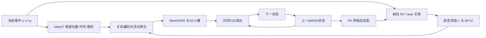
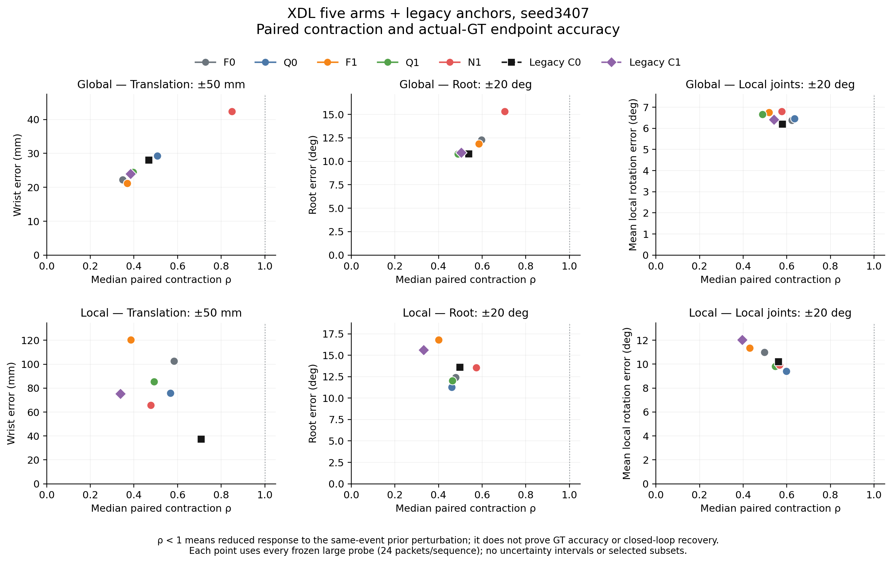
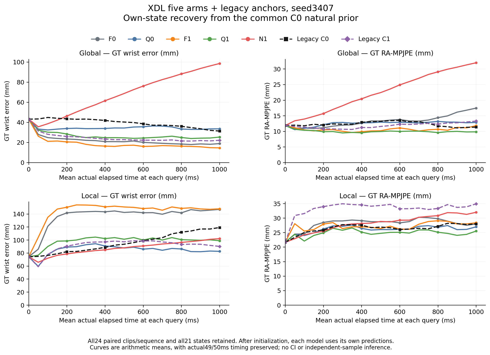

# S37 系列与 XYZ 关联：完整实验整理及原因分析

更新：2026-10-13。范围：本项目已经开展的 S37 路由、FK/网格图、根更新、历史/记忆、XYZ、XA、XB、XC 和 XDL；相邻的 S38、U1a、S40、S39/S42 作为相关对照单列。原始实验账本仍是 [EXPERIMENT_RECORDS.md](EXPERIMENT_RECORDS.md)，本文提供完整索引、可比较结果、解释和未解决问题。本次是已有证据整理与文档更新，不包含新训练或模型推理。

原2026-10-10版本仅覆盖XA，其原文已保存到 [整理前快照](../outputs/xdl/s37_consolidation_20261013/S37_XYZ_ASSOC_DIAGNOSIS.before.md)，SHA256为 `7222cb4f0e2f7aa979cec00cdc3ff4f399880ba6ee4b7c167b239fae111d83c1`。旧文的若干强因果判断在本稿中明确修订；历史记录中的“当前版本”“下一步”“未实施”均按原时点理解。

## 阅读导航

- [当前结论](#current-verdict)
- [范围、协议与证据等级](#scope)
- [全部实验索引](#inventory)
- [三代结构和实际数据流](#architecture)
- [早期S37实验及历史失败](#early)
- [XA：关联来源、冻结干预及配对训练](#xa)
- [整手2D对齐探针](#align)
- [XB：局部残差信息与负控制](#xb)
- [XC：显式3D与因果时间关联](#xc)
- [XD设计与XDL实际恢复实验](#xdl)
- [原因分析及证据排序](#causes)
- [修复优先级与未执行对照](#repair)
- [量测口径、工程异常与旧文勘误](#measurement)
- [文献、产物及复核](#sources)
- [XDL 工具与 CPU 复算命令](#xdl-reproduction)
- [附录：每项早期实验的状态与证据](#inventory-detail)

<a id="current-verdict"></a>
## 1. 当前结论

**最确定的共同表现问题是：在已测大扰动中，模型能够减小相对于clean输出的前态扰动，却没有可靠地恢复到数据标签GT对应的绝对状态；local位置漂移、正常局部动作和细手指运动尤其不足。** “ρ收缩”“配对方向看起来正确”“主表RA降低”都不足以替代真实恢复；local小扰动亦非稳定收缩。

跨轮证据支持四个具体判断：

1. **事件有用。** 从早期证据置零，到XDL的观测零接口N1，事件内容对主精度和部分运动有实际效用。不能把当前失败解释为事件完全没有信息。
2. **条件几何读取有用，但旧显式几何特征不是独立测深。** XA匹配去掉原D/Z/edge整组，在local有约6.9mm优势；XDL新增银行上的MANO条件查询又优于固定atlas查询。这两项不矛盾：几何可以帮助“去哪里读取”，由前态生成的深度不能自动当作当前观测测到的深度。
3. **自身前态训练有条件收益，尚未解决local。** XDL的self收益主要在global；local主RA改善小，GT正确起态也漂移。仅调整错误初始化或增加self比例没有被证明足够。
4. **关联规则、局部残差和四片时间外推的修补均未建立完整恢复能力。** XA contour未超过当轮工程噪声门；XB主效用过门而绑定/恢复未过；XC的G/T及协同均未获完整支持。不能继续把一个局部修补的改善写成整个纠偏机制已成立。

当前尚未唯一识别“整体架构错误”“MANO起始关联错误”或“异步时间错位”。更准确的研究定位是：**观测表示、状态条件读取、状态更新/监督目标和local数据边界之间的联合缺口**。修复应进入这些接口并逐因子验证，保留已显示效用的部分；现有证据不足以要求推倒全部MANO/GNN。

本文对“GT正确”“真实终点”的说法指当前数据集标签计分。标签本身来自项目记录中的伪GT流程，未新增独立高精度动捕验证，不能把所有差异都等同于真实物理误差。

<a id="scope"></a>
## 2. 范围、协议和证据等级

### 2.1 固定数据与命名

当前协议是九人72序列训练；zgz_global/local同属一个人，兼作开发与上报集；唯一 `data/hand_data51/splits_semkine.json` 只读。训练seed不是新受试者，包、片段、探针和重叠窗口也不是独立重复。

“S37”在2026-09-06清理后重新命名。清理前的“FK直连S37”、五人/八人线及x1001不进入现行九人主表。当前S39唯一指 `dt3_dz_l3_w200cfg`；`s39_covmap`只是退役S37相关配置，不能混同。

规范九列表中的EventHands-PCA6是原 `eval_abs`、PCA6投影GT口径的固定参照，并非同批zgz递推帧的配对评价；它与S37主行的差值不作因果或恢复收益。S39亦为不同窗口/滤波配方。两者保留规范参照身份，正式因子解释使用各轮内部匹配控制。

### 2.2 各时期并非完全相同的训练或评价合同

| 时期 | 训练与权重选择 | 评价及解释边界 |
|---|---|---|
| 历史S37 routed/FK/mesh/根头/XYZ筛选 | 多数2seed；routed等6000步、500步网格择点；rootinnov仅1500步；XYZscreen仅1500单seed | 选点成绩带zgz选择偏差；不能与后来固定step6000的差值直接归因 |
| 旧routed与XYZ-C1 | 训练窗口30–300ms并启用speed augmentation；各自噪声/读出合同 | 主评价W50；训练窗口合同不能改写为全程rawW50 |
| RT统一配方 | 单卡512、累积2、cosine到2%；2k筛选与6k末点分开 | `rt_s37`三seed末点23.83；23.25是两seed末点，20.33是两seed选点，20.74是更早routed选点 |
| XA | C1/C0/oracle/contour各3407/3408；C1另3407同seed复跑；取6000末点 | 一次C1 repeat提供当轮工程噪声门，不是CI，不可借给XB/XC/XDL |
| XB | A/B/C/D各3seed fresh6000，另A的3407复跑，共13完整run；另8个1500步轻量探针 | pilot和完整训练分别裁决；效用、绑定、恢复、正常运动须联判 |
| XC | G×T四条件各3seed及每条件3407完整复跑，共16run，固定6000 | 每个比较有自身repeat对比门；完整恢复和动作护栏，四片近似不等于持续逐事件图 |
| XDL | 五臂各seed3407 fresh6000；2卡各512；rawW50、无speed augmentation；self K4三步burn+main | 单seed探索，V2无repeat δ/τ；固定实用margin不能被称为可靠复跑门 |

**有效batch相同不保证训练目标逐位或数学等价。** 例如历史EDGE6用微批256累积2，routed用512累积1，均在batch MSE后取log10；一般 `mean(log L_micro) ≠ log(mean L_micro)`。FKGRAPH曾由DDP每rank512退回单卡1024续训，也改变rank内logloss的聚合。这是本次依据源码/配置做的数学合同复核，不能写成新的实测归因。历史成绩保留，严格单因子解释需收窄。

### 2.3 证据分层

- **源码事实**：输入、聚合、状态、单位、时钟和梯度路径；不等于这个设计已被证明是最大瓶颈。
- **零训练/冻结干预**：特定权重的敏感性与合同；推理期换成GT几何、删已训练特征常产生分布外输入。
- **匹配重训**：可支持本因子、本实现、数据及预算内的效应；因子包消融不能识别包内单通道。
- **恢复/运动证据**：共同初态后各自递推，与实际GT、clean及正常运动联判。
- **历史文档级证据**：产物已删或主行不在，只能引用当时记录，不声称当前可重放。
- **设计/合同阶段**：没有完成科学评价的条目，不能列成精度失败或成功。

XA旧报告的block-bootstrap区间属于给定权重/包序列上的历史量测，不含训练seed不确定度。本次没有新增统计检验或CI；XB/XC多seed亦为描述性与工程门，XDL只有一个seed。

<a id="inventory"></a>
## 3. 全部实验索引

下表和附录覆盖51项已核早期实验线及相关对照，后续XA、整手对齐、XB、XC、XD/V2、XDL另列。每项都有账本入口；没有当前主行的条目保留为历史记录，不制造替代主行。

| 编号/实验线 | 原记录日期 | 状态入口 | 来源 |
|---|---|---|---|
| E01 S37 Routed / s37_routed | 2026-09-07 | [状态/结果登记](#experiment-e01) | [原记录](EXPERIMENT_RECORDS.md#s37-routed-prereg) |
| E02 S37 FKgraph / s37_fkgraph | 2026-09-07 | [状态/结果登记](#experiment-e02) | [原记录](EXPERIMENT_RECORDS.md#s37-fkgraph) |
| E03 S37 MeshQ / s37_meshq | 2026-09-07; later09-29 audit | [状态/结果登记](#experiment-e03) | [原记录](EXPERIMENT_RECORDS.md#s37-meshq) |
| E04 S37 Meshgraph / s37_meshgraph | 2026-09-18 | [状态/结果登记](#experiment-e04) | [原记录](EXPERIMENT_RECORDS.md#s37-meshgraph) |
| E05 S37 ROOTINNOV / s37_rootinnov | 2026-09-29 | [状态/结果登记](#experiment-e05) | [原记录](EXPERIMENT_RECORDS.md#s37-rootinnov) |
| E06 S37 ROTW10 / s37_rotw10 | 2026-09-29 | [状态/结果登记](#experiment-e06) | [原记录](EXPERIMENT_RECORDS.md#s37-rotw) |
| E07 S37 ROTW30 / s37_rotw30 | 2026-09-29 | [状态/结果登记](#experiment-e07) | [原记录](EXPERIMENT_RECORDS.md#s37-rotw) |
| E08 S37diag CNNabs and CNN root fuse_R/fuse_RT | 2026-09-29 | [状态/结果登记](#experiment-e08) | [原记录](EXPERIMENT_RECORDS.md#s37-rotw) |
| E09 S37 EDGE6 / s37_edge6 | 2026-09-29–30 | [状态/结果登记](#experiment-e09) | [原记录](EXPERIMENT_RECORDS.md#s37-edge6) |
| E10 S37 ROOTFUSE / s37_rootfuse | 2026-09-29–30 | [状态/结果登记](#experiment-e10) | [原记录](EXPERIMENT_RECORDS.md#s37-edge6) |
| E11 S37 XYZ/depth initial probe09-24 | 2026-09-24 | [状态/结果登记](#experiment-e11) | [原记录](EXPERIMENT_RECORDS.md#s37-xyz-candidate) |
| E12 S37 XYZ CPU branch information DEBUG | 2026-09-29 | [状态/结果登记](#experiment-e12) | [原记录](EXPERIMENT_RECORDS.md#s37-xyz-candidate) |
| E13 S37 XYZ candidate/minimal/full design drafts | 2026-09-29; updated09-30 | [状态/结果登记](#experiment-e13) | [原记录](EXPERIMENT_RECORDS.md#s37-xyz-candidate) |
| E14 S37 XYZ SCREEN C1 and C0 | 2026-09-29; archived09-30 | [状态/结果登记](#experiment-e14) | [原记录](EXPERIMENT_RECORDS.md#s37-xyz-screen) |
| E15 S37 XYZ FULL C1 / s37_xyz_c1_full | 2026-09-30; read-only analysis10-05 | [状态/结果登记](#experiment-e15) | [原记录](EXPERIMENT_RECORDS.md#s37-xyz-full) |
| E16 RT unified S37 baseline / rt_s37 and rt_s37_2k | 2026-10-01–02 | [状态/结果登记](#experiment-e16) | [原记录](EXPERIMENT_RECORDS.md#root-tracking-verdict) |
| E17 RT G3 hierarchical grid / rt_g3_2k | 2026-10-01–02 | [状态/结果登记](#experiment-e17) | [原记录](EXPERIMENT_RECORDS.md#root-tracking-verdict) |
| E18 RT E8 whole-packet causal kNN / rt_e8_2k | 2026-10-01–02 | [状态/结果登记](#experiment-e18) | [原记录](EXPERIMENT_RECORDS.md#root-tracking-verdict) |
| E19 RT C37 CNN+routed / rt_c37_2k | 2026-10-01–02 | [状态/结果登记](#experiment-e19) | [原记录](EXPERIMENT_RECORDS.md#root-tracking-verdict) |
| E20 RT S37 ROOT_ABS / rt_s37ra_2k | 2026-10-01–02 | [状态/结果登记](#experiment-e20) | [原记录](EXPERIMENT_RECORDS.md#root-tracking-verdict) |
| E21 RT C37 ROOT_ABS / rt_c37ra_2k | 2026-10-01–02 | [状态/结果登记](#experiment-e21) | [原记录](EXPERIMENT_RECORDS.md#root-tracking-verdict) |
| E22 RT E7 absolute EventGNN / rt_e7_2k | 2026-10-01–02 | [状态/结果登记](#experiment-e22) | [原记录](EXPERIMENT_RECORDS.md#root-tracking-verdict) |
| E23 RT CNN delta comparator / rt_cnndelta_2k | 2026-10-01–02 | [状态/结果登记](#experiment-e23) | [原记录](EXPERIMENT_RECORDS.md#root-tracking-verdict) |
| E24 RT ABS_TRACK dense comparator / rt_cnnar_2k | 2026-10-01–02 | [状态/结果登记](#experiment-e24) | [原记录](EXPERIMENT_RECORDS.md#root-tracking-verdict) |
| E25 x1001 aborted eight-subject root-screen round | 2026-10-01 | [状态/结果登记](#experiment-e25) | [原记录](EXPERIMENT_RECORDS.md#x1001-20261001) |
| E26 S3709-28/29 frozen decomposition, reset/hold, root and finger, window probes | 2026-09-28–29 | [状态/结果登记](#experiment-e26) | [原记录](EXPERIMENT_RECORDS.md#s37-routed-prereg) |
| E27 S3709-30 architecture-decision A..F diagnostics | 2026-09-30 | [状态/结果登记](#experiment-e27) | [原记录](EXPERIMENT_RECORDS.md#architecture-decision) |
| E28 S37 read-only evidence synthesis10-07 | 2026-10-07 | [状态/结果登记](#experiment-e28) | [原记录](EXPERIMENT_RECORDS.md#s37-diagnosis-20261007) |
| E29 Deleted S37-associated SPATIAL_CONTEXT | before2026-09-28 cleanup; cited09-29, originaldateunverified | [状态/结果登记](#experiment-e29) | [原记录](EXPERIMENT_RECORDS.md#audit-b8) |
| E30 Deleted S37-associated NEIGHBORHOOD | before2026-09-28 cleanup; cited09-29, originaldateunverified | [状态/结果登记](#experiment-e30) | [原记录](EXPERIMENT_RECORDS.md#audit-b8) |
| E31 Deleted S37-associated CONSTANT_CONTEXT | before2026-09-28 cleanup; cited09-29, originaldateunverified | [状态/结果登记](#experiment-e31) | [原记录](EXPERIMENT_RECORDS.md#audit-b8) |
| E32 Deleted S37-associated TEMPORAL_HISTORY | before2026-09-28 cleanup; cited09-29, originaldateunverified | [状态/结果登记](#experiment-e32) | [原记录](EXPERIMENT_RECORDS.md#audit-b8) |
| E33 Deleted S37-associated HISTORY_EVIDENCE | before2026-09-28 cleanup; cited09-29, originaldateunverified | [状态/结果登记](#experiment-e33) | [原记录](EXPERIMENT_RECORDS.md#audit-b8) |
| E34 Deleted S37-associated CENTERED_UPDATE | before2026-09-28 cleanup; cited09-29, originaldateunverified | [状态/结果登记](#experiment-e34) | [原记录](EXPERIMENT_RECORDS.md#audit-b8) |
| E35 Deleted S37-associated STATE_ACCUMULATION | before2026-09-28 cleanup; cited09-29, originaldateunverified | [状态/结果登记](#experiment-e35) | [原记录](EXPERIMENT_RECORDS.md#audit-b8) |
| E36 Deleted S37-associated NORMAL_FLOW | before2026-09-28 cleanup; cited09-29, originaldateunverified | [状态/结果登记](#experiment-e36) | [原记录](EXPERIMENT_RECORDS.md#audit-b8) |
| E37 Deleted S37-associated RELATIVE_INCREMENT | before2026-09-28 cleanup; cited09-29, originaldateunverified | [状态/结果登记](#experiment-e37) | [原记录](EXPERIMENT_RECORDS.md#audit-b8) |
| E38 Deleted S37-associated EVENT_OBSERVATION | before2026-09-28 cleanup; cited09-29, originaldateunverified | [状态/结果登记](#experiment-e38) | [原记录](EXPERIMENT_RECORDS.md#audit-b8) |
| E39 Deleted S37-associated PAST_ANCHOR / HASTE-style PA1 | before2026-09-28 cleanup; cited09-29, originaldateunverified | [状态/结果登记](#experiment-e39) | [原记录](EXPERIMENT_RECORDS.md#audit-b8) |
| E40 Deleted S37-associated CURRICULUM K0/K1/K2 | before2026-09-28 cleanup; cited09-29, originaldateunverified | [状态/结果登记](#experiment-e40) | [原记录](EXPERIMENT_RECORDS.md#audit-b8) |
| E41 Deleted S37-associated X1 / event_hier / X1c | before2026-09-28 cleanup; cited09-29, originaldateunverified | [状态/结果登记](#experiment-e41) | [原记录](EXPERIMENT_RECORDS.md#audit-b8) |
| E42 Deleted S37-associated event_guided_mesh_memory / vertex GRU+unroll | before2026-09-28 cleanup; cited09-29, originaldateunverified | [状态/结果登记](#experiment-e42) | [原记录](EXPERIMENT_RECORDS.md#audit-b8) |
| E43 Deleted S37-associated c0_s37_so3fk | before2026-09-28 cleanup; cited09-29, originaldateunverified | [状态/结果登记](#experiment-e43) | [原记录](EXPERIMENT_RECORDS.md#audit-b8) |
| E44 Deleted S37-associated s39_covmap | before2026-09-28 cleanup; cited09-29, originaldateunverified | [状态/结果登记](#experiment-e44) | [原记录](EXPERIMENT_RECORDS.md#audit-b8) |
| E45 Old KEG-halo E5.5b/E5.5c unroll reference | 2026-08-25 | [状态/结果登记](#experiment-e45) | [原记录](EXPERIMENT_RECORDS.md#audit-b8) |
| E46 Old S7delta-trust / S13triggeredabsoluteanchor | oldprotocol;originaldateunverified | [状态/结果登记](#experiment-e46) | [原记录](EXPERIMENT_RECORDS.md#audit-b8) |
| E47 S38 measurement/interface and S37abs/spdelta related controls | 2026-10-02–03 | [状态/结果登记](#experiment-e47) | [原记录](EXPERIMENT_RECORDS.md#s38-verdict) |
| E48 U1a shared-node measurement/readout audit | 2026-10-02–03 | [状态/结果登记](#experiment-e48) | [原记录](EXPERIMENT_RECORDS.md#u1a-verdict) |
| E49 S40 graph hierarchical encoder+16node measurement | 2026-10-05–06 | [状态/结果登记](#experiment-e49) | [原记录](EXPERIMENT_RECORDS.md#s40-prereg) |
| E50 S39 and S42 dense runtime/history reference | 2026-10-04–06 | [状态/结果登记](#experiment-e50) | [原记录](EXPERIMENT_RECORDS.md#s42-verdict) |
| E51 Pre09-06 old FK-direct S37 identifier | before2026-09-06 | [状态/结果登记](#experiment-e51) | [原记录](EXPERIMENT_RECORDS.md#s37-routed-prereg) |

| 后续阶段 | 已开展工作 | 完成范围与结论 | 证据入口 |
|---|---|---|---|
| XA来源P1/效应P2 | 来源标签、噪声/时间、错配与更新探针 | 关联对前态敏感；两个效应判据未支持错配是根更新主因 | [XA原始报告](../outputs/xa/step1/REPORT.md)、[预注册/裁决](EXPERIMENT_RECORDS.md#xyz-assoc-20261009) |
| XA A/B/C几何、D/E置信与特征 | 固定C1权重替换分配/几何、候选全搜索、置信缩放、几何屏蔽、扰动轨迹 | OOD敏感性与实现事实；发散/封顶/存活步分开保存 | [几何报告](../outputs/xa/step4/geom/REPORT.md)、[置信报告](../outputs/xa/step4/conf/REPORT.md) |
| XA P3 | C1/C0/oracle/contour两seed及C1同seed复跑，共9run | local去整组3D有利；contour未超门；oracle含泄漏 | [最终P3门](../outputs/xa/step5/p3_gates.json) |
| 整手对齐 | 2D相似、刚体/平移oracle，事件ICP及迭代/点到线变体、自检 | 一致率能部分恢复；未建立部署闭环主效用 | [完整对齐报告](../outputs/xa/align/REPORT.md) |
| XB/ABCD | 8轻量probe、13完整run、内容负控制、共同10步恢复与运动 | pilot闭环非有限；完整主效用过、绑定和恢复未过 | [正式裁决](../outputs/xb/verdict.json) |
| XC | 四组G/T、3seed、四完整repeat、错时刻和恢复/运动 | G、T与交互均无完整受控支持 | [正式裁决](../outputs/xc/verdict.json) |
| XD完整设计 | 5臂×3seed＋5个完整repeat，物理扰动/恢复合同 | 设计已完成；原20run方案没有全执行 | [完整设计](EXPERIMENT_RECORDS.md#xd-recovery-20261013) |
| XD-V2成本修订 | 首轮五臂单seed、减少诊断覆盖、预算分期 | 首轮已按XDL执行；第二seed没有执行 | [成本合同](EXPERIMENT_RECORDS.md#xd-recovery-cost-v2-20261013) |
| XDL旧权重阶段 | C0/C1各3407/3408及C1r，单步/内容/恢复/运动 | 五旧权重完整，收缩与GT恢复分离 | [旧权重审计](../outputs/xdl/legacy_results_audit.json) |
| XDL新五臂 | F0/Q0/F1/Q1/N1，五fresh6000及完整评价 | query/self有条件收益，local恢复/正常运动不足 | [最终原始审计](../outputs/xdl/results_audit.json)、[独立科学审查](../outputs/xdl/independent_final_scientific_review.json) |
| 相关S43与S37→S43消融 | 稀疏渲染/比对、SO3/FK、depth增强、self及噪声正则；另设计逐项退回S37配方 | S43有历史结果；逐项消融四个3407臂在2500–3000步被用户终止，无评测，未完成归因 | [S43记录](EXPERIMENT_RECORDS.md#s43-prereg)、[中止消融](EXPERIMENT_RECORDS.md#s43-ablation) |

<a id="architecture"></a>
## 4. 三代结构及错误可能进入的位置

### 4.1 旧S37 routed：事件图与状态加性支路

状态无关事件token/EdgeConv编码，按FK投影和LBS形成16关节证据；手指局部头、root整手头；另有独立 `prev_mlp`。旧根头可写成观测项加状态项的形式，常数增益/证据置零结论只针对这个版本。routed同时去掉S36渲染并加入路由，历史收益不能单独归因路由。

“只有前32事件”是旧文误写；候选是每个事件之前的局部索引窗。将窗口或层数增大未过门，不证明所有事件时序信息无用；短训可解码性弱也不证明信息物理不存在。[10-07更正](EXPERIMENT_RECORDS.md#s37-diagnosis-20261007)

### 4.2 旧XYZ-C1：事件射线与前态网格共同生成关系特征

XYZ版本取消独立prev_mlp，使用17槽共同读出，直接拼48维历史根/手指AA，原接口不显式拼t；不能沿用旧routed加性根头的推导。原输出51D仍通过delta更新。



图中实线表示源码数据依赖，不表示每条边的科学负效应已识别。实际模型既含观测，也含先验；不能把所有特征都称为“前态自己生成”。

| 环节 | 代码 | 输入 → 输出（形状、坐标系、单位、时间基准） | 梯度 | 状态 |
|---|---|---|---|---|
| 事件窗口 | `eval_track.py::_window_events` | 事件 `(N,5)` = [0, x, y, t_rel_s, p]；x∈[0,240)、y∈[0,180) 像素；t_rel = (ms_rel·1000 + tsub) µs → 秒，**相对窗首**，tsub 给亚毫秒偏移（`zgz_*_tsub.npy`）；p∈{0,1} | — | 无；评估窗不重叠，事件不重复使用 |
| prev | `track_sequence` / `dataset.py:392-412` | 评估：上一步预测，名义时刻 = 窗首前 1 ms（end−50）；训练：**窗首**真值 + 混合噪声（50% σ=(5 mm, 0.05, 0.05)，30% σ=(5 cm, 0.3, 0.3)，20% 方向性），训练窗长 log-U[30, 300] ms；target = 窗末真值。51 维 = [t(3, 米, 相机系), root 轴角(3), 手指轴角残差(45)] | prev 是数据 | 唯一跨步量 |
| token7 | `encoder.py:153-171` | 全包计算后抽样：[x/240, y/180, 2p−1, t/Δt（Δt = 名义窗长）, log1p(Δt_ie/1e-6), SAE同/Δt, SAE反/Δt] → `(B,N,7)`；**事件时间只进这里** | 无参数 | 无 |
| 抽样 | `xyz_mesh.py:70-83` `stride_sample` | 等步长 ≤2048/包，步长由整包最终计数决定（非因果）；global 91% 的步被截断（中位 29,974 事件 → 2048） | — | — |
| FK | `model.py:~2521-2528` → `mano_layer.py:108-180` | prev(51) + 序列真值 β → V `(B,778,3)` 米、相机系；LBS + posedirs 常开；**整包共用这一份静止网格** | **`no_grad`** | 每包重建 |
| 射线 | `model.py:~2529-2534` | d = (sK)⁻¹[u,v,1]，s = 0.375（640×480 → 240×180，典型 fx ≈ 226 px），d_z = 1 → 射线参数即深度；band = 16/f_px ≈ 0.0707，front_tol = 3/f_px，z_tol = 0.01 m，k = 16 | `no_grad` | — |
| 关联 | `xyz_mesh.py::associate_rays`（hit_first 分支） | 顶点透视投影 → 每事件角距最近 16 顶点 → 其邻接面（≤128 槽）Möller–Trumbore，取最近正 t（**正反面同算**）→ hit：3 顶点重心权 A、q = 1、z = t；无命中 → near：16 px 带内、参考顶点 +3 px 同集、前层 = ≤ zfront + 1 cm（**无下界、无法向判据**）、≤4 顶点高斯权（σ = 8 px）、q = 最近者核值 < 1、z = 权重均值；都没有 → none（valid = 0）。输出 vid/A `(B,N,4)`，q/z/valid/hit `(B,N)` | **`no_grad`**，整个关联不可微 | 每包重建 |
| 记录与 φ | `xyz_mesh.py:347-365` | w = q·A·mask `(B,N,4)`，r = (1−q)·mask；每条记录特征 13 维 = [token7, dXYZ = (z·d − V[vid])/0.01 m, zn = (z−0.45)/0.1, valid(=1), hit] → `rel` MLP 13→64→128。C0 把 dXYZ、zn 置零。**hit 记录的 dXYZ 法向分量恒为 0**（交点在面内） | 有（进 rel） | — |
| 顶点聚合 | `:366-377` | 按 vid scatter：mean = Σw·φ/Σw（**对 w 的均匀缩放不变**），peak = amax(φ)（**不加权**），mass = log1p(Σw)；未命中顶点全零；`vin` 257→128 无偏置 → H `(B,778,128)`，O = 有直接质量的顶点 | 有 | — |
| MeshGNN | `:257-268,379-385` | 固定面 1-ring（K = 8，平均度 5.93），边向量 (V_l−V_j)/5 mm 与长度 → `edge` 4→32 → sigmoid 门；3 层，支持集 S 每层扩一环（直接 ≈377 → 传播 ≈733 / 778）；全部 778 顶点计算后乘掩码 | 有（边几何 `no_grad`） | 每包重建 |
| 槽池化 | `:271-292,388-402` | 16 关节槽 `(B,16,258)` = [LBS 软权均值(128), 硬分配 max(128), 直接覆盖率, 传播覆盖率]；第 17 槽 = 残差 [rmean, rpeak, rs/live, rhas] | 有 | — |
| 读出 | `:316-319,405-407` | 分组 1×1 conv 17×258 → 17×32 → 拼 **prev[3:51]**（根旋转 + 手指；**不含平移**）→ fc1 592→256 → fc2 256→51（零初始化） | 有 | — |
| 增量合成 | `model.py:~2775-2787` | x = prev + δ：平移米直接相加；**根轴角直接相加（无 SO(3) 复合）**；手指残差相加；空包 δ = 0 | — | — |
| 损失 | `model.py:285-303,977` | (450·MSE手指 + 60·MSE根旋 + 30000·MSE平移)/51，取 log10；参数空间，无 FK、无根对齐 | — | — |

这张张量表取自10-10源码快照，只描述旧C1；原代码行号已漂移，复核应以函数名和冻结源码SHA定位。现存主要实现为 [xyz_mesh.py](../semkine/xyz_mesh.py)、[model.py](../model/model.py)、[mano_layer.py](../model/mano_layer.py)。

旧关系特征的关键数学量为：

```text
X_event = z_prior(prev, ray, association) · ray
dXYZ = (X_event − V_prev[vid]) / L_REL
z_feature = (z_prior − 0.45m) / 0.1m
```

hit交点位于所选前态三角面内；这里没有增加一个独立测深传感器。dXYZ仍同时依赖事件射线与前态几何，不应写成“完全仅为prev函数”或“对前态误差残差恒零”。token7通过关系编码保留时间/极性，不能说观测“只剩命中模式”。

### 4.3 XDL：共同事件银行、状态99与两种查询

五臂共同采用状态无关的事件节点银行、旧C0关联/槽和state99：t3、全部48AA、16个处理后的投影坐标及valid位。新增64维银行接口和旧544维接口共同读出；F/Q只改变新增银行查询中心（固定atlas或MANO投影）。两组都保留共同旧关联、offset和状态上下文；F不是彻底去掉全部几何先验。

N1在最终旧544D/新64D观测接口乘零，保持同名义参数定义、状态输入和空包gate。Q1/N1检验该实现中事件内容的效用，Q/F检验新增查询接口，均不能直接证明旧hit-first射线规则必要或新银行容量有效。接口加入完整t后local仍漂移，故“旧读出没有t”已不能作为完整解释。[模型实现](../semkine/xyz_recovery_study.py)、[银行实现](../semkine/xyz_observation.py)

<a id="early"></a>
## 5. 早期S37：从路由到XYZ完整训练

### 5.1 路由、FK图、MeshQ和Meshgraph

历史routed选点RA20.74，相对S36选点23.17有改进，证据置零会明显退化；但这不是恢复机制或单一读出因子的证明。末点均值23.99与选点20.74必须分开。10-07复核纠正了“闭环/TF放大率变小证明局部化”的旧因果读法。

FKgraph把FK当图、事件当观测，历史RA22.10，两个seed方向相反，按当轮门打平；观测承重与效率改善没有解决根测量。MeshQ已经训练，后审读记43.34/41.83；结果节仍“待填”且无正式主行，不可标成未执行。Meshgraph的20.48/29.30显示种子分裂，不足以认定网格拓扑本身无效。

FKgraph的NCCL故障、回退续训和float64累加修复，Meshgraph的运行期法向累加修改，都属于工程和可比性记录。它们增加了历史严格因果归因的限制，不应删除失败轨迹或把工程恢复当科学效用。

### 5.2 根新息、旋转权重、CNN根融合、深图和根融合

ROOTINNOV是选中S37权重上的冻结骨干、只训根第一阶段，且同时去掉根prev_mlp；1500步未过门后未进入full。它只能否定本阶段组合，不能否定所有新息头或保留先验的门控设计。

ROTW10双seed完整训练但整体打平；ROTW30只一个seed，不能写成跨seed的否定。CNN绝对根的零训练融合有收益，说明更好的外源观测可以帮助；融合输出又回灌下一步FK，无法由一次输出替换证明闭环根/手指解耦或具体根头可部署上界。

EDGE6与ROOTFUSE的主评价均在当轮平局区间并且seed反向；没有补足根/oracle/纯手指机制诊断。EDGE6的EBS匹配不能自动掩盖微批logloss差异。层数、路由均值或损失权重修法未获支持，仍没有单独排除编码、读出、数据和优化交互。

### 5.3 根/手指/窗口/复位/hold诊断与统一RT筛选

历史冻结分解发现根旋转是重要RA来源，换根后仍剩手指缺口；GT复位、hold、noevents、窗口50–300ms、特征ridge/CCA和梯度/更新诊断均已开展。可解码性是指定探针和数据上的能力，不是信息论不可观测证明。当前主表RA只是减腕对齐，换根改善RA也不证明绝对t恢复。

RT已实际筛查G3层级读出、E8整包因果kNN、C37 CNN+routed、ROOT_ABS、E7绝对EventGNN、CNN-delta和ABS_TRACK。短训换编码器或绝对根都没有普遍修复；CNN绝对线显示观测表示和监督目标可能共同重要。RT三seed末点23.83不可与历史routed选点20.74混写；CPU/GPU2k评价也存在闭环放大的数值差。

x1001是被叫停的八人轮次；ly封存集未打开，若干臂未完成。S38/U1a/S40是相关分支而非同一个XYZ因子；S39/S42是稠密参考，不能将CNN较好直接归因为某一S37关联实现。

S43是另一条稀疏渲染–比对路线，相关主干、监督、depth增强、热像素和self同时变化。历史干净稀疏sp在S39栈的三seed RA约9.21，未过当轮9.01门；去热像素的稠密两seed约9.694/9.196，而同样去热像素的稀疏约9.294/8.970。这是指定配方上的噪声/活跃集证据，不能直接证明稀疏或稠密架构普遍优劣。后续噪声、门控、死区和异步运行时亦有记录，不能用W200/滤波结果替代本次W50 XYZ恢复。

为拆分S37→S43，曾设计norender、mse、focal和s37recipe等消融；实际四个3407臂在2500–3000步被用户终止，没有评测。这组未完成的控制不能提供“损失”“尺度”或“渲染比对”的单因素效果。[原记录及中止原因](EXPERIMENT_RECORDS.md#s43-ablation)

### 5.4 已删的空间、历史、课程、精度、记忆和观测合同

SPATIAL_CONTEXT、NEIGHBORHOOD、CONSTANT_CONTEXT、TEMPORAL_HISTORY、HISTORY_EVIDENCE、CENTERED_UPDATE与STATE_ACCUMULATION均有历史执行记录，后者梯度保真通过但任务效用未过。K0/K1/K2是单seed课程筛查，K0有NaN，K1/K2未过门。X1/event_hier是绝对GNN的多因素短训尝试，原X1超时；顶点GRU/unroll记忆有严重精度负结果。

NORMAL_FLOW、RELATIVE_INCREMENT、EVENT_OBSERVATION、PAST_ANCHOR停留在支持/合同或NOT_TESTED层，没有正式姿态主行；`c0_s37_so3fk` 和 `s39_covmap`仅核到配置/动机，不可登记为已完成精度失败。这些条目只剩文档/提交索引，不把合同通过当网络有效。[历史B8](EXPERIMENT_RECORDS.md#audit-b8)、[内部索引](EXPERIMENT_RECORDS.md#internal-arm-index)

### 5.5 XYZ CPU信息检查、1500筛选与6000完整C1

09-29 CPU DEBUG检查的恒等式和反例证明某些几何量来自前态，没有训练新模型或完成闭环精度。1500步C1/C0单seed筛选显示约1.11mm选点差，但根门和同预算门未过，不能由短训差证明显式3D有效。

用户另行授权的full C1随机初始化、6000双seed完成，选点RA19.99，整体落在与历史routed的平局范围；末点均值21.9231另记。那时没有同预算full C0，所以没有隔离几何通道。10-09 XA才补齐该控制。历史XYZ权重后来清理，XA新重训不能假称原full权重的同一逐位复算。

### 5.6 历史九列主表

以下表格机械提取自账本的原九列主表，不重建已删除主行，不统一择点/末点或旧时延。每张表以所属历史章节的合同解释；缺正式主行的MeshQ等仅保留文字结果和状态。

Routed：该章节未提取到完整九列主表，结果和缺口见上述正文/附录及[原章节](EXPERIMENT_RECORDS.md#s37-routed-prereg)；不补造表格。

FKgraph：该章节未提取到完整九列主表，结果和缺口见上述正文/附录及[原章节](EXPERIMENT_RECORDS.md#s37-fkgraph)；不补造表格。

Meshgraph：该章节未提取到完整九列主表，结果和缺口见上述正文/附录及[原章节](EXPERIMENT_RECORDS.md#s37-meshgraph)；不补造表格。

#### ROOTINNOV：历史表

来源：[原章节](EXPERIMENT_RECORDS.md#s37-rootinnov)；原表择点/末点及种子规则不变。

| 网络结构 | MPJPE-local | MPJPE-global | MPVPE-local | MPVPE-global | RA-MPJPE(递推) | Latency | FLOPs/step | Params |
|---|---|---|---|---|---|---|---|---|
| EventHands-PCA6 (baseline) | 30 | 10.99 | 23.58 | 8.15 | - | 1.76 ms | 1.653 G | 11.18 M |
| S37 路由读出（当前臂） | 26.41 | 15.82 | 21.40 | 12.39 | 20.74（19.23 / 22.26） | 7.72 ms | 0.827 G | 0.73 M |
| S37 根新息 第一步（冻结骨干） | 27.77 | 18.74 | 23.85 | 15.09 | 22.94（23.01 / 22.86） | 20.66 ms | 0.827 G | 0.74 M |

#### ROTW/CNN根融合：历史表

来源：[原章节](EXPERIMENT_RECORDS.md#s37-rotw)；原表择点/末点及种子规则不变。

| 网络结构 | MPJPE-local | MPJPE-global | MPVPE-local | MPVPE-global | RA-MPJPE(递推) | Latency | FLOPs/step | Params |
|---|---|---|---|---|---|---|---|---|
| EventHands-PCA6 (baseline) | 30 | 10.99 | 23.58 | 8.15 | - | 1.76 ms | 1.653 G | 11.18 M |
| S37 路由读出（当前臂） | 26.41 | 15.82 | 21.40 | 12.39 | 20.74（19.23 / 22.26） | 7.72 ms | 0.827 G | 0.73 M |
| S37 旋转权重 ×10 | 25.88 | 16.28 | 21.10 | 13.64 | 20.74（21.10 / 20.38） | 8.00 ms | 0.827 G | 0.73 M |

#### EDGE6/ROOTFUSE：历史表

来源：[原章节](EXPERIMENT_RECORDS.md#s37-edge6)；原表择点/末点及种子规则不变。

| 网络结构 | MPJPE-local | MPJPE-global | MPVPE-local | MPVPE-global | RA-MPJPE(递推) | Latency | FLOPs/step | Params |
|---|---|---|---|---|---|---|---|---|
| EventHands-PCA6 (baseline) | 30 | 10.99 | 23.58 | 8.15 | - | 1.76 ms | 1.653 G | 11.18 M |
| S37 路由读出（当前臂） | 26.41 | 15.82 | 21.40 | 12.39 | 20.74（19.23 / 22.26） | 7.72 ms | 0.827 G | 0.73 M |
| S37 + EdgeConv 6 层 | 24.36 | 18.80 | 20.49 | 14.09 | 21.38（22.61 / 20.16） | 8.47 ms | 1.651 G | 0.78 M |
| S37 + 根头逐关节融合 | 26.94 | 14.51 | 23.26 | 11.28 | 20.29（20.52 / 20.06） | 8.18 ms | 0.827 G | 1.50 M |

#### XYZ SCREEN：历史表

来源：[原章节](EXPERIMENT_RECORDS.md#s37-xyz-screen)；原表择点/末点及种子规则不变。

| 网络结构 | MPJPE-local | MPJPE-global | MPVPE-local | MPVPE-global | RA-MPJPE(递推) | Latency | FLOPs/step | Params |
|---|---|---|---|---|---|---|---|---|
| EventHands-PCA6 (baseline) | 30 | 10.99 | 23.58 | 8.15 | - | 1.76 ms | 1.653 G | 11.18 M |
| S37 路由读出（当前臂，双种子） | 26.41 | 15.82 | 21.40 | 12.39 | 20.74（19.23 / 22.26） | 7.72 ms | 0.827 G | 0.73 M |
| XYZ C1（三维关系，3407 单种子短训） | 30.49 | 12.83 | 25.08 | 10.33 | 21.04 | 9.68 ms | 0.231 G | 0.46 M |
| XYZ C0（去显式三维通道，3407 单种子短训） | 28.56 | 16.59 | 25.93 | 12.98 | 22.15 | 9.61 ms | 0.231 G | 0.46 M |

#### XYZ FULL：历史表

来源：[原章节](EXPERIMENT_RECORDS.md#s37-xyz-full)；原表择点/末点及种子规则不变。

| 网络结构 | MPJPE-local | MPJPE-global | MPVPE-local | MPVPE-global | RA-MPJPE(递推) | Latency | FLOPs/step | Params |
|---|---|---|---|---|---|---|---|---|
| EventHands-PCA6 (baseline) | 30 | 10.99 | 23.58 | 8.15 | - | 1.76 ms | 1.653 G | 11.18 M |
| S37 路由读出（当前臂） | 26.41 | 15.82 | 21.40 | 12.39 | 20.74（19.23 / 22.26） | 7.72 ms | 0.827 G | 0.73 M |
| XYZ C1（完整双种子） | 28.08 | 12.97 | 23.70 | 10.04 | 19.99（19.80 / 20.18） | 9.66 ms | 0.231 G | 0.46 M |


<a id="xa"></a>
## 6. XA：关联来源、作用与可修性

### 6.1 P1/P2：真实错配和前态敏感性

真值前态下，local手指轮廓事件被分到掌部的M约6.3%，这些错误命中大多q=1，深度偏差中位约+30mm；自身前态下M约12.6%，精确部位一致率80.6%降到41.9%，hit却近乎不变。命中率、精确一致率和M的分母不同，不得互相替代。

课程小/大噪声增加错配；50ms时间近似也增加错配，但其变化不能与39pp的一致率下降直接比作科学“效应大一到两个量级”。P2两个冻结效应判据没有支持错配质量是根更新主因；关联敏感性不等于闭环放大链已被唯一识别。

### 6.2 A/B/C：更正确关联的冻结替换为何会变坏

A1仅将分配替换为真值旧状态，几何仍用自身prev；A2连同z替换，含泄漏。多检查点出现变差或发散，说明训练好的C1对这类输入替换敏感，不能据此推断它“只能学命中模式”“没有学位移”或更正确关联物理上无用。

B1事件时刻真值几何的冻结替换，整体TF约+0.53mm、local+0.89mm；旧文统一写“≤0.5mm”不准确。全1538面候选搜索影响很小，但只约束本搜索近似和这些权重。旧A组报告将极大误差/NaN/Inf封顶为1000mm并另报发散计数；“存活步+1.93mm”是辅助选定子集读数，不能与XDL全分母有限精度混并。

### 6.3 D/E：置信聚合与几何特征的实际路径

顶点mean使用归一化权重，q统一缩放在精确数学上会抵消；peak不加权；mass与残差槽仍改变，所以置信度不是完全无效，而不是简单的输出可靠性门。q不直接作为原关系MLP特征，hit给满置信、near无完整法向/前层下界，是源码风险。冻结缩放跨seed反向，尚无匹配“可靠性聚合”重训识别其瓶颈份额。

E组屏蔽已训练的dXYZ/z/edge是OOD敏感性；no_z的TF改善不能单独证明删z重训必然有利。E2确实在后续真实事件下自递推10步，但采用旧AA加法扰动及R_excess定义，并非XDL的wrist保持/左右运输物理合同。不能拼接为同一收缩或恢复曲线。

### 6.4 P3配对重训及当前可信读法

下面引用 `outputs/xa/step5/main_table_last.md` 的最终快照，checkpoint均6000；oracle显式标为含GT几何泄漏的诊断参照，不能部署。

| 网络结构 | MPJPE-local | MPJPE-global | MPVPE-local | MPVPE-global | RA-MPJPE(递推) | Latency | FLOPs/step | Params |
|---|---|---|---|---|---|---|---|---|
| EventHands-PCA6 (baseline) | 30 | 10.99 | 23.58 | 8.15 | - | 1.76 ms | 1.653 G | 11.18 M |
| XYZ C1 复现（末步，hit_first，自身 prev 关联） | 32.31 | 14.07 | 25.24 | 11.36 | 22.55（22.93 / 22.16） | 9.61 ms | 0.231 G | 0.46 M |
| XYZ C1 同配置同种子复跑（噪声底） | 29.96 | 11.00 | 24.15 | 9.34 | 19.81 | 9.52 ms | 0.231 G | 0.46 M |
| XYZ C0 匹配预算（显式 3D 通道置零） | 25.43 | 14.56 | 22.72 | 11.23 | 19.62（19.20 / 20.03） | 9.55 ms | 0.231 G | 0.46 M |
| XYZ 真值分配上界（分配用窗末真值网格，几何用自身 prev；诊断，不可部署） | 16.57 | 8.02 | 14.31 | 6.19 | 12.00（11.02 / 12.98） | 11.42 ms | 0.231 G | 0.46 M |
| XYZ 替代关联（遮挡轮廓双假设 + 近层背面过滤） | 27.89 | 13.31 | 23.11 | 10.66 | 20.09（18.77 / 21.41） | 10.29 ms | 0.233 G | 0.46 M |

- C1的同seed复跑末点差约3.12mm，overall/local/global工程门约6.24/6.36/6.13mm；这些只属于XA。
- 去原D/Z/edge整组后，最终step5 local改善约6.880mm，两个seed约7.030/6.729，同号且超门。早期 `outputs/xa/gates.json` 曾记6.892mm；差异不改裁决，本文不混拼两快照的精确小数。
- contour的overall约2.461mm、local4.418mm改善未超过门；未检出不等于证明等效或贡献为零。预注册local追加种子当时未完成，不能后补成已有结果。
- oracle整体差约10.552mm、local15.740mm，同时引入窗末GT对应/几何信息；不能将差距当可部署可达收益，也不能将φ≈0.23当实际规则贡献份额。
- overall/global的C0/C1差未过门，应写“未超过本轮门”，删除“无因果贡献”的排他表述。

**原因分析：** 旧几何输入存在local条件下负效应，深度分布和前态依赖是合理解释；D/Z/edge、编码、关联与读出尚未单独隔离。硬命中规则有真实错误，当前修法没有建立稳定主收益，不能认定它是唯一主因。

<a id="align"></a>
## 7. 整手2D相似/ICP对齐可行性

对 `xa_c1_s3407` 实际2590包的共同闭环前态，oracle 2D相似将local精确一致率41.85%提高至63.02%，真值前态为80.56%；事件ICP仅47.48%。global为78.86%→oracle86.27%、事件ICP82.74%。这些是关联质量，不是新候选闭环RA。

local仅平移事件ICP估计反而降低一致率；仅平移oracle则提高到约49.35%，两者不可混写。tight、30次迭代、尺度退火、点到线等变体属于看过基准后的补充敏感性。真值形状自检仍有系统偏置和捕获范围限制；内部纹理事件吸附到外轮廓、遮挡和形状歧义均可能影响估计。oracle有778顶点对应，ICP只有轮廓和事件，信息量不同。

该探针支持整手旋转/尺度偏差参与错配，但不证明“加ICP就能修好”、不能把oracle回收55%关联差距改写成55%姿态误差收益。来源 [完整报告](../outputs/xa/align/REPORT.md)；历史block区间仅给定权重的包级重采样范围。

<a id="xb"></a>
## 8. XB：ABCD局部残差与控制

四臂分别为A全包容量控制、B固定4×4局部残差、C局部内容置乱、D只留空间占用/质量。全部用同main监督和原C0基础；不是单独的新逐事件MANO更新器。

### 8.1 轻量probe与完整训练分开

8个1500步probe训练loss有限，但完整自身闭环全部出现非有限：前态指数放大后FK溢出。它们记FAIL、不能排序。随后13个fresh完整run的必需数值检查通过，不能用full结果追认pilot恢复能力，也不能把pilot失败代替full机制裁决。

### 8.2 完整结果与门

以下机械引用正式主表，A/B/C/D为三个seed均值，A-repeat是同seed噪声参照。

| 网络结构 | MPJPE-local | MPJPE-global | MPVPE-local | MPVPE-global | RA-MPJPE(递推) | Latency | FLOPs/step | Params |
|---|---|---|---|---|---|---|---|---|
| EventHands-PCA6 (baseline) | 30 | 10.99 | 23.58 | 8.15 | - | 1.76 ms | 1.653 G | 11.18 M |
| 旧匹配 C0（两 seed，末步参考） | 25.43 | 14.56 | 22.72 | 11.23 | 19.62（19.20 / 20.03） | 9.55 ms | 0.231 G | 0.46 M |
| A：全包容量对照 | 35.74 | 17.69 | 29.07 | 12.90 | 26.08（21.56 / 27.27 / 29.41） | 11.60 ms | 0.232 G | 0.48 M |
| B：4×4局部残差 | 26.14 | 15.32 | 21.57 | 11.51 | 20.35（19.68 / 22.73 / 18.64） | 11.26 ms | 0.232 G | 0.48 M |
| C：局部内容置乱 | 28.63 | 17.71 | 23.53 | 13.83 | 22.79（23.72 / 19.72 / 24.93） | 11.86 ms | 0.232 G | 0.48 M |
| D：仅空间占用/质量 | 28.27 | 18.97 | 23.80 | 14.57 | 23.29（19.92 / 24.31 / 25.65） | 11.62 ms | 0.232 G | 0.48 M |
| A：同种子独立复跑 | 24.67 | 15.23 | 20.70 | 12.81 | 19.62 | 11.41 ms | 0.232 G | 0.48 M |
| S39：W200 + 自适应滤波 + 证据门（完整栈参考） | 10.27 | 7.36 | 8.94 | 6.25 | 8.71（8.91 / 8.53 / 8.69） | 4.09 ms | 1.252 G | 2.80 M |

B相对A整体改善约5.726mm，超过当轮约3.871mm工程门；但是内容置乱只消除约42.55%收益，未达到50%绑定门。恢复门失败：3407的natural和large均变坏，不能被其他seed的改善抵消。正常动作在当轮容差内通过，但三seed小幅一致代价仍记录。[正式裁决](../outputs/xb/verdict.json)

near质量交换可能同时改变内容与质量绑定；质量保持r=1补充不替代全域负控制。B比A好，也没有据此超过旧C0或证明局部绑定是唯一机制。

**原因分析：** 额外空间读出能改善主评分，证据尚不足以认定收益来自正确局部事件—MANO绑定；错误前态后的恢复未被打通。因此继续堆同类局部残差缺少完整证据。

<a id="xc"></a>
## 9. XC：原显式3D × 四片因果时间关联

G0/G1仅控制原D/Z/edge整组；G0仍保留前态关联/图拓扑。T0/T1使用共同过去历史，T1从incoming锚定外推四个包内中心并分配事件时刻；无未来GT，边图仍incoming anchor。训练teacher-noisy前态和部署自身历史的差异仍存在。

四组各3407/3408/3409，加四条件3407完整复跑，共16run6000。每个条件比较及交互使用对应repeat的噪声门，恢复/运动全部核验。

| 网络结构 | MPJPE-local | MPJPE-global | MPVPE-local | MPVPE-global | RA-MPJPE(递推) | Latency | FLOPs/step | Params |
|---|---|---|---|---|---|---|---|---|
| EventHands-PCA6 (baseline) | 30 | 10.99 | 23.58 | 8.15 | - | 1.76 ms | 1.653 G | 11.18 M |
| 旧C0（两seed、无新历史读出，仅参考） | 25.43 | 14.56 | 22.72 | 11.23 | 19.62（19.20 / 20.03） | 9.55 ms | 0.231 G | 0.46 M |
| G0T0：零显式3D，静止关联，共同过去历史 | 25.51 | 16.88 | 22.83 | 12.61 | 20.89（20.75 / 20.69 / 21.24） | 12.63 ms | 0.231 G | 0.47 M |
| G1T0：原3D，静止关联，共同过去历史 | 30.78 | 17.76 | 25.57 | 12.79 | 23.81（22.48 / 28.83 / 20.12） | 13.88 ms | 0.231 G | 0.47 M |
| G0T1：零显式3D，四片因果关联 | 32.67 | 16.22 | 28.60 | 12.60 | 23.87（20.12 / 20.78 / 30.70） | 34.70 ms | 0.231 G | 0.47 M |
| G1T1：原3D，四片因果关联 | 34.27 | 15.89 | 28.13 | 12.52 | 24.44（28.73 / 22.25 / 22.32） | 33.74 ms | 0.231 G | 0.47 M |
| G0T0：同种子独立复跑 | 23.99 | 14.96 | 22.40 | 11.37 | 19.16 | 13.73 ms | 0.231 G | 0.47 M |
| G1T0：同种子独立复跑 | 31.20 | 13.03 | 26.14 | 9.94 | 21.47 | 13.33 ms | 0.231 G | 0.47 M |
| G0T1：同种子独立复跑 | 39.55 | 15.79 | 32.64 | 11.95 | 26.83 | 30.58 ms | 0.231 G | 0.47 M |
| G1T1：同种子独立复跑 | 39.93 | 23.06 | 29.12 | 15.87 | 30.90 | 31.57 ms | 0.231 G | 0.47 M |
| S39：W200完整栈（参考） | 10.27 | 7.36 | 8.94 | 6.25 | 8.71（8.91 / 8.53 / 8.69） | 4.09 ms | 1.252 G | 2.80 M |

裁决为 `no_supported_effect_under_registered_gates`：没有支持的G/T上下文，协同亦未过。组合相对G0T0的主评分没有改善；seed与复跑差很大，不能选某个好seed解释普遍因果时间收益。[正式裁决](../outputs/xc/verdict.json)

**原因分析：** 时间一致性是合理合同，但这次四片外推没有解决正确状态恢复。时间更精细也可能继续建立在错误速度、位置和姿态上；这一解释尚未被独立速度/深度因子证实。负结果约束本实现/预算，不否定所有连续时刻关联或时间信息。没有持久逐事件图、前缀不变采样或完整异步调度性能证明。

<a id="xdl"></a>
## 10. XD设计、成本修订与XDL实际执行

### 10.1 设计与实测范围

原XD提出五臂×三seed＋五完整repeat（20run）；后来V2首轮收窄为五臂seed3407及较稀疏seen bank。实际完成的是XDL首阶段；没有第二seed，更没有把20run全设计执行完。

五旧权重诊断和五新fresh6000均完成。所有新臂使用共同银行/state99/C0基础；F0/Q0 teacher，F1/Q1 self，N1 self且最终观测接口置零。self课程为 `p_self=.5*clip((s−500)/1500,0,1)`，前三raw包eval/no_grad burn，末包监督，没有跨burn BPTT或后续GT reset。

选中行burn优化在真实B512 learned夹具/梯度对照中不满足容差，正式退回full batch burn；训练main30,720,000＋burn50,614,272＝81,334,272窗口行。旧52,605,696只是未实现selected优化的期望，不能作本次实耗。

旧五权重恢复诊断同样保留：local均16个eligible、0新增持续恢复；global均23个eligible，结果如下。每序列均24片段，global初始已满足1个、local8个；AUC为全部24片段均值，不是eligible或成功子集。表中AUC按实际elapsed归一化，属于指定冻结权重与固定片段的描述性量测，不是新旧结构的匹配因子比较。[原始审计](../outputs/xdl/results_audit.json)

| 旧权重 | global natural新增hit/23 | local natural新增hit/16 | local natural腕点AUC/mm | local natural RA-AUC/mm | local clean腕点AUC/mm |
|---|---|---|---|---|---|
| C0 seed3407 | 1 | 0 | 95.353 | 26.584 | 56.651 |
| C1 seed3407 | 6 | 0 | 91.885 | 33.441 | 90.237 |
| C0 seed3408 | 5 | 0 | 128.378 | 25.530 | 99.833 |
| C1 seed3408 | 8 | 0 | 94.485 | 31.501 | 95.430 |
| C1r seed3407 | 6 | 0 | 92.887 | 31.168 | 92.639 |

### 10.2 旧权重复评、新五臂主结果与固定比较

旧五权重来自XA的C0/C1及C1复跑，未为本阶段重新训练。以下是XDL评价阶段重新生成的规范表；它与XA原表在表格聚合与时延测量层次上分别保留，不能将单seed行作多seed因果效应。

| 网络结构 | MPJPE-local | MPJPE-global | MPVPE-local | MPVPE-global | RA-MPJPE(递推) | Latency | FLOPs/step | Params |
|---|---|---|---|---|---|---|---|---|
| EventHands-PCA6 (baseline) | 30 | 10.99 | 23.58 | 8.15 | - | 1.76 ms | 1.653 G | 11.18 M |
| S39：dt_dz_l3，W=200 + 自适应滤波 + 证据门 ramp1000 * | 10.27 | 7.36 | 8.94 | 6.25 | 8.71（8.91 / 8.53 / 8.69） | 4.09 ms | 1.252 G | 2.80 M |
| 旧 C0 / seed3407 / step6000 | 26.11 | 13.20 | 23.38 | 10.03 | 19.20 | 9.98 ms | 0.231 G | 0.46 M |
| 旧 C1 / seed3407 / step6000 | 33.14 | 14.07 | 26.33 | 11.89 | 22.93 | 9.90 ms | 0.231 G | 0.46 M |
| 旧 C0 / seed3408 / step6000 | 24.75 | 15.92 | 22.06 | 12.44 | 20.03 | 9.78 ms | 0.231 G | 0.46 M |
| 旧 C1 / seed3408 / step6000 | 31.48 | 14.07 | 24.15 | 10.83 | 22.16 | 9.61 ms | 0.231 G | 0.46 M |
| 旧 C1r / seed3407 / step6000 | 29.96 | 11.00 | 24.15 | 9.34 | 19.81 | 9.72 ms | 0.231 G | 0.46 M |

下面逐字引用规范CLI生成的 [最终主表](assets/xdl_20261013/final_main_table.md)。新五臂单seed；S39为不同W200/滤波/门控三seed配方参考。

| 网络结构 | MPJPE-local | MPJPE-global | MPVPE-local | MPVPE-global | RA-MPJPE(递推) | Latency | FLOPs/step | Params |
|---|---|---|---|---|---|---|---|---|
| EventHands-PCA6 (baseline) | 30 | 10.99 | 23.58 | 8.15 | - | 1.76 ms | 1.653 G | 11.18 M |
| S39：dt_dz_l3，W=200 + 自适应滤波 + 证据门 ramp1000 * | 10.27 | 7.36 | 8.94 | 6.25 | 8.71（8.91 / 8.53 / 8.69） | 4.09 ms | 1.252 G | 2.80 M |
| XDL F0：固定查询／teacher，单seed3407 | 27.89 | 18.84 | 24.61 | 13.71 | 23.04 | 15.08 ms | 0.268 G | 0.49 M |
| XDL Q0：MANO查询／teacher，单seed3407 | 24.50 | 15.48 | 19.69 | 11.00 | 19.67 | 15.22 ms | 0.268 G | 0.49 M |
| XDL F1：固定查询／自身前态，单seed3407 | 27.54 | 12.99 | 24.59 | 9.74 | 19.75 | 16.90 ms | 0.268 G | 0.49 M |
| XDL Q1：MANO查询／自身前态，单seed3407 | 23.91 | 10.93 | 19.37 | 8.33 | 16.96 | 16.09 ms | 0.268 G | 0.49 M |
| XDL N1：零观测／自身前态，单seed3407 | 41.17 | 50.41 | 30.38 | 38.45 | 46.11 | 17.48 ms | 0.268 G | 0.49 M |

七固定比较的主RA改善（base−candidate，mm，overall/local/global）：

| 比较 | overall | local | global | 描述性读法 |
|---|---|---|---|---|
| Q0/F0 | 3.375 | 3.392 | 3.359 | teacher下新增MANO查询有益 |
| Q1/F1 | 2.788 | 3.629 | 2.058 | self下新增MANO查询有益 |
| F1/F0 | 3.293 | 0.352 | 5.847 | self主要改善global |
| Q1/Q0 | 2.706 | 0.589 | 4.546 | local未到1.1mm实用margin |
| Q1/N1 | 29.150 | 17.261 | 39.479 | 事件内容对主RA有用 |
| F1/N1，预声明补充 | 26.362 | 13.632 | 37.421 | 非零观测self比N1好 |
| Q1/F0，预声明补充 | 6.081 | 3.981 | 7.905 | 联合主效用有工程信号 |

这张是诊断比较表，不扩充九列主表。交互 `E_Q0+E_F1−E_F0−E_Q1` 为overall−0.587、local+0.237、global−1.302mm，不能声明普遍超加性。没有repeat δ，不补造τ或跨seed可靠性。

### 10.3 同E下扰动方向和ρ：能回拉，不等于正确GT

新五臂zgz的三块large均满足medianρ≤.90且至少70%ρ<1的描述性政策，N1也满足。Q1 local大平移/root/finger的medianρ约0.492/0.464/0.547，实际腕点却85.27mm、root12.02°、finger9.81°。配对方向cos高、N1也高，不能把它们命名为真实GT修正方向成功。

local小平移下四个有事件臂均未满足收缩政策：F0/Q0/F1/Q1的ρ<1比例约52.08%/56.25%/65.28%/52.78%；N1为100%却正常动作很差。seen/global汇总较好，九人和各轴尾部另留；稀疏seen探针不能冒称每事件完整Jacobian。

### 10.4 实际GT、自身20步恢复与clean起态

共同natural来自冻结C0，之后每模型仅用自己的预测。global/local natural RA真实时间AUC（mm）：F0 13.201/28.251、Q0 12.520/26.203、F1 10.570/27.269、Q1 10.004/24.892、N1 22.495/28.309。

local24段中8个initially_satisfied，16个待恢复；五臂全部0新增持续恢复、16右删失。global有23个待恢复，F0/Q0/F1/Q1/N1新增hit分别5/6/13/6/0，其余删失。最低RA-AUC不是最高恢复率。

Q1相对Q0的local natural RA-AUC改善，但腕点AUC85.220→98.883mm恶化；F1相对F0亦137.388→145.074mm。Q1从clean GT开始，固定24包的local单步GT腕点误差均值已约65.787mm，local20步腕点AUC仍97.519mm。**错误初始MANO并非该local失败的充分解释，正确起态也未得到保护。** 此处单步bank与20步恢复是不同固定样本集合，不以其差计算累积误差贡献。

### 10.5 正常运动和事件控制

Q1 full-clean global absolute gain/cos/lag约1.049/0.954/0ms，root约0.872/0.855/0ms；finger仅0.128/0.172/50ms。local absolute约0.285/0.112/114.706ms、root约0.146/0.058/100ms、finger约0.320/0.369/58.824ms。local41个连续run中17个具有主200ms/active读数，上述是17个defined run的等权均值；24个undefined未被写成0或通过。114.706ms是离散lag的均值，不是单轨迹具有亚50ms的量测分辨率。

self_query的local clean absolute lag增加29.412ms，超过25ms；root cos下降约0.0625，超过0.05；query_self的local absolute/finger lag增加35.294ms。全部七比较各120指标及defined分母见 [独立终审](../outputs/xdl/independent_final_scientific_review.json)，不能凭主RA通过完整运动保护门。

每臂960错内容、48empty完整；N1实际960个控制模型输出完全相同，两序列×两模式各240；Q1有非零响应；empty exact hold。N1重新FK计分约1.5e−5mm尾差与模型输出一致性分开。事件有用的证据很强于“完全无用”，但local腕点/所有自由度的事件恢复门仍未全部通过。

### 10.6 完整性、成本和图

旧五权重293,750科学查询；新五臂诊断423,350＋主评12,950＝436,300，共同参考/预检/基准调用另计。30诊断分项完整且mandatory数值有限，无有限子集补均值。训练/优化器实际6000，实际曝光相同；first3各rank配对流一致，不宣称测了6000步全部事件哈希。

训练46.7738GPU·h含首次失败通信启动0.4739，新评价2.1357，共48.9095；加先期10预算预留的保守58.9095≤82。预留不是先期实测费用。GPU仅2–7，第二seed未执行。CPU最后68项target测试通过，既有全仓7个默认快照失败如实保留。

以下图表为正式产物的逐字节副本，随仓库提交；原始路径、审计和 raw 来源 SHA 保留在 [figure manifest 来源快照](assets/xdl_20261013/xdl_figures_manifest.json)，附件说明见 [README](assets/xdl_20261013/README.md)。



图1：新五臂与旧C0/C1 seed3407，global/local均保留24个固定包的全部large探针。横轴是配对ρ中位数，纵轴是GT终点均值；向左不保证向下。平移/根/finger各144/144/2160查询，不是独立样本置信区间。[SVG](assets/xdl_20261013/xdl_large_bank_rho_gt.svg)



图2：每序列24共同片段、21状态，49/50ms真实时钟；首态共同C0，此后各自递推。腕点与RA同时展示，不能用RA改善掩盖位置漂移。曲线是完整片段均值，无CI或成功子集筛选。[SVG](assets/xdl_20261013/xdl_natural_recovery_gt.svg)

<a id="causes"></a>
## 11. 原因分析：哪些已经知道，哪些还要隔离

### 11.1 独立观测与前态派生几何需要区分

已知：当前事件给像素/时间/极性，旧z与被关联的网格来自前态；hit几何满足自身面约束。几何可以组织读取，但不会自动提供独立深度纠错。XA的local整组3D负效应与这个风险相容。

尚未证明：网络只学先验、事件无法提供深度，或自指是唯一主因。XDL新银行状态无关、旧显式3D关闭仍失败，表明仅删除旧z通道或改命中规则不能保证解决。下一需分别控制单通道、关联/特征、状态接口和读出；oracle含泄漏不能作可达目标。

### 11.2 深度、尺度、事件稀疏、遮挡和标签边界

已记录训练深度均值约564mm、p99约666mm、最大约710mm；local699–742mm、约86%步高于该训练最大。不能误写“local整条都超过710”。local原事件中位660/50ms、global约29,974；训练/评测的深度、受试者、录制、遮挡和伪标签条件混杂。

旧routed在首步已出现72.7–79.9mm local平移误差，占闭环的70–85%，其他CNN也有同类偏差，说明不是全由递推累积或XYZ关联引起。深度一致增强在稠密线改善绝对误差为相容旁证；它不是这次XYZ独立深度因子的结果。事件充足分层仍有S37差距，亦不能将全部失败归于事件数少。

修复必须核相机K/尺度增广语义、depth覆盖、腕点定义和标签误差；本稿没有重新修数据或计算这些因素的贡献比例。新物理扰动合同通过支持单位/mean/clock的一致性，不排除未测试的标定或标签偏差。

### 11.3 事件表示与绝对姿态/细动作读出

旧RT ridge/绝对输出短训及更深EdgeConv没有建立稳定解决；CNN根融合可改善，说明更强观测参照有价值。XDL global整体运动较好、finger增益很小，local多数运动读数弱，是输出行为的直接缺口。

候选解释包括有限节点/局部时域、pooling丢失精细空间符号/时序、观测读出分辨力不足、多块共用51D头竞争。probe解不出不证明信息物理不存在；新银行相对旧C0的增益并非纯容量对照；EDGE6阴性也不证明所有编码器升级无用。

### 11.4 teacher噪声与部署自身状态分布

旧训练prev主要GT加噪声，部署prev来自模型，分布失配风险真实。XDL用当前模型三步自身burn而非旧离线状态，global改善支持这项干预有作用；local改善小、正确GT起态也漂，排除了“只要换自身前态就足够”的简单预测。

候选是三步burn/单末包损失不足以学习长恢复，噪声去除目标与动作跟随不匹配；本次没有完整BPTT或恢复损失因子对照。旧K0/K1/K2/unroll失败只约束各具体实现，不能逻辑排除所有self/recovery训练。

### 11.5 收缩、偏置与运动保护的冲突

若模型将不同输入回拉到同一有偏轨迹，配对距离可下降、高cos也可出现，真实GT误差仍大；零观测N1的良好ρ提供该解释的实际对照。XDL clean起态漂移、local无持续恢复和normal动作欠响应共同说明当前收缩目标不足以裁决纠偏。

“回拉到先验/偏置轨迹”是与结果一致的候选机理，不是已证明的全局吸引子。需要实际GT、clean及运动联合目标，不再把ρ、方向投票或平滑单独当成功。

### 11.6 关联置信与离散对应

hit-first可能误把几何相交当对应，q=1会掩盖来源不确定，mean归一化与不加权max削弱简单置信语义。这些源码事实值得处理；contour改善来源错误但主效用未过，表明来源指标与任务指标不能自动等价。

尚缺匹配的q特征/加权聚合/可微关联/软候选因子。`no_grad`表示当前损失不优化关联参数，不表示所有不可微关联必然无效。XDL的Q/F也未单独检验旧hit-first。

### 11.7 根AA合成、跨块串扰与历史状态

旧XYZ的AA加法、旧读出无t、统一头、无持久节点记忆均为代码事实；扰动存在跨块影响。这些不能直接排序为最大原因。XDL显式加入全状态后未解决local；GRU/unroll记忆历史失败，亦非所有记忆机制否证。

物理root/local扰动用SO3合成并保持实际FK腕点，正确量测防止把AA分支或平移/腕点差混入效应；模型输出合成则是另一个待单变量检验的因素。换输出某块GT不等于运行中的块已解耦。

### 11.8 时间近似与异步实现

旧关联不读t，包内静止几何有真实近似；XC使几何与事件时刻更一致，却未获得完整效用/恢复支持。时间精确性和独立纠错信息是不同问题：以有偏状态/速度外推更精细的网格未必产生更正确观测。

多种实现按包重建图/FK，stride采样依赖最终包计数，不能宣称前缀不变或逐事件局部更新。毫秒/亚毫秒timestamp不等于实现了微秒级状态输出；模型查询时延也不是采集、组包、传输、队列、缓存的完整时延。

### 11.9 对“架构、初始化还是关联”的当前回答

| 候选 | 当前证据 | 当前判断 |
|---|---|---|
| 只改MANO起始错误就够 | correct GT起态也漂；natural错误态全local不恢复 | 简单充分解释被削弱；初始化质量仍有实际作用 |
| 只改硬命中/轮廓规则就够 | 来源错配降低，配对主收益未过门 | 本修法不足；规则并非已证明完全无贡献 |
| 只精确事件时刻关联就够 | XC完整四片试验未获支持 | 本时间方案不足；不能否定所有异步方法 |
| 只加self训练就够 | XDL global有益，local收益弱且恢复/保护失败 | 可保留作为基础，非完整解决方案 |
| 整个MANO/GNN必须推倒 | 条件查询有益、事件有益，默认/物理合同核验通过 | 尚无足够证据作此排他决定 |
| 观测/读出/恢复目标与local边界共同限制 | 跨实现首步偏差、几何输入局部负效应、clean漂移及动作弱 | 当前最值得分因子研究的解释族，贡献比例未识别 |

这里排序的是研究优先级，不是各原因真实贡献的估计；local姿态RA、绝对位置和global finger可能具有不同原因。

<a id="repair"></a>
## 12. 修复优先级与下一批可证伪问题（未执行）

1. **统一验收对象。** 同E改变物理错误前态后，同时检查GT腕点/绝对joints、root/finger测地角、RA形状、真实事件下自恢复及clean运动。保留所有失败、初始已满足、短段和undefined；拒绝以RA或ρ单指标替代。
2. **保留有效基础，分别隔离绝对位置信息。** Q查询和self作为候选基础；分别比较深度覆盖/尺度语义、原z相对化或单通道控制、独立观测位置估计。一次只改变一个可归因因素，不能同时改数据、头、loss再宣称某一项生效。
3. **定位细动作表示/分块读出。** 先比较同监督/同状态/同预算的编码与读出，再检查root/finger时序或局部运动证据；全局pooling与局部结构、状态条件输入和观测估计分开控制。必须保护GT起态和正常动作。
4. **检验恢复监督。** 比较现三步burn+单末包与明确的真实GT恢复/跨步目标；teacher对照、零观测N1和正常动作保护保留。尚未证明更多unroll或更高self比例有效。
5. **随后处理置信、旋转合成与精确时间。** 它们作为单变量合同/效用试验，而不是因代码存在风险就自动扩大网络。XC阴性后不优先重复同四片方案。

下一阶段先冻结追加seed/repeat与训练预算。XDL只一个seed，不把missing repeat当δ=0；本文上述修复项仍是待验证问题。

<a id="measurement"></a>
## 13. 量测定义、异常及旧文勘误

### 13.1 XDL物理扰动与收缩定义

state51=[t3(m),root AA3,15组local残差45]。MANO local mean只加一次，SO3扰动后减一次；root在相机系、local在父系。small/large为5/50mm或5°/20°，旋转保持实际OpenPose21腕点≤0.01mm，而非只保持t参数。

`ρ_T=distance(wrist_predδ,wrist_predclean)/distance(wrist_prevδ,wrist_prevclean)`；root/finger采用旋转矩阵差的Frobenius/chordal范数比，finger汇总15关节，可含串扰。旋转配对gain/cos使用左右运输的条件定义，不是唯一的“真实运动相减”。

GT终点独立计分：wrist、abs/RA MPJPE/MPVPE、root geodesic和15local geodesic均值；RA仅减腕，不做旋转对齐。translation恢复不能用RA证明。clean/natural零分母等undefined明示，不转换为0或成功。

### 13.2 真实恢复与运动

新120clips×18初态×20queries/21states；旧仅zgz48clips。旧XB/XC10步起点不能直接延长代替新20步选择。真实时间AUC为梯形积分除以总elapsed，单位仍mm/°，不是累计mm·s。持续恢复需absolute MPJPE≤20mm且RA-MPJPE≤10mm连续3查询，前者不是仅腕点误差；初始已满足另列，未达右删失。

主motion为200ms displacement和5点GT中心平滑，仅离线计分；root/local用SO3 chordal mean。signed gain=predΔ·GTΔ/||GTΔ||²，bias=|gain−1|；不足horizon、低能量及平坦lag为undefined。lag网格0/50/100/150/200ms，不能宣称比50ms更细的单轨迹时延分辨率。

首状态跨度49ms、后50ms，E相对incoming offset0/1ms；诊断packet.target全零。代码时钟/mean/物理合同通过，不等于全部任务能力过门。[冻结量测规范](../outputs/xdl/measurement_spec_v3.json)

### 13.3 工程失败与科学失败分开

| 记录 | 实际发生 | 科学解释边界 |
|---|---|---|
| 历史FK/mesh累加与NCCL | 运行期修复/续训/重选点 | 保留合同差异，不能当架构因子效应 |
| XA冻结GT替换 | OOD输入导致发散，旧报告封顶并另存位置 | 不能用存活子集均值或oracle泄漏识别唯一原因 |
| XB pilot | 有限前态先放大、继而FK非有限 | 本probe版本闭环失败；full另行有限，二者不互相覆盖 |
| XB公共输入审计 | 默认CUDA归约差触发严格断言；审计作用域确定性后通过 | 训练/科学评分未借此放宽，失败历史保留 |
| XDL selected burn | 子批终态/梯度超预声明容差 | 优化未验收，正式fullburn；不叫模型恢复失败 |
| XDL诊断batch16/64 | 微小FK差经barycentric放大，未达1e−5 | bulk工程预检停止，正式batch1；不以批形状异常解释科学效果 |
| XDL首次NCCL | 三pair初始化有挂起，统一已测通信设置后fresh重启 | 未完成权重隔离，费用带回；未隔离三项设置的单独因果 |
| XDL配置身份检查器 | 原yaml和resolved语义相同、bytes SHA不同，旧checker误报 | CPU分链修正并红绿复审；预测与训练源不变 |

PL的精确 `ModelCheckpoint.kth_value=+inf` 是monitor=None管理哨兵，单独保留，不豁免模型/optimizer非有限。XDL data_identity.scope中“v2/v3/v4 files not used”是冻结描述错误；实际360训练＋10留出＋1split全覆盖各版本，证据未改写。

### 13.4 旧文需要更正的判断

| 旧读法 | 当前严谨表述 |
|---|---|
| 更正确分配发散，所以只学命中/不能学位移 | 固定权重对OOD关联替换敏感，具体表征和因果瓶颈未隔离 |
| dXYZ/z完全只是prev函数，误差残差恒零 | 深度依赖前态，但dXYZ也依赖事件射线；hit满足自身面约束，无新增独立测深 |
| z_prior是local失败直接原因 | D/Z/edge整组local负效应已测，单通道与数据边界尚未隔离 |
| overall/global无因果贡献 | 本轮未超过工程门，未证明无贡献或等效 |
| 时间作用≤0.5mm，所以不用修 | 实际TF整体+0.53/local+0.89；后续XC本四片方案未获完整支持 |
| 自身前态从未测过/读出无t就是主因 | 仅对旧版本成立；XDL已经真实self/fullstate，local仍失败 |
| ρ好/方向cos高就是恢复 | 必须与实际GT、clean、正常运动和零观测联判 |
| 某修法未改善就能排除整类机制 | 只否定具体实现与预算，不能排他归因其它原因 |
| 所有S37均同配方，EBS一样就公平 | 选点/末点、窗长、loss聚合、历史版本、已删源必须分开 |

<a id="sources"></a>
## 14. 文献、原始产物与复核范围

### 14.1 文献是解释框架，不是模型效果证明

- [Xue等，Event-Based Non-rigid Reconstruction of Low-Rank Parametrized Deformations from Contours，IJCV2024](https://link.springer.com/article/10.1007/s11263-024-02011-z)：区分事件关联概率与几何测量/状态估计，可启发保留几何组织并验证观测约束；不证明本项目的hit-first或关系MLP能恢复。
- [EvHandPose，arXiv:2303.02862](https://arxiv.org/html/2303.02862v3)：使用形状/运动一致性训练的设计启发，不可把训练损失等同部署时每步优化，更不能替代错误前态恢复证据。
- [Motion and Structure from Event-based Normal Flow，arXiv:2407.12239](https://arxiv.org/html/2407.12239)：论文用专门几何约束处理normal flow的部分可观测性；本项目可据此分自由度/运动能量分析，不能直接推断整手51D完全不可观测。
- [Kassis, Agarwal, He, Patel & Brueckner (2026), Scientific Agent Skills: A Library of Procedural Knowledge for Research Agents](https://doi.org/10.48550/arXiv.2609.00065)：本次 `scientific-critical-thinking`/分析流程的方法归属，官方当前元数据已核；不是科研效果或模型质量证据。

本次按 `research-experiment-workflow` 的writing阶段读取 `ml-paper-writing`、`scientific-critical-thinking`、`verification-before-completion`，以及前一分析阶段的 `statistical-analysis`。阅读收据不代替科学判断；没有新Jev调用、没有把未执行设计晋级为结果。

### 14.2 原件、身份和复算入口

| 阶段 | 权威结果/身份 | 可重读范围 |
|---|---|---|
| 早期及已删S37 | [早期覆盖清单](../outputs/xdl/s37_consolidation_early_inventory.json)、账本s37-records/10-07/B8 | 现存配置/历史文字与提交索引；无主行/权重的不声称模型复算 |
| XA | [最终P3门](../outputs/xa/step5/p3_gates.json)、[最终主表](../outputs/xa/step5/main_table_last.md)、step1/2/4及align | 阶段快照需匹配，不能混接早期gates精确小数 |
| XB | [verdict](../outputs/xb/verdict.json)、[完整主表](../outputs/xb/TABLE_full.md)、study/analysis/reanalysis manifests | pilot、full、补充r=1和数值审计作用域分开 |
| XC | [verdict](../outputs/xc/verdict.json)、[完整主表](../outputs/xc/TABLE_full.md)、frozen/study manifests和individual rows | 三seed、四repeat、注册比较与全部曲线 |
| XDL | [results_audit](../outputs/xdl/results_audit.json)、[科学终审](../outputs/xdl/independent_final_scientific_review.json)、[费用终审](../outputs/xdl/independent_final_cost_review.json) | 所有新旧raw、失败/undefined、配置与weights链、图来源 |

XDL结果SHA `c5ba02a7b473906fd508e4dfaa10d9aa08aa1c72fb028b01cd94791e573d47e1`；独立科学review SHA `8a6f682eb8edbad3789b7d38ca144e5192fc20fd632f33a866ab4a664ad14f11`；最终journal SHA `a6682298e33291b222072b733da11c3f84680fad9c8edf396765d6ff27e41748`。这些PASS证明对应身份/完整性和描述性结论可审，不代表全部恢复门通过。

本稿由机器插入既有九列表与51项覆盖索引，再独立审读原因和量测边界；复核/来源manifest位于 `outputs/xdl/s37_consolidation_20261013/`。本文更新不改已有训练或诊断原件。

<a id="xdl-reproduction"></a>
### 14.3 XDL 工具与 CPU 复算命令

以下命令均从仓库根目录运行，使用安装了项目依赖的 Python 环境。

- `tools/xdl/finalize.py` 从既有 raw 重算审计。原始 YAML、训练 resolved YAML 和诊断使用的 YAML 分别核对各自记录的文件 SHA；诊断路径只接受原始或 resolved 文件，完整配置语义及 checkpoint 配置仅排除 `_config_path` 后比较。不同 YAML 序列化字节不能直接相互充当身份。
- `tools/xdl/plot_recovery.py` 读取完整审计、冻结 `packet_bank.json` 及七个模型的14份 bank/recovery raw，不运行模型。正式新图要求五新臂及旧 C0/C1 seed3407 完整；逐项校验 SHA、元数据、冻结包/片段 ID、全部分母及必需数值。图保存 PNG、SVG 和来源 manifest，失败另存 `xdl_figure_failure.json`。`--legacy-only` 仅绘制两个旧锚点。

`outputs/`、权重和数据默认不随 Git 提交；本仓库保留的 [图表附件](assets/xdl_20261013/README.md) 可直接阅读。重算 finalizer 还需要本地冻结清单、权重/配置、训练完成收据、共同参考及主行等完整产物。下面第一条命令会重写 `results_audit.json` 和 `diagnostic_analysis.txt`，产生新的时间戳与 SHA；执行前应备份对应历史审计和审查文件，新审计须重新绑定审查及绘图，不能沿用正文里的历史 SHA。

```bash
CUDA_VISIBLE_DEVICES='' python tools/xdl/finalize.py --out outputs/xdl --workers 5
```

只重绘历史正式图时直接读取既有审计，输出到独立目录，保留原图及其 manifest：

```bash
CUDA_VISIBLE_DEVICES='' python tools/xdl/plot_recovery.py \
  --audit outputs/xdl/results_audit.json \
  --audit-sha256 c5ba02a7b473906fd508e4dfaa10d9aa08aa1c72fb028b01cd94791e573d47e1 \
  --out outputs/xdl/figures_recheck
```

若已重算审计，`--audit-sha256` 应改为新审计的实际 SHA。绘图自身只读取 audit/bank/raw 及其身份元数据，不重新打开 checkpoint 或执行训练/推理。

记录中最后一轮68项 CPU target suite 的完整命令如下；本次提交前另复跑其中配置身份与绘图的20项，全部通过。全仓历史7个默认快照失败仍按原记录保留。

```bash
CUDA_VISIBLE_DEVICES='' OMP_NUM_THREADS=2 MKL_NUM_THREADS=2 OPENBLAS_NUM_THREADS=1 \
  python -m pytest -q \
  tests/test_xd_model.py tests/test_xdl_data.py tests/test_xdl_diagnostics.py \
  tests/test_xdl_rows.py tests/test_xdl_runner.py tests/test_xdl_finalize.py \
  tests/test_xdl_plots.py
```

<a id="inventory-detail"></a>
## 附录A：每项早期实验的结果登记与特有限制

共同的数据、择点、受试者和时延边界见§2。以下保留每项自己的状态/结果字段与附加限制；机器状态英文名称原样保留以便查回清单。结果为历史登记，不是本次新测。

<a id="experiment-e01"></a>
### E01. S37 Routed / s37_routed

原记录日期：2026-09-07。状态：`historically_adopted_complete_6000x2`。来源：[账本](EXPERIMENT_RECORDS.md#s37-routed-prereg)（整理时行号 3837, 3943, 3966, 5998, 6001）。

结果登记（保持原字段和单位）：

```json
{
  "seeds": [
    3407,
    3408
  ],
  "selection_steps": [
    2500,
    5000
  ],
  "historical_selected_RA_mm": 20.74
}
```

当前正式主行：未核到本条目的当前主行；历史数字不当作本次可重放结果。

本条目特有边界（来自独立覆盖审查）：

- Compared with existing S36; removes prev rendering and adds routed readout together, so not an isolated readout factor.
- Training source on09-07 was not committed; source/forward equivalence evidence is not exact historical training reconstruction.
- Old amplification-ratio causal explanation must be weakened under10-07 erratum#1.

<a id="experiment-e02"></a>
### E02. S37 FKgraph / s37_fkgraph

原记录日期：2026-09-07。状态：`complete_with_DDP_failure_resume_not_adopted_tie`。来源：[账本](EXPERIMENT_RECORDS.md#s37-fkgraph)（整理时行号 4209, 4301, 4305, 4337, 4377）。

结果登记（保持原字段和单位）：

```json
{
  "seeds": [
    3407,
    3408
  ],
  "optimizer_steps": 6000,
  "selection_steps": [
    2000,
    1500
  ],
  "historical_selected_RA_mm": 22.1
}
```

当前正式主行：未核到本条目的当前主行；历史数字不当作本次可重放结果。

本条目特有边界（来自独立覆盖审查）：

- DDP stalled atstep3378; resumed each seed fromstep3000 on singleGPU batch1024, repeating unsaved work and altering rank grouping.
- Same effective1024 batch does not imply same scalar logMSE objective: rank-local log512 vs single log1024 aggregation differs in general (new read-only mathematical inference).
- Float32 atomic accumulation replaced by float64 for reproducibility; checkpoints were reselected after this inference change.
- Full encoder change versus S36; two seeds differ in direction.

<a id="experiment-e03"></a>
### E03. S37 MeshQ / s37_meshq

原记录日期：2026-09-07; later09-29 audit。状态：`trained_negative_result_without_formal_mainrow_original_results_section_unfilled`。来源：[账本](EXPERIMENT_RECORDS.md#s37-meshq)（整理时行号 4416, 4496, 4517, 4521, 8913, 8914, 9060）。

结果登记（保持原字段和单位）：

```json
{
  "seeds": [
    3407,
    3408
  ],
  "historical_selected_RA_mm_by_seed": [
    43.34,
    41.83
  ],
  "source": "B6 audited selection grid"
}
```

当前正式主行：未核到本条目的当前主行；历史数字不当作本次可重放结果。

本条目特有边界（来自独立覆盖审查）：

- Do not classify as unexecuted merely because original sections6/7 say pending.
- Changes query aggregation, raw4, prev_mlp/prev interface and routed heads together; cannot isolate the cause.
- No formal mainrow, original raw selection outputs currently absent.

<a id="experiment-e04"></a>
### E04. S37 Meshgraph / s37_meshgraph

原记录日期：2026-09-18。状态：`complete_6000x2_not_adopted_seed_split`。来源：[账本](EXPERIMENT_RECORDS.md#s37-meshgraph)（整理时行号 4529, 4625, 4648, 4706）。

结果登记（保持原字段和单位）：

```json
{
  "seeds": [
    3407,
    3408
  ],
  "selection_steps": [
    3000,
    5000
  ],
  "historical_selected_RA_mm": 24.89,
  "historical_selected_RA_mm_by_seed": [
    20.48,
    29.3
  ]
}
```

当前正式主行：未核到本条目的当前主行；历史数字不当作本次可重放结果。

本条目特有边界（来自独立覆盖审查）：

- Changes nodes, edges and pooling versus FKgraph.
- Training-time normal accumulation changed float32 tofloat64; reproducibility restored, but training version was not wholly fixed.
- Root instability/long-range-message explanation is supported descriptively, not isolated by an independent mechanism training arm.

<a id="experiment-e05"></a>
### E05. S37 ROOTINNOV / s37_rootinnov

原记录日期：2026-09-29。状态：`stage1_complete_1500x2_G1_G2_G4_FAIL_no_full_training`。来源：[账本](EXPERIMENT_RECORDS.md#s37-rootinnov)（整理时行号 4743, 4754, 4785, 4818, 4843）。

结果登记（保持原字段和单位）：

```json
{
  "seeds": [
    3407,
    3408
  ],
  "optimizer_steps": 1500,
  "selection_steps": [
    1000,
    1250
  ],
  "historical_selected_RA_mm": 22.94
}
```

当前正式主行：未核到本条目的当前主行；历史数字不当作本次可重放结果。

本条目特有边界（来自独立覆盖审查）：

- Same-seed selected S37 warmstart, backbone/fingers frozen, only roots trained, root prev_mlp removed together with adding new innovation head.
- Six checkpoint grid250..1500 differs from12-point full-training comparator.
- Shows failure of this mixed first-stage implementation; does not reject innovation, keeping prior pull, multi-step training or full training.

<a id="experiment-e06"></a>
### E06. S37 ROTW10 / s37_rotw10

原记录日期：2026-09-29。状态：`complete_6000x2_not_adopted_tie_seed_split`。来源：[账本](EXPERIMENT_RECORDS.md#s37-rotw)（整理时行号 4879, 4952, 4980, 6024）。

结果登记（保持原字段和单位）：

```json
{
  "seeds": [
    3407,
    3408
  ],
  "selection_steps": [
    6000,
    4000
  ],
  "historical_selected_RA_mm": 20.74
}
```

当前正式主行：未核到本条目的当前主行；历史数字不当作本次可重放结果。

本条目特有边界（来自独立覆盖审查）：

- Only rotation-loss weight60->600 changes; root error does not reliably improve.
- Rotw10 seed effects disagree; no general proof that loss allocation cannot matter.
- ROTW text citing failed SO3/FK c0 is superseded: B8 only confirms configuration, not results.

<a id="experiment-e07"></a>
### E07. S37 ROTW30 / s37_rotw30

原记录日期：2026-09-29。状态：`single_seed_diagnostic_only`。来源：[账本](EXPERIMENT_RECORDS.md#s37-rotw)（整理时行号 4879, 4967, 4975）。

结果登记（保持原字段和单位）：

```json
{
  "seeds": [
    3407
  ],
  "selection_steps": [
    5000
  ],
  "historical_selected_RA_mm": 19.1
}
```

当前正式主行：未核到本条目的当前主行；历史数字不当作本次可重放结果。

本条目特有边界（来自独立覆盖审查）：

- Single seed dose diagnostic, not a formal adoption arm; global rotation change is offset by local deterioration.

<a id="experiment-e08"></a>
### E08. S37diag CNNabs and CNN root fuse_R/fuse_RT

原记录日期：2026-09-29。状态：`CNN_reference_trained_4000x2_fusion_zero_extra_training_diagnostic`。来源：[账本](EXPERIMENT_RECORDS.md#s37-rotw)（整理时行号 4894, 4934, 4947）。

结果登记（保持原字段和单位）：

```json
{
  "seeds": [
    3407,
    3408
  ],
  "CNN_optimizer_steps": 4000,
  "CNN_selected_steps": [
    4000,
    3500
  ],
  "historical_CNN_RA_mm": 13.56,
  "historical_fuse_R_RA_mm": 16.93,
  "historical_fuse_RT_RA_mm": 16.79
}
```

当前正式主行：未核到本条目的当前主行；历史数字不当作本次可重放结果。

本条目特有边界（来自独立覆盖审查）：

- CNN absolute51D/LNES/11.18M is an external architecture/target/recipe reference, not PCA6 baseline or an isolated S37 factor.
- Fusion changes output rotation and the recurrent next-state routing; direct measurement and route improvement are not separated.
- No formal candidate mainrow for diagnostic CNN/fusion.

<a id="experiment-e09"></a>
### E09. S37 EDGE6 / s37_edge6

原记录日期：2026-09-29–30。状态：`complete_6000x2_not_adopted_tie_seed_split`。来源：[账本](EXPERIMENT_RECORDS.md#s37-edge6)（整理时行号 4996, 5013, 5019, 5133, 5157, 5182, 5190）。

结果登记（保持原字段和单位）：

```json
{
  "seeds": [
    3407,
    3408
  ],
  "selection_steps": [
    5500,
    4500
  ],
  "historical_selected_RA_mm": 21.38
}
```

当前正式主行：未核到本条目的当前主行；历史数字不当作本次可重放结果。

本条目特有边界（来自独立覆盖审查）：

- Both seed effects disagree; root/oracle/finger mechanism probes proposed insection3 were not completed.
- Gradient finite/nonzero confirms training connection, not estimation utility.
- Two ranks256 samples withaccumulate2 differs from baseline two ranks512 withaccumulate1; LOG10 batchMSE makes microbatch averaging generally a different objective despite EBS1024 (new mathematical inference).

<a id="experiment-e10"></a>
### E10. S37 ROOTFUSE / s37_rootfuse

原记录日期：2026-09-29–30。状态：`complete_6000x2_not_adopted_tie_seed_split`。来源：[账本](EXPERIMENT_RECORDS.md#s37-edge6)（整理时行号 4996, 5013, 5019, 5133, 5157, 5182, 5190）。

结果登记（保持原字段和单位）：

```json
{
  "seeds": [
    3407,
    3408
  ],
  "selection_steps": [
    4500,
    6000
  ],
  "historical_selected_RA_mm": 20.29
}
```

当前正式主行：未核到本条目的当前主行；历史数字不当作本次可重放结果。

本条目特有边界（来自独立覆盖审查）：

- Both seed effects disagree; root/oracle/finger mechanism probes proposed insection3 were not completed.
- Gradient finite/nonzero confirms training connection, not estimation utility.
- Same512/rank batching retained; changes root readout to per-joint nonlinear fusion; adds substantial parameters.

<a id="experiment-e11"></a>
### E11. S37 XYZ/depth initial probe09-24

原记录日期：2026-09-24。状态：`historical_zero_training_geometry_probe_raw_outputs_deleted`。来源：[账本](EXPERIMENT_RECORDS.md#s37-xyz-candidate)（整理时行号 5366, 8593, 6048）。

结果登记（保持原字段和单位）：

```json
{
  "no_formal_pose_result": true
}
```

当前正式主行：未核到本条目的当前主行；历史数字不当作本次可重放结果。

本条目特有边界（来自独立覆盖审查）：

- Source exists via git85d76a1:docs/S37_XYZ_EVENT_DEPTH_ANALYSIS_20260924.md; original runtime products deleted and not rerun.
- Projection retained depth for visibility; ray representation does not add sensor depth; detach does not eliminate inference feedback.

<a id="experiment-e12"></a>
### E12. S37 XYZ CPU branch information DEBUG

原记录日期：2026-09-29。状态：`CPU_executed_no_optimizer_no_new_model_accuracy_no_GPU`。来源：[账本](EXPERIMENT_RECORDS.md#s37-xyz-candidate)（整理时行号 5324, 5340, 8666）。

结果登记（保持原字段和单位）：

```json
{
  "seed": 20260929,
  "scope": "equivalence identities, counterexamples, MANO local rank, head rewrite"
}
```

当前正式主行：未核到本条目的当前主行；历史数字不当作本次可重放结果。

本条目特有边界（来自独立覆盖审查）：

- Uses two existing S37 selected head weights for algebraic equivalence only, not a trained new XYZ network.
- Does not demonstrate that a narrow common head or pooled mesh preserves useful pose information.
- Original temporary scripts/JSON gone; preserve archived statements and source limits.

<a id="experiment-e13"></a>
### E13. S37 XYZ candidate/minimal/full design drafts

原记录日期：2026-09-29; updated09-30。状态：`proposal_at_drafting_then_implemented_by_screen_full_no_separate_training_arm`。来源：[账本](EXPERIMENT_RECORDS.md#s37-xyz-candidate)（整理时行号 5209, 5214, 5230, 5358, 5393）。

结果登记（保持原字段和单位）：

```json
{
  "scope": "six merged design/debug/recommendation/admission documents"
}
```

当前正式主行：未核到本条目的当前主行；历史数字不当作本次可重放结果。

本条目特有边界（来自独立覆盖审查）：

- Historical draft labels unimplemented/untrained are not final state: SCREEN and FULL subsequently ran.
- XYZ common head receives48historicalAA directly and drops independentprev_mlp; routed F(E)+G(prev) root argument does not directly prove the XYZ mechanism.
- Design is not lossless pruning of routed; changes encoder/readout and information organization.

<a id="experiment-e14"></a>
### E14. S37 XYZ SCREEN C1 and C0

原记录日期：2026-09-29; archived09-30。状态：`complete_1500x1_stage2_admission_FAIL_user_later_overrode_to_full_C1`。来源：[账本](EXPERIMENT_RECORDS.md#s37-xyz-screen)（整理时行号 5412, 5443, 5476, 5486, 5510, 5525）。

结果登记（保持原字段和单位）：

```json
{
  "seeds": [
    3407
  ],
  "optimizer_steps": 1500,
  "selection_grid": [
    500,
    1000,
    1500
  ],
  "C1_selected_step": 1000,
  "C0_selected_step": 500,
  "C1_RA_mm": 21.04,
  "C0_RA_mm": 22.15,
  "admission": "H4 root rotation FAIL; H5 matched short-budget lag; H6 evidence load PASS"
}
```

当前正式主行：未核到本条目的当前主行；历史数字不当作本次可重放结果。

本条目特有边界（来自独立覆盖审查）：

- Screen budget capped6GPUh overall, paired training cap3GPUh plus evaluation; no general architecture rejection from one seed/short training.
- C0 retains historical geometric association and model size, masks explicit3D learned inputs; not event-only/no-geometry.
- Full dual-seed routed table row is context, not a matched short-budget comparator; actual H5 uses same seed and500/1000/1500 grid.

<a id="experiment-e15"></a>
### E15. S37 XYZ FULL C1 / s37_xyz_c1_full

原记录日期：2026-09-30; read-only analysis10-05。状态：`fresh_complete_6000x2_not_adopted_tie`。来源：[账本](EXPERIMENT_RECORDS.md#s37-xyz-full)（整理时行号 5539, 5558, 5578, 5590, 5609, 5623, 5630, 5664）。

结果登记（保持原字段和单位）：

```json
{
  "seeds": [
    3407,
    3408
  ],
  "selection_steps": [
    6000,
    2500
  ],
  "historical_selected_RA_mm": 19.99,
  "historical_last_RA_mm": 21.9231
}
```

当前正式主行：未核到本条目的当前主行；历史数字不当作本次可重放结果。

本条目特有边界（来自独立覆盖审查）：

- User expressly authorized complete training after failed automated screen admission; fresh random initialization, not warmstart fromscreen.
- No matching complete6000x2C0 existed in this historical round; cannot isolate explicit3D contribution from C1vsrouted.
- 19.99 is selected, not both last-step result; seed3407 worsens.
- Historical C1 training30..300ms withSPEED_AUGtrue; W50 evaluation, unlike laterXDL rawW50 training.
- Temporary probe scripts deleted; formal numeric records do not imply full mechanism probes were run.

<a id="experiment-e16"></a>
### E16. RT unified S37 baseline / rt_s37 and rt_s37_2k

原记录日期：2026-10-01–02。状态：`2k_paired_screen_and_complete6k_later_three_seed_confirmation`。来源：[账本](EXPERIMENT_RECORDS.md#root-tracking-verdict)（整理时行号 322, 371, 464, 549, 5682, 6027, 6070）。

结果登记（保持原字段和单位）：

```json
{
  "seeds_last": [
    3407,
    3408,
    3409
  ],
  "two_seed_selected_RA_mm": 20.33,
  "two_seed_last_RA_mm": 23.25,
  "three_seed_last_RA_mm": 23.83,
  "three_seed_selected_RA_mm": 20.76
}
```

当前正式主行：未核到本条目的当前主行；历史数字不当作本次可重放结果。

本条目特有边界（来自独立覆盖审查）：

- Unified singleGPU512acc2, cosine schedule differs from historical routed2GPU512constantLR; no causal comparison of just architecture.
- Three seeds share sameGT/sequences/reset noise; three runs span versions, dirty training source not fully reproducible.
- 2k schedule compressescosine to2000; not equivalent to slicingfirst2000steps of6k.
- Historical 23.25 and20.33 are two-seed, not three-seed means.

<a id="experiment-e17"></a>
### E17. RT G3 hierarchical grid / rt_g3_2k

原记录日期：2026-10-01–02。状态：`executed_2000x2_last_step_screen_not_complete6k_evidence`。来源：[账本](EXPERIMENT_RECORDS.md#root-tracking-verdict)（整理时行号 371, 378, 405, 549, 605）。

结果登记（保持原字段和单位）：

```json
{
  "seeds": [
    3407,
    3408
  ],
  "steps": 2000,
  "RA_mm_by_seed": [
    24.16,
    22.41
  ]
}
```

当前正式主行：未核到本条目的当前主行；历史数字不当作本次可重放结果。

本条目特有边界（来自独立覆盖审查）：

- Uses unifiedRTrecipe and2kcompressedcosine; cannot equate with historicalselected6k20.74.
- Some screen arms were evaluatedonCPU, othersGPU; same-checkpoint device difference about0.13..0.19mm.
- Retired arm names verified read-only gitshowa555857:tools/rt/make_configs.py; existing generated6kconfig does not establish6ktraining.

<a id="experiment-e18"></a>
### E18. RT E8 whole-packet causal kNN / rt_e8_2k

原记录日期：2026-10-01–02。状态：`executed_2000x2_last_step_screen_not_complete6k_evidence`。来源：[账本](EXPERIMENT_RECORDS.md#root-tracking-verdict)（整理时行号 371, 378, 405, 549, 605）。

结果登记（保持原字段和单位）：

```json
{
  "seeds": [
    3407,
    3408
  ],
  "steps": 2000,
  "RA_mm_by_seed": [
    24.28,
    24.14
  ]
}
```

当前正式主行：未核到本条目的当前主行；历史数字不当作本次可重放结果。

本条目特有边界（来自独立覆盖审查）：

- Uses unifiedRTrecipe and2kcompressedcosine; cannot equate with historicalselected6k20.74.
- Some screen arms were evaluatedonCPU, othersGPU; same-checkpoint device difference about0.13..0.19mm.
- Retired arm names verified read-only gitshowa555857:tools/rt/make_configs.py; existing generated6kconfig does not establish6ktraining.

<a id="experiment-e19"></a>
### E19. RT C37 CNN+routed / rt_c37_2k

原记录日期：2026-10-01–02。状态：`executed_2000x2_last_step_screen_not_complete6k_evidence`。来源：[账本](EXPERIMENT_RECORDS.md#root-tracking-verdict)（整理时行号 371, 378, 405, 549, 605）。

结果登记（保持原字段和单位）：

```json
{
  "seeds": [
    3407,
    3408
  ],
  "steps": 2000,
  "RA_mm_by_seed": [
    23.2,
    24.11
  ]
}
```

当前正式主行：未核到本条目的当前主行；历史数字不当作本次可重放结果。

本条目特有边界（来自独立覆盖审查）：

- Uses unifiedRTrecipe and2kcompressedcosine; cannot equate with historicalselected6k20.74.
- Some screen arms were evaluatedonCPU, othersGPU; same-checkpoint device difference about0.13..0.19mm.
- Retired arm names verified read-only gitshowa555857:tools/rt/make_configs.py; existing generated6kconfig does not establish6ktraining.

<a id="experiment-e20"></a>
### E20. RT S37 ROOT_ABS / rt_s37ra_2k

原记录日期：2026-10-01–02。状态：`executed_2000x2_last_step_screen_not_complete6k_evidence`。来源：[账本](EXPERIMENT_RECORDS.md#root-tracking-verdict)（整理时行号 371, 378, 405, 549, 605）。

结果登记（保持原字段和单位）：

```json
{
  "seeds": [
    3407,
    3408
  ],
  "steps": 2000,
  "RA_mm_by_seed": [
    23.66,
    24.05
  ]
}
```

当前正式主行：未核到本条目的当前主行；历史数字不当作本次可重放结果。

本条目特有边界（来自独立覆盖审查）：

- Uses unifiedRTrecipe and2kcompressedcosine; cannot equate with historicalselected6k20.74.
- Some screen arms were evaluatedonCPU, othersGPU; same-checkpoint device difference about0.13..0.19mm.
- Retired arm names verified read-only gitshowa555857:tools/rt/make_configs.py; existing generated6kconfig does not establish6ktraining.

<a id="experiment-e21"></a>
### E21. RT C37 ROOT_ABS / rt_c37ra_2k

原记录日期：2026-10-01–02。状态：`executed_2000x2_last_step_screen_not_complete6k_evidence`。来源：[账本](EXPERIMENT_RECORDS.md#root-tracking-verdict)（整理时行号 371, 378, 405, 549, 605）。

结果登记（保持原字段和单位）：

```json
{
  "seeds": [
    3407,
    3408
  ],
  "steps": 2000,
  "RA_mm_by_seed": [
    19.55,
    20.41
  ]
}
```

当前正式主行：未核到本条目的当前主行；历史数字不当作本次可重放结果。

本条目特有边界（来自独立覆盖审查）：

- Uses unifiedRTrecipe and2kcompressedcosine; cannot equate with historicalselected6k20.74.
- Some screen arms were evaluatedonCPU, othersGPU; same-checkpoint device difference about0.13..0.19mm.
- Retired arm names verified read-only gitshowa555857:tools/rt/make_configs.py; existing generated6kconfig does not establish6ktraining.

<a id="experiment-e22"></a>
### E22. RT E7 absolute EventGNN / rt_e7_2k

原记录日期：2026-10-01–02。状态：`executed_2000x2_last_step_screen_not_complete6k_evidence`。来源：[账本](EXPERIMENT_RECORDS.md#root-tracking-verdict)（整理时行号 371, 378, 405, 549, 605）。

结果登记（保持原字段和单位）：

```json
{
  "seeds": [
    3407,
    3408
  ],
  "steps": 2000,
  "RA_mm_by_seed": [
    27.9,
    28.11
  ]
}
```

当前正式主行：未核到本条目的当前主行；历史数字不当作本次可重放结果。

本条目特有边界（来自独立覆盖审查）：

- Uses unifiedRTrecipe and2kcompressedcosine; cannot equate with historicalselected6k20.74.
- Some screen arms were evaluatedonCPU, othersGPU; same-checkpoint device difference about0.13..0.19mm.
- Retired arm names verified read-only gitshowa555857:tools/rt/make_configs.py; existing generated6kconfig does not establish6ktraining.

<a id="experiment-e23"></a>
### E23. RT CNN delta comparator / rt_cnndelta_2k

原记录日期：2026-10-01–02。状态：`executed_2000x2_last_step_screen_not_complete6k_evidence`。来源：[账本](EXPERIMENT_RECORDS.md#root-tracking-verdict)（整理时行号 371, 378, 405, 549, 605）。

结果登记（保持原字段和单位）：

```json
{
  "seeds": [
    3407,
    3408
  ],
  "steps": 2000,
  "RA_mm_by_seed": [
    20.53,
    22.85
  ]
}
```

当前正式主行：未核到本条目的当前主行；历史数字不当作本次可重放结果。

本条目特有边界（来自独立覆盖审查）：

- Uses unifiedRTrecipe and2kcompressedcosine; cannot equate with historicalselected6k20.74.
- Some screen arms were evaluatedonCPU, othersGPU; same-checkpoint device difference about0.13..0.19mm.
- Retired arm names verified read-only gitshowa555857:tools/rt/make_configs.py; existing generated6kconfig does not establish6ktraining.

<a id="experiment-e24"></a>
### E24. RT ABS_TRACK dense comparator / rt_cnnar_2k

原记录日期：2026-10-01–02。状态：`executed_2000x2_last_step_screen_not_complete6k_evidence`。来源：[账本](EXPERIMENT_RECORDS.md#root-tracking-verdict)（整理时行号 371, 378, 405, 549, 605）。

结果登记（保持原字段和单位）：

```json
{
  "seeds": [
    3407,
    3408
  ],
  "steps": 2000,
  "RA_mm_by_seed": [
    16.28,
    14.14
  ]
}
```

当前正式主行：未核到本条目的当前主行；历史数字不当作本次可重放结果。

本条目特有边界（来自独立覆盖审查）：

- Uses unifiedRTrecipe and2kcompressedcosine; cannot equate with historicalselected6k20.74.
- Some screen arms were evaluatedonCPU, othersGPU; same-checkpoint device difference about0.13..0.19mm.
- Retired arm names verified read-only gitshowa555857:tools/rt/make_configs.py; existing generated6kconfig does not establish6ktraining.

<a id="experiment-e25"></a>
### E25. x1001 aborted eight-subject root-screen round

原记录日期：2026-10-01。状态：`aborted_changed_protocol_not_current9subject_result`。来源：[账本](EXPERIMENT_RECORDS.md#x1001-20261001)（整理时行号 616, 618, 622, 626, 635）。

结果登记（保持原字段和单位）：

```json
{
  "train_subjects": 8,
  "missing_subject": "ly",
  "sealed_ly_never_opened": true,
  "E8_completed_steps": 500,
  "cnntrack_completed_steps": 2500,
  "scope": "S37/CNN/E7/E9 completed or selected historical comparison plus incompleteE8/cnntrack"
}
```

当前正式主行：未核到本条目的当前主行；历史数字不当作本次可重放结果。

本条目特有边界（来自独立覆盖审查）：

- Directorydeleted; numeric records only inthissection.
- Eight-subject split differs fromcanonicalnine-subject72seq; no direct currentmainrow comparison.
- Stoppedbyuser19:24 andswitchedback9people20:02; incompletetasks yieldno precision rejection.
- E9 executed in8personround; statement nevertrained appliesonlycurrent9personprotocol.

<a id="experiment-e26"></a>
### E26. S3709-28/29 frozen decomposition, reset/hold, root and finger, window probes

原记录日期：2026-09-28–29。状态：`zero_training_historical_diagnostics_many_raw_outputs_deleted`。来源：[账本](EXPERIMENT_RECORDS.md#s37-routed-prereg)（整理时行号 4008, 4030, 4080, 4111, 4157, 5998, 6048）。

结果登记（保持原字段和单位）：

```json
{
  "scope": "closed-loop replacement/freeze, same-packet iteration, ridgeMLPinformation,2D/oracledepth residual, window50..300 scan"
}
```

当前正式主行：未核到本条目的当前主行；历史数字不当作本次可重放结果。

本条目特有边界（来自独立覆盖审查）：

- Use10-07errata for amplification,rootgain,oracle interpretation,metricalignment,reset effects,lossweight,windowbound.
- Ridge/MLP are frozen-featuredecoder probes, not front-endinformationtheorems; oracledepth leaks privilegedgeometry.
- Rawtemporaryfilesdeleted; no claim they were rerun duringcurrentconsolidation.

<a id="experiment-e27"></a>
### E27. S3709-30 architecture-decision A..F diagnostics

原记录日期：2026-09-30。状态：`executed_diagnostics_no_new_formal_arm_or_mainrow`。来源：[账本](EXPERIMENT_RECORDS.md#architecture-decision)（整理时行号 6542, 6548, 6554, 6570, 6920）。

结果登记（保持原字段和单位）：

```json
{
  "scope": "source audit, state-free absolute readout probes, update law, timing, selection effect; S37-AbsRoot proposal never implemented"
}
```

当前正式主行：未核到本条目的当前主行；历史数字不当作本次可重放结果。

本条目特有边界（来自独立覆盖审查）：

- No new formalresult inresearchwindow.
- ProposedS37-AbsRoot wasnot implemented; do notconfuse withlaterRTROOT_ABS.
- SomeJSONreadablehistorically butscriptsdependondeletedtemporarydirs.
- Timingdifferentharness/rawvsanchored cannot be readaswholepipeline latency.

<a id="experiment-e28"></a>
### E28. S37 read-only evidence synthesis10-07

原记录日期：2026-10-07。状态：`read_only_no_new_training_evaluation_mainrow`。来源：[账本](EXPERIMENT_RECORDS.md#s37-diagnosis-20261007)（整理时行号 5670, 5682, 5731, 5850, 5950, 5998, 6048）。

结果登记（保持原字段和单位）：

```json
{
  "scope": "historicalroutedandunifiedRTsource/artifact audit with28errata andcandidatehypotheses"
}
```

当前正式主行：未核到本条目的当前主行；历史数字不当作本次可重放结果。

本条目特有边界（来自独立覆盖审查）：

- Usecorrectedmetadataandscope, notoldabsoluteclaims.
- Statementself-generatedstatesnotyettested istrueat10-07, supersededbylaterXDLfive-armstage.
- Allnegativecausalclaimsrestrictedtospecificimplementation/probe/budget; noentireXYZ/GNNdirectionrejection.

<a id="experiment-e29"></a>
### E29. Deleted S37-associated SPATIAL_CONTEXT

原记录日期：before2026-09-28 cleanup; cited09-29, originaldateunverified。状态：`frozen_S37_adapter_utility_FAIL`。来源：[账本](EXPERIMENT_RECORDS.md#audit-b8)（整理时行号 9016, 9037, 6048, 8590）。

结果登记（保持原字段和单位）：

```json
{
  "scope": "FrozenS37@2500; distant-vslocal localgain0.25below1.1gate"
}
```

当前正式主行：未核到本条目的当前主行；历史数字不当作本次可重放结果。

本条目特有边界（来自独立覆盖审查）：

- AllPart2B8numbersaredeletedrecordscitedfrom85d76a1, originalexecutionhash/checkpoints/scriptsnotreverified.
- No current formalmainrow; notaddedtoformalnine-columnscoretable.
- Sparse short-budget/frozen/multi-factor/support-failure evidence cannot reject the general mechanism.

<a id="experiment-e30"></a>
### E30. Deleted S37-associated NEIGHBORHOOD

原记录日期：before2026-09-28 cleanup; cited09-29, originaldateunverified。状态：`fixed_checkpoint_neighborhood_probe_STOP`。来源：[账本](EXPERIMENT_RECORDS.md#audit-b8)（整理时行号 9016, 9037, 6048, 8590）。

结果登记（保持原字段和单位）：

```json
{
  "scope": "No formaltrainedmainrow; localchange−0.03"
}
```

当前正式主行：未核到本条目的当前主行；历史数字不当作本次可重放结果。

本条目特有边界（来自独立覆盖审查）：

- AllPart2B8numbersaredeletedrecordscitedfrom85d76a1, originalexecutionhash/checkpoints/scriptsnotreverified.
- No current formalmainrow; notaddedtoformalnine-columnscoretable.
- Sparse short-budget/frozen/multi-factor/support-failure evidence cannot reject the general mechanism.

<a id="experiment-e31"></a>
### E31. Deleted S37-associated CONSTANT_CONTEXT

原记录日期：before2026-09-28 cleanup; cited09-29, originaldateunverified。状态：`fixed_context_control_NOT_ADOPTED`。来源：[账本](EXPERIMENT_RECORDS.md#audit-b8)（整理时行号 9016, 9037, 6048, 8590）。

结果登记（保持原字段和单位）：

```json
{
  "scope": "Constantbias-vslocaladapter violatesglobal0.3tolerance"
}
```

当前正式主行：未核到本条目的当前主行；历史数字不当作本次可重放结果。

本条目特有边界（来自独立覆盖审查）：

- AllPart2B8numbersaredeletedrecordscitedfrom85d76a1, originalexecutionhash/checkpoints/scriptsnotreverified.
- No current formalmainrow; notaddedtoformalnine-columnscoretable.
- Sparse short-budget/frozen/multi-factor/support-failure evidence cannot reject the general mechanism.

<a id="experiment-e32"></a>
### E32. Deleted S37-associated TEMPORAL_HISTORY

原记录日期：before2026-09-28 cleanup; cited09-29, originaldateunverified。状态：`fixed_history_readout_gate_FAIL`。来源：[账本](EXPERIMENT_RECORDS.md#audit-b8)（整理时行号 9017, 9037, 6048, 8590）。

结果登记（保持原字段和单位）：

```json
{
  "scope": "Gainvsmatchedcontrolonly0.22below0.5;globalworse"
}
```

当前正式主行：未核到本条目的当前主行；历史数字不当作本次可重放结果。

本条目特有边界（来自独立覆盖审查）：

- AllPart2B8numbersaredeletedrecordscitedfrom85d76a1, originalexecutionhash/checkpoints/scriptsnotreverified.
- No current formalmainrow; notaddedtoformalnine-columnscoretable.
- Sparse short-budget/frozen/multi-factor/support-failure evidence cannot reject the general mechanism.

<a id="experiment-e33"></a>
### E33. Deleted S37-associated HISTORY_EVIDENCE

原记录日期：before2026-09-28 cleanup; cited09-29, originaldateunverified。状态：`fixed_past_evidence_joint_utility_FAIL`。来源：[账本](EXPERIMENT_RECORDS.md#audit-b8)（整理时行号 9017, 9037, 6048, 8590）。

结果登记（保持原字段和单位）：

```json
{
  "scope": "Apparentlocalgainvsholddoesnotpassmatchedcontrol/globalgates"
}
```

当前正式主行：未核到本条目的当前主行；历史数字不当作本次可重放结果。

本条目特有边界（来自独立覆盖审查）：

- AllPart2B8numbersaredeletedrecordscitedfrom85d76a1, originalexecutionhash/checkpoints/scriptsnotreverified.
- No current formalmainrow; notaddedtoformalnine-columnscoretable.
- Sparse short-budget/frozen/multi-factor/support-failure evidence cannot reject the general mechanism.

<a id="experiment-e34"></a>
### E34. Deleted S37-associated CENTERED_UPDATE

原记录日期：before2026-09-28 cleanup; cited09-29, originaldateunverified。状态：`fixed_null_centering_STOP`。来源：[账本](EXPERIMENT_RECORDS.md#audit-b8)（整理时行号 9017, 9037, 6048, 8590）。

结果登记（保持原字段和单位）：

```json
{
  "scope": "Didnotpass0.5mmutilitygate"
}
```

当前正式主行：未核到本条目的当前主行；历史数字不当作本次可重放结果。

本条目特有边界（来自独立覆盖审查）：

- AllPart2B8numbersaredeletedrecordscitedfrom85d76a1, originalexecutionhash/checkpoints/scriptsnotreverified.
- No current formalmainrow; notaddedtoformalnine-columnscoretable.
- Sparse short-budget/frozen/multi-factor/support-failure evidence cannot reject the general mechanism.

<a id="experiment-e35"></a>
### E35. Deleted S37-associated STATE_ACCUMULATION

原记录日期：before2026-09-28 cleanup; cited09-29, originaldateunverified。状态：`gradient_fidelity_PASS_pose_utility_FAIL`。来源：[账本](EXPERIMENT_RECORDS.md#audit-b8)（整理时行号 9018, 9037, 6048, 8590）。

结果登记（保持原字段和单位）：

```json
{
  "scope": "BF16tailaccumulationtoFP32;fidelitydoesnotimplytaskbenefit"
}
```

当前正式主行：未核到本条目的当前主行；历史数字不当作本次可重放结果。

本条目特有边界（来自独立覆盖审查）：

- AllPart2B8numbersaredeletedrecordscitedfrom85d76a1, originalexecutionhash/checkpoints/scriptsnotreverified.
- No current formalmainrow; notaddedtoformalnine-columnscoretable.
- Sparse short-budget/frozen/multi-factor/support-failure evidence cannot reject the general mechanism.

<a id="experiment-e36"></a>
### E36. Deleted S37-associated NORMAL_FLOW

原记录日期：before2026-09-28 cleanup; cited09-29, originaldateunverified。状态：`INCONCLUSIVE_SUPPORT_OR_PROFILE`。来源：[账本](EXPERIMENT_RECORDS.md#audit-b8)（整理时行号 9018, 9037, 6048, 8590）。

结果登记（保持原字段和单位）：

```json
{
  "scope": "NF2supportgateunmet;noformalposemmresult"
}
```

当前正式主行：未核到本条目的当前主行；历史数字不当作本次可重放结果。

本条目特有边界（来自独立覆盖审查）：

- AllPart2B8numbersaredeletedrecordscitedfrom85d76a1, originalexecutionhash/checkpoints/scriptsnotreverified.
- No current formalmainrow; notaddedtoformalnine-columnscoretable.
- Sparse short-budget/frozen/multi-factor/support-failure evidence cannot reject the general mechanism.

<a id="experiment-e37"></a>
### E37. Deleted S37-associated RELATIVE_INCREMENT

原记录日期：before2026-09-28 cleanup; cited09-29, originaldateunverified。状态：`definition_contract_only_no_pose_result`。来源：[账本](EXPERIMENT_RECORDS.md#audit-b8)（整理时行号 9018, 9037, 6048, 8590）。

结果登记（保持原字段和单位）：

```json
{
  "scope": "Onlydefinition/constructioncontract"
}
```

当前正式主行：未核到本条目的当前主行；历史数字不当作本次可重放结果。

本条目特有边界（来自独立覆盖审查）：

- AllPart2B8numbersaredeletedrecordscitedfrom85d76a1, originalexecutionhash/checkpoints/scriptsnotreverified.
- No current formalmainrow; notaddedtoformalnine-columnscoretable.
- Sparse short-budget/frozen/multi-factor/support-failure evidence cannot reject the general mechanism.

<a id="experiment-e38"></a>
### E38. Deleted S37-associated EVENT_OBSERVATION

原记录日期：before2026-09-28 cleanup; cited09-29, originaldateunverified。状态：`local_contract_PASS_G22_NOT_TESTED`。来源：[账本](EXPERIMENT_RECORDS.md#audit-b8)（整理时行号 9018, 9037, 6048, 8590）。

结果登记（保持原字段和单位）：

```json
{
  "scope": "Localobservabilitycontractpassed;requiredG22notexecuted"
}
```

当前正式主行：未核到本条目的当前主行；历史数字不当作本次可重放结果。

本条目特有边界（来自独立覆盖审查）：

- AllPart2B8numbersaredeletedrecordscitedfrom85d76a1, originalexecutionhash/checkpoints/scriptsnotreverified.
- No current formalmainrow; notaddedtoformalnine-columnscoretable.
- Sparse short-budget/frozen/multi-factor/support-failure evidence cannot reject the general mechanism.

<a id="experiment-e39"></a>
### E39. Deleted S37-associated PAST_ANCHOR / HASTE-style PA1

原记录日期：before2026-09-28 cleanup; cited09-29, originaldateunverified。状态：`INCONCLUSIVE_FIXED_TRACK_SUPPORT`。来源：[账本](EXPERIMENT_RECORDS.md#audit-b8)（整理时行号 9018, 9037, 6048, 8590）。

结果登记（保持原字段和单位）：

```json
{
  "scope": "local0/16support,globalBlabelunopened; noformaltrackingresult"
}
```

当前正式主行：未核到本条目的当前主行；历史数字不当作本次可重放结果。

本条目特有边界（来自独立覆盖审查）：

- AllPart2B8numbersaredeletedrecordscitedfrom85d76a1, originalexecutionhash/checkpoints/scriptsnotreverified.
- No current formalmainrow; notaddedtoformalnine-columnscoretable.
- Sparse short-budget/frozen/multi-factor/support-failure evidence cannot reject the general mechanism.

<a id="experiment-e40"></a>
### E40. Deleted S37-associated CURRICULUM K0/K1/K2

原记录日期：before2026-09-28 cleanup; cited09-29, originaldateunverified。状态：`single_seed_K0_NaN_K1_K2_gates_FAIL`。来源：[账本](EXPERIMENT_RECORDS.md#audit-b8)（整理时行号 9019, 9037, 6048, 8590）。

结果登记（保持原字段和单位）：

```json
{
  "scope": "S37architecture,seed3407;K0failsnumerically;K1/K2utilitygatesfail"
}
```

当前正式主行：未核到本条目的当前主行；历史数字不当作本次可重放结果。

本条目特有边界（来自独立覆盖审查）：

- AllPart2B8numbersaredeletedrecordscitedfrom85d76a1, originalexecutionhash/checkpoints/scriptsnotreverified.
- No current formalmainrow; notaddedtoformalnine-columnscoretable.
- Sparse short-budget/frozen/multi-factor/support-failure evidence cannot reject the general mechanism.

<a id="experiment-e41"></a>
### E41. Deleted S37-associated X1 / event_hier / X1c

原记录日期：before2026-09-28 cleanup; cited09-29, originaldateunverified。状态：`X1_TIMEOUT_X1c_single_seed3000_joint_gates_FAIL`。来源：[账本](EXPERIMENT_RECORDS.md#audit-b8)（整理时行号 9020, 9037, 6048, 8590）。

结果登记（保持原字段和单位）：

```json
{
  "scope": "Multiplechangesencoder/absoluteinterface/loss/steps;notcleanS37factor"
}
```

当前正式主行：未核到本条目的当前主行；历史数字不当作本次可重放结果。

本条目特有边界（来自独立覆盖审查）：

- AllPart2B8numbersaredeletedrecordscitedfrom85d76a1, originalexecutionhash/checkpoints/scriptsnotreverified.
- No current formalmainrow; notaddedtoformalnine-columnscoretable.
- Sparse short-budget/frozen/multi-factor/support-failure evidence cannot reject the general mechanism.

<a id="experiment-e42"></a>
### E42. Deleted S37-associated event_guided_mesh_memory / vertex GRU+unroll

原记录日期：before2026-09-28 cleanup; cited09-29, originaldateunverified。状态：`trained_selected_negative_precision_gate_FAIL`。来源：[账本](EXPERIMENT_RECORDS.md#audit-b8)（整理时行号 9021, 9037, 6048, 8590）。

结果登记（保持原字段和单位）：

```json
{
  "scope": "778vertexGRUplusunroll;step500selectedRA78.78fromdeletedrecord"
}
```

当前正式主行：未核到本条目的当前主行；历史数字不当作本次可重放结果。

本条目特有边界（来自独立覆盖审查）：

- AllPart2B8numbersaredeletedrecordscitedfrom85d76a1, originalexecutionhash/checkpoints/scriptsnotreverified.
- No current formalmainrow; notaddedtoformalnine-columnscoretable.
- Sparse short-budget/frozen/multi-factor/support-failure evidence cannot reject the general mechanism.

<a id="experiment-e43"></a>
### E43. Deleted S37-associated c0_s37_so3fk

原记录日期：before2026-09-28 cleanup; cited09-29, originaldateunverified。状态：`configuration_only_results_UNVERIFIED`。来源：[账本](EXPERIMENT_RECORDS.md#audit-b8)（整理时行号 9021, 9037, 6048, 8590）。

结果登记（保持原字段和单位）：

```json
{
  "scope": "Not XYZ-C0;SO3/FKlossblockresultnotverified"
}
```

当前正式主行：未核到本条目的当前主行；历史数字不当作本次可重放结果。

本条目特有边界（来自独立覆盖审查）：

- AllPart2B8numbersaredeletedrecordscitedfrom85d76a1, originalexecutionhash/checkpoints/scriptsnotreverified.
- No current formalmainrow; notaddedtoformalnine-columnscoretable.
- Sparse short-budget/frozen/multi-factor/support-failure evidence cannot reject the general mechanism.

<a id="experiment-e44"></a>
### E44. Deleted S37-associated s39_covmap

原记录日期：before2026-09-28 cleanup; cited09-29, originaldateunverified。状态：`configuration_motivation_only_results_UNVERIFIED`。来源：[账本](EXPERIMENT_RECORDS.md#audit-b8)（整理时行号 9021, 9037, 6048, 8590）。

结果登记（保持原字段和单位）：

```json
{
  "scope": "NotcurrentS39;coverage-maprootproposalhasunverifiedtrainingresult"
}
```

当前正式主行：未核到本条目的当前主行；历史数字不当作本次可重放结果。

本条目特有边界（来自独立覆盖审查）：

- AllPart2B8numbersaredeletedrecordscitedfrom85d76a1, originalexecutionhash/checkpoints/scriptsnotreverified.
- No current formalmainrow; notaddedtoformalnine-columnscoretable.
- Sparse short-budget/frozen/multi-factor/support-failure evidence cannot reject the general mechanism.

<a id="experiment-e45"></a>
### E45. Old KEG-halo E5.5b/E5.5c unroll reference

原记录日期：2026-08-25。状态：`old_split_related_reference_not_S37_self_training`。来源：[账本](EXPERIMENT_RECORDS.md#audit-b8)（整理时行号 9011, 9037, 5950）。

结果登记（保持原字段和单位）：

```json
{
  "scope": "constantUNROLL_P0.5collapse; laterannealed/residualformreference"
}
```

当前正式主行：未核到本条目的当前主行；历史数字不当作本次可重放结果。

本条目特有边界（来自独立覆盖审查）：

- Old5personKEGprotocol/architecture, nottheS37EventGNNorXYZself-historyexperiment.
- Cannotcall42.5mmTFaGNN-absoluteformalresultorclaimS37self-trainingwasalreadytested.

<a id="experiment-e46"></a>
### E46. Old S7delta-trust / S13triggeredabsoluteanchor

原记录日期：oldprotocol;originaldateunverified。状态：`related_reference_S7_frozen_probe_S13_incomplete_accuracy`。来源：[账本](EXPERIMENT_RECORDS.md#audit-b8)（整理时行号 9014, 9037）。

结果登记（保持原字段和单位）：

```json
{
  "scope": "Olddenseprotocolzero-trainingconstanttrust;triggeredanchorcontractpassedbutaccuracyincomplete"
}
```

当前正式主行：未核到本条目的当前主行；历史数字不当作本次可重放结果。

本条目特有边界（来自独立覆盖审查）：

- Do notmixwithcurrentS37selected/lastschema; incompletetrackingdoesnotconstituteformalnegativeaccuracyarm.

<a id="experiment-e47"></a>
### E47. S38 measurement/interface and S37abs/spdelta related controls

原记录日期：2026-10-02–03。状态：`separate_sparse_measurement_family_related_control`。来源：[账本](EXPERIMENT_RECORDS.md#s38-verdict)（整理时行号 6928, 7100, 5950, 7554）。

结果登记（保持原字段和单位）：

```json
{
  "scope": "IncludesS37encoderabsolutecontrolandpyramidΔcontrol;S38v2changesencoderandmeasurementinterfaces,gainsnotS37singlefactor"
}
```

当前正式主行：未核到本条目的当前主行；历史数字不当作本次可重放结果。

本条目特有边界（来自独立覆盖审查）：

- Explicitboundary/controlonly;donotpoolwithS37XYZformalresults.
- Onlyalreadycheckedsourceclaimsused; completeper-armnewerresultsbelongtoitsownrecordsection.

<a id="experiment-e48"></a>
### E48. U1a shared-node measurement/readout audit

原记录日期：2026-10-02–03。状态：`separate_S38_based_shared_interface_study_not_S37_mainline`。来源：[账本](EXPERIMENT_RECORDS.md#u1a-verdict)（整理时行号 7566, 7624, 7658, 8110）。

结果登记（保持原字段和单位）：

```json
{
  "scope": "S37RTthree-seedrowisread-onlycontrol;U1afreezeandsavedsourceidentitiesareseparate"
}
```

当前正式主行：未核到本条目的当前主行；历史数字不当作本次可重放结果。

本条目特有边界（来自独立覆盖审查）：

- Explicitboundary/controlonly;donotpoolwithS37XYZformalresults.
- Onlyalreadycheckedsourceclaimsused; completeper-armnewerresultsbelongtoitsownrecordsection.

<a id="experiment-e49"></a>
### E49. S40 graph hierarchical encoder+16node measurement

原记录日期：2026-10-05–06。状态：`2k_screen_failed_no_stage2_user_discarded_code`。来源：[账本](EXPERIMENT_RECORDS.md#s40-prereg)（整理时行号 8169, 8257, 8317, 8402, 8737）。

结果登记（保持原字段和单位）：

```json
{
  "scope": "RelatedscreencomparesRTS37baselineandS38measurement,notS37XYZarchitecture;coderetiredaftergatefailure"
}
```

当前正式主行：未核到本条目的当前主行；历史数字不当作本次可重放结果。

本条目特有边界（来自独立覆盖审查）：

- Explicitboundary/controlonly;donotpoolwithS37XYZformalresults.
- Onlyalreadycheckedsourceclaimsused; completeper-armnewerresultsbelongtoitsownrecordsection.

<a id="experiment-e50"></a>
### E50. S39 and S42 dense runtime/history reference

原记录日期：2026-10-04–06。状态：`current_baseline_or_dense_reference_not_S37_experiment`。来源：[账本](EXPERIMENT_RECORDS.md#s42-verdict)（整理时行号 7, 11, 2412, 2560, 5950）。

结果登记（保持原字段和单位）：

```json
{
  "scope": "S39W200/filter/evidencerampandS42selfstateeffectarecrossarchitecture/schedulecontrols,notS37causalproof"
}
```

当前正式主行：未核到本条目的当前主行；历史数字不当作本次可重放结果。

本条目特有边界（来自独立覆盖审查）：

- Explicitboundary/controlonly;donotpoolwithS37XYZformalresults.
- Onlyalreadycheckedsourceclaimsused; completeper-armnewerresultsbelongtoitsownrecordsection.

<a id="experiment-e51"></a>
### E51. Pre09-06 old FK-direct S37 identifier

原记录日期：before2026-09-06。状态：`deleted_identifier_not_current_S37_family`。来源：[账本](EXPERIMENT_RECORDS.md#s37-routed-prereg)（整理时行号 3841, 5731）。

结果登记（保持原字段和单位）：

```json
{
  "scope": "S37numberwasreset;nocurrentroutedidentityorrunrowclaimed"
}
```

当前正式主行：未核到本条目的当前主行；历史数字不当作本次可重放结果。

本条目特有边界（来自独立覆盖审查）：

- Explicitboundary/controlonly;donotpoolwithS37XYZformalresults.
- Onlyalreadycheckedsourceclaimsused; completeper-armnewerresultsbelongtoitsownrecordsection.
