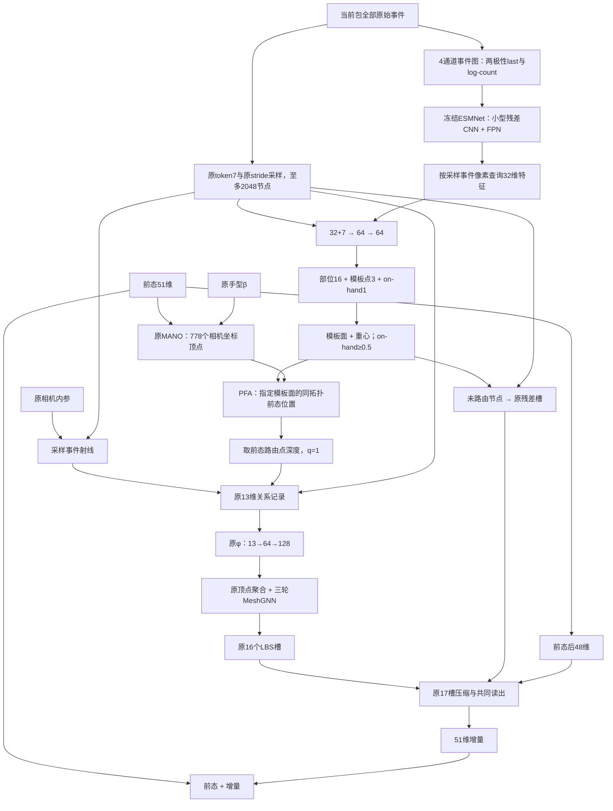

# S45-SM pfasrdz：深度增强、ESMNet表面路由与PFA关联

撰写日期：2026-11-02。本文依据实际代码、冻结配置、训练回执与已有结果，详细解释 pfasrdz 相对于原 S45 的设计变化、前向计算、训练方式和作用机制。文中时间均为北京时间（UTC+8）。

**论文名称统一为 Event Surface Mapping Network (ESMNet)，下文简称 ESMNet。**

## 1. 这个版本究竟改了哪三件事

**pfasrdz 保留 S45 的13维关系编码、778顶点聚合、MeshGNN和51维状态更新，改变的是训练深度增强，以及事件被分配到前态表面的方式。** 名称中的三部分是：

| 部分 | 实际内容 | 作用位置 |
|---|---|---|
| `dz` | 把原图像缩放增强改为深度变化的标签语义 | 训练数据构造 |
| `sr` | 冻结的轻量表面路由器ESMNet，权重名为`sr1` | 从当前事件预测模板部位、模板点与on-hand分数 |
| `pfa` | Prior-Free Association：表面分配不以前态射线命中为条件 | 将预测模板面/重心映射到前态网格，形成原格式关联记录 |

这是相对于原S45的三项组合，不是只在原13维向量后增加若干特征。**最终关系输入仍然是13维。** ESMNet输出的模板位置用来决定面、重心和关联深度，不直接作为新的三维字段拼到φ里。

最重要的结构变化是：原S45根据“事件射线在前态网格上碰到了哪里”决定分配；pfasrdz先根据事件预测“应当属于模板的哪个表面位置”，再查看前态把这个表面放在相机空间的哪里。

“Prior-free”只描述表面分配的条件，完整方法仍使用前态、相机内参和手型，并不等于整条网络不依赖前态。

## 2. 原S45的什么环节被替换

原S45的输入是事件包、51维前态、MANO手型和相机内参。前态经MANO得到相机坐标网格 $V^-\in\mathbb R^{778\times3}$，事件像素对应射线 $d_i$，其中 $d_{iz}=1$。

它先运行射线—前态网格关联：表面命中时，取候选三角面的交点和重心；没有命中时，尝试角度带内近邻；仍无关联时，事件进入残差槽。

对匹配顶点 $j$，原记录为：

$$
\xi_{ij}=[\underbrace{\tau_i}_{7},\underbrace{\delta_{ij}}_{3},
\underbrace{\zeta_i}_{1},\underbrace{valid_i}_{1},\underbrace{hit_i}_{1}],
$$

$$
X_i=z_id_i,\qquad
\delta_{ij}=\frac{X_i-V^-_j}{0.01},\qquad
\zeta_i=\frac{z_i-0.45}{0.1}.
$$

这些量的空间单位先是米，再按1cm和0.1m缩放。φ仍为 `13→64→128`，后面做原网格聚合、消息传播、槽池化和共同读出。

原关联由前态决定，所以前态变化时，不仅关系里的几何数值会变，事件分到哪个顶点、是否能形成网格记录也会变。pfasrdz将后面这部分分配来源改成只看事件的ESMNet。

这是一项结构选择，不是“任何以前态关联的方法都必然无法纠错”的一般定理。本文只说明本次实现怎样改变信息路径。

基线身份：[S45 baseline.json](/data1/lyq/code/mesh/EventHands1/outputs/s45/baseline.json)。原方法详解：[S45输入到输出](/data1/lyq/code/mesh/EventHands1/docs/S45_输入到输出完整设计详解_20261102.md)。

## 3. 从输入到输出的两条分支



深度增强不在这条部署前向图中随机执行；它作用于训练数据。部署时输入实际事件与实际前态，ESMNet提供预测表面分配，PFA保留事件射线用于几何记录，但跳过原射线—网格求交。

## 4. `dz`：深度增强具体怎样做

### 4.1 原S45也有图像缩放，变化在标签解释

原数据增强已有图像roll、缩放与像素shift。缩放因子为：

$$
a\sim\operatorname{LogUniform}(0.8,1.25).
$$

设事件像素为 $q$，事件坐标中的主点为 $c$，roll为二维旋转 $R$，则事件变换为：

$$
q'=aR(q-c)+c+\Delta p.
$$

原S45默认 `SCALE_MODE: focal`：将图像放大解释为焦距放大，深度标签不随缩放变化，缩放由相机内参吸收。

pfasrdz设置 `SCALE_MODE: depth`：使用同样的事件像素变换、同样的缩放随机数，但把缩放解释为手相对相机前后移动，内参不再吸收这个缩放因子。

### 4.2 改的是MANO根支点深度，不是直接把t_z除以a

设MANO手型对应的根支点为 $j_0$，状态平移为 $t$。在roll之后，根支点相机位置为：

$$
p_0=j_0+t.
$$

深度模式执行：

$$
p'_{0z}=p_{0z}/a,\qquad
\boxed{t'_z=\frac{j_{0z}+t_z}{a}-j_{0z}.}
$$

X/Y平移保持roll后的值；局部关节姿态和β不因scale改变。若根支点深度为0.60m、$a=1.25$，新根深度为0.48m，手在训练标签中向相机靠近。

相机内参只保留shift对应的变化。用 $s=0.375$ 表示事件网格缩放：

$$
K'=A_1K,\qquad
A_1=\begin{bmatrix}
1&0&\Delta p_x/s\\
0&1&\Delta p_y/s\\
0&0&1
\end{bmatrix}.
$$

roll的标签变换仍沿用原实现：对 $Q=R_z(\theta)$，根旋转变为 $QR_g$，平移变为 $Q(j_0+t)-j_0$，而不是简单使用 $Qt$。

### 4.3 它是保持手结构的刚性深度移动

实现没有把每个顶点的Z都各自除以a。它改变一个平移参数，使整只手沿Z作相同平移，保留MANO手的几何结构。

图像纯缩放严格对应逐点 $Z_i\mapsto Z_i/a$；刚性深度平移与它在根点一致，在其他顶点会因手自身的深度范围产生透视近似残差。因此，不能写成对整只手每个顶点都精确投影等价。

### 4.4 它希望改变什么

训练主干由此接触更宽的根深度与相应前态/目标几何，避免把所有视觉缩放都解释成焦距变化。它没有新增深度传感器输入，也没有把zn删掉或改成腕点相对深度。

ESMNet配置也使用这份增强，但ESMNet只读事件、训练目标是模板表面位置。两种scale模式的事件图像变换相同，不能说ESMNet因`dz`直接接收了一份新增真实深度。

来源：[增强配置与默认focal](/data1/lyq/code/mesh/EventHands1/semkine/domrand.py:93)、[随机采样](/data1/lyq/code/mesh/EventHands1/semkine/domrand.py:156)、[状态和内参变换](/data1/lyq/code/mesh/EventHands1/semkine/domrand.py:225)、[事件像素变换](/data1/lyq/code/mesh/EventHands1/semkine/domrand.py:266)。

## 5. ESMNet先把全部事件变成什么输入

### 5.1 四通道事件图

ESMNet只读取当前包的 `events / ptr / delta_t_s`。对每个像素与极性，形成：

$$
I=[T_0,T_1,\log(1+C_0),\log(1+C_1)]
\in\mathbb R^{4\times180\times240}.
$$

- $T_p$：该像素该极性最后一条存储事件的 $t_{\rm rel}/\Delta t$，裁剪到 `[0,1]`。
- $C_p$：该像素该极性的事件数量。
- 空像素为零。

在合法的时间有序输入下，最后存储事件也是该位置最后发生的事件。计数通道直接做 `log1p(count)`，没有除以固定计数参考，也没有饱和裁剪。

### 5.2 图像读取全部事件，查询节点仍最多2048

事件图由当前包全部原始事件构造，不是先选2048条再生成。逐事件预测则使用与S45相同的stride节点，至多2048个。

这意味着没有成为后续关系记录的原始事件，也可能通过事件图影响路由器的空间特征。它不表示全部原始事件都各自进入了后面的MANO网格聚合。

### 5.3 哪些输入明确不进入ESMNet

ESMNet的预测面、模板点和on-hand分数不读取前态、前态渲染、相机K或β。它也没有T1a那种事件节点kNN消息传递；这里使用的是事件图像CNN与逐节点MLP。

完整模型后续仍需要K、β与前态完成几何和状态更新。只有路由器这一支是上述事件输入。

代码依据：[事件图构造](/data1/lyq/code/mesh/EventHands1/semkine/s45rt_router.py:90)、[ESMNet 前向实现](/data1/lyq/code/mesh/EventHands1/semkine/s45sm.py:104)。

## 6. ESMNet网络结构与逐事件查询

### 6.1 轻量残差CNN

冻结路由器`sr1`采用通道宽度16/24/48/64：

| 阶段 | 运算 | 单包输出形状 |
|---|---|---|
| 输入 | 四通道事件图 | $4\times180\times240$ |
| stem | 3×3卷积4→16，stride1，GroupNorm8，ReLU | $16\times180\times240$ |
| 残差块1 | 两个3×3卷积，首层stride2，匹配skip | $16\times90\times120$ |
| 残差块2 | 同类块，通道24 | $24\times45\times60$ |
| 残差块3 | 同类块，通道48 | $48\times23\times30$ |
| 残差块4 | 同类块，通道64 | $64\times12\times15$ |

残差块的skip为1×1卷积加GroupNorm以匹配通道/步长；主分支在两个卷积处使用GroupNorm，并在中间与残差相加后使用ReLU。

### 6.2 FPN式多尺度融合

取1/4、1/8、1/16三个尺度，各通过1×1卷积变成32通道。从最深层开始，nearest上采样到较浅层尺寸并相加，最后用3×3卷积、GroupNorm和ReLU平滑：

$$
F\in\mathbb R^{B\times32\times45\times60}.
$$

逐节点查询利用的是这张有空间位置的多尺度特征图，不是给每个节点拼接同一个全图GAP向量。卷积空间支持与GroupNorm统计共同参与特征计算，不能只因输入整张图就把每个查询等同为完整相同的全局摘要。

### 6.3 按事件像素取32维，再拼token7

对一个采样事件，查询位置是：

$$
x_4=\left\lfloor u_i\frac{60}{240}\right\rfloor,\qquad
y_4=\left\lfloor v_i\frac{45}{180}\right\rfloor.
$$

使用整数格点查询，不是双线性插值。把该位置的32维与原token7拼接：

$$
z_i=\operatorname{MLP}_{39\to64\to64}
[F(b_i,:,y_4,x_4),\tau_i].
$$

两个隐藏层后都有ReLU。不同时间或极性的事件即使位于同一FPN位置，也会通过不同token进入逐节点头。

### 6.4 三个输出头

$$
o_i^{\rm part}\in\mathbb R^{16},\qquad
o_i^{\rm coord}\in\mathbb R^3,\qquad
o_i^{\rm onhand}\in\mathbb R.
$$

它们分别表示部位logits、静息模板点坐标、on-hand logit。模板坐标头的数值单位按cm解释，解码时乘0.01转成米。

它不是相机XYZ，不是当前手的绝对三维位置，也不是前态顶点位置的额外回归。

代码依据：[ESMNet定义](/data1/lyq/code/mesh/EventHands1/semkine/s45sm.py:66)、[残差块](/data1/lyq/code/mesh/EventHands1/semkine/s45rt_router.py:121)、[FPN与查询](/data1/lyq/code/mesh/EventHands1/semkine/s45sm.py:92)。

## 7. 从部位与模板点解码成面和重心

### 7.1 固定的16部位如何定义

MANO给每个顶点一行16维LBS蒙皮权重。顶点部位取其最大权重索引；一个三角面所属部位由三个顶点部位做多数表决，平票取最小索引。

这是固定模板表的派生分区，不是额外手工给每个测试事件提供的标签，也不是21个OpenPose输出关节的分类。

### 7.2 先选部位，再找最近模板面质心

$$
\hat k_i=\arg\max_k o_{ik}^{\rm part},\qquad
\hat U_i=0.01\,o_i^{\rm coord}.
$$

令静息模板面的质心为 $C_f$，只在预测部位内选择：

$$
\hat f_i=\arg\min_{f:\mathrm{part}(f)=\hat k_i}
\|C_f-\hat U_i\|_2.
$$

它不是直接找最近模板顶点，也不是在所有三角面中求预测点到表面的精确最近距离。错误的部位选择会限制后续候选面，不能靠坐标头自动跨回另一个部位。

### 7.3 得到重心坐标

对所选模板三角面，先计算预测点在其平面上的重心坐标，再将负系数裁为零、重归一化，得到：

$$
\lambda_i=(\lambda_{i1},\lambda_{i2},\lambda_{i3}),
\qquad \lambda_{ia}\ge0,\quad\sum_a\lambda_{ia}=1.
$$

这是 `project_bary` 的具体规则，不应把它泛称为任意点到三角形的精确欧氏最近点求解。

面索引与重心定义了一个模板表面位置。由于前态网格使用同一MANO拓扑，可以用同一面、同一重心在前态网格上定位。

代码依据：[面部位表](/data1/lyq/code/mesh/EventHands1/semkine/s45sm.py:56)、[面解码](/data1/lyq/code/mesh/EventHands1/semkine/s45sm.py:127)、[project_bary](/data1/lyq/code/mesh/EventHands1/semkine/s45tr_t0.py:108)。

## 8. 哪些事件会被路由：硬阈值的准确含义

对每个采样节点：

$$
p_i^{\rm on}=\sigma(o_i^{\rm onhand}),\qquad
\mathrm{routed}_i=\mathrm{mask}_i\land[p_i^{\rm on}\ge0.5].
$$

没有再按最高部位概率或面置信度筛选。面解码使用部位argmax和模板点，没有独立面分类头，因此也没有一个独立的面分类概率用于额外阈值。

PFA还检查面索引是否合法、重心是否有限非负以及重心和是否大于零。通过这些条件的节点才是最终eligible节点。

pfasrdz采用**硬PFA**：合格节点关联质量直接设为1。一个on-hand概率0.51的节点和0.99的节点都通过阈值时，不会因该概率不同而得到不同连续关联权重。

这与后续软PFA `spfasrdz` 不同；软版本会把on-hand与部位概率用于连续质量。本文不把两种机制混写。

代码依据：[route_nodes](/data1/lyq/code/mesh/EventHands1/semkine/s45sm.py:225)、[PFA有效性检查](/data1/lyq/code/mesh/EventHands1/semkine/s45sm.py:260)。

## 9. PFA具体怎样建立关联

### 9.1 跳过原射线求交与near筛选

原S45的 `associate_rays` 不再用于筛出命中事件。安装PFA时，原函数接收空mask并返回全零关联；快速实现直接构造同形状的零关联张量。

因此，只要路由器认为某个有效采样事件属于手，即使前态网格没有在它的射线上命中，PFA也可以为它建立顶点记录。

### 9.2 用模板面与重心定位前态表面点

设预测面包含三个顶点索引 $v_{i1},v_{i2},v_{i3}$，使用前态顶点计算：

$$
P_i^-=\sum_{a=1}^{3}\lambda_{ia}V^-_{v_{ia}}.
$$

它是“路由器预测的那个模板位置，在前态手型上当前处于哪里”。它不是模板点本身的相机坐标，也不是事件真实三维位置。

深度取：

$$
\boxed{z_i=\max(P^-_{iz},0.05\ \mathrm m).}
$$

0.05m是正深度下限。使用的是前态路由点的Z分量，不是顶点到射线的最近点参数，也不是ESMNet坐标头直接预测的相机深度。

### 9.3 写入原格式关联字段

对eligible节点：

$$
\mathrm{vid}_i=[v_{i1},v_{i2},v_{i3},v_{i1}],
\qquad A_i=[\lambda_{i1},\lambda_{i2},\lambda_{i3},0],
$$

$$
q_i=1,\qquad valid_i=1,\qquad hit_i=1.
$$

第四个位置是统一四记录布局的零权重占位。重心为零的顶点不形成正权重记录。

**这里的hit=1是PFA主动写入的记录标记，不证明事件射线真实命中了该面。** 沿用原字段格式不表示沿用原物理命中语义。

### 9.4 没被路由的事件全部进残差，不回退原关联

未通过阈值或有效性检查的节点保持全零关联：

$$
q_i=A_i=z_i=0,\qquad valid_i=hit_i=0.
$$

原质量规则仍为：

$$
w_{ij}=q_iA_{ij},\qquad r_i=1-q_i.
$$

因此，合格节点全部进入所选面，其他有效采样节点全部进入原残差槽。没有再回退运行原射线关联。代码中的 `xag_fallback` 只是未eligible节点的审计字段名，不能据此推断发生了几何回退。

这些质量规则针对采样保留节点，不能解释为全部原始事件都分别进入了网格。

代码依据：[跳过原关联](/data1/lyq/code/mesh/EventHands1/semkine/s45sm.py:251)、[PFA字段写入](/data1/lyq/code/mesh/EventHands1/semkine/s45sm.py:260)、[快速PFA](/data1/lyq/code/mesh/EventHands1/semkine/s45sm_fast.py:170)。

## 10. 13维记录没变，几何偏差怎样变得不同

### 10.1 原公式继续使用PFA给出的新深度与顶点

对预测面上的每个正权重顶点记录：

$$
X_i=z_id_i,\qquad
\delta_{ia}=\frac{X_i-V^-_{v_{ia}}}{0.01},\qquad
\zeta_i=\frac{z_i-0.45}{0.1},
$$

$$
\xi_{ia}=[\tau_i^7,\delta_{ia}^3,\zeta_i,1,1]\in\mathbb R^{13}.
$$

事件token仍为原7维，φ仍为13→64→128。ESMNet的CNN特征或模板点没有作为额外维度直接拼接到φ中。

### 10.2 一个有解释力的残差关系

根据 $P_i^-=\sum_a\lambda_{ia}V^-_{v_{ia}}$，可得：

$$
\boxed{\sum_a\lambda_{ia}\delta_{ia}
=\frac{X_i-P_i^-}{0.01}.}
$$

若没有触发深度下限，$z_i=P^-_{iz}$，所以右侧Z分量为零，XY分量对应在前态预测深度下的横向重投影偏差。触发下限时，Z分量也可以非零。

例如，对X方向：

$$
X_{ix}-P^-_{ix}
=P^-_{iz}\left(d_{ix}-\frac{P^-_{ix}}{P^-_{iz}}\right).
$$

括号中是事件射线方向与前态指定表面点投影方向之差。它可以在模板面/重心不随前态重新选择的条件下，保留“这个表面在前态中偏离事件射线多少”的信号。

### 10.3 与原surface命中的理想情况对照

原S45真正命中三角面时，理想精确交点同时满足 $X_i=z_id_i$ 和 $X_i=\sum_aA_{ia}V^-_{v_{ia}}$，因此对应的重心加权几何偏移约为零。PFA的重心来自事件路由，未被强制等于射线与前态面的交点，所以一般不满足这一相等关系。

这个零和对照不适用于原near分支，near本来就可以有非零加权偏差。这说明两者提供的几何关系可以不同；它不证明原S45没有其他纠错信息，也不是说整个13维记录在原关联下都为零。

还有一个关键限定：模型先逐记录运行非线性φ，再做顶点聚合。它并没有直接计算上式作为唯一输入，不能把整个网络等同于显式重投影最小二乘求解器。上述是公式推导的结构性质，不能单独据此量化实验收益来源。

代码依据：[原13维记录构造](/data1/lyq/code/mesh/EventHands1/semkine/xyz_mesh.py:404)、[PFA几何](/data1/lyq/code/mesh/EventHands1/semkine/s45sm.py:260)。

## 11. 一个PFA数值算例

以下是人为构造的计算示例，不是某个测试帧的测量。

假设路由器选出一个面和重心：

$$
\lambda=(0.5,0.25,0.25),
$$

该面三个前态顶点为：

$$
V_1^-=(0.020,0.000,0.500),\quad
V_2^-=(0.040,0.000,0.500),\quad
V_3^-=(0.020,0.020,0.500)\quad\mathrm m.
$$

前态路由点为：

$$
P^-=0.5V_1^-+0.25V_2^-+0.25V_3^-
=(0.025,0.005,0.500)\ \mathrm m.
$$

若事件射线为 $d=(0.060,0.010,1)$，PFA取 $z=0.500$，得到：

$$
X=zd=(0.030,0.005,0.500)\ \mathrm m.
$$

三条记录的dXYZ分别为：

$$
\delta_1=(1.0,0.5,0),\quad
\delta_2=(-1.0,0.5,0),\quad
\delta_3=(1.0,-1.5,0).
$$

其重心加权偏差为：

$$
0.5\delta_1+0.25\delta_2+0.25\delta_3=(0.5,0,0)
=\frac{X-P^-}{0.01}.
$$

它表达在这个预测深度上，事件射线点相对指定表面点有5mm的X方向偏差。zn仍为 $(0.500-0.45)/0.1=0.5$。

如果原S45在这个面上做精确求交，会选到交点自身的重心，而不会强制使用路由器预测的上述重心。这正是两种分配原则的不同。神经网络后续怎样把偏差转换成状态更新，仍由训练学习，不是直接把5mm写入输出平移。

若该事件的on-hand分数低于0.5，则这个PFA面记录不会建立，整份事件质量会进入残差槽。

## 12. PFA之后哪些网络仍然是原S45

对每条13维记录，仍使用原共享φ。按 $q_iA_{ij}$ 聚合到顶点，保留128维加权均值、128维逐通道最大值和1维 `log1p(mass)`，形成257维，再无偏置投影到128维。

之后仍为：

| 阶段 | 维度或规则 |
|---|---|
| 前态顶点 | 778个，米制相机坐标 |
| 关系编码φ | 13→64→128 |
| 顶点统计与投影 | 257→128 |
| MeshGNN | 固定面一环，3轮，128维 |
| 16个LBS槽 | 每槽258维，含均值、最大值、直接覆盖与传播覆盖 |
| 残差槽 | 原共享φ处理token7+六个零，再做原残差统计 |
| 槽压缩 | 17组独立258→32及ReLU，形成544维 |
| 读出条件 | 拼接前态后48维，得到592维 |
| 共同读出 | 592→256→51 |
| 状态更新 | 前态51维加上增量51维 |

因此，它没有增加第二个姿态网络，也没有改成直接回归自由网格。需要778顶点和21关节时，仍由输出状态经原MANO解码。

完整网络仍在以下位置使用前态：MANO网格、路由点相机深度、dXYZ/zn、MeshGNN边几何、读出prev48和最终状态加法。PFA只把模板面/重心的分配来源从前态求交改成事件预测。

## 13. ESMNet先怎样单独训练

### 13.1 监督来自训练录制的XAG伪源

路由器先独立训练。每个采样事件的伪源提供有效性、模板面与重心；有效性还要通过面索引、有限非负重心与正重心和检查。

对于有效伪源，静息模板点目标是：

$$
U_i^*=\sum_a\lambda_{ia}^*V^{\rm template}_{f_{ia}^*}.
$$

部位目标使用源面的固定LBS多数部位。on-hand目标是是否有合格手上伪源。它们是由标签派生的训练监督，不能当成已经逐事件验证过的真实物理对应。

### 13.2 路由器的损失

$$
L_{\rm ESMNet}=L_{\rm partCE}
+L_{\rm coordSmoothL1}+0.5L_{\rm onhandBCE}.
$$

- on-hand BCE作用于所有有效采样节点。
- 部位交叉熵只在有效手上伪源节点计算。
- 坐标SmoothL1比较网络cm单位输出与 $U_i^*/0.01$，也只在有效手上伪源节点计算。

这里没有训练相机深度头，也没有用主干姿态损失端到端联合更新ESMNet。

### 13.3 数据与配方

`sr1`在原9名训练受试者中留出ylf，实际用8人训练，不用zgz训练。后续主干仍按原9人训练，二者不能混淆。

路由器使用seed3407、fresh6000步、双卡每卡batch512、Adam学习率0.001、500步warmup后常数、BF16。沿用原增强并配置depth模式；`sr1`没有后续路由器研究中的KD蒸馏或额外router-only增强。

路由器于2026-10-31 **12:07–13:22** 在GPU2–3完成训练，固定文件为 `sr1_final.ckpt`。

代码依据：[监督目标](/data1/lyq/code/mesh/EventHands1/semkine/s45sm.py:156)、[损失](/data1/lyq/code/mesh/EventHands1/semkine/s45sm.py:169)、[登记配方](/data1/lyq/code/mesh/EventHands1/tools/s45sm/registry_r1.json)、[数据筛选与训练](/data1/lyq/code/mesh/EventHands1/tools/s45sm/router_train.py:57)。

## 14. 冻结ESMNet后，主干怎样训练

### 14.1 冻结路由器，fresh训练主干

加载ESMNet后，将其所有参数设为 `requires_grad=False` 并置为 `eval()`；路由调用在 `no_grad` 下执行。然后从与S45-AT dz配对的共有初始张量出发，fresh训练pfasrdz主干6000步。

这不是加载dz或S45第6000步权重微调。主干训练与部署都使用同一个冻结ESMNet预测路由，没有在主干训练时换用GT面、到测试时才换预测面的两套分配。

### 14.2 主干保留原任务损失与噪声合同

仍为seed3407、双卡每卡batch512、Adam0.004、500步warmup后常数、BF16、严格确定性及`legacy_none`合同。训练30–300ms窗口，正式递推评测50ms窗口/步长。

损失仍为：

$$
L=L_{\rm rot}+L_{\rm trans}+2L_{\rm FK},
$$

并保留原log10训练目标处理。没有新增重投影损失、路由修正损失或解析求解器。

训练前态是GT经同步增强后加原混合噪声；闭环E1段首按原协议初始化，之后使用上一包预测。手型 `sequence_gt` 与内参条件沿用基线。

### 14.3 梯度的边界

姿态损失训练原φ、顶点投影、MeshGNN、槽投影和读出。它不会通过argmax面选择或冻结路由器反传更新ESMNet。

前态MANO、事件射线与PFA记录作为无梯度条件构造，输入前态也不会沿这条路径被优化。输出预测端的MANO FK损失仍可微，能把预测关节误差传回主干。

原fc2仍零初始化，故初始最终增量为零；但PFA改变了记录和槽内容，不要求内部特征或第一步梯度与S45逐位相同，不能套用pxc/pxm的第3步首次不同规则。

### 14.4 配对验收与完成

验收参照S45-AT dz的初始张量、全部样本索引、小字段指纹和每rank41个完整包指纹。主干输入包不读取XAG标签。

首次预检在训练开始前因审计回调错误要求XAG字段而失败；工程修订1替换基础包审计后，重新预检通过才正式开训。该修订没有改模型设计或训练任务。

正式主干在GPU4–5于2026-10-31 **15:12–17:09** 完成，两个rank均到6000步，正式验收为PASS。

来源：[冻结加载](/data1/lyq/code/mesh/EventHands1/semkine/s45sm.py:205)、[配对验收逻辑](/data1/lyq/code/mesh/EventHands1/tools/s45sm/verify.py:153)、[工程修订](/data1/lyq/code/mesh/EventHands1/docs/EXPERIMENT_RECORDS.md:20866)、[正式回执](/data1/lyq/code/mesh/EventHands1/outputs/s45sm/20261031/receipts/formal_pfasrdz.json)。

## 15. XAG字段名为什么不代表部署时读取真值

配置仍包含：

```yaml
MODEL:
  XAG_ASSOC: face_route
  XAG_GNN: legacy
S45SM:
  ROUTER: sr1
  ROUTER_KIND: sr
  ASSOC: pfa
  ONHAND_TAU: 0.5
```

这些字段复用了原有接口。安装钩子实际进行三项替换：

1. 将 `sample_sources` 替换成ESMNet预测函数，返回预测面、预测重心和预测有效性。
2. 将 `route_association` 替换成PFA记录构造。
3. 将原 `associate_rays` 替换成空关联路径，从而跳过求交。

因此，`xag_face / xag_bary / xag_valid` 在这条路径中装的是预测结果，不是部署时从GT源文件读取的值。字段名称与数值来源要分开判断。

| 信息 | 什么时候使用 |
|---|---|
| XAG标签派生面/重心 | ESMNet训练监督 |
| ESMNet预测面/重心 | pfasrdz主干训练与部署 |
| 原训练GT状态 | 训练目标和扰动前态来源 |
| 段首原初始化 | 闭环评测开始一个有效段时 |
| 后续闭环前态 | 模型上一包预测 |
| GT前态E3 | 单独诊断，不是发布E1逐包输入 |

不能把“ESMNet分配不读前态”扩写成整个方法不需要初始化、K、β，也不能把标签路由诊断 `pfagtdz` 的结果当作pfasrdz的部署成绩。

代码依据：[预测伪源适配器](/data1/lyq/code/mesh/EventHands1/semkine/s45sm.py:238)、[安装钩子](/data1/lyq/code/mesh/EventHands1/semkine/s45sm.py:287)。

## 16. 与face_route、T1d、srdz和软PFA的区别

| 问题 | 原face_route机制（如srdz） | pfasrdz的硬PFA |
|---|---|---|
| 是否先算原射线关联 | 是 | 跳过 |
| 哪些事件可以换面 | 原来已有`q>0且valid`的事件 | 所有live、路由合格的采样事件 |
| 是否能为原来无匹配事件建立网格记录 | 不能 | 可以 |
| 面/重心来源 | srdz为ESMNet；T1d为标签派生路由 | ESMNet预测 |
| q如何处理 | 保留原关联质量 | 合格者硬设1 |
| z如何处理 | 保留原关联深度 | 前态路由表面点Z，下限0.05m |
| valid/hit | 保留原标记 | 合格者都设1 |
| 无效预测如何处理 | 保留原关联结果 | 全部进入残差，无原关联回退 |

旧face_route只换 `vid/A`，所以即使面来源不读前态，哪些事件能走网格、它们的质量和深度仍受原关联影响。PFA把这些步骤一起换成上述规则。

软PFA `spfasrdz` 使用相同面、重心和前态深度，但将合格节点的q从1改为on-hand概率乘最大部位概率，剩余质量进入残差。**pfasrdz本身使用硬q=1，不能把软权重解释套到它上面。**

T1a则改变事件特征，不改变原射线关联；pxc/pxm是增加关系编码的顶点位置输入。pfasrdz没有同时包含这两类改动。

来源：[旧face_route](/data1/lyq/code/mesh/EventHands1/semkine/xag.py:76)、[软PFA](/data1/lyq/code/mesh/EventHands1/semkine/s45sm_soft.py:25)。

## 17. 为什么发布主表使用快速实现

### 17.1 原实现的额外开销来自哪里

原模型和路由器重复计算token与采样；路由器事件图构造还使用排序，面查找和PFA记录构造中还有动态索引、分块与主机同步。这些实现开销不是ESMNet所必须的不同学习机制，但会影响部署时延。

快速实现保持同一套权重和路由规则，主要做：

- 复用原模型已经计算的token7与同一组src/mask。
- 用每个像素的最大事件行索引实现“最后存储事件获胜”，减少排序。
- 对小batch做密集面查找，避免动态nonzero与分块。
- 密集写入PFA关联张量，减少动态形状与同步。
- 单包CUDA、无梯度、无autocast时，对固定4×180×240输入的冻结CNN主干重放CUDA graph；其他情况运行普通主干。

token缓存键包含输入对象、指针、形状和版本等，不是把旧包内容或旧前态长期当成新包结果。前态网格与PFA深度仍随本次输入构造。

### 17.2 快速版改变的是执行方式

已有测试对事件图、预测路由字段与PFA记录使用逐元素比较；`rowcheck_r3a.json`记录pfasrdz原版与快速版完整2590帧主行精度汇总一致，状态PASS。

第1轮原实现旧时延约19.29ms；当前主表采用快速版13.96ms。两者不能混成同一个实现的读数，也不能将旧时延超预算的结论直接搬到快速版。

这套优化没有把ESMNet换成另一个网络，也没有增加新的输入或重新训练一个主干。

来源：[快速实现](/data1/lyq/code/mesh/EventHands1/semkine/s45sm_fast.py:1)、[既有快速实现测试](/data1/lyq/code/mesh/EventHands1/tests/test_s45sm_fast.py:48)、[主行精度复核](/data1/lyq/code/mesh/EventHands1/outputs/s45sm/20261031/rowcheck_r3a.json)。

## 18. 参数、计算与部署预算怎样统计

| 部分 | 参数个数 | 统计说明 |
|---|---:|---|
| 原S45姿态主干 | 459,059 | φ、网格网络、槽投影和读出尺寸不变 |
| 冻结ESMNet sr1 | 137,028 | 冻结仍属于部署模型参数 |
| PFA | 0个新增训练参数 | 模板面/重心与前态几何的确定性计算 |
| **部署合计** | **596,087** | 主干与实际测试路由器相加 |

相比S45增加约29.85%，在登记的600,000参数上限内。ESMNet没有挂在主干的 `state_dict` 参数树下，不代表统计时可以忽略它。

既有快速主行MAC读数为：

$$
198,154,944\ \text{（主干路径）}
+180,708,096\ \text{（ESMNet）}
=378,863,040.
$$

表中按仓库口径报告为0.379G。PFA跳过原几何求交，记录数量和输入分配也改变，因此不能简单拿“S45所有开销 + CNN”推算最终时延。

同一个独占测量块r3a中，pfasrdz为13.95944ms，S45重测为13.99459ms。这个小差值应解释为约持平，不据此声称稳定快了0.035ms。快速版预算检查已通过。

主行JSON自身只计入主干参数/MAC，正式报告按汇总工具补加路由器。本文结果表采用这个完整部署口径。

来源：[完整成本与预算](/data1/lyq/code/mesh/EventHands1/outputs/s45sm/20261031/summary_r3.json)、[成本补加逻辑](/data1/lyq/code/mesh/EventHands1/tools/s45sm/summary.py:169)。

## 19. 部署前向伪代码

以下说明依赖关系，省略批量索引、无效面与数值保护的展开。随机深度增强属于训练数据步骤，不在此推理函数中执行。

```python
# sr1已加载并冻结；姿态主干已按预测 ESMNet 路由训练。
tok7, src, mask = original_s45_tokens_and_stride(batch, max_nodes=2048)
rays = original_camera_rays(batch.events, src, batch.camera_K)

with torch.no_grad():
    # 路由器只读取事件，不读取prev、K或beta。
    image4 = build_last_time_and_log_count_image(batch.events, batch.ptr, batch.delta_t_s)
    fmap32 = esmnet.trunk(image4)
    features32 = integer_query_at_sampled_pixels(fmap32, batch.events, src)
    node64 = esmnet.head(concat(features32, tok7))
    part_logits = esmnet.part(node64)
    template_point_m = esmnet.coord(node64) * 0.01
    onhand_prob = sigmoid(esmnet.onhand(node64).squeeze(-1))
    selected = mask & (onhand_prob >= 0.5)
    face, bary = decode_part_centroid_face_and_clipped_bary(
        part_logits, template_point_m, selected
    )

    # 前态只在后续几何中进入。
    verts = original_mano_fk(batch.prev_state, batch.betas)
    routed_point = interpolate_on_previous_mesh(verts, face, bary)
    eligible = selected & valid_face_and_bary(face, bary)
    z = routed_point[..., 2].clamp_min(0.05)

    # 原射线求交被跳过。合格者q=1，不合格者保持全零关联。
    assoc = empty_association_like_s45(mask)
    assoc = write_pfa_face_records(
        assoc, face, bary, z, eligible, q=1.0, valid=True, hit=True
    )

# 原S45关系公式、φ、顶点聚合、MeshGNN、17槽与共同读出。
delta51, _, _ = original_xyz_mesh_net(
    tok7, rays, mask, verts, assoc, batch.prev_state[:, 3:51]
)
delta51 = original_zero_event_gate(delta51, batch.counts)
prediction51 = batch.prev_state.to(delta51.dtype) + delta51
```

`onhand` 头去掉最后单通道维后与 `B×N` mask比较；原网格网络还返回统计与辅助字段，伪代码只使用其增量输出。快速版在保持这些字段的前提下复用token与采样，并改进图像/查表/PFA执行。

## 20. 已完成结果与WEAK的准确含义

下表由 `tools.report_table.row()` 读取既有主行生成。误差单位mm，FLOPs列沿用MACs口径；ESMNet成本已补加。S45各臂为seed3407、固定step6000，S39保留原三种子报告。各行时延为已发布测量，pfasrdz的预算比较使用第18节所列同块S45重测值。

| 网络结构 | MPJPE-local | MPJPE-global | MPVPE-local | MPVPE-global | RA-MPJPE(递推) | Latency | FLOPs/step | Params |
|---|---|---|---|---|---|---|---|---|
| EventHands-PCA6 (baseline) | 30 | 10.99 | 23.58 | 8.15 | - | 1.76 ms | 1.653 G | 11.18 M |
| S39（历史参考） | 10.27 | 7.36 | 8.94 | 6.25 | 8.71（8.91 / 8.53 / 8.69） | 4.09 ms | 1.252 G | 2.80 M |
| S45 base | 23.51 | 9.37 | 19.52 | 8.01 | 15.94 | 14.09 ms | 0.231 G | 0.46 M |
| S45-AT dz：仅深度增强 | 22.94 | 10.72 | 18.95 | 9.12 | 16.40 | 14.24 ms | 0.231 G | 0.46 M |
| srdz：dz + ESMNet + 原face_route | 20.15 | 9.50 | 16.65 | 7.55 | 14.45 | 17.35 ms | 0.412 G | 0.60 M |
| pfasrdz：dz + ESMNet + 硬PFA（快速版） | 15.88 | 9.54 | 13.73 | 7.68 | 12.48 | 13.96 ms | 0.379 G | 0.60 M |
| t1ddz：标签路由参考目标（不可部署） | 12.82 | 6.58 | 10.86 | 5.22 | 9.48 | 15.24 ms | 0.227 G | 0.46 M |

其中t1ddz是使用标签派生面路由的预定参考目标，不可部署，也不是被证明的理论最优下界。本文pfasrdz使用的是预测路由。

### 20.1 相对原S45确实有local改善

pfasrdz的zgz local在5000、5500、6000步为 `16.36 / 16.02 / 15.88mm`，原S45对应为 `29.72 / 24.41 / 23.51mm`。三个晚期点都更低，不能把本结果概括成“完全没有相对S45收益”。

末点总体RA为12.48mm，S45为15.94mm；global末点9.54mm与S45的9.37mm接近且略高。主行不同维度的变化需要分别看，不应声称全部指标同时改善。

### 20.2 样本内保留了较多标签路由收益

按登记的R定义，5000/5500/6000步分别为约 `0.750 / 0.685 / 0.809`，都达到0.6要求。这里R是相对S45与T1d样本内差距的收益保留比例，不是路由准确率或测试成功概率。

### 20.3 误差下降了，但收缩强度略未过门

从均值手型反复送入同包事件的诊断中，误差从约17.426mm降到14.179mm：

$$
C=\frac{14.179}{17.426}\approx0.8137.
$$

所以它确实出现误差下降，不能笼统说“完全不收敛”。但预注册要求 $C\le0.8$，这项门槛没有达到。该静态重复事件探针也应与真实连续事件E1分开理解。

### 20.4 距参考目标还有一项误差未过近目标范围

相对t1ddz参考目标，local/global/总体RA差距约为 `3.058 / 2.956 / 3.004mm`。登记的近目标范围分别为 `3.5 / 2.75 / 3.1mm`；local和总体RA在范围内，global稍超出。

快速版参数/时延预算已过，但C与global差距未满足近目标条件，因此原分类仍为 **WEAK**。它不是因当前快速版时延超预算，也不等于没有局部改善。

这些结果仍是单种子描述，不能自动扩展成跨种子、跨数据域的稳定优势。后续标签路由PFA诊断 `pfagtdz` 的结果属于另一条不可部署实验，不能记到pfasrdz名下。

来源：[第三轮汇总与重判](/data1/lyq/code/mesh/EventHands1/outputs/s45sm/20261031/summary_r3.json)、[分类规则](/data1/lyq/code/mesh/EventHands1/tools/s45sm/summary.py:139)、[已发布研究结果](/data1/lyq/code/mesh/EventHands1/Results.md:400)。

## 21. 相对于S45，最值得记住的设计边界

| 问题 | 准确理解 |
|---|---|
| 深度增强加了什么输入 | 没加传感输入，改变训练缩放的3D标签与内参解释 |
| ESMNet预测什么 | 模板部位、模板点、on-hand，而非相机姿态或深度 |
| 表面分配是否读前态 | 面/重心来源不读前态，后续几何仍读 |
| PFA是否还要求射线命中 | 不要求，原求交已跳过 |
| 未路由事件怎么办 | 进入残差，无原射线回退 |
| q是否就是路由概率 | 硬PFA合格者q=1，概率只用于on-hand筛选 |
| 13维是否变宽 | 不变宽，改变的是其中几何记录的来源与含义 |
| 是否端到端训练路由器 | 先训练再冻结，主干任务损失不更新ESMNet |
| 是否使用GT路由部署 | 不使用；XAG只用于路由器训练监督 |
| 是否脱离原S45框架 | φ、网格处理、槽、共同读出与51维增量均保留 |

当路由正确时，PFA有机会在前态偏离事件射线时仍把事件放回相同模板表面位置，并通过几何偏差学习更新；当路由错误时，也可能给出错误的局部证据。实际方法是学习型状态更新，不是凭结构就保证方向正确的解析校正。

## 22. 固定身份、源码与结果证据

### 22.1 直接实现

- [semkine/s45sm.py](/data1/lyq/code/mesh/EventHands1/semkine/s45sm.py)：ESMNet、监督目标、冻结预测路由、PFA与安装接口。
- [semkine/s45sm_fast.py](/data1/lyq/code/mesh/EventHands1/semkine/s45sm_fast.py)：快速部署执行。
- [semkine/s45rt_router.py](/data1/lyq/code/mesh/EventHands1/semkine/s45rt_router.py:90)：事件图与残差块。
- [semkine/s45tr_t0.py](/data1/lyq/code/mesh/EventHands1/semkine/s45tr_t0.py:108)：重心投影、裁剪和归一化。
- [semkine/domrand.py](/data1/lyq/code/mesh/EventHands1/semkine/domrand.py:225)：深度增强的状态/K标签变换。
- [semkine/xyz_mesh.py](/data1/lyq/code/mesh/EventHands1/semkine/xyz_mesh.py:385)：原13维记录与后续主干。
- [pfasrdz正式配置](/data1/lyq/code/mesh/EventHands1/configs/s45sm_20261031/s45sm_pfasrdz_s3407.yaml)、[第1轮登记](/data1/lyq/code/mesh/EventHands1/tools/s45sm/registry_r1.json)。

### 22.2 两份部署权重都需要保留

- 主干：[s45sm_pfasrdz_s3407-step=6000.ckpt](/data1/lyq/code/mesh/EventHands1/outputs/s45sm/20261031/runs/s45sm_pfasrdz_s3407/s45sm_pfasrdz_s3407-step=6000.ckpt)。
- 主干SHA256：`5d0299bd2cdc313437daf349c4c1c1febc3871141dc2bb42845013f8f2ecddbf`。
- 路由器：[sr1_final.ckpt](/data1/lyq/code/mesh/EventHands1/outputs/s45sm/20261031/routers/sr1/sr1_final.ckpt)。
- 路由器SHA256：`c6bdd2b592bf816f1984dc60329c4e886fd6f83e12229f2db256fda578de88f6`。
- 主干SHA对应指定step6000文件，不能用`repro_final.ckpt`的不同文件SHA替代。

### 22.3 协议、验收与主行

- [预注册](/data1/lyq/code/mesh/EventHands1/docs/EXPERIMENT_RECORDS.md:20785)。
- [工程修订1](/data1/lyq/code/mesh/EventHands1/docs/EXPERIMENT_RECORDS.md:20866)。
- [正式主干验收PASS](/data1/lyq/code/mesh/EventHands1/outputs/s45sm/20261031/receipts/formal_pfasrdz.json)。
- [ESMNet完成与身份](/data1/lyq/code/mesh/EventHands1/outputs/s45sm/20261031/routers/sr1/sr1_final.json)。
- [快速主行JSON](/data1/lyq/code/mesh/EventHands1/outputs/s45sm/20261031/evaluations/pfasrdz/row_fast_step6000/s45sm_fast_pfasrdz_main_row_step6000.json)。
- [原版/快速版精度复核](/data1/lyq/code/mesh/EventHands1/outputs/s45sm/20261031/rowcheck_r3a.json)。
- [含路由器成本的汇总和分类](/data1/lyq/code/mesh/EventHands1/outputs/s45sm/20261031/summary_r3.json)。
