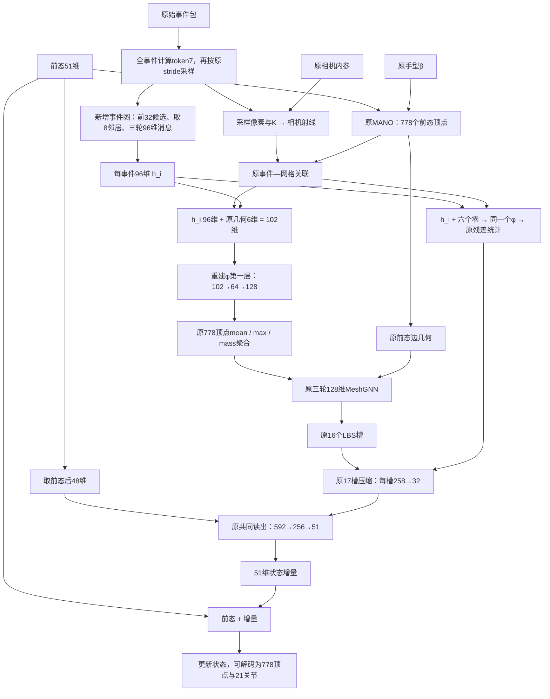

# S45-TR T1a：用事件 GNN 节点特征替换 S45 的 token7

撰写日期：2026-11-02。本文依据实际代码、冻结配置、训练验收和已有结果，详细说明 T1a 从事件输入到状态输出的设计、相对 S45 的变化及其作用方式。文中时间均为北京时间（UTC+8）。

## 1. T1a 的核心设计

**T1a 先在采样事件之间进行三轮时空消息传递，为每个事件生成 96 维上下文特征，再用它替换原 S45 的 7 维事件 token。** 原射线关联、几何字段、MANO 网格 GNN 和状态更新路径继续保留。

原 S45 每条匹配关系记录：

$$
[\underbrace{\mathrm{token7}}_{7},\underbrace{\mathrm{dXYZ},zn,valid,hit}_{6}]
\in\mathbb R^{13}.
$$

T1a 每条匹配关系记录：

$$
[\underbrace{h_i^{\rm event}}_{96},\underbrace{\mathrm{dXYZ},zn,valid,hit}_{6}]
\in\mathbb R^{102}.
$$

这里是**替换七维，不是在原13维后追加96维**。因此关系输入是102维，而不是109维。φ 的第一层相应从 `13→64` 重建为 `102→64`，之后仍输出128维关系特征。

设计意图是：原 S45 的事件描述主要由单事件属性及少量时间历史特征构成，T1a 让一个事件在与前态 MANO 发生关系编码前，先读取周围前序事件的内容与相对时空布局。

这个设计没有新增传感器输入或测试时标签，也没有新增事件→MANO对应预测头。已完成结果没有检出稳定的泛化纠错改善；设计机制与实测结论需要分开理解。

## 2. 先区分两张图与一条关联路径

T1a 中存在两个不同的图：

| 部分 | 节点 | 边或关联从哪里来 | 处理的特征 |
|---|---|---|---|
| 新增 EventGNN | 当前包至多2048个采样事件 | 前序节点候选窗内的归一化时空近邻 | 96维事件节点特征 |
| 保留的 MeshGNN | 固定778个MANO顶点 | 三角网格的一环邻接 | 128维顶点特征 |
| 两者之间的关系 | 事件与前态顶点 | 原 S45 射线—网格关联 | 102维关系记录，经φ编码 |

事件图先让事件之间交换信息；原射线关联决定事件的特征送到哪些前态顶点；网格图再沿手表面传播已经聚合的事件证据。

**新增 EventGNN 不读取前态来选择邻居，原事件—MANO关联仍读取前态。** 因而可以说事件图表征在结构上不以前态为条件，不能说整条 T1a 网络与前态无关。

原 S45 的完整计算主线见 [S45 输入到输出完整设计详解](/data1/lyq/code/mesh/EventHands1/docs/S45_输入到输出完整设计详解_20261102.md)。其固定身份为 [S45 baseline.json](/data1/lyq/code/mesh/EventHands1/outputs/s45/baseline.json) 中的 `c1sf_so3_s3407 step6000`。

## 3. 输入事件、七维属性与采样

### 3.1 原始输入合同继续沿用 S45

单包事件是 `[u, v, t_rel_s, p]`。批量事件增加包索引列，成为 `[batch_index, u, v, t_rel_s, p]`，并通过 `ptr` 区分各包。

像素位于240×180事件网格；时间是相对包起点的秒数，使用恢复后的微秒时间信息；原始极性为0/1。

模型还接收原51维前态、10维MANO手型、相机内参以及包时长。新增事件图本身只读取事件 token 和 mask，不读取前态、β、K、MANO顶点或关联结果。相机内参仍供原射线关联使用。

### 3.2 EventGNN 的节点属性仍从 token7 开始

对每个事件：

$$
\tau_i=\left[
\frac{u_i}{240},\frac{v_i}{180},2p_i-1,
\frac{t_i}{\Delta t},
\log\left(1+\frac{\Delta t_{ie}}{10^{-6}}\right),
\operatorname{clip}\left(\frac{a_i^{\rm same}}{\Delta t},0,1\right),
\operatorname{clip}\left(\frac{a_i^{\rm opp}}{\Delta t},0,1\right)
\right]\in\mathbb R^7.
$$

| 属性 | 含义 |
|---|---|
| 归一化像素位置两维 | 事件在图像中的位置 |
| 极性一维 | 正负变化方向的编码 |
| 包内相对时间一维 | 事件位于窗口的哪个时间位置 |
| 对数事件间隔一维 | 与包内前一条事件的间隔，不要求同像素 |
| 同/反极性 SAE 两维 | 同像素上相应极性历史距当前的时间 |

这些是 EventGNN 的输入属性，不是96维输出中仍逐项原样保留的七个固定位置。它们先经过可学习嵌入，再经过消息传递。

### 3.3 先计算全事件属性，再选节点

模型先对全部原始事件计算 token7，再按原 S45 的确定性 stride 选至多2048个节点。因此，选中事件的间隔与SAE特征可以反映未进入后续图计算的事件历史。

每包原有 $n$ 条事件，保留 $m=\min(n,2048)$；非空包的局部选择索引是：

$$
i_k=\left\lfloor\frac{kn}{m}\right\rfloor,\qquad k=0,\ldots,m-1.
$$

原始batch是变长拼接；采样后补齐到本批最大的节点数 $N\le2048$，使用 `mask: B×N` 将padding排除。EventGNN只在这份已采样的节点表上计算，不进行第二次独立随机采样。

代码依据：[token7定义](/data1/lyq/code/mesh/EventHands1/semkine/encoder.py:133)、[原stride采样](/data1/lyq/code/mesh/EventHands1/semkine/xyz_mesh.py:50)、[原模型采样与token调用](/data1/lyq/code/mesh/EventHands1/model/model.py:910)、[T1a直接读取已采样token](/data1/lyq/code/mesh/EventHands1/semkine/s45tr_t1a.py:48)。

## 4. 在什么坐标中建立事件图

建图使用三维坐标：

$$
c_i=\left[\tau_{i,0},\tau_{i,1},\tau_{i,3}T_{\rm scale}\right]
=\left[\frac{u_i}{240},\frac{v_i}{180},\frac{t_i}{\Delta t}\right],
$$

本实验固定 `T_SCALE=1.0`。所以两个节点的距离为：

$$
D_{ij}=\|c_j-c_i\|_2^2
=\left(\frac{u_j-u_i}{240}\right)^2
+\left(\frac{v_j-v_i}{180}\right)^2
+\left(\frac{t_j-t_i}{\Delta t}\right)^2.
$$

这不是三维相机空间距离，也不是基于MANO表面的距离。它只使用归一化图像位置和窗口归一化时间，没有在建图时调用相机内参或前态网格。

`T_SCALE=1` 意味着一个完整包时长的时间变化，与一个完整图像宽度/高度的坐标变化具有相同数量级。它不表示“时间直接以像素为单位”。

例如，24个水平像素、18个垂直像素和50ms窗口内的5ms，分别对应三个轴上的0.1。窗口为300ms时，相同5ms在时间轴上则约为0.0167，因此实际邻居选择也会受窗口时长影响。

图的坐标与节点属性需要区分：建图只用这三维；消息的节点内容来自完整七维token经过学习得到的96维特征。极性和SAE不会直接进入邻居距离，但可以进入消息内容。

代码依据：[建图坐标](/data1/lyq/code/mesh/EventHands1/semkine/s45tr_t1a.py:57)、[距离与mask](/data1/lyq/code/mesh/EventHands1/semkine/event_gnn.py:152)。

## 5. 每个事件怎样选择邻居

### 5.1 先限定前序候选节点

对采样节点表中索引为 $i$ 的节点，只考虑：

$$
\mathcal C_i=\{i-1,i-2,\ldots,i-32\}
$$

中索引有效、源节点与目标节点mask均有效的部分。**32指前32个采样节点，不是32ms，也不是原始事件列表中的前32条。**

如果原始事件经过了stride，这32个节点可能跨越更多原始事件；它们对应的物理时间范围随事件密度、窗口和采样步长变化。

### 5.2 再在候选内选最近8个

对有效候选按上一节的 $D_{ij}$ 排序，取最近的至多8个作为邻居：

$$
\mathcal N_E(i)=\operatorname{kNN}_{k=8}
\{c_j:j\in\mathcal C_i\}.
$$

这是有限候选窗内的kNN，不是整个包上所有节点之间的全局kNN。它没有额外空间半径门槛，所以候选中即使没有很近的点，也会从有效候选中取最近者。

建图的候选距离计算约为 $O(N\times32)$，避免构造完整 $N\times N$ 距离矩阵。它把搜索范围限制在局部的前序节点中，而不是保证找出任意远处的全局最优邻居。

### 5.3 边方向与边界

若 $j\in\mathcal N_E(i)$，消息方向是 $j\rightarrow i$。源索引严格小于目标索引；代码依赖输入节点按事件顺序排列，没有在 `_edges` 内再排序，也没有额外判断严格的 $t_j<t_i$。

因此，同时间戳事件可以按稳定存储顺序建立边。“读取前序事件”比“只连接严格更早时间”更准确。

靠近包开头时，有效候选不足8个，剩余位置使用 `emask=0`；索引0节点没有有效入边。为方便张量取值，失效索引可能被裁到0，但消息会被mask清零，不构成有效自环。不同包之间没有边。

### 5.4 边上提供什么信息

每条边附带：

$$
\Delta c_{ij}=c_j-c_i
=\left[\frac{u_j-u_i}{240},\frac{v_j-v_i}{180},\frac{t_j-t_i}{\Delta t}\right].
$$

这是有符号的相对时空向量。上方邻居、左方邻居、近期邻居和较早邻居可以有不同的消息响应，而不是只给模型一个无方向的距离值。

代码依据：[EventGNN._edges](/data1/lyq/code/mesh/EventHands1/semkine/event_gnn.py:152)。

## 6. 七维属性怎样变成96维事件特征

### 6.1 初始嵌入

先进行一次共享线性嵌入：

$$
h_i^{(0)}=\operatorname{ReLU}(W_{\rm emb}\tau_i+b_{\rm emb})
\in\mathbb R^{96},\qquad7\to96.
$$

padding节点乘mask后保持零。每个有效节点先拥有自己的事件属性表示，再读取邻居。

### 6.2 一条消息的精确公式

第 $l$ 轮，从邻居 $j$ 发给节点 $i$ 的消息是：

$$
m_{ij}^{(l)}=\operatorname{ReLU}\left(
A_l[\underbrace{h_j^{(l)}-h_i^{(l)}}_{96};
\underbrace{\Delta c_{ij}}_{3}]+b_l\right)
\in\mathbb R^{96}.
$$

每轮消息线性层是 `99→96`，有bias。输入使用96维特征差和3维相对坐标，不是把 $h_i$、$h_j$ 与边坐标全部拼成195维。

特征差描述邻居内容与当前事件的关系；相对坐标提供这种差异发生在什么方向、相隔多远的时间。两者一起经过可学习线性变换和ReLU。

### 6.3 对有效邻居取均值，再残差相加

$$
u_i^{(l)}=
\frac{\sum_j\mathrm{emask}_{ij}m_{ij}^{(l)}}
{\max(\sum_j\mathrm{emask}_{ij},1)},
$$

$$
h_i^{(l+1)}=(h_i^{(l)}+u_i^{(l)})\,\mathrm{mask}_i.
$$

这里没有softmax注意力，也没有按距离额外乘一遍高斯权重。距离用于选邻居；相对坐标作为消息MLP输入；聚合时对有效消息取普通均值。

节点自身的表示通过残差保留。没有有效邻居时更新为零，因此索引0节点保留自己的初始嵌入。举一个仅解释聚合的通道算例：若该通道原值为0.4，两条有效消息分别为0.3和0.1，均值为0.2，更新后为0.6。真实模型对全部96个通道计算，消息值由学习得到的矩阵产生。

### 6.4 三轮各有自己的参数

模型重复三轮，得到：

$$
h_i=h_i^{(3)}\in\mathbb R^{96}.
$$

三轮消息矩阵各自独立，初始嵌入共享于所有节点。一个节点可以通过多跳消息读取前序邻居的邻居，而不仅仅读取一条原始事件。

代码依据：[EdgeConv结构](/data1/lyq/code/mesh/EventHands1/semkine/event_gnn.py:56)、[T1a实际消息轮](/data1/lyq/code/mesh/EventHands1/semkine/s45tr_t1a.py:34)、[节点特征计算](/data1/lyq/code/mesh/EventHands1/semkine/s45tr_t1a.py:48)。

## 7. 三轮传播的范围、图是否重建，以及输出是什么

### 7.1 一包只建一次事件图

T1a 先得到同一份 `idx / dp / emask`，三轮反复使用。它没有在每轮之后根据新学到的 $h_i$ 再做动态kNN。

图随每个事件包的内容变化，但在一个包的三轮传播中固定。工程中的“逐轮重算”指训练反向时重算消息激活，不是逐轮改变邻接，详见第14节。

### 7.2 多跳上下文与限制

在固定节点表上，每跳最多回溯32个采样索引，三轮消息链最多回溯96个采样索引。这不表示该节点直接读取了此前所有96个节点；实际路径由每次选择的至多8个邻居决定。

这也是图消息路径的范围，不是所有输入属性的严格时间范围：token7已包含在全部原始事件上计算的历史信息，部分包级归一化处理也不由三轮边数限定。

### 7.3 直接交出每个节点的96维，不做整包读出

T1a构造 `EventGNN(..., readout=False)`。它直接取 `B×N×96` 节点特征，不构造通用 EventGNN 的整包mean/max投影头。

也没有使用通用 `return_nodes` 路径额外计算的4维边摘要，没有第二个姿态头，没有事件到MANO部位或面的分类头。原事件的内容以96维节点表征形式进入后续关系记录。

代码依据：[构造参数与readout=False](/data1/lyq/code/mesh/EventHands1/semkine/s45tr_t1a.py:81)。

## 8. 96维如何接回原S45

### 8.1 原前态几何与关联继续保留

原 S45 根据输入前态生成MANO网格，并计算事件射线、关联顶点、分配权重、关联深度和命中标记。T1a没有用事件GNN特征替换这些关联规则。

对原关联选择的一条记录 $(i,j)$，仍然计算：

$$
X_i=z_i d_i,\qquad
\delta_{ij}=\frac{X_i-V^-_j}{0.01},\qquad
\zeta_i=\frac{z_i-0.45}{0.1}.
$$

然后把事件部分换成 $h_i$：

$$
\widetilde\xi_{ij}=[\underbrace{h_i}_{96},\underbrace{\delta_{ij}}_{3},
\underbrace{\zeta_i}_{1},\underbrace{1}_{\rm valid},
\underbrace{\mathrm{hit}_i}_{1}]
\in\mathbb R^{102}.
$$

同一个事件分给多个顶点时，复用同一个 $h_i$；各条记录仍有各自的顶点、dXYZ和分配权重。

### 8.2 φ第一层重建为102维输入

新的关系编码器为：

$$
\phi_{\rm T1a}(\widetilde\xi)
=W_2\operatorname{ReLU}(W_{102}\widetilde\xi+b_{64})+b_{128},
\qquad102\to64\to128.
$$

φ第二层、输出维度及后续网格结构不变。第二层后仍没有额外ReLU，128维关系特征允许正负值。

代码上的核心是：

```python
old = self.rel[0]
new = nn.Linear(96 + 6, old.out_features)
with torch.no_grad():
    new.bias.copy_(old.bias)
self.rel[0] = new
self.rel_in = 102
```

第一层的新weight整体重新初始化，只复制旧bias。它不是保留原13维矩阵再增加一条零初始化分支；初始化的精确范围见第13节。

### 8.3 一次局部改变会怎样影响记录

原 S45 中，某个事件的关系输入主要由自身token与关联几何构成。T1a中，修改一个前序事件的属性，可能沿事件图改变后续多个节点的 $h_i$；这些节点各自的关系记录就会随之改变，即使它们自身的原始token没有直接被改动。

这条作用路径不要求先改变MANO关联。GNN的作用是丰富送入原关联位置的特征值，而不是直接重选对应顶点。

代码依据：[第一层重建](/data1/lyq/code/mesh/EventHands1/semkine/s45tr_t1a.py:79)、[子类forward](/data1/lyq/code/mesh/EventHands1/semkine/s45tr_t1a.py:90)、[原关系记录与φ前向](/data1/lyq/code/mesh/EventHands1/semkine/xyz_mesh.py:404)。

## 9. 残差槽也读取96维上下文特征

### 9.1 并非只有落到网格上的事件发生变化

原 S45 对 $r_i=1-q_i>0$ 的事件，用 `token7 + 六个零几何字段` 形成残差记录。T1a将其一起替换为：

$$
\widetilde\xi_i^{\rm res}
=[\underbrace{h_i}_{96},\underbrace{0,0,0,0,0,0}_{6}]
\in\mathbb R^{102}.
$$

它与匹配记录仍使用**同一个**新的φ。六个零表示残差路径没有匹配几何，并不是事件真实深度为零。

随后按原残差质量做加权均值、非加权逐通道最大值、残差质量比例和存在标记，得到258维残差槽。槽的维度与统计规则保留，但事件内容现在来自GNN节点特征。

### 9.2 未关联事件也可以经事件图影响已关联事件

EventGNN对全部有效采样节点运行，不会先按MANO命中情况筛掉节点。因此，一个完全未分到网格的事件，仍可能是后面某个已匹配事件的事件图邻居。

它可以通过两条路径影响输出：自身的残差槽路径，以及沿事件图进入后续节点特征、再进入那些节点的网格记录。T1a并没有因此为这个事件建立一份可靠的MANO对应。

这也意味着图传播的是采样事件中的实际内容，并非只有已经确认属于手的事件。没有新增分割或对应监督去保证每条邻居消息都有益。

代码依据：[子类把全部token替换为节点特征](/data1/lyq/code/mesh/EventHands1/semkine/s45tr_t1a.py:90)、[原残差路径随rel_in形成六个零字段](/data1/lyq/code/mesh/EventHands1/semkine/xyz_mesh.py:448)。

## 10. 从两张图走到最后51维输出

### 10.1 整体流程图



图按信息依赖关系组织。实际调用中，原模型先准备前态几何与关联，进入子类 `forward` 后再计算节点特征；事件图与关联在逻辑上并不互相作为输入。

### 10.2 后半段保留原S45尺寸与规则

匹配记录经φ变成128维特征后，按原权重 $w_{ij}=q_iA_{ij}$ 聚到778个顶点：

$$
m_j=\sum_iw_{ij},\qquad
\mu_j=\frac{\sum_iw_{ij}\phi_{ij}}{\max(m_j,10^{-12})},
\qquad P_j=\max_{i:w_{ij}>0}\phi_{ij}.
$$

均值使用分配权重，最大值不先乘权重。拼接 $[\mu_j,P_j,\log(1+m_j)]$ 得257维，再无偏置投影到128维。后续沿原网格一环进行三轮MeshGNN传播。

通过MANO固定LBS权重汇成16个258维槽，再加258维残差槽。17组独立的 `258→32` 投影与ReLU形成544维证据，拼接前态后48维，再经：

$$
592\to256\to51,
\qquad \hat s=s^-+\Delta s.
$$

这48维仍是根轴角3维和局部轴角残量45维。输出仍为51维状态，旋转参数按原轴角坐标逐元素加法更新；SO(3)定义作用在训练损失，不是把更新改成旋转群乘法。

需要顶点和关节时，再用原MANO对更新状态解码。没有把96维事件节点直接当作关节角，也没有绕过原MeshGNN另设一个姿态输出支路。

### 10.3 主要张量对照

| 阶段 | 原S45 | T1a |
|---|---|---|
| 原事件属性 | $B\times N\times7$ | 相同 |
| 事件上下文网络 | 无新增事件图 | 嵌入7→96，三轮99→96消息 |
| 送入记录的事件部分 | 7维token | 96维节点特征 |
| 原几何/有效性字段 | 6维 | 6维，定义相同 |
| φ输入 | 13维 | 102维 |
| φ第一层 | 13→64 | 102→64 |
| φ第二层 | 64→128 | 相同尺寸 |
| 顶点聚合与输入投影 | 257→128 | 相同尺寸 |
| 网格GNN | 3轮、128维 | 相同结构 |
| 16槽+残差槽 | $B\times17\times258$ | 相同尺寸，残差内容也用新事件表示 |
| 槽压缩与前态拼接 | 544+48 | 相同 |
| 最终读出与增量 | 592→256→51 | 相同结构 |

## 11. 这个修改希望解决什么，实际没有强制解决什么

### 11.1 从单事件描述转向局部时空上下文

原token7包含事件位置、时间与少量历史统计，但不会把周围其他像素的事件内容直接融合成可学习表征。T1a的消息可以结合邻居的极性、时间模式、特征差和相对位置，表示一个局部事件群如何分布。

在设计上，网络可以学到“相似事件在什么方向和时距上共同出现时，更应该产生某类响应”。这些上下文可能与移动边缘、局部活动一致性有关；但没有专门的速度标签或光流损失，不能把96维直接解释为已经学到正确光流或三维运动。

### 11.2 为什么仍保留原事件—MANO关系

用户原方案的检验对象是：**更丰富的事件特征，经过原来的关联与网格处理，能否改善状态更新。** 因此，T1a没有同时替换射线关联，避免把“事件表示变化”和“关联来源变化”合并成同一个实验。

这也保留了原关联的局限：如果前态错误，事件仍可能被分到不合适的顶点。T1a可以尝试学习怎样解释这些记录，但不会直接输出新的对应或用GT路由纠正它们。

### 11.3 两次空间组织承担不同角色

事件图在图像—时间坐标中组织原始观测内容；网格图在前态手表面的固定拓扑中组织与融合这些内容。前者不以MANO为节点，后者不以event为节点。

这种分工让事件上下文在进入前态条件几何之前先形成，同时继续使用原手模型的结构约束。但这只说明计算如何组织，不代表实验已证明上下文成为了稳定纠错力。

### 11.4 这次比较包含完整的表征替换

T1a不仅新增事件邻接，还增加节点网络参数、扩宽φ第一层并重建其权重。实验比较的是这一整套登记的表征替换，不应仅凭T1a与S45之间的差值，就把收益或退化全部精确归因到“某一条事件边”或“邻接本身”。

## 12. “异步event”和“已实现异步运行”要区分

### 12.1 当前确定实现的是前序节点有向边

事件本身带时间戳，图边只从较小节点索引指向较大索引。固定同一份token和节点表时，后面的节点不会通过一条反向边向更早节点发送消息。

但当前训练和评测都在拿到完整事件包后，用张量同步计算。没有维护逐事件插入的图缓存，没有实现新事件到来后仅更新受影响子图的运行流程，也没有发布相应逐事件时延。

### 12.2 为什么不能直接承诺任意前缀结果不变

还存在包级处理：

- uniform-stride选择依赖整包事件数；把更长的前缀作为新包重新处理，已选节点可能改变。
- 时间坐标使用包时长归一化；更换包定义或窗口时长可能改变坐标与邻居。
- SAE无历史时的实际fallback使用整包首末事件跨度 $\max(t_{\rm last}-t_{\rm first},10^{-6})$，该值可能随后续事件改变。

所以“图的有向边读取前序节点”不能直接扩展为“当前整套输入预处理与运行时已经满足任意前缀等价”。这些包级信息在包结束时预测该包终点状态的合同中可用，与持续逐事件输出是不同的执行合同。

### 12.3 既有测试的证明范围

既有测试在固定节点表上修改索引100节点的部分属性，验证前面节点不变、后续节点与最终输出可以变化。它证明了所测固定输入图的传播方向和记录确实读取GNN，没有验证不同包长度重新采样、归一化之后的前缀一致性。

因此，最准确的描述是：**T1a使用前序节点有向事件图，当前实现按包同步计算。**

来源：[事件图实现](/data1/lyq/code/mesh/EventHands1/semkine/event_gnn.py:152)、[SAE跨度与fallback](/data1/lyq/code/mesh/EventHands1/semkine/encoder.py:76)、[固定节点表测试](/data1/lyq/code/mesh/EventHands1/tests/test_s45tr_t1a.py:102)。

## 13. 初始化方式：与pxc/pxm的零旁路不同

### 13.1 发生变化的初始张量

T1a先构造原S45模块，再在隔离的随机数状态中构造EventGNN和新的第一层。初始化约束允许变化的是：

```text
xyz.rel.0.weight
xyz.evgnn.*
```

其中：

- EventGNN使用正常随机初始化，不是零输出旁路。
- 新 `rel[0]` 是完整的 `nn.Linear(102,64)`。
- 只复制旧第一层bias；新weight的所有列重新初始化，包含对应原几何六维的列。
- 其余共有初始张量与构造后的随机流保持S45的记录。

因此，“原几何字段定义相同”不意味着第一层对应这些字段的旧权重也被逐列复制。

### 13.2 初始最终增量为零，不代表隐藏表示与首步梯度相同

原最终 `fc2` 仍是零初始化，所以初始化时最终增量仍为零，预测从前态开始。但EventGNN输出与新的φ内部表示已经不同。

输出层的第一步权重梯度依赖其输入隐藏特征，因此也不要求与S45逐位相同。不能套用pxc/pxm“第1、2步相同，第3步首次不同”的解释。

T1a正式回执中的 `s45_replay_steps_equal` 为 `null`；独立的 `s45replay` 臂承担原S45训练入口第1–3步逐位复现的前置核验。T1a核验的是登记的初始例外和配对输入合同。

代码与回执：[初始化例外](/data1/lyq/code/mesh/EventHands1/tools/s45tr/common.py:59)、[共有初值核验](/data1/lyq/code/mesh/EventHands1/tools/s45tr/common.py:198)、[第一层重建](/data1/lyq/code/mesh/EventHands1/semkine/s45tr_t1a.py:79)、[正式验收](/data1/lyq/code/mesh/EventHands1/outputs/s45tr/20261030/receipts/formal_t1a.json)。

## 14. 工程修订3：怎样降低事件图训练内存

首次预检在第一步反向时显存不足，失败现场保留。登记的工程修订包括按行取邻居、逐轮激活重算，以及可扩展的分配器设置；事件图配置、消息公式与训练配方没有因此改变。

### 14.1 从按通道展开索引改为按行取节点

消息计算需要取 $h_j$。通用版本使用扩展到通道的 `gather`，在严格确定性反向中会产生较大的索引排序缓冲。

T1a的实际实现把 $B\times N$ 个节点展平成行，使用包含batch偏移的行索引 `index_select` 取邻居，再恢复 `B×N×k×96`。它改变取值实现，保留相同的邻居节点和消息公式。

### 14.2 反向时重算消息激活

有梯度时，每轮使用：

```python
checkpoint(edge_round, layer.lin, h, idx, dp, emask, use_reentrant=False)
```

以反向时重算消息计算，减少三轮大尺寸逐边激活的常驻内存。这里重算的是激活，不是重选邻居；`idx/dp/emask`仍由一包的一次建图得到。

在 `no_grad` 推理时直接执行消息运算，不进行这项训练反向重算。

### 14.3 数值验证的精确措辞

既有测试验证逐行取值与原EdgeConv、激活重算与普通前向之间的数值及梯度一致性，采用规定容差：节点输出常用 `atol=1e-6`，梯度比较采用 `atol/rtol=1e-5`。

不应把这些 `allclose` 检查全部改写成逐位相同。它们与训练协议中样本指纹、共有初始张量的逐位检查属于不同层面的验证。

来源：[工程修订登记](/data1/lyq/code/mesh/EventHands1/docs/EXPERIMENT_RECORDS.md:19553)、[按行消息实现](/data1/lyq/code/mesh/EventHands1/semkine/s45tr_t1a.py:34)、[逐轮重算](/data1/lyq/code/mesh/EventHands1/semkine/s45tr_t1a.py:48)、[既有等价性测试](/data1/lyq/code/mesh/EventHands1/tests/test_s45tr_t1a_r2.py:31)。

## 15. 梯度、训练任务与完成情况

### 15.1 图特征随原任务损失一起学习

梯度路径为：

```text
原SO(3)/平移/FK任务损失
→ 51维读出
→ 槽投影
→ MeshGNN与残差摘要
→ 共享φ
→ 每事件96维特征
→ 三轮EventGNN与7→96嵌入
```

没有新增事件类别、部位、面、对应、光流或速度的辅助监督。事件图邻接由输入坐标的离散近邻选择产生，没有额外学习一个邻接预测器。

前态FK、相机射线与原事件—网格关联仍在 `torch.no_grad()` 中计算。增加EventGNN没有使输入前态或离散MANO关联变成训练变量。预测输出端的FK损失仍可以通过预测关节反传到模型。

### 15.2 配方沿用S45，采用fresh训练

T1a是fresh6000步配对重训，没有加载S45第6000步权重微调。保持seed3407、双卡每卡batch512、Adam0.004、500步warmup后常数、BF16、`legacy_none`、原数据划分/增强/混合前态噪声。

任务损失仍为：

$$
L=L_{\rm rot}+L_{\rm trans}+2L_{\rm FK},
$$

并保留 `LOSS.LOG10: true` 的训练目标处理。训练窗口为30–300ms，正式递推评测使用50ms窗口与步长。

训练输入前态来自窗口起点GT经原增强与扰动；自身闭环评测在段首按原合同初始化，之后用上一包预测。手型 `sequence_gt` 与相机内参条件沿用原S45。不能把“事件图不读前态”写成整条训练和推理没有GT来源条件。

### 15.3 已完成的证据

工程修订后的预检通过后，正式训练在GPU2–3于 **2026-10-30 03:10–06:33** 完成；两个rank均为 `COMPLETE, step=6000`。主行随后在GPU4独占测量。

正式验收记录两个rank的全部6000步样本索引、输入小字段与所记录完整包指纹没有配对差异，并检查了登记的初始张量例外。旧驱动 `status.json` 顶层仍可显示 `RUNNING`，但T1a本身的正式训练、验收、评测、读数与主行作业已完成，不能只按这个顶层字段判断。

来源：[正式配置](/data1/lyq/code/mesh/EventHands1/configs/s45tr_20261030/s45tr_t1a_s3407.yaml)、[正式验收PASS](/data1/lyq/code/mesh/EventHands1/outputs/s45tr/20261030/receipts/formal_t1a.json)、[rank0完成记录](/data1/lyq/code/mesh/EventHands1/outputs/s45tr/20261030/runs/s45tr_t1a_s3407/completion_rank0.json)、[任务状态](/data1/lyq/code/mesh/EventHands1/outputs/s45tr/20261030/status.json)。

## 16. 参数量与计算量为什么这样变化

### 16.1 新增参数逐项计算

| 变化 | 核算 | 参数个数 |
|---|---|---:|
| EventGNN嵌入 | $7\times96+96$ | 768 |
| 每轮消息层 | $(96+3)\times96+96$ | 9,600 |
| 三轮消息层合计 | $3\times9,600$ | 28,800 |
| EventGNN总计 | 嵌入 + 三轮消息 | 29,568 |
| φ第一层扩宽的净增加 | $(102-13)\times64$ | 5,696 |
| **相对S45总增加** | $29,568+5,696$ | **35,264** |

原φ参数为9,216，新φ为14,912；其余原模块合计449,843。加上新增EventGNN：

$$
449,843+14,912+29,568=494,323.
$$

原S45为459,059参数，T1a为494,323，约增加7.68%。这里没有再计算一个整包事件读出头或路由器，因为T1a并未构建它们。

### 16.2 参数只增加一小部分，不代表运算增加同样比例

每条事件边都要执行 `99→96` 消息线性层，同一套权重会在许多节点、邻居和三轮计算中反复使用。计算规模主要随 $3\times N\times k\times99\times96$ 增长。

此外，新φ第一层要在全部匹配记录以及残差记录上处理102维输入。因而事件图的训练参数不多，逐边运算仍可以成为明显开销。

既有主行报告T1a为732,061,888 MAC，S45为231,083,520 MAC，约为3.17倍。这是既有报告样本与口径下的计算量；实际包的节点数、匹配记录数和残差记录数也会影响运算规模。

## 17. 接近实现的完整伪代码

以下省略批量取值、精度与空包细节，保留事件图、关系替换和原网格网络的依赖关系：

```python
# 原S45：全事件token、原stride采样、前态几何与关联。
tok7, mask, sampled_pixels = original_tokens_and_stride(batch, max_nodes=2048)
with torch.no_grad():
    verts = original_mano_fk(batch.prev_state, batch.betas)
    rays = original_camera_rays(sampled_pixels, batch.camera_K)
    assoc = original_ray_mesh_association(rays, mask, verts)

# 新增事件图：不读取verts、rays、assoc、prev或beta。
coords = torch.stack(
    [tok7[..., 0], tok7[..., 1], tok7[..., 3] * 1.0],
    dim=-1,
)
idx, dp, edge_mask = knn_inside_previous_32_sampled_nodes(coords, mask, k=8)
h = relu(event_embed_7_to_96(tok7)) * mask[..., None]
for message_layer in three_event_layers:
    neighbor_h = gather_nodes_by_batch_row(h, idx)
    message99 = concat(neighbor_h - h[..., None, :], dp)
    message96 = relu(message_layer(message99)) * edge_mask[..., None]
    update = message96.sum(dim=2) / edge_mask.sum(dim=2, keepdim=True).clamp_min(1)
    h = (h + update) * mask[..., None]

# 原关联给出正权重记录；事件内容换成h96。
records = positive_weight_records(assoc, mask)
old_geometry6 = original_dxyz_zn_valid_hit(records, rays, verts)
matched102 = concat(h[records.batch, records.event], old_geometry6)
matched_phi128 = relation_mlp_102_64_128(matched102)

# 原网格路径保持。
vertex257 = original_vertex_mean_max_mass(matched_phi128, records)
vertex128 = original_vin(vertex257)
mesh128 = original_three_mesh_gnn_layers(vertex128, verts)
slots16 = original_lbs_pool(mesh128)

# 残差也读取h96，使用同一个新φ。
residual_events = positive_residual_mass_events(assoc, mask)
residual102 = concat(h[residual_events], six_zero_fields(residual_events))
residual_phi128 = relation_mlp_102_64_128(residual102)
residual_slot258 = original_residual_statistics(residual_phi128, residual_events)

slots17 = concat_slots(slots16, residual_slot258)
evidence544 = relu(original_grouped_slot_projection(slots17)).flatten(start_dim=1)
readout592 = concat(evidence544, batch.prev_state[:, 3:51])
delta51 = original_fc2(relu(original_fc1(readout592)))
delta51 = original_zero_event_gate(delta51, batch.counts)
prediction51 = batch.prev_state.to(delta51.dtype) + delta51
```

原实现对事件消息轮使用第14节的逐行取值和训练激活重算。伪代码中的两次 `relation_mlp_102_64_128` 指同一个共享模块，不是两套权重。

## 18. 已完成实验结果与判读

下表通过 `tools.report_table.row()` 读取已有主行生成。误差单位mm；FLOPs列沿用仓库MACs口径。S45与T1a为单seed3407、固定step6000；S39保留原三种子报告。

| 网络结构 | MPJPE-local | MPJPE-global | MPVPE-local | MPVPE-global | RA-MPJPE(递推) | Latency | FLOPs/step | Params |
|---|---|---|---|---|---|---|---|---|
| EventHands-PCA6 (baseline) | 30 | 10.99 | 23.58 | 8.15 | - | 1.76 ms | 1.653 G | 11.18 M |
| S39（历史参考） | 10.27 | 7.36 | 8.94 | 6.25 | 8.71（8.91 / 8.53 / 8.69） | 4.09 ms | 1.252 G | 2.80 M |
| S45 base | 23.51 | 9.37 | 19.52 | 8.01 | 15.94 | 14.09 ms | 0.231 G | 0.46 M |
| S45-TR T1a：事件GNN节点特征 | 20.61 | 9.86 | 17.48 | 7.94 | 14.86 | 15.59 ms | 0.732 G | 0.49 M |

### 18.1 末点主行不能替代稳定性判断

T1a在zgz local的5000、5500、6000步分别为 `20.12 / 26.20 / 20.61mm`。对应S45为 `29.72 / 24.41 / 23.51mm`，改善方向有反复；末点改善约2.90mm，低于原5mm的local判断门槛。

GT前态单步E3的local为11.70mm，S45为10.52mm，没有出现预期中的全面改善。这个结果也说明“事件特征更丰富”不能直接推导成“已形成更稳定的纠错”。

### 18.2 样本内有一致方向，补读仍判weak

9条训练local录制的**逐录制配对差中位**，在三个晚期点分别改善约 `4.60 / 3.11 / 2.21mm`，较好的录制数为 `9/9、8/9、8/9`。

需要与另一个统计量区分：直接做“S45录制中位数减T1a录制中位数”，得到的增益约为 `4.42 / 2.37 / 2.65mm`。中位之差不等于配对差中位。

S45-GRADE要求两种统计在每个点都至少改善2.5mm；5500步的中位之差与6000步的配对差中位未过。因此该样本内结果保留为 **weak（B类）**，不作为稳定泛化优势。

### 18.3 静态重复事件探针也没有朝目标收敛

在固定同包事件、从均值手型起点反复更新20次的诊断中，T1a的zgz local误差从约24.09上升到29.57mm，训练local从约19.64上升到23.44mm。该静态探针需要与真实连续事件的E1分开解释，但没有显示新增事件图已经获得向目标收敛的能力。

### 18.4 准确结论与时延范围

既有证据支持的表述是：**T1a成功把局部事件上下文接入原S45，训练与评测完成；在当前单种子实验与检测范围内，未检出更丰富事件特征带来的稳定手指纠错或zgz泛化改善。**

发布时延为15.59ms，S45为14.09ms。这两个发布值不是同块配对测量，不能把约1.49ms的差称为精确测定的稳定开销。计算量和参数增加是这次表征替换的实际成本，收益不能仅按末点排序推断。

来源：[T1a主行](/data1/lyq/code/mesh/EventHands1/outputs/s45tr/20261030/evaluations/t1a/row_step6000/s45tr_t1a_main_row_step6000.json)、[S45-GRADE判读](/data1/lyq/code/mesh/EventHands1/outputs/s45grade/20261030/insample/decision.json)、[补读登记结果](/data1/lyq/code/mesh/EventHands1/docs/EXPERIMENT_RECORDS.md:20286)、[机制缓存](/data1/lyq/code/mesh/EventHands1/outputs/s45tr/20261030/readouts/t1a/summary.json)。

## 19. 与原S45及另外几个版本的区别

| 问题 | T1a的实际设计 |
|---|---|
| 增加的是什么 | 原始事件之间的可学习局部时空上下文 |
| 改了哪一段输入 | token7替换成每事件96维，关系记录变102维 |
| 是不是直接在event上做GNN | 是，节点就是采样事件；后面仍另有原MeshGNN |
| 是否更改事件—MANO关联 | 没有，仍是原射线关联 |
| 是否新建路由器或对应头 | 没有 |
| 残差槽是否也变了 | 是，事件内容也使用96维GNN特征 |
| 是否增加新部署输入 | 没有，仍沿用原事件、前态、手型、内参条件 |
| 是否是pxc/pxm式的零初始化旁路 | 不是；T1a重建φ第一层，EventGNN正常初始化 |
| 是否实现逐事件异步执行 | 当前按包同步，边只读取前序节点 |
| 是否证明了稳定收益 | 现有结果未检出；样本内补读为weak |

pxc/pxm是在原关系输入处直接增加顶点位置条件；T1a改变事件内容的表示。pfasrdz则改变表面关联来源并加入深度增强。它们检验的是不同修改点，不能把其中一个方法的结果自动视为几项已经合并训练的结果。

## 20. 固定实验身份与源码证据

### 20.1 直接实现

- [semkine/s45tr_t1a.py](/data1/lyq/code/mesh/EventHands1/semkine/s45tr_t1a.py)：读取原采样token、事件消息计算、第一层重建及子类接入。
- [semkine/event_gnn.py](/data1/lyq/code/mesh/EventHands1/semkine/event_gnn.py)：坐标、有限候选窗kNN和EdgeConv公式。
- [semkine/encoder.py](/data1/lyq/code/mesh/EventHands1/semkine/encoder.py:133)：token7与包内历史特征。
- [semkine/xyz_mesh.py](/data1/lyq/code/mesh/EventHands1/semkine/xyz_mesh.py:385)：原关系记录、残差、顶点聚合、MeshGNN与读出。
- [model/model.py](/data1/lyq/code/mesh/EventHands1/model/model.py:887)：原输入条件几何与最终状态更新。
- [tests/test_s45tr_t1a.py](/data1/lyq/code/mesh/EventHands1/tests/test_s45tr_t1a.py)、[tests/test_s45tr_t1a_r2.py](/data1/lyq/code/mesh/EventHands1/tests/test_s45tr_t1a_r2.py)：既有节点、初值、传播与实现等价性检查。

### 20.2 协议、配置与完成证据

- [预注册](/data1/lyq/code/mesh/EventHands1/docs/EXPERIMENT_RECORDS.md:19494)。
- [工程修订3](/data1/lyq/code/mesh/EventHands1/docs/EXPERIMENT_RECORDS.md:19553)。
- [T1a正式配置](/data1/lyq/code/mesh/EventHands1/configs/s45tr_20261030/s45tr_t1a_s3407.yaml)。
- [预检PASS](/data1/lyq/code/mesh/EventHands1/outputs/s45tr/20261030/receipts/preflight_t1a.json)。
- [正式验收PASS](/data1/lyq/code/mesh/EventHands1/outputs/s45tr/20261030/receipts/formal_t1a.json)。
- [rank0完成](/data1/lyq/code/mesh/EventHands1/outputs/s45tr/20261030/runs/s45tr_t1a_s3407/completion_rank0.json)、[rank1完成](/data1/lyq/code/mesh/EventHands1/outputs/s45tr/20261030/runs/s45tr_t1a_s3407/completion_rank1.json)。

### 20.3 固定检查点与结果

- [固定第6000步权重](/data1/lyq/code/mesh/EventHands1/outputs/s45tr/20261030/runs/s45tr_t1a_s3407/s45tr_t1a_s3407-step=6000.ckpt)。
- SHA256：`ed0558b3cb78068ffbd6fb1aa872f49c3ea9e816dbc8dc8f4bb4eda32f24316f`。
- 此SHA对应指定step6000文件，不与`repro_final.ckpt`的文件SHA混用。
- [发布主行](/data1/lyq/code/mesh/EventHands1/outputs/s45tr/20261030/evaluations/t1a/row_step6000/s45tr_t1a_main_row_step6000.json)、[S45-TR汇总](/data1/lyq/code/mesh/EventHands1/outputs/s45tr/20261030/summary.json)、[样本内补读判读](/data1/lyq/code/mesh/EventHands1/outputs/s45grade/20261030/insample/decision.json)。
