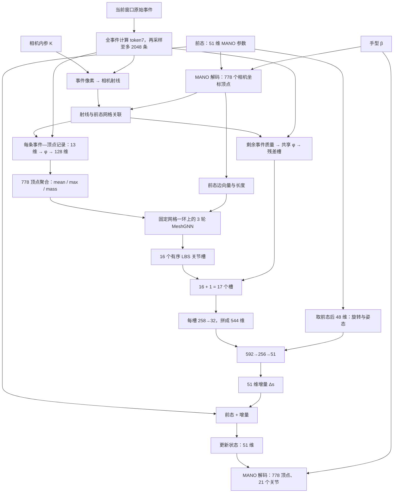

# S45 方法详解：从原始事件输入到 MANO 状态与网格输出

撰写日期：2026-11-02。本文依据仓库实际代码、S45 固定身份与配置快照整理，按一次事件包更新的计算顺序展开。公式采用与实现一致的维度和尺度；“为什么这样设计”与“代码实际保证什么”分别说明。

## 1. 先确定本文说的是哪个 S45

**S45 是“以前态 MANO 网格承载事件证据，再预测状态增量”的跟踪方法。** 它把上一状态解码成 778 个相机坐标顶点，让事件沿相机射线与这张网格建立关联，编码事件—顶点关系，在网格上聚合并传播特征，最后输出 51 维状态增量。

当前固定的 S45 身份是：

- 来源运行：`c1sf_so3_s3407`，seed 3407，固定第 6000 步。
- 结构：原 XYZ-C1，关联、13 维关系记录、778 顶点聚合、MeshGNN 和 51 维加性更新保持原设计。
- 训练目标：SO(3) 旋转损失 + 平移损失 + FK 关节损失，权重 `1 / 1 / 2`。
- 实际路径：`DATA.INPUT_MODE: raw_packed`，`MODEL.ENCODER: xyz_mesh`。

原 S45 使用的 GNN 是 **MANO 网格上的 MeshGNN**。它没有先对异步事件建立 T1a 的事件图，也没有加入 pxc 的额外顶点 XYZ 分支或 pfasrdz 的表面路由器。配置中的 `BACKBONE: event_gnn` 是保留字段，实际前向分支由 `ENCODER: xyz_mesh` 决定。

身份与配置：[S45 baseline.json](/data1/lyq/code/mesh/EventHands1/outputs/s45/baseline.json)、[冻结配置快照](/data1/lyq/code/mesh/EventHands1/outputs/s45/20261029/config_snapshot.yaml)、[模型分支选择](/data1/lyq/code/mesh/EventHands1/model/model.py:612)。

## 2. 整体输入、输出与计算主线

一次更新可写为：

$$
\hat s_k=s_{k-1}+F_\Theta(\mathcal E_k,s_{k-1},\beta,K).
$$

其中：

| 符号 | 含义 |
|---|---|
| $\mathcal E_k$ | 本次事件窗口内的原始事件列表 |
| $s_{k-1}$ | 本次更新前提供的 51 维 MANO 状态 |
| $\beta$ | 10 维 MANO 手型参数，按原协议提供 |
| $K$ | 相机内参，按数据及增强后的实际值提供 |
| $F_\Theta$ | 关联之后的可学习特征处理与读出网络 |
| $\Delta s_k$ | 网络生成的 51 维增量 |
| $\hat s_k$ | 更新后的 51 维状态 |

主要步骤如下：



这个图中，射线关联和前态几何是确定性计算。主要可学习部分是关系编码器、网格特征处理和最终读出。**三轮 MeshGNN 是同一次更新中的三轮空间传播，不是三个连续时刻。**

## 3. 输入到底长什么样

### 3.1 原始事件列表

单个事件包的事件数组是：

$$
E\in\mathbb R^{N_{\rm raw}\times4},\qquad
E_i=[u_i,v_i,t_i,p_i].
$$

- $u_i,v_i$：已经位于 **240×180** 事件网格上的像素坐标。
- $t_i$：相对当前包起点的时间，单位是秒。
- $p_i$：存储极性，取 0 或 1。

数据使用毫秒索引定位事件，并从 `_tsub.npy` 恢复亚毫秒时间。相对微秒时间由“相对毫秒 × 1000 + 亚毫秒余量”形成，随后乘 $10^{-6}$ 转成 float32 秒。同一时间戳内保留文件存储顺序。

S45 的前向输入是事件列表，不需要先生成一张 LNES 图像，也没有在输入端把所有事件压成图像后送入 CNN。

### 3.2 多个事件包怎样合成 batch

不同包的事件数不同。`collate_packets` 先把事件拼接成：

$$
E_{\rm batch}\in\mathbb R^{N_{\rm total}\times5},\qquad
[b,u,v,t,p],
$$

并提供 `ptr`：

```text
第 b 个包的事件 = events[ptr[b] : ptr[b+1]]
```

因此，原始 batch 按变长列表存储，没有按原始最大事件数补齐。后面的采样计算会使用较小的补齐张量和 mask，两者需要区分。

### 3.3 其他实际输入

| 数据 | batch 形状 | 用途 |
|---|---|---|
| 原始事件 | $N_{\rm total}\times5$ | 生成 token、射线与事件证据 |
| `ptr` | $B+1$ | 区分各包 |
| `delta_t_s` | $B$ | 归一化时间特征 |
| `prev_state` | $B\times51$ | 前态网格、读出条件和更新起点 |
| `betas` | $B\times10$ | MANO 手型 |
| `camera_K` | $B\times3\times3$ | 像素对应的相机射线 |
| `target` | $B\times51$ | 训练目标；递推评测包中可为零占位，GT 在包外用于指标，不参与 S45 前向特征计算 |

S45 不预测 $\beta$，配置使用 `MANO.BETA_SOURCE: sequence_gt`。所以准确的输入条件是“事件 + 前态 + 协议提供的手型与相机内参”；不能把它描述成只读四列事件、完全不需要其他条件。

代码依据：[事件与 batch 定义](/data1/lyq/code/mesh/EventHands1/semkine/events.py:119)、[变长 collate](/data1/lyq/code/mesh/EventHands1/semkine/events.py:223)、[原始事件打包](/data1/lyq/code/mesh/EventHands1/semkine/dataset.py:501)。

## 4. 事件先变成 7 维 token，再选择至多 2048 条

### 4.1 七维特征的顺序与含义

对每个事件，计算：

$$
\tau_i=\left[
\frac{u_i}{W},\frac{v_i}{H},2p_i-1,
\frac{t_i}{\Delta t},
\log\left(1+\frac{\Delta t_{ie}}{10^{-6}}\right),
\operatorname{clip}\left(\frac{a_i^{\rm same}}{\Delta t},0,1\right),
\operatorname{clip}\left(\frac{a_i^{\rm opp}}{\Delta t},0,1\right)
\right]\in\mathbb R^7.
$$

| 维度 | 作用 |
|---|---|
| $u/W,v/H$ | 事件在图像中的位置 |
| $2p-1$ | 正负极性 |
| $t/\Delta t$ | 事件位于当前窗口的哪个时间位置 |
| 对数事件间隔 | 当前事件与包内前一条事件之间的时间间隔，不要求同像素 |
| 同极性 SAE 时间 | 同像素上一次同极性事件距现在多远 |
| 反极性 SAE 时间 | 同像素上一次反极性事件距现在多远 |

其中 $\Delta t$ 为包的窗口时长，代码下限为 $10^{-6}$ 秒；包内第一条事件的 $\Delta t_{ie}=0$。

SAE 只在本次包内计算，没有跨包维护一个持续更新的像素时间面。反极性历史查询要求时间严格更早。同极性间隔为零时，也进入实现的 fallback 处理。

**一个实现细节：** 没有可用历史时，实际 fallback 是包内首末事件的时间跨度：

$$
\operatorname{span}=\max(t_{\rm last}-t_{\rm first},10^{-6}),
$$

然后再除以窗口时长并裁剪。它不保证等于 1，也不能把它简单写成“总是用整个配置窗口时长替代”。

### 4.2 特征计算与采样的先后顺序

模型先在全部原始事件上计算 token7，然后再选取采样事件对应的 token。这样，被选事件的时间间隔、同像素历史仍可能反映没有被选入后续网络的事件。

每包原有 $n$ 条事件，保留：

$$
m=\min(n,2048).
$$

非空包按确定性均匀 stride 选择局部索引：

$$
i_k=\left\lfloor\frac{kn}{m}\right\rfloor,
\qquad k=0,\ldots,m-1.
$$

当 $n\le2048$ 时全部保留。超过上限时，只有采样事件进入射线关联和关系编码；“采样事件质量守恒”不表示所有原始事件都经过后续网格网络。

采样后，batch 内补齐到本批最大的保留数量 $N\le2048$，得到 `tok: B×N×7` 和 `mask: B×N`。padding 不产生有效事件质量。全批为空时，模型有提前返回路径。

代码依据：[token7](/data1/lyq/code/mesh/EventHands1/semkine/encoder.py:133)、[SAE 实现](/data1/lyq/code/mesh/EventHands1/semkine/encoder.py:52)、[stride_sample](/data1/lyq/code/mesh/EventHands1/semkine/xyz_mesh.py:50)、[模型调用顺序](/data1/lyq/code/mesh/EventHands1/model/model.py:910)。

## 5. 前态 51 维怎样生成 778 个 MANO 顶点

### 5.1 状态的精确含义

S45 的状态布局是：

$$
s^-=[\underbrace{t}_{3},\underbrace{\omega_{\rm root}}_{3},
\underbrace{\theta_{\rm residual}}_{45}].
$$

- $t$：MANO 的三维平移参数，单位米。
- $\omega_{\rm root}$：全局旋转的三维轴角参数，单位弧度。
- $\theta_{\rm residual}$：15 个局部关节的 45 维轴角**残量**，相对 MANO 的 `hands_mean` 定义。

FK 前会执行：

$$
\theta_{\rm local,full}=\theta_{\rm residual}+\operatorname{hands\_mean}.
$$

因此，最后 45 维不是未经说明就可以当作已加均值的完整局部轴角。模型构造 `ManoLayer(add_mean=False)`，因为解码适配器已经加过均值，MANO 层内不能再加第二次。

前三维 $t$ 也是 MANO 的整体平移偏移，不应直接等同于独立测得的腕点 XYZ。最终腕点、关节和顶点位置由完整 MANO 解码产生。

### 5.2 MANO 层做了哪些确定性计算

MANO 使用固定模型资产与输入参数，依次完成：

1. 用 $\beta$ 对模板进行手型变形，得到 `v_shaped`。
2. 用固定关节回归器得到 16 个基础关节位置。
3. 将根旋转和 15 个局部轴角转换为旋转矩阵。
4. 加入姿态相关的表面形变。
5. 沿固定骨架执行前向运动学。
6. 用固定线性混合蒙皮权重，对 778 个顶点混合关节变换。
7. 加上平移 $t$，得到相机坐标中的顶点和关节。

用于后续关联的输出是：

$$
V^-\in\mathbb R^{B\times778\times3}.
$$

其单位为米。固定面表 `faces` 决定三角网格拓扑，LBS 权重表为 `778×16`。这两张表也会用于后续的网格消息传播和关节槽池化。

前态网格、相机射线与关联在 `torch.no_grad()` 中计算，作为本次预测的条件；这条输入几何路径不反传去优化前态或关联决定。训练损失端对**预测状态**的 MANO 解码仍可求导，二者不能混淆。

代码依据：[51 维解码](/data1/lyq/code/mesh/EventHands1/model/pose_repr.py:81)、[MANO 层](/data1/lyq/code/mesh/EventHands1/model/mano_layer.py:39)、[前态几何调用](/data1/lyq/code/mesh/EventHands1/model/model.py:914)。

## 6. 事件射线怎样与前态网格关联

### 6.1 用与事件网格一致的内参生成射线

输入内参的 $f_x,f_y,c_x,c_y$ 乘 `RENDER_SCALE=0.375`，得到与 240×180 事件像素对应的内参，下面用撇号表示：

$$
d_i=\left[\frac{u_i-c'_x}{f'_x},\frac{v_i-c'_y}{f'_y},1\right].
$$

射线上的点是 $X(z)=z d_i$。因为 $d_{iz}=1$，参数 $z$ 就是相机 Z 深度。训练域随机化会同步变换事件、状态和内参，因此模型使用的是每个样本实际对应的内参。

### 6.2 先选 16 个角方向近邻顶点

把每个前态顶点投到归一化射线平面：

$$
a_j=\left[\frac{V^-_{jx}}{V^-_{jz}},\frac{V^-_{jy}}{V^-_{jz}}\right],
\qquad \rho_{ij}=\|a_j-d_{i,xy}\|_2.
$$

每个事件选 $\rho_{ij}$ 最小的 16 个顶点。这里是**像素射线方向上的近邻**，不是相机 XYZ 中的三维欧氏 kNN。$V^-_{jz}\le10^{-6}$ m 的顶点使用大哨兵值处理，避免正常参与方向近邻。

### 6.3 surface 分支：候选面中的最近正向命中

取这 16 个顶点各自相邻的三角面，组成候选面集合，然后对候选面做射线—三角形求交。实现采用 Möller–Trumbore 算法，接受两种面朝向，不做背面剔除。

在候选面内选择最近的有效正深度交点。这里不是遍历整张网格所有三角形后求全局最近命中；16 px 带也不是 surface 分支额外施加的命中条件。

设命中面的重心坐标是 $(1-u_b-v_b,u_b,v_b)$，将微小负值裁为零后归一化：

$$
A_i=\operatorname{normalize}\left(
[\max(1-u_b-v_b,0),\max(u_b,0),\max(v_b,0),0]\right).
$$

前三个位置对应该面的三个顶点，第四个是统一记录宽度 `R_MAX=4` 的零权重占位。此时：

$$
q_i=1,\quad \mathrm{valid}_i=1,\quad \mathrm{hit}_i=1,
\quad z_i=z_{\rm hit}.
$$

重心恰为零的顶点不生成正权重记录，所以实际记录数可以少于三条。

### 6.4 near 分支：未命中时保留近表面证据

若没有 surface 命中，模型尝试把事件分给角方向上足够近的前态顶点。令：

$$
f=\sqrt{f'_x f'_y},\qquad
b=16/f,\qquad \eta=3/f,\qquad z_{\rm tol}=0.01\ \mathrm m.
$$

它们分别对应约 16 px 的角度带、3 px 的前层参考容差以及 1 cm 的深度容差。它们用于归一化射线平面，不是直接用像素欧氏距离实现。

对候选顶点计算其到射线最近点的参数：

$$
z_{ij}^{\rm cp}=\frac{V^-_j\cdot d_i}{d_i\cdot d_i}.
$$

这个参数不直接等于顶点自身的 Z 坐标。先定义带内候选和前层参考集合：

$$
I_{ij}=[\rho_{ij}\le b]\land[z_{ij}^{\rm cp}>10^{-4}],
$$

$$
\rho_{\rm ref}=\min_j\rho_{ij},\qquad
C_{ij}=I_{ij}\land[\rho_{ij}\le\rho_{\rm ref}+\eta],
$$

$$
z_{\rm front}=\min_{j:C_{ij}}z_{ij}^{\rm cp}.
$$

最终可选集合为：

$$
L_{ij}=I_{ij}\land[z_{ij}^{\rm cp}\le z_{\rm front}+z_{\rm tol}].
$$

按原角距离顺序保留其中至多四个顶点。需要按代码准确理解：3 px 容差用于确定 $z_{\rm front}$ 的参考集合，最终集合 $L$ 没有再施加相同的角容差，也没有额外的 $z\ge z_{\rm front}$ 下界。若参考集合为空，代码使用 `inf` 的前层参考，随后仍按带内条件与排序选取。

对最终保留的顶点，设 $\sigma=b/2$：

$$
\kappa_{ij}=\exp\left[-\frac12(\rho_{ij}/\sigma)^2\right],\qquad
A_{ij}=\frac{\kappa_{ij}}{\sum_{\ell\in\mathrm{kept}}\kappa_{i\ell}}.
$$

事件的总关联质量与深度为：

$$
q_i=\exp\left[-\frac12(\rho_{i,\mathrm{nearest\ kept}}/\sigma)^2\right],
\qquad z_i=\sum_j A_{ij}z_{ij}^{\rm cp}.
$$

此时 `valid=1, hit=0`。$q_i$ 通常小于 1，角距离恰为零时可等于 1。因此严格范围是 $(0,1]$。

### 6.5 none 分支

既没有 surface 命中，也没有可保留的 near 顶点时：

$$
q_i=0,\quad A_i=0,\quad z_i=0,\quad
\mathrm{valid}_i=0,\quad\mathrm{hit}_i=0.
$$

该事件不产生顶点匹配记录，其质量全部进入后面的残差槽。

这些关联步骤的作用，是依据前态为事件建立一个“可以在哪里解释它”的空间假设。关联深度来自前态几何，不能解释为事件相机直接测得了深度或正确对应。

代码依据：[射线—三角形求交](/data1/lyq/code/mesh/EventHands1/semkine/xyz_mesh.py:113)、[关联主函数](/data1/lyq/code/mesh/EventHands1/semkine/xyz_mesh.py:134)、[相机内参缩放](/data1/lyq/code/mesh/EventHands1/model/model.py:808)。

## 7. 每个采样事件的质量如何分配

统一定义事件到顶点的权重：

$$
w_{ij}=q_i A_{ij}\,\mathrm{mask}_i,
\qquad r_i=(1-q_i)\,\mathrm{mask}_i.
$$

对一个有效采样事件，有：

$$
\sum_j w_{ij}+r_i=1.
$$

例如，near 事件有 $q_i=0.6$，向两个顶点分配 $A_i=(0.7,0.3)$，那么两个顶点分别收到 `0.42 / 0.18` 的事件质量，残差槽收到 `0.4`。这只是解释分配规则的示例，不是某个已测样本。

surface 事件的全部质量进入命中面顶点；none 事件全部进入残差。weak near 事件可能同时影响网格和残差槽。padding 的质量为零。

这个机制的目的，是避免因为关联带有限，就把带外或不确定事件直接全部扔掉。守恒只针对采样后的有效事件；原始事件下采样造成的信息压缩仍然存在。

## 8. 从 7 维事件特征形成 13 维事件—顶点关系

对每条 $w_{ij}>0$ 的记录，取其关联深度点与前态顶点：

$$
X_i=z_i d_i,\qquad V^-_j=\text{这条记录对应的前态顶点}.
$$

原 S45 关系记录是：

$$
\xi_{ij}=[\underbrace{\tau_i}_{7},
\underbrace{\delta_{ij}}_{3},
\underbrace{\zeta_i}_{1},
\underbrace{1}_{\rm valid},
\underbrace{\mathrm{hit}_i}_{1}]
\in\mathbb R^{13},
$$

其中：

$$
\delta_{ij}=\frac{z_i d_i-V^-_j}{0.01},
\qquad \zeta_i=\frac{z_i-0.45}{0.1}.
$$

几何输入的单位都是米，再用上述常量缩放成无量纲特征：

| 组成 | 维数 | 要告诉关系编码器什么 |
|---|---:|---|
| token7 | 7 | 发生了什么样的事件 |
| dXYZ | 3 | 射线关联点相对该顶点在哪里，尺度为 1 cm |
| zn | 1 | 关联点的相机绝对深度，参考值 0.45 m，尺度 0.1 m |
| valid | 1 | 是否属于有效匹配记录，这里为 1 |
| hit | 1 | 是表面命中还是仅近邻关联 |

注意 $X_i$ 与 $V^-_j$ 不等同：命中点位于三角面内部时，它与该面的各个顶点通常都有偏移。因此，一个事件分配给三个顶点时，会得到三条不同的 dXYZ 记录。

共享关系编码器为：

$$
\phi_{ij}=W_2\operatorname{ReLU}(W_1\xi_{ij}+b_1)+b_2,
\qquad 13\to64\to128.
$$

第二层后没有额外 ReLU，因此输出特征可以有正有负。所有顶点、所有事件记录共享这同一个 MLP；它不会为每个顶点独立建立一个网络。

它的角色是先把“事件内容 + 与前态的几何关系”变成可学习的局部证据，然后再聚合。S45 原始记录没有直接拼接顶点自身的三维相机坐标；那是 pxc 的改动位置。

代码依据：[φ 的定义](/data1/lyq/code/mesh/EventHands1/semkine/xyz_mesh.py:310)、[13 维记录与前向](/data1/lyq/code/mesh/EventHands1/semkine/xyz_mesh.py:398)。

## 9. 事件记录怎样聚合到 778 个顶点

每个顶点可能接收多条事件记录。定义其总质量：

$$
m_j=\sum_i w_{ij},\qquad O_j=\mathbf1[m_j>0].
$$

$O_j$ 是**直接支持**：本次包内是否确实有正权重事件记录分给这个顶点。它不是连续置信度，也不是顶点是否存在。

对该顶点的 128 维关系特征，计算两种内容汇总：

$$
\mu_j=\frac{\sum_i w_{ij}\phi_{ij}}{\max(m_j,10^{-12})},
\qquad
M_j=\operatorname{channelwise\ max}_{i:w_{ij}>0}\phi_{ij}.
$$

**均值使用关联权重，最大值不先乘关联权重**，只要求该记录权重大于零。一个较弱的记录也可能通过某个最大值通道产生影响。

然后拼接：

$$
x_j=[\mu_j,M_j,\log(1+m_j)]\in\mathbb R^{257},
$$

再用无偏置线性层投影：

$$
H_j^0=W_{\rm in}x_j\in\mathbb R^{128},\qquad 257\to128.
$$

三部分分别保留平均证据、各通道强响应以及事件质量规模。加权均值归一化掉总质量，最大值也不直接记录总质量，因此额外保留 `log1p(mass)` 作为证据规模通道。

无直接支持顶点的均值、最大值和质量均归零，故初始特征为零，但这些顶点仍然保留在网格图中。后面可从邻居接收传播特征。

实现中，求和累加训练时使用 FP32，eval 时使用 FP64，均值随后转回 FP32；最大值也是 FP32。这不表示整个评测网络都在 FP64 下运行。

代码依据：[顶点聚合](/data1/lyq/code/mesh/EventHands1/semkine/xyz_mesh.py:420)、[无偏置输入投影](/data1/lyq/code/mesh/EventHands1/semkine/xyz_mesh.py:313)。

## 10. MeshGNN：在前态网格上进行三轮空间消息传播

### 10.1 图的节点和边是什么

图的节点是全部 778 个 MANO 顶点。若两个顶点在三角面上通过一条边连接，就建立双向邻接，得到固定的网格一环 $\mathcal N(j)$。

这里的“固定”是指连接拓扑固定；前态手指弯曲、旋转或平移后，顶点位置可以改变，边的几何特征随之重新计算。没有每层再按 event 做 kNN，也没有把未观测顶点从图中删除。

### 10.2 用三维边几何调制消息

对目标顶点 $j$ 与相邻源顶点 $\ell$，计算：

$$
g_{j\ell}=
\left[
\frac{V^-_\ell-V^-_j}{0.005},
\frac{\|V^-_\ell-V^-_j\|_2}{0.005}
\right]\in\mathbb R^4.
$$

前三维是有方向的边向量，最后一维是边长，尺度为 5 mm。再计算共享边嵌入：

$$
e_{j\ell}=\operatorname{ReLU}(W_e g_{j\ell}+b_e)
\in\mathbb R^{32},\qquad4\to32.
$$

边向量会抵消整只手的平移，但其 XYZ 分量仍在相机坐标轴下，随全局旋转改变。因此这不是完整的旋转不变边表示。

这个 32 维边嵌入由三轮共用；每轮再用自己的门控线性层，把它映射成 128 维 sigmoid 门：

$$
a_{j\ell}^{(l)}=\operatorname{sigmoid}
(W_g^{(l)}e_{j\ell}+b_g^{(l)}).
$$

门值按通道调制邻居消息。它没有在邻居之间执行 softmax，也不是用门值之和进行注意力归一化。

### 10.3 一轮消息传播的完整公式

先将初始传播支持设为：

$$
S_j^0=O_j.
$$

第 $l$ 轮的邻居消息为：

$$
M_j^{(l)}=
\frac{\sum_{\ell\in\mathcal N(j)}
S_\ell^{(l)}\left(a_{j\ell}^{(l)}\odot W_m^{(l)}H_\ell^{(l)}\right)}
{\max\left(\sum_{\ell\in\mathcal N(j)}S_\ell^{(l)},1\right)}.
$$

也就是：只有有传播支持的邻居发送消息，经过边几何门控，再按**有支持邻居数**取平均。

支持度更新为：

$$
S_j^{(l+1)}=
\max\left(S_j^{(l)},\max_{\ell\in\mathcal N(j)}S_\ell^{(l)}\right).
$$

顶点特征更新为：

$$
H_j^{(l+1)}=H_j^{(l)}+
S_j^{(l+1)}\operatorname{ReLU}
\left(W_s^{(l)}H_j^{(l)}+M_j^{(l)}\right).
$$

$W_m^{(l)}$ 和 $W_s^{(l)}$ 都是无偏置的 `128→128` 线性映射。网络共运行三轮，得到 $H^3$ 和 $S^3$；三轮各有自己的 `msg / slf / gate` 参数。

### 10.4 这样传播有什么作用

- 直接收到事件的顶点保留初始局部证据，并从网格邻居接收信息。
- 没有直接收到事件的顶点，可以从有支持邻居获得特征，三轮的支持范围最多沿三条网格边扩展。
- 固定网格连接提供手表面的邻接结构，前态边几何用于调节信息传播方式。
- 支持变量表示证据可达性，不等于特征一定数值非零。即使某次 ReLU 输出零，支持仍可按图传播。

由于消息和自身映射没有 bias，全零特征场经过这部分 GNN 仍为零；仅靠边嵌入的 bias 不能凭空生成一片顶点特征。但**这只是网格传播模块的性质**，后面的读出有 bias 且直接读取前态，不能据此声称整网在任何“无有效证据”情况下都自动不更新。

代码依据：[固定一环构造](/data1/lyq/code/mesh/EventHands1/semkine/xyz_mesh.py:80)、[边几何](/data1/lyq/code/mesh/EventHands1/semkine/xyz_mesh.py:360)、[MeshGNN 单轮](/data1/lyq/code/mesh/EventHands1/semkine/xyz_mesh.py:236)。

## 11. 从 778 个顶点汇成 16 个有序关节槽

### 11.1 为什么需要槽池化

网格上已经有 `778×128` 的特征，但最终只需要输出 51 个状态增量。S45 使用 MANO 的固定蒙皮权重，把顶点特征整理成 16 个有序的关节相关槽。

这里的 16 对应 MANO 的 16 个基础骨架节点，包含根节点与 15 个局部关节。它们是后续读出器的特征槽，**不是各自独立输出一个关节位置的 16 个预测头**。

### 11.2 软均值与硬部位最大值

设固定 LBS 权重为 $W_{jk}$，形状 `778×16`；第 $j$ 个顶点的硬部位定义为：

$$
h(j)=\arg\max_k W_{jk}.
$$

对第 $k$ 个槽，使用传播后的支持 $S=S^3$ 和特征 $H=H^3$：

$$
\mu_k=\frac{\sum_j W_{jk}S_jH_j}
{\max(\sum_jW_{jk}S_j,10^{-6})},
$$

$$
P_k=\operatorname{channelwise\ max}_{j:S_j>0,\ h(j)=k}H_j.
$$

均值使用 LBS 软权重，最大值使用每个顶点的硬部位归属。没有相应支持时置零。

### 11.3 同时保留直接覆盖和传播覆盖

另外计算两个标量：

$$
c_k=\frac{\sum_jW_{jk}O_j}{\sum_jW_{jk}},
\qquad
s_k=\frac{\sum_jW_{jk}S_j}{\sum_jW_{jk}}.
$$

$c_k$ 表示该槽有多少蒙皮权重覆盖到**直接收到事件**的顶点，$s_k$ 表示有多少覆盖到**直接或传播获得支持**的顶点。实现对分母有小量保护。

第 $k$ 个槽为：

$$
E_k=[\underbrace{\mu_k}_{128},
\underbrace{P_k}_{128},\underbrace{c_k}_{1},\underbrace{s_k}_{1}]
\in\mathbb R^{258}.
$$

因此输出形状为 `B×16×258`。保留两种覆盖度，是为了让读出器可以区分该部位的内容来自直接事件，还是主要经邻居传播得到。

代码依据：[lbs_slot_pool](/data1/lyq/code/mesh/EventHands1/semkine/xyz_mesh.py:266)。

## 12. 没有可靠落到网格上的事件怎样处理：第 17 个残差槽

### 12.1 仍然使用同一个关系编码器

对 $r_i=1-q_i>0$ 的采样事件，构造：

$$
\xi_i^{\rm res}=[\tau_i,\underbrace{0,0,0,0,0,0}_{\text{六个几何与有效性字段}}]
\in\mathbb R^{13},
$$

然后：

$$
\phi_i^{\rm res}=\phi(\xi_i^{\rm res})\in\mathbb R^{128}.
$$

这与匹配记录共用同一套 φ 权重。几何字段为零只是表示残差路径没有可用顶点几何，不能理解为测得事件的真实深度为零。

### 12.2 按包汇总残差

设有效采样事件数为 $N_{\rm live}$，残差总质量为 $m_r=\sum_i r_i$，则：

$$
\mu_r=\frac{\sum_i r_i\phi_i^{\rm res}}{\max(m_r,10^{-12})},
\qquad
P_r=\operatorname{channelwise\ max}_{i:r_i>0}\phi_i^{\rm res}.
$$

均值按残差质量加权，最大值不先乘 $r_i$。第 17 个槽是：

$$
b=[\underbrace{\mu_r}_{128},\underbrace{P_r}_{128},
\underbrace{m_r/\max(N_{\rm live},1)}_{1},
\underbrace{\mathbf1[m_r>0]}_{1}]
\in\mathbb R^{258}.
$$

没有残差时相应内容置零。注意它的最后两维是“残差质量比例”和“是否存在残差”，与 16 个 LBS 槽的“直接覆盖/传播覆盖”语义不同。

残差事件不经过网格 GNN，而是汇成一个整体槽直接交给读出器。这保留了部分未关联事件的内容，但没有给它们建立与 16 个手部区域同样细致的空间槽。

最后拼接：

$$
\operatorname{slots}=[E_1,\ldots,E_{16},b]
\in\mathbb R^{B\times17\times258}.
$$

代码依据：[残差分支](/data1/lyq/code/mesh/EventHands1/semkine/xyz_mesh.py:448)。

## 13. 17 个槽怎样生成最终的 51 维状态增量

### 13.1 每个槽独立压缩为 32 维

`slot_proj` 的实现是：

```python
nn.Conv1d(17 * 258, 17 * 32, kernel_size=1, groups=17)
```

它等价于 **17 组各自独立的 `258→32` 线性投影**，投影后使用 ReLU。它不是对所有槽共享一个投影，也不是先把全部 4386 维完全混合再压缩。

记压缩结果为：

$$
z=[\operatorname{ReLU}(P_1E_1+c_1),\ldots,
\operatorname{ReLU}(P_{17}E_{17}+c_{17})]\in\mathbb R^{544}.
$$

槽的顺序固定，读出器可以利用不同部位的身份。第 17 项使用残差槽 $b$。

### 13.2 再拼接前态后 48 维

读出器直接读取：

$$
s^-_{3:51}=[\omega_{\rm root},\theta_{\rm residual}]
\in\mathbb R^{48}.
$$

因此联合输入维度是：

$$
544+48=592.
$$

随后计算：

$$
h=\operatorname{ReLU}(W_{\rm fc1}[z,s^-_{3:51}]+b_{\rm fc1})
\in\mathbb R^{256},
$$

$$
\Delta s=W_{\rm fc2}h+b_{\rm fc2}\in\mathbb R^{51}.
$$

真正跨全部 17 个槽联合混合发生在 `fc1`。全部 51 维由这个共同读出器产生，没有每个手指独立的一套最终状态头。

读出器没有直接拼接前态平移的前三维，但不能据此说模型不知道平移：平移已经影响前态网格、射线关联、zn 与 dXYZ，最终又通过加性更新保留在状态中。

### 13.3 加回前态

模型执行：

$$
\boxed{\hat s=s^-+\Delta s.}
$$

平移、根轴角和局部轴角残量都按状态坐标逐元素相加。**S45 的 SO(3) 是训练损失的定义，不表示这里改成了旋转矩阵乘法或李群上的乘法更新。**

最后输出层 `fc2.weight / bias` 初值为零，所以初始化时网络输出零增量，从输入前态开始学习如何更新。

### 13.4 空事件包的特殊处理

配置 `ZERO_EVENT_GATE: true` 对 `counts<=0` 的包将增量置零，然后加回转换到输出 dtype 的前态。全批为空时还有提前返回零增量的路径。

因此，空包的设计行为是不更新状态。若讨论逐位数值等价，应保留 dtype 条件：通常 FP32 推理可直接视为空包恒等；混合 BF16 批量中，代码会先将前态转换到输出类型，不能无条件声称与原 FP32 输入逐位相同。

有事件但没有顶点命中、或者把事件证据做消融，并不等同于空包。非空情况下，残差槽、读出 bias 和前态 48 维仍可产生非零更新。

代码依据：[槽投影与读出定义](/data1/lyq/code/mesh/EventHands1/semkine/xyz_mesh.py:317)、[读出前向](/data1/lyq/code/mesh/EventHands1/semkine/xyz_mesh.py:465)、[增量加法与空包门](/data1/lyq/code/mesh/EventHands1/model/model.py:945)。

## 14. 输出结束在哪里，以及下一包如何继续

### 14.1 网络直接输出的是状态

`forward_packet` 直接返回：

$$
\hat s\in\mathbb R^{B\times51}.
$$

它没有直接输出 `778×3` 个自由顶点坐标，也没有直接回归 `21×3` 个独立关节坐标。状态参数通过 MANO 约束了输出手的结构。

需要三维结果时，再解码：

$$
(\hat V,\hat J)=\operatorname{MANO}(\hat s,\beta),
$$

$$
\hat V\in\mathbb R^{B\times778\times3},\qquad
\hat J\in\mathbb R^{B\times21\times3}.
$$

输出在相机坐标系中，以米为单位。MANO 的 16 个基础关节加上 5 个固定顶点取得的指尖，再按 OpenPose 顺序排列，形成这 21 个关节。它与前面的 16 个 LBS 特征槽不是同一组数量概念。

### 14.2 连续跟踪时的递推

在自身闭环评测中，每个有效段先按原合同初始化前态，随后：

```text
本包事件 + 当前前态 → S45 → 本包预测状态
下一包前态 ← 本包预测状态
```

下一包重新由这个状态生成 MANO 网格、重新关联事件并计算全部特征。**跨包传下去的是 51 维状态；本包的 778×128 特征场没有作为一个额外循环隐藏状态传给下一包。** SAE 也没有跨包持续保存。

发布评测使用 50 ms 窗口与 50 ms 步长。段首有基于 GT 的原协议初始化，不是从任意未知手型和未知位置自行检测起步；段内后续前态则使用上一包模型预测，不逐包替换为 GT。

代码依据：[MANO 输出](/data1/lyq/code/mesh/EventHands1/model/mano_layer.py:108)、[闭环初始化和 prev ← pred](/data1/lyq/code/mesh/EventHands1/semkine/eval_track.py:194)。

## 15. S45 训练时如何让这个更新有意义

### 15.1 训练前态与测试递推前态不同

原训练样本取窗口起点的 GT 状态作为前态来源，窗口末点的 GT 作为目标。经过事件、标签和内参同步的域随机化后，再对输入前态加入 S45 原有混合扰动。

因此，训练是在“给定一个有误差的前态，预测窗口末状态”的单步任务上学习；它没有默认把自己的上一包预测连续滚动成整段训练输入。自身闭环测试则使用模型输出作为后续输入，二者的前态分布需要区分。

训练开启 `SPEED_AUG`，在 30–300 ms 的范围内按对数窗长采样；接近有效段起点时，窗口可按段长裁短。输入扰动是：

- 50% 小高斯：平移、根旋转、局部姿态的标准差为 `0.005 m / 0.05 / 0.05`。
- 30% 大高斯：对应为 `0.05 m / 0.3 / 0.3`。
- 20% 定向噪声：三个状态块各取随机方向，再在各自上限内采样长度。

### 15.2 旋转损失

解码预测和 GT，将根旋转与 15 个完整局部轴角分别转换为单位四元数。设两者为 $q_{bj}^{p}$ 与 $q_{bj}^{g}$：

$$
L_{\rm rot}=\operatorname{mean}_{b,j=1\ldots16}
\left[1-\min\left((q_{bj}^{p}\cdot q_{bj}^{g})^2,1\right)\right].
$$

平方使 $q$ 与 $-q$ 对应相同旋转。若相对旋转角为 $\vartheta$，这一项对应 $\sin^2(\vartheta/2)$；它不是轴角向量的逐元素 MSE，也不是直接把角度误差当损失。

### 15.3 平移损失

$$
L_{\rm trans}=\operatorname{SmoothL1}(t^p,t^g).
$$

它作用在米制三维平移上，使用实现中的默认 SmoothL1 设置。

### 15.4 FK 关节损失

预测和 GT 通过同一 MANO、同一手型解码为 21 个关节。各自减去腕点后计算平均欧氏距离：

$$
L_{\rm FK}=\operatorname{mean}_{b,j=1\ldots21}
\left\|(J^p_{bj}-J^p_{b0})-(J^g_{bj}-J^g_{b0})\right\|_2.
$$

它的单位是米，关注根相对关节形状，不再次监督整体平移；但没有把整只手的旋转对齐，因此仍对根旋转以及手指姿态敏感。

### 15.5 总损失与实际反向目标

$$
L=L_{\rm rot}+L_{\rm trans}+2L_{\rm FK}.
$$

原配置还设置 `LOSS.LOG10: true`，训练实际返回并反向传播的是 $\log_{10}(L)$；日志 `train_loss` 和验证返回值仍记录原加权损失。配置遗留的 `LAMBDA_POSE / LAMBDA_R / LAMBDA_T` 属于旧 51 维 MSE 的诊断分支，不是 S45 当前优化目标的 `450 / 60 / 30000` 权重。

前态 FK 与关联在无梯度条件路径中。损失计算时，预测状态的 MANO FK 可微，GT FK 不反传，因此梯度能经过预测关节回到读出器和网格网络，但不会沿输入关联通路去优化前一帧状态。原训练也没有跨多个递推时刻展开反向传播。

### 15.6 优化配方

固定 S45 使用 seed3407、双卡每卡 batch512、Adam 学习率 0.004、500 步 warmup 后常数、BF16、6000 步，遵循严格确定性与 `legacy_none` 采样合同。该固定配方没有余弦衰减、EMA 或 weight decay。

来源：[训练窗口与前态](/data1/lyq/code/mesh/EventHands1/semkine/dataset.py:342)、[混合扰动](/data1/lyq/code/mesh/EventHands1/semkine/dataset.py:309)、[SO(3)+平移+FK 损失](/data1/lyq/code/mesh/EventHands1/model/model.py:123)、[log10 训练目标](/data1/lyq/code/mesh/EventHands1/model/model.py:409)、[优化器](/data1/lyq/code/mesh/EventHands1/model/model.py:475)。

## 16. 全流程张量与参数量对照

### 16.1 一次前向的主要维度

下表中 $N\le2048$ 为补齐后的采样事件数，$R$ 为整个 batch 的正权重事件—顶点记录总数：

| 阶段 | 形状或变换 | 主要作用 |
|---|---|---|
| 原始 batch 事件 | $N_{\rm total}\times5$ | 变长事件输入 |
| 全事件 token | $N_{\rm total}\times7$ | 事件内容与包内历史 |
| 采样 token / mask | $B\times N\times7$ / $B\times N$ | 限制后续事件计算量 |
| 前态网格 | $B\times778\times3$ | 相机空间几何载体 |
| 射线 | $B\times N\times3$ | 将事件像素连接到空间 |
| 顶点索引与分配权重 | $B\times N\times4$ | 每个事件至多四个关联顶点 |
| 匹配记录 | $R\times13$ | token7 + 六个几何/有效性字段 |
| φ | $13\to64\to128$ | 关系编码 |
| 顶点统计 | $B\times778\times257$ | mean128 + max128 + logmass1 |
| vin | $257\to128$，无偏置 | 初始网格特征 |
| 边几何/嵌入 | $4\to32$ | 前态边信息 |
| 三轮 MeshGNN | $B\times778\times128$ | 空间传播与融合 |
| 16 个 LBS 槽 | $B\times16\times258$ | 按关节蒙皮关系汇总 |
| 残差槽 | $B\times1\times258$ | 未充分关联的事件摘要 |
| 17 槽压缩 | 每槽 $258\to32$ | 得到 544 维证据 |
| 拼接前态后 48 维 | $544+48=592$ | 状态条件读出 |
| 共同读出器 | $592\to256\to51$ | 状态增量 |
| 加回前态 | $B\times51$ | 更新状态 |
| 输出 MANO 解码 | 778 顶点、21 关节 | 可视化、评价或后续使用 |

### 16.2 可训练参数逐模块核算

| 模块 | 核算方式 | 参数个数 |
|---|---|---:|
| 关系编码器 φ | $13\times64+64+64\times128+128$ | 9,216 |
| 顶点投影 vin | $257\times128$ | 32,896 |
| 共享边嵌入 | $4\times32+32$ | 160 |
| 三轮 MeshGNN | $3(128^2+128^2+32\times128+128)$ | 110,976 |
| 17 组槽投影 | $17(258\times32+32)$ | 140,896 |
| fc1 | $592\times256+256$ | 151,808 |
| fc2 | $256\times51+51$ | 13,107 |
| **合计** | 以上可训练矩阵与 bias | **459,059** |

MANO 模板、形变基、固定拓扑、蒙皮权重和关节回归器等为模型常量 buffer，没有算作可训练参数。上述合计与 S45 发布主行中的参数量一致。

## 17. 用接近代码的顺序重新走一遍

以下为结构伪代码，省略批量索引、空包与精度控制。`positive_records`、聚合等名称代表前面已说明的原实现，不是额外增加的新模块。

```python
# 输入：原始事件、窗口时长、前态51维、手型beta、内参K。
all_tokens = event_tokens(all_events, ptr, delta_t, H=180, W=240)
src, mask = uniform_stride_sample(ptr, max_nodes=2048)
tokens = gather_sampled_tokens(all_tokens, src, mask)
pixels = gather_sampled_pixels(all_events, src)

with torch.no_grad():
    local_full = prev[:, 6:51] + mano.hands_mean
    verts, _ = mano(beta, prev[:, 3:6], local_full, prev[:, 0:3])
    rays = camera_rays(pixels, scaled_intrinsics(K, scale=0.375))
    assoc = original_surface_near_none_association(rays, mask, verts)

weights = assoc.q[..., None] * assoc.A * mask[..., None]
residual_weights = (1.0 - assoc.q) * mask

# 所有正权重事件—顶点记录，一次向量化编码。
records = positive_records(weights, assoc.vertex_indices)
ray_points = records.depth[:, None] * records.ray
dxyz = (ray_points - records.vertex_xyz) / 0.01
zn = (records.depth[:, None] - 0.45) / 0.1
record13 = concat(records.token7, dxyz, zn, ones_like(zn), records.hit)
phi128 = relation_mlp_13_64_128(record13)

mean128, max128, mass = aggregate_to_778_vertices(phi128, records, weights)
H0 = vin_257_to_128(concat(mean128, max128, log1p(mass)))
O = mass > 0
H, S = H0, O
edge32 = original_edge_embedding(verts)
for layer in three_independent_mesh_layers:
    H, S = layer(H, S, edge32, fixed_mesh_ring)

slots16 = lbs_pool_mean_max_direct_support_propagated_support(H, S, O)
residual_slot = shared_phi_residual_summary(tokens, residual_weights)
slots17 = concat_slots(slots16, residual_slot)

evidence544 = relu(grouped_slot_projection_258_to_32(slots17)).flatten(start_dim=1)
readout592 = concat(evidence544, prev[:, 3:51])
delta51 = fc2(relu(fc1(readout592)))
delta51 = zero_delta_for_empty_packets(delta51, packet_counts)
prediction51 = prev + delta51

# prediction51既可作为下一包前态，也可解码成网格/关节。
output_verts, output_joints21 = decode_prediction_with_mano(prediction51, beta)
```

实际实现保留输出 dtype 转换与原数值合同。推理需要的是前向计算，损失和 GT 目标属于训练/评价部分，不插入这条预测链。

## 18. 理解 S45 时最容易混淆的几个边界

### 18.1 前态有四条作用路径

| 路径 | 前态具体影响什么 |
|---|---|
| 网格与射线关联 | 事件被分配到哪些顶点、质量、关联深度和几何记录 |
| 网格边几何 | MeshGNN 的空间消息门控 |
| 读出器的 prev48 | 根旋转与局部姿态条件，可直接影响增量 |
| 输出加法 | 51 维前态作为状态更新的起点 |

所以，前态不仅仅是最后加一次，也不仅仅用于决定一个事件属于哪个顶点。输入前态发生变化时，它可以同时改变证据构造、传播和读出条件。

### 18.2 几何字段是“前态条件下的解释”

S45 的关联没有来自深度传感器的真实事件深度。$z_i$、顶点位置、dXYZ 和边几何都依赖前态。因此，它们不是一份与前态独立的真实三维观测。

同样，near 的 $q_i$ 是按角距离设计的核值，不能未经校准就当成“这次关联正确的概率”。方法提供一种组织事件证据的方式，并没有在结构上保证前态错误时关联仍然正确。

### 18.3 三种“残差”不是一回事

- **状态里的 residual45**：相对 MANO 均值姿态的局部轴角残量。
- **第 17 个残差槽**：未充分分配到网格的事件质量的特征摘要。
- **最终加性增量 $\Delta s$**：本次预测对 51 维前态的修改。

三者出现在不同位置，含义也不同。

### 18.4 原 S45 与后续几个版本的关系

- pxc 在原 13 维关系编码处增加前态顶点相机 XYZ 的可学习分支。
- T1a 把原 token7 换成 event GNN 的 96 维节点特征。
- pfasrdz 使用事件表面路由与 PFA，并加入深度增强。

这些都属于后续独立修改。本文描述的是固定 S45 本体，其关系输入仍为原来的 13 维，事件到网格的关联仍由上述射线几何规则决定。

## 19. 固定 S45 的已有主行，作为方法身份参照

下表由 `tools.report_table.row()` 读取已有主行生成。误差单位 mm；FLOPs 列沿用仓库 MACs 口径。S45 为单 seed3407、固定 step6000，S39 保留原三种子报告。

| 网络结构 | MPJPE-local | MPJPE-global | MPVPE-local | MPVPE-global | RA-MPJPE(递推) | Latency | FLOPs/step | Params |
|---|---|---|---|---|---|---|---|---|
| EventHands-PCA6 (baseline) | 30 | 10.99 | 23.58 | 8.15 | - | 1.76 ms | 1.653 G | 11.18 M |
| S39（历史参考） | 10.27 | 7.36 | 8.94 | 6.25 | 8.71（8.91 / 8.53 / 8.69） | 4.09 ms | 1.252 G | 2.80 M |
| S45：XYZ-C1 + SO(3) / 平移 / FK 损失（seed3407） | 23.51 | 9.37 | 19.52 | 8.01 | 15.94 | 14.09 ms | 0.231 G | 0.46 M |

这里的 local/global 是评价录制的两种类别，表内对应的是根对齐误差，不应把 `MPJPE-global` 理解成绝对相机坐标下、不做根对齐的误差。总体 RA 按帧数汇总，也不是把 local 和 global 两个数字直接取算术平均。

S45 的采用是固定研究基底的决定。以上是已发布结果，不能仅凭结构设计或单种子这一行就推断具有稳定的闭环纠错能力。

## 20. 固定身份与源码证据索引

### 20.1 身份

- [baseline.json](/data1/lyq/code/mesh/EventHands1/outputs/s45/baseline.json)。
- [配置快照](/data1/lyq/code/mesh/EventHands1/outputs/s45/20261029/config_snapshot.yaml)。
- [S45 第 6000 步检查点](/data1/lyq/code/mesh/EventHands1/outputs/c1sf/20261029/runs/c1sf_so3_s3407/c1sf_so3_s3407-step=6000.ckpt)。
- 固定检查点 SHA256：`d0164d55660c31184e8fd0b70f22f56cf9a7a064a216073862c9c56653d7dce0`。
- [发布主行 JSON](/data1/lyq/code/mesh/EventHands1/outputs/semkine/s45_main_row.json)。

### 20.2 按前向顺序阅读代码

1. [semkine/events.py](/data1/lyq/code/mesh/EventHands1/semkine/events.py)：事件字段、变长事件包与 batch。
2. [semkine/dataset.py](/data1/lyq/code/mesh/EventHands1/semkine/dataset.py:430)：窗口、前态/目标、增强与事件打包。
3. [model/model.py：forward_packet](/data1/lyq/code/mesh/EventHands1/model/model.py:945)：实际入口与最终加法。
4. [model/model.py：_xyz_mesh_forward](/data1/lyq/code/mesh/EventHands1/model/model.py:887)：token、采样、前态 FK、射线、关联与网格网络调用。
5. [semkine/encoder.py](/data1/lyq/code/mesh/EventHands1/semkine/encoder.py:133)：token7。
6. [model/pose_repr.py](/data1/lyq/code/mesh/EventHands1/model/pose_repr.py:81) 与 [model/mano_layer.py](/data1/lyq/code/mesh/EventHands1/model/mano_layer.py:108)：51 维状态到 MANO。
7. [semkine/xyz_mesh.py：associate_rays](/data1/lyq/code/mesh/EventHands1/semkine/xyz_mesh.py:134)：surface / near / none。
8. [semkine/xyz_mesh.py：XYZMeshNet.forward](/data1/lyq/code/mesh/EventHands1/semkine/xyz_mesh.py:385)：关系记录、顶点聚合、网格传播、槽与读出。
9. [semkine/xyz_mesh.py：XYZMeshLayer](/data1/lyq/code/mesh/EventHands1/semkine/xyz_mesh.py:236) 与 [lbs_slot_pool](/data1/lyq/code/mesh/EventHands1/semkine/xyz_mesh.py:266)：三轮传播与 16 槽池化。
10. [model/model.py：_so3_fk_loss](/data1/lyq/code/mesh/EventHands1/model/model.py:123)：S45 相对原 XYZ-C1 改用的训练损失。
11. [semkine/eval_track.py](/data1/lyq/code/mesh/EventHands1/semkine/eval_track.py:169)：段首初始化、连续闭环、MANO 解码及评价。
