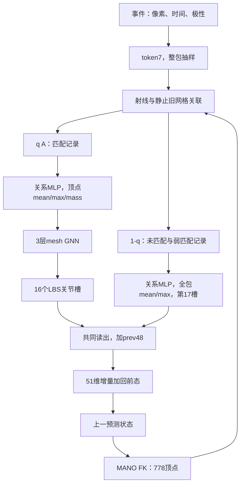
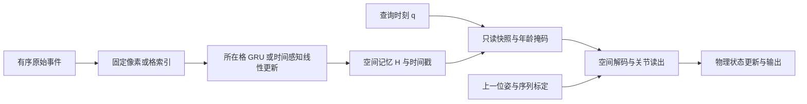
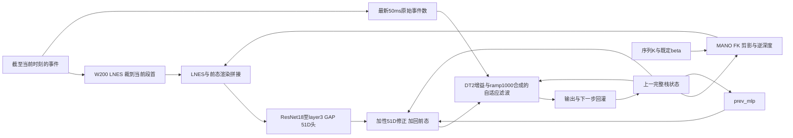
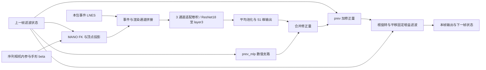
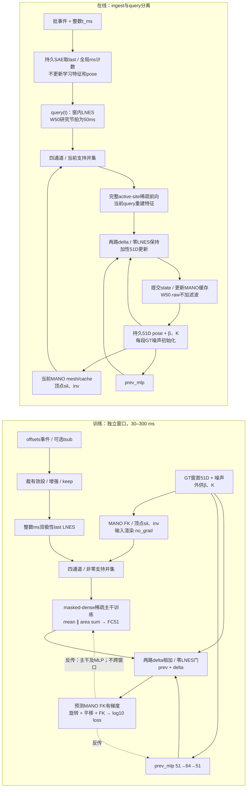
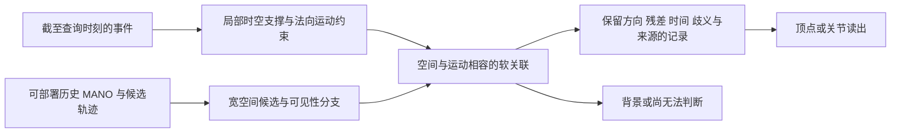

# EventHands1：网络结构与可观测性诊断研究（统一合并版）

> 将网络结构研究、可观测性诊断及历史备份归入一个阅读入口；保留原始证据，不重跑实验、不重算指标、不据合并动作宣布新研究结论。

- **合并时间（北京时间）**：2026-10-26 22:10:04 +08:00。
- **组织方式**：第一编为 2026-10-26 诊断证据，第二编为结构、文献与方案演进档案；两份主文完整保留。
- **备份去重**：备份的 5,841 行已逐行完整包含在现稿中，独有内容为 0；现稿仅新增 684 行，故不再次粘贴整份备份。
- **原分稿清理（2026-10-27，用户要求）**：两份主文已核验完整保留，备份无独有内容；原三个文件已删除，本稿作为统一维护入口。原件、清理前合并稿与入口文件可从项目内 `outputs/docs_merge_cleanup_20261027/originals_before_cleanup.zip` 恢复。不因“观点相似”删减任何研究证据。
- **S43 文档并入（2026-10-28，用户要求）**：原 `docs/S43表征调研.md`（十二编）、`docs/S43_三种表征方案与主方案定义_第二轮重设计_20261027.md`、`docs/S43_100单元交叉审查_第二轮重设计_20261027.md` 逐行并入本稿[附录 N](#s43-representation-survey)、[附录 O](#s43-redesign-20261027)、[附录 P](#s43-battle100-20261027)后删除；原 `docs/S43_REL_实现训练与流式结果_20261027.md` 并入[实验账本](EXPERIMENT_RECORDS.md#s43-rel-doc-20261027)。只下移标题层级、改写跨文件链接，原锚点不改名；备份与可逆记录见 `outputs/s43_docs_merge_20261028/`，校验见[文末](#s43-docs-merge-integrity-20261028)。

> **旧出处读取说明：** 正文中的 `docs/可观测性诊断研究.md` 对应第一编（`obs-h-*`）；`docs/网络结构分析.md` 及其备份对应第二编（原显式锚点保留）。这些旧名称只保留为历史出处，不再是独立维护文件。内容覆盖与删除回执见 `outputs/docs_merge_cleanup_20261027/`；不删除任何 Git 分支，不修改实验结果。
- **编辑边界**：仅将原正文的 Markdown 标题整体下移一级，并插入导航锚点和标有“合并版”的范围注释；原始数字、表格、公式、代码、出处与局限不改动。去掉新增注释和锚点并恢复标题层级，可逐字节还原两份正文。

<a id="merge-reading-guide"></a>

## 统一阅读导引：当前对象、历史结论与未执行提案

1. **当前研究 baseline 与历史正式参照分开**：按[项目规范](../AGENTS.md)中 2026-10-26 用户更正，当前研究 baseline 是 **S43 的 W50 原始协议、无滤波**；S39 仍是保留的正式参照。“S39 不变”不是把当前 S43 改回 S39，两种口径不混用。第一编绝大多数诊断对象是 S39 / C1 / K7，不因合并变成 S43 的测量结果。
2. **新审计限定旧假说**：OBS-A 不支持“均匀帧时钟造成数据中实际错位”的说法；旧 TBC 的 e(n) / 7.3 mm 是不适用假设下推算，不能继续作为实际数据缺陷。绝对常数偏移仍有灵敏度限制。详见[第一编第 4 节](#obs-h-024)。
3. **尺度不能越级归因**：录制级事件侧尺度缺口不能直接等同于标签—RGB-D 尺度错误、K 错误或统一 6% 偏差；来源仍未闭合。OBS-C 是借助伪标签的离线标定上界，不是纯事件可部署方法。参见[第一编 F3](#obs-h-018)、[第一编 4.2](#obs-h-026)与[第二编 L.A](#net-h-426)。
4. **方案按时间与命名空间读取**：早期 S37 的 M1–M8、mesh v2 的 M1–M10、K 系列不是同一组编号。附录 L 初步候选需与随后[第二编附录 M](#net-h-456)连读：M2 被替换为 RGQ·MSCN，M6 被替换为 KSCS·GSCD（诊断、无 GPU 臂），M9 改写为系统证据合同；这些提案不覆盖第一编已记录的 MV2 执行结果。
5. **历史待办不等于当前待办**：K★ / K7 后续阶梯已终止、未开 GPU，以[第二编 K.7](#net-h-424)及第一编后续证据为准。“下一步”“待启动”“GPU 正在运行”只描述写入时点；本次不触发训练、调度、数据修正或实验。
6. **证据强度不随合并升级**：F1–F8 的对象、种子、门和核对状态原样保留；oracle、单 seed、描述性、工具缺陷、“未检出不等于无效”等限定继续有效。[第一编 5.4](#obs-h-032)是事后描述性解释，不是新受试者泛化偏差的排他因果证明。
7. **编号与出处作用域**：章节、附录及“本文 / 本轮”按所在编解释。第一编裸 `#xxx` 指实验账本，`网络结构分析.md#xxx` 对应第二编原结构锚点。第二编已有显式锚点和链接原样保留，新导航用 `obs-h-*` / `net-h-*` 避免附录 A–C 重名歧义。原文项目路径是出处，不是本次执行命令。

## 快速导航

| 阅读目的 | 入口 |
|---|---|
| 任务、范围与摘要 | [第一编 摘要](#obs-h-002) |
| 对象、协议、统计与出处 | [第一编 第 2 节](#obs-h-008) |
| F1–F8 发现与证据表 | [第一编 第 3 节](#obs-h-015) |
| OBS-A / OBS-C 结果与限制 | [第一编 第 4 节](#obs-h-024) |
| 结构创新讨论与事后机制解释 | [第一编 第 5 节](#obs-h-028) |
| 适用范围与局限 | [第一编 第 6 节](#obs-h-033) |
| 逐行证据索引 | [第一编 附录 A](#obs-h-034) |
| 端到端训练臂主表 | [第一编 附录 B](#obs-h-037) |
| S37 / S39 结构与历史综合 | [第二编 2026-10-05 综合分析](#net-h-023) |
| XVM 文献研究 | [第二编 附录 I](#net-h-341) |
| S43 / SBA 深度研究 | [第二编 附录 J](#net-h-360) |
| MANO 算子与 K★ | [第二编 附录 K](#net-h-416) |
| 十方案 v2 来源审计 | [第二编 附录 L](#net-h-425) |
| 十方案后续 R3 评审 | [第二编 附录 M](#net-h-456) |
| S43 表征调研（十二编：审计、原理、文献卡片、候选、审查、定义、REL 归因与原子负结果） | [第二编 附录 N](#s43-representation-survey) |
| S43 第二轮三案与主方案定义（含第三轮） | [第二编 附录 O](#s43-redesign-20261027) |
| S43 100 单元交叉审查（两轮） | [第二编 附录 P](#s43-battle100-20261027) |
| S43-REL 实现、完整配对训练与流式结果 | [实验账本](EXPERIMENT_RECORDS.md#s43-rel-doc-20261027) |
| 来源 SHA256 与覆盖检查 | [文末合并校验](#merge-integrity) |

<details>
<summary>第一编完整章节索引（展开）</summary>

- [事件单目手部跟踪：围绕现任模型 S39 的十余条改动的证据整理与评测体制诊断](#obs-h-001)
  - [摘要](#obs-h-002)
  - [1 引言](#obs-h-003)
  - [2 设置](#obs-h-008)
  - [3 发现](#obs-h-015)
  - [4 新审计：OBS-A 与 OBS-C（结果已在账本登记）](#obs-h-024)
  - [5 讨论](#obs-h-028)
  - [6 局限](#obs-h-033)
  - [附录 A 证据索引](#obs-h-034)
  - [附录 B 本文引用的端到端训练臂主表](#obs-h-037)
  - [附录 C OBS-A 与 OBS-C 的登记方法要点（自第 4 节移入）](#obs-h-040)

</details>

---

<!-- MERGE_SOURCE_BEGIN obs -->

<a id="obs-h-001"></a>

## 事件单目手部跟踪：围绕现任模型 S39 的十余条改动的证据整理与评测体制诊断

> **合并版范围注：** 本编保留原诊断稿的日期、对象、F 编号和证据表。“现任 S39 / S39 不变”等按原段落时点理解，S39 是本编诊断参照，不覆盖统一导引中的当前 S43 研究基线。卷内“第 n 节 / 附录 A–C”仅指本编；裸 `#xxx` 默认指实验账本锚点，不是本合并稿锚点。


| 项目 | 内容 |
|---|---|
| 日期 | 2026-10-26 |
| 状态 | 草稿（修订版）。第 4 节两项新审计（OBS-A 事件—标签时间对齐审计、OBS-C 个体标定上界）已在账本预注册（#obs-prereg-20261026）并完成，结果与总裁决见 #obs-a-result-20261026、#obs-a1r2-result-20261026、#obs-c-result-20261026、#obs-verdict-20261026，已并入第 4 节并据此改写相关发现。 |
| 性质 | 二手整理（对应 #obs-prereg-20261026 §3 的 OBS-W）。数字取自 `docs/EXPERIMENT_RECORDS.md`（以下简称账本）、`docs/网络结构分析.md` 与 `outputs/` 下已有产物，少数由本文据产物重算（附录 A.2 列出）；本文没有新跑任何实验，也没有读取事件或标签数据。 |
| 读者 | 项目合作者与潜在审稿人（懂事件相机与手部姿态估计，未读过本仓库账本）。 |
| 外部可核性 | 本文每个数字都只能由本仓库的账本与产物核对，外部读者拿不到这些文件，所以本文**不能被独立复核**（2.5 节、第 6 节第 1 条）。证据表的"核"列标出每行回溯到产物的深度；只见账本的行（"账"）应按转述对待。 |
| 出处写法 | 见第 2.5 节。每个数字都带账本锚点（以 `#` 开头）或产物路径；附录 A 逐条给出核对状态。 |
| 文件名与"可观测性" | 文件名沿用立项时的名称。本文中的"可观测性"只指"在给定的数据、标签、估计器与指标下，某类信息能被读出多少"，**不是**信息论意义的可辨识性；哪些结论接近"边界"、哪些没有，见 1.2 节末。 |

<a id="obs-h-002"></a>

### 摘要

**任务与协议。** 本文整理一个事件相机单目手部跟踪项目的内部记录。模型每 50 ms 从 240×180 的模拟事件流（v2e 由 60 Hz RGB 视频生成）递推估计一次 51 维 MANO 手部状态（平移 3、根轴角 3、手指轴角 45）；标签是 RGB-D 优化得到的伪标签；训练用 9 名受试者，唯一的测试受试者 zgz 有两条序列——global（整手运动为主的 69 s 长序列）与 local（深度几乎不变、被标签缺口切成多个短段的序列），并兼作开发集。主指标 RA-MPJPE 是减腕点的 21 关节误差（含根旋转、不含平移），在 50 ms 闭环递推下评测（2.3 节）。现任模型 S39 在 zgz 上的 local / global / RA 为 10.27 / 7.36 / 8.71 mm（三种子，2.2 节）；种子标准差为 local 0.379 / global 0.261 mm，三种子对三种子的最小可检出效应（MDE）为 1.149 / 0.793 mm（2.4 节）。

**覆盖范围。** 本文不提出新结构。它把 S39 周围十余条线的预注册门与零训练探针读数整理成八个发现（F1–F8），逐行标注对象、种子数与门状态。其中被改对象是 S39 或其前身 dt_dz_l3 的训练线是：S42（含自身前态训练 B 与三个消融）、S44-D 与 DT3 的 evc（均三种子，6000 步）、M1（单 seed，6000 步）、M5 与 RGQ（单 seed，2000 步被停止规则终止）以及 DT2 的 22 个训练臂（两种子，对象是前身）；其余线作用在 XYZ-C1、XDL、XKF、冻结的 K7 头或生成式似然上，读数不能直接外推到 S39（1.3 节）。

**读数（按对象分）。**

1. *对 S39 的训练侧或读出改动*：local 配对差（对 S39 同种子）S42-B −0.372 mm（l3w192 主干；对匹配无 B 对照 −0.376）、S44-D −0.017 mm（l3 主干）、M1（S39 加表面提升读出 SLR）−0.36 mm（单 seed）；都低于 MDE，没有一个臂过预注册采纳门，所以只能写"未检出稳健收益"，不能写"没有收益"（F5、F4.4）。
2. *零训练诊断（对象为 S39 的冻结输出或冻结头）*：把理想 GT 增量融合进 S39，RA 最多改善 2.43 / 1.12 mm；在 r\* 门线质量（κ = 0.87；κ 是合成测量噪声档，按手指增量误差比 R_art 标定，越大测量越差）下只有 0.156 / 0.019 mm；在冻结头的实测 local 质量（κ ≈ 0.94）下 local 只有 0.134 mm，global 的 0.0155 mm 是把同一档套到 global 上的值（该头在 global 的实测质量更差，R_art 1.89），不是实测质量下的读数（F1；E3 = 前态取真值的单步读数，κ 在该体制下标定；测量器是冻结的 K7 patch 头）。S39 的剩余误差以逐段变化的缓变偏差为主（F2）；根旋转在前身 dt_dz_l3 上是主项（Shapley 63 %），在 S39 上把根换成真值使 local / global 降 3.19 / 3.48 mm、把手指换成真值降 2.95 / 0.48 mm，即 global 以根为主、local 根与手指相当（F2；部分行只见账本）。冻结 S39 特征上的读出增益（SELECT = ycy、ylf 两名训练受试者，对 S39 样本内；对非 mesh 的配准平铺读出 local −0.76 / global −0.57 mm，对 S39 自带的全局平均池化 GAP 读出 −2.86 / −2.03 mm）在单 seed 端到端里为 −0.36 / +0.40 mm（换了受试者、体制、种子数与读出基线）；local 的差值落在种子噪声量级内，global 反号，转移比例无法判断（F4）。
3. *尺度缺口与相关结构*：事件侧相对标签的二维尺度缺口 σ\* 在各录制间为 0.93–1.01，不是 zgz 特有，成因在现有数据里不可闭合，且环内 σ 校正在闭环 RA 上最多改变 0.09 mm（F3、OBS-C）；冻结 K7 头的残差在跨顶点上强相关（local hop1 0.838），但按雅可比预测的相关谱未优于拉普拉斯零模型，C1 上的邻域聚合在 E3 探针中落在预注册的"可忽略"带内（±0.75 / ±0.5 mm，与种子 SD 同量级，未检出杠杆；注意力两臂 12 个种子中 8 个塌缩，不可解读；F8，对象不是 S39）。
4. *评测体制*：E3（前态取真值）下删除事件反而使 RA 变好，正对照失败，原因未分，所以 E3 不能当作事件依赖检验（F6）；只有一个测试受试者使 1 mm 以下的比较不可分（F6）；真实传感器 EvRealHands 的输入统计位于 9 名训练受试者的包络之外，但这个门的区分力没有标定，仓库内也没有任何真实传感器的精度读数（F7）。
5. *两项新审计（账本已登记结果，第 4 节）*：OBS-A——20 / 20 条基础事件流与 54 / 54 条变体流的时间戳落在真实帧时钟上，MV2 的 TBC 探针按均匀帧时钟推算的事件—标签错位 e(n)（p95 配准误差 7.3 mm）不存在于数据中；OBS-C——尺度规范 σ 的环内校正在闭环 RA 上最多改变 0.09 mm，录制级常偏（根 + 手指）上界 local 约 0.5 / global 约 1.1 mm，zgz_local 的逐段常数上界约 2 mm（41 段，许多段只有 1–7 步，含过拟合；只在 ≥ 50 步的段上拟合为 1.3–1.5 mm）且逐段变化，同一人另一条录制的离线标定反而使 RA 变差（判"中间"）。

**怎么读这些读数。** 它们没有排除结构改动仍有杠杆：被试的结构类别见 1.4 节，未覆盖的包括训练受试者数量的学习曲线、留出受试者折、在线个体自适应和第二个测试受试者；"数据、标定、传感器与标签决定误差"只是被怀疑的方向，本文的实验没有直接检验它们（OBS-A、OBS-C 对其中两项给出了否定读数：均匀时钟错位不存在，环内 σ 校正在闭环 RA 上不是杠杆）。本文的否定读数都限于所测的估计器、数据与协议，不是不可辨识性证明——例如 SBA R3 在生成模型下，单窗内 10 mm 手指误差可被识别（F1）。**局限**：单个测试受试者且开发 = 测试、伪标签、模拟事件、多数训练臂单 seed、部分门为描述或已降级；本文数字只能由仓库内账本与产物核对（2.5 节、第 6 节）。

<a id="obs-h-003"></a>

### 1 引言

<a id="obs-h-004"></a>

#### 1.1 为什么做诊断，而不是继续加模块

本仓库围绕同一个任务积累了大量结构改动：任务是从 240×180 的事件流递推估计 51 维 MANO 手部状态；改动包括读出头、顶点 / 关节算子、MeshGNN 感受野、事件—顶点关联、尺度规范、快路径增量测量、闭环自身前态训练等。每条线都按预注册门判定，多数在门处停止。

三点使"再加一个模块"的边际信息很低。

- 这些线共享同一批数据、同一个测试受试者和同一个基线 S39，所以"十余条线都没成功"不是十余个独立检验；而且多数线的被改对象并不是 S39（1.3 节）。本文因此不把失败条数当证据，而是逐条记录每个读数否决了哪一层问题：实现、特征探针、匹配短训或完整训练（账本自己的提醒见 网络结构分析.md#current-experiment-synthesis）。
- 在两条线上观察到"冻结特征或 E3 单步探针上有信号、端到端训练里没有同量级收益"：M1（F4.1 对 F4.4）与 DT2 rootanc（F4.5）。这个模式并不普遍：AGG778 R2 里冻结头与重学头一致（F4 局限），旧协议下真图 S36 对抽头绑定卷积 S31 是真杠杆（F4 局限）；而且只有过了探针门的机制才被送去端到端，探针到端到端的差距里含有选择偏倚（赢家诅咒 / 回归均值）这一替代解释，本文没有办法把它从"不转移"里分出来（F4 局限）。
- 评测本身限制了可确证的效应大小：zgz 只有一个受试者，三种子对三种子的最小可检出效应 local 1.149 / global 0.793 mm（F6）。小于该线的改动在现有协议内无法确证，也无法否证。

<a id="obs-h-005"></a>

#### 1.2 本文贡献

1. 把十余条路线的读数整理成八个发现（F1–F8）并给出路线总览（1.3 节）与已试 / 未试的设计类别（1.4 节）。每个发现配一张证据表（结论 / 主读数 / 对象 / 种子 / 门 / 核 / 出处），共 78 行，逐行区分预注册门、描述和"工具缺陷降为描述"，并把"在 zgz 上判的门"与"在 FIT7 / SELECT 样本内判的门"分开。
2. 对直观说法做收窄。例如"增量信息已到上限"在账本里不成立：理想 GT 增量仍能省 2.43 / 1.12 mm；成立的是"以 K7 头为测量器、在 E3 标定的 κ 下，增量型快路径的可部署增益低于种子噪声"（F1）。又如"探针增益缩水"：探针对 GAP 与对配准平铺是两个不同的对比，端到端读数是单 seed，local 差值落在种子噪声量级内、global 反号（F4）。
3. 汇总评测体制层面的发现：E3 删事件的反向读数及其替代解释、单测试受试者的功效与种子 SD 的不确定性、E1 / E3 可以不同号、冻结干预与重学结论有时相反（F4、F6），并给出评测建议（第 5.2 节，逐条标注支持程度）。
4. 把"需要数据、标定、传感器或标签才能回答的问题"与网络结构问题分开列出（第 5.1 节），并说明哪些已被本文所依据的审计检验过。
5. 并入两项新审计（OBS-A、OBS-C）的账本结果，并说明它们改变了哪几条发现的读法（第 4 节）。

**"边界"一词的用法。** 本文只有两类读数接近"边界"的含义：单向杀伤门的上界读数（F1.1 的 KS1：给定测量器与标定，增益不超过某值）与被预注册门封锁的主张（F7.1：零样本真实传感器主张）。其余都是"在所测的估计器与协议下未检出"。F2 的否定限于具体估计器；F1 的反例（SBA R3 E1）说明单窗内的手指误差在生成模型下可识别；F7.6 的 TBC 推算已被 OBS-A 否定。本文没有建立任何信息论意义的可辨识性边界。

<a id="obs-h-006"></a>

#### 1.3 路线总览：每条线改的是什么、对象是谁

"对象"一列决定读数能否外推到 S39。表中日期为账本登记日（2026 年）。

| 线（日期） | 做了什么 | 对象模型 | 种子 / 规模 | 门读数 | 对应发现 |
|---|---|---|---|---|---|
| DT2（10-04） | 22 个训练侧臂：读出头（rooth / rootanc）、根权重、正则、数据分布、更长训练、自回放、训练噪声配比；另有零训练滤波与分块归因 | S39 的前身 dt_dz_l3（W50 协议，无 W200 / 滤波 / 门） | 两种子配对 | 21 个平局、1 个变差（+1.77）（#dt2-verdict §0） | F2.2、F2.3、F4.5、F4.6、F5.4 |
| DT3（10-04） | 证据窗口 W200、自适应滤波、证据门（= S39 的来历）；K1–K5 零训练诊断；事件量条件化 evg / evc | dt_dz_l3 → S39 | 三种子 | S39 8.71；evc 6000 步三种子打平（#dt3-verdict §0） | F2.4、2.2 节参照表 |
| S42（10-06） | 部署环路自身前态训练 B、窄主干 l3w192、GLIMPSE 手部 ROI（A）、集成蒸馏（C） | S39 配方 | 三种子 6000 步（C 仅 s3407 调试） | 候选 7 项采纳门 3 项未过 | F5.1、F5.2、F5.5 |
| S43（10-07） | 稀疏渲染–比对网络 | 另一架构（稀疏） | 三种子（个别臂两种子或单种子） | 套 S39 栈后差于 S39（#s43-prereg） | F7.9 |
| S44（10-19–20） | 法向流手指快路径（零训练）；D 臂 = S39 配方 + B | S39 冻结输出；S39 配方 | 快路径三种子；D 三种子 6000 步 | P0.1 作废；D 三门不过 | F1.7、F5.3 |
| XDG / XDI / XKF（10-14–15） | 显式平移 × 深度支持；无参数轮廓新息；直接测量 + 常数增益融合 | XDL Q1 / XYZ / XKF 家族 | 单 seed 或三种子短训 | XDG 机制门过、主表不一致；XDI 四门 FAIL；XKF R2 停止 | F2.9、F3.9、F5.7、F7.10 |
| XAG / XCL（10-17–19） | XYZ-C1 的关联 × 特征 × 读出阶梯控制 | XYZ-C1 家族 | 单 seed 3407 | E1 / E2 / E3 可不同号 | F6.3、F6.4 |
| XVM（10-21） | 顶点锚定的逐顶点事件运动测量 | C1 + 学到的测量头 | 单 seed | P4、P5、C1+sign 均未过 | F1.5、F1.6 |
| SBA（10-22） | 生成式事件似然（扫掠边界对齐）与 P4 发射模型 | MANO 似然（无跟踪网络） | 零训练 + P4 发射模型 | P0 / Q0 在 local 被否定；R3 部分 | F1.8、F3、F7.7、F7.8 |
| AGG778 / MRF / AURA（10-24–25） | C1 的聚合 778、MeshGNN 感受野、事件—顶点关联的隔离检验 | XYZ-C1 | 探针三种子；D 臂单 seed | 多数"可忽略" | F4.7–F4.9、F6.2、F8.6–F8.8 |
| K★ / K7（10-25） | 增量快路径阶梯 KS0–KS5 | S39 存档轨迹 + 冻结 K7 头 | 零训练 | KS1 杀 B，该线终止 | F1、F6.6、F6.7、F8.1 |
| MV2（10-26） | 十方案 M1–M10：表面提升读出、射线商、掌部刚体对齐、时基 / 标签 / 传感器审计等 | S39 冻结输出为主；M1 / M5 / RGQ 为 S39 + 读出 | 探针三种子；M1 单 seed 6000 步；M5 / RGQ 单 seed 2000 步停止 | M1：local −0.36 / global +0.40 | F1.9、F2.6–F2.8、F3.6–F3.8、F4.1–F4.4、F5.6、F6.1、F6.10、F7.1–F7.5、F8.2–F8.5 |
| OBS（10-26） | OBS-A 时钟判别；OBS-C 个体标定上界 | S39 冻结输出 + 事件时间戳 | 三种子，CPU | A：全部判真实帧时钟；C："中间" | F2.11、F3.11、F7.6、F7.11 |

**统计。** 按本文证据表与路线总览，被改对象是 S39 或其前身并训到 6000 步、与 S39 同种子配对的三种子臂共 6 个：S42 的四个（l3w192 无 B、l3w192 + B、GLIMPSE、GLIMPSE + B）、S44-D 与 DT3 的 evc；单 seed 6000 步的 1 个（M1）；在 2000 步被停止规则终止的 2 个（M5、RGQ）；两种子的 22 个（DT2，对象是前身 dt_dz_l3）。表中自 XDG 起的各行，被改对象都不是 S39。所以"没有一条稳健地超过 S39"只覆盖前一类线（计数以本文引用的臂为限，不是账本全部臂的普查）。

<a id="obs-h-007"></a>

#### 1.4 已试与未试的设计类别

下表按本文证据表与账本检索整理（非穷尽）。

| 类别 | 代表线（发现） | 对 S39 的读数 |
|---|---|---|
| 读出头 / 读出族 | DT2 rootanc、rooth（F4.5）；M1 表面提升读出（F4.1–F4.4） | 平局；M1 −0.36 / +0.40（单 seed） |
| 训练分布、正则、增广、噪声配比、更长训练、自回放 | DT2 的 22 个臂（F5.4） | 21 个平局、1 个变差 |
| 闭环自身前态训练 B | S42-B、S44-D、M5 臂（F5） | 未过预注册门 |
| 输入裁剪、主干收窄、蒸馏 | S42 的 GLIMPSE、l3w192、集成蒸馏（F5.2、B.1） | GLIMPSE 有害（local +1.28）；l3w192 中性；蒸馏未过调试门 |
| 推理侧：证据窗口、滤波、证据门 | DT3（S39 的来历） | 有效，但在 zgz 上选，读数乐观 |
| 推理侧：TTA、多窗口平均、集成 | DT3 | 极性 TTA −0.02、多窗口平均 −0.04、AdaBN 大幅变差、三种子集成 −0.45（< 0.5，不开蒸馏） |
| 增量快路径测量 | K★、S44 快路径、XVM（F1） | 未过门 |
| 顶点 / 关节算子与 MeshGNN | MRF、AURA、AGG778、MV2-M6（F4.7–F4.9、F8） | 对象是 C1 / K7 头，不是 S39 |
| 尺度规范、射线商读出 | RGQ、MSCN（F3.6–F3.8） | weak / 杀 |
| 生成式事件似然 | SBA（F1.8、F3、F7.7） | local 被否定、global 部分 |
| 融合 / 直接测量 | XKF（F5.7） | 非 S39，停止 |
| 稀疏架构 | S43（F7.9） | 差于 S39 |

**本文证据未覆盖的类别。** (a) 训练受试者数量与误差的学习曲线、留出受试者折：账本称"在本协议内看来数据受限"是推断（#dt2-verdict §0），受试者数与留出误差的关系尚未检验；(b) 第二个独立的测试受试者；(c) 在线个体自适应：AdaBN 失败，OBS-C 只给离线标定的上界；(d) 真实传感器上的训练与精度读数：EvRealHands 只作最终测试，尚无精度读数；(e) 更早的历史线（GRU 槽、顶点 GRU 记忆、S37 事件图等）按旧协议或已删记录登记在账本，不在本文证据表内，本文也未重核。

<a id="obs-h-008"></a>

### 2 设置

<a id="obs-h-009"></a>

#### 2.1 数据与协议

- **训练**：9 名受试者（ch、lfz、lpc、lr、ly、lyh、lyq、ycy、ylf），72 条序列（每人 local 与 global 两条基础序列，另有 54 个训练变体 `_v2`–`_v4`）；唯一划分文件是数据根下只读的 `splits_semkine.json`（AGENTS.md「数据协议固定」）。
- **测试**：`zgz_global` 与 `zgz_local`（一个受试者的两条序列）既是开发集也是测试集，没有封存测试集；两条序列合计 2590 个 50 ms 评测步（global 1386 + local 1204）。凡在 zgz 上做的选择都带乐观偏差（#root-tracking-verdict，§1；#dt-verdict，§1）。
- **local 与 global**：global 序列以整手平移 / 旋转为主，深度在受试者自己的深度附近变化 ±30–50 mm；local 序列的深度几乎不变（训练受试者标准差 3–11 mm），zgz_local 深度 0.699–0.743 m，超出所有训练 local 序列的深度范围（#dt-prereg §9.5 的数据读数；#dt3-prereg §1 的数据事实；zgz_global 是一段 69 s、一次初始化的序列，zgz_local 的段结构见 2.3 节）。
- **CPU 探针的受试者划分**：FIT7（ch、lfz、lpc、lr、ly、lyh、lyq）与 SELECT（ycy、ylf）。S39 在 9 人全量上训练，所以 SELECT 与 FIT7 对 S39 都是样本内（#kstar-prereg-20261025，§1）。对"只在 FIT7 上拟合、在 SELECT 上读"的冻结头或探针读出，SELECT 是留出。
- **事件**：由 v2e 对 60 Hz RGB 视频（源帧 59.67 Hz，间隔 16.63–17.13 ms）插帧后按阈值 0.15 生成，并限制在手框 ×1.5 内；640×480 坐标按 `floor(3i/8)` 并格到 240×180，K 同乘 3/8（#mv2-stage0-20261025；网络结构分析.md#mesh-v2-audit-20261025，L.A.0）。**这些 v2e 参数取自 MP4 容器标签与 18 条训练录制的 54 个变体 sidecar；zgz 基础流没有变体 sidecar，也没有 v2e manifest / 命令 / 日志，历史 command 与日志【未核验】**（#mv2-stage0-20261025，A3；F7.3）。
- **伪标签**：不是 WiLoR 逐帧输出，而是 WiLoR 初始化 → 跨场景共享形状估计 → 真实 RGB-D 深度、关键点、掩膜和时序约束共同优化 → 插值到毫秒（网络结构分析.md#mesh-v2-audit-20261025，L.A.0）。状态为 51 维：平移 3、根轴角 3、手指轴角 45（网络结构分析.md 附录 F）。
- **真实传感器数据**：EvRealHands（10 人 80 条，DAVIS346，15 Hz 标签）自 2026-10-25 起解禁为只作最终测试，不选点、不调参、不进 zgz 主行（AGENTS.md；#mv2-decisions-20261025）。本文只引用其输入统计（F7），没有任何精度读数。

<a id="obs-h-010"></a>

#### 2.2 对象模型与参照表

本文涉及的模型不止 S39。读每个发现时须先看"对象"一列。

- **S39**：`dt3_dz_l3_w200cfg`，即 `dt_dz_l3`（种子 3407 / 3408 / 3409）+ 证据窗口 W = 200 ms（裁到段首）+ DT2 事件量自适应滤波 + 证据门 ramp1000（AGENTS.md「实验编号」）。网络是两极性 LNES（本仓库的事件时间面表示，全称账本未展开）与由上一滤波状态渲染的剪影 / 逆深度（778 点溅射）拼接，经适配卷积和 ResNet18 至 layer3、GAP 与 51 维头；数值 `prev_mlp` 与 CNN 输出相加，再加回前态（网络结构分析.md#current-s39-contract）。CNN 输入含前态渲染，所以它的输出不能称为事件的独立测量。评测时模型读取序列自带的 betas 与相机 K（配置 `BETA_SOURCE: sequence_gt`，来自 `_aux.npz`）；betas 由目标受试者的 RGB-D 估计，账本称之为额外个体标定 / 特权形状条件（网络结构分析.md#mesh-v2-audit-20261025，L.A1【推断】；网络结构分析.md#dt-literature-20261003【代码事实】）。
  - **dt_dz_l3**：S39 的网络与权重本体。`dz` 指深度一致的尺度增强，`l3` 指 ResNet18 截到 layer3。单独按 W = 50 ms 协议评测时为"协议记录行"（RA 10.21，#dt3-verdict §1）；DT2 的训练臂都以它为对照。
  - **W200 / Count50 / ramp1000 / DT2 滤波**：W200 = 证据窗口 200 ms（每 50 ms 仍出一次结果，只用过去事件，裁到段首）；Count50 = 最近 50 ms 原始事件数，用作证据门的计数口径；ramp1000 = 事件数 n < 1000 时三块更新增益乘 n / 1000；DT2 滤波 = 根增益按 log10(原始事件数) 分段取 0.3 / 0.5 / 0.8、手指 0.8、平移 0.5（#dt3-verdict §0；#dt2-verdict §0）。
- **XYZ-C1（简称 C1）**：把事件射线按像素外包围带关联到 MANO 的 778 个顶点，逐顶点记录经 φ（13→64→128）与池化进入 3 层 MeshGNN，由 LBS 槽与残差槽读出（#agg778-prereg-20261024，模块边界 M）；0.46 M 参数，E1 RA 24.28 mm（单 seed 3407，附录 B.2）。它与 S39 同任务、不同架构，所以 MRF / AURA / AGG778 / XCL 的结论只对 C1 成立；它们出现在本文，是因为它们是 mesh / MANO 算子的创新尝试，并提供 E1 / E2 / E3 体制比较的材料。XCL 的变体：A0 = C1 的默认关联；A3 = oracle 关联（对已知来源用真值替换顶点 / 深度，不可部署）；F0 = 原特征（#xcl-20261019）。
- **K7 头（冻结 patch_r2）**：顶点锚定的时间面头——在每个可见顶点处取事件时间面小窗，CNN 读出该顶点的二维测量；账本写作 patch r2 或 r = 2 cm 的 patch CNN，用 FIT7 训练、冻结（#kstar-prereg-20261025；#xvm-s2-results-20261021）。K★ 与 MV2-M6 的读数都在这个头上。
- **XDL Q1 / XKF**：XDL Q1 = MANO 查询 / 自身前态的 XYZ 变体（单 seed 3407）；XKF = 给 XYZ 加一条不读前态的事件直接测量分支，并与 XYZ 用残差统计得到的常数增益融合（AGENTS.md「XKF」）。

| 网络结构 | MPJPE-local | MPJPE-global | MPVPE-local | MPVPE-global | RA-MPJPE(递推) | Latency | FLOPs/step | Params |
|---|---|---|---|---|---|---|---|---|
| EventHands-PCA6 (baseline) | 30 | 10.99 | 23.58 | 8.15 | - | 1.76 ms | 1.653 G | 11.18 M |
| S39：dt_dz_l3，W=200 + 自适应滤波 + 证据门 ramp1000 * | 10.27 | 7.36 | 8.94 | 6.25 | 8.71（8.91 / 8.53 / 8.69） | 4.09 ms | 1.252 G | 2.80 M |

\* W、滤波 spec 与证据门在 zgz 上选定，两折交叉只作选择护栏，不是独立受试者测试：W 的两折 out-of-fold 改善 −1.00 mm（六次选择全负），证据门 −0.19 mm（6/6 为负）（#dt3-verdict，§0）。表中数字复制自 #dt3-verdict §1（账本中的表由 `tools/report_table.py` 生成）。

<a id="obs-h-011"></a>

#### 2.3 评测

- **主表口径**：MPJPE 与 RA-MPJPE 都是减腕点（根对齐）、不含平移的闭环（递推）误差；RA 是两条序列按帧加权（#dt-verdict，§1）。RA 对 21 关节各减腕关节、不做旋转对齐：根旋转全额计入，平移完全不计入；绝对 MPJPE 含平移，不进主表（#s37-diagnosis-20261007，§4.2）。
- **评测协议**：50 ms 递推，每个有效段从 GT + 噪声（5 mm / 0.05 rad）出发，rng 种子 0（#root-tracking-verdict，§1）。S39 的评测栈为 W200 裁段首 + ramp1000 spec + Count50（#s42-verdict）。
- **三种读数**（#xcl-result-20261019；#mv2-results-20261026）：
  - E1：部署闭环，模型用自身递推的前态；
  - E2：以另一个模型（XCL 中为 C1）的闭环轨迹作共同前态的单步读数；
  - E3：前态取 GT(end − 50) 的单步读数，也记作"教师强制"TF。
- **E3 的恒等基线**：前态原样不更新。zgz 上恒等为 local 4.41 / global 2.43 mm（#xvm-s1-results-20261021，P0a）。
- **评测单元**（同一数据的几种计数口径，避免混用）：
  - *步*：50 ms 一个评测步。zgz_global 1386 步，zgz_local 1204 步，共 2590 步。
  - *段*：zgz_global 是一整段（69 s，一次初始化）。zgz_local 的 90 个有效段由标签有效性缺口切出（3886 个标注帧中 144 个无效，3.7 %），其中 41 段产生评测步，每段中位 7 步（约 0.35 s），15 段只有 1 步，最长的 5 段占 68.4 % 的步（823 / 1204）（#s37-diagnosis-20261007，§4.1；#dt2-verdict §2.2 同记 41 段、中位 349 ms）。Stage 0 另记这 90 个有效段的长度中位为 3 帧（60 Hz 标签帧，F7.4），二者口径不同、并不矛盾。
  - *递推与复位*：每个有效段从 GT + 噪声出发；段首 GT 初值在约 1 s 内就不起作用（#dt2-verdict §2.2），所以文中"1 s 尺度的缓变"在 local 上主要由少数长段承载，在 global 上由那一整段承载。
  - *有效样本量*：端点自相关强，积分自相关时间 τ_int 为 local 25.8 / 27.7 / 45.5、global 8.9 / 10.4 / 10.9 个端点，有效样本 n_eff local 约 26–47（名义 1204）、global 约 127–156（名义 1386）（F6.7）。

<a id="obs-h-012"></a>

#### 2.4 统计与证据强度

- **统计单位是种子。** S39 三个种子在 zgz 上的种子间标准差为 local 0.379 / global 0.261 mm；三种子对三种子（df 4，80 % 功效）的最小可检出效应 MDE 为 local 1.149 / global 0.793 mm（#kstar-results-20261025，KS0；outputs/kstar/s0_aa/result.json）。MDE 是规划近似，不是门槛；"确证"沿用项目惯例 1.5 × MDE_local = 1.72 mm（#mv2-prereg-20261026）。
- **MDE 本身不确定。** 种子 SD 由 3 个种子估计（df = 2），按卡方区间 0.379 的 95 % 区间约为 [0.20, 2.38]、0.261 为 [0.14, 1.64]，MDE 随之约为 [0.60, 7.22] 与 [0.41, 4.98]（本文算，附录 A.2）；全文把 MDE 当点估计使用，"低于 MDE"指低于点估计。种子两两均值差已达 local 0.494 / 0.744 / 0.250、global 0.289 / 0.232 / 0.522（F6.6），最大值已是 MDE 的 65 %，SD 可能被低估。MDE 也只对应 3 对 3 的比较；本文引用的单 seed 对比（如 M1 −0.36）要大得多的效应才能区分，且 SD 取自 S39 配方，对 C1 / XDL 等配方未必适用。
- **块自助只描述端点抽样。** 同一配方的 6 个种子对里 4 个的 20 端点块自助区间不含 0（outputs/kstar/s0_aa/result.json）。所以本文不用块自助区间判断模型间差异；本文自己依赖块自助的几处（F2.6、F4.1、F4.3）都另列种子级读数。
- **MDE 公式笔误。** `decision.rule` 字符串写作 `3.04 * sqrt(2/3) * SD_seed`；按字面算只有约 0.94 mm，而报告的 1.149 / SD 0.379 = 3.035。引用 MDE 时以报告的数字为准。

证据表的"门"列按下表编码，"对象""种子""核"各占一列。

| 标记 | 含义 |
|---|---|
| 门·zgz | 门与阈值在读数前写入账本，读数在 zgz 上（zgz 兼作开发与测试，带乐观偏差）。后接结果：通过 / 未过 / 杀（单向杀伤门）/ 作废。 |
| 门·样本内 | 预注册门，读数在 FIT7 / SELECT 上；对 S39 是样本内（对只在 FIT7 上拟合的冻结头或探针读出，SELECT 是留出，见"对象"列）。 |
| 门·合成 / 门·数据 | 预注册门，读数来自合成对照，或只涉及数据与标签统计（无模型精度）。 |
| 停止规则 | 预注册的训练停止规则；只停不放行。 |
| 降级 | 预注册的工具有效性对照（正 / 负对照）未过，按预注册条款该门降为描述，不作结论。 |
| 描述·零训练 / 描述·事后 / 描述·转述 | 无预注册门：零训练诊断；读数后追加的诊断或账本补注；账本原文的二手转述（本文未回溯到产物）。只作机制线索，不用于主张。 |
| 种子 | 训练臂或探针的种子数；"—"表示零训练且无种子维度。 |
| 对象 | S39 / 其前身 dt_dz_l3 / XYZ-C1 / K7 头 / XDL、XKF / MANO 似然 / 标签与事件数据 等（2.2 节）。 |
| 核 | 账+产：账本数字与产物逐项一致；账：只见账本，未回溯到产物（按转述对待）；产：取自产物；算：本文重算（附录 A）。 |

账本还提醒：负结果必须说明它否决了哪一层——接口、工程执行、特征探针、匹配短训、完整训练是五种不同的证据（网络结构分析.md#current-experiment-synthesis）。本文的每个"未检出"都按这个意义读。

<a id="obs-h-013"></a>

#### 2.5 预注册的约束力、出处写法与外部可核性

**预注册的约束力。** 本文所说的"预注册"是写在仓库内部账本里、在相应读数之前登记的门与阈值；没有外部可见的注册平台，也没有第三方时间戳。它的约束来自三点：(i) 预注册节的文本与被调用源码的 SHA-256 在读数前冻结在 `outputs/<线>/protocol.json`（例如 OBS 的 `outputs/obs/protocol.json`，预注册文本 SHA-256 前缀 `ddc71118`、29 个文件），探针入口在每次读数前校验（K★ 的 `verify_protocol()`，#kstar-results-20261025）；(ii) 读数后的工程修订只能写入协议的 `amendments`（K★ 两处、MV2 四处、OBS 一处 OA1-R2 重设计），且不改门；(iii) 预注册 §0 披露写作时已知的读数。仍有三类弱点：账本写于多个会话，部分"写于读数之前"的时点无法由产物核实（S44 阶段 0，#s44-d-result-20261020 核对补注）；K★ 预注册披露了读数前的只读读数（#kstar-prereg-20261025，§0）；OA1-R2 是在已知 OA1 / OA2 / OA3 全部读数之后设计的（#obs-a1r2-prereg-20261026，来历与披露），统计量与阈值靠合成压测而不是真实流设定，并且在任何 OA1-R2 读数之前修订过一次。另外，**多数门在 FIT7 / SELECT 上判，而 S39 对这两组受试者是样本内**，所以"门通过"回答的是"训练分布内冻结特征里是否还有这类信息"，不回答新受试者泛化；证据表的"门"列把它与 zgz 上的门分开标注。

**出处写法。** `#xxx` 指 `docs/EXPERIMENT_RECORDS.md` 内的锚点，`§n` 指该锚点下的小节；`网络结构分析.md#xxx` 指 `docs/网络结构分析.md`；`outputs/...` 是仓库内产物路径，括号内的点号路径是 JSON 键。证据行编号 `F{发现}.{序号}` 在附录 A 中对应到产物与核对状态。

**外部可核性。** 上述锚点、产物与 SHA 都在本仓库内，外部读者无法打开。因此本文是内部证据的整理，不是可独立复现的论文：外部使用须另附账本摘录与关键 `result.json`（含 `protocol.json` 的 SHA）。在那之前，"核"列为"账"的行应按转述对待，不能当作被核实的读数。

<a id="obs-h-014"></a>

#### 2.6 术语与符号表

| 术语 | 含义（一句话） | 首现 |
|---|---|---|
| RA / RA-MPJPE | 21 关节各减腕关节的平均误差（mm），不做旋转对齐，根旋转计入、平移不计入 | 2.3 |
| local / global | zgz 的两条序列：local 深度几乎不变、被标签缺口切成短段；global 整手运动为主的 69 s 长序列 | 2.1 |
| E1 / E2 / E3 / TF | 前态的三种来源：自身递推 / 另一模型的闭环轨迹 / GT(end − 50)；E3 也称教师强制 | 2.3 |
| FIT7 / SELECT | CPU 探针的受试者划分：7 人拟合 / 2 人读数（均为 S39 的训练受试者） | 2.1 |
| MDE / 种子 SD | 三种子对三种子的最小可检出效应 / 种子间标准差 | 2.4 |
| n_eff / τ_int | 有效样本量 / 端点序列的积分自相关时间 | 2.3、F6.7 |
| S39 / dt_dz_l3 | 现任模型 / 其网络与权重本体 | 2.2 |
| W200、Count50、ramp1000 | 200 ms 证据窗口、最近 50 ms 原始事件计数、事件数 < 1000 时更新增益按 n / 1000 缩放 | 2.2 |
| LNES | 本仓库的两极性事件时间面表示（全称账本未展开） | 2.2 |
| C1 / A0 / A3 / F0 | XYZ-C1 及其 XCL 变体（默认关联 / oracle 关联 / 原特征） | 2.2 |
| K7 头（patch_r2） | 冻结的顶点锚定时间面头（FIT7 训练） | 2.2 |
| GAP / tile / lift_lbs / rootanc | M1 探针的读出臂：layer3 全局平均池化 / 按 FK 腕点配准的 9×9 规则网格采样 / 顶点处采样按 LBS 权重汇聚到 16 关节 / 在 FK(prev) 的 21 关节处采样 | F4.1 |
| R_art | 手指增量误差比：Σ‖估计的手指增量误差‖ / Σ‖零运动基线误差‖（越小越好，1 = 不比"不动"好）（#s44-prereg-20261019） | F1.1 |
| κ | KS1 中合成测量噪声的 R_art 等价档；κ = 0 是理想 GT 增量 | F1.1 |
| r\* | 单步测量路线要使 E3 RA 比恒等低 0.2 mm 所需的法向相关（KS3） | F1.3 |
| ρ_stale | 只用 ≥ 50 ms 前事件的读出相关 / 全窗读出相关；大表示头在外推而不是测当前运动 | F1.2 |
| carry、b_off = 1 − carry | 前态扰动在一步更新后的保留比例 / 一步更新对位置扰动的纠回比例 | F4.3、F5.5 |
| σ\*、σ | 绕腕二维缩放使事件似然最大的值（事件侧相对标签 / RGB 的尺度缺口）/ 环内的尺度规范参数 | F3.1 |
| z\* | 似然最大的深度偏移（z 线读数） | F3.5 |
| 优先率 | SBA：GT 假设的似然优于扰动假设的包比例，0.5 为随机水平 | F1.8 |
| D / U、W1、Fano、mult | SDG：EvRealHands 对训练受试者的最大 Wasserstein-1 距离 / 训练受试者两两最大距离；Fano = 计数的方差 / 均值；mult = 每像素多重计数 | F7.1 |
| hop、J、span(J) | MANO 网格上的邻域跳数 / FK 雅可比 / 其列空间 | F8.1 |
| KS0–KS5 | K★ 阶梯：A/A、融合天花板、陈旧性、相关噪声 r\*、PA-fit、功效 | F1 |
| M1–M10 | MV2 十方案：表面提升读出（SLR）、射线规范商与度量邻域（RGQ、MSCN）、材料点事件积累、遮挡轮廓一维测量、掌部刚体预对齐（IB、FIPA、Schur、RCA）、相关谱（KSCS、GSCD）、投影规范归因、mesh 物理一致自监督（SRCA、TBC、PF）、查询时刻前沿（PSQ、PAS / CAF）、真实传感器与第二关节体（TTA、SDG、SAD、STCA） | 1.3 |
| OBS-A / OBS-C / OBS-W | 事件—标签时间对齐审计 / 个体标定上界 / 本文；OA1、OA1-R2、OA2、OA3 为 OBS-A 的子检验；Cal-A / Cal-B / Oracle-R / Oracle-S 为 OBS-C 的标定来源 | 第 4 节 |

<a id="obs-h-015"></a>

### 3 发现

下表是八个发现的一页纸概览。"收窄后的结论"是账本支持的最强说法；"最大缺口"是这条结论最容易被反驳的地方。

| 编号 | 收窄后的结论 | 最强证据 | 最大缺口 |
|---|---|---|---|
| F1 | 增量型快路径对 S39 的可达增益：理想 GT 增量 2.43 / 1.12 mm；r\* 门线质量与实测 K7 头质量下低于种子噪声（κ 在 E3 体制下标定） | F1.1 融合天花板（门·zgz，单向杀） | κ 是合成噪声；只有 zgz 存档；测量器限于 K7 头；理想增量仍有 2.43 / 1.12 mm |
| F2 | S39 的剩余误差以逐段变化的缓变偏差为主，根旋转是主项；录制级常数标定上界 local 约 0.5 / global 约 1.1 mm，段级 local 约 2 mm；因果 1 s 事件窗回收方案被杀 | F2.1–F2.4 零训练分解；F2.7 IB；F2.11 OBS-C | 否定的是估计器，不是可辨识性；偏差来源（模型 / 伪标签 / 受试者）未分；RCA 只在 SELECT 上判 |
| F3 | 事件侧尺度缺口 σ\* 是录制级量，成因不可闭合；环内 σ 校正在闭环 RA 上不是杠杆（≤ 0.09 mm）；两条尺度协变修补未成立 | F3.1–F3.3 Stage 0；F3.11 OBS-C | 多为描述；缺历史 runtime 记录 |
| F4 | 冻结特征上的读出增益在单 seed 端到端里同号（local）或反号（global）；local 差值落在种子噪声量级内，转移比例无法判断 | F4.1 对 F4.4 | 单 seed；探针与端到端同时换了受试者、体制与读出基线；选择偏倚 |
| F5 | 闭环自身前态训练 B 在 S39 家族上未检出稳健收益 | F5.1、F5.3（S42-B、S44-D） | 检出力低；M5 / RGQ 两臂只训到 2000 步；两条线不独立 |
| F6 | E3 下删事件使 RA 变好（正对照失败，原因未分），E3 不能作事件依赖检验；单人单种子下 1 mm 以下的比较不可分 | F6.1；F6.11；F6.6 MDE | SAD 本身降为描述；样本内记忆等替代解释未排除；E1 无 10 % 阳性对照；大效应仍远超 MDE |
| F7 | 真实传感器的输入统计位于训练受试者包络之外（该门区分力未标定），后果未测；事件与标签共用真实帧时钟（OBS-A） | F7.1 SDG；F7.11 OBS-A | 没有任何真实传感器的精度读数；绝对常数偏移的检验灵敏度有限 |
| F8 | 冻结 K7 头残差的跨顶点相关强；雅可比预测的 hop 谱未优于拉普拉斯零模型（门杀，仅主模型）；邻域聚合在 C1 的重学探针（E3）中无杠杆 | F8.2 谱比对；F8.6 MRF | 对象是冻结的 K7 头与 XYZ-C1，不是 S39 |

<a id="obs-h-016"></a>

#### 3.1 F1 增量型快路径：理想增量有空间，可达测量质量下低于种子噪声

**一句话结论。** 把逐步增量测量融合进 S39，RA 的上界在理想 GT 增量下为 zgz_local 2.43 / zgz_global 1.12 mm（大于 3 对 3 MDE）；在 r\* 门线质量（κ = 0.87）下为 0.156 / 0.019 mm；在实测冻结 K7 头的质量（κ ≈ 0.94）下为 0.134 / 0.0155 mm，均低于种子标准差（0.379 / 0.261 mm）。所以账本支持的说法是"可达的测量质量不够"，不是"增量信息已耗尽"。κ 在 E3 体制下标定，测量器是冻结的 K7 头，结论限于这两者。

**KS1 的设计**（供未读账本的读者）。取 S39 三个种子在 zgz 上的存档闭环轨迹；"增量测量" = GT 增量 + 合成噪声，噪声强度用手指增量相对误差比 R_art 的等价档 κ 标定（κ = 0 是理想 GT 增量，κ 越大测量越差，R_art = 1 相当于不比"保持不动"好）；把测量按分组常数增益（平移 / 根 / 手指）融合进 S39 的递推，增益在被评数据上网格搜索，所以读数是乐观上界；读 RA 的改善。两档与实测的对应：κ = 0.87 对应 XVM P3n 的 r\* 门线（单步测量路线要求的法向相关约 0.825，c = 0.8），**不是实测质量**；κ = 0.94 对应冻结 patch_r2 头在 E3 local 的实测 R_art 0.940（#kstar-prereg-20261025 §3）。KS1 是"单向杀伤"门：上界不够就否决增量融合路线；上界够也不放行任何主张。

```text
图 1  KS1：把合成增量测量融合进 S39 后 zgz 上的 RA 改善（mm，三种子均值，越长越好；每格 █ = 0.1 mm）

zgz_local
  参照 种子 SD      ███▌ 0.379
  参照 3 对 3 MDE   ███████████ 1.149
  κ = 0             ████████████████████████ 2.430   理想 GT 增量
  κ = 0.5           ███ 0.326
  κ = 0.8           █▌ 0.153
  κ = 0.87          █▌ 0.156   r* 门线质量
  κ = 0.94          █ 0.134   实测冻结头（κ ≈ 0.94）

zgz_global
  参照 种子 SD      ██▌ 0.261
  参照 3 对 3 MDE   ███████▌ 0.793
  κ = 0             ███████████ 1.124   理想 GT 增量
  κ = 0.5           █ 0.103
  κ = 0.8           ▏ 0.04
  κ = 0.87          ▏ 0.019   r* 门线质量
  κ = 0.94          ▏ 0.0155   实测冻结头（κ ≈ 0.94）
```

| 编号 | 结论 | 主读数 | 对象 | 种子 | 门 | 核 | 出处 |
|---|---|---|---|---|---|---|---|
| F1.1 | 融合天花板：理想增量有空间；r\* 门线质量（κ = 0.87）与实测头质量（κ ≈ 0.94）下没有 | κ = 0：local −2.43 / global −1.12 mm；κ = 0.87：−0.156 / −0.019；κ = 0.94：−0.134 / −0.0155（后者 global 取自产物，账本未记） | S39（zgz 存档 + 合成增量） | 3 | 门·zgz：杀 B 触发（单向，乐观上界） | 账+产 | #kstar-results-20261025；#kstar-prereg-20261025 §2–§3；outputs/kstar/s1_fusion_ceiling/decision.json |
| F1.2 | KS2：冻结的顶点锚定时间面头测的是当前运动，不是外推 | ρ_stale ycy 0.430 / ylf 0.455（杀线 ≥ 0.70）；去 lag-2 持续性偏相关 0.462 / 0.503（杀线 < 0.45，裕度 0.012 / 0.053，本文算） | K7 头（冻结 patch_r2；SELECT local） | — | 门·样本内：通过（逐人判） | 账+产 | #kstar-results-20261025；outputs/kstar/s2_stale/decision.json |
| F1.3 | KS3：local 单步测量路线对法向相关的要求过高 | 正式运行（因键路径缺陷，实际剖面为 ρ = 0）local r\*_E3 中位 0.959（判死线 > 0.95）；真实剖面补跑中位 0.970 | K7 头 + 求解器 | — | 降级（工具缺陷） | 账+产 | #kstar-results-20261025；outputs/kstar/s3_corr_rstar/decision.json；outputs/kstar/s3_corr_rstar_measured/result.json |
| F1.4 | KS4：冻结 patch 特征上的岭读出没有可恢复的位置信息，只有锚点邻域的微分信息 | 14 mm 偏移的新息读出斜率 b_off ycy 0.054 / ylf 0.051（杀线 < 0.30） | K7 头（冻结特征 + FIT7 岭读出） | — | 门·样本内：information_limited | 账+产 | #kstar-results-20261025；outputs/kstar/s4_pafit/decision.json |
| F1.5 | XVM：学到的逐顶点测量在 local 上不足，端到端单步与 C1+sign 均不过门 | P4 选中组 zgz_local 法向相关 0.343（所需 r\* 0.825）；C1+sign 的 E1 local 29.90 对 C1 27.99（门：改善 ≥ 3 mm） | XYZ-C1 + 学到的测量头 | 单 seed 3407 | 门·zgz：P4、P5、C1+sign 均未过 | 账 | #xvm-s2-results-20261021；#xvm-c1sign-result-20261021 |
| F1.6 | 与 S39 做朴素信息融合使闭环崩溃 | λ_S ∈ {1, 4, 16}：local 22.52–31.76 / global 50.63–95.23 / RA 39.18–65.60 mm；控制臂 3407 为 10.68 / 7.38 / 8.91 | S39 栈 + 冻结 P4 测量（整合探针） | 3（零训练） | 描述·事后 | 账 | #xvm-pi-addendum-20261021；#xvm-s2-results-20261021 |
| F1.7 | S44：预注册估计器下 oracle 归属也解不出手指增量；快路径对 S39 的影响 ≤ 0.03 mm | P0.1 的 R_art local：oracle 0.964 / 可部署 0.970 / 置乱 1.003（门：oracle ≤ 0.7）；P0.10 快路径 RA 差 local −0.016 / −0.011 / −0.005 | S39 冻结输出 + 手工法向流估计器 | 3（零训练） | 门·zgz：作废（估计器特异） | 账 | #s44-phase0-results-20261020；#s44-p0b-results-20261020 |
| F1.8 | SBA R3 E8：跨窗积累使似然信息增加 4–6 倍，优先率几乎不升（偏差限制，不是方差限制） | 优先率 K = 1 / 2 / 4（50 / 100 / 200 ms）：local 0.685 / 0.691 / 0.711，global 0.750 / 0.759 / 0.762；200 ms 对 50 ms 信息比 6.37 / 4.24 | MANO 似然（无跟踪网络） | — | 门·zgz：local 部分，global 否定（附前置门偏离） | 账 | #sba-r3-results-20261022；#sba-r3-verdict-20261022；#sba-r3-pregate-20261022 |
| F1.9 | M9 年龄轴：前态更旧 50 ms 对 E3 RA 的增量小于 1 个种子 SD，年龄轴判死 | ε(a_p = 50) − ε(a_p = 0)：local −0.12 / −0.11 / −0.11，global −0.23 / −0.10 / −0.05 mm（判死线 1 × SD = 0.379 / 0.261） | S39 冻结（SELECT，E3） | 3 | 门·样本内：dead（E3 体制；符号为负） | 账+产 | #mv2-results-20261026；outputs/mv2/m9_age/result.json |
| F1.10 | 50 ms 手指增量自带标签噪声底 | 噪声能量占比 ρ 0.148 / 0.257（训练 0.194），R_art 下限 0.41 / 0.50；±25 ms 平滑后 50 ms 手指增量变化 local 1.24 mm（对 e_zero 3.05）、global 0.56 mm（对 1.13） | 标签（zgz 与训练受试者） | — | 描述·零训练 | 账 | #xvm-s1-results-20261021（P0b）；#s44-phase0-results-20261020 |

表后补充（逐字取自账本或产物；非主读数）：

- **F1.1**：κ = 0.5：−0.33 / −0.10；κ = 0.8：−0.153 / −0.040（产物 summary_delta_ra，账本未记）；κ = 0.87：zgz_local 三种子 −0.170 / −0.143 / −0.156，5 折按 run 留出 −0.145；κ = 0.94：zgz_local 三种子 −0.123 / −0.150 / −0.129，zgz_global 三种子 −0.0233 / −0.0141 / −0.0089（产物）。杀 A（两域 < 0.6 mm）未触发；杀 B（κ = 0.87 时 local < 1.1 mm）触发。工具有效性：V0 复现存档 3e-5 mm，白噪声锚 −8.06～−9.13 mm，置乱 ≈ 0。
- **F1.2**：ρ_stale ycy 0.430 / ylf 0.455（杀线 ≥ 0.70）；去 lag-2 持续性偏相关 0.462 / 0.503（杀线 < 0.45）；时间置乱 −0.004 / −0.014（杀线 ≥ 0.50）；对照：无事件持续性预测器 0.425 / 0.386（须不过门，符合），真目标加噪声 0.886 / 0.890（须过门，符合）
- **F1.3**：正式运行（因键路径缺陷，实际剖面为 ρ = 0）local 九条序列 r\*_E3 为 0.857 / 0.918 / 0.948 / 0.953 / 0.959 / 0.960 / 0.964 / 0.965 / 0.972，中位 0.959（判死线 > 0.95；其中三条低于 0.95）；真实剖面补跑（ind）0.950–0.978，中位 0.970；gls 九条全部 > 0.99，账本疑为求解器实现问题
- **F1.4**：增广微分读出 r 从 clean 到 14 mm：0.564 → 0.490 / 0.663 → 0.590（降 0.074 / 0.073，< 0.10）；结论限定于冻结 patch_r2 特征 + FIT7 岭读出。
- **F1.5**：参照 patch CNN r = 2 cm：zgz_local 0.644 / global 0.967；1-ring 相邻顶点误差相关 local 0.70–0.72、global 0.68–0.74（事后校准诊断）；P5 的 E3 local 4.35（R_art 0.978）、patch r2 4.23（0.940），恒等 4.41，门 R_art ≤ 0.90。
- **F1.6**：账本对这组读数的解释（#xvm-s2-results-20261021）：算子只见过近 GT 锚点，部署锚点（S39 绝对平移误差约 35–45 mm）下分布外且过度自信；所以它是算子 / 融合设置的问题，本文不把它计入"上限"论证。
- **F1.7**：大尺度 P0b：R_art local 0.992 / 0.993 / 1.000，P0.10 local +0.017 / +0.017 / −0.026；P0.10 global −0.008 / +0.001 / −0.002（门：local ≤ −0.3）；快路径同时写根旋转时 local +1.630 / +1.572 / +1.448。
- **F1.8**：纯方差预期（K = 4）0.888 / 0.918；g200 +0.026 [+0.004, +0.046] / +0.011 [−0.002, +0.024]；标签哨兵：raw GT 对 ±25 ms 平滑 GT 的优先率 0.42 / 0.41。
- **F1.9**：符号为负，即更旧的前态使 E3 RA 略低；F6 说明 S39 的 E3 更新平均在恒等上加误差，所以这一读数更可能反映 E3 的体制偏差，E1 下未测。CAF 判读为未定。
- **F1.10**：100 ms：0.084 / 0.249；200 ms：0.035 / 0.176；这个"噪声底"与真运动不可分（F7.4）。

**解释。** 在 K7 头与 E3 标定的 κ 下，这些读数指向同一个读法：缺的是可达的测量质量，而不是增量信息。KS1 把质量作为自变量，κ 从 0 升到 0.94 时 local 增益从 2.43 降到 0.134 mm（global 从 1.12 降到 0.0155）；实测冻结头对应 κ ≈ 0.94。XVM 学到的逐顶点测量离所需质量很远（0.343 对 0.825），S44 的手工法向流在预注册尺度下连 oracle 归属都解不出手指增量。跨窗积累把似然信息增加 4–6 倍，优先率却只升 0.01–0.03，与"偏差限制"一致。F1.6 与 F1.10 不计入这条论证（前者是算子分布外，后者与真运动不可分）。

**局限与反例。**

*会削弱结论的反例*

- **理想增量并非无用。** κ = 0 的 2.43 / 1.12 mm 大于 3 对 3 MDE（1.149 / 0.793 mm），所以"理想增量也没用"不成立；KS1 只回答"S39 之后的增量融合"。KS1 的噪声是合成的，增益在被评数据上网格搜索（乐观上界），且只读 zgz 存档；它是单向杀伤门，通过不放行任何主张（#kstar-prereg-20261025，§3）。
- **oracle 读数说明信息存在。** XVM 的线性可观测比在观测集上为 0.931 / 0.990（σ = 0.5 px），账本判"单目二维测量在构造上足够"；给逐顶点二维 GT 位移的 P2 在 E3 local 的 R_art 为 0.277，E1 local 2.00 mm；给三维 GT 位移的 P1 为 E1 local 0.32 mm（#xvm-s1-results-20261021）。这些是不可部署的上界。
- **单窗内手指误差可识别；否定是估计器特异的。** SBA R3 E1 在 P4 生成模型下，10 mm 单指屈曲的优先率为 zgz_local 0.757 [0.717, 0.796] / zgz_global 0.853，5 mm 去根协同 0.719 / 0.934，捐赠对照约 0.5；这推翻了第二轮"静止手掌下手指构型单窗几乎不可识别"，后者只对扭转探针成立（#sba-r3-results-20261022；#sba-why-20261022）。S44 的训练受试者上法向速度相关随尺度升到 local 0.683 / global 0.947（#s44-phase0-results-20261020，事后敏感性）；XVM 的 patch CNN 在 zgz 上 0.644 / 0.967。
- **读出族限定。** KS4 的 b_off 低不等于输入里没有位置信息：S39 自身输出对 14 mm 偏移的 1 − carry 为 0.8425，而同类 GAP 线性读出只有 0.07（F4.3）。

*口径与措辞校正*

- **体制与测量器。** F1.1、F1.5 的 R_art 与 κ 都在 E3 体制下读（F6 说明该体制的限制），测量器是 K7 头或 XVM 学到的头；"κ ≈ 0.94"是把冻结头的 E3 local R_art 映射成合成噪声档，再套到 S39 闭环上（头 → 噪声档 → S39 闭环，三步外推）。摘要与一句话结论里的 0.156 / 0.019 是 r\* 门线质量下的上界，不是实测质量下的读数。
- **时基与标签。** OBS-A 已判事件与标签共用真实帧时钟（F7.11），所以"上限"不再含均匀时钟错位这一项；绝对常数偏移只有 OA2 的低灵敏度旁证与 SBA D 轮 τ\* 的 10 ms 网格读数（F7.11）。F1.10 的噪声底可能夹带真运动（F7.4）。
- **KS2 的措辞。** 账本称 KS2 头"只比持续性高约 0.1"，按已记数字偏相关 0.462 / 0.503 对持续性对照 0.425 / 0.386，差为 0.037（ycy）/ 0.117（ylf），引用以数字为准。
- **时点。** S44 阶段 0 若干"写于读数之前"的时点无法由产物核实（#s44-d-result-20261020，核对补注）。

<a id="obs-h-017"></a>

#### 3.2 F2 剩余误差以逐段变化的缓变偏差为主；常数标定与因果事件窗回收都只能回收一小部分

**一句话结论。** S39（及其前身 dt_dz_l3）的闭环剩余误差主要是随时间变化很慢、种子间方向一致的偏差，根旋转是主项。这类偏差在录制级几乎不是常数：OBS-C 的录制级常数标定（尺度 σ + 根旋转 + 手指）上界只有 zgz_local 约 0.5 / zgz_global 约 1.1 mm，zgz_local 的段级常数约 2 mm 且逐段变化，同一人另一条录制的标定反而使 RA 变差。已测的两种掌部刚体预对齐方案被杀：IB 在因果 1 s 事件窗内回收不了注入的 5° 段级根偏置（回收比中位 −2.84，与时间置乱零模型无差）；FIPA 在 50 ms 窗、固定迭代预算下的静态对齐残差（K = 8 时仍）高于 S39 TF 根误差 2.28°，没有可部署的固定预算形态。账本没有证明事件在原理上辨识不了这类偏差，也没有分出偏差来自模型、伪标签还是受试者。

**图 2　各种"已知偏差"oracle 能从 S39 的闭环 RA 里回收多少**（mm，数值越大回收越多）。F2.1 行来自 #s42-prereg §1 的零训练诊断（基线取 seed 3407 的 10.68 / 7.38）；OBS-C 行是三种子均值，评测步为各录制第 100 步之后；两组样本口径不同，不能逐格相减。

| 回收来源（oracle 或标定） | zgz_local 回收的 RA（mm；每格 █ = 0.2 mm） | zgz_global 回收的 RA（mm） |
|---|---|---|
| F2.1 扣每段常值偏差（oracle，关节空间；基线 seed 3407） | 3.38 ████████████████▌ | 2.68 █████████████ |
| F2.1 根旋转 ← GT | 3.19 ███████████████▌ | 3.48 █████████████████ |
| F2.1 手指 ← GT | 2.95 ██████████████▌ | 0.48 ██ |
| OBS-C Oracle-S：逐段 σ + 根 + 手指常数（local 41 段；global 只有 1 段，同 Oracle-R） | 2.45 ████████████ （2.30–2.59） | 1.14 █████▌ （0.99–1.31） |
| 　事后（非门）：只在 ≥ 20 步的段上逐段拟合 | 2.18 ██████████▌ （2.0–2.3） | — |
| 　事后（非门）：只在 ≥ 50 步的段上逐段拟合（覆盖 65 % 的步） | 1.40 ██████▌ （1.3–1.5） | — |
| OBS-C Oracle-R：整条录制 σ + 根 + 手指常数 | 0.54 ██▌ （0.48–0.61） | 1.14 █████▌ （0.99–1.31） |
| OBS-C Cal-A：同录制前 5 s 标定 | 变差 0.04–0.28 | 0.72 ███▌ （0.66–0.79） |
| OBS-C Cal-B：同一人另一条录制的离线标定 | 变差 0.26–0.60 | 变差 0.32–1.29 |

| 编号 | 结论 | 主读数 | 对象 | 种子 | 门 | 核 | 出处 |
|---|---|---|---|---|---|---|---|
| F2.1 | S39 零训练分解：缓变偏差占大头；local 上根与手指各占约一半 | 扣每段常值偏差（oracle）后 RA：global 7.38 → 4.7、local 10.68 → 7.3；local 缓变 : 快变 = 10.0 : 2.7（5 步滑窗）；根 ← GT / 手指 ← GT 后 local 7.5 / 7.7（global 3.9 / 6.9） | S39（zgz 闭环轨迹） | 3（单值行的基线为 seed 3407） | 描述·零训练 | 账 | #s42-prereg，§1 诊断表；#s42-verdict，§4 |
| F2.2 | DT2 分块归因：根旋转是主项，误差在种子间共享 | 根旋转换成 GT，RA 10.07 → 5.44（−46 %）；全部手指换 GT → 8.69（−14 %）；Shapley 根 63 %；根误差 lag-1 自相关 global 0.95 / local 0.85 | S39 前身 dt_dz_l3（W50 协议） | 2（账本该节标题 3407 / 3408，句内写"三个种子"） | 描述·零训练 | 账 | #dt2-verdict，§2.1 |
| F2.3 | 根旋转是逐帧重估，不是递推 | 10° 根扰动的保留率：一步 0.18–0.20，两步 0.09–0.11，五步 0.06–0.07 | S39 前身 dt_dz_l3 | 5 | 描述·零训练 | 账 | #dt2-verdict，§2.2 |
| F2.4 | DT3 K1：训练受试者（S39 样本内）与 zgz 之间的误差差距；形态为每段准常数的根旋转偏差 | 训练受试者 local 教师强制 3.67、闭环 4.48，zgz_local 8.54 / 12.53；zgz_global 6.74 对 2.52（2.6 倍）；每段准常数根旋转偏差约 5°，段间方向不同，跨种子余弦 0.9 | S39 前身 dt_dz_l3 的 W50 裸跟踪器 | 账本未标 | 描述·零训练 | 账 | #dt3-verdict，§2；outputs/dt3/reports/arch_synthesis.md |
| F2.5 | 闭环前态误差的时间相关 | S44 P0.9：闭环前态手指关节误差中位 0.155 / 0.19 rad（global / local），p90 0.30–0.45，lag-1 自相关 0.72–0.81；K★ 裁决区：根 / 平移 lag-1 0.9–0.98、手指约 0.7 | S39 闭环前态 | — | 描述·零训练（K★ 一组：描述·转述） | 账 | #s44-phase0-results-20261020；#kstar-results-20261025（裁决） |
| F2.6 | RCA：闭环曝光间隙在 SELECT 上集中于根块，在 FIT7 上不集中 | SELECT：RA 曝光间隙 3.88 mm 的根占比 0.84 [0.68, 0.90]（三种子 0.825 / 0.880 / 0.820），λ_root 0.937，1 s 偏差占比 0.91（零模型 0.13）；FIT7：间隙 0.91 mm，根占比 0.49 [0.41, 0.57]，1 s 偏差占比 0.485 | dt_dz_l3 裸跟踪器回放（S39 样本内） | 3 | 门·样本内：通过（门只在 SELECT 判） | 账+产 | #mv2-m1-s4-20261026（M5 条）；#mv2-prereg-20261026（M5 RCA 节）；outputs/mv2/m5_rca/result.json |
| F2.7 | IB / FIPA：IB 在 1 s 因果事件窗内回收不了注入的段级根偏置（只能作离线逐段校准）；FIPA 的固定迭代静态对齐没有可部署的固定预算形态 | IB：5° 段级根偏置在 1 s 因果窗内的回收比中位 −2.84（500 ms 为 −2.59；120 例），与时间置乱零模型差的 CI [−0.50, +0.66] 含 0；FIPA：K = 8 次展开在 256 / 512 / 1024 容量下残差都高于 S39 TF 根误差 2.28° | IB：GT 轨迹 + 注入的段级根旋转偏置（SELECT，不经 S39，无模型种子维）；FIPA：与 S39 教师强制根误差 2.28°（三种子）比较 | IB 无 / FIPA 3 | 门·样本内：杀 | 账+产 | #mv2-m1-s4-20261026（M5 PRA 条）；outputs/mv2/decisions.json（M5.ib、M5.fipa） |
| F2.8 | Schur：1 s 窗内偏置后验的可辨识窗占比未达门 | 后验 SD ≤ 2° 的窗占比 0.45（门 0.50）；MAP 残差中位 16.4°，不优于置乱 | 干净 GT 轨迹上的 SELECT 锚点（40 个，窗 1000 ms；谱另含 FIT7，共 96 个锚点；无注入，不经过 S39） | — | 描述·转述（账本归为描述，慢状态不作主张） | 账 | #mv2-m1-s4-20261026 |
| F2.9 | XDG：去掉显式平移先验后，事件对注入深度误差的纠回仍弱 | ±50 mm 输入下输出对输入深度的斜率 q1t0 0.88、q1dz 0.78（1 = hold）；local z ± 50 腕误差仍 39–50 mm | XDL 系列（非 S39） | 单 seed 3407 | 描述·转述 | 账 | #xdg-20261014 |
| F2.10 | 历史旁证（S37 时代，非 S39） | S37 逐包信念的根旋转误差 lag-1：0.85 / 0.80 / 0.86 / 0.89，离线最优常数增益滤波仅改善 RA 0.81 / 1.17 / 0.60 / 0.78 mm | S37（旧模型） | — | 描述·转述 | 账 | #probe-runtime-20260929；#positioning-e3dpsm（立论 3） |
| F2.11 | OBS-C：个体标定上界——录制级常偏上界小，段级 local 约 2 mm，跨录制的离线标定变差 | Oracle-R（整条录制常数，σ + 根 + 手指）ΔRA：local −0.61 / −0.48 / −0.54，global −1.31 / −0.99 / −1.13 mm；Oracle-S（逐段，zgz_local 41 段）−2.59 / −2.45 / −2.30；Cal-B（同一人另一条录制的离线标定）local +0.60 / +0.26 / +0.45、global +1.29 / +0.53 / +0.32（变差） | S39 冻结三种子 + 完整 S39 栈（zgz 闭环；评测步 = 各录制第 100 步之后） | 3 | 门·zgz：中间（描述性） | 账+产 | #obs-c-result-20261026；#obs-verdict-20261026；outputs/obs/oc/result.json（decision）；outputs/obs/posthoc/oracleS_long_segments.json |

表后补充（逐字取自账本或产物；非主读数）：

- **F2.1**：S39 三种子闭环 RA：global 7.38 / 7.09 / 7.61，local 10.68 / 10.19 / 9.94；三种子集成 + S39 栈 global 7.105 / local 9.843（方差项上限，local −0.42）。"扣每段常值偏差"的参数化账本未逐字定义，与 F2.11 的 Oracle-S 口径不同。
- **F2.2**：全部手指换 GT → 8.69；平移换 GT 不变；Shapley 根 63 % / MCP 19 % / PIP 7 % / DIP 3 % / 拇指 7 %；教师强制下已存在 80 %（TF 根 5.59°，闭环 6.96°）；三个种子的误差方向余弦 0.89–0.91（账本原文，种子数与该节标题的两种子不一致，未决）。
- **F2.3**：训练 prev 噪声里 50 % 是 0.3 rad 的大噪声。
- **F2.4**：种子方差只占 MSE 的 6 %（TF）/ 11 %（闭环）；去噪标签重评分只降 0.4–0.6 mm，不可约下限约 2.2–4.8 mm（模型侧占 83–95 %）。
- **F2.6**：λ_root 0.937（95 % 上界 0.973）；FIT7：λ_root 0.507；FIT7 的 1 s 偏差占比零模型 0.115；ALL：0.684 / 0.814 / 0.788；三种子的 λ_root 0.927 / 0.946 / 0.937、1 s 偏差占比 0.904 / 0.921 / 0.901（outputs/mv2/m5_rca/result.json，summary.per_seed_select）。
- **F2.7**：p90 到达时间超过 1 s（删失）。
- **F2.9**：账本称训练身份 check 上 q1t0 / q1dz 的 ±50 mm 纠回反而比 Q1 弱（34–40 mm 对 23–30 mm）。
- **F2.10**：（#positioning-e3dpsm 立论 3；单步误差 12.11 mm 是 KEG 时代 s21_keg_halo 的读数，不是 S39）相邻 50 ms 真实位移 2.91 mm，完美条件下单步误差 12.11 mm，步间自相关 0.91，约 1/3 能量为整条序列的常量（12.11 → 9.52 mm）。
- **F2.11**：Cal-A（同录制前 5 s 标定）：local +0.07 / +0.28 / +0.04（变差），global −0.72 / −0.66 / −0.79；global 三个种子都略低于 global MDE 0.793（0.720 / 0.664 / 0.787）；Cal-A 回收 Oracle-R 的 0.55 / 0.67 / 0.70（本文算）。Oracle-R 只 σ / 只根 / 只手指（三种子平均）：local −0.06 / −0.32 / −0.25，global −0.01 / −0.41 / −0.52。事后（非门）：zgz_local 只在 ≥ 20 步的段上逐段拟合收回 2.0–2.3 mm，只在 ≥ 50 步的段上（覆盖 65 % 的步）收回 1.3–1.5 mm；许多段只有 1–7 步，Oracle-S 含过拟合成分，但账本称段级偏置是真实的。训练录制（S39 样本内）上同样的上界只有 Oracle-R −0.17、Oracle-S −0.23 mm，Cal-B 在样本内也变差 +0.82。工具有效性：σ = 1 的 CPU 闭环复现存档 S39 行，6 个（种子，录制）误差全部 ≤ 0.011 mm。

**解释。** 三组零训练分解（S42 诊断、DT2 反事实、DT3 K1）给出同一幅图：误差在秒量级上缓变，种子间方向一致，教师强制下已经存在，根旋转是主项；训练侧改动没有动它（F5）。三组分解的对象同属 S39 家族，所以它们是同一类证据的重复，不是独立检验。种子间方向一致（余弦 0.89–0.91）只说明偏差与随机种子无关；它同样适用于伪标签侧的系统偏差、训练集覆盖和架构的共同归纳偏置，不能单独指向"受试者泛化"。OBS-C 补上了一块：把这类偏差当成"每录制一个常数"去标定，能回收的只有 local 约 0.5、global 约 1.1 mm；逐段常数在 zgz_local 回收约 2 mm（41 段，许多段只有 1–7 步，含过拟合），同一人另一条录制的标定反而变差，说明 zgz 上可校正的常偏是"录制 / 段"级的，不是"人"级的（账本裁决，#obs-c-result-20261026）。账本把"段级偏置的来源（例如伪 GT 逐段优化）"留给用户另立研究。账本对 DT2 的判读是"在本协议内看来数据受限"，这是推断；受试者数与留出误差的关系尚未检验。IB 在因果 1 s 窗内回收不了注入的段级根偏置，FIPA 的固定预算静态对齐没有可部署形态，两者被杀；Schur 未达门（后验 SD ≤ 2° 的窗占比 0.45 < 0.50）。

**局限与反例。**

*会削弱结论的反例*

- **否定的是估计器，不是可辨识性。** IB / FIPA 否定的是"掌部刚体预对齐"这一类方案；SBA R3 在生成模型下显示单个 50 ms 窗内 10 mm 的手指误差可识别（F1 的反例）。跨窗积累却是偏差限制（F1.8）。
- **"跨受试者泛化缺口"的措辞不成立。** F2.4 与 DT2 / DT3 的"泛化差距"是训练受试者（S39 样本内）与 zgz（唯一的留出受试者）之差，混有过拟合与记忆；没有逐受试者留出实验，不能分离"新受试者"与 zgz 特有因素（距离、手尺寸）。样本内的受试者之间也有数倍差别：S39 栈在 SELECT 上 seed 3407 的闭环 RA 为 ycy_global 14.585、ylf_global 2.644 mm（F6.8）；回放口径下 SELECT 的闭环 RA 7.70 mm 而 FIT7 为 4.88 mm（outputs/mv2/m5_rca/result.json，summary.*.ra_mm.closed_loop）。替代解释（账本未检验）：伪标签的段级根旋转偏置（Stage 0 把 RGB 域读数的循环性列为不可闭合项；OBS-C 裁决把"伪 GT 逐段优化"列为待查来源）、训练集覆盖、根旋转与手指的互相补偿（F2.1 的"根与手指各约一半"用换 GT 的反事实得到，不独立）、以及腕旋转对远端关节的杠杆放大。"缓变"由 250 ms 滑窗定义，也含合法的运动跟踪滞后。
- **缓变不等于全部，也不等于可标定。** 扣每段常值偏差后 local 仍剩 7.3、global 4.7 mm（F2.1），常值部分只解释一部分；OBS-C 的参数化标定（σ + 根旋转 + 手指轴角常数）回收得更少（local Oracle-S 2.3–2.6、global Oracle-R 约 1.1 mm，对 F2.1 的 3.4 / 2.7 mm；两者口径不同、样本不同，不能直接比较，但提示关节空间的常值偏差有一部分不是这三类常数偏置能表示的）。

*口径与措辞校正*

- **RCA 的集中度依赖受试者集合。** 0.84 与 0.91 只在 SELECT（两人）成立；按同一门线（根占比 ≥ 0.5、1 s 偏差占比 ≥ 0.5）对照，FIT7 的 0.49 与 0.485 都略低于线（本文的对照，不是预注册读数）；三个种子的 SELECT 根占比 0.825 / 0.880 / 0.820 一致，但种子一致不等于受试者一致。SELECT 的 RA 曝光间隙（3.88 mm）是 FIT7（0.91 mm）的数倍。绝对误差的曝光间隙主要在平移：平移占比 SELECT 0.886 [0.831, 0.947]、FIT7 0.978、ALL 0.950；RA 口径把平移扣掉了（outputs/mv2/m5_rca/result.json，summary.*.exposure_gap_abs）。
- **样本内与裸跟踪器。** S39 对 SELECT 与 FIT7 都是样本内，λ 估计偏乐观；回放不含 DT2 滤波与证据门，绝对数是 `dt_dz_l3` 的，不是 S39 行的。DT3 K1 显示训练受试者的闭环误差远小于 zgz（4.48 对 12.53），所以训练受试者上的缓变偏差占比可能偏小。
- **旧模型与未回溯数字。** F2.10 是 S37 与更早的数字；F2.5 的 K★ 数字是账本原文。F2.2 的种子数在账本内不一致（节标题 3407 / 3408，句内"三个种子"）。
- **时基。** 初稿曾引用 TBC 的时基推算"不能解释同号的 σ\*、根偏置或 local 8.54"；OBS-A 随后判 TBC 的 e(n) 不存在于数据中（F7.11），所以均匀时钟错位不是这些偏差的来源；绝对常数偏移没有被高灵敏度地检验。
- **本文没有做的检验。** 受试者数量与留出误差的学习曲线、逐受试者留出折、偏差来源（模型 / 伪标签 / 受试者）的分离。

<a id="obs-h-018"></a>

#### 3.3 F3 事件侧尺度缺口 σ\* 是录制级量，成因不可闭合；σ 校正在闭环 RA 上不是杠杆

**一句话结论。** 事件侧相对标签 / RGB 的二维尺度缺口 σ\* 在各录制间为 0.93–1.01，不是 zgz 特有，也不是标签—RGB-D 尺度、K、并格相位、光栅化或（按 OBS-A）时间错位造成的；它的成因在现有数据里不可闭合。S39 对沿腕射线的尺度扰动在单步 E3 前态扰动里有约 1 mm 的响应，介于种子标准差与 MDE 之间；但 OBS-C 显示环内 σ 校正在闭环 RA 上最多改变 0.09 mm，所以 σ 缺口没有被证明是 RA 的杠杆。两条尺度协变的修补路线（MSCN、RGQ 因子臂）都没有成立。

| 编号 | 结论 | 主读数 | 对象 | 种子 | 门 | 核 | 出处 |
|---|---|---|---|---|---|---|---|
| F3.1 | σ\* 是录制级缺口，不是 zgz 特有，也不是"全局约 6 %" | 事件侧 σ\*：zgz_local 0.943（掩膜侧 1.015）、zgz_global 0.961、ycy_local 0.946、lyq_local 0.984、lpc_local 1.013（这 5 条由 Stage 0 重算）；20 录制范围 0.93–1.01、中位 0.98（取自 outputs/sba/p0v/result.json，其余 15 条未重算） | 标签与事件（20 录制） | — | 描述·零训练 | 账+产+算 | #mv2-stage0-20261025（A1 d）；#sba-d-results-20261022；#sba-why-20261022；outputs/sba/p0v/result.json |
| F3.2 | 已排除的来源 | 掩膜侧 σ_mask\* 0.998–1.028（20 录制中位 1.019，与深度 ρ = +0.08）；单因素 Δσ\*：并格相位 ±0.4375 px ≤ 0.013，fx、fy ±1 % ≤ 0.011，cx、cy ±0.5 px ≤ 0.004，三角光栅对 3×3 溅射 ≈ 0；标签—事件时间偏移 τ\* 为 0 ms（zgz_local）/ +10 ms（zgz_global） | 标签 / 相机内参 / 并格 | — | 描述·零训练（σ_mask\* 有循环性；单因素只在 5 条录制上做） | 账+产 | #mv2-stage0-20261025；#sba-d-results-20261022 |
| F3.3 | 成因不可闭合 | betas 第一主成分 ±1 SD（手长 ∓4.7 %）使 Δσ\* 为 ±0.044…±0.058，是唯一量级够的单因素；事件侧 σ\* 与 betas[0] 的相关 −0.01 | 标签 / 事件 / 手形 | — | 描述·零训练（不可闭合） | 账+产 | #mv2-stage0-20261025；outputs/mv2/stage0/report.md |
| F3.4 | 缺口随距离增大 | 事件侧 σ\* 与录制深度 Spearman −0.49（p = 0.027），Pearson −0.61（p = 0.004）；事件侧减掩膜侧的差与深度 Spearman −0.64（p = 0.002） | 标签与事件（20 录制 / 10 受试者） | — | 描述·零训练 | 账+产 | outputs/mv2/stage0/report.md（A1 c）；#sba-why-20261022 |
| F3.5 | zgz_local 的 +45 mm"深度偏置"与 σ\* ≈ 0.94 的二维缩放数值相符 | z\* +45 mm（zgz_global +10）；+45 mm / 0.72 m = 6.2 %；按 z\* ≈ 深度 × (1/σ\* − 1) 预测 zgz_local +46 对实测 +45；20 录制 Pearson 0.72（去掉 zgz_local 后 0.574，本文算） | S39 存档预测 + SBA 似然 | — | 描述·事后 | 账+产+算 | #sba-d-results-20261022；#sba-why-20261022；outputs/sba/p0v/result.json |
| F3.6 | RGQ 探针：S39 对沿腕射线的尺度扰动响应约 1 mm，沿射线只补回约四成 | σ = 0.94：SELECT 上非 t_z 通道（根对齐关节）相对 σ = 1 的位移，三种子 1.066 / 0.976 / 1.029 mm；t_z 响应比 0.375 / 0.370 / 0.365 | S39 冻结（SELECT，E3 前态扰动） | 3 | 门·样本内：weak（介于种子 SD 0.379 与 MDE 1.149 之间，只放行单 seed 描述臂） | 账+产 | #mv2-results-20261026；outputs/mv2/rgq/result.json |
| F3.7 | MSCN 度量半径窗没有降低尺度漂移，反而更大，被杀 | R = D(度量窗) / D(固定窗)，FIT7、s = 0.94：seed 3407 为 1.1327（CI [1.1144, 1.1526]），三种子 1.1327 / 1.0707 / 1.0404（门：R 的 CI 上界 ≤ 0.80，任一 R ≥ 0.95 则杀） | S39 冻结 + 度量半径窗（FIT7） | 3 | 门·样本内：杀 | 账+产 | #mv2-results-20261026；outputs/mv2/mscn/result.json |
| F3.8 | RGQ 因子臂（训练时把前态沿腕射线移到 w/σ，σ ~ U[0.93, 1.01]）在 step 2000 被停止 | E3 RA 5.86 mm（S39@2000 为 7.12）；根 carry 0.232 > 0.165 + 0.05 = 0.215 | S39 配方 + RGQ（M1 子类） | 单 seed 3407（2000 步） | 停止规则：停（只停不放行；无 zgz 读数） | 账+产 | #mv2-results-20261026；outputs/mv2/gpu_rgq/s3/s3_check.json |
| F3.9 | XDG：local 深度钳位来自显式平移 × 训练深度支持；消除后主表收益不一致 | local 偏置 Q1 −64.7 / q1r −72.8 → q1t0 +3.8 / q1dz +2.6 mm；主表 local / global / RA：q1r 25.86 / 13.11 / 19.04，q1t0 28.81 / 11.62 / 19.61，q1dz 19.54 / 14.41 / 16.79 | XDL Q1 / XDG 臂（非 S39；钳位偏近，与 S39 的偏远方向相反） | 单 seed | 机制门 PASS；主表读数为单 seed 描述（q1dz 同时改了尺度语义，只能称语义总效应） | 账+产 | #xdg-20261014；outputs/xdg/retrain/result.json |
| F3.10 | σ 的数值水平依赖估计器 | SBA 二维似然 zgz σ\* 0.94–0.96，R3 录制级 σ_r 0.951 / 0.959；M4 一维法向轮廓估计的腕部 σ̂（18 个）0.7823–0.9153，落入 [0.93, 1.01] 的比例 0.0，cv_sigma 0.0478 | 似然 / 轮廓估计器 | — | 描述（σ̂ 与偏移简并，账本明言不把 σ̂ 当真值） | 账+产 | #sba-r3-results-20261022（E3）；outputs/mv2/m4_contour/result.json（decision.detail.e8） |
| F3.11 | OBS-C：环内 σ 校正在闭环 RA 上不是杠杆 | Oracle-σ\*（Stage 0 的逐录制 σ\*，只环内尺度）ΔRA：zgz_local +0.05 / −0.00 / −0.05，zgz_global −0.01 / 0.00 / 0.00 mm；Oracle-R 只 σ（三种子平均）：local −0.06、global −0.01 | S39 冻结 + 环内尺度包装层（zgz 闭环） | 3 | 门·zgz：中间（描述性） | 账+产 | #obs-c-result-20261026；outputs/obs/oc/result.json |

表后补充（逐字取自账本或产物；非主读数）：

- **F3.1**：SBA D 轮：zgz_local 0.94（zgz_global 0.96，训练 local 0.98，训练 global 0.98）。两处网格口径不同（Stage 0：0.82–1.08 步 0.02 加抛物线精修；SBA：0.90–1.04 步 0.02 取 argmax），不要混用。同一录制的 base / v2 / v3 / v4 变体共享标签，σ\* 相同（v4 的 K 不同，故不是内参误差），在录制间变化（#sba-why-20261022）；录制内（窗口间）的离散度账本未记，网格步 0.02，20 录制的范围 0.93–1.01 只占约 4 个网格步。
- **F3.2**：深度残差绝对中位 ≤ 1.5 mm；1×1 溅射 +0.007…+0.035；并格约定均值偏差精确 −0.4375 px，折算 σ − 1 的绝对值 0.5–1.0 %（按手跨 60–85 px）/ 1.0–1.6 %（真实手形最小二乘）；±25 ms 平滑后 z\* 仍 +45 mm。
- **F3.3**：10 受试者 betas[0] 的标准差仅 0.14 SD（手长 ±0.65 %）；zgz_local 0.943 → 0.996，ycy_local 0.946 → 0.998；缺 sequence_refined.npz、validation.json、subject_shape、raw WiLoR、逐 run 配置与日志；无 v2e manifest / 命令 / 日志。
- **F3.4**：事件侧减掩膜侧的差为 −0.013…−0.088（均值 −0.044）；掩膜侧 σ\* 与深度 +0.08（p = 0.73）；SBA 复核给出 Spearman −0.47。n = 20 录制不独立（local 与 global 共享 betas），p 值未按受试者聚类，只作描述；训练录制每条仅 32 个包（lr_local 31），zgz_local 1095、zgz_global 1378（outputs/sba/p0v/result.json）。深度与序列类型（local / global）、手速、事件密度共线，v2e 在远处的阈值响应与手速的替代解释【未检验】。
- **F3.5**：z\* zgz_local +45 mm（zgz_global +10，训练 local +10，训练 global +5）；ycy_local +48 对 +20，lyh_local +27 对 +20；S39 存档预测比 GT 更远：zgz_local +40 / +50 / +30 mm（91–97 % 的步），zgz_global +44 / +29 / +26 mm（96–100 %）；z\* 网格 2.5 mm；训练录制每条仅 32 个包，zgz_local 是高杠杆点。
- **F3.6**：local 1.216 / 1.107 / 1.130，global 0.930 / 0.856 / 0.937；同位姿、手长 × σ 的 hand 形状 1.391 / 1.241 / 1.323；t_z 响应比 local 约 0.31，global 约 0.42–0.44（账本摘要写 0.39–0.44，以产物为准）。
- **F3.7**：s = 1.06 时 1.0775 / 1.0249 / 1.0005；探针敏感：D(固定窗) 4.7247（seed 3407，要求 ≥ 1.5）。
- **F3.8**：手指 carry 0.185（S39 0.153）。
- **F3.9**：输出腕深 p95 680 / 674 → 748 / 751 mm；训练标签深度上限 718.5 mm（p99 671.9），local 真值 705–749 mm；Q1 与 q1r 同配置之差 +1.95 / +2.18 / +2.08 mm（工程噪声底）；q1dz 对 q1r：local 好 6.3、RA 好 2.25、global 差 1.3 mm。
- **F3.11**：σ = 1 时包装层逐位等于裸 S39（单测）；σ 网格 0.90–1.06 步 0.01；账本描述："已知 σ\* 的环内校正与 Oracle 选 σ 都只改变 0–0.09 mm（MV2 RGQ 测到的约 1 mm 单步串扰没有变成闭环 RA 差）"。

**解释。** σ\* 的缺口、S39 的深度偏差和 S39 对尺度扰动的响应是三件相关但不同的事，账本没有把它们接成一条因果链。事后诊断里 zgz_local 的 +45 mm 与 σ\* ≈ 0.94 数值相符，但跨录制只有 Pearson 0.72。Stage 0 排除了标签—RGB-D 尺度、K、并格相位、光栅化和时间错位，却无法在手尺寸、v2e 事件边缘响应与 SBA 的 σ 滋扰参数之间分摊。RGQ 测到的约 1 mm 低于 local MDE，hand 形状的 1.2–1.4 mm 则高于它；两条架构修补（MSCN、RGQ 因子臂）都没有成立；OBS-C 进一步显示，即便给出每录制的 σ\*（Oracle-σ\*）并在环内校正，RA 也只变化 0–0.09 mm。

**局限与反例。**

*会削弱结论的反例*

- **"不可闭合"是证据缺失，不是已证不可识别。** 缺的是历史 runtime、事件边缘的独立实测和手尺寸的独立标定（#mv2-stage0-20261025，不可闭合项）。账本另有一条识别性限制：以事件代价拟合的 σ\* 不自动等于真实几何缩放，可能是阈值、轮廓发射、可见性、插帧等错设被一个缩放参数吸收后的有效 nuisance，不能据此推出部署必须加在线 σ 状态（网络结构分析.md#mesh-v2-audit-20261025，L.A1）。
- **σ 与深度偏差对 RA 的影响量级有上界。** SBA D 轮的判读是主表的根对齐指标对深度不敏感（#sba-d-results-20261022）；DT3 显示 zgz_local 相对 global 特有的差距只占一小部分（教师强制 +0.7、闭环 +2.9 mm，#dt3-verdict §2）；OBS-C 的环内 σ 校正只改变 0–0.09 mm（F3.11）。三者合起来说明 +45 mm 的深度偏置与 σ\* 缺口对根对齐 RA 的影响有限；但 OBS-C 只检验了"环内沿腕射线移动前态"这一种 σ 处理，事件侧缩放等其它处理未测。
- **显式处理 σ 在 SBA 里有正向边际，但单独不足以让 local 过线。** SBA 第二轮 Q0 里，在 V2（P4 发射模型 + 逐部位倍率 / 离群率）之上再加 σ 剖面（V2 → V3）：zgz_global 的手指优先率 0.592 → 0.644（+0.052），zgz_local 0.535 → 0.570（+0.035）；V0 → V3 的整体读数为 global 0.585 → 0.644、local 0.579 → 0.570（V3 同时含发射模型、倍率、离群率与 σ）；V3 在 local 仍低于 0.60 被否定（#sba-q0-results-20261022；V 的定义见 #sba-p4-prereg-20261022）。

*口径与措辞校正*

- **"录制级"的证据与限度。** 同一录制的 base / v2 / v3 / v4 变体 σ\* 相同、录制间不同，是"录制级"的依据；窗口间离散度未报，网格步 0.02，范围 0.93–1.01 只占约 4 步，部分录制间差异在一个网格步以内；p 值按 n = 20 非独立样本给出。深度、序列类型、手速与事件密度共线，σ\* 随距离增大的读法没有排除这些替代解释。
- **z\* 公式不是普适的。** Pearson 0.72，去掉 zgz_local 后 0.574；zgz_global 预测 23.5 对实测 10 mm，lpc_local 预测 −4.9 对 +5 mm（outputs/sba/p0v/result.json）；训练录制每条 32 个包，z\* 网格 2.5 mm，zgz_local 为高杠杆点。
- **RGQ 测的是前态沿腕射线的平移**，不是事件侧缩放，也不是闭环。seed 3407 在 σ = 0.97 / 1.03 / 1.06 处已有 0.721 / 0.697 / 0.999 mm（outputs/mv2/rgq/result.json），说明读数含对任何前态扰动的一般敏感度，不全是 σ 特异的。
- **时间错位不是解释。** SBA D 轮估计 τ\* 为 0 / +10 ms（网格 10 ms，账本标【未核验】）；OBS-A 判 TBC 的均匀时钟错位不存在（F7.11）。

<a id="obs-h-019"></a>

#### 3.4 F4 冻结特征上的读出增益在端到端里未检出同量级转移；转移比例无法判断

**一句话结论。** 在冻结 S39 特征上，mesh 提升读出相对配准平铺有 local −0.76 / global −0.57 mm、相对 GAP 读出有 local −2.86 / global −2.03 mm 的线性增益（预注册门通过，SELECT 样本内，E3）；同一读出接入 S39 并端到端训练后，配对的 zgz 结果为 local −0.36 / global +0.40 mm（单 seed 3407，E1 闭环）。这两组读数换了受试者、体制、种子数与读出基线：local 的差值落在种子噪声量级内，global 方向反号，所以只能说"未检出同量级的转移"，无法给出转移比例，也不构成方向支持。DT2 的 rootanc 读出头也是"探针好、训练平局"。

**表 4.1　探针与端到端的口径对照**（mm；括号内为同一种子 3407 的读数）

| 读数 | 受试者 / 体制 | 种子 | local | global |
|---|---|---|---|---|
| 探针 lift_lbs − GAP（对应 S39 自带的 GAP 读出） | SELECT，E3，样本内 | 3 种子均值（3407） | −2.86（−3.09） | −2.03（−2.62） |
| 探针 lift_lbs − tile（预注册主对比；tile 是非 mesh 的配准平铺对照） | 同上 | 同上 | −0.76（−1.38） | −0.57（−1.45） |
| 探针 df 配平 lift_lbs − tile | 同上 | 同上 | −0.58（−1.31） | −0.37（−1.44） |
| 端到端 SLR − S39（配对，seed 3407） | zgz，E1 闭环 | 单 seed 3407 | −0.36 | +0.40 |

出处：outputs/mv2/pa1/result.json（contrast.*）；#mv2-m1-s4-20261026。端到端的 S3 读数（step 2000，SELECT，E3，合并域）为 RA 6.16 对 S39@2000 的 7.12 mm。

| 编号 | 结论 | 主读数 | 对象 | 种子 | 门 | 核 | 出处 |
|---|---|---|---|---|---|---|---|
| F4.1 | PA1：冻结 S39 特征上，mesh 提升读出（lift_lbs）优于配准平铺（tile）与 GAP，且 mesh 特异 | lift_lbs − tile：local −0.76 [−1.10, −0.40]，global −0.57 [−1.16, −0.02]，合并 −0.664 [−1.015, −0.33]；Holm p 0.000 / 0.011；lift_lbs − GAP：local −2.86、global −2.03、合并 −2.43 | S39 冻结特征（SELECT 635 个端点，E3；读出在 FIT7 拟合） | 3 | 门·样本内：通过（区间为（序列，1 s）块自助） | 账+产 | #mv2-results-20261026；outputs/mv2/pa1/result.json |
| F4.2 | 探针读出的绝对误差远高于 S39 自身 | 合并域平均误差：lift_lbs 14.125、GAP 16.55、tile 14.788、保持前态 18.109、S39 自身输出 4.873 mm | S39 冻结（SELECT） | — | 描述（mean_s39 一项，账本未逐字定义；按 tools/mv2/pa_probe.py 第 472 行为 S39 自身输出在同批端点的误差） | 产 | outputs/mv2/pa1/result.json（contrast.all.mean_err_*、mean_hold、mean_s39） |
| F4.3 | PA2：线性读出能取到的位置信息 b_off 远低于 S39 自身 | 像面平移 14 mm（t14）的 b_off：GAP 0.07、tile 0.32、lift_lbs 0.68（三种子 0.89 / 0.59 / 0.57）；lift_lbs 对 max(GAP, tile) 的差 0.36 [0.35, 0.38]；S39 自身输出的 1 − carry 为 0.8425 | S39 冻结（SELECT） | 3 | 门·样本内：通过；S39 一项为描述性注记 | 账+产 | #mv2-results-20261026；outputs/mv2/pa2/result.json（contrast_t14.all） |
| F4.4 | M1 SLR 端到端 S4：local −0.36 在种子 SD 量级内，global 反向 | SLR（seed 3407，6000 步）local 10.32 / global 7.78 / RA 8.96；配对的 S39 seed 3407 为 10.68 / 7.38 / 8.91：local −0.36，global +0.40 mm | S39 + 表面提升读出（新增 86,826 参数） | 单 seed 3407 | 门·zgz：local 过 / global 不过（S42 单种子方向门，描述性；local 效应 0.36 < 1.5 × MDE = 1.72，不补种子） | 账+产 | #mv2-m1-s4-20261026；outputs/mv2/gpu_m1/s3/s3_check.json |
| F4.5 | DT2 rootanc / rooth：读出头改动平局 | rootanc ΔRA +0.19 / +0.11（均值 +0.15）；rooth +1.12 / +0.47（均值 +0.79）；22 个训练臂两种子配对：21 平局、1 个变差（+1.77） | S39 前身 dt_dz_l3 | 2 | 描述 | 账 | #dt2-verdict，§0、§2.3、§3 |
| F4.6 | 单步（教师强制）与闭环可以脱钩 | DT2 nzlo：TF RA 7.49 → 6.61，闭环 RA +0.08；w128_kd：TF 7.17 对 7.58，闭环 ΔRA −0.17；AURA none：E3 local 8.82 对 C1 的 15.35，而 E1 local 仅 −0.12 | S39 前身（DT2）；XYZ-C1（AURA） | DT2 2；AURA 单 seed | 描述 | 账 | #dt2-verdict，§0、§2.2；#aura-results-20261025 |
| F4.7 | 冻结干预与重学结论相反：冻结干预只反映共适应 | A3F0 E1 local：原 10.48，截断消息 / 固定支持 17.78–27.04；A0 固定支持下 E1 global 发散（k3f / poolO 111.07，绝对误差约 73 m）；重学的 N0d 与 L3 只差 ≤ 0.2 | XYZ-C1 / A3F0 | H 臂 1 | 描述（C 段为冻结权重上的分布外干预） | 账 | #mrf-c-result-20261025；#mrf-b-result-20261025 |
| F4.8 | MRF D：去掉消息与外推在系统内的 global 改善主要来自闭环漂移 | self3 − C1 的 RA global E1 / E2 / E3 −9.28 / −1.65 / −0.15，local E1 −2.68、E3 +0.69；C1 的 global E1 在 5000 / 5500 / 6000 步为 13.29 / 15.99 / 21.06，self3 为 13.01 / 12.82 / 11.79 | XYZ-C1（MRF D） | 单 seed 3407 | 描述（XCL 单 seed 规则：global 方向支持，local 与腕部噪声带内） | 账 | #mrf-d-result-20261025 |
| F4.9 | AURA：探针内 global 的实质效应在单 seed 的 D 读数里既未被确认也未被否定 | 探针（E3，zgz）P1 占据 occD − occ：local +0.09 可忽略，global +0.72 [0.53, 0.95] 实质；P2 绑定 shufG − c1：local +0.21 未定，global +0.66 [0.49, 0.86] 实质；D 的 shuffle：global E1 / E2 / E3 −3.33 / −0.92 / +2.53；none 的 zgz_global E1 腕点绝对 1782 mm（C1 约 30 mm，Δ +1752 mm，发散） | XYZ-C1（AURA） | 探针 3；D 单 seed 3407 | 探针为门·zgz；D 为描述 | 账 | #aura-results-20261025 |

表后补充（逐字取自账本或产物；非主读数）：

- **F4.1**：三种子逐种子（主对比 lift_lbs − tile）：local −1.38 / −0.39 / −0.52，global −1.45 / −0.13 / −0.14，合并 −1.42 / −0.25 / −0.32；df 配平版（lift_lbs 取使有效自由度等于 tile 的 λ）：local −0.58 [−0.99, −0.16]（−1.31 / −0.10 / −0.33）、global −0.37 [−1.06, +0.29]（−1.44 / +0.46 / −0.13）、合并 −0.47 [−0.88, −0.09]（−1.38 / +0.19 / −0.23）；对 GAP 逐种子：local −3.09 / −2.61 / −2.89，global −2.62 / −1.57 / −1.89；tile − GAP −1.76；平移 10 mm 的采样 − GAP −2.22（lift_lbs 比它只再好 0.204）；lift_lbs − 顶点置乱 −1.47；时间置乱 − GAP +0.33，噪声 − GAP +0.38。预注册门对每个域要求 Holm 显著、95 % CI 上界 < 0、三种子各自均值 < 0 且 df 配平版均值 < 0，local 与 global 都满足；逐种子的符号见上，df 配平版 global 与合并各有一个种子（3408）为正。
- **F4.3**：lift_lbs 对 max(GAP, tile) 的差为 diff；S39 一项为描述性注记（账本：这个读出族明显低估了 GAP 特征里已有的位置信息）。
- **F4.4**：探针中对应的对比：对 GAP −2.43（local −2.86 / global −2.03），对 tile −0.66（−0.76 / −0.57），见表 4.1；S3（step 2000，SELECT）E3 RA 6.16 对 7.12 mm；绝对 MPJPE local −1.94（平移 −1.50）、global +1.05（平移 +0.53）；时延 10.67 对 4.33 ms；探针里各读出臂都是 GAP ⊕ 臂块，GPU 臂是 S39 加 SLR 分支（零初值末层）。
- **F4.5**：对照 5 个种子 RA 标准差 0.27 mm；两种子配对、1.1 mm 门的检出率约 0.35。
- **F4.6**：DT2 nzlo 闭环放大比 1.34 → 1.54；w128_kd 放大比 +0.054（w128：TF 7.22，ΔRA −0.07，放大比 +0.058）；AURA 的 E1 local 差 −0.12（none）。
- **F4.7**：A3F0 E1 local 截断消息 / 固定支持：k0e 27.04、k1e 22.07、k2e 17.78、k0f 20.47、k3f 21.29、poolO 23.70；A0 的 k0e 闭环 global 反而好 6.1 mm（14.95 对 21.06）；冻结特征换掉 G：H.L3 − H.N0d −1.11 [−1.30, −0.91]（单种子），重学后 −0.20。
- **F4.8**：腕部 local E1 +18.65。
- **F4.9**：D 的 shuffle local E1 / E2 / E3 +0.35 / +0.58 / +0.99（E3 与 P2 同号，E1、E2 反号），均在噪声带内。

**解释。** *哪个对比对应端到端的基线。* 探针里各读出臂都是 GAP ⊕ 臂块，而 S39 自带的就是 GAP 读出，所以"S39 + 表面提升读出（SLR）对 S39"在探针里对应 lift_lbs − GAP（合并 −2.43）；tile 是探针里额外设的非 mesh 对照，lift_lbs − tile（合并 −0.66）检验的是"mesh 精确配准是否比同样在手附近规则采样更好"。账本自己把 −0.66 与端到端 −0.36 并列（#mv2-m1-s4-20261026），口径是对 tile。无论取哪一个，对比都不是单因素配对：受试者（SELECT 样本内对 zgz）、体制（E3 单步对 E1 闭环）、种子数（3 对 1）与读出基线（探针里 GAP 线性岭读出的绝对误差 16.55 mm，S39 自身输出 4.87 mm，F4.2）同时变化。

*一种与数据一致的读法（不是因果证明）。* 线性读出的绝对误差 14.1 mm，S39 自身 4.87 mm（F4.2）；平移 10 mm 的采样仍保留相对 GAP 的 −2.22 mm，而 lift_lbs 为 −2.43 mm（F4.1），即收益大部分来自"在手附近采样"；端到端训练里网络已有的读出没有给这两部分留下同量级的剩余空间。冻结干预与重学的结论相反（F4.7），说明冻结探针对训练后行为的预测力有限。XDG 的机制门通过而主表收益不一致（F3.9），也是机制成立而收益未随之确立的一例。

*替代解释：选择偏倚。* 只有过了探针门的机制才被送去端到端（M1 在 PA1 与 PA2 通过后放行 GPU 臂，#mv2-results-20261026），探针到端到端的差距里含有赢家诅咒 / 回归均值，不能与"不转移"分开。要估计转移比例，至少需要 M1 的三个种子，并在同一受试者集与体制下重测探针；M1 按预注册终止、不补种子（local 效应 0.36 < 1.72），本文没有做。

**局限与反例。**

*会削弱结论的反例*

- **缩水不是反向，global 才是。** M1 的 local 方向与探针同号（−0.76 对 −0.36；S3 的 E3 也好 0.97 mm），差 0.40 低于单 seed 差值的噪声量级（√2 × 0.379 = 0.54，本文算），无法区分"缩水"与"零"；global 方向相反（+0.40 对 −0.57，差 0.97），大于对应量级（√2 × 0.261 = 0.37，本文算），但探针端点的块自助区间半宽也有约 0.57，且包含受试者与体制变化，不能归因于单一因素。
- **种子与受试者的混淆。** PA1 的三个种子里 3407 的增益最大（对 tile：local −1.38 / −0.39 / −0.52，global −1.45 / −0.13 / −0.14），而 S4 的配对训练恰好是 seed 3407；同一种子 3407 上，探针对 GAP 为 −3.09 / −2.62，对 tile 为 −1.38 / −1.45，端到端为 −0.36 / +0.40。探针与端到端还同时换了受试者与体制（SELECT 样本内 + E3，对 zgz + E1 闭环）。
- **探针显著性偏乐观，且对种子 3407 敏感。** PA1 的区间来自（序列，1 s）块自助，两位受试者且对 S39 样本内；KS0 已提示块自助过于自信，所以块自助区间不作模型间推断（2.4 节）。global 的下界 −0.02 几乎碰 0；df 配平版 global −0.37 [−1.06, 0.29] 含 0。以种子为单位（n = 3）：主对比三种子在 local、global、合并都同号；df 配平版只有 local 三种子同号，global（−1.44 / +0.46 / −0.13）与合并（−1.38 / +0.19 / −0.23）各有一个种子（3408）为正。去掉 3407 后另两个种子的均值：主对比 local −0.45 / global −0.14 / 合并 −0.29，df 配平版 local −0.22 / global +0.16 / 合并 −0.02（本文算）——合并的 df 配平读数几乎全部来自 3407，而 M1 端到端的配对种子恰好是 3407。
- **选择偏倚**（见解释）。

*口径与措辞校正*

- **对象不同。** DT2 的对照是 S39 的前身，两种子检出率约 0.35；PA1 复现的 `rootanc21 − tile` 在合并域为 −0.253 [−0.61, 0.13]，不显著，两者不是同一个对象。MRF、AURA 的对象是 XYZ-C1（E1 RA 24.28），不是 S39。
- **冻结与重学的分歧不是一般规律。** AGG778 R2 里冻结头与重学头一致（T2 与 M13 的差，绝对值 ≤ 0.31，#agg778-r2-results-20261025），与 MRF 相反。
- **算子结构曾经是真杠杆。** 旧协议（退役划分，按 checkpoint 网格选点）下，真图 S36 对抽头绑定的 3×3 卷积 S31 选中 RA 36.90 → 31.67（好 5.23 mm），种子极差 4.97 → 0.61（#gnn-arms，§1）。账本同时记下"单种子不足以判定"：S36 对 S31 在种子 3407 上是平局（39.34 → 38.70），在 3408 上是大胜（53.33 → 34.05）。这对本文所有单 seed 结论同样适用。
- **E1 与 E3 的 MRF 读数不对称。** F4.8 的 global E1 −9.28 在账本里被归为 C1 检查点漂移（5000 步时仅差 0.28），而 E3 的 −0.15 与 F8.6 的"可忽略"被采信；单 seed 的两个方向都不可靠，二者无法由现有读数调和（F8 局限）。

<a id="obs-h-020"></a>

#### 3.5 F5 闭环自身前态训练在 S39 家族上未检出稳健收益

**一句话结论。** 在 S39 配方下，部署环路自身前态训练 B 对 S39 同种子的 local 配对差：S42 的 l3w192 主干 −0.372 mm（−0.823 / −0.313 / +0.021；对同主干无 B 的匹配对照 −0.376），S44-D 的 l3 主干 −0.017 mm（−0.550 / +0.037 / +0.463）。两条线共享种子、S39 配方、测试受试者与评测栈，S44-D 补的是 S42 在 l3 主干上缺的三种子，所以不是独立检验；六个配对差的均值 −0.19、粗略标准误约 0.19（把六个当独立样本，实际不独立，本文算）。均低于 3 对 3 MDE（1.149 mm），没有一个臂过预注册采纳门。所以只能写"未检出稳健收益"，不能写"没有收益"。

| 编号 | 结论 | 主读数 | 对象 | 种子 | 门 | 核 | 出处 |
|---|---|---|---|---|---|---|---|
| F5.1 | S42 候选（S39 配方 + 部署环路自身前态训练 B + resnet18_l3w192 主干）：三种子 local 均 < 10 mm，但 7 项采纳门中 3 项未过 | 候选 local 9.90（9.86 / 9.87 / 9.96）/ global 7.28 / RA 8.50；S39 为 10.27 / 7.36 / 8.71；门 2：local 配对差 −0.372（−0.823 / −0.313 / +0.021），要求均值 ≤ −0.2 且 3/3 为负，未过 | S39 配方 + B + l3w192 主干 | 3 | 门·zgz：7 项中 3 项未过（S39 保留） | 账 | #s42-verdict，§0、§2 |
| F5.2 | B 的匹配消融：同号但小于 MDE，且依赖主干 | l3w192 上 B 的 local −0.696 / −0.351 / −0.082（均值 −0.376，本文算）；GLIMPSE 上 −0.118 / −0.170 / −1.182；l3w192 无 B 对 S39：local +0.005 | S39 配方 + B 的匹配消融 | 3 | 描述·配对差（不是门） | 账+算 | #s42-verdict，§3 |
| F5.3 | S44-D：S39 配方 + B，三种子 fresh 6000 步，三门全不过 | local 10.25 / global 7.47 / RA 8.76；对 S39 同种子配对 local −0.550 / +0.037 / +0.463（均值 −0.017）；GD1–GD3 均不过 | S39 配方 + B（l3 主干；S42 在该主干只有 s3407） | 3 | 门·zgz：三门不过 | 账 | #s44-d-result-20261020 |
| F5.4 | DT2：22 个训练侧臂（含自回放 roll、训练噪声配比）无一改善主表 | 两种子配对：21 个平局、1 个变差（+1.77）；对照 5 个种子 RA 标准差 0.27 mm，1.1 mm 门的检出率约 0.35 | S39 前身 dt_dz_l3（W50） | 2 | 描述（DT3 §0 复核：22 个臂在 W200 下仍全部平局） | 账 | #dt2-verdict，§0、§2.3、§3 |
| F5.5 | 机制判读：carry 与闭环 RA 的关系跨架构同向，在 B 处理内部反向 | 根 carry global / local（括号为 S39 栈 local RA）：S39 0.051 / 0.133（10.68）；dzl3w192self 0.058 / 0.145（9.86）；g112 0.101 / 0.189（11.15）；g112self 0.139 / 0.224（11.03） | S39 配方各臂（6k） | 单 seed 3407 | 描述·转述（账本称相关、非因果证明） | 账 | #s42-verdict，§4；#s42-prereg，§13；#dt2-verdict，§2.2 |
| F5.6 | M5 根块限定自身前态臂在 step 2000 被 S3 停止 | E3 RA 8.03 mm > S39@2000 的 7.12 + 0.3；根 carry 0.161（S39 0.165）、手指 0.163（0.153） | S39 + M5 根块自身前态臂（M1 子类） | 单 seed 3407（2000 步） | 停止规则：停（只停不放行；无 6000 步读数，不报 zgz） | 账+产 | #mv2-results-20261026（M5 臂条）；outputs/mv2/gpu_mv2_slr_rootself_s3407/s3/s3_check.json |
| F5.7 | 旁证（非自身前态训练）：XKF R2 的运动监督 / FP32 累加 / D 几何辅助三项修复 | 正确前态下 I 的绝对 MPJPE：修复 9.47 / 11.97 / 10.43 对同 LR 对照 12.51 / 16.07 / 14.01 mm（hold 11.36）；完整序列自身递推的 local 绝对 MPJPE 反而增加 1.166 / 1.289 / 2.254 mm；主表 RA 修复 11.20 对对照 11.16 | XKF 家族（非 S39） | 3（非正式 debug，2200 步） | 描述（三项一起启用，单项因果未分离；readiness 门未过） | 账+产 | #xkf-repair-r2-20261015；outputs/xkf/repair_20261015_r2/decision.json |

表后补充（逐字取自账本或产物；非主读数）：

- **F5.1**：候选 RA 逐种子 8.13 / 8.64 / 8.72；门 5：local 滞后 0.358 对 0.224 步（阈值 +0.1）未过；门 6：完整推理链 p50 5.496 对 5.458 ms 未过；门 1、3、4、7 通过。
- **F5.2**：GLIMPSE 上 B 的 global +0.335 / −0.109 / +0.441；l3w192 上 B 的 global −0.792 / −0.010 / −0.004；l3w192 无 B 对 S39：overall +0.105；l3w192 上 B 的 local 均值 −0.376 由三个逐种子数算得，非账本原文。
- **F5.3**：global 7.47、RA（8.70 / 8.73 / 8.85）；global 配对 +0.090 / +0.356 / −0.097（均值 +0.116）；GD1 local 均值 10.251 > 9.90，GD2 global 7.473 > 7.46，GD3 RA 8.764 > 8.71。
- **F5.4**：roll：ΔRA −0.13 / +0.22（均值 +0.05），放大比 1.333；同配方两次训练之差的标准差约 0.38 mm。
- **F5.5**：其余臂：dzl3self 0.065 / 0.131；g112 与 g112self 的 carry 更高；训练受试者上自身前态误差很小（训练内闭环约 4.5 mm）。DT2：10° 根扰动一步后只保留 0.18–0.20。
- **F5.6**：账本称自身前态比例已按 ramp 升到约 0.24（SELF_RAMP [1500, 3600] 在 step 2000 的进度）；同一步的 M1 SLR 为 E3 6.16。
- **F5.7**：同条件 fused 27.81 / 20.68 / 22.95 mm；主表 RA 修复（11.68 / 10.78 / 11.15）；readiness FAIL / PASS / FAIL，decision 为 STOPPED_DEBUG_GATE_FAIL。账本："I 正确前态稳定性有一致收益，但并不负责绝对纠错"，且主表相对原 2000 步的改善同时出现在对照里，不能归因于修复包。

**解释。** 账本对 B 的机制判读是：训练受试者上自身前态误差很小，自身前态训练因此学到"信任前态"，在 zgz 的有偏前态下有害；这是相关性判读，不是因果证明（#s42-prereg §13）。这与 F2 的图景一致：训练分布的修正没有触动逐段变化的缓变偏差。但本文没有任何实验直接测量训练分布修正对该偏置的作用：RCA 没有 S42-B 对照，检查点已于 2026-10-08 清理删除（#mv2-prereg-20261026，M5 RCA 节）。

关于 carry：账本的判读是"闭环误差随一步前态保持率 carry，而不是单步 TF 误差"（#s42-verdict §4）。跨架构看方向一致（S39 0.133 → g112 0.189，RA 10.68 → 11.15）；但在 B 这个处理内部方向相反：dzl3w192self 的根 carry（0.145）高于 S39（0.133）而 RA 更低（9.86 对 10.68），g112self（0.224）高于 g112（0.189）而 RA 也更低（11.03 对 11.15）。所以 carry 与 RA 的相关来自跨架构的比较（单 seed，约 5 个臂），不能当作 B 的作用机制；该机制不确定。

**局限与反例。**

*会削弱结论的反例*

- **未检出不等于没有。** 两条线的 local 效应都小于 MDE；DT2 的两种子配对检出率约 0.35。S42 候选 7 项门中 4 项通过，门 2 只差第三个种子（候选 9.96 对 S39 的 9.94，+0.021）。
- **主干与种子的依赖。** S42 里 B 的三种子证据在 l3w192 主干上；S39 主干 l3 上的 B 在 S42 只有 dzl3self 一个种子（overall −0.129），S44-D 才补齐三种子。S44-D 的 GD1 门值 9.90 是 S42 候选的 local，比 S39 的 10.27 严。
- **短训筛选不可靠。** S42 的 2k 筛选对 A+B 给出 −0.44，6k 反向；对照两种子在 2k 就差 0.89 mm（#s42-verdict，§0、§6）。M5、RGQ 两个臂都是按 2000 步的读数停的，M5 臂停在自身前态比例刚升到约 0.24 的时点；停止所依据的 E3 规则本身存疑（F6.5）。

*口径与措辞校正*

- **其它线的杠杆很大，但对象不是 S39。** MRF 的 self3 在 C1 上 global E1 差 −9.28 mm（F4.8），AURA 的 none 使闭环腕点 E1 绝对 1782 mm（C1 约 30 mm；Δ +1752 mm，F4.9）。这些发生在 XYZ-C1（E1 RA 24.28）上，所以 F5 只限于 S39 家族。
- **XKF R2 不是自身前态训练线。** 它的三项修复是运动监督标签、FP32 累加与 D 的几何辅助，都不是 S42-B 那类自身前态训练；账本的 3–4 mm 改善是"local-bank 正确前态下 I 的绝对 MPJPE"，起点是正确前态，不是自身闭环；完整序列自身递推的 local 绝对 MPJPE 反而增加，闭环 RA 11.20 对 11.16 没有变化（F5.7）。所以它不是 F5 的正面读数。

<a id="obs-h-021"></a>

#### 3.6 F6 E3 下删事件使 RA 变好（正对照失败，原因未分），不能用来检验事件依赖；单人单种子下 1 mm 以下的比较不可分

**一句话结论。** E3（前态取 GT）体制下，S39 的裸网络单步更新在 zgz 上平均高于"保持上一步 GT"的恒等基线（F6.11）；在 9 名训练受试者的基础录制上，删减证据（只留 10 % 事件）反而使 E3 RA 降低而不是升高（F6.1）。所以 E3 不能用来检验"模型是否依赖事件"。这个反向读数至少有三种读法——E3 体制失效、S39 确实不依赖事件、对训练录制的样本内记忆——本文不能区分它们。E3 的符号也不预测闭环（F6.4）。zgz 只有一个受试者，加上种子噪声，1 mm 以下的比较在现有协议内不可分。

| 编号 | 结论 | 主读数 | 对象 | 种子 | 门 | 核 | 出处 |
|---|---|---|---|---|---|---|---|
| F6.1 | SAD 正对照反向：E3 下删事件不升反降 | 只保留 10 % 事件：ΔRA local −0.56 / −0.27 / −0.43，global −0.46 / −0.19 / −0.35 mm（正对照要求升高 ≥ 0.38）；背景噪声注入 r = 0.05：local −0.13 / −0.12 / −0.14 | S39 冻结裸网络（9 名训练受试者基础录制，样本内；E3） | 3 | 降级（正对照反向） | 账+产 | #mv2-results-20261026；outputs/mv2/m10_sad/result.json |
| F6.2 | E3 对信息剂量与结构性损坏单调响应——C1 / A3 探针（AGG778，对象不是 S39）与 S39 的边界噪声注入（SAD） | AGG778 R1：T6σ（GT ΔV 加 σ = 0 / 3 / 6 / 12 mm 噪声）A0 5.27 / 5.73 / 5.88 / 6.46；SAD（S39）掩膜边界 ±3 px 内加噪：b = 0.1 时 local +3.37…+3.63、global +3.78…+4.50，b = 0.3 时 local +8.24…+8.65 mm | C1 / A3 探针（AGG778）；S39 冻结（SAD 边界项） | 3 | AGG778 为门（有效性前提，通过）；SAD 部分为描述 | 账+产 | #agg778-results-20261024；#agg778-r2-results-20261025；outputs/mv2/m10_sad/result.json |
| F6.3 | E3 的动态范围与 C1 / A3F0 在 GT 前态处的表现 | 恒等 4.41 / 2.43，常速度 6.53 / 2.25；XCL E3 local：C1 15.35、A3F0 8.78、C0 10.07、A0FΩd 3.20，C1 的 H3 置零 9.87；R2 天花板 T6 2.01 / 0.94 | C1 / A3F0（XCL） | 单 seed | 描述（R2 的有效性门 V3 通过） | 账 | #xvm-s1-results-20261021（P0a）；#xvm-analysis-20261021；#agg778-results-20261024；#agg778-r2-results-20261025 |
| F6.4 | E3 与 E1 的读数可以不同号 | XCL 的 global RA（E1 / E2 / E3）：F+@A0 −2.88 / −2.20 / +0.27；F+@A1 −3.20 / −3.92 / +1.23；C0 − C1 −7.59 / −2.08 / +0.01。MRF self3 − C1 的 global −9.28 / −1.65 / −0.15。M1：S3 的 E3 好 0.97 mm（6.16 对 7.12），S4 的 local −0.36 / global +0.40 | C1 家族；M1（S39 + SLR） | 单 seed 3407 | 描述 | 账 | #xcl-result-20261019；#mrf-d-result-20261025；#mv2-m1-s4-20261026 |
| F6.5 | E3 作 GPU 臂停止规则有风险 | M5 臂：E3 8.03 > 7.12 + 0.3 → 终止；RGQ 臂：E3 5.86（更好）但根 carry 0.232 > 0.215 → 终止 | S39 + 条件臂（M5、RGQ） | 单 seed | 停止规则；"E3 对自身前态训练的臂有偏"是本文推断，账本没有这样写 | 账+产 | #mv2-results-20261026 |
| F6.6 | 种子噪声与最小可检出效应 | 种子 SD local 0.379 / global 0.261；3 对 3 MDE（df 4，80 % 功效）local 1.149 / global 0.793；确证惯例 1.5 × MDE_local = 1.72 mm；SD 的 95 % 区间（df = 2，本文算）约 [0.20, 2.38] / [0.14, 1.64] | S39 三种子 zgz 存档 | 3 | 描述（KS0 A/A；MDE 为规划近似，不是门槛） | 账+产 | #kstar-results-20261025（KS0）；outputs/kstar/s0_aa/result.json；#mv2-prereg-20261026 |
| F6.7 | 块自助区间过于自信；端点自相关强 | 6 个种子对中 4 个的 20 端点块自助区间不含 0；积分自相关时间 τ_int local 25.8 / 27.7 / 45.5、global 8.9 / 10.4 / 10.9 个端点；有效样本 n_eff local 约 26–47（名义 1204）、global 约 127–156（名义 1386） | S39 三种子 zgz 存档 | 3 | 描述 | 账+产 | outputs/kstar/s0_aa/result.json（pairs） |
| F6.8 | 只有一人两条序列；SELECT 仅两人，受试者间差异大 | zgz：1386 + 1204 = 2590 个 50 ms 评测步；S39 栈在 SELECT 上（seed 3407，包相位 φ = 0）的闭环 RA：ycy_global 14.585、ylf_global 2.644，ycy_local 5.723、ylf_local 5.831 mm | 数据协议 / S39 栈（SELECT，样本内） | seed 3407 | 描述（SELECT 对 S39 样本内） | 产 | AGENTS.md；#root-tracking-verdict，§1；outputs/mv2/m9_psq/result.json（layer2.table） |
| F6.9 | 数值路径本身有噪声底 | 同包训练数值（bf16 + fp32 累加）对评估数值的单步输出差中位：A0 0.66–0.87 mm（最大 8.2）、A3 0.44–0.47 mm；训练数值闭环 C1 local 28.27（+0.28）/ global 21.76（+0.69），A3F0 10.47 / 4.10（≈ 0） | C1 / A3F0（不是 S39） | — | 描述 | 账 | #agg778-results-20261024（Stage A，A5） |
| F6.10 | E1 评测对包边界相位基本不敏感 | 包边界相位平移 1 / 10 / 25 / 50 ms 的 ΔRA 绝对值最大 0.0451 mm（φ = 10 ms，local，seed 3407），φ = 50 ms 时最大 0.0276；φ ∈ {10, 25} 的 12 格里有 5 格超过 0.03 门 | S39 栈（SELECT，E1） | 3 | 降级（层一的正对照 C3 过严） | 账+产+算 | #mv2-results-20261026；outputs/mv2/m9_psq/result.json |
| F6.11 | S39 裸网络的 E3 单步误差在同一域（zgz）高于恒等基线 | 裸网络单步 TF（prev = 上一步 GT）：global 6.41 / 6.39 / 6.87，local 8.65 / 8.86 / 8.52；保持上一步 GT（零更新）：global 2.43，local 4.35（P0a 记 4.41） | S39 冻结裸网络（zgz，TF） | 3 | 描述·零训练 | 账 | #s42-prereg §1；#s42-verdict §4；#xvm-s1-results-20261021（P0a） |

表后补充（逐字取自账本或产物；非主读数）：

- **F6.1**：背景噪声注入 r = 0.05：global −0.22 / −0.32 / −0.52；r = 0.2：local −0.36 / −0.31 / −0.33，global −0.69 / −0.89 / −1.08。E3 为"裸网络、prev = GT(end − 50)"，不含 DT2 滤波与证据门（#mv2-prereg-20261026，M10 SAD 节）。
- **F6.2**：AGG778 R1：T6σ A0 的 σ12 − σ0 +1.19 [1.02, 1.36]，A3 3.97 / 4.45 / 5.00 / 5.70（+1.73 [1.58, 1.87]）；R2 V4（T6s12 − T6）：A0 +1.60 [1.46, 1.75]，A3 +1.68 [1.54, 1.82]。
- **F6.3**：R1 的 A0 天花板 T6 5.27 > 恒等 4.41，账本归因于探针下游的"去噪先验"偏置，R2 修正工具后不再出现。
- **F6.4**：同一对的 local −2.76 / −2.08 / −5.28（XCL，C0 − C1，E1 / E2 / E3）。
- **F6.6**：S39 三种子在 zgz 的均值：local 10.680 / 10.186 / 9.936，global 7.375 / 7.086 / 7.608；种子两两均值差 local 0.494 / 0.744 / 0.250，global 0.289 / 0.232 / 0.522。
- **F6.7**：例：zgz_local 3407 对 3409 均值差 +0.744 mm，块 20 区间 [0.289, 1.249]。
- **F6.10**：φ ∈ {10, 25} 的 12 格里超过 0.03 门的 5 个值：0.0451 / 0.0324 / 0.0302 / −0.0308 / −0.0303。

**解释。** E3 回答的是"给定精确前态时一步更新的误差"。在 C1 / A3 探针上它对信息剂量与结构性损坏单调响应（F6.2），在 S39 上它对掩膜边界噪声注入也单调响应（SAD 边界项），所以 E3 作为剂量诊断是有效的。但在 S39 上，zgz 的同域读数显示单步更新平均高于恒等（F6.11），删事件的反向读数因此可以读成"证据越少越接近前态"（账本解释，没有预注册检验；背景噪声注入是加事件，该解释对它的适用性账本没有论证）。E3 的符号也不预测闭环（F6.4）。评测规模上，zgz 一人两条序列，种子 SD 0.379 / 0.261 mm，3 对 3 MDE 1.149 / 0.793 mm；本文引用的多数 local 效应（0.02–0.8 mm）低于这条线。

**局限与反例。**

*会削弱结论的反例*

- **SAD 本身降为描述；替代解释未排除。** 正对照未达成，所以这条结论是"E3 不是检验事件依赖的有效体制"，不是"S39 不依赖事件"。(i) *样本内记忆*：F6.1 读的是 S39 的 9 名训练受试者基础录制，样本内；对训练集的记忆会使删事件几乎无代价，账本没有检验。(ii) *恒等基线跨域*：F6.11 的"高于恒等"是 zgz 上的同域比较；F6.1 的训练录制上没有登记恒等基线，所以"证据越少越接近前态"的解释在那些录制上是从 zgz 迁移来的。(iii) *滤波与门回退不是该读数的解释*：E3 读数用的是裸网络，不含 DT2 滤波、证据门与 Count50；这些回退机制只可能进入 E1 描述读数。
- **E1 闭环下删事件也不使 RA 变差。** SAD 的 E1 描述读数（seed 3407，SELECT）：ycy_local plain 5.741 对 off_keep0.6 5.518、on_keep0.6 5.543；ylf_local plain 5.858 对 5.674、5.516（outputs/mv2/m10_sad/result.json，e1）。只有三条删事件项、没有 10 % 阳性对照。所以"S39 真的对事件量不敏感"与"E3 失效"目前不能区分。
- **论点只覆盖亚毫米到约 1 mm 的区间。** 大效应远超 MDE：XCL 的 A0FΩd local 4.22 / A0FΩo 4.57 对 C1 27.99（#xcl-result-20261019），AURA 噪声前态下 P4 +7.38 mm（#aura-results-20261025）。MRF 的 global E1 −9.28 数值上过门，但账本归因于 C1 检查点漂移（5000 步时仅差 0.28），不能算"噪声外的大效应"；该读数与 E3 的 −0.15 无法由单 seed 调和（F4 局限、F8 局限）。

*口径与措辞校正*

- **E3 仍有用。** XCL 里 E3 暴露了 C1 在 GT 前态处事件通路注入误差（15.35 对 H3 置零 9.87），AGG778 工具链复现 E3 到 ±0.01 mm；它适合隔离模块的信息量。F6.2 的 AGG778 部分对象是 C1 / A3 探针，不能用来为 S39 的 E3 有效性辩护；对 S39 只有 SAD 的边界噪声项。
- **种子 SD 与 MDE 的不确定性。** SD 由 3 个种子（df = 2）估计，95 % 区间约为估计值的 0.5 倍到 6 倍（F6.6，本文算）；"低于 MDE"指低于点估计；单 seed 对比的噪声量级约为 √2 倍种子 SD。
- **功效问题主要在 zgz 端到端比较。** PA1 在 635 个 SELECT 端点上给出显著区间，但那是块自助且样本内（F4）。
- **E1 评测本身基本稳定。** F6.10 的 ΔRA 最大 0.0451 mm，低于种子 SD；但 12 格中 5 格超过 0.03 门，φ = 50 ms 的同网格对照为 0.0276，说明该门贴近噪声底。

<a id="obs-h-022"></a>

#### 3.7 F7 模拟事件与真实传感器：输入统计在训练包络之外，后果未测；时基：事件与标签共用真实帧时钟

**一句话结论。** EvRealHands 的事件率、Fano 因子、每像素多重计数、ON 比例和手框尺寸超出训练 9 人两两距离的最大值（D/U 1.44–2.14），零样本真实传感器主张被预注册门封锁；但这个门没有"同传感器"或"异传感器"的参照来标定区分力；U 只来自同一相机、同一管线的 9 人，外部数据集很可能超出（本文推断），所以它只能读作"EvRealHands 不在 9 名训练受试者的包络内"，不能读作域差的大小。v2e 的时间层、标签带宽和发射结构也与"MANO 轮廓扫掠"假设不完全一致。仓库内没有任何真实传感器的模型精度读数，也没有把任何一处精度损失归因于模拟器伪影，所以 F7 是"差异已知、后果未测"。时基方面，OBS-A 判 20 / 20 条基础流与 54 / 54 条变体流的事件时间戳落在真实帧时钟上，TBC 推算的均匀时钟错位不存在（F7.11）。

| 编号 | 结论 | 主读数 | 对象 | 种子 | 门 | 核 | 出处 |
|---|---|---|---|---|---|---|---|
| F7.1 | SDG：EvRealHands 的输入统计位于训练包络之外，真实传感器主张被封锁 | D / U（EvRealHands 对训练受试者的最大 W1 距离 / 训练两两最大距离，全帧 ROI）：log_rate 1.4446、fano 2.0933、mult 2.0848、on_frac 2.1378、bbox_px 1.7928；未超出：log_slots 0.9669、zero_ms_frac 0.8734 | EvRealHands 对训练受试者的输入统计（无模型） | — | 门·数据：real_sensor_claims_blocked | 账+产 | #mv2-results-20261026；outputs/mv2/m10_sdg/result.json；outputs/mv2/decisions.json |
| F7.2 | 三项转换契约在仓库内无法核验 | 并格：346→240、260→180 为 1.442 / 1.444 源像素每输出像素，转换器脚本不在仓库（unverified）；训练并格 x_out = floor(3 x_src / 8)，2 或 3 个源像素对 1 个输出像素（均值 2.667）；K / 渲染尺度 0.6936 / 0.6923；极性约定未记载 | 转换契约清单 | — | 描述（对照清单，不是效应读数） | 账+产 | outputs/mv2/m10_sdg/result.json（checklist；decision.not_assessable） |
| F7.3 | v2e 的时间层与成簇 | 相邻事件同时刻占比：zgz_local 98.01 %、zgz_global 99.862 %、ycy_local 98.51 %；54 个训练变体 sidecar：batch 96、阈值 0.15、sigma_thres 0.02，cutoff / leak / shot_noise / refractory 均为 0；zgz 无变体、无 sidecar，无 v2e manifest / 命令 / 日志 | v2e 事件流 | — | 描述·零训练（Stage 0 A3） | 账+产 | #mv2-stage0-20261025；outputs/mv2/stage0/report.md（A3） |
| F7.4 | 标签带宽：1 ms 标签是对约 60 Hz 伪标签的样条再插值 | 1 ms 信号 > 30 Hz 功率占比：手指 0.46–0.62 %、根旋转 0.24–0.63 %、腕点 0.03–1.72 %；60 Hz 样本自身 15–30 Hz 带占比：手指 17–22 %、根旋转 9–22 %、腕点 0.4–19 % | 标签 | — | 描述·零训练（真运动与逐帧抖动不可分） | 账+产 | #mv2-stage0-20261025（A2）；outputs/mv2/stage0/report.md |
| F7.5 | SRCA：合成世界里，60 Hz 关键帧 + 位姿线性内插的 v2e 式管线对 > 30 Hz 标签残差盲 | ESIM 式正对照斜率 0.1948 [0.1864, 0.2035]；v2e 式 −0.0549 [−0.0578, −0.0520]（零模型 −0.0514）；标签子帧残差 RMS 0.3091 mm | 合成管线（无跟踪网络） | — | 门·合成：kill（blind_confirmed；合成管线取位姿线性内插） | 账+产 | #mv2-results-20261026；outputs/mv2/srca/result.json |
| F7.6 | TBC：按均匀帧时钟推算的 e(n) 与互相关恢复（T1）；OBS-A 随后判均匀时钟假设不成立 | T0：18 条录制的 p95 偏差 16.1–29.3 ms，合并 p95 配准误差 7.3256 mm（3.3213 px，按均匀时钟推算）；T1：互相关恢复的偏移与偏差的相关 0.0178 [−0.0685, 0.1006]（门 ≥ 0.5；置换 p95 0.0899） | 标签与事件的时间轴（按均匀时钟推算） | — | 门·数据：T0 越过 0.40 mm 线进入 T1；T1 杀；其前提经 OBS-A 判不成立（F7.11） | 账+产 | #mv2-results-20261026；outputs/mv2/tbc/result.json |
| F7.7 | v2e 事件的发射结构与"MANO 轮廓扫掠"假设不符 | 自遮挡（内部）边发射率：掌 1.38、食 2.17、拇 1.71，中 0.66、无名 0.58、小 0.016；剪影边各部位相近（1.97–2.71）；每事件留出负对数似然增益 0.066 nats | MANO 似然（SBA P4 与 D 轮） | — | 描述（P4 用部位组 z-buffer 可见性近似、忽略同一手指节段间的自遮挡，不能排除内边发射率偏低部分来自这一近似） | 账 | #sba-p4-results-20261022；#sba-d-results-20261022；#sba-prereg-20261022（局限） |
| F7.8 | 每次轮廓穿越产生的事件数不能跨受试者 / 距离迁移 | S0c：zgz_local 上训练标定的 κ 预测手部事件数是观测的 2.43 倍（中位，1095 窗）；κ_sil 跨受试者 CV 0.24 | MANO 似然 | — | 门·zgz：S0c 不过，改用剖面 κ | 账 | #sba-s0-results-20261022 |
| F7.9 | 事件统计失配对稀疏网络有可测影响，对稠密 S39 不敏感 | 稀疏臂 s43_spnc（训练带热像素，评测流无热像素）S39 栈 RA 39.664 / 40.372（3407 / 3408）；同一权重（3408）零训练探针：干净输入 TF RA global 20.21 / local 47.67，加回合成热像素后 5.13 / 8.67；稠密 S39 干净 4.94 / 8.21、加热像素 4.94 / 8.28；S39 配方去掉热像素重训 s43n_densenh RA 9.694 / 9.196（3407 / 3408），逐种子对带热像素的 S39 同种子（8.912 / 8.527）变差 +0.78 / +0.67 | 稀疏网络（S43）对稠密 S39 配方 | s43_spnc 2（探针用 3408）；densenh 2（逐种子配对） | 描述 | 账 | #s43-prereg（偏离 3、5、6） |
| F7.10 | XDI：无参数轮廓代价在 v2e 事件下，GT 不是最小点 | GT 前态的腕误差 local 2.7 → 47.5 mm、global 6.1 → 29.1 mm（门 ≤ +3）；调试试跑见到事件框比 MANO 手投影高 10–15 px，20–30 % 事件落在轮廓 2 px 以外 | XYZ 轮廓代价（非 S39） | — | 门·zgz：FAIL（原因来自调试观察，无隔离实验） | 账 | #xdi-20261014 |
| F7.11 | OBS-A：事件时间戳落在真实帧时钟上；TBC 的均匀时钟错位 e(n) 不存在于数据中 | OA1-R2：20 / 20 条基础流（z_H 788–2057，z_U −3.3…4.0）与 54 / 54 条变体流（z_H 633–2532，z_U ≤ 3.5）判在真实帧时钟 H；OA2（S39 时移拟合）合并 α̂ = −0.25、95 % 区间 [−0.25, 0.25]（含 0、不含 1）→ 支持 H | 74 条事件流的时间戳；S39 冻结（OA2） | OA2：3 | 门·数据：OA1 原版降级（工具缺陷）→ OA1-R2 重设计后判定；OA2 为旁证 | 账+产 | #obs-a-result-20261026；#obs-a1r2-prereg-20261026；#obs-a1r2-result-20261026；outputs/obs/oa1r2/result.json（decision）；outputs/obs/oa2/result.json |

表后补充（逐字取自账本或产物；非主读数）：

- **F7.1**：D_max 0.8809 / U_max 0.6098（log_rate）、383.9 / 183.4（fano）、4.017 / 1.927（mult）、0.0398 / 0.0186（on_frac）、48.18 / 26.87 px（bbox_px）；数据驱动 ROI 变体的 D/U：bbox 1.686、fano 2.0935、log_rate 1.4473、mult 2.081、on_frac 2.1224，结论相同；封锁五类主张：LNES 覆盖因子相关、零样本事件率、零样本毫秒成簇、尺度 / 深度相关、带符号 / 极性通道。
- **F7.2**：各向异性 0.2 %（MODEL.RENDER_SCALE 为单标量，unverified）；标签时钟：训练为 59.67 Hz 源帧插值到 1 ms，EvRealHands 为 15 Hz 标注插值到 1 ms（标签带宽 7.5 对 30 Hz）；亚毫秒成簇在 EvRealHands 上不可评估（.evc 只有 1 ms 帧）。
- **F7.3**：唯一时刻间隔众数 1854 / 931 / 931 µs；v2e 最低插帧倍数 ceil(16.76 ms / 2 ms) = 9，再与整批最大光流位移的 ceil 取较大者，同批共享倍数；AEDAT 头 source = DVXplorer_sample（640×480）；AEDAT 重放与 hand_data51 逐行 0 差异。
- **F7.4**：zgz_local 的连续有效段 90 段，长度中位 3 帧（60 Hz 标签帧；其中 41 段产生评测步，见 2.3 节）。
- **F7.5**：标签子帧残差 RMS local 0.4039、global 0.1826（14 条录制）；预注册门线 0.793 mm。
- **F7.6**：T0 的最大偏差 19.6–37.2 ms，漂移斜率绝对值 ≤ 0.313 ms/s；平均速度版 4.4756 mm（1.9890 px）；块级偏移估计的标准差 18.37 ms，被估偏差的标准差 12.51 ms；T1 的区间置乱零模型退化（相关值与真实相关逐位相同，0.01781103681119501）。
- **F7.7**：材质边 96 个中 79 个 > 0.05（中位 0.46）；运动缩放 s_f\* = 0.5（所有域）；极性留出准确率 0.53 对打乱 0.51。
- **F7.8**：剪影条带极性一致性中位 local 0.637、global 0.804。
- **F7.9**：稠密 S39 的探针数字是 TF RA（global / local）；s43n_densenh 与稀疏臂的其它对照见 #s43-prereg 偏离 3–6。
- **F7.11**：OA1 原版（工具缺陷）：74 条流运行无错但有效性不过——合成 U 对照 41 / 74 条、真实映射对照 18 条失败；原因：U 的命中率与零模型都在 p 族中取最大而被抬到 0.08–0.12，再乘 10 倍比值门槛后合成 U 层与映射到 U 的真实层都判不成 U；没有流的 U 命中率高于其零模型（基础流 h_U 0.014–0.047）；13 / 20 条基础流按原规则判 H，另 7 条 h_H 只有 0.03–0.44，但仍是零模型的 4 倍以上。OA1-R2（相位似然比重设计，唯一一次重设计；其预注册的"来历与披露"一节披露了设计时已知的 OA1 / OA2 / OA3 读数）：有效性三项全过（合成 H / U 正对照 74 / 74、真实映射对照全部翻转、额外均匀层 |z| ≤ 2.5）。OA2：18 条训练录制同（[−0.25, 0.25]）；zgz 两条 625 个样本不能判别（[−0.5, 1.25]，β̂ −7.5 ms）；按真实 e 移位标签使误差 +0.045 mm（CI [0.030, 0.062]），换成外来 e 是 +0.039 mm；灵敏度有限：标签时移 ±20 ms 只让单步 RA 变化约 0.09 mm（4.27 → 4.36）。OA3（假设地板，描述）：若事件在 U 上，"完全跟随事件"的跟踪器相对现有标签必然多出的 RA 平均 0.59–1.86 mm（p95 1.5–6.3 mm），|e| 平均 6.7–14.8 ms；按 OA1-R2 这只是假设值，不适用。

**解释。** 已证实的是三件事：输入统计与转换契约层面的差异（F7.1、F7.2）；v2e 的时间结构与标签带宽的性质（F7.3、F7.4、F7.11）；模拟器的发射结构与 MANO 扫掠假设不完全一致（F7.7、F7.8）。未被测量的是这些差异造成的精度损失。唯一在事件统计上有可测精度后果的读数来自 v2e 内部：账本据两个单 seed 臂与两个种子的配对判读，训练期热像素增广是稠密 S39 的关键正则，而对稀疏网络造成训练 / 评测失配（F7.9）；这是模拟数据内部的统计失配，不是 sim-to-real。

**局限与反例。**

*会削弱结论的反例*

- **没有真实传感器的精度读数。** EvRealHands 只读过输入统计，且被限定为最终测试；SDG 的封锁是"主张被封锁"，不是"精度变差被测到"。M10 TTA 也确认没有合格的第二关节体（outputs/mv2/m10_tta/）。
- **SDG 的 D/U 门区分力未标定。** U 是 9 名训练受试者（同一相机、同一 v2e 管线）之间的最大距离，天然偏小；EvRealHands 是不同传感器（DAVIS346 346×260，按 1.44 个源像素并到 240×180；训练为 640×480 按 2.667 个源像素并格），事件率、每像素多重计数与手框像素尺寸含像素尺度与场景距离项，与"传感器域差"混在一起。预注册自己预期事件率会因背景超出，数据驱动 ROI 变体结论不变。账本里没有"同传感器两次采集"或"异传感器模拟参数"的参考距离，所以 1.44–2.14 无从解读大小；转换器在仓库内无法核验（F7.2），比较是否在统一分辨率下做也未核。
- **OBS-A 只关闭了"均匀时钟"这一个机制。** OA1-R2 检验的是时间层落在真实帧时钟还是均匀帧时钟；它不检验事件相对标签的绝对对齐（RGB 曝光中点与 header、相机延迟）、伪标签优化的时序平滑 / 滞后、样条再插值、v2e 插帧内的光流位置假设。这些的检验都很弱：OA2 的 β 网格 ±20 ms、灵敏度仅约 0.09 mm；SBA D 轮的 τ\* 网格 10 ms（【未核验】）；TBC 的 T1 对 12 ms 级偏差几乎没有分辨力（块级偏移估计的离散 18.37 ms 大于被估偏差的离散 12.51 ms）。OA1-R2 又是在已知 OA1 / OA2 / OA3 全部读数后设计的（2.5 节）。账本的总结"时间对齐不是误差来源、数据无需修正"（#obs-verdict-20261026）应按这个范围读。

*口径与措辞校正*

- **SDG 的 D 取到训练成员的最大距离，比取最近成员严格。** 以最近的训练受试者计，只有 fano、mult、on_frac 三项仍超出训练直径（D_min 216.6 > 183.4；2.090 > 1.927；0.0277 > 0.0186），log_rate（D_min 0.3197 < 0.6098）与 bbox_px（21.31 < 26.87）不再超出。主读数用全帧，含背景；EvRealHands 的右手 40 条池化里含 4 条 flash、6 条 highlight。
- **合成与真实的距离未知；标签子帧残差的精度后果未测。** SRCA 的合成管线取位姿线性内插（SuperSloMo 的最优情形）；预注册门以 0.793 mm（global MDE）作"可忽略"线，标签子帧残差 0.31 mm 低于该线；但 MDE 是种子间可确证的模型差，不是"精度后果"阈值，所以本文不据此断言该盲区没有精度后果。
- **TBC 的 7.3 mm 是按均匀时钟假设推算的上界，该假设已被 OBS-A 否定。** 平均速度版 p95 为 4.4756 mm，最大速度版的合并中位为 1.4387 mm；T1 的"未恢复"在 OBS-A 之前不等于"不存在"，OBS-A 之后该推算不适用（OA3 的错位地板也不适用）。
- **"独立模拟器 0.975 对真实 v2e 0.58–0.68"不是域差证据。** 手指 ±20° 探针是绕骨轴的扭转，可见变化中位仅 15.6–26.7 像素²（#sba-why-20261022）。SBA R3 E1 在 v2e 事件上单窗内 10 mm 手指误差仍可识别（F1 的反例），削弱了"模拟事件无法承载手指信息"。
- **XDI 与热像素的失配不专属传感器域差。** XDI 的失败账本归于"MANO 只有手、事件含前臂与内部边缘"的模型—场景失配；SBA D 轮修正前臂胶囊后 z\* 仍为 +45 mm。热像素失配由训练增强造成。

<a id="obs-h-023"></a>

#### 3.8 F8 冻结 K7 头残差的跨顶点相关强，但雅可比预测的相关谱未优于零模型；邻域聚合在 C1 的重学探针（E3）中无杠杆

**一句话结论。** 冻结的 K7 patch 头在 SELECT 上的残差有很强的跨顶点相关（local hop1 0.838），其方差约 93 % 落在 FK 雅可比张成的子空间里（local 0.928 / global 0.937）。这个份额高于同维光滑基（local +0.080、global +0.305），但把位姿换成错位姿的 J 同样高（local 0.913、global 0.942），说明它反映低秩张成，而不是位姿特异。按雅可比预测的 hop 相关谱被预注册门杀（只对主模型 J_main；J_equal_effect 变体过线）。在 C1 的重学探针里，消息传递、外推、4 跳尺寸和池化形式在 E3 RA 上都落在"可忽略"带内，有效感受野约 1 跳。**对象是冻结的 K7 头与 XYZ-C1，不是 S39。**

| 编号 | 结论 | 主读数 | 对象 | 种子 | 门 | 核 | 出处 |
|---|---|---|---|---|---|---|---|
| F8.1 | 冻结 patch 头的残差跨顶点相关强，随 hop 衰减 | local hop1–4：0.8377 / 0.5982 / 0.2470 / −0.1166；global：0.8805 / 0.7261 / 0.5128 / +0.1003；残差 lag-1：local 0.189 / global 0.429 | K7 头（SELECT；残差目标含根与平移的共模） | — | 描述（KS2 附带；单头） | 账+产 | #kstar-results-20261025；outputs/kstar/s2_stale/result.json |
| F8.2 | M6 谱比对：FK 雅可比预测的 hop 谱不优于图拉普拉斯零模型，被杀 | J_main 的 local hop1–4：0.9182 / 0.7094 / 0.3725 / −0.1498；hop1–3 最大差 0.1255 对门 T 0.0541；RMSE：J 0.0945，lap_vector 0.0636；四个 σ 先验变体的 delta_max 为 0.0462 / 0.1072 / 0.1163 / 0.1255 | K7 头 | — | 门·样本内：kill（只对主模型 J_main） | 账+产 | #mv2-results-20261026；outputs/mv2/m6/decision.json |
| F8.3 | M6 子空间份额：残差约 93 % 落在 FK 雅可比子空间，高于同维光滑基，但错位姿同样高（特异性弱） | local：span(J) 0.9282 [0.9242, 0.9324]，同维光滑基 0.8486（差 0.0797 [0.0741, 0.0852]），错位姿 0.9129；global：0.9368 [0.8769, 0.9614]，同维光滑基 0.6322（差 +0.3046 [0.2150, 0.4068]），错位姿 0.9419 | K7 头（SELECT） | — | 门·样本内：通过 | 账+产 | #mv2-results-20261026；outputs/mv2/m6/decision.json、result.json（pe2.share） |
| F8.4 | 有效自由度的描述量 | local：r_eff 39.865（阈值 1e-2）/ 50.888（1e-3），系数参与数 7.119，掩码顶点 173.21；global：19.593 / 46.344 / 5.480 / 175.26；秩上限 ≤ 51 由 FK 参数个数（3 + 3 + 45）决定 | K7 头 | — | 描述（预注册规定 n_eff 不作门、不作主张） | 产 | outputs/mv2/m6/result.json（pe2.share）；#mv2-prereg-20261026 |
| F8.5 | 并格共享（GSCD）：local 过门但压线，global 不成立 | local D = 0.1500 [0.1360, 0.1640]（门 0.15）；global D = −0.0006 [−0.0594, 0.0461] | K7 头 | — | 门·样本内：local 通过，global 描述 | 账+产 | #mv2-results-20261026；outputs/mv2/m6/result.json（gscd） |
| F8.6 | MRF：消息传递、外推、4 跳尺寸可忽略，能力格 L3 ≈ N0d | zgz E3 RA（local / global）：H-U（L3np − N0d）A3 −0.06 / −0.07，A0 +0.03 / +0.01；H-P（L3 − L3np）A3 −0.14 / +0.00，A0 −0.03 / +0.02；H-S（K12np − L3np）A3 −0.13 / −0.02，A0 −0.04 / +0.02 | XYZ-C1 的记录（A3 / A0） | 3（探针） | 门·zgz：可忽略（区间在 ±0.75 / ±0.5 mm 内且每个种子都在带内；E3） | 账 | #mrf-b-result-20261025；#mrf-prereg-20261024 |
| F8.7 | 有效感受野约 1 跳；学到的外推特征不如无参数近邻 | 有记录顶点学到的更新 92–94 % 来自自身，1 跳 5–8 %（结构上限 3 跳）；稀释到 1/4 时 L3 − N0d 仍 −0.19（A3）；A3 下外推顶点的三维位移 R²（不可见 / 可见）H3 0.14 / 0.23，无参数近邻 H0near 0.51 / 0.56 | XYZ-C1 | 探针 3；D 单 seed | 描述 + 预注册对比（C 段为冻结权重上的描述；92–94 % 为读数前的 CPU 预检） | 账 | #mrf-d-result-20261025；#mrf-c-result-20261025；#mrf-b-result-20261025 |
| F8.8 | AGG778：C1 的 φ + 池化不比固定均值丢任务信息 | H-F（A3 / E3，local / global）：M13 − T4 −0.45 [−0.54, −0.38] / −0.20 [−0.24, −0.16]；H-B（A0 / E3）：M13 − M13fan +0.03 / −0.03；R1 的"T2 11.8 对固定均值 5.2"迁移缺口在修正工具后不复现 | XYZ-C1（AGG778 R2） | 3（探针） | 门·zgz：无端到端；只覆盖 E3 小运动 | 账 | #agg778-r2-results-20261025 |

表后补充（逐字取自账本或产物；非主读数）：

- **F8.1**：CI 如 local hop1 [0.832, 0.842]；n = 10,140 个样本，来自 SELECT 两人的 16 条序列（含 `_v2`–`_v4` 训练变体，对应 4 条基础录制），端点样本不独立（#mv2-prereg-20261026，M6 数据节）。
- **F8.2**：hop1–3 最大差对门 T 0.0541；RMSE：lap_scalar 0.1192，iid 0.5325；与最佳零模型的差 −0.0309（要求 ≥ 0.0249）。
- **F8.3**：机会份额（账本术语）local 0.2527 / global 0.1921；合成正对照 0.9301；local ycy 0.9402 / ylf 0.9197；样本 local 4,836 / 496 组，global 5,304 / 536 组。
- **F8.5**：local：D_hop 0.1407 / 0.1958 / 0.1136；组内分层 0.1578；BASE-only 0.1474 [0.1179, 0.1778]；距离分箱后 0.0833；重叠度与像面距离的 Spearman −0.747 / −0.929 / −0.972。
- **F8.6**：T6.L3 2.04 / 0.94 对 T6.N0d 2.30 / 0.96（A3）；能力格 X.L3 − X.N0d：T6s12 +0.01 / +0.17，T6out −0.30 / −0.04，T6ap −0.12 / −0.02。
- **F8.7**：重学探针只变差约 0.1–0.25，冻结模块变差 1.0 / 2.2。
- **F8.8**：A3 距 GT ΔV 天花板仍差 1.2 mm（local 3.21 对 2.01；global 1.29 对 0.94）。

**解释。** 相关结构是真实的，但没有证据说它是"运动学的影子"：谱比对被杀；子空间份额在 local 上比同维光滑基高 0.08（0.928 对 0.849），在 global 上高 0.30（0.937 对 0.632），说明 J 的列空间比同维光滑基更贴近残差；但错位姿的 J 同样高（local 0.913、global 0.942，后者甚至高于正确位姿），所以这个份额反映的是 J 低秩张成本身，而不是位姿特异。并格共享在 local 上压线通过，并与像面距离强共线，在 global 上不成立。邻域聚合在重学探针里没有杠杆；冻结模块对自己消息的依赖是共适应（F4.7）。

**局限与反例。**

*会削弱结论的反例*

- **对象不是 S39，且读数体制是 E3。** F8.1–F8.5 都在冻结的 K7 patch 头上（FIT7 训练、SELECT 读数），不是 S39 的读出，也不是 zgz；SELECT 只有两位受试者，不能做受试者级自助。F8.6–F8.8 的对象是 XYZ-C1 / A3F0 的记录与关联，只在 E3 小运动读数；同一对象的 E1 读数（F4.8：MRF self3 的 global E1 −9.28）被账本归为 C1 检查点漂移，而 E3 的 −0.15 被采信为"可忽略"，二者无法由单 seed 调和。
- **谱杀只对主模型 J_main 成立。** J_equal_effect 的 delta_max 0.0462 低于门 0.0541，单看谱匹配会过；拉普拉斯热核零模型有 1 个自由参数、被标定到 hop1，而 J 零参数，比较对 J 不利；global 只作描述（hop4 账本 +0.100，J_main −0.013）。
- **"相关不是可白化噪声"没有被直接检验。** 它来自 R3 两轮专家意见（R2 探针轴 9 / 12 no-go），不是有效性证据；该轮子代理实际为会话默认模型而非计划的模型，与第一轮不可跨轮比较（#mv2-r3-result-20261025）。M6 的判读文件写的是"M6 no longer claims sensor-correlated noise"（outputs/mv2/m6/decision.json，consequence），而不是"已证非噪声"。
- **阴性带宽与种子标准差同量级。** "可忽略"带 ±0.75 / ±0.5 mm 与种子 SD 0.379 / 0.261 同量级，不能排除小于该带宽的效应。注意力两臂（Gg / Gl）在 12 个种子中有 8 个在真实特征上塌缩为常数输出，所以"全局感受野无作用"没有被检验（#mrf-b-result-20261025）。

*口径与措辞校正*

- **GSCD 压线。** D 的点估计 0.15004 只比门多 4e-5，下界 0.136 低于 0.15，BASE-only 0.1474 低于 0.15，距离分箱后 0.0833；s_ij 是 patch 头自己的 16×16 窗，不是 S39 的格单元，S39 层格单元的描述性 D 为 0.104 / 0.112 / 0.120。global 上距离分箱后反而为正（0.1384 [0.0859, 0.1784]），与总体 D ≈ 0 矛盾，指向混杂。
- **相关精度（GLS）没有被正确检验。** F1.3 的补跑里 gls 比 ind 更差，账本疑为求解器问题；稳固的部分只有 ρ = 0 下 ind 的 r\* 已 > 0.95。
- **逐顶点信息层面并非全无作用。** B-vertex 里 A3 下 mlp 读出的 O 上轮廓法向相关 0.33 → 0.54（+0.21，实质）；M1 PA1 中 lift_lbs 相对顶点置乱 −1.47 mm（F4.1）。这些信息在任务层（E3 RA）被 LBS 槽池化吸收，端到端又未转移（F4.4）。

<a id="obs-h-024"></a>

### 4 新审计：OBS-A 与 OBS-C（结果已在账本登记）

两项审计已在账本里预注册（#obs-prereg-20261026，写于任何 OBS 读数之前；协议冻结于 outputs/obs/protocol.json），结果已登记（#obs-a-result-20261026、#obs-a1r2-prereg-20261026、#obs-a1r2-result-20261026、#obs-c-result-20261026、#obs-verdict-20261026）。预注册 §0 披露了写作时已知的相关读数（MV2 的 TBC、Stage 0 的 σ\*、RGQ、RCA、IB 等），它们不得用于设定或调整门。本节只留问题、结果与对第 3 节的影响，方法细节（常数、网格、门）在附录 C。编号按内容取首字母（A 对齐、C 标定、W 写作），没有 OBS-B。

<a id="obs-h-025"></a>

#### 4.1 OBS-A 事件—标签时间对齐审计

**要回答的问题**（与预注册 §1 一致）。

1. 每条事件流的时间戳落在哪个时钟上：真实帧时钟 H（c_n^H = header_n − header_0），还是均匀帧时钟 U（c_n^U(p) = n · D / p，D = header_{N−1} − header_0，p 为最后一个被发出的插帧位置，作为讨厌参数取 {N − 1} ∪ {N − 2 + (m − 1) / m：m = 1…200}）？
2. 若某条流在 U 上，它与在 H 上的标签之间存在逐帧时变的错位 e(n) = c_n^H − c_n^U。TBC 推算过它的上界：18 条录制的 p95 偏差 16.1–29.3 ms，合并 p95 配准误差 7.3256 mm（F7.6）；但 T1 没有把它恢复出来（相关 0.0178，块级偏移估计的离散 18.37 ms 大于被估偏差的 12.51 ms，区间置乱零模型退化）。
3. 用途：若有基础流在 U 上，这是数据缺陷，修正对所有模型都有效，并会改变对 F1（"上限"）与 F7.6 的读法；若全部在 H 上，就关闭"均匀时钟"这一机制（预注册写作"时基疑点关闭"，本文按 4.1 末的限定读）。

**起草前已有的线索（不是结果）。**

- 视频时间轴取自源 header：`events-frame_times.txt` 末行的 `source_coverage_end_s` 与末帧 header 相对首帧的差逐位相同；这只证明端点对齐（outputs/mv2/stage0/report.md，A2）。
- 预注册 §0 记录的源码阅读：标签帧放在 round((header − 首帧) · 1000) ms；事件取 AEDAT4 微秒时间戳 // 1000；当前本地修改版 v2e 在给出 `--event_hand_bbox_mask_dir` 时把插帧时刻按源帧位置插值到真实时间戳上，否则按平均帧率均匀分布；模拟器在每个插帧区间的末端放一层公共时间层。基础流生成时的 `v2e.py` 不能由哈希认证（#obs-prereg-20261026 §0；#mv2-stage0-20261025）。
- Stage 0 把"标签相对事件时钟的绝对偏移"列为不可闭合项：无硬件同步证据（#mv2-stage0-20261025，不可闭合项）。SBA D 轮估计的偏移 τ\* 为 0 ms（zgz_local）/ +10 ms（zgz_global），网格 10 ms，账本标【未核验】（#sba-d-results-20261022）。
- 标签哨兵：raw GT 对 ±25 ms 平滑 GT 的优先率 0.42 / 0.41；它不区分标签抖动与时基偏移（F1.8）。

**方法要点**见附录 C.1：OA1 用事件时间层对两种时钟的命中率判时钟；OA2 用冻结 S39 的输出对移位标签的误差拟合 α̂、β̂ 作模型旁证；OA3 量化"若在 U 上"的影响；判定须先过合成与映射对照的工具有效性，否则降为描述，允许一次重设计。

**结果**（据 #obs-a-result-20261026、#obs-a1r2-prereg-20261026、#obs-a1r2-result-20261026、#obs-verdict-20261026 与 outputs/obs/oa1、oa1r2、oa2、oa3 的 result.json 核对；数字见 F7.11）：

- **OA1 原版 → 工具缺陷，降为描述。** 有效性不过：合成 U 对照 41 / 74 条、真实映射对照 18 条失败；原因是冻结前把 U 改为 p 族时引入的不对称（U 的命中率与零模型都在族内取最大，被抬到 0.08–0.12）。描述读数：没有任何流的 U 命中率显著高于其零模型（最多高出 0.0045，基础流 h_U 与零模型都在 0.014–0.047）；13 / 20 条基础流按原规则判 H，另 7 条 H 命中率低（0.03–0.44）但仍是零模型的 4 倍以上；账本给出的一个未经检验的解释是：v2e 的最后一个时间层只由全图穿越次数最多的像素产生，事件随后按手部框过滤，最大像素在框外时帧时刻就没有层，这与时钟无关。
- **OA1-R2（相位似然比重设计，预注册允许的唯一一次）→ 20 / 20 条基础流（18 训练 + zgz_local + zgz_global）全部判 H，54 / 54 条变体流也判 H。** 有效性三项全过。账本含义：事件时间戳与标签一样以 RGB header 时间戳为时钟；TBC 的 e(n)（|e| 中位 6–15 ms）并不存在于数据中，OA3 的错位地板（RA 0.6–1.9 mm）不适用。
- **OA2（S39 时移拟合，旁证）**：合并 6,319 个样本，α̂ = −0.25，β̂ = 0 ms，95 % 区间 [−0.25, 0.25]（含 0、不含 1）→ 支持 H；18 条训练录制同；zgz 两条 625 个样本不能判别。灵敏度有限：标签时移 ±20 ms 只让单步 RA 变化约 0.09 mm。
- **总裁决**（#obs-verdict-20261026）：事件与标签共用真实帧时钟；TBC 提出的 e(n) 时基错位不存在，时间对齐不是误差来源，数据无需修正；S39 不变。

**对这个结论的范围限定（本文的判读，不是账本原文）。** 全部判 H 关闭的是"事件落在均匀帧时钟上"这一个机制，不是全部时基疑点：(i) 事件相对标签的绝对常数偏移（曝光中点、相机延迟）只有 OA2 的低灵敏度旁证（β̂ = 0 ms，网格 2.5 ms，但 ±20 ms 只改变 0.09 mm；zgz 两条不能判别）与 SBA D 轮 10 ms 网格的 τ\*（【未核验】）；(ii) 伪标签优化的时序平滑 / 滞后、样条再插值与 v2e 插帧内的光流位置假设不在检验范围；(iii) OA1-R2 在已知 OA1 / OA2 / OA3 读数后设计，统计量与阈值靠合成压测设定；(iv) 7 条基础流帧时刻命中率低的原因（最大穿越像素落在手部框外）在 OA1 里是未经检验的解释；OA1-R2 在这些流上的相位结构同样强（判 H），与该解释相符，但解释本身没有被直接检验。

<a id="obs-h-026"></a>

#### 4.2 OBS-C 个体标定上界

**要回答的问题**（与预注册 §2 一致）。如果已知每条录制或每个受试者的少量常数——尺度规范 σ、根旋转偏置、手指姿态偏置——S39 的误差能降多少？上界大，"带离线个体标定的部署"值得设计；上界小，这条路关掉。

**为什么问。**

- F2 的缓变偏差在账本里只剩一种形态：离线逐段校准（IB 的处置，F2.7）。
- F3 的 σ\* 是录制级量，手尺寸是量级够的敏感度（F3.3）。
- 已有一个粗上界：扣每段常值偏差（oracle）后 global 4.7、local 7.3 mm（F2.1）。它没有区分"能否从少量标定数据估计"，也没有分解偏置类型。
- 评测本身已含一项特权个体标定：S39 读取序列的 betas 与 K（`BETA_SOURCE: sequence_gt`），betas 由目标受试者的 RGB-D 估计，账本称之为"额外个体标定 / 特权形状条件"（网络结构分析.md#mesh-v2-audit-20261025，L.A1【推断】；网络结构分析.md#dt-literature-20261003【代码事实】）。OBS-C 把"个体标定"从形状扩展到尺度与偏置。

**方法要点**见附录 C.2：冻结 S39 三种子 + 完整 S39 栈在 CPU 上闭环；标定参数为环内 σ、输出侧根旋转常偏与手指常偏（顺序 σ → 根 → 手指）；标定来源 Cal-A（同录制前 5 s）、Cal-B（同一受试者另一条录制）、Oracle-R（整条录制）、Oracle-S（逐段）、Oracle-σ\*；门在 zgz 上读一次。OBS-C 估计的是用标签得到的离线标定上界，不是事件窗内的在线回收，不能被写成方法。

**结果**（据 #obs-c-result-20261026、#obs-verdict-20261026 与 outputs/obs/oc/result.json、outputs/obs/posthoc/oracleS_long_segments.json 核对；完整数字见 F2.11、F3.11）：

- **有效性通过**：σ = 1 的 CPU 闭环复现存档 S39 行，6 个（种子，录制）全部误差 ≤ 0.011 mm。
- **门（zgz，读一次）：中间。**"杠杆"不成立——Cal-B 在两域三种子上都让 RA 变差；"关掉"也不成立——录制级上界 Oracle-R 高于种子 SD。

| 标定（zgz，评测步 = 各录制第 100 步之后；ΔRA = 标定后 − 基线，mm，三种子） | zgz_local | zgz_global |
|---|---|---|
| Cal-A 同录制前 5 s（σ + 根 + 手指） | +0.07 / +0.28 / +0.04 | −0.72 / −0.66 / −0.79 |
| Cal-B 同一人另一条录制（σ + 根 + 手指） | +0.60 / +0.26 / +0.45 | +1.29 / +0.53 / +0.32 |
| Oracle-R 整条录制常数（上界） | −0.61 / −0.48 / −0.54 | −1.31 / −0.99 / −1.13 |
| Oracle-R 只 σ / 只根 / 只手指（三种子平均） | −0.06 / −0.32 / −0.25 | −0.01 / −0.41 / −0.52 |
| Oracle-σ\*（Stage 0 σ\*，只环内尺度） | +0.05 / −0.00 / −0.05 | −0.01 / 0.00 / 0.00 |
| Oracle-S 逐段常数（上界；zgz_local 41 段，zgz_global 1 段） | −2.59 / −2.45 / −2.30 | 同 Oracle-R |

- **账本的描述**：(1) 尺度规范 σ 在闭环里不是 RA 的杠杆（已知 σ\* 的环内校正与 Oracle 选 σ 都只改变 0–0.09 mm；MV2 RGQ 测到的约 1 mm 单步串扰没有变成闭环 RA 差）；(2) 录制级可校正部分是根旋转常偏（手系，zgz_local 约 2°、zgz_global 约 4.5°）与手指常偏，合计 local 约 0.5、global 约 1.1 mm；(3) 偏置不随受试者迁移：同一人另一条录制的标定反而变差（两条录制的根常偏方向与大小不同）；(4) zgz_local 的段级常偏大且逐段变化：事后描述（非门）只在 ≥ 20 步的段上逐段拟合仍收回 2.0–2.3 mm，只在 ≥ 50 步的段上（覆盖 65 % 的步）收回 1.3–1.5 mm，许多段只有 1–7 步，Oracle-S 含过拟合成分；(5) 训练录制（S39 样本内）上同样的上界只有 Oracle-R −0.17、Oracle-S −0.23 mm。
- **账本的裁决**：离线个体标定（Cal-B）与开头几秒标定（Cal-A）都不能作为部署条件下的杠杆；zgz 上可校正的常偏是"录制 / 段"级的，不是"人"级的。按预注册：中间（描述性），不开新的工作线；是否针对"段级偏置的来源"（例如伪 GT 逐段优化）另立研究由用户决定。S39 不变。

**判读限制（本文的补充）。**

- **门的构造。** "杠杆"门取 KS0 的 3 对 3 MDE，"关掉"门取种子 SD；它们原是训练种子间比较的规划近似，用在"同一冻结权重的后处理标定"上口径不同（预注册承认）。F2.1 的 oracle 已远大于种子 SD，使"关掉"门几乎不可能触发，因此它没有区分力；本文把结果读作"中间（描述性）"，不据门下"有杠杆"或"无杠杆"的结论。
- **Cal-B 是跨域标定。** Cal-B 用 local ↔ global 的另一条录制标定（深度与运动都不同），它的失败不能说明录制级标定无用；global 上开头 5 s 的 Cal-A 收回 0.72 / 0.66 / 0.79 mm，三个种子都略低于 global MDE 0.793（0.720 / 0.664 / 0.787）。
- **标定数据来自标签。** Cal-A、Cal-B、Oracle 都用 RGB-D 优化得到的伪标签；任何这类"离线个体标定"都需要 RGB-D 标注数据，不属于纯事件部署。
- **只检验了一种参数化。** σ 只在环内沿腕射线移动前态，偏置只有根旋转常偏与手指轴角常偏（n / (n + 50) 收缩）；与 F2.1 的"扣每段常值偏差"口径不同（F2 局限）。

<a id="obs-h-027"></a>

#### 4.3 两项审计如何改变第 3 节的读法

| 账本登记的结果 | 受影响的发现 | 读法的变化 |
|---|---|---|
| OBS-A：20 / 20 基础流与 54 / 54 变体流判真实帧时钟 H（OA1-R2；OA2 旁证一致） | F7.6、F1、F2、F3 | 均匀时钟错位 e(n) 不存在，TBC 的 7.3 mm 与 OA3 地板不适用；F1 的"上限"不再含该机制；绝对常数偏移等其它对齐误差来源未被强检验（4.1 的限定） |
| OBS-C：环内 σ 校正 ≤ 0.09 mm | F3 | σ 缺口没有被证明是 RA 的杠杆；F3.6 的约 1 mm 单步串扰没有变成闭环差 |
| OBS-C：录制级常偏 local 约 0.5 / global 约 1.1 mm，段级 local 约 2 mm，跨录制标定变差 | F2 | 缓变偏差不是"每录制一个常数"；zgz 上可校正的常偏是录制 / 段级而不是人级；偏差来源（模型 / 伪标签 / 受试者）未分 |
| OBS-C：Cal-A 在 global 回收 0.66–0.79 mm（低于 MDE）、local 无效 | F2、5.1 | "带离线个体标定"在这套数据上不是可部署的杠杆；global 的开头标定有部分回收但不过 MDE |

<a id="obs-h-028"></a>

### 5 讨论

<a id="obs-h-029"></a>

#### 5.1 本文的实验没有触及、需要数据、标定、传感器或标签才能回答的问题

这张表不是"误差由这些环节决定"的论证。它列出的是：本文证据没有触及、也没有显示结构改动能触动的问题，以及哪些能在本数据内检验。

| 问题 | 现有证据 | 缺什么 | 能否在本数据内检验 |
|---|---|---|---|
| 段级根 / 平移的缓变偏差 | F2.1–F2.7、F2.11 | 偏差来源（模型 / 伪标签 / 受试者）的分离；受试者数与留出误差的关系（账本称"数据受限"，是推断） | 部分：OBS-C 已给常数标定上界（录制级 local 约 0.5 / global 约 1.1 mm，段级 local 约 2 mm，跨录制标定变差）；来源分离与学习曲线需要新增训练或伪标签再核，本文没有做 |
| 录制级尺度 σ\* 与手尺寸 | F3.1–F3.5、F3.11 | 事件边缘位置的独立实测、手尺寸的独立标定、v2e 运行记录（#mv2-stage0-20261025，不可闭合项） | 不能；历史 runtime 缺件。OBS-C：环内 σ 校正在闭环 RA 上 ≤ 0.09 mm |
| 事件—标签时基 | F7.6、F7.11 | 硬件同步证据；对绝对常数偏移（曝光中点、相机延迟）的高灵敏度检验 | OBS-A 已判均匀时钟不成立；绝对偏移只有低灵敏度旁证 |
| 标签带宽、抖动与不可约误差 | F1.10、F7.4、F2.4 | 独立的高帧率真值；标签自带速度先验，高频不自动等于错误标签 | 不能；不可约下限约 2.2–4.8 mm 来自去噪标签重评分（对象为 `dt_dz_l3`） |
| 真实传感器 | F7.1、F7.2 | 转换器契约核验（并格、K、极性）与 EvRealHands 最终测试的登记 | 不能；需新数据与新登记 |
| 评测的统计功效 | F6.6–F6.8 | 更多测试受试者；SELECT 对 S39 是样本内 | 不能；需新受试者 |

<a id="obs-h-030"></a>

#### 5.2 对同类研究的评测建议

以下每条都有账本里的具体读数作依据，不是一般性经验；"支持程度"标出依据的强弱：**描述**＝依据来自描述性、零训练或单 seed 读数（本节没有一条建议的依据是带预注册门的跨受试者检验）；**方法学**＝一般原则，本仓库只有间接例子。

1. **先做正对照，再用体制。**〔支持程度：描述。〕E3 下"只留 10 % 事件"使 RA 降低而不是升高（F6.1）；这个例子本身是正对照失败（工具缺陷降级），说明体制必须先能检出一个已知的删证据操作，再声称"模型依赖 / 不依赖事件"。E3 仍适合做"信息剂量"诊断（F6.2，对象是 C1 / A3 探针与 S39 的边界噪声项）。
2. **同时报 E1 / E2 / E3，并要求符号一致。**〔描述。〕同一对模型的 E1 与 E3 可以不同号（F6.4，单 seed）。XCL 的"方向支持"规则要求三读数严格同号，并在 5000 / 5500 / 6000 步至少两点同号。
3. **统计单位是种子，单测试受试者时分辨力很有限。**〔描述：KS0 A/A 是描述性读数，MDE 为规划近似。〕报种子 SD 与 MDE；块自助区间只描述端点抽样，6 个种子对里 4 个的块自助区间不含 0（F6.6、F6.7）。1 mm 以下的单 seed 比较不下结论；补种子确证的惯例线是 1.5 × MDE_local = 1.72 mm；SD 本身只有 df = 2，区间很宽（F6.6）。
4. **探针增益必须端到端验证，并说明读出基线与选择偏倚。**〔描述：两例（F4.4、F4.5），且有选择偏倚的替代解释。〕冻结特征上的线性增益（F4.1）与 DT2 rootanc 都没有同量级转移；同时要说明读出族的强弱（F4.2、F4.3）与探针对比的参照臂（GAP 还是 tile），否则"增益"可能只是在补偿一个弱读出。
5. **冻结干预不是结构必要性的证据。**〔描述；有反例。〕冻结模块在截断后大幅变差，重学的探针不变（F4.7）；AGG778 R2 里冻结头与重学头一致，所以需要重学对照而不是一般规律。
6. **预注册工具有效性对照与降级条款。**〔方法学；本仓库的几个例子。〕SAD、PSQ 层一对照、KS3 都因有效性对照未过或工具缺陷降为描述（F6.1、F6.10、F1.3）；OA1 原版在 OBS-A 里也是如此（F7.11）。没有这个条款，这些读数会被当作结论。
7. **不只看最后一个检查点。**〔描述。〕C1 的 global E1 在 5000 / 5500 / 6000 步为 13.29 / 15.99 / 21.06（F4.8）；单 seed 的"方向支持"可能是检查点漂移。
8. **按物理量定探针尺度。**〔描述·事后。〕手指 ±20° 的扭转探针只对应约 0.5 mm 的关节误差，据此得出的"不可识别"后来被收窄；按关节误差定尺度的 10 mm 屈曲在单窗内可识别（F1 反例；#sba-why-20261022）。
9. **写明样本内。**〔方法学。〕CPU 探针的 FIT7 与 SELECT 对被评模型都是样本内（F2.6、F4.1），并把样本内的门与 zgz 上的门分开标注（2.4 节）。

**与相关评测惯例的关系：**【文献占位：与事件相机 3D 手部 / 人体跟踪评测惯例（例如 E-3DPSM 的切分与时序评测）的关系，由用户另行调研；本文不做文献定位，账本只在 网络结构分析.md#positioning-e3dpsm 登记了部分定位】

<a id="obs-h-031"></a>

#### 5.3 对结构类创新的含义，以及什么证据会改变本文的读法

在本协议内，三种子对三种子能确证的 local 效应约 1.72 mm（1.5 × MDE_local，F6.6；SD 的不确定使该线的范围很宽）。对 S39 同种子配对的端到端 local 差——S42 候选均值 −0.372（逐种子 −0.823 / −0.313 / +0.021）、S44-D 均值 −0.017、M1 −0.36（单 seed）——都低于 MDE 1.149 mm，更低于这条确证线（F4.4、F5.1、F5.3）。这不说明结构无用，只说明在这个单人测试集上，结构类效应本身难以被检出；被试的结构类别也有限（1.4 节）。

**被怀疑的误差来源及其量级上界。** 本文没有证明误差由数据、标定、传感器或标签决定，"主要来源"一词本文不使用。下面是被怀疑的来源，以及本文读数给出的上界或否定：

- 缓变偏差：F2 的零训练分解显示它占大头，但录制级常数标定只能回收 local 约 0.5 / global 约 1.1 mm（OBS-C），来源（模型 / 伪标签 / 受试者）未分；
- 录制级尺度 σ\*：F3 的 +45 mm 深度偏置与 σ\* 数值相符，但对根对齐 RA 的影响有限（SBA D 轮判读；DT3 的 zgz_local 特有部分 TF +0.7 / 闭环 +2.9 mm；OBS-C 的环内 σ 校正 ≤ 0.09 mm）；
- 时基：TBC 的均匀时钟推算被 OBS-A 否定；绝对常数偏移没有被高灵敏度地检验（F7.11）；
- 标签：高频成分（F1.10、F7.4）；去噪标签重评分只降 0.4–0.6 mm（F2.4）。

下列证据会改变本文的读法：

- 受试者数与留出误差的学习曲线显示增加训练受试者使误差明显下降：则"数据受限"的读法成立，但这仍不意味着结构改动有杠杆；
- 对绝对常数偏移（曝光中点、相机延迟）有高灵敏度的检验显示 ≥ 10 ms 的偏移：则 F1 的上限含时基项，F4–F6 的"未检出"需在修正后的数据上重读；
- 针对"段级偏置的来源"的研究（OBS-C 裁决提出的伪 GT 逐段优化）显示偏置主要来自标签：则 F2 的剩余误差中有一部分不应归为模型；
- 在同一受试者集与体制下重测 M1 的探针并补齐三个种子：则 F4 的转移比例可估；
- 第二个独立测试受试者上，F4 的探针到端到端差距不复现：则 F4 只是 zgz 的特例；
- 真实传感器上的精度读数与 v2e 上相近：则输入统计上的域差对精度的后果可以收窄；差距大，则 F7 的"后果未测"变成"后果已测"。

<a id="obs-h-032"></a>

#### 5.4 事后机制分析（2026-10-26 追加；账本 #why-ten-schemes-20261026，描述性）

> **合并版证据限定：** 下段为事后、描述性的机制解释，不是排他因果证明。“映射泛化偏差 / 前态作用弱”不能据此排除伪标签、个体条件或评测因素，也不能改写本编 F2 / F6 与 5.3 对来源未分、事件依赖未判的限制；结论不直接外推到 S43。


在本文定稿后，账本用 OBS-C 存下的闭环轨迹和两项新的 CPU 描述性读数补了一层机制解释，与第 3 节一致但更具体：(1) S39 是逐帧绝对回归器——任意幅度（0.5°–20°、0.01–0.3 rad）的前态扰动一步保留率都只有 0.05–0.07，平移 0.13–0.19，没有死区；(2) 误差是新受试者上的逐帧映射偏差——从完美前态出发的单步比"不动"差 4.1 mm（训练录制样本内只差 0.9 mm），闭环只再加 1–2 mm；(3) 70–80 % 的误差能量在 1 s 以上时间尺度，闭环各幅度箱的收缩系数都是 0.92–0.94，是每帧重新产生的缓变偏置而不是被携带的记忆；(4) 偏置随姿态缓变（相隔 5 s 以上的姿态近邻误差余弦 0.72–0.76，随机 0.5）并向训练先验收缩（根收缩系数 0.18–0.24，训练录制 0.08）。按这幅图，F1–F8 里被试的十个方案都在改善"相对前态的运动 / 位置测量"，而误差来自"映射对新受试者的泛化 + 环路几乎不用前态"，所以在样本内、E3 体制下通过的探针到端到端 zgz 配对时没有收益。

<a id="obs-h-033"></a>

### 6 局限

1. **本文的数字不能被外部独立复核。** 每个数字都只能由本仓库的账本、产物与 protocol.json 的 SHA 核对，外部读者没有这些文件（2.5 节）；证据表"核"列为"账"的行只见账本（附录 A.1），应按转述对待。预注册也没有外部时间戳。
2. **单测试受试者，且开发 = 测试。** zgz 兼作开发集与测试集；S39 的 W、滤波与证据门在 zgz 上选定（两折交叉只作护栏），主表带乐观偏差（2.2 节）。
3. **CPU 探针的受试者对 S39 是样本内。** FIT7 与 SELECT 都在 S39 的训练集里；SELECT 只有两人，不能做受试者级自助；在 FIT7 / SELECT 上判的门与在 zgz 上判的门不是同一类证据（2.4 节）。
4. **伪标签不是独立真值。** 标签来自 RGB-D 优化与毫秒插值；σ_mask\* 有循环性；标签相对事件时钟的绝对偏移只有低灵敏度旁证；1 ms 标签是对约 60 Hz 样本的再插值（F3.2、F7.4、F7.11）。
5. **事件是 v2e 模拟。** 基础流的 v2e 运行记录缺失，zgz 无变体 sidecar（F7.3）。没有任何真实传感器的精度读数（F7）。
6. **多数训练臂单 seed。** M1、MRF、AURA、XDG、XVM、M5、RGQ 等均为单 seed 3407；3 对 3 MDE 为 local 1.149 / global 0.793 mm，其 SD 估计只有 df = 2（F6.6）；MRF 与 AURA 的边界段都写明，单 seed 的"噪声带内"不能排除小于 5 mm 的系统内效应（#mrf-d-result-20261025；#aura-results-20261025）。
7. **部分门为描述或已降级。** SAD、M9 PSQ、KS3、M3 SMG（材料点事件积累的位置读出探针）、PF、OA1 原版等为"工具缺陷降为描述"；F2、F3、F7 的多数读数没有预注册门。
8. **各条线不是独立检验，对象也不都是 S39。** 共享数据、测试受试者、基线与评测；"十余条线都没成功"不能当作十余次独立的否定，也不能外推到被改对象不是 S39 的线（1.3 节）。
9. **账本写于多个会话，部分时点不可核验。** S44 阶段 0 的若干"写于读数之前"的时点无法由产物核实（#s44-d-result-20261020，核对补注）；K★ 预注册披露了读数前的只读读数（#kstar-prereg-20261025，§0）；MV2 预注册披露实现代理在开发期的小切片运行中看到过 M3 / M8 的判读字符串（#mv2-prereg-20261026，§0）；OA1-R2 在已知 OA1 / OA2 / OA3 读数后设计（#obs-a1r2-prereg-20261026）；R3 两轮评审的子代理实际为会话默认模型（#mv2-r3-result-20261025）。
10. **结论的适用范围。** 50 ms 步长、240×180 分辨率、S39 / C1 的记录与关联、本探针协议；MRF、AURA、AGG778 的阴性结论只在这些条件下成立（各自账本的"边界"段）。F4、F8 的多条证据对象是 XYZ-C1 或冻结的 K7 头，不是 S39；F1、F8 的多条读数在 E3 体制下读。
11. **本文是二手整理。** 数字取自账本与产物，未重跑实验；附录 A 标注了哪些数字仅见于账本原文、哪些由本文据产物重算；个别账本措辞与记录数字不一致处已在正文指出（KS2"高约 0.1"、F2.2 的种子数），引用须以数字为准，引用须以数字为准。

<a id="obs-h-034"></a>

### 附录 A 证据索引

<a id="obs-h-035"></a>

#### A.1 编号 → 账本锚点 / 产物文件

核对状态的含义：**账+产** = 账本原文与产物（JSON / Markdown）逐项一致，由本文或前置核对步骤读过产物（括号内注明仅见于账本的部分）；**账** = 只见于账本原文，未回溯到产物；**产** = 账本摘要没有该数字，取自产物；**算** = 本文据产物重算，或由多个数字相减、平均得到，不是账本原文（清单见 A.2）。`#` 开头的锚点指 `docs/EXPERIMENT_RECORDS.md`；JSON 键中的竖线按产物原样写作 `\|`。

| 编号 | 数字组 | 账本锚点 | 产物文件（键） | 核对状态 |
|---|---|---|---|---|
| F1.1 | κ = 0 / 0.5 / 0.8 / 0.87 / 0.94 的 RA 改善；V0、白噪声锚、置乱 | #kstar-results-20261025；#kstar-prereg-20261025 §2–§3 | outputs/kstar/s1_fusion_ceiling/decision.json（oracle_delta_ra.zgz_local / zgz_global；local_rstar_delta_ra；local_rstar_seeds；local_rstar_cv_mean；kill_A；kill_B） | 账+产（κ = 0.5 与工具有效性数字仅见账本；κ = 0.8、κ = 0.94 的数值取自产物 result.json 的 summary_delta_ra，账本未记） |
| F1.2 | ρ_stale、偏相关、时间置乱与两个对照 | #kstar-results-20261025 | outputs/kstar/s2_stale/decision.json（subjects.\*.rho_stale / partial_r / rho_shuffle；controls） | 账+产（对照的具体数仅见账本） |
| F1.3 | r\*_E3 九条序列、中位、真实剖面补跑、gls | #kstar-results-20261025 | outputs/kstar/s3_corr_rstar/decision.json（per_sequence）；outputs/kstar/s3_corr_rstar_measured/result.json | 账+产 |
| F1.4 | b_off 与微分读出 r | #kstar-results-20261025 | outputs/kstar/s4_pafit/decision.json（subjects.\*.b_off_14mm / diff_r_clean / diff_r_14mm） | 账+产 |
| F1.5 | P4 / P5 / C1+sign | #xvm-s2-results-20261021；#xvm-c1sign-result-20261021 | — | 账 |
| F1.6 | 整合探针 | #xvm-pi-addendum-20261021；#xvm-s2-results-20261021 | — | 账 |
| F1.7 | S44 阶段 0（P0.1、P0.10、P0b） | #s44-phase0-results-20261020；#s44-p0b-results-20261020 | — | 账 |
| F1.8 | SBA R3 E8 | #sba-r3-results-20261022；#sba-r3-verdict-20261022；#sba-r3-pregate-20261022 | — | 账 |
| F1.9 | M9 年龄轴 | #mv2-results-20261026；#mv2-prereg-20261026（M9 门） | outputs/mv2/m9_age/result.json（decision.axis.\*.inc50_mm） | 账+产 |
| F1.10 | 50 ms 手指增量的标签噪声底 | #xvm-s1-results-20261021；#s44-phase0-results-20261020 | — | 账 |
| F2.1 | S39 零训练分解 | #s42-prereg §1；#s42-verdict §4 | outputs/trk6/s39_ctl/（未回读） | 账 |
| F2.2 | DT2 分块归因 | #dt2-verdict §2.1 | — | 账 |
| F2.3 | 根旋转保留率 | #dt2-verdict §2.2 | — | 账 |
| F2.4 | DT3 K1 与误差形态 | #dt3-verdict §2 | outputs/dt3/reports/arch_synthesis.md（未回读） | 账 |
| F2.5 | P0.9；K★ 裁决区 lag-1 | #s44-phase0-results-20261020；#kstar-results-20261025 | — | 账（K★ 一组为账本原文） |
| F2.6 | RCA（SELECT / FIT7 / ALL） | #mv2-m1-s4-20261026；#mv2-prereg-20261026（M5 RCA 节） | outputs/mv2/m5_rca/result.json（summary.SELECT / FIT7 / ALL：exposure_gap_ra；exposure_gap_abs；lambda；bias_share；ra_mm） | 账+产 |
| F2.7 | IB / FIPA | #mv2-m1-s4-20261026 | outputs/mv2/decisions.json（M5.ib.gate_inputs；M5.fipa） | 账+产 |
| F2.8 | Schur | #mv2-m1-s4-20261026 | outputs/mv2/m5_schur/result.json（未回读） | 账 |
| F2.9 | XDG 的 ±50 mm 读数 | #xdg-20261014 | outputs/xdg/retrain/eval/（未回读） | 账 |
| F2.10 | S37 运行时探针；E-3DPSM 切分 | #probe-runtime-20260929；#positioning-e3dpsm | — | 账 |
| F2.11 | OBS-C：个体标定上界（Cal-A / Cal-B / Oracle-R / Oracle-S） | #obs-c-result-20261026；#obs-verdict-20261026 | outputs/obs/oc/result.json（decision.gate；decision.train_insample_mean_delta_ra；rows）；outputs/obs/posthoc/oracleS_long_segments.json | 账+产（Cal-A 回收 Oracle-R 的比值由本文算） |
| F3.1 | 各录制事件侧 σ\* | #mv2-stage0-20261025（A1 d）；#sba-d-results-20261022；#sba-why-20261022 | outputs/sba/p0v/result.json（recordings.\*.sigma_star_q0_median）；outputs/mv2/stage0/report.md（A1 d） | 账+产+算（20 录制的范围与中位由本文复算） |
| F3.2 | 排除项 | #mv2-stage0-20261025；#sba-d-results-20261022 | outputs/mv2/stage0/report.md（A1 b、c、d） | 账+产 |
| F3.3 | 成因不可闭合 | #mv2-stage0-20261025 | outputs/mv2/stage0/report.md（A1 c、d；不可闭合项） | 账+产 |
| F3.4 | 与深度相关 | #sba-why-20261022 | outputs/mv2/stage0/report.md（A1 c 补充） | 账+产 |
| F3.5 | z\* 与 σ\*；S39 存档预测 | #sba-d-results-20261022；#sba-why-20261022 | outputs/sba/p0v/result.json（recordings.\*.zstar_median_mm / pred_zstar_mm / depth_m；pearson_pred_vs_zstar） | 账+产+算（去掉 zgz_local 的 0.574 由本文复算） |
| F3.6 | RGQ 位移与 t_z 响应比 | #mv2-results-20261026 | outputs/mv2/rgq/result.json（per_seed.<seed>.SELECT\|all\|wrist\|0.94\|art_mm / tz_ratio；SELECT\|all\|hand\|0.94\|art_mm；SELECT\|local\|wrist\|0.94\|art_mm；…\|0.97、1.03、1.06）；outputs/mv2/decisions.json（M2.rgq） | 账+产 |
| F3.7 | MSCN 的 R 与 D | #mv2-results-20261026 | outputs/mv2/mscn/result.json（per_seed.<seed>.FIT7\|0.94 与 FIT7\|1.06 的 R、R_ci、D） | 账+产 |
| F3.8 | RGQ 因子臂 S3 | #mv2-results-20261026 | outputs/mv2/gpu_rgq/s3/s3_check.json | 账+产 |
| F3.9 | XDG 钳位与主表 | #xdg-20261014 | outputs/xdg/retrain/result.json | 账+产 |
| F3.10 | σ 的估计器差异 | #sba-r3-results-20261022（E3） | outputs/mv2/m4_contour/result.json（decision.detail.e8） | 账+产 |
| F3.11 | OBS-C：环内 σ 校正与 Oracle-σ\* | #obs-c-result-20261026 | outputs/obs/oc/result.json（rows.\*.variants.oracle_sigma_star；oracleR_sigma） | 账+产 |
| F4.1 | PA1 | #mv2-results-20261026 | outputs/mv2/pa1/result.json（contrast.local / global / all：lift_lbs-tile、lift_lbs-gap、tile-gap、ctl_\*、lift_lbs-ctl_vshuffle、lift_lbs_dfmatched-tile、rootanc21-tile） | 账+产 |
| F4.2 | 探针读出的绝对误差 | — | outputs/mv2/pa1/result.json（contrast.all.mean_err_\*、mean_hold、mean_s39）；tools/mv2/pa_probe.py 第 472 行 | 产（账本摘要未列） |
| F4.3 | PA2 的 b_off | #mv2-results-20261026 | outputs/mv2/pa2/result.json（contrast_t14.all.b_off / ci / diff / s39_one_minus_carry） | 账+产 |
| F4.4 | M1 S4 | #mv2-m1-s4-20261026 | outputs/mv2/gpu_m1/s3/s3_check.json；outputs/mv2/gpu_m1/table.md；outputs/mv2/gpu_m1/NO_EXTRA_SEEDS | 账+产 |
| F4.5 | DT2 rootanc / rooth | #dt2-verdict §0、§2.3、§3 | — | 账 |
| F4.6 | TF 与闭环脱钩 | #dt2-verdict §0、§2.2；#aura-results-20261025 | — | 账 |
| F4.7 | 冻结干预与重学 | #mrf-c-result-20261025；#mrf-b-result-20261025 | outputs/mrf/c/summary.json（未回读） | 账 |
| F4.8 | MRF D | #mrf-d-result-20261025 | outputs/mrf/main_table.md；outputs/mrf/verdict.json（未回读） | 账 |
| F4.9 | AURA 探针与 D | #aura-results-20261025 | outputs/aura/main_table.md；outputs/aura/verdict.json（未回读） | 账 |
| F5.1 | S42 候选与采纳门 | #s42-verdict §0、§2 | outputs/trk6/reports/gates_dzl3w192self_6k.json（账本引用，该文件现已不存在；账本记 S42 主行已于 2026-10-08 清理） | 账 |
| F5.2 | B 的匹配消融 | #s42-verdict §3 | outputs/trk6/reports/summary_6k.json（账本引用，现已不存在） | 账+算（local 均值 −0.376 由本文算） |
| F5.3 | S44-D | #s44-d-result-20261020 | outputs/semkine/s44d_dzl3self_w200cfg_main_row.json（未回读） | 账 |
| F5.4 | DT2 的 22 个训练臂 | #dt2-verdict §0、§2.3、§3 | — | 账 |
| F5.5 | carry 与保留率 | #s42-verdict §4；#s42-prereg §13；#dt2-verdict §2.2 | — | 账 |
| F5.6 | M5 根块自身前态臂 S3 | #mv2-results-20261026（M5 臂条） | outputs/mv2/gpu_mv2_slr_rootself_s3407/s3/s3_check.json | 账+产 |
| F5.7 | XKF R2 | #xkf-repair-r2-20261015 | outputs/xkf/repair_20261015_r2/decision.json | 账+产 |
| F6.1 | SAD 正对照与背景噪声 | #mv2-results-20261026 | outputs/mv2/m10_sad/result.json（derived.<seed>.<domain>.ctl_thin_keep_0.1 / background_r\*；decision） | 账+产 |
| F6.2 | 剂量响应与边界噪声 | #agg778-results-20261024；#agg778-r2-results-20261025 | outputs/mv2/m10_sad/result.json（derived…border_noise_b0.1 / b0.3） | 账+产（AGG778 两组仅见账本） |
| F6.3 | E3 动态范围 | #xvm-s1-results-20261021（P0a）；#xvm-analysis-20261021；#agg778-results-20261024；#agg778-r2-results-20261025 | — | 账 |
| F6.4 | E1 / E2 / E3 不同号 | #xcl-result-20261019；#mrf-d-result-20261025；#mv2-m1-s4-20261026 | — | 账 |
| F6.5 | E3 作停止规则 | #mv2-results-20261026 | outputs/mv2/gpu_rgq/s3/s3_check.json；outputs/mv2/gpu_mv2_slr_rootself_s3407/s3/s3_check.json | 账+产 |
| F6.6 | 种子 SD、MDE、种子均值与两两差 | #kstar-results-20261025（KS0） | outputs/kstar/s0_aa/result.json（decision.seed_level；pairs.\*.mean_diff） | 账+产 |
| F6.7 | 块自助、τ_int、n_eff | #kstar-results-20261025（KS0） | outputs/kstar/s0_aa/result.json（decision.block20_excludes_0_count；pairs.\*.tau_int / n_eff / ci_block20） | 账+产（τ_int 范围账本也有） |
| F6.8 | 评测样本与 SELECT 的受试者间差异 | #root-tracking-verdict §1；AGENTS.md | outputs/mv2/m9_psq/result.json（layer2.table.3407.\*.0.per_seq） | 产 |
| F6.9 | 数值路径噪声底 | #agg778-results-20261024（A5） | — | 账 |
| F6.10 | PSQ 层二 | #mv2-results-20261026 | outputs/mv2/m9_psq/result.json（layer2.table） | 账+产+算（各格 ΔRA 由本文按相对 φ = 0 重算） |
| F6.11 | S39 裸网络 E3 单步误差对恒等基线（zgz） | #s42-prereg §1；#s42-verdict §4；#xvm-s1-results-20261021（P0a） | — | 账 |
| F7.1 | SDG | #mv2-results-20261026 | outputs/mv2/m10_sdg/result.json（full.distances.\*；decision；decision_descriptive_dd_roi）；outputs/mv2/decisions.json（M10_SDG） | 账+产（D_min 与最近成员的比较由本文据 distances 读出） |
| F7.2 | 转换契约清单 | #mv2-results-20261026（M10 SDG 条） | outputs/mv2/m10_sdg/result.json（checklist；decision.not_assessable） | 账+产 |
| F7.3 | v2e 时间层与 provenance | #mv2-stage0-20261025（A3） | outputs/mv2/stage0/report.md（A3） | 账+产 |
| F7.4 | 标签带宽 | #mv2-stage0-20261025（A2） | outputs/mv2/stage0/report.md（A2） | 账+产 |
| F7.5 | SRCA | #mv2-results-20261026 | outputs/mv2/srca/result.json | 账+产 |
| F7.6 | TBC | #mv2-results-20261026 | outputs/mv2/tbc/result.json（t0.per_recording；t0.pooled.all；t1；decision） | 账+产 |
| F7.7 | 发射结构 | #sba-p4-results-20261022；#sba-d-results-20261022 | — | 账 |
| F7.8 | S0c | #sba-s0-results-20261022 | — | 账 |
| F7.9 | 热像素失配 | #s43-prereg（偏离 3、5、6） | — | 账 |
| F7.10 | XDI | #xdi-20261014 | — | 账 |
| F7.11 | OBS-A：OA1 原版 / OA1-R2 / OA2 / OA3 | #obs-a-result-20261026；#obs-a1r2-prereg-20261026；#obs-a1r2-result-20261026；#obs-verdict-20261026 | outputs/obs/oa1/result.json（decision）；outputs/obs/oa1r2/result.json（decision；rows.\*.real.z_H / z_U）；outputs/obs/oa2/result.json（decision.all / zgz / train）；outputs/obs/oa3/result.json | 账+产（z 范围由本文据 rows 复核） |
| F8.1 | 残差跨顶点相关 | #kstar-results-20261025 | outputs/kstar/s2_stale/result.json（readings.all\|local / global\|hop\*\|residual） | 账+产 |
| F8.2 | 谱比对 | #mv2-results-20261026 | outputs/mv2/m6/decision.json（kscs_spectrum） | 账+产 |
| F8.3 | 子空间份额 | #mv2-results-20261026 | outputs/mv2/m6/decision.json（kscs_span）；outputs/mv2/m6/result.json（pe2.share.local / global.all） | 账+产 |
| F8.4 | 有效自由度 | #mv2-prereg-20261026（M6 节） | outputs/mv2/m6/result.json（pe2.share.\*.all：r_eff_mean、r_eff_1e3_mean、pr_coef_mean、n_mask_mean） | 产 |
| F8.5 | GSCD | #mv2-results-20261026 | outputs/mv2/m6/result.json（gscd.local / global：primary、within、dist_matched、layer_cells、collinearity_spearman_s_dn；gscd.local_base） | 账+产 |
| F8.6 | MRF B 的对比与能力格 | #mrf-b-result-20261025；#mrf-prereg-20261024 | outputs/mrf/b/summary.json（未回读） | 账 |
| F8.7 | 有效感受野与 B-vertex | #mrf-d-result-20261025；#mrf-c-result-20261025；#mrf-b-result-20261025 | — | 账 |
| F8.8 | AGG778 R2 | #agg778-r2-results-20261025 | outputs/agg778/r2/summary.json（未回读） | 账 |
| 附录 C | OBS-A / OBS-C 登记的常数与门：74 条流、容差、平移网格、命中率阈值、α / β 网格、σ 网格、5 s 与收缩常数 50、门 1.149 / 0.793 / 0.379 / 0.261、复现容差 0.30 mm；OA1-R2 的相位统计量与阈值 | #obs-prereg-20261026 §1–§2；#obs-a1r2-prereg-20261026 | outputs/obs/protocol.json（冻结的预注册文本 SHA 与 amendments；未回读） | 账（预注册文本） |

<a id="obs-h-036"></a>

#### A.2 本文自行计算或派生的数字

| 位置 | 数字 | 算法 |
|---|---|---|
| F5.2、第 5.3 节 | l3w192 上 B 的 local 均值 −0.376 | (−0.696 − 0.351 − 0.082) / 3 |
| F3.5、F3.1 | 去掉 zgz_local 后的 Pearson 0.574；20 录制 σ\* 的范围 0.93–1.01 与中位 0.98 | 用 outputs/sba/p0v/result.json 的 recordings.*.pred_zstar_mm、zstar_median_mm、sigma_star_q0_median 重算 |
| F6.10 | 12 格中 5 格超过 0.03；最大 0.0451；φ = 50 ms 最大 0.0276 | 按 outputs/mv2/m9_psq/result.json 的 layer2.table 取各 φ 的 ra_mm 减 φ = 0 的值 |
| 第 2.4 节 | MDE / SD = 3.035；按字面公式约 0.94 mm | 1.1488 / 0.3785；3.04 × √(2/3) × 0.3785 |
| F1 局限 | KS2 偏相关与持续性对照之差 0.037 / 0.117 | 0.462 − 0.425；0.503 − 0.386 |
| F7 局限 | 以最近训练受试者计，log_rate 与 bbox_px 不再超出 | 比较 outputs/mv2/m10_sdg/result.json 中 full.distances 的 D_erh_min_over_train 与 U_train_pairwise_max |
| F8 一句话结论 | 同维光滑基 local 0.849 / global 0.632，错位姿 local 0.913 / global 0.942 | 取 outputs/mv2/m6/result.json（pe2.share.*.all）的 smooth_basis、wrong_pose，保留三位小数 |
| F5 一句话结论、5.3 节 | 六个 local 配对差（对 S39 同种子）的均值 −0.19、样本 SD 0.46、标准误 0.19 | 取 S42 候选 −0.823 / −0.313 / +0.021 与 S44-D −0.550 / +0.037 / +0.463；均值 = Σ / 6，SD 为样本标准差，标准误 = SD / √6（把六个当独立样本，实际不独立） |
| 2.4 节、F6.6、第 6 节 | 种子 SD 的 95 % 区间 local [0.20, 2.38]、global [0.14, 1.64]；MDE 的相应范围 [0.60, 7.22] / [0.41, 4.98] | df = 2 的卡方区间：s·√(2 / 7.378) 至 s·√(2 / 0.05064)，因子 0.521 与 6.285；MDE 按同因子缩放 |
| F4 解释与局限 | 单 seed 差值的噪声量级 √2 × 0.379 = 0.54、√2 × 0.261 = 0.37 | 两个独立种子之差的标准差 = √2 × 种子 SD |
| F4.1 表后补充、F4 局限 | 去掉 3407 后另两个种子的均值：主对比 local −0.45 / global −0.14 / 合并 −0.29，df 配平版 local −0.22 / global +0.16 / 合并 −0.02 | 取 outputs/mv2/pa1/result.json 各对比 per_seed_mean 的后两个种子的均值 |
| F1.2 | KS2 偏相关对杀线 0.45 的裕度 0.012 / 0.053 | 0.462 − 0.45；0.503 − 0.45 |
| F2.11 表后补充、4.2 判读限制 | Cal-A 在 zgz_global 回收 Oracle-R 的比值 0.55 / 0.67 / 0.70；Cal-A 三个种子都低于 0.793 | 0.720 / 1.310、0.664 / 0.993、0.787 / 1.130（outputs/obs/oc/result.json，decision.gate.global） |
| 图 2、F2 局限 | F2.1 的回收量 local 3.38、global 2.68；根旋转 ← GT 3.19 / 3.48；手指 ← GT 2.95 / 0.48；OBS-C 各行的三种子均值 | 10.68 − 7.3；7.38 − 4.7；10.68 − 7.49；7.38 − 3.9；10.68 − 7.73；7.38 − 6.9；Oracle-S local (2.59 + 2.45 + 2.30) / 3 = 2.45 等 |
| 图 1 | κ = 0.8 与 κ = 0.94 的 RA 改善（local −0.153 / −0.134，global −0.040 / −0.0155） | 取自 outputs/kstar/s1_fusion_ceiling/result.json 的 summary_delta_ra（三种子均值，产物值，非本文计算） |
| F5 局限、F2 局限 | 回放口径下 SELECT 闭环 RA 7.70 mm、FIT7 4.88 mm | 取 outputs/mv2/m5_rca/result.json 的 summary.SELECT / FIT7 ra_mm.closed_loop（产物值，非本文计算） |
| F2.11 | 与 F2.1 口径对照：Oracle-S local 2.3–2.6 对 F2.1 的 3.4 mm（10.68 − 7.3）；Oracle-R global 约 1.1 对 2.7 mm（7.38 − 4.7） | 同上；两者样本与参数化不同，仅作量级对照 |

<a id="obs-h-037"></a>

### 附录 B 本文引用的端到端训练臂主表

两张表按本仓库规定的九列格式列出被本文引用的训练臂（另加"支撑的发现"一列），数字复制自账本或 `outputs/` 下由 `tools/report_table.py` 生成的表。**两张表的地位不同**：B.1 是 S39 家族（三种子，或与 S39 同种子配对的单 seed 行）；B.2 是 XYZ / XDL / XKF 家族（单 seed 3407，XKF 两行为非正式 debug），被改对象不是 S39，不能与 S39 行逐格比较，也不进入"是否超过 S39"的判断。

<a id="obs-h-038"></a>

#### B.1 S39 家族（zgz，S39 栈）

| 网络结构 | MPJPE-local | MPJPE-global | MPVPE-local | MPVPE-global | RA-MPJPE(递推) | Latency | FLOPs/step | Params | 支撑的发现 |
|---|---|---|---|---|---|---|---|---|---|
| EventHands-PCA6 (baseline) | 30 | 10.99 | 23.58 | 8.15 | - | 1.76 ms | 1.653 G | 11.18 M | 基线 |
| S39：dt_dz_l3，W=200 + 自适应滤波 + 证据门 ramp1000 * | 10.27 | 7.36 | 8.94 | 6.25 | 8.71（8.91 / 8.53 / 8.69） | 4.09 ms | 1.252 G | 2.80 M | 基线；全文 |
| S42 候选：S39 配方 + 部署环路自身前态训练（B）+ l3w192 主干 * | 9.90 | 7.28 | 8.69 | 6.07 | 8.50（8.13 / 8.64 / 8.72） | 4.14 ms | 1.098 G | 1.94 M | F5.1、F5.2 |
| 消融：S39 配方 + l3w192 主干（无 B）* | 10.27 | 7.55 | 9.11 | 6.19 | 8.81（8.88 / 8.81 / 8.76） | 4.07 ms | 1.098 G | 1.94 M | F5.2 |
| 消融：GLIMPSE 112 手部 ROI（A）* | 11.55 | 7.72 | 9.87 | 6.34 | 9.50（9.30 / 9.55 / 9.66） | 4.74 ms | 0.354 G | 2.80 M | F5.2 |
| 消融：GLIMPSE 112 + B * | 11.06 | 7.95 | 9.49 | 6.46 | 9.39（9.42 / 9.41 / 9.34） | 4.80 ms | 0.354 G | 2.80 M | F5.2 |
| S44-D：S39 + 部署环路自身前态训练（三种子，6000 步） | 10.25 | 7.47 | 8.96 | 6.34 | 8.76（8.70 / 8.73 / 8.85） | 4.08 ms | 1.252 G | 2.80 M | F5.3 |
| M1 SLR：S39 + 表面提升读出（seed 3407，6000 步） | 10.32 | 7.78 | 9.11 | 6.78 | 8.96 | 10.67 ms | 1.296 G | 2.89 M | F4.4 |
| S39 seed 3407（M1 的配对参照，同卡测时延） | 10.68 | 7.38 | 9.38 | 6.38 | 8.91 | 4.33 ms | 1.252 G | 2.80 M | F4.4 |

\* W、滤波与证据门在 zgz 上选定，开发集 = 测试集，有乐观偏差。S42 各行的主行文件已于 2026-10-08 清理删除（#s42-verdict，2026-10-20 补注），只能以账本数字为准。来源：#dt3-verdict §1、#s42-verdict §1、#s44-d-result-20261020、outputs/mv2/gpu_m1/table.md。

<a id="obs-h-039"></a>

#### B.2 XYZ / XDL / XKF 家族（单 seed 3407，E1 闭环；XKF 两行为三种子的 2200 步非正式 debug）

| 网络结构 | MPJPE-local | MPJPE-global | MPVPE-local | MPVPE-global | RA-MPJPE(递推) | Latency | FLOPs/step | Params | 支撑的发现 |
|---|---|---|---|---|---|---|---|---|---|
| EventHands-PCA6 (baseline) | 30 | 10.99 | 23.58 | 8.15 | - | 1.76 ms | 1.653 G | 11.18 M | 基线 |
| S39：dt_dz_l3，W=200 + 自适应滤波 + 证据门 ramp1000 * | 10.27 | 7.36 | 8.94 | 6.25 | 8.71（8.91 / 8.53 / 8.69） | 4.09 ms | 1.252 G | 2.80 M | 基线；全文 |
| XYZ C1（seed3407） | 27.99 | 21.06 | 22.50 | 15.35 | 24.28 | 13.89 ms | 0.231 G | 0.46 M | F1.5、F4.7–F4.9、F6.3、F6.4 |
| XVM C1+sign：C1 + 带符号轮廓记录特征（seed3407） | 29.86 | 11.65 | 23.30 | 9.48 | 20.12 | 13.29 ms | 0.232 G | 0.46 M | F1.5 |
| MRF 去掉跨顶点消息与外推（self3）on C1（seed3407） | 25.31 | 11.79 | 21.82 | 9.03 | 18.07 | 13.42 ms | 0.116 G | 0.46 M | F4.8 |
| AURA 去掉关联（全部事件进残差槽）（seed3407） | 27.87 | 19.61 | 25.13 | 13.90 | 23.45 | 13.73 ms | 0.198 G | 0.46 M | F4.9 |
| AURA 随机绑定（包内置换，占据不变）（seed3407） | 28.34 | 17.73 | 22.91 | 11.65 | 22.66 | 15.64 ms | 0.231 G | 0.46 M | F4.9 |
| XDL Q1：MANO 查询 / 自身前态（seed3407） | 23.91 | 10.93 | 19.37 | 8.33 | 16.96 | 16.09 ms | 0.268 G | 0.49 M | F3.9 |
| XDG q1r：Q1 同配置复跑（噪声底） | 25.86 | 13.11 | 21.22 | 9.34 | 19.04 | 15.54 ms | 0.268 G | 0.49 M | F3.9 |
| XDG q1t0：state99 去掉 t | 28.81 | 11.62 | 23.30 | 9.67 | 19.61 | 20.59 ms | 0.268 G | 0.49 M | F3.9 |
| XDG q1dz：DOMRAND depth 尺度 | 19.54 | 14.41 | 16.71 | 10.76 | 16.79 | 16.45 ms | 0.268 G | 0.49 M | F3.9 |
| XKF 同 LR 对照（2200 步，非正式） | 14.72 | 8.07 | 12.04 | 6.89 | 11.16（11.55 / 10.68 / 11.26） | 25.56 ms | 1.644 G | 3.36 M | F5.7 |
| XKF 修复短训（2200 步，非正式） | 14.78 | 8.09 | 12.04 | 6.92 | 11.20（11.68 / 10.78 / 11.15） | 25.86 ms | 1.644 G | 3.36 M | F5.7 |

来源：outputs/aura/main_table.md、outputs/mrf/main_table.md、#xvm-c1sign-result-20261021、#xdg-20261014、#xkf-repair-r2-20261015。C1+sign 一行取主行文件的数字，与正文 F1.5 引用的严格口径 E1 读数（29.90 / 11.64 / 20.13）相差不超过 0.04 mm（#xvm-c1sign-result-20261021）。

<a id="obs-h-040"></a>

### 附录 C OBS-A 与 OBS-C 的登记方法要点（自第 4 节移入）

以下是预注册（#obs-prereg-20261026 §1、§2）的摘要，写于任何 OBS 读数之前；OA1-R2 的重设计见 #obs-a1r2-prereg-20261026（用相位似然比统计量替换命中率，其余结论规则同 OA1）。其中"时基疑点关闭"是预注册措辞，本文按 4.1 的限定读。

<a id="obs-h-041"></a>

#### C.1 OBS-A

1. **OA1 时钟判别（主检验，模型无关）。** 对 `hand_data51` 的 74 条流（18 条基础训练录制、54 条训练变体、2 条 zgz），取事件时间戳的唯一值集合为时间层，数每个内部源帧在 H 与 U 上是否有时间层落在容差 tol(t) = 3 µs + 2 · ulp_float32(t) 之内，得命中率 h_H、h_U（只计活跃帧；U 取 p 族中最高者）。零模型是把时钟网格整体平移 ±113 / ±227 / ±341 / ±457 µs。判 H 须 h_H ≥ 0.5 且 ≥ 10 × max(h_H 的零模型, h_U)，判 U 对称，其余为未定。
2. **工具有效性（须全过，否则 OA1 降为描述）。** 合成正对照（用每条流自己的 header 合成 H 版与 U 版时间层，判定须分别为 H 与 U）、真实映射对照（把真实时间层映射到另一时钟后判定须翻转）、真实流的零模型命中率 ≤ 0.10。
3. **结论规则。** 20 条基础流（18 训练 + 2 zgz）全部判 H → 事件与标签共用真实帧时钟，TBC 的 e(n) 前提不成立，时基疑点关闭；任一基础流判 U → 数据缺陷，以 OA3 量化影响，修正方式与是否重训交用户决定；变体流只作描述；未定的流以 OA2 作旁证并如实登记。
4. **OA2 模型旁证。** 冻结 S39 三种子在 20 条基础流上做 E3 单步，比较输出与移位标签 GT(end + α · e(end) + β) 的根对齐误差，网格 α ∈ {−0.5, …, 1.5}、β ∈ {−20, …, 20} ms；H 假设对应 α = 0，U 假设对应 α = 1；α̂ 的 95 % 区间由（序列，1 s）块自助 2000 次给出。OA2 只作旁证，与 OA1 不一致时不据它单独下数据缺陷结论。
5. **OA3 影响量化（描述）。** 标签时间错位地板：对每条基础流每 5 ms 取一点，比较 GT(t) 与 GT(t + e(t)) 的根对齐与绝对 MPJPE（平均与 p95）。
6. **范围与停止规则。** 只读事件时间戳、header 时间戳与 S39 输出；不改数据、K 与标签；zgz 只读元数据与事件时间戳。有效性不过则降为描述，允许一次重设计（须新预注册）；任何修正数据、重训或改评测协议的动作交用户决定。

<a id="obs-h-042"></a>

#### C.2 OBS-C

1. **对象与数据。** 冻结 S39 三种子（step 6000），完整 S39 栈（ramp1000 自适应滤波、W200 固定窗裁段首、Count50、最大窗 300 ms）在 CPU 上闭环。门在 zgz_local 与 zgz_global 上判，读一次、不调任何超参数；18 条基础训练录制上的同样读数只作描述（S39 对它们是样本内）。初态噪声与存档的 S39 行相同。
2. **标定参数。** σ（环内）：包装层把前态沿腕射线移到 w / σ、调用裸 S39、再把输出移回，σ = 1 时逐位等于裸 S39，网格 0.90–1.06 步 0.01；根旋转偏置（输出侧常数，左乘或右乘，按标定数据的 RA 选）；手指偏置（45 维轴角残差均值，按 n / (n + 50) 收缩）；顺序 σ → 根 → 手指；目标指标为 RA-MPJPE。
3. **标定来源。** Cal-A：同录制前 5 s（前 100 个评测步）；Cal-B：同一受试者的另一条录制（local ↔ global）的全部评测步，在目标录制第 100 步之后评测；Oracle-R：整条录制；Oracle-S：每个有效段各自拟合；Oracle-σ\*：用 Stage 0 的逐录制 σ\*（描述）；基线为未标定的 S39。
4. **门（zgz，读一次）。** "标定是杠杆"：Cal-B 在 zgz_local 使 RA 降 ≥ 1.149 mm 且三种子各自都降 ≥ 1.149，或在 zgz_global 降 ≥ 0.793 mm 且三种子各自都降 ≥ 0.793。"关掉"：Oracle-R 在 zgz_local 的三种子平均降幅 < 0.379 mm 且在 zgz_global < 0.261 mm。其余为"中间"（描述性）。Cal-A 用同一阈值但只作描述。阈值直接取 KS0 的种子 SD 与 MDE（F6.6），预注册承认口径差异。
5. **工具有效性。** σ = 1 的 CPU 闭环在 zgz 上逐种子复现 S39 存档行的 RA，6 个（种子，录制）全部差 ≤ 0.30 mm；否则 OBS-C 降为描述。
6. **与 IB 区分。** OBS-C 估计的是用标签得到的离线标定上界，不是事件窗内的在线回收，不能被写成方法。

<!-- MERGE_SOURCE_END obs -->

---

<details>
<summary>第二编完整章节索引（展开）</summary>

- [网络结构分析：S37 XYZ 复审、逐事件架构路线与 S39 对照](#net-h-001)
  - [2026-10-12：ABCD 全步骤验证与研究取舍](#net-h-002)
  - [2026-10-11 专题：S37 XYZ 到底值得继续挖掘什么](#net-h-003)
  - [2026-10-08 专题：先复核 S34，再比较两种逐事件架构](#net-h-014)
  - [当前综合分析（2026-10-05）：先解释实验，再选择结构](#net-h-023)
  - [历史正文与文献附录（2026-09-29—10-04）](#net-h-039)
  - [0. 过程与核验口径](#net-h-040)
  - [1. 交叉核验中更正或降级的内容](#net-h-041)
  - [2. Problem 1：根的融合规则（常数增益、无新息、无几何条件）](#net-h-042)
  - [3. Problem 2：手指头运动学孤立、不知道自己所在的坐标系](#net-h-050)
  - [4. Problem 3：证据表示（时间近视、无层级、一阶池化、丢弃比较信号）](#net-h-058)
  - [5. Problem 4：时序状态（只传 51 维，训练与闭环分布不一致）](#net-h-066)
  - [6. 总表与最值得验证的 3 个假设](#net-h-073)
  - [7. 下一步](#net-h-078)
- [第二轮（2026-09-29 晚）：按结构问题的证据闭环](#net-h-079)
  - [8. 分工、核验与仓库状态](#net-h-080)
  - [9. A. 与问题相关的真实信息流](#net-h-081)
  - [10. B. 最关键的结构问题（代码 → 现象 → 机制 → 文献 → 实验 → 证伪）](#net-h-082)
  - [11. C. 文献对照表（只保留与 P-A … P-E 结构上相似的工作）](#net-h-088)
  - [12. D. 当前实验结论审查](#net-h-089)
  - [13. E. 下一轮实验矩阵](#net-h-090)
  - [14. F. 最值得优先验证的 3 个假设](#net-h-094)
  - [15. CVPR / ICCV / ECCV / NeurIPS 视角](#net-h-096)
  - [16. 运行时证据（零训练探针，2026-09-29 21:39–21:44）](#net-h-097)
  - [附：论文索引](#net-h-098)
- [附录](#net-h-099)
  - [附录 0 本文的组成与原文件的取回](#net-h-100)
  - [附录 A 方向 1 / 2 文献调研（2026-09-28，原 `docs/research/dir12_20260928/`）](#net-h-101)
  - [附录 B 第二轮结构问题调研（2026-09-29，原 `docs/research/lit_hyp_20260929/`）](#net-h-149)
  - [附录 C 文献总表](#net-h-255)
  - [附录 D DT 轮（2026-10-03）补充的外部文献](#net-h-268)
  - [附录 E 与 E-3DPSM 的创新切分（2026-08-26）（原 `docs/EXPERIMENT_RECORDS.md#positioning-e3dpsm`）](#net-h-273)
  - [附录 F `dt_dz_l3 + 滤波` 的结构优化文献调研（2026-10-03）](#net-h-274)
  - [附录 G S37 路由方法：十四方向限定出版范围调研（2026-10-04）](#net-h-291)
  - [附录 H：单目图神经网络／GCN 网格重建与遗漏补充（2026-10-04）](#net-h-334)
- [附录 I XVM 文献调研（2023–2026，按 16 个方向）](#net-h-341)
- [附录 J：S43 / SBA 深度再研究——从事件观测到关节几何的可辨识更新（2026-10-22）](#net-h-360)
  - [J.0 本轮范围、阅读口径与研究方式](#net-h-361)
  - [J.1 问题重定位：不要把错误测量的问题包装成网络容量问题](#net-h-362)
  - [J.2 文献地图：从事件手部扩展到观测物理、运动几何与表面算子](#net-h-366)
  - [J.3 核心论文精读：公式、实现与任务适配，而不是模块购物清单](#net-h-372)
  - [J.4 三条路线共同遵守的数学与证据合同](#net-h-381)
  - [J.5 方案 A：CATA——删失关节转移对齐](#net-h-386)
  - [J.6 方案 B：TDM——任务切空间的形变测量](#net-h-391)
  - [J.7 方案 D：OPKAC——观测拉回—运动学伴随卷积与来源一致记忆](#net-h-397)
  - [J.8 跨方向 Battle：以科学问题和可证伪性取舍](#net-h-403)
  - [J.9 最小实现与实验路线：以机制为完成标准](#net-h-407)
  - [J.10 证据来源、阅读覆盖与本轮交付范围](#net-h-412)
- [附录 K：MANO 顶点/关节算子方向的十方案 × 60 专家 Battle（2026-10-25）](#net-h-416)
  - [K.0 方法与执行记录](#net-h-417)
  - [K.1 用户方向的裁决（全票 no）](#net-h-418)
  - [K.2 排名](#net-h-419)
  - [K.3 每方案的处置](#net-h-420)
  - [K.4 K★ 修订版与杀死阶梯](#net-h-421)
  - [K.5 被多数否定的组件与被忽略的风险](#net-h-422)
  - [K.6 诚实边界](#net-h-423)
  - [K.7 阶梯结果（2026-10-25；全部 CPU、零训练；原文见账本 `#kstar-results-20261025`）](#net-h-424)
- [附录 L：十方案 v2 补充调研——来源归因、文献边界与可检验证据（2026-10-25）](#net-h-425)
  - [L.A 决定性核查：尺度、伪GT时间特性与事件生成](#net-h-426)
  - [L.B 十方案的文献边界与设计处置](#net-h-434)
  - [L.C Nature 级证据：按主张拆解，而不是按刊名拼装](#net-h-446)
  - [L.D 统计与评测：训练重复、受试者、序列、包不能混为同一个 n](#net-h-448)
  - [L.E 收敛：先闭合来源，再决定新的方法实验](#net-h-452)
- [附录 M：十方案 v2 的第三轮生成式 Battle（R3，2026-10-25）](#net-h-456)
  - [M.0 方法与执行记录](#net-h-457)
  - [M.1 两轴裁决分布](#net-h-458)
  - [M.2 为什么 M2 与 M6 被否定](#net-h-459)
  - [M.3 最终十方案（替代链见 `summary.json`）](#net-h-460)
  - [M.4 少数否定意见并入的探针修订（要点）](#net-h-461)
  - [M.5 M1 的 60 条条件（聚类）](#net-h-462)
  - [M.6 诚实边界](#net-h-463)
- [附录 N：S43表征调研（2026-10-28 并入）](#net-h-464)
  - [阅读导航](#net-h-465)
  - [第一编｜S43 现状核对与证据审计（第一阶段）](#s43-part-01)
  - [第二编｜S43：研究问题界定与第一性原理分析](#s43-part-02)
  - [第三编｜S43：十组机制地图、文献证据与待推导缺口](#s43-part-03)
  - [第四编｜S43 文献逐篇机制卡片](#s43-part-04)
  - [第五编｜S43：三种表征原理候选、退化审查与证据选型](#s43-part-05)
  - [第六编｜S43：100单元四轮交叉审查与候选修订](#s43-part-06)
  - [第七编｜S43：100审查单元四轮明细](#s43-part-07)
  - [第八编｜S43：B-R 可直接实现的表示定义 v1](#s43-part-08)
  - [第九编｜REL 完成后的失败归因与新问题（2026-10-28）](#s43-part-09)
  - [第十编｜原生反证片段的负结果与MANO解释问题（2026-10-28）](#s43-part-10)
  - [第十一编｜A适配读出完成：几何组织有相对作用，尚无可用新息（2026-10-28）](#s43-part-11)
  - [第十二编｜区分“MANO约束有用”与“MANO专用事件表示有用”（2026-10-28）](#s43-part-12)
- [附录 O：S43——三种事件—MANO 表示原理与百单元交叉审查（第二轮重设计与第三轮主方案定义）（2026-10-28 并入）](#net-h-466)
  - [1. 先把上一阶段的结论用对](#net-h-467)
  - [2. 三种原理：关系、可行域、材料场](#net-h-468)
  - [3. 百单元交叉审查怎样执行](#net-h-469)
  - [4. 主方案 A：基本单元与记忆](#net-h-470)
  - [5. 任意查询：从关系到 MANO 关节作用](#net-h-471)
  - [6. 历史手态改变，什么可继续使用](#net-h-472)
  - [7. 训练、在线与最小伪代码](#net-h-473)
  - [8. 完整计算与存储账](#net-h-474)
  - [9. 最近工作：借哪一个思想，保留哪一项待证差异](#net-h-475)
  - [10. 直接验证核心创新的三个实验（本轮未执行）](#net-h-476)
  - [11. 本轮交付与证据状态](#net-h-477)
  - [第三轮：从REL失败归因到独立前端（2026-10-28）](#s43-third-round-design-20261028)
  - [第三轮待验主方案：关节反证片段记忆；备选：完整时空场](#net-h-478)
  - [备选A的六项定义：原生时空场与解剖轨迹查询](#net-h-479)
- [附录 P：S43 第二轮重设计——100 单元交叉审查完整记录（含第三轮 100 视角审查）（2026-10-28 并入）](#net-h-480)
  - [执行者与十类专业视角](#net-h-481)
  - [十个关键问题](#net-h-482)
  - [10×10覆盖矩阵](#net-h-483)
  - [作者修订与最终裁决](#net-h-484)
  - [逐单元记录](#net-h-485)
  - [机器覆盖核验](#net-h-486)
  - [第三轮（2026-10-28）：REL负结果后的100视角交叉审查](#s43-third-round-100-20261028)

</details>

<!-- MERGE_SOURCE_BEGIN net -->

<a id="net-h-001"></a>

## 网络结构分析：S37 XYZ 复审、逐事件架构路线与 S39 对照

> **合并版时序注：** 本编是完整结构研究档案，各日期原说保留。开头“当前 GPU 正在运行”“只保留 K7 阶梯”等是当时状态，不是本次运行状态或继续执行指令。K★ 最终裁决见 K.7，MV2 / OBS 后续证据见第一编。附录 L 是来源与文献审查，附录 M 是方案评审，均不能冒充训练效果。


> **2026-10-25｜MANO 顶点/关节算子方向十方案 × 60 专家 Battle：** 用户方向「顶点/关节卷积 + FK 点溅射逆深度」两轮全票不能作主创新点（算子层是 GLS/PLIKS 改写，溅射逆深度与沿射线平移成像相同）；十方案中只有 K7（顶点锚定时间面测量）被视为必要，但证据不足以区分测量与持续性外推；K★ 整包第二轮 no-go，只保留 K7 的 CPU 零训练杀死阶梯（KS0–KS5，预注册 [`#kstar-prereg-20261025`](EXPERIMENT_RECORDS.md#kstar-prereg-20261025)）。详见[附录 K](#k-battle-20261025)。S39 不变。

> **2026-10-22 新增｜S43 / SBA 深度调研与原创方法设计：** 已重新核读原分析全文、最新诊断与相关源码，并扩展到 2023—2026 事件物理、运动估计、关联/状态估计及表面算子。三路线、公式、近邻区别、跨方向 Battle 与最小实验见[附录 J](#s43-sba-deep-research-20261022)。建议 B 先做窄机制验证、D 作主算子候选、A 先核观测物理边界；均为待验证方案，本轮未训练，旧结果与裁决保留。


> **2026-10-15 R3继续修复local融合：** 已实现真实GT运动监督、FP32累加、物理关节质心融合与逐样本稳定推理，完成原始/增强事件的D-only及I-only三seed配对短训。新I端点通过短恢复检查，但完整序列未改善，原单步纠偏G2仍失败，未启动全量。当前GPU2/4/6在训练身份上采集I/D同次前向的配对残差，准备重新估计固定增益，并用9身份与18动作家族留出做真实递推验证。最新统一表与证据见[R3账本](EXPERIMENT_RECORDS.md#xkf-fusion-r3-20261015)；S39与历史失败保留。

> **2026-10-15 XKF修复结果：** 新增opt-in `XKFRepairModel`，保持XYZ关联和MANO图，I改用同次增强前后GT之差监督预测增量，状态累加保留FP32；D加入分别固定GT三维或GT二维的训练辅助，推理仍只读事件。三seed修复与同LR对照的2000→2200配对短训及完整评估已完成：I在local正确前态更稳定，但D全local深度误差三个seed均差于对照，融合的clean保护与恢复门未通过。实现修正保留，当前候选停在debug2200，未全量、未替换S39。统一主表、原始证据与裁决见[修复账本](EXPERIMENT_RECORDS.md#xkf-repair-r2-20261015)，原诊断见[local恢复排查](EXPERIMENT_RECORDS.md#xkf-local-recovery-20261015)。

> **2026-10-14 后续接口审查：** Q1最终读出为legacy544+bank64+state99；E2替头只读取bank与state99，所以global退化不能当作完整最终接口的等价读出阴性。原平移目标已是endpoint MSE，新对照须真正改变因素。见[源码及CPU审查](EXPERIMENT_RECORDS.md#post-xde-causal-audit)与[三项XDF新预注册](EXPERIMENT_RECORDS.md#xdf-prereg)。XDF已执行：完整707的legacy内容门通过，但clean保护和恢复未成立；GT腕钳位未消除local角度问题，z倍权失败、全长local重拟合头发散。见[执行结果与剩余接口缺口](EXPERIMENT_RECORDS.md#xdf-results)，尚未识别H3→LBS或候选排序为唯一瓶颈。

> **2026-10-14 快实验更新：** [XDE执行结果](EXPERIMENT_RECORDS.md#xde-results)确认全local正确前态首步负深度偏置。XDL银行34→4前后均有可解码事件增量，但替换平移小头仍未实现local持续恢复并损害global；目前不能把压缩认定为主瓶颈。depth增强未过事前候选一致性前置门，完整重训未启动。生产结构与S39未改变，旧架构假设仍按原时点解释。

> **2026-10-13 状态更新：** XC 与 XDL 的完整已执行结果、三代结构数据流、跨轮原因分析和未执行候选已整理到 [S37 系列与 XYZ 关联诊断](EXPERIMENT_RECORDS.md#s37-xyz-diagnosis)。XDL 首阶段五臂 seed3407 已完成；[终态记录](EXPERIMENT_RECORDS.md#xdl-final-results-20261013)保留完整主表与恢复/运动边界，S39 仍为正式默认方案。以下文献分析和旧假设按各自写入日期理解。

> **2026-10-12 验收更新：** [ABCD 全步骤验证](EXPERIMENT_RECORDS.md#xyz-abcd-verdict-20261012)已完成，正式裁决为停止扩大本轮局部残差候选；S39 保持原状。以下保留 10-11 的分析及假设，按日期区分证据。

<a id="xyz-abcd-verdict-20261012"></a>

<a id="net-h-002"></a>

### 2026-10-12：ABCD 全步骤验证与研究取舍

主表、裁决、“哪些证据成立，哪些主张仍不能成立”与“对下一阶段研究的约束”已于 2026-10-20 统一迁入 [完整实验记录的对应章节](EXPERIMENT_RECORDS.md#xyz-abcd-verdict-20261012)；本节保留标题与锚点供下文分析引用。

---


> **2026-10-11 本轮入口：** [S37 XYZ 系统复审](#xyz-reassessment-20261011)。结合已完成的 XYZ-ASSOC、当前源码、今日已有的整手对齐探针与最近邻原始论文，重新区分关联缺陷、先验几何、残差池化和异步执行。结论：方向值得保留为有门槛的研究路线；优先研究错误前态下仍可利用的局部观测与未匹配证据，暂不以扩大 mesh GNN 或提高射线命中率作为主线。下方历次分析按各自日期读取。

<a id="xyz-reassessment-20261011"></a>

<a id="net-h-003"></a>

### 2026-10-11 专题：S37 XYZ 到底值得继续挖掘什么

<a id="net-h-004"></a>

#### 1. 决策范围与已有结果

本次回答的是：**在 S37 XYZ 效果较差、事件与旧 MANO 网格的关联脆弱、剩余证据绕过图传播的条件下，是否还有值得研究的机制？** 分析对象是 `ENCODER=xyz_mesh` 的 XYZ-C1，不能把 S37 routed 的 EventGNN 路径混进来。使用已有记录和产物、只读源码审计及定点原文核验；本次没有新增训练、GPU 探针、精度或时延测量。

证据截止 2026-10-11。训练仍为 9 人 72 序列，zgz_global / zgz_local 仍兼作开发与测试，`splits_semkine.json` 不变。下列 XYZ 行为同种子、同预算、末步 step6000 的配对重训；S39 行为正式完整栈，包含 W200、自适应滤波及证据门，**只说明当前可用方案的差距，不是隔离 XYZ 架构贡献的配对对照**。

下表于本次由 `tools/report_table.py --tag last xa_c1 xa_c0 xa_ctr` 和 `tools/report_table.py dt3_dz_l3_w200cfg --no-baseline` 生成，合并相同表头。使用当前主行产物，不手工沿抄历史文档中的旧数值。

| 网络结构 | MPJPE-local | MPJPE-global | MPVPE-local | MPVPE-global | RA-MPJPE(递推) | Latency | FLOPs/step | Params |
|---|---|---|---|---|---|---|---|---|
| EventHands-PCA6 (baseline) | 30 | 10.99 | 23.58 | 8.15 | - | 1.76 ms | 1.653 G | 11.18 M |
| S37 XYZ-C1（配对重训，末步） | 32.31 | 14.07 | 25.24 | 11.36 | 22.55（22.93 / 22.16） | 9.61 ms | 0.231 G | 0.46 M |
| S37 C0（3D通道置零，末步） | 25.43 | 14.56 | 22.72 | 11.23 | 19.62（19.20 / 20.03） | 9.55 ms | 0.231 G | 0.46 M |
| S37 contour（关联规则修正，末步） | 27.89 | 13.31 | 23.11 | 10.66 | 20.09（18.77 / 21.41） | 10.29 ms | 0.233 G | 0.46 M |
| S39：dt_dz_l3，W=200 + 自适应滤波 + 证据门 ramp1000 * | 10.27 | 7.36 | 8.94 | 6.25 | 8.71（8.91 / 8.53 / 8.69） | 4.09 ms | 1.252 G | 2.80 M |

XYZ-C1 未达到替换 S39 的依据；contour 修正未过原预注册采纳门，C0 的 local 优势支持重查显式几何编码。Latency 沿用 step5 在空闲 GPU2 干净重生成的主行标定值（账本 XYZ-ASSOC 末尾的干净复核说明）；它不是包含传感器传输、等待和排队的端到端测量，MAC 较少也不代表墙钟更快。

【来源审计】10-10 账本初版与随后 step5 干净重生成的主行在 C0 小数和延迟上略有差异；当前 `xa_c0_main_row_last.json` 与 `outputs/xa/step5/p3_gates.json` 的 G3 逐种子差、均值逐位一致，旧 `outputs/xa/gates.json` 为早期快照。这里使用当前主行出表、step5 门解释裁决，不重写历史阈值或声称重新运行了门。未来正式比较须一起冻结主行和门产物。

<a id="net-h-005"></a>

#### 2. 当前 XYZ 的真实信息流



【源码事实，S001】`model/model.py:2531–2575` 每包只做一次 FK；关联只使用射线与几何，没有事件时间参数；`semkine/encoder.py:153–171` 把时间放进 token。`semkine/xyz_mesh.py:84–97` 的抽样步长由整包最终事件数决定，最多2048条；`:421–507` 每包重建全部顶点特征，没有持久的事件或顶点特征状态。

因此当前 XYZ 是**带时间特征的按包模型**。它没有 XYZ 路径中的事件间 GNN，也没有逐事件更新的动态图。按包末查询时可以因果执行；不能把它描述为包内任意时刻都已经持续维护好了 MANO 图。事件异步、模型可递推、实现逐事件增量更新是三件不同的事。

<a id="net-h-006"></a>

#### 3. 关联问题：几何命中、表面来源、可用于纠错的观测并不相同

【源码事实，S001】默认 `hit_first` 搜索射线命中的最近正深度面，给 hit 全关联质量 `q=1`，再对该面的顶点作重心分配；near 才用近邻回退。FK、面选择和分派均在 `no_grad` 内；关联规则本身不会由学习改变。固定 mesh 拓扑是有效形状先验，但拓扑、LBS 蒙皮影响、事件表面来源和更新效用不能互相代替。

**XYZ 的深度由前态推出来，并非传感器测到了深度。** 对 hit，`X=z_hit d` 位于自身前态的三角面，`dXYZ_j=X−V_j` 是面内位置编码。可严格推出 `n·dXYZ_j=0` 和重心加权 `Σ A_j dXYZ_j=0`；不能推出每个向量为零，更不能说所有前态误差都不产生任何信号。像素、时间、面内位置、near 侧偏以及覆盖模式仍可能携带运动信息。问题是这些通道没有独立的法向／深度观测，也不天然给出可信的状态修正方向。

【已有实验，S002–S004】正确前态下的轮廓错配确实存在；真实闭环前态下的一致率恶化更明显。完整配对重训的 contour 方向为改善，但未超过原噪声门；匹配 C0 在 local 上优于 C1。它们支持优先检查**错误状态与关联耦合、先验通道外推及下游使用方式**，不支持继续把“扩大候选、增加法向判据、全局搜更多面”当最主要杠杆。

【推断边界】冻结权重时换入真值分派导致发散，首先是组合分布改变的证据；重新训练的 oracle 则包含窗末真值分派和记录级几何泄漏。二者共同提示现网依赖自身分派统计，但还不能唯一确定“自指就是主因”，也不能把 oracle 的差距当作可部署方法可回收的收益。

**只把 dXYZ 改成有符号2D距离不自动新增观测。** 若 `D=X−V`、`X=z_hit d`，则 `V_z(d_xy−V_xy/V_z)=D_xy−d_xy D_z`。继续使用同一自身网格候选时，这主要是重参数化；它可能改善尺度泛化，却没有解除候选选择依赖错误前态的限制。应先证明观测端的局部结构在候选变化前仍被保留，并且候选比较能提供有用的纠错方向。

<a id="net-h-007"></a>

#### 4. 剩余证据绕过 mesh：担心成立，但保留它本身有必要

【源码事实，S001】`xyz_mesh.py:433–434` 定义 `w=q A`、`r=1−q`。`:487–503` 把剩余事件的 token 输入同一个关系 MLP，几何、valid、hit 通道置零，再对整包取 mean/max，形成第17槽；它绕过 mesh GNN，随后与16个关节槽共同读出。near 事件可同时贡献两个分支；未关联事件全量走残差。**这不是未经编码直接池化，也不是将摘要传到下一时间步。**

该旁路有合理作用：当前网格严重偏离时，未关联事件可能恰是恢复所需的真实手部证据。简单删掉它，或强迫所有事件落到 MANO 上，可能使模型彻底失去再捕获来源。真正需要研究的是以下三处压缩与质量失真：

- **单槽混合。** 背景噪声、热点、关联失败的真实手部、弱匹配被合并为一个全包表示。token 含位置和时间，所以不能说全部位置／时间信息消失；但池化不再显式保留多个空间区域、各自时间跨度及关联失败原因，难以支撑可解释的局部重关联。
- **低质量仍有完整峰值。** 顶点 peak 和残差 rpeak 都不按对应权重衰减。只要剩余权重为正，微小残余也能以满幅特征参与 max；是否真的主导输出尚无配对训练证明。
- **微小质量变成完整支持。** `O=mass>0`，mesh 各层以 max 扩展二值 `S`，LBS 池化按 `S` 而非质量读出。因此传播覆盖率表示“可到达”，不能当作该部位有同等强度的直接观测。起点的 `Σw+r=1` 不保证后续 max、传播和关节读出保留这种质量语义。

还需纠正“q 完全不影响均值”的说法：`mean_j=Σ_i q_i A_ij φ_ij / Σ_i q_i A_ij` 仅对支持不变的统一正比例缩放不变；逐事件相对置信度变化仍会改变均值。D1 的路径隔离不能推广成任意 q 变化都只经 mass 和残差起作用。

【建议】先让质量在 peak、support、残差和读出之间保持一致，再比较**等维度、等预算**的空间残差槽／局部残差节点。后者保留传感器坐标、时间、支持强度和若干候选；缺乏证据时允许未匹配，而不是用 softmax 造出唯一部位。匹配度、是否来自手、可见性和对某个状态更新的有效性须分别定义，不能把 `q` 一次性称为这四者的概率。

<a id="net-h-008"></a>

#### 5. 异步与 MANO 建图的矛盾发生在哪里

传感器坐标中的事件是已发生的观测；MANO 图中的空间位置、几何门和事件跨边取决于可变的预测状态。根旋转或根平移改变时，远处顶点和许多事件跨边都可能失效；只因来了一个局部事件，并不保证仅需更新局部 mesh。关联不确定性若过早固化为 vertex 特征，后续状态修正还会把错误分派写入记忆。

较合理的长期结构是**事件写入传感器空间，查询时形成观测与 MANO 的关联**：保存有位置、有效时刻和质量的局部事件证据，MANO 作为状态假设与形状约束；对候选状态读取同一批证据，匹配、未匹配与恢复通路都保持可审计。没有支持的关节保留直接观测缺失标记，父链引起的运动与该关节自身更新分开记账。

【已有实现边界，S005】S43 已有 SAE 按事件写入和独立查询，查询仍需完整稀疏前向与 FK；因此“writer 与 MANO 查询分离”本身已被项目覆盖。子树门未过机制门，不能承诺借父链门就能解决 XYZ；局部 MANO cache 也不等于端到端加速。真正待研究的是**缓存什么内容、错误状态下怎样读、拒绝证据如何重新加入候选比较**。

包内时间对齐可以作为后续维度，但当前 XA 指向前态误差的影响比包内滞后更大。用连续轨迹或事件时刻 FK 需要额外状态、计算和轨迹假设；若没有时间破坏负控制与实际快运动收益，暂不以连续时间建图作为核心贡献。保留真实毫秒跨度，不能只用包内归一化时间充当物理历史长度。

<a id="net-h-009"></a>

#### 6. 最近邻文献已经做了什么，还可能差在哪里

本轮以本地 G/H、F.1–F.2 为入口，检索事件手部、事件轮廓对应、非刚性跟踪与模型驱动事件残差，定点读取原始论文。检索式包括 `event camera hand tracking mesh contour correspondence EventHands EvHandPose` 与 `event camera model based tracking silhouette residual contrast maximization continuous time pose`，并沿最近邻原文核对。**这是针对当前决策的系统组织与有限反搜，不是穷尽文献的系统综述；未证明新颖性。**

| 来源 | 已有机制及方法定位 | 对 XYZ 的约束 |
|---|---|---|
| S006：[Xue等，IJCV 2024，Event-Based Non-rigid Reconstruction of Low-Rank Parametrized Deformations from Contours](https://link.springer.com/article/10.1007/s11263-024-02011-z) | §5.1–5.3：事件到轮廓面的隐变量关联、EM 更新、前缓冲状态／速度先验；MANO 实验。§5.2 直接讨论指轮廓射线误命中掌心；§5.3 将纵向项用于分派，却从状态优化移除，以免伪奖励网格靠近相机。 | “事件→MANO面、轮廓软对应、几何残差”已有直接先例；可借的是分派先验与更新证据的不同角色。假设静态背景和以轮廓为主的事件，不能直接移植所有场景。 |
| S007：[EvHandPose 原文](https://arxiv.org/html/2303.02862) | §IV-A 手部 flow 表征；§IV-B2 式14–23：按 mesh flow 形成 IWE，再按法向与运动权重选择顶点，构造手边缘约束。 | 时间对齐、法向筛选、mesh 对应和 motion-aware 表征已有先例；“加时间／法向”不够形成独立创新点。其候选和运动假设也须在错误前态附近检查。 |
| S008：[SuperGlue，CVPR 2020](https://openaccess.thecvf.com/content_CVPR_2020/html/Sarlin_SuperGlue_Learning_Feature_Matching_With_Graph_Neural_Networks_CVPR_2020_paper.html)；原文方法细读见 [G.2](#s37-g-2) | 部分匹配与未匹配监督。 | 可借拒绝语义；两图关键点的一对一容量不适合事件到部位的多对一关系。加 dustbin 不自动提供重捕获或可靠度。 |
| S009：[AEGNN，CVPR 2022](https://openaccess.thecvf.com/content/CVPR2022/html/Schaefer_AEGNN_Asynchronous_Event-Based_Graph_Neural_Networks_CVPR_2022_paper.html)；方法核验见 G17/[G.14](#s37-g-14) | 局部事件图的增量传播与缓存。 | 排程减少重算，不创造观测信息；随姿态变化的 MANO 跨边须另行维护依赖闭合与失效范围。 |

旧 F.1 只核 BMVC 2022、注明未复核 IJCV 扩展；本轮补上 S006。它尤其提醒：**有助于挑对应的纵向先验，不一定能作为推动状态更新的观测误差。** 此处借用的是机制区分，不宣称复制 EM 会改善本项目。MANO／固定拓扑 GCN 论文、EventNet 与 DAGr 的既有核读继续见 G/H；它们分别提供形状先验、时序表示或更新排程，不能代替错误前态下的对应有效性证明。

<a id="net-h-010"></a>

#### 7. 证据图与机会排序

本轮采用四个生成角度：异常（C0 在 local 更好）、反转（“剩余”可能是恢复来源）、结构迁移（分派先验与测量误差分离）、先设计反证实验（同观测破坏关联或局部结构）。它们收敛到以下机制，而不是新增模块名称。

小型证据图的原子节点为：N1 前态决定分派【观察，S001】；N2 hit 深度来自自身网格【观察，S001】；N3 peak 不保留质量【观察，S001】；N4 剩余证据压为单槽【观察，S001】；N5 显式3D组通道 local 负效应【报告，S002】；N6 闭环下部位一致性下降【报告，S003】；N7 独立纠错量未被充分辨识【推断，S001–S004】；N8 轮廓EM已有先例【报告，S006】；N9 状态无关事件写入已有实现【观察／报告，S005】。

文字邻接表：N1 与 N6 支持重查 N7；N2 与 N5 动机化相对几何／测量分离，但不确定是哪条通道；N3 与 N4 动机化质量一致的局部残差；N8 限制“新对应”的创新主张；N9 限制“写入与查询分离”的创新主张。上述边只表示支持、限制和提出问题，不表示已识别因果效应。

评分为研究决策辅助，0–5分；六项依次是重要性／缺口证据／可行性／差异性／信息增益／可复用性，权重25/20/20/15/15/5。所有新方法的数值增益门均为 **hold**：尚无新方法同产物口径验收和机制负控制；优先级不是有效性概率。

| 顺序与角色 | 可检验机会 | 六项分数；加权分 | 置信与门 | 判断依据与最便宜的下一步 |
|---|---|---|---|---|
| 1，支撑条件 O1 | q/r 的质量能否在 peak、support 与读出保留下来 | 4/4.5/4.5/1.5/4.5/4；78.0 | 问题高，性能中低；hold | 重要性来自直接／传播证据混淆；源码使缺口较可信且易做局部核验；算子本身已有先例，差异性低；能分辨权重失真是否影响恢复，接口可复用。先做支持不变的相对权重与微小残余干预，再匹配重训。 |
| 2，核心 O2 | 保留空间结构的未匹配证据，能否在错误前态下改善纠错与重关联 | 4.5/3.5/3/3.5/4.5/4；76.5 | 中；hold | 闭环失配使重要性高；单槽结构有源码证据，但收益未测故缺口分有限；同预算设计可行而对应监督困难；相对直接EM／IWE约束的差异在拒绝后仍保留局部观测并单次读出；局部置乱能强区分解释。 |
| 3，相邻 O3 | 去绝对深度捷径与相对几何是否消除 local 的负贡献 | 4/4/4.5/1.5/4/4；74.5 | 中；hold | C0 组消融提供强动机且单变量实现容易；缺少去z重训，不能认定病因；归一化创新性低，但可为后续路线建立公平起点。先单独分离z、dXYZ、edge，深度增强另开变量。 |
| 4，高风险 O4 | 保持传感器证据、查询时重绑定 MANO，是否扩大恢复范围并减少有效重算 | 4.5/3/2.5/3/4/4；69.5 | 中低；hold | 恢复和效率都重要，但缓存内容收益未证且动态依赖成本高；S43已覆盖写入／查询分离，差异需来自局部证据与重绑定规则；同观测轨迹可同时检验缓存污染与更新范围。 |
| 5，暂缓 O5 | 事件时刻的运动关联是否带来超过静止前态的有效证据 | 3/2/2.5/2/3.5/3；52.5 | 低；hold | 当前XA的时间错位效应较小，轨迹与标注依赖较大，邻近工作已有时间warping；若快运动和时间负控制出现明确分离再提升优先级。 |

O1、O2、O3 的分数接近；将差异性、可行性等不确定项上下改变1分，排序可逆。执行顺序因此按最便宜的判别先 O1/O3，**论文主张候选是 O2**，不以评分高就称池化或归一化本身新颖。不把三项同时加入一个模型后再解释增益。

把 O2 写成实现契约：观测节点保存由事件本身得到的局部特征、传感器坐标、时间支持和质量；MANO 节点保存假设的几何与运动学；跨边表示可能对应而非已测深度；未匹配节点保留局部内容并允许后续重查。先比较等预算的局部残差槽与一个最小二部读出，再考虑更深图网络。只有观测锚点具有可核验的共同语义和有效时刻时，才构造 `u_obs−Π(V(prev))`；任意事件簇的质心不是某个关节的观测。若监督不能可靠地区分活动、遮挡和来源，就保留候选评分及不确定性，不伪造精确对应标签。当前数据能否支撑这种锚点，是 O2 的关键依赖。

<a id="net-h-011"></a>

#### 8. 最小验证计划与停止条件（建议，未执行）

**先冻结比较契约。** XYZ 内部比较使用同一采样事件、数据划分、种子、步数、损失、根更新律、空包保持与真实自身前态；主结果仍由统一主行与主表生成。新旧评估管线先用同一不可变预测产物核对，物理单位、FK/MANO mean、RA定义和完整2590步样本须一致；记录逐项差异，目标精度容差为1e-4 mm。同观测比较不能偷偷增加W200历史；若要对比S39完整栈，双方的证据窗口与滤波必须显式匹配，架构和配方贡献分开。

1. **现有信息是否足够：** 审计实际闭环前态，分别看真空包、消融后的有事件包、全部未匹配和少量弱匹配。后两者不能由真空包 hold 代替。源码中 `ablate_evidence` 清空w/r后，readout仍可由prev48与偏置输出增量，故需区分先验回拉与观测纠错。冻结干预只定位依赖，不能据其符号采纳新方法。
2. **单独检验质量传递：** 固定候选和特征，改变逐事件相对q，或令某个残余质量趋近零；查peak、support和读出是否保留无意的满幅影响。再比较原聚合与一种明确定义的质量感知聚合，同预算重训。不要用“uniform q缩放不变”替代逐事件权重检验，也不要简单乘带负值的feature后称其可靠max。
3. **单独检验残差结构：** 原第17槽对比等总维度的空间残差表示／局部节点，保持事件数、总质量、时长和读出参数可比。负控制先明确破坏的是空间邻接、特征与位置绑定，还是候选跨边，并保留事件量、极性、时间边际及非目标证据；配等容量、等全局信息的对照。纯粹重排记录可能是mean/max的恒等操作，连坐标一起换节点编号可能只是等价重排，只换位置而保留原坐标token则会制造矛盾输入，均不能冒充有效机制控制。另做与模型状态无关的背景／噪声对照。只报告GT附近的可解码性不够，必须覆盖实际闭环错误前态。匹配候选只能由可部署观测和前态产生，真值只作事后判别。
4. **先拆几何成因，再升级框架：** 去z、只改dXYZ、只改edge各为独立臂；几何增强另设臂。受限的部位oracle、几何通道全零oracle可帮助界定泄漏，但真值部位标签仍是不可部署信息，不称无泄漏可达上界。自生成前态训练可作为后续独立变量；S42/S43结果不保证迁移到XYZ会有效。
5. **时间与异步仅在核心证据成立后追加：** 原时间与打乱时间对照须保留像素、极性、数量及窗口长度；仅用更长历史获益应归于证据量，不归于异步建图。同时报告写入、等待、查询、MANO更新和缓存失效的完整成本，不能只计mesh卷积MAC。

【建议门，需在任何新结果前固定】以完整递推RA为确认指标，local/global、实际恢复和根／手指／平移为诊断护栏；三种子配对且末步，不凭最佳seed或选点采纳。改进须超过事先冻结的复跑噪声门，两条序列无超过该门的退化；基线与新方法须接受同一机制负控制，再比较它们的差值，至少移除一半配对增益，且控制不能同时删除输入证据或显著增加背景难度。冻结干预只证明依赖；性能归因须配同预算训练控制，或另证没有非目标分布变化。旧XA的单次复跑噪声不是所有未来架构的通用误差条。

若局部结构破坏仍保留大部分增益，则停止“局部重关联”解释，检查容量／尺度信息；若只有GT-prev或oracle改善，停止可部署恢复主张；若仅几何归一化有效，保留这项工程修正，不扩成新的异步图故事；若匹配预算后仍明显落后S39且无独立能力优势，则将XYZ作为机制研究支线，不继续扩大完整模型。对极稀疏／遮挡下没有可辨识更新的部件允许保持或不确定性扩大，不能承诺每一关节每一步可恢复。

<a id="net-h-012"></a>

#### 9. 对旧结论的收窄与今日已有探针

以下是分析层的修正，保留原实验门和历史记录：

- **“z_prior是local退化的直接原因”尚未确定。** C0 同时关闭dXYZ、z和边几何，只识别整组通道负效应。绝对z与深度分布外是合理解释，仍缺少单通道匹配重训。overall/global在噪声内只能说未检出增量，不能说已证明无因果贡献。
- **“规则最多解释四分之一／收益不超过3mm”过强。** contour/oracle比值使用了含泄漏的分母，不是因果归因份额；一次替代规则未过门不限定所有规则的收益上界。
- **“更正确分派发散，所以自指是唯一主因”过强。** 冻结网络换入异分布几何不识别唯一机制；当前证据支持值得验证的框架假设，尚不排除读出、训练前态、损失和编码捷径的交互。
- **“置信度只经mass和残差”“残差对前态误差恒零”需按本节§3–4限定。** 不同事件q的相对变化仍改mean；hit法向残差为零不等于所有几何信号为零。
- **“扰动十步衰减说明恢复真值”不成立。** 两条受扰轨迹趋同可能共同漂到错误状态；需同时量实际真值误差与运动滞后。旧TF根误差探针有轴角向量差口径，不能无说明称SO(3)测地误差。

【今日已有、未并入账本的报告，S010】发现 `outputs/xa/align/REPORT.md` 和 `align_probe.json`，后者记录 2026-10-11 08:37:50、报告09:22:33；脚本为 `tools/xa/probe_align.py`，单检查点xa_c1_s3407末步。报告复现原闭环轨迹后，在固定前态上比较整手对齐的关联变化：oracle相似变换能回收较多一致性差距，事件ICP只回收一部分且会伤害部分包；也有额外CPU耗时。变体在看到主结果后加入，只能算敏感性分析。

报告未把变换加入新模型的真实闭环、没有新正式主行，且在本次读取的docs中没有对应预注册门。因此它是**候选可行性的诊断线索，不是整手对齐已改善跟踪的结果**；它降低了“先做简单ICP就能恢复XYZ”的信心，却未否定学习式观测、其他候选机制或结构残差。报告详细数字保留于原产物，不搬成新的结果表。

<a id="net-h-013"></a>

#### 10. 源链与交付判断

| 来源ID | 可核验位置 | 状态与用途 |
|---|---|---|
| S001 | `semkine/xyz_mesh.py:168–311,336–371,421–507`；`model/model.py:2531–2575,2820–2825`；`semkine/encoder.py:153–171` | 本次只读观察；关联、聚合、时间和闭环路径 |
| S002 | [XYZ-ASSOC预注册与结果](EXPERIMENT_RECORDS.md#xyz-assoc-20261009)、[10-10裁决](EXPERIMENT_RECORDS.md#xyz-assoc-verdict-20261010)；`outputs/semkine/xa_{c1,c0,ctr}_main_row_last.json`；`outputs/xa/step5/p3_gates.json` | 已有配对重训报告；当前主行与历史门快照分别标识 |
| S003 | [XYZ诊断](EXPERIMENT_RECORDS.md#s37-xyz-diagnosis) §1–2；`outputs/xa/step1/REPORT.md`、`step2/REPORT.md` | 已有来源与单检查点统计；标签有几何／仿真代理边界 |
| S004 | `outputs/xa/step4/geom/REPORT.md`、`step4/conf/REPORT.md` | 已有冻结干预，受输入分布改变限制 |
| S005 | [S43预注册及执行](EXPERIMENT_RECORDS.md#s43-prereg) §2设计、§5异步限定、§13更新死区与门结果、§15运行时；[S34与逐事件专题](#eventwise-architecture-20261008) | 项目先例及负证据；不外推XYZ有效性 |
| S006–S009 | §6的原文链接；既有G.2、G.14及G17的章节／公式定位 | 已有机制边界与有限反搜；不声称完整新颖性证明 |
| S010 | `outputs/xa/align/REPORT.md`，特别是范围声明与结尾限制；`align_probe.json.meta` | 今日已有、未入账的关联探针；非新模型结果 |

读取时HEAD为 `4a2d57e0e61c2d4c3879c6310e693e32d1dc3abb`，工作树有大量先前未提交变更，源码事实绑定读取时工作树。实验记录SHA256 `4d3b4165daa2571bf96830f0626122f1c045eca737f98c99930dc4b986a2e39e`；XYZ诊断 `7222cb4f0e2f7aa979cec00cdc3ff4f399880ba6ee4b7c167b239fae111d83c1`；本文件修改前 `b8fa096a3379923b87877082c5e1225d5149794c933f48669cc9190eafdccdce`。本次仅更新本分析文档。

**判断：值得继续挖掘的是“保留局部事件观测和拒绝证据，在错误MANO前态下仍可纠错的关联／读出”，其中质量传递与相对几何是先要验证的条件。当前hit-XYZ + 更大mesh GNN不宜继续作为完整主模型投入方向。** O2的差异性仍需进一步核对近期非刚性事件跟踪、部分对应与恢复方法；只有配对闭环与机制控制同时成立，才能把这一方向升级为有效方法与创新贡献。

---

> **2026-10-08 本轮研究入口：** 针对逐事件卷积/图传播与逐格循环状态两条架构路线，新增[S34证据复核与文献专题](#eventwise-architecture-20261008)。S34独立结果缺失，不能据旧CellGNN否定两路；本轮同时补最近方法与实现语义，研究建议优先核验逐格状态加按查询读出。下方10月5–6日结论保留为对应快照。

<!-- EVENTWISE_ARCHITECTURE_REVIEW_20261008_BEGIN -->
<a id="eventwise-architecture-20261008"></a>

<a id="net-h-014"></a>

### 2026-10-08 专题：先复核 S34，再比较两种逐事件架构

**结论：这次两方面都有缺口，而且需要改变分析单位。** 旧文档已列 AsyNet、AEGNN、Matrix-LSTM 和事件 SSM，因此不是从零缺论文；但对“逐事件更新空间特征、按查询输出手部状态”这一具体目标，最近方法覆盖不足，已有方法也没有落实到状态、时间和计算的合同。应把问题从“图/CNN/GRU 谁更强”改成：**一个事件改变哪些状态、这些状态如何随真实时间演化、空间信息何时交互、一次查询读取什么、训练是否实现同一个因果函数。** S34 及旧 CellGNN 的证据不能排除这两条路线。

本章先审查当前 `EXPERIMENT_RECORDS.md` 的 GNN-ARMS 归档及能找回的 S34 历史文件，再复核本文 G17/G18、F.5、G.5/G.9/G.14，最后定点核读论文与官方代码。以下明确区分【已有记录】【源码事实】【论文方法】和【本项目建议】。本次交付为文献与架构分析，没有新增训练、精度、计时或运行时等价性结果；正式基线仍为 S39，S42 未替换它。

导航：[S34证据](#eventwise-s34-audit) · [两路区别](#eventwise-two-routes) · [文献补漏](#eventwise-literature) · [逐格状态设计](#eventwise-cell-design) · [逐层传播设计](#eventwise-propagation-design) · [成本与验证](#eventwise-evaluation) · [旧结论修正](#eventwise-corrections)。

<a id="eventwise-s34-audit"></a>

<a id="net-h-015"></a>

#### 1. S34：先划清实际做过什么

【已有记录】现行 [GNN-ARMS 归档](EXPERIMENT_RECORDS.md#gnn-arms) 的主表和checkpoint网格实际列出 S31/S32/S33 及 S36，**没有 S34 独立结果**；删除清单包含 s31–s34 配置、CellGNN 原实现和旧产物。故本轮不能给出S34成绩或判它通过/失败，更不能把其他CellGNN臂的分数填给S34。

【历史脚本】Git `e9c4435:tools/run_s34_earlybird.sh` 可核实名称 `s34_cellgnn_scale_s3407`，计划读取 step2000，使用 `_retired_splits_semkine_5v2v3.json`、50ms 与前态噪声 `1,4`。它是筛查入口和预设判词，不是执行终态。现存Git历史未找到对应完整配置或 `class CellGNN` 定义，当前 `outputs/semkine` 也没有精确S34目录；这是已检查范围内的缺失，不声称穷尽全服务器。旧5v2v3协议不能进入现行9人72序列正式排名。

【历史图示，非运行源码认证】`e9c4435:docs/assets/s34_cellgnn_arch.png` 及 `s34_cellgnn_flow.png` 描述的是：事件token拼接前态render取值 → 8px格点统计 → 256宽、4层固定8邻域处理 → mean/max共享特征 → 根/平移和15个手指头 → `prev_mlp`、空包门及51D位姿反馈。图中跨包反馈的是pose；层内 `h_i` 不能证明存在逐格跨时间hidden。图未给出持久cell状态写入、逐事件dirty集合或缓存传播接口。

图示声称只对active格计算，而归档“4.1”记载S31–S35实际对全部690格执行固定卷积。占用掩码参与与计算是否真的跳过空格可能不同，也可能是图示过时；原实现缺失时，**不能挑图标题中的“异步”来认证实际运行时**。历史 `e9c4435:semkine/frontends.py:23–36` 还明确该CellGNN是固定格点卷积性质，且 `rpg_asynet is not used`。

因此，S34能支持的判断是：**它是旧CellGNN规模筛查设计，证据尚不足以恢复独立结果；不是已被公平测过的官方AsyNet，也不是逐格GRU/SSM。** CellGNN系的负结果约束当时的包级格点表示、读出和反馈组合。旧“容量/采样已全部排除，池化是唯一上限”的因果外推过强；早期筛查脚本预设的这个解释本身不构成证据。

可复核位置：本轮实验记录快照第3553–3562、3583–3614、3702–3705、3813–3825行；历史文件用上述 `git show <commit>:<path>` 恢复。此次不补写缺失分数，不更改原实验记录。

<a id="eventwise-two-routes"></a>

<a id="net-h-016"></a>

#### 2. 两条路线的本质区别，以及一个已有的交叉路线

本章A/B专指本次两条架构路线；历史G17/G18的“方案A/B”指当时顶点关联/残差矩方案，不是同一组候选。

| 项目 | A：AsyNet / AEGNN 式逐层传播 | B：逐格循环状态 + 按查询读出 |
|---|---|---|
| 事件到达 | 更新输入表示/图，再把受影响激活沿层传播 | 只更新事件所属格的状态；可扩为固定数量的重叠邻域 |
| 缓存含义 | 通常是当前表示/图上网络前向的中间结果 | 是依事件顺序学习的历史压缩，不必等同某个滑窗前馈结果 |
| 空间交互 | 发生在事件传播的卷积邻域/图边中 | 最简版本推迟到查询；重叠patch或少量事件层可提前交互 |
| 时间信息 | 来自表示、边特征及事件/窗口生命周期；缓存本身不等于学会长期记忆 | 来自循环更新及明确的物理时间间隔；遗忘门本身不保证时间正确 |
| 查询 | 读已维护的深层特征，再运行任务头 | 按查询时刻读取多格记忆，做空间解码与任务头 |
| 主要代价 | 逐层受影响集合、建边、池化、插入/删除与缓存 | 每事件小状态更新 + 查询时空间解码 + 状态内存 |
| 主要风险 | 层数/感受野扩大后更新接近稠密；前态条件会使缓存失效 | 格内历史不等于物体轨迹；跨格运动、遮挡及独立格间关系可能读不出来 |

**两路并不互斥。** FARSE-CNN 把局部循环与逐层事件传播结合；SSLA 把少量重叠空间状态和可并行训练的线性递推结合。它们说明应比较“写入范围 × 时序更新 × 空间交互 × 查询”，而不是只列互斥的网络名称。独立格状态是一个清楚的起点，并不是已知的最终最优结构。[FARSE-CNN，ECCV 2024](https://www.ecva.net/papers/eccv_2024/papers_ECCV/html/7037_ECCV_2024_paper.php)、[SSLA 作者稿 v4，§3](https://arxiv.org/html/2603.06228v4)

<a id="eventwise-literature"></a>

<a id="net-h-017"></a>

#### 3. 文献补漏：最接近本问题的方法及其边界

| 原始方法与本轮阅读入口 | 真正支持的机制 | 对本任务的迁移限制 |
|---|---|---|
| Messikommer等，**AsyNet**，ECCV 2020；[正式正文及§3](https://www.ecva.net/papers/eccv_2020/papers_ECCV/papers/123530409.pdf)、[作者稿含补充§7.2](https://arxiv.org/html/2003.09148)；已有文献复核 | 缓存稀疏CNN激活，传播局部表示变化，处理活动位置变化 | 等价对象是对应同步稀疏CNN；不是任意稠密CNN，不会凭排程增加观测信息 |
| Schaefer等，**AEGNN**，CVPR 2022；[出版页](https://openaccess.thecvf.com/content/CVPR2022/html/Schaefer_AEGNN_Asynchronous_Event-Based_Graph_Neural_Networks_CVPR_2022_paper.html)、[作者稿§4](https://arxiv.org/html/2203.17149)；复核 | 时空半径图，新增事件的逐层邻域闭包与局部池化更新 | 双向邻接会改旧节点；采样、归一化与删点不能由插入实验代替 |
| Gehrig、Scaramuzza，**DAGr / Low-latency automotive vision with event cameras**，Nature 2024；[Methods](https://www.nature.com/articles/s41586-024-07409-w)；复核 | 有向事件图、池化与更新剪枝，减少传播 | 粗池化位置/时序变化仍可能改边；其事件图局部性不适用于随pose移动的全部MANO跨边 |
| Cannici等，**Matrix-LSTM / A Differentiable Recurrent Surface for Asynchronous Event-Based Data**，ECCV 2020；[§3.1及附录](https://www.ecva.net/papers/eccv_2020/papers_ECCV/papers/123650137.pdf)、[官方实现](https://github.com/marcocannici/matrixlstm)；深化已有条目 | 像素/小邻域的有序事件由共享LSTM处理，独立状态组成空间表面 | temporal bins重置、按样本首尾归一化等设置需重审；不自动等价于持续、前缀稳定的bank |
| Sekikawa等，**EventNet**，CVPR 2019；[正式页](https://openaccess.thecvf.com/content_CVPR_2019/html/Sekikawa_EventNet_Asynchronous_Recursive_Event_Processing_CVPR_2019_paper.html)、[正文§2.4](https://arxiv.org/pdf/1812.07045)；复核 | 事件递归特征与按需任务读出分开 | 特定时间变换/max递推、全局状态；不是任意GRU或空间格状态的等价证明 |
| Santambrogio等，**FARSE-CNN**，ECCV 2024；[正式正文§3、§4.3/4.5](https://www.ecva.net/papers/eccv_2024/papers_ECCV/papers/07037.pdf)、[官方实现](https://github.com/AIRLab-POLIMI/farse-cnn)；本轮补入 | 邻域LSTM持久状态与稀疏层级传播，跨越A/B | submanifold限制发出特征的位置，并非仅更新单格；计数式temporal dropout会减少深层触发，低事件区须查特征年龄 |
| Schöne等，**Event-SSM / Scalable Event-by-event Processing of Neuromorphic Sensory Signals With Deep State-Space Models**，ICONS 2024；[机构出版记录](https://pure.royalholloway.ac.uk/en/publications/scalable-event-by-event-processing-of-neuromorphic-sensory-signal/)、[方法§3.2](https://arxiv.org/html/2404.18508)、[官方实现](https://github.com/Efficient-Scalable-Machine-Learning/event-ssm)；补入 | 实际事件间隔控制状态转移，事件注入单独定义；线性递推可结合scan | 原模型是全局事件序列；格化和手部空间读出是新的迁移因素，不能直接照搬其分类结论 |
| Dampfhoffer等，**Graph Neural Network Combining Event Stream and Periodic Aggregation for Low-Latency Event-Based Vision（HUGNet2+PA）**，CVPR 2025；[正式正文§3.1–3.3](https://openaccess.thecvf.com/content/CVPR2025/papers/Dampfhoffer_Graph_Neural_Network_Combining_Event_Stream_and_Periodic_Aggregation_for_CVPR_2025_paper.pdf)；补入 | 因果事件支路读取已经完成的周期空间上下文 | 实际读取PA(T−2)，当前事件不等待不等于上下文新鲜；训练也须用同样的上下文年龄 |
| Jeziorek、Kryjak，**SSER / Self-Supervised Event Representations: Towards Accurate, Real-Time Perception on SoC FPGAs**，SPIE 2025，DOI 10.1117/12.3056056；[机构出版记录](https://badap.agh.edu.pl/publikacja/160301)、[§3.3–3.4](https://arxiv.org/html/2505.07556)、[官方RecRepEvent](https://github.com/vision-agh/RecRepEvent)；补入 | 事件只读写所在像素GRU，以时间/极性重建学习表征 | 自监督重建不等于手姿态充分表征；训练padding/状态mask和连续流时间编码须核验；FPGA编码器成本不是本项目全栈成本 |
| Zubić等，**State Space Models for Event Cameras**，CVPR 2024；[正式页及正文](https://openaccess.thecvf.com/content/CVPR2024/html/Zubic_State_Space_Models_for_Event_Cameras_CVPR_2024_paper.html)，§3.2–3.3、§4.3.3；重新限定 | 稠密事件表示之间的SSM及部署频率适配 | 适合作时间尺度参考，不是原始事件逐个写格的直接先例 |

本节按机制相关性纳入ICONS和SPIE，明确出版身份；不把它们写成CVPR/ECCV/ICLR主会，也不回填旧附录G限定的出版清单。YOLE/fcYOLE仅作历史线索，其原文为CVPR Workshops 2019，不作为另一篇主会GRU先例。

**SSLA 是本轮不能遗漏的近邻。** 它按坐标把事件分到少量重叠patch，位置相关投影后更新各自线性状态，再汇回同一事件；训练按patch整理子序列并做并行scan。它给出了“空间状态多、每事件只激活少数、训练仍可并行”的具体实现，而非只说换SSM。作者机构和代码标为 ECCV 2026；本轮读的是 2026-08-26 arXiv v4，未取得最终 proceedings 版本。[机构记录](https://rpg.ifi.uzh.ch/research_dvs.html)、[方法 §3.3–3.4](https://arxiv.org/html/2603.06228v4)、[官方代码](https://github.com/haohq19/ssla)

【源码事实】核对官方 `layers/mos_attention.py` 的 `MosAttention.forward`（commit `4f6b528e284904b388e5dc9e367d97bc5651c5c9`）：以输入投影生成 `q/v/g`，`g=sigmoid(g_proj(...))`，调用分段scan，再 `q*h` 与聚合。它是输入相关线性递推，**不能直接称为固定连续时间 LTI 系统，也不能仅凭输入有 Δt 就保证任意时间分包等价**。本文下述物理时间衰减是另外明确提出的候选合同。[固定版本源码](https://github.com/haohq19/ssla/blob/4f6b528e284904b388e5dc9e367d97bc5651c5c9/layers/mos_attention.py)

现有文档对 Matrix-LSTM 的“曾被比较且较差”、对事件 SSM 的“检测跨率更稳”，都不能代替上述实现分析。别的任务和某个配置的优劣，不是本项目逐格状态的准入或否决证据。反过来，这些方法已经覆盖“逐格/局部循环、异步传播、线性scan”的基本组合，**仅给手网格加一个 per-cell GRU/SSM 不足以声称架构创新**；需要证明手部空间读出、跨格动态和闭环纠错上的新增机制。

<a id="eventwise-cell-design"></a>

<a id="net-h-018"></a>

#### 4. 路线 B 的可实现定义：事件写入，查询读出

【本项目建议，未实现】令事件 `e_i=(x_i,y_i,p_i,t_i)`，格索引 `c=g(x_i,y_i)`；每格保存 `(h_c, τ_c, valid_c)`，其中 `τ_c` 是最后一次事件写入时间。所有格共享参数、各自持有状态；格内保留极性、相对坐标和时间信息。将粗格中所有位置只编码成相同token会丢失指缘方向，不能把空间降采样当作无损压缩。

**B-GRU：** 先构造 `u_i=φ(p_i,位置偏移,Δt_i)`，再令 `h_c ← GRU(u_i,h_c)`。若希望无事件期间也随时间遗忘，可单独定义 `h_c^- = exp(-softplus(λ)·Δt_i)⊙h_c` 后再送GRU，并用无该衰减的GRU作对照。这里 `Δt_i=t_i-τ_c` 是该格的间隔；整传感器相邻事件间隔不是同一量。普通GRU只有接收到事件时才更新，不能把它的门自动解释为连续物理衰减。

**B-linear：** 一个更容易审核和并行训练的起点是对角、事件脉冲驱动的线性状态：

\[
h_c(t_i^+) = \exp[-\operatorname{softplus}(\lambda)(t_i-\tau_c)]\odot h_c(\tau_c^+) + B\phi(e_i),\qquad \tau_c\leftarrow t_i.
\]

这里把事件定义为离散脉冲，`Bφ(e_i)` 是一次事件注入；它不是把“上一事件特征”当区间内恒定输入的零阶保持离散化，不能随意给注入项乘 Δt。可学习多个时间常数，让快、慢证据并存，但稳定的潜状态衰减**不证明 MANO 位姿闭环稳定，也不保证深度可观测**。先同固定指数表面比较，确认新增价值来自学习而非只是更长历史。

**查询 `q` 的操作另行定义。** 对需要读取的格，在临时视图计算 `h_c(q)=exp[-softplus(λ)(q-τ_c)]⊙h_c(τ_c^+)`，再读 `H(q)`、年龄和有效掩码。查询不再次注入旧事件，也不修改最后事件时间；工程上若将衰减物化回缓存，必须分开“状态已推进时间”和“最后事件时间”，保持同一数学结果。普通GRU的未访问格默认保持；显式衰减GRU则在查询时也应用同一衰减，不能用空token再调用一次GRU来冒充时间演化。



**空间解码先保持可比较。** 第一阶段对 A/B 使用相同的空间网格适配和读出，保留全局上下文及关节位置，不只把全部格压成一个无位置向量；之后再比较全局token、关节query、局部多尺度读出。图示允许前态参与查询或任务头，但事件记忆写入先保持不读前态。这样前态变化不会要求回算全部历史记忆。仅依赖预测关节附近的query仍有捕获域问题，应给全局再定位信息留入口；这属于后续读出因素，不能同时改动后把全部收益归给GRU。

**空间格是相机坐标记忆，不是跟着手指移动的记忆。** 手指跨格时，旧位置保留旧证据、新位置开始接收新证据。独立格更新保留局部时序，却不直接编码跨格事件先后关系。先让查询层利用位置、年龄、多时间尺度和局部空间混合；若受控分析表明跨格方向确实不足，再比较重叠patch或少量邻域状态传播。直接叠全局attention、warping和运动预测会混合多个解释。

**训练不是把相同窗反复喂给状态。** S39 的 W200 相邻查询共享事件；持续状态的writer应以新到事件/游标推进，同一事件只写一次。训练clip需要连续的事件顺序、明确warm-up、段首reset、TBPTT截断及状态携带。将每个200ms重叠窗从零编码，与连续bank是不同模型；将整个窗重复写进bank又会重复计数。增强必须在同一持续片段内保持坐标一致，不能每查询独立变换却复用旧格状态。标签按原时间戳监督，不能因为writer逐事件就伪造逐事件GT。

**历史长度必须作为独立因素登记。** 上述指数状态默认有无限衰减尾部，GRU也可能保留W200以前的信息；它们不能自动称为“仍用相同W200”。严格有限窗的线性状态需要保存并扣除到期事件贡献，另付队列/到期处理成本；普通GRU一般不能常数时间删除最早事件并保持同一窗口序列函数。应区分有限窗重算、持续记忆及匹配历史长度的对照。TBPTT截断只截梯度，不等于前向记忆在该处清零。

**批训练中的padding与同刻事件也属于模型合同。** 只mask loss不阻止填充token改写循环状态，应按有效长度打包或mask状态更新；本轮SSER可见训练代码的mask主要用于重建loss，因此不能直接借它证明在线真实事件重放等价。FARSE官方实现则按同时间戳合并输入后更新LSTM；把它改成任意顺序逐个更新会变成另一个非线性函数。本轮只指出待核边界，没有运行作者代码判定整套系统错误。[SSER encoder](https://github.com/vision-agh/RecRepEvent/blob/HEAD/SW/models/recurrent/encoder.py)、[autoencoder](https://github.com/vision-agh/RecRepEvent/blob/HEAD/SW/models/recurrent/autoencoder.py)、[FARSE固定版本](https://github.com/AIRLab-POLIMI/farse-cnn/blob/fb61c251bc7e083f35ab83d4bafdf68d01f3f056/layers/FARSEConv.py)

**有序等价不需要置换不变。** 同一格中的仿射递推 `h_i=a_i⊙h_(i-1)+b_i` 可用 `(a_2,b_2)∘(a_1,b_1)=(a_2⊙a_1,a_2⊙b_1+b_2)` 做结合scan；其结合性不等于交换性。按格分组仍须保持格内时间与同时间戳的确定顺序。GRU因门依赖前态，不能直接使用这个仿射scan；可并行不同格及批次，格内仍有顺序依赖。浮点并行与顺序累加也不保证逐位相同，需先规定数值容差再检查。

<a id="eventwise-propagation-design"></a>

<a id="net-h-019"></a>

#### 5. 路线 A 的关键不是“有稀疏层”，而是更新依赖闭合

【本项目建议】先明确要等价执行的函数：固定事件身份、时间编码、采样、图/表面、归一化与窗口，再维护每层受影响集合。如果只是在同一前缀上替换执行排程、输出数学上相同，那么收益首先是成本与响应；精度变化须来自另一个明确的表示/历史因素，不能把缓存本身解释为新观测。

**A1，固定网格稀疏卷积。** 输入变化既可能是新事件增加，也可能是到期事件扣除、像素新激活/失活。AsyNet官方卷积按新旧输入差更新缓存，max pooling还保存局部候选并重取最大值；不能只保留当前max就宣称可任意删除。状态条件render若与事件一起进入缓存主干，pose一变就可能使大量旧输入失效。更清楚的边界是事件主干独立维护，pose条件在查询头注入。[增量卷积固定版本](https://github.com/uzh-rpg/rpg_asynet/blob/b0262db06387ba93fb9abe6f0dd878dd3e76975f/layers/conv_layer_2D.py)、[池化实现](https://github.com/uzh-rpg/rpg_asynet/blob/b0262db06387ba93fb9abe6f0dd878dd3e76975f/layers/max_pool.py)

**A2，因果事件图。** 只从过去连接到新节点、旧输入和边不变时，追加可以只计算新节点各层；AEGNN式双向图则会触发旧节点的多跳更新。滑窗删除又不同：从邻居搜索队列移走旧节点，不等于撤回它已写进保留节点的消息。若保留旧消息，应称为另一种历史模型。粗池化还须追踪均值位置、计数、max赢者和有向边翻转，不能只追踪特征是否变化。DAGr论文的有向池化明确有撤旧/加新消息条件。[AEGNN §4](https://arxiv.org/html/2203.17149)、[DAGr Methods](https://www.nature.com/articles/s41586-024-07409-w)

**官方代码能支持到哪里，也要登记。** 本轮静态核读的AEGNN快照 `d96e13b…`：追加卷积加反向边，BN路径用初始化统计量；离线数据采样用 `FixedPoints`，不能证明在线前缀稳定。DAGr快照 `0b1d317…` 虽有 `SlidingWindowGraph.delete_nodes`，实际 `EV_TGN.forward` 传入 `delete_nodes=False`；其FLOPs检查主要是N−1初始化后插一个事件。它们都不能替本项目完成持续插删测试；这也不是声称原论文已被复现失败。[AEGNN卷积](https://github.com/uzh-rpg/aegnn/blob/d96e13b2f80f3c7515a65baf966544e0914d068d/aegnn/asyncronous/conv.py)、[采样](https://github.com/uzh-rpg/aegnn/blob/d96e13b2f80f3c7515a65baf966544e0914d068d/aegnn/datasets/ncaltech101.py)、[DAGr实际建图入口](https://github.com/uzh-rpg/dagr/blob/0b1d3170bb47827d02036fb1e05a19f9d7dd3241/src/dagr/model/layers/ev_tgn.py)、[检查范围](https://github.com/uzh-rpg/dagr/blob/0b1d3170bb47827d02036fb1e05a19f9d7dd3241/src/dagr/asynchronous/evaluate_flops.py)

**归一化不能一概视为障碍。** 在线按全图重估统计的BN/归一化会扩大变化依赖；固定running statistics的eval BN则是逐节点仿射，可融合。AsyNet复制训练模型running statistics后置eval；DAGr实际BN调用使用固定running statistics。AEGNN初始化统计近似是该实现的特定问题。依赖扩大首先意味着更多维护成本，只有漏维护时才导致等价失败。[AsyNet模型](https://github.com/uzh-rpg/rpg_asynet/blob/b0262db06387ba93fb9abe6f0dd878dd3e76975f/models/asyn_sparse_vgg.py)、[AEGNN BN](https://github.com/uzh-rpg/aegnn/blob/d96e13b2f80f3c7515a65baf966544e0914d068d/aegnn/asyncronous/batch_norm.py)、[DAGr BN](https://github.com/uzh-rpg/dagr/blob/0b1d3170bb47827d02036fb1e05a19f9d7dd3241/src/dagr/asynchronous/batch_norm.py)

【当前项目边界】现存 `semkine/event_gnn.py::_sample` 的样本身份随整包事件数变化；`encoder.py` 的SAE回退还依赖整包跨度。此前G.14已指出这不是前缀不变接口。它可以在包结束时因果输出，但不能直接缓存成“新事件只算一个节点”；需先定义流式采样、时间基准和生命周期。S34更没有可恢复的异步运行时证据。

**交叉路线的两个新提醒。** FARSE-CNN需要持续状态训练，短段零初态训练不能自动外推长流；其按整段耗时除事件数的吞吐均摊，与实际一次单事件调用是不同表。HUGNet2+PA的速度描述包含FPGA运算量外推，不能当作已测的本模型部署延迟；PA读取旧两周期上下文，又需登记上下文年龄。这两篇适合启发“局部事件更新 + 查询/周期空间联系”，其系统代价要由本项目重测。[FARSE §4.3/4.5](https://www.ecva.net/papers/eccv_2024/papers_ECCV/papers/07037.pdf)、[HUGNet2+PA §3.1/3.3](https://openaccess.thecvf.com/content/CVPR2025/papers/Dampfhoffer_Graph_Neural_Network_Combining_Event_Stream_and_Periodic_Aggregation_for_CVPR_2025_paper.pdf)

<a id="eventwise-evaluation"></a>

<a id="net-h-020"></a>

#### 6. 两路如何比较，才能回答架构问题

**先比较同一服务需求的总成本。** 设输入事件率为 `r`、查询率为 `f_q`，事件writer平均工作量为 `C_e`，查询解码工作量为 `C_q`。持续推理的粗略工作量为

\[
C_{\rm second}\approx r\,\mathbb E[C_e]+f_q C_q+C_{\rm expiration/indexing}.
\]

对 A，`C_e` 含全部逐层受影响集合；对 B，若GRU稠密隐层宽D，则格更新通常含 `O(D²)`，对角SSM的状态转移为 `O(D)`，但输入投影和读出仍要另算；格总数G带来 `O(GD)` 状态内存。计算量、内存、吞吐和尾延迟必须分开。本式是成本分解，不是实测延迟预测。

每事件耗时小，不代表每秒处理所有事件更便宜。若单处理通路长期到达率超过服务率，事件排队会增加延迟；突发高事件率还需要测尾部积压。SSLA 论文的逐事件时间来自单核CPU的C++实现，不能换算成 PyTorch GPU 的完整手网格输出时间；其时序压缩也需单独算作精度/效率因素。[SSLA v4 §4.3–4.4](https://arxiv.org/html/2603.06228v4)

W200 是历史证据跨度，持续维护后不意味着每次查询等待200ms；50ms查询节拍又不等于必须积满50ms才更新特征。评估应分别记录：传感器/传输延迟、缓冲等待、writer排队、查询解码、MANO/状态更新。若为了GPU效率使用microbatch，就如实报告批量与等待时间；数学上逐事件可递推不等于实现逐事件零等待。

| 阶段 | 最小比较 | 要解决的问题与停止条件 |
|---|---|---|
| 合同检查 | 顺序前缀 vs 保序分块；同事件插入额外只读query；空段/重置/同时间戳/长空闲；A增加删除与池化失效 | 同一输入前缀、同一时间的encoder状态应一致；查询不能偷看后续事件。合同不成立时不做性能归因 |
| 写入机制 | 固定计数/指数表面、可学习线性状态、GRU；相同格、时间支持、读出、标签和训练预算 | 学习是否比固定历史统计提供增量？若只有延长记忆或多参数就能复制，收窄结论 |
| 空间传播 | A的局部逐层传播 vs B的查询时空间混合；先固定输出频率和可见事件 | 空间计算提前到事件到达时是否值得？不能同时让一侧多历史、多事件或多监督 |
| 交叉路线 | 独立格 vs 固定重叠patch；需要时参考 FARSE/SSLA | 是否缺跨格时空关系；不能把它与更宽读出一起打包后宣称是SSM收益 |
| 完整跟踪 | 既定9人72序列、原zgz开发=测试、原初始化和查询；精度及运动/漂移/恢复/整链成本 | 降抖但运动迟滞、只保留好初值、或吞吐跟不上均不构成架构成功 |

工程公平与科学归因需要两层对照：**同一模型的同步参考 vs 异步执行**检验实现；**匹配信息/训练条件的 A vs B**检验架构。前者的等价性不保证后者精度相同。正式S39是交付基准，但替换事件表示后通常不能逐位复用其完整输入函数；还需匹配的新表示对照，避免把所有训练差异归因于异步性。

查询不写特征bank只能保证“额外只读query不改变encoder未来”；若每次查询都更新位姿，并将位姿送入下一次读出，那么改变查询频率仍可能改变姿态轨迹。跨查询率测试要单独区分只读特征查询与物理状态提交，不能要求或承诺整个闭环天然频率不变。无新事件时可允许隐藏特征按物理时间衰减，同时在既定S39语义下保持输出位姿；两者没有矛盾。

还要防止**同一旧证据被多次用于位姿提交**。固定20Hz正式对照仍按既定Count50语义；改变提交率时，最近50ms事件数与“上次提交后新增事件数”必须分开。writer只写一次并不能替代任务层的新证据/重复提交合同。

本章不设看过结果后可调整的数值门，也不恢复旧自动训练。若进入实现，应先把上述合同、有限候选与预算写入实验预注册，再用正式工具生成主表；这里没有可报的新实验主行。

<a id="eventwise-corrections"></a>

<a id="net-h-021"></a>

#### 7. 对既有分析的修正与研究排序

| 旧表述/缺口 | 本轮限定或修正 |
|---|---|
| “CellGNN失败，逐格架构没有价值” | 旧CellGNN的格上包级卷积，与每格持续循环状态是不同模型；S34本身的实际结果证据还不完整 |
| “全局池化已定位为唯一死因，容量/采样全部排除” | 旧跨架构比较和固定checkpoint节点扫描没有隔离这些因素；池化、空间交互、时间编码、训练与闭环均可能交互 |
| “Matrix-LSTM旧状态非零，违反零证据零贡献” | 特征记忆存在不等于无证据时位姿被更新；物理hold应放在明确的任务更新层 |
| “逐事件精确递推必须可交换聚合” | 对置换不变集合汇总的条件不能扩大成有序循环网络的必要条件；GRU和仿射scan保序即可定义因果递推 |
| “CVPR2024事件SSM就是per-event SSM先例” | 它主要处理稠密事件表示的时序；直接eventwise应对照 Event-SSM，空间稀疏状态还应对照SSLA |
| “每事件只更新一处，所以一定更快” | A可能逐层扩散；B还有读出、投影与存储；均须计事件率、查询率、突发流量和整链成本 |
| “状态无关encoder已经解决闭环” | 它仅使事件记忆不因pose变动而失效；query捕获域、深度与输出反馈仍需实测 |

**优先推进 B 的明确合同与小规模受控实现，A 保留为并行对照；这是工程研究优先级，不是已证明 B 精度更高。** 原因是 B 可以先固定writer与query边界、避开动态图生命周期，并清楚比较固定统计/GRU/线性记忆。若目标最终要求每事件立即输出、或查询空间解码成为主要成本，A及FARSE/SSLA式交叉路线的优先级会上升。当前50ms正式查询协议下，先证明更好的时空证据及完整跟踪质量，不能只优化每事件算子数字。

因此，10月5日“广度较充分、优先深化现有分析”的判断需按研究目标收窄：它针对当时S39闭环机制整合仍适用；**针对这次两种逐事件网络架构，既缺最近且最相近的方法，也缺把已有方法变成可检验设计的深度**。下一步最有价值的不是再扩一列网络名字，而是确定writer/readout边界、状态时间语义、空间联系与训练等价，并围绕它们设计单因素比较。

<a id="net-h-022"></a>

#### 8. 本轮来源与变更范围

读取的实验记录 SHA-256：`ef66f1c6a68f4960775971d697dceb5316abe0cb21683e4ad76f2d92411f8fd3`；更新前本文：`e843d06eeb82fd37c7cd1cfc548d2978d588525e3e1d8298b3e9d8c2eeb954bf`。S34历史来源固定到Git `e9c4435`，官方SSLA源码固定到上文commit；其余论文与代码的具体方法位置见文献表。检索截止2026-10-08，文献选择围绕上述两个架构问题，未声称穷尽所有2025–2026工作或证明新颖性。

本次修改本文件，新增本专题并在G17/G18与Matrix-LSTM旧条目处补上适用范围。原实验记录、模型、权重、数据划分及已有S39/S42裁决不因本次研究而改变。旧章节按各自日期读取；本章对逐事件架构的定义与证据边界覆盖与之冲突的旧概括。

<!-- EVENTWISE_ARCHITECTURE_REVIEW_20261008_END -->

---

> **2026-10-06 晚 S42 状态：** 新一轮以 S39 为基线完成诊断—实现—消融—闭环验证。手部 ROI（GLIMPSE）降 72% FLOPs、改善深度与手指，但使根旋转更依赖前态（一步 carry 约翻倍），闭环 local +1.28 mm；部署环路自身前态训练（B）是唯一在匹配对照下 3/3 种子改善 local 的机制；集成蒸馏在 6k 无增益。最好的组合 local 9.90 但未过可靠性/滞后/时延门，S39 保留。机制判读：未见受试者闭环误差随一步前态误差保留率（carry）而非单步 TF 变化。详见 [S42 结论](EXPERIMENT_RECORDS.md#s42-verdict)。

> **2026-10-06 当前状态：原 goal 已暂停，保留 S39。** 按用户要求，主模型已恢复到与原 S39 评估来源相同的历史源码，完整栈仍为 `dt_dz_l3` + W200裁段首 + DT2自适应滤波 + Count50/ramp1000。F至Y后续诊断未共同满足精度、运动、抖动、漂移和成本要求，没有替代S39；失败与支持不足分别见[终态归档及恢复验证](EXPERIMENT_RECORDS.md#tracking-stop-s39-20261006)。下方下一轮建议已暂停，不再自动执行。

> **2026-10-05 综合分析快照（历史）。** 先审查 [实验记录](EXPERIMENT_RECORDS.md)，再复核下方历次结构与文献分析。本次结论是：**已有文献广度和机制框架较充分；当前最优先的缺口，是把最新实验纳入同一框架并进一步做因果辨识。** 需要定点深化错误前态下的关联、全局再捕获和历史内容学习，而不是继续按网络名称扩充候选清单。正式起点为 **S39：`dt3_dz_l3_w200cfg`**；历史正文及附录 G/H 的“当前 S37”不再代表项目当前方案。

导航：[实验反证](#current-experiment-synthesis) · [当前计算图](#current-s39-contract) · [机制分析](#current-mechanism-analysis) · [文献取舍](#current-literature-decision) · [下一轮判别顺序](#current-discriminating-plan) · [状态与来源](#current-review-provenance)。

<!-- CURRENT_NETWORK_ANALYSIS_20261005_BEGIN -->
<a id="current-evidence-20261005"></a>

<a id="net-h-023"></a>

### 当前综合分析（2026-10-05）：先解释实验，再选择结构

<a id="net-h-024"></a>

#### 阅读与证据范围

先读实验记录中的 RT/S37、DT/DT2/DT3、S41/P0、G1/G2、State/Observation/D/E/F，以及稀疏图、S38/U1a/S40；随后对照历史正文与附录 F/G/H，并核对当前工作树的稠密前向、数值状态支路、滤波和证据条件化实现。**实验记录、原始产物、源码事实、机制推断和未来建议分别标明；没有新训练或新精度评测。** 现存记录中的数据、门槛及判定保持原意，不用新解释追认失败臂通过。

官方协议保持 9 人、72 条训练序列；`zgz_global` 与 `zgz_local` 同时为开发和测试；唯一划分文件为只读 `splits_semkine.json`，没有另设封存测试集。历史退役划分只作机制背景，不与正式主行排名。主表仍由工具生成；额外机制数字及门统计回看对应实验记录与原始报告。

| 网络结构 | MPJPE-local | MPJPE-global | MPVPE-local | MPVPE-global | RA-MPJPE(递推) | Latency | FLOPs/step | Params |
|---|---|---|---|---|---|---|---|---|
| EventHands-PCA6 (baseline) | 30 | 10.99 | 23.58 | 8.15 | - | 1.76 ms | 1.653 G | 11.18 M |
| S39：dt_dz_l3，W=200 + 自适应滤波 + 证据门 ramp1000 * | 10.27 | 7.36 | 8.94 | 6.25 | 8.71（8.91 / 8.53 / 8.69） | 4.09 ms | 1.252 G | 2.80 M |

S39 仍为正式对照，没有新的候选共同通过学习、闭环、响应、漂移和成本要求并取代它。星号保留原声明：W、滤波和门曾在 zgz 上选择，两折交叉仅作选择护栏；它不是独立受试者测试。表中 Latency 是正式 eager 锚点口径，不代表 W200 完整部署链已通过时延门。

<a id="current-experiment-synthesis"></a>

<a id="net-h-025"></a>

#### 当前 1. 实验到底支持了什么

| 实验链 | 可保留的结论 | 不能由此推出 | 证据入口 |
|---|---|---|---|
| RT/S37 → DT/DT2 | 编码器、测量目标与状态接口存在交互；单步偏差和闭环失配都值得分析 | 图不含朝向、CNN 天然适合绝对测量，或某个分支是唯一原因 | [根跟踪裁决](EXPERIMENT_RECORDS.md#root-tracking-verdict)、[DT](EXPERIMENT_RECORDS.md#dt-verdict)、[DT2](EXPERIMENT_RECORDS.md#dt2-verdict) |
| DT3 → S39 | 同一主干通过长证据窗与保守更新改善既定闭环主表；完整栈与裸网络必须分开 | 已得到更准确的独立运动观测，或运动保真同步改善 | [DT3](EXPERIMENT_RECORDS.md#dt3-verdict)、[代价勘误](EXPERIMENT_RECORDS.md#record-audit-20261005) |
| K1 泛化诊断 | 跨身份单步误差差距确实存在；裸 W50 在训练身份长段也出现失锁 | 所有误差只能由未见身份解释，或完整 S39 已被证实同样失锁 | [K1 原报告](../outputs/dt3/reports/arch_K1.md)、[聚合范围勘误](EXPERIMENT_RECORDS.md#record-audit-20261005) |
| S41/P0-a、P0-b | 当前冻结特征和读出未过准入门；局部查询对大状态错误脆弱；global 有运动信息线索 | 新编码器、非线性联合时空对应、全部协议内架构都无效 | [S41 裁决](EXPERIMENT_RECORDS.md#s41-prereg) |
| G2、State | G2 的物理等价轴角干预支持数值表示与反馈耦合；匹配 State 候选没有共同过门 | 6D、SO(3) 左乘或记忆必然有效，或旋转表示已经被普遍否定 | [G1/G2](EXPERIMENT_RECORDS.md#tracking-diagnostics-20261005)、[State](EXPERIMENT_RECORDS.md#tracking-goal-20261005) |
| Observation、E | 所测渲染臂通过 rawTF 门，但没有自动改善完整闭环；E 的共同工程配方未通过学习门 | 所有渲染无用、GAP 已证实是唯一瓶颈，或只能归咎长闭环 | [连续线裁决](EXPERIMENT_RECORDS.md#tracking-goal-20261005) |
| D0/D1 | 当前 retained bank 未过门，后期读支持明显减少；部分内容干预没有实际支持 | 所有历史无信息、TTL 是唯一问题，或 hard gate/detach 已被证明是死因 | [D 完整诊断](EXPERIMENT_RECORDS.md#tracking-goal-20261005) |
| S38/U1a/S40 | 某些编码器与测量接口组合有用；U1a/S40 当前候选未共同通过 | 共享节点、层级图或空间编码整个方向无效；ridge 是信息上限 | [S38](EXPERIMENT_RECORDS.md#s38-verdict)、[U1a](EXPERIMENT_RECORDS.md#u1a-verdict)、[S40](EXPERIMENT_RECORDS.md#s40-prereg)、[S40 勘误](EXPERIMENT_RECORDS.md#record-audit-20261005) |

**负结果必须说明它否决了哪一层。** 接口不正确、工程执行正常但未过学习门、特征探针无收益、匹配短训无收益、完整训练无收益，是五种不同证据。E 没有取得新 2k 候选资格；F 的两步 I/O 工程执行不属于学习成功；D 的内容置换若是 no-op，就没有完成“历史内容无用”的反证。XYZ 完整训练和 edge6/rootfuse 的“不采纳”成立，但缺少的机制诊断不能用短训故事补齐。[最新审计](EXPERIMENT_RECORDS.md#record-audit-20261005)

**稀疏路线最值得纠正的归因。** S38 成功结构仍使用 mean/max 汇总，所以“出现全局池化”不是失败的充分原因。旧不同算子容量比较、同 checkpoint 推理节点数扫描，也不能分别排除容量和训练采样交互。U1a 的 shared/untied 配对可回答共享这一因素，但对 S38 还改变了平移参数化、归一化支持和手指表达；S40 的 local 头相对 ctx 线性探针仍有差距，不能将其失败全部归给编码器。rot16 还读取状态条件路由证据，二者并非严格同输入支持的头比较，见当前 3.8。所测线性可解码性只给一个可达参照，不给特征的理论信息上限。[稀疏实测归档](EXPERIMENT_RECORDS.md#gnn-arms)、[U1a](EXPERIMENT_RECORDS.md#u1a-verdict)、[S40 范围修正](EXPERIMENT_RECORDS.md#record-audit-20261005)

<a id="current-s39-contract"></a>

<a id="net-h-026"></a>

#### 当前 2. 分析对象是 S39 完整栈

S39 沿用 `dt_dz_l3` 的权重：两极性 LNES 与上一滤波状态生成的剪影/逆深度拼接，经过适配卷积和 ResNet18 至 layer3、GAP/51D 头；数值 `prev_mlp` 与 CNN 输出相加，再加回前态。训练使用旋转/平移/FK 目标与 depth 模式增强。**已有 FK 损失不等于部署时拥有独立几何观测；CNN 输入含前态渲染，不能称事件独立测量。** 源码：`configs/dt/dt_dz_l3.yaml`；`model/model.py` 的 `forward`、`_render_prev`、`prev_mlp`；`model/backbones.py`。



图中的时间含义要分开：**200 ms 是证据窗口，50 ms 是输出步长及原始事件计数口径**；W200 的相邻窗口共享事件。窗口、滤波、门、段首重置与初始化共同定义实际跟踪器，不能只给网络名字。已有 S41 逐位核验发现默认部署窗口计数与 Count50 合同的差别；临时适配器正确性通过不等于正式接口及空闲完整时延均已完成。[S41 §3](EXPERIMENT_RECORDS.md#s41-prereg)

**ramp1000 不等于训练 `evg`。** 历史 DT3 E 训练变体（现已移出活动目录）的 `evg/evc` 中，`_evidence` 读取 LNES 非零槽数并取 `log1p`；训练 evg 缩放 51D 加性 delta。S39 的零训练门使用最新 50 ms 原始事件数，作用于推理更新。当前实际执行将 DT2 增益和 ramp 合成到固定 [ramp1000.json](../outputs/dt3/gate_specs/ramp1000.json)，由 `AdaptiveFilter` 的三块 `GainSchedule` 一次更新：根按 SO(3) 测地混合，手指和平移线性混合。节点间按 `log10(count)` 插值并夹到端点，所以“乘 n/1000”是节点构造的概念说明，不能代替可逐位复现的离散 spec；零事件另有严格 hold。长窗 occupancy、原始 count、轴角 delta 缩放和根测地混合是不同契约；二者还使用不同训练/反馈条件。因此“evg 学成常数，而 ramp1000 有用”没有隔离可学习门这一因素，更没有否定不确定度学习。历史 E 变体源码保存在回退前 `pre_restore_files.tar.gz` 中（原 `model/model.py::_evidence/_evidence_gate/forward`），不属于恢复后的 S39 模型；当前滤波源码为 `semkine/anchored.py::GainSchedule/AdaptiveFilter`；[DT3 证据门与训练臂](EXPERIMENT_RECORDS.md#dt3-verdict)。

<a id="current-mechanism-analysis"></a>

<a id="net-h-027"></a>

#### 当前 3. 需要比网络模块名称更深一层的分析

<a id="net-h-028"></a>

##### 3.1 单步测量偏差、闭环误差和失锁需要同时解释

【实测】DT2/DT3 的单步跨身份差距和共享慢偏差支持泛化问题；G1 的完整栈 TF/CL 差距支持反馈暴露；K1 的训练内失锁提示再捕获缺陷。它们可以并存。不能用 TF/CL 的误差比或 oracle 根替换的收益，给某一模块分配因果百分比；TF 改变了条件分布，oracle 又改动了与手指相互补偿的物理状态。[DT2](EXPERIMENT_RECORDS.md#dt2-verdict)、[G1/G2](EXPERIMENT_RECORDS.md#tracking-diagnostics-20261005)、[最新勘误](EXPERIMENT_RECORDS.md#record-audit-20261005)

【分析推导】设完整部署映射为 `s_t = Phi(E_t, s_(t-1))`，物理状态包括 T、root 与 15 个局部旋转。只在平滑、共同局部坐标域内，误差可近似写为 `e_t = b_t + A_t e_(t-1)`：`b_t` 是给定正确前态时的单步缺陷，`A_t` 是实际重渲染、读出、更新和滤波共同构成的反馈敏感度。一般还有非线性余项及门/关联切换。这使“偏差注入”和“误差反馈”成为不同待测量：小 `A_t` 可以很快回到错误轨迹，小 `b_t` 也可能因反馈而失锁。旋转表示、条件观测和优化可共同改变两项，不能由一个平均保持率指定病因。

G2 的 principal 干预不是 S39 主因的证明；裸 W50 的 ycy 失锁也不是 S39 完整栈的已知事实。应先在**同一个完整栈、相同真实事件与前态条件**中检查它们能否复现，才建立共同解释。部署中的硬渲染和 `no_grad` 使普通 autograd 漏掉真实反馈依赖；需要重算渲染/路由的有限物理扰动，不能只读 `prev_mlp` 梯度。[既有条件框架 F.6](#dt-f-6)

<a id="net-h-029"></a>

##### 3.2 状态等价性不是换成 6D 的性能承诺

【直接线索】G2 在保持物理 SO(3) 和平移的条件下，仅改变轴角表示就改变配对闭环行为；State 的 6D 输入/SO(3) 更新却未过联合门。这并不矛盾：前者诊断“等价状态被数值接口区别对待”，后者评价一个包含编码器、训练目标、反馈和表示的新实现。[G2](EXPERIMENT_RECORDS.md#tracking-diagnostics-20261005)、[State](EXPERIMENT_RECORDS.md#tracking-goal-20261005)

【待检验命题】对两个表示同一物理状态的合法坐标 `c1(s)`、`c2(s)`，完整一步输出还原到物理状态后是否一致？手指必须先按既定 MANO mean 约定还原实际旋转，再构造等价表示；不能直接将存储残差当作完整旋转。随后还应测试前态发生真实小/大错误时是否能纠正，因为表示一致并不自动增加纠错信息。Zhou 的连续表示论证解决神经网络坐标连续性，不保证新状态输入能学好，也不保证回灌主值轴角后没有接口接缝。[方法正文](https://arxiv.org/html/1812.07035)；原文详见 [F.9](#dt-f-9)、[G.11](#s37-g-11)。

<a id="net-h-030"></a>

##### 3.3 局部查询有证据，但它的捕获范围依赖前态

【实测】P0-a 在小前态噪声组有线索、大噪声组明显失败，且大多数查询并非缺事件支撑。G2 的局部读出可改善某些长闭环，却没有稳健改善原始 TF 根测量。这首先要求区分：候选里有没有正确支撑、内容能否区分候选、读出的几何偏移是否能驱动正确更新。[S41](EXPERIMENT_RECORDS.md#s41-prereg)、[G2](EXPERIMENT_RECORDS.md#tracking-diagnostics-20261005)

【结构推断】当 pose 先验决定查询位置，而局部读出又只能在该位置附近取证时，大状态错误可能使系统找不到纠正自己的证据。网络可以在错误支持上稳定收缩；增加 joint token、mesh 节点或局部层数不自动打破这种依赖。需要检查**局部跟踪与全局重新定位的分工**，以及无可靠对应时的拒绝语义。无 prev 的事件编码只能保证这一层函数不读状态；路由、查询、测量头和更新是否读取前态须分别核验。

TAPIR 的方法提供一个具体参照：每帧全局匹配用于初始化，再以局部相关细化，并分别预测遮挡和位置风险。这使“局部精修能否离开错误初始化”成为独立问题。其 RGB 表面查询、全视频时间细化和训练监督不能直接迁移为因果事件手部跟踪；本项目只能借这种职责分解，不能借其精度或实时性作为承诺。[ICCV 2023 出版条目](https://openaccess.thecvf.com/content/ICCV2023/html/Doersch_TAPIR_Tracking_Any_Point_with_Per-Frame_Initialization_and_Temporal_Refinement_ICCV_2023_paper.html)、[作者稿 v2 §3.1–3.2](https://arxiv.org/html/2306.08637)

<a id="net-h-031"></a>

##### 3.4 记忆首先需要实际内容支持与学习通路

【实测】D1 后期主要被 matched 门阻断，expiry 并非主要现象；一个 seed 的特定内容干预实际 no-op，另一个支持收益不足门。G2 的 memory 优势在规范化后仍不稳。这足以维持当前实现的 fail，不能证明历史内容本身无信息。[D](EXPERIMENT_RECORDS.md#tracking-goal-20261005)、[G2](EXPERIMENT_RECORDS.md#tracking-diagnostics-20261005)

【机制假设】hard 匹配及读写门、detach 和短 horizon 可能让被保存内容的未来效用缺少学习信号，但尚未被单因素隔离。应沿“实际写入 → 持续身份/描述符 → 读候选 → 有效读出 → 改变物理更新 → 未来 loss”核对。先明确 intervention 是否改变了被使用的内容，再解释置换/清空结果；把被门拒绝的 bank 清空而输出不变，不是记忆无用的证据。反过来，过度开放读门也可能传播错对应，不能直接降阈值或延 TTL。

SuperGlue 已在 G.2 深读：可借的是有监督的匹配/未匹配语义与可微分派，不是“加 dustbin 就修好 D”。RGB 两集特征的一对一容量约束、对应标签来源与事件到部件的多对一关系不同。还需区分 learned matchability、物理可见性和未来更新效用；null 分数不能直接当协方差。[作者稿 §3.2–3.3](https://arxiv.org/html/1911.11763)；[既有 G.2](#s37-g-2)。

<a id="net-h-032"></a>

##### 3.5 训练条件分布与更新目标仍未完全分离

【实测】Observation 中渲染的 TF 正线索未转成共同闭环收益；E 的三个方案都未通过学习门。CPU 诊断中，过去 GT 加相同 clip 噪声比自身反馈容易，但部分干净前态上的 root/T 更新也会变差。因此“早期反馈分布过难”和“本来就学不好正确更新”是两个需要分开的解释。E 与历史 S39 的初始化、BN、own8 和精度合同不同，不能将原 S39 成绩直接当 E0 的匹配对照。[Observation/E/F](EXPERIMENT_RECORDS.md#tracking-goal-20261005)

【分析推导】训练最小化 `E_(E,s~q_train)[loss(Phi_theta(E,s),s*)]`，部署输入却来自当前模型访问的 `q_theta`；这种条件差异可能重要，但不是看到 TF 好于 CL 就证明了曝光偏差主因。自身轨迹采样、过去 GT curriculum、逐步损失和跨步反传又是不同因素；有 rollout 长度不等于相同长度 BPTT。若干净前态下一步方向都错，单纯延长自身反馈更可能复制错误。

DAgger 已在 F.6 解释，关键是模型访问状态上的专家标签与数据聚合；这里事件序列不会因预测改变，而渲染/数值条件会改变。不能把 GT curriculum 当作已经实现 DAgger，也不能把控制任务定理当 MANO 闭环保证。F 已完成工程执行但尚无学习收益，见本章状态核对。[原论文 §2–4、Algorithm 3.1](https://proceedings.mlr.press/v15/ross11a/ross11a.pdf)

<a id="net-h-033"></a>

##### 3.6 S39 的主表改善还需要分离初值保留与运动信息

【实测与未决】DT3 中 W200 的 TF 并未同步明显改善，完整闭环主表更好但运动响应受到抑制；local 多短段且每段按协议初始化，段长与证据窗口同量级。G1 已证实完整栈保留初始扰动，不能继续用裸网络的一步响应描述它。[DT3](EXPERIMENT_RECORDS.md#dt3-verdict)、[G1](EXPERIMENT_RECORDS.md#tracking-diagnostics-20261005)

【竞争解释】收益可能同时来自更多事件证据、对坏更新的抑制、短段内较好初值被保留，不能仅选其中一个讲故事。需要固定同 checkpoint/同前态比较 W50/W200 的条件纠错，再检查真实闭环；按段龄、长短段、事件支持和合法初始化误差分层，并保留 hold 或预先固定的等幅收缩对照。无 GT 初始化属于另一个诊断问题，不能偷偷替换正式协议；RT 的对应结果不能代替 S39 实测。

原 GT 高频噪声会放大速度分母。原门、150/250 ms proxy、向量方向/幅度、抖动、真实扰动恢复应共同解释；proxy 是敏感性分析，不得借此取消失败护栏或重新选有利标签。速度比不是“丢失多少真实运动”的因果比例，两折也不是独立受试者证据。[S39 代价与标签勘误](EXPERIMENT_RECORDS.md#record-audit-20261005)

<a id="net-h-034"></a>

##### 3.7 分支相消、根替换和低 RA 不给唯一模块归因

【静态事实与推论】当前输出含 `F(E,render(prev)) + G(prev)`，F 也带状态条件。两项相消支持接口耦合，但不能把 F 的幅度当纯事件贡献、G 的幅度当有害先验。分支缩放还改变训练过的函数分解及运行分布；删支路失败、重训失败与“该支路理论上必要”是不同命题。

根对齐评价删掉平移，但平移仍通过投影/渲染改变下包输入；root/finger 经 MANO 共同决定关节位置，错误可以补偿。root oracle、finger oracle 与 Shapley 是特定反事实记账，不是可实现算法的收益上界，更不能给未识别的模块病因分配份额。应在同一真实反馈条件下分别检查物理 T/root/finger、根对齐 J/V、方向和恢复；不能只优化一个分数后再解释其余状态。[DT2](EXPERIMENT_RECORDS.md#dt2-verdict)、[P0-c/d](EXPERIMENT_RECORDS.md#s41-prereg)

<a id="net-h-035"></a>

##### 3.8 本轮新增源码核验：S40 的“状态无关”与证据消融边界

【源码事实，未跑新精度】当前 `model/model.py:2656–2698` 先按 prev/`route_prev_override` 获得 routed evidence，再调用 `NodeMeasurement`，随后才处理旧 `ablate_evidence` 标志。`semkine/routed_readout.py:158–187` 对全部 16 个节点拼接 `LN(src)`、`LN(e_k)` 和 identity；根行没有屏蔽 `e_0`。因此 **rot16 的 pooled/ctx 编码状态无关，raw 根测量却有 `prev → routing → e_0 → head` 的通路**，不能沿用 U1a 的独立根证明，也不能把 ctx ridge 与 rot16 raw 根当严格同输入支持的 head-only 对照。

同包、相同 prev 下，旧 `ablate_evidence` 的清零晚于 rot16 根/手指测量和 `jcount`，所以它没有直接消融这两项及其关节 hold 门；但仍会改变后续 `_decode_active` 的平移路径，并可能经下一包投影改变闭环。**不能把它称为整个 forward/闭环 no-op，也不能用该标志单独证明 S40 测量没有使用事件证据。** 以上只确认结构依赖及干预覆盖范围，没有证明它造成 S40 失败，原不进入 Stage 2 的裁决保持。源码行号对应本轮只读工作树快照，未提交改动不是 HEAD 本身。

<a id="current-literature-decision"></a>

<a id="net-h-036"></a>

#### 当前 4. 是文献调研不够，还是分析不够深刻

**优先缺口是最新证据整合与因果辨识；定点文献深化是第二层需求。** 原 F 的十二方向、G 的十四方向及 H 的网格补充，已覆盖渲染比较、对应/拒绝、滤波与相关误差、时序训练、旋转/FK、泛化和效率。F.13、G.15/G.16 已明确独立观测、错误信念、状态依赖、平滑与恢复、单因素控制等边界。不能把这些成熟分析说成这次才发现，也不能从论文数量推导已覆盖所有最新工作。

目前的问题是：这些框架主要围绕历史 S37 和稠密 DT 祖先，**尚未用完整 S39 与当天 G2/State/C/D/E/F 的反证更新各假设的状态**。旧叙事曾将局部线性探针、训练身份平均误差及失败臂集合，扩大成“只有泛化”“GAP/编码器上限”“协议内结构不是杠杆”。实验审计已收窄它们，结构文档应同步，而不是再增加一轮并行的模块清单。

| 要回答的机制问题 | 已有基础与本轮核读 | 真正需要深化的内容 | 不能直接迁移的部分 |
|---|---|---|---|
| 错误前态下如何重获正确支持 | F.1/F.2/G.3 的 render/refine；本轮补 TAPIR，ICCV 2023，作者稿 v2 §3.1–3.2 | 局部捕获域、全局重新定位、位置风险；首先对齐 P0-a 大误差组与 K1 失锁 | RGB 表面查询、全视频时间运算、其训练预算和性能 |
| 对应拒绝怎样避免历史内容失去训练信号 | 已有 SuperGlue，CVPR 2020，本轮复核 §3.2–3.3；G.2 的语义/来源区分 | D 的读写支持与实际内容干预；拒绝监督及未来效用是否可学 | 一对一容量、RGB 真对应标签、dustbin 值作为可见性或协方差 |
| 数值等价状态如何进入一致反馈 | 已有 Zhou，CVPR 2019，本轮复核表示连续性；F.9/G.11 | 对当前完整栈构造物理等价输入，查所有状态条件化路径与真实纠错 | “使用6D即可提高精度”、忽略MANO mean、把数值连续当准确 |
| 自身访问分布与学习失败如何区分 | 已有 DAgger，AISTATS 2011，本轮复核 Algorithm 3.1；F.6 | E0 的匹配健康、噪声/own 条件差距、课程与目标/BN的单因素比较 | 控制定理、GT curriculum 等同数据聚合、rollout 等同BPTT |
| 收缩到正确轨迹需要哪些条件 | 已有 Stable Recurrent Models 与 F.6 的局部误差框架 | 同时估计单步缺陷与完整多步恢复，分开有事件/无事件与切换工况 | 单步小Jacobian/低抖动作为全局稳定或长期准确证明 |

本轮新增的核心书目只有 **TAPIR**，其余是已有论文的定点复核，不再把重复论文当补漏成果。TAPIR 的正式 ICCV 主会身份由 CVF 核对，方法读作者稿 v2；没有用预印本年份替代出版年份。SuperGlue、Zhou、DAgger 沿用其已核实出版身份，并注明本轮所读原文位置；不将 F 的概念基础自动并入 G 的限定出版清单。CoTracker 系列可列后续检索线索，本轮没有核读具体版本，不能据此支撑结构建议。

应以“论文中哪个机制能区分哪两个当前解释”组织阅读：TAPIR 对应局部跟踪/重定位；SuperGlue 对应拒绝和监督；Zhou 对应坐标性质；DAgger 对应访问分布。文献给设计参照，项目仍需提供自己的关联来源、可学习方向、跨身份误差与真实闭环证据。joint graph、increment head、memory 或 learned filter 的名字不构成新颖性。

<a id="current-discriminating-plan"></a>

<a id="net-h-037"></a>

#### 当前 5. 下一轮应先消除哪些不确定性

**2026-10-06 状态：本节保留为历史研究建议，用户已暂停执行。** 后续实际结果与未执行准备项见[终态归档](EXPERIMENT_RECORDS.md#tracking-stop-s39-20261006)，不得按下列列表自动续训。

以下是**分析建议**，不是追加执行、调参或训练授权；不恢复已关闭队列、不改变既有门，也不重跑已完成的相同 P0。现行正式对照保持 S39。若后续实施，新臂的机制门、预算、阈值和选择规则须在看结果前写入唯一实验入口，训练侧拟合，zgz 的开发适配如实标记。

1. **先让比较对象和学习合同成立。** 精确重放 S39 的当前窗口/Count50/filter/ramp/段生命周期；在候选训练系统中核对 E0 初始函数、物理目标、初始化、采样、BN 调用和有效监督预算。CPU 合同、两步 GPU I/O 与 500 学习门分别判断。若匹配对照自己未过学习门，先停止架构排名，检查干净前态的单步方向和目标/优化健康，不能因 E1 loss 稍低就选“赢家”。
2. **用同一完整栈区分初值保留、偏差和失锁。** 固定合法初始化与真实事件，按段龄/长段/事件支持回看 S39、裸 W50 和简单 hold；先核完整 S39 的 ycy 长段，再测错误初值是否回到正确轨迹。主指标改善但仅靠短段保留，须收窄为当前协议收益；训练身份也失锁则否决“只有身份泛化”解释。
3. **先做物理等价性和条件分布判别，再改状态或课程。** 对 S39 重算完整渲染反馈，比较等价坐标；在前态误差幅度匹配后比较训练噪声与 own 状态的纠错。等价表示无差距就不把 G2 病灶移植为 S39 主因；干净条件也学不好就不能只归反馈曝光。F 后续若只提高收缩/TF却损害运动和正确恢复，仍应否决。
4. **关联候选先证明支持与方向，再进端到端训练。** 同预算比较局部查询与带全局恢复候选的观测读出，检查小/大状态错误、正确候选召回、拒绝和纠错方向；用训练侧小样本检查新增内容可学。只有 GT 投影有益或冻结浅 probe 无益都不足以回答整个方向。若真实自身前态下没有增量支持，停止此分支；若有支持却读不出方向，先修读出/监督合同。
5. **记忆和可靠性随后做公平单因素比较。** bank 干预先记录实际被使用槽位；学习门与固定 ramp 使用相同信息、同更新算子和反馈条件，并与预先固定的等幅常数收缩比较。只有有效内容改善预测而保持运动/漂移，才谈历史贡献；hard gate/TTL/detach 逐项隔离，不将全部改动捆成“新memory”。

这些判别应共享物理 T/root/finger 的定义、MANO mean、边界重置、空包保持、源链和明确预算，**但不要求把不同实验强行变成同一种模型**。前态、BN、采样、初始化或预算不能匹配时，应将比较标成描述性，不能说已排除某原因。正式上报仍使用原主表；机制诊断和原/proxy动态、绝对误差、漂移、恢复与完整链时延分别回到实验预注册，不增设便于过线的主表列。

目前最值得研究的主问题是：**在既定数据协议内，模型能否从自身有误的物理状态出发，取得有方向且可拒绝的事件证据，学会回到正确轨迹，同时保留真实运动？** 状态一致性是接口前提，关联/恢复是观测问题，反馈训练是利用证据的问题；三者不能用一项失败互相否决。还没有证据选定唯一最佳新结构，暂不承诺更深CNN、图头、记忆或学习滤波能过门。

<a id="current-review-provenance"></a>

<a id="net-h-038"></a>

#### 当前 6. 最新状态、历史勘误与来源

**最新状态覆盖下方旧快照：** F 已完成500诊断并失败；F至Y最新记录、仅工程成功的probe/producer、未执行的fixedfit/event-only，以及S39源码恢复均见[2026-10-06终态](EXPERIMENT_RECORDS.md#tracking-stop-s39-20261006)。本节原12:36/12:50说明只表示当时状态。

本章采用的实验记录 SHA-256 为 `7d967b9486f395771b2e459a69069115901f9bf0aca63a844edf4a15f7196406`；更新前结构文档为 `4752fa3849e56b58b2179db3fbdaa1fddc5c494dfa404144c5925f343daa9346`。正式记录中当天补录对应 **12:36:33（Asia/Shanghai）** 快照，原始来源见 [MANIFEST](../outputs/record_audit_20261005/snapshot_123633/MANIFEST.json)。本轮额外只读核对到 F 的 **12:50:18** 终态文件；不同时间层的状态分别列出，不能将旧快照当实时队列。

**F 状态更正。** `/tmp/eh1_goal_tracking_20261005/next_feedback/TRAIN_CPU_CONTRACT.json` 已 `passed=true`、`CPU_only=true`、`initial_own_raw51_exact_original_E0=true`、`not_accuracy_result=true`；`GPU_FULL_IO_QUEUE_ADMISSION.json` 标明 `no500/no2000/no6000=true`。`gpu_full_io2/F0/completion_step2.json` 和 F2 对应文件均 `completed=true`、`step=2`、`evaluations_executed=0`、`not_a_performance_result=true`。因此 F 已从静态准备推进到 **CPU 合同与 GPU 全源两步 I/O 工程执行**，仍不能称已通过 500 学习门、2k/6k 或取得精度改善。这是最新工程状态的限定，不改写旧实验记录的原始快照，也不代表持续监控。

| 历史文字或建议 | 本章更新后的使用方式 |
|---|---|
| 正文/附录 G/H 的“当前 S37” | 仅指各章写作时研究对象；正式当前起点以本章 S39 为准 |
| F.0 固定滤波与LNES全零图 | 是 10-03 祖先快照；完整 S39 按 W200、Count50、自适应滤波和 ramp 合同分析 |
| H2/H5 待跑、重复 GAP/关节采样或时间片探针 | 后续已有结果；新问题须明确相对既有探针的增量，不能换名重跑 |
| 非二次增长证明没有曝光偏差；只有泛化/只能协议外 | 不成立；当前保留单步偏差、反馈分布和再捕获的竞争解释 |
| S40 测量头全过，所以编码器是上限 | 按最新 local/global 范围勘误；线性探针仅是可达参照 |
| State/C/D 失败意味着表示/渲染/记忆一般无效 | 只否决已测实现、目标、预算与训练合同 |
| F 仍 NN_calls=0，或工程执行成功就是学习成功 | 前者是旧快照，后者不成立；按上述最新终态限定 |
| eager主表、W50图计时、W200逐位正确性可互相替代 | 路径和覆盖不同；完整空闲链时延仍须单独确认 |

下方原正文与附录 A–H 保留为历史来源。其方法细节、限制与文献定位仍有价值；“当前”“下一步”“未执行”只按各自时间和模型读取。此次新增的是**最新实验约束下的机制综合与研究取舍**，没有改模型、checkpoint、split 或其他执行会话。

<!-- CURRENT_NETWORK_ANALYSIS_20261005_END -->

---

<a id="net-h-039"></a>

### 历史正文与文献附录（2026-09-29—10-04）

> 下文保留 S37 原分析与历次补充；现行 S39 结论、研究顺序和状态以 [当前综合分析](#current-evidence-20261005) 为准。

> **2026-10-04 单目网格补充：** 单目 GCN／图网络 mesh 重建及前次遗漏补充见 [附录 H](#s37-mesh-20261004)，含正式出版身份、方法核读、图节点与输出区别，以及对当前 S37 的适用边界。

> **2026-10-04 更新：** 当前 S37 路由方法的十四方向调研见 [附录 G](#s37-literature-20261004)，本轮仅纳入已核验的中科院大类一区且 Top 期刊或 CCF A/B 主会正式长文。较新的 H2/H5、G3/E8 裁决和当前代码事实以 G.0 为准；下方较早诊断保留为历史记录。

> **2026-10-03 更新：** 本轮针对 `dt_dz_l3 + 滤波` 的十二方向调研见 [附录 F](#dt-literature-20261003)。此前正文与附录 A/B 主要描述历史 S37，不能直接当作 DT 的诊断；新增正文核验、更正、模块映射与条件性修改建议集中在附录 F。

> 2026-09-29。起点是对 `s37_routed` 计算图的逐行代码分析（同日）。本文不改代码、不提出大规模重构。
>
> **第二轮（同日晚，§8–§15）改写了第一轮的排序。** 20 个子代理分头做了代码审计、已有实验复核、顶会与期刊文献、实验设计，
> 交付物（20 个文件，已浓缩并入本文附录 B，原文件已删除）原在 `docs/research/lit_hyp_20260929/`。第一轮排第一的"状态依赖融合增益"（原 H1）被降级：仓库现象（同包迭代收敛点 ≈ 闭环误差、
> 课程臂落在同一条权衡线上）与文献（E-3DPSM 把 Q/R 改成输入相关后反而变差；学习增益只在"有显式新息、观测质量瞬时变化"时占优）
> 都指向**逐包信念本身的偏差**，而不是融合规则。第二轮最值得验证的三个假设（§14）：
> **H1 闭环误差由时间相关的逐包信念偏差决定，融合增益不是瓶颈**；
> **H2 信念的上限在事件编码器——时间近视、按时间等步长抽样、一阶池化、按事件计数定义邻域**；
> **H3 根与手指的"方向错"是同一机制——更新朝有偏的逐包信念收缩，而不是缺父系坐标系**。
> 成本最低、信息量最大的单个实验是**绝对姿态可解码性探针**（§14.4，零训练，约 1 GPU·h）。
> 运行时证据（§16）：H1、H3 已被零训练探针支持；H2（绝对可解码性）与 H5（事件率）待重跑。
>
> 第一轮原文（§0–§7）保留；被第二轮更正或降级的地方在 §1 表末与 §6 开头标出。

---

<a id="net-h-040"></a>

### 0. 过程与核验口径

- 5 个子代理并行、独立检索（分工：事件相机手部/人体；时序/递推/状态空间；MANO 解码与根；人体网格方法向手部迁移；
  审稿式核验与新颖性反例）。模型为 Sonnet 5（Sonnet 5.5 在当时的环境里不存在）。中途一次 API 额度中断后续跑，
  随后按用户指令提前停止检索，只用已读原文交报告。主代理没有再做检索，只做跨代理对照，并对照仓库代码与产物核查建议。
- CVF 页面当时一律返回 403，核验主要来自 arXiv / ar5iv 原文。去重后约 75 篇读过方法部分，18 篇被 ≥2 个代理独立读过。
- 检索被提前终止，因此本文所有"暂未找到直接对应工作"的判断可信度为中等。

**标记**

- 【A】代码事实（逐行确认，附 `file:line`）
- 【A·测】仓库实测（`docs/` 与 `outputs/` 中的测量，不是代码推导）
- 【B】假设
- 【C】文献支持的结论
- 核验：✔✔ ≥2 个代理独立读过原文；✔ 1 个代理读过原文；◐ 仅摘要；✘ 未完成原文核验

<a id="net-h-041"></a>

### 1. 交叉核验中更正或降级的内容

| 项目 | 问题 | 处理 |
|---|---|---|
| HandDGP | 两个代理读同一张 Table 2，幅度不一致（2.7 mm vs 81.3→46.3 mm）；venue 也不一致（ECCV 2024 / arXiv） | 只引"几何求解优于对照"的方向；幅度与 venue 标 ✘ |
| Ev2Hands | 窗口长度两个代理读法不一致（约 11 ms / 2 ms） | 不引窗口长度 |
| TCMR | 只有 1 个代理经 PDF 文本代理读到原文，另 2 个未能打开 | 降为 ✔ |
| KITRO | −36.7% 的收益依赖测试时的 2D 线索，线索来源未核实 | 不作为"层级解码本身有效"的证据 |
| "去掉 prev_mlp 对根旋转的回拉"（依据 HMP） | 与仓库实测冲突：去掉整个 `prev_mlp` 闭环发散（RA 81–101，`EXPERIMENT_RECORDS.md#s37-routed-prereg` §9）；root innovation 去掉根回拉后变差（22.94，`docs/EXPERIMENT_RECORDS.md#s37-rootinnov` [ROOTINNOV]） | 视为已有反证的形式，不采纳 |
| 用 TCMR 类比 `prev_mlp` | TCMR 修的是"过度依赖当前帧"，方向相反 | 不采纳该类比 |
| 把 replacement unrolling 的失败称为曝光偏差 | 那次失败是"过度信任近乎干净的自身历史"，对应 TIP 的历史 dropout | 更正表述 |
| EvRGBHand"去掉时间注意力，强光 23.5→47.3 mm"（§5 表） | 第二轮 C9 读原文、主代理复核 Table 4：完整模型强光 22.34，去掉 TA 23.87（+1.5 mm）；47.34 是同时去掉 OE、MB、BO 三个 Degrader | **更正**：TA 只贡献约 1.5 mm，不能作为"时间注意力必要"的幅度证据 |
| HKMR 71.08→77.10 | 数字正确；该消融是"每个关节只依赖紧邻父关节"，不是去掉整棵树（C13） | 引用时写明消融语义 |
| HOPE-Net 12.91 vs 6.81 | 数字正确；比较的是自适应邻接的**初始化**（骨骼 vs 单位阵），两边最终都在学邻接（C13） | 不再写成"固定树 vs 学习邻接" |
| HybrIK Eq.15 | 讲的是由 3D 关节解析求相对旋转时的误差累积，不是神经网络逐关节解码（C13） | 不再写成"朴素链式解码有害" |
| MAED/KTD"消融数值未找到" | 已找到 Table 2：CNN+STE 编码器下 KTD 45.7 / 79.1 对迭代回归 47.5 / 80.2；只用 CNN 时 PA-MPJPE 50.9 对 52.2，MPJPE 反而 88.0 对 87.5（主代理复核） | 收益 1–2 mm，且依赖编码器 |
| PyMAF 网格对齐特征的幅度 | 第二轮 C14 把有、无特征金字塔的两行混读；复核 Table 4：无金字塔时均匀网格 80.5 对网格对齐 79.6，有金字塔时 79.7 对 76.8，全局特征基线 84.1 | 引用时区分两行：对齐带来 0.9–2.9 mm |
| CLIFF ≈2.6 mm | 核实：Human3.6M MPJPE，w/o CI 84.0 对完整 81.4（C14） | 维持 |
| HandDGP 幅度冲突 | 2026-10-03 复核：2.7 mm 对应 HandDGP Table 2 的 DGP 定位消融；Table 1 的 B5 CS-MJE 也有81.3，不能仅归因于CLIFF误读（见 F.10） | ECCV 2024 已核实；不能跨行或跨指标拼收益 |
| Ev2Hands 窗口长度 | 原文 Implementation：2 ms 窗、1 ms 重叠；"约 11 ms"是 EventHands 的有效步进（C9） | 可以引用 2 ms |
| PEPNet 链接（第二轮 C10） | C10 写的 `arXiv:2312.04080` 是一篇物理论文；正确编号 `2403.19412`（主代理核对） | 已在 C10 文件内更正 |

**仓库内风险（需要决定）**

- 09-28 清除的预注册里，有几份名称与下面的候选方向重合：SPATIAL_CONTEXT、NEIGHBORHOOD、TEMPORAL_HISTORY、
  HISTORY_EVIDENCE、STATE_ACCUMULATION、NORMAL_FLOW、RELATIVE_INCREMENT、CENTERED_UPDATE、X1/event_hier。
  可从提交 `85d76a1` 取回；本文按 09-28 的指令没有读它们。开跑前应先确认是否已测过。
- MESHQ 臂的设计本身就带逐关节硬门，并且去掉了 `prev_mlp`。它没有主行、`docs/EXPERIMENT_RECORDS.md#s37-meshq` [MESHQ] §6–§7 未填，
  按 AGENTS.md 不能当结果引用。建议先给它跑 `tools/make_s36_row.py --run s37_meshq`，它可以作为"硬门 + 去掉先验"
  这一形式的现成对照。

---

<a id="net-h-042"></a>

### 2. Problem 1：根的融合规则（常数增益、无新息、无几何条件）

<a id="net-h-043"></a>

#### 当前实现【A】

- 根头是单层 `nn.Linear(4624 → 6)`，输入只有 `[feat 512 ‖ e_0..e_15]`（`model/model.py:825`、`1133-1141`），
  不含 prev 的任何分量，也不含 K 与深度。
- prev 进入根只有两条路：路由分组 `a(prev)`，不可微（`model/model.py:1242-1260`）；加性、看不到事件的
  `prev_mlp`（`model/model.py:1380-1386`）。路由算出的距离 d 与顶点 id 在 `model/model.py:1365` 被丢弃。
- 于是 `Δroot = F(事件; a(prev)) + G(prev)`：两项各算各的，所有样本同一个融合增益；旋转在轴角空间相加
  （`model/model.py:1392`）。

<a id="net-h-044"></a>

#### 为什么值得怀疑

- 【A·测】每步把根旋转换成 GT：20.74 → 12.4，是最大单项误差。prev 干净时单步根旋转误差 6–8°，真实 50 ms 只转
  1.6–3°。10° 扰动的纠正里，事件贡献 0.01–0.20，`prev_mlp` 的回拉贡献 0.27–0.63（`EXPERIMENT_RECORDS.md#s37-routed-prereg` §9）。
- 【A·测】同包反复迭代的收敛点 ≈ 闭环误差（同文 §8）：稳态就等于单包信念，没有跨包平均。
- 【B·H1-gain】正确工作的滤波器，稳态误差应低于单次测量误差（标量随机游走卡尔曼滤波：`P = (P+q)r/(P+q+r) < r`）。
  现在的环路稳态只和单包信念一样差，prev 干净时一步就注入 6–8°，比原地不动差 2.7–3.4 倍——常数增益本身可能在放大误差。
- 【B·H1-measure】另一种可能：根缺少显式的几何测量（观测减预测、深度、焦距）。
- 【A·测】已排除或已失败：旋转损失权重 ×10 打平（`docs/EXPERIMENT_RECORDS.md#s37-rotw` [ROTW] §A）；证据窗口 100–300 ms 无效（§9.3）；
  oracle 路由更差（§6）；root innovation 第一步（冻结主干、删除根回拉、单步训练、新息作为加项）变差，
  prev 干净时仍注入 5.3–5.7°——这部分注入来自没有被门控的 F。
- 【A·测】把根旋转换成逐帧 CNN 的估计 → 16.93（`docs/EXPERIMENT_RECORDS.md#s37-rotw` [ROTW] §B）：更好的逐包绝对测量确实是杠杆。

<a id="net-h-045"></a>

#### 最相关已有工作

| 论文 | venue/年 | 核验 | 做了什么 | 与我们的差别 |
|---|---|---|---|---|
| KalmanNet | IEEE TSP 2022 | ✔ | GRU 根据新息 Δy 与上一步更新算出增益 Kₜ，`x̂ = x̂⁻ + KₜΔy` | 前提是有显式新息；我们的图里没有 |
| Selective Sensor Fusion | CVPR 2019 | ✔ | 两模态特征先经学习的 soft/hard mask 门控再融合，输入退化时优于直接拼接 | 我们的 F+G 是无门加法 |
| PIXIE | 3DV 2021 | ✔（手部） | moderator 输出置信 w，按 `w·F_body + (1−w)·F_part` 融合，优于直接拼接 | 两个静态专家之间，不是观测 vs 状态；单帧 |
| PyMAF | ICCV 2021 | ✔✔ | 在当前估计的投影网格处采样对齐特征，迭代回归残差 | 只在单张图内迭代，不跨时间 |
| Oberweger et al. | TPAMI 2020 | ✔（手部） | 渲染当前估计，与输入比较，updater 预测修正 | 单帧迭代，稠密图像 |
| se(3)-TrackNet（源头 DeepIM, ECCV 2018） | IROS 2020 | ✔ | 在上一帧位姿处渲染，回归相对位姿，跨帧递推 | 刚体，无关节/部件 |
| CLIFF | ECCV 2022 | ✔✔ | 把 `[cx/f, cy/f, b/f]` 拼进回归器，专门改善全局旋转；去掉约差 2.6 mm | 单帧裁剪；我们的根头看不到 K |
| Nehvi et al. / Xue et al. | CVPRW 2021 / BMVC 2022 | ✔ | 事件域里逐步重算"渲染 vs 事件"的残差 | 优化方法；自述需要好的初值，轮廓残差不足以同时解 R、t 与形状 |

反例：EventHands（✔✔）开环逐窗 + 外部卡尔曼平滑；WHAM（✔✔）自述视频方法常不如单帧；GVHMR（✔）为消除累积误差去掉自回归；
RRTrack、STORM（✔，2026）指出闭环精修会漂出收敛域。

<a id="net-h-046"></a>

#### 【C】文献结论

- 根/全局位姿的估计普遍配有专门机制：几何求解、残差比较、置信门控。核验到的论文里没有"单层线性读出 + 常数先验"。
- 状态依赖增益在滤波、VIO、人体运动里都有证据，但没有一篇是逐包事件手部跟踪。
- 文献里的残差信号，要么联合训练，要么是测试时优化，没有冻结主干的先例。

<a id="net-h-047"></a>

#### 可能的解决方向

- **D1 门控融合（只改融合规则）**：`Δroot = σ(g(ρ))⊙F + σ(h(ρ))⊙G`。ρ 用已算好的可靠度标量：逐部件 count、coverage、
  路由比例、被路由节点的平均 d、|F|、|G|。保留 G，只调它。
- **D2 新息作为测量**：把丢弃的 d / v* 变成逐部件相对几何量（平均偏移向量、带符号距离），送进一个小的非线性根头。
- **D3 相机与深度条件**：K 导出的量与 prev 深度作为根头输入。主要影响平移，RA 不计平移，优先级低。

<a id="net-h-048"></a>

#### Controlled ablation

```
Step 0（零训练，先做）：闭环 oracle 门控上界——每步用 GT 在 {prev, prev+F, prev+G, prev+F+G}
       （或 αF+βG 网格）中挑最好的根旋转；另做一组只作用于根的常数 ρ 扫描
baseline（S37）
→ +A   D1，冻结主干，只训门与根头                   验证 H1-gain
→ +B   D2，冻结主干，只加相对几何，融合不变          验证 H1-measure
→ +A+B 门以新息为条件（KalmanNet 形式）              验证"增益需要新息才能按样本切换"
```

- 判据：沿用 `docs/EXPERIMENT_RECORDS.md#s37-rootinnov` [ROOTINNOV] 的机制门——G1 prev 干净时注入 ≤3°，G2 10° 扰动的纠正增益 ≥0.5——
  再加两个种子 RA 改善 ≥1.1 mm。
- 证伪：Step 0 上界 < 1.1 mm → H1-gain 出局；+A 让 G1 下降、G2 同比例下降 → 门只是整体缩小增益（等价于常数 ρ）；
  +B 不提高 G2 → 瓶颈在表示（P3）。
- 成本：Step 0 零训练；+A、+B 冻结主干只训读出（`TRAIN.TRAINABLE_PREFIXES` 已支持，`model/model.py:914-920`）；
  +A+B 过机制门后再做两种子全量。

<a id="net-h-049"></a>

#### Novelty risk

- 残差驱动的位姿精修：**已有工作基本做过**（PyMAF、Oberweger、se(3)-TrackNet、DeepIM、CAPTRA、WiLoR）。
- 学习的状态依赖增益：**有类似思想但场景/结构不同**（KalmanNet、Selective Sensor Fusion、PIXIE、WHAM/PIP 的门控修正）。
- "以事件路由新息为条件、门控先验回拉的根"：**暂未找到直接对应工作**（依据时序与审稿两个代理的检索日志；检索被提前终止）。

---

<a id="net-h-050"></a>

### 3. Problem 2：手指头运动学孤立、不知道自己所在的坐标系

<a id="net-h-051"></a>

#### 当前实现【A】

- 头 k 只读 `[e_{k+1} 257 ‖ θ_k^prev 3] → 64 → 3`（`model/model.py:830-834`、`1146-1153`）；对其他证据的梯度为零由测试钉死
  （`tests/test_s37_routed_readout.py:170-186`）。
- 根的输出不传给手指；池化后没有关节间消息传递；LBS 行跨 2–3 个关节，e_j 混有相邻关节上的事件；
  只有整包无事件才置零（`model/model.py:1387-1391`），没有逐关节门。
- 头输出父坐标系下的轴角增量（MANO 按 `G_j = G_parent·[R_j|t_j]` 蒙皮，`model/mano_layer.py:135-151`），
  证据却是相机系的图像特征。

<a id="net-h-052"></a>

#### 为什么值得怀疑

- 【A·测】手指换 GT → 15.1；更新幅度比 0.96–0.98，但沿所需方向的投影只有 0.25–0.26（定义见
  `tools/run_closed_loop_probe.py:150-172`）；逐帧 CNN 的仅手指 RA 更低（global 4.4–4.9 vs 6.0–8.8，local 10.9–11.6 vs 16.8–17.2）；
  global 上手指冻结在段首反而更好；local 上闭环每步关节位移约为真实值的 3 倍。
- 【B·H2-frame】把相机系证据换算成父系增量需要父链在相机系下的朝向，头拿不到，所以方向错。
  可检验的预测：收益应集中在远端关节（PIP/DIP）。
- 【B·H2-context】逐部件隔离本身不一定是缺陷，前提是池化前的特征带上下文（PARE 的情形）。我们的主干只有 2–7 ms、
  3 跳，这个前提很可能不成立——P2 与 P3 很可能是交互作用。

<a id="net-h-053"></a>

#### 最相关已有工作

| 论文 | venue/年 | 核验 | 做了什么 | 与我们的差别 |
|---|---|---|---|---|
| HKMR | ECCV 2020 | ✔ | 每条运动链的回归器读"共享特征 + 父链已更新姿态"；去掉层级 71.08→77.10 mm | 人体，单帧 |
| HybrIK / HybrIK-X | CVPR 2021 / TPAMI 2025 | ✔✔ / ✔（手部） | 父→子逐级求解；自述朴素链式会沿树累积误差（Eq.15），需自适应修正 | 需要 3D 关节作支架；单帧 |
| Hamba | NeurIPS 2024 | ✔（手部） | MANO 邻接图卷积 + Mamba；去掉 GCN，PA-MPJPE 6.6→7.3 | 单帧，token 是图像特征 |
| Hand4Whole | CVPRW 2022 | ✔✔（手部） | 在关节投影处采样特征；腕旋转以子关节特征为条件 | 单帧 |
| CAPTRA | ICCV 2021 | ✔ | 用上一帧位姿把当前观测变到规范坐标系，在 SO(3) 上复合小增量 | 刚体/铰接物体，但正是"把观测变到 prev 局部坐标系"的先例 |
| PARE（条件性反例） | ICCV 2021 | ✔✔ | 逐部件池化 + 各自独立 MLP，上下文来自深层共享 CNN | 说明隔离可以成立，前提是主干有上下文 |
| HOPE-Net（初始化对照） | CVPR 2020 | ✔ | 可学习邻接的骨骼初始化 12.91 mm、单位阵初始化 6.81 mm；两边均学习邻接 | 场景是 2D→3D 关节姿态提升，不是网格重建；见 H.3 勘误 |
| HaMeR（反例） | CVPR 2024 | ✔ | 单 token、无关节结构的解码器在大数据下是手部 SOTA | 单帧，参数量高两三个数量级 |

另：MAED/KTD（ICCV 2021，✔）关节 k 读"共享特征 + 祖先已预测旋转"，消融数值未找到。

<a id="net-h-054"></a>

#### 【C】文献结论

- 带祖先或跨关节信息的解码在人体（HKMR）和手部（Hamba、HybrIK-X、Hand4Whole）都有消融支持。
- HOPE-Net只提供自适应邻接初始化的对照，不能证明固定树劣于学习图；HybrIK Eq.15分析的是Naive IK重建误差沿祖先累加，不能直接推广为链式神经解码有害（2026-10-04按C13勘误纠正）。
- 主干上下文丰富时，逐部件隔离可以成立（PARE、HaMeR）。

<a id="net-h-055"></a>

#### 可能的解决方向

- **D1 坐标系数值**：把 prev FK 算出的父骨骼相机系朝向（6D，不回传梯度）和根 Δ（detach）加到头 k 的输入。
  状态只以数值进入读出端，证据图结构不变，符合仓库规则。
- **D2 可学习邻接的跨关节混合**：在 e_0..e_15 上加一层注意力/GCN，以 MANO 树初始化、邻接可学习，之后仍接逐关节头。
- **D3 规范化**：把每个部件的事件偏移旋转到该部件投影骨骼的方向下（CAPTRA 的 2D 版本）。

<a id="net-h-056"></a>

#### Controlled ablation

```
Step 0（零训练）：冻结 S37 特征，拟合所需 Δθ_k，四组输入
  (i)  [e_{k+1}, θ_k]
  (ii) (i) + 父链朝向 + 根 Δ
  (iii)(i) + 全部 e_j
  (iv) (i) + 部件内偏移统计
  按 MCP / PIP / DIP / 拇指分层，报告解释方差与"沿所需方向的投影"
baseline → +A（D1，冻结主干）→ +B（D2，冻结主干）→ +A+B
可选 2×2：+B × "加宽池化前感受野"（P3 的 +B），检验 PARE 式交互
```

- 判据：仅手指 RA（闭环里根旋转用 GT，仓库已有分解工具）、方向投影、分层误差；两种子 RA ≥1.1 mm。
- 证伪：(ii) 与 (iii) 都不提高解释方差 → P2 不是瓶颈，转 P3；+A 在近端和远端收益一样大 → 不是坐标系问题，是容量。

<a id="net-h-057"></a>

#### Novelty risk

- 祖先条件、跨关节混合：**已有工作基本做过**（HKMR、KTD、HybrIK(-X)、Hamba、Aksan SPL）。
- 以 prev FK 的父系朝向作为数值条件、解码按 prev 路由的事件证据：**有类似思想但场景/结构不同**
  （KTD 用祖先预测，CAPTRA 用 prev 做规范化）。

---

<a id="net-h-058"></a>

### 4. Problem 3：证据表示（时间近视、无层级、一阶池化、丢弃比较信号）

<a id="net-h-059"></a>

#### 当前实现【A】

- token 为图像绝对坐标；等步长抽样至多 2048 个节点（`semkine/event_gnn.py:127-146`；dense 测试序列 zgz_global
  中位 29,974 事件/50 ms，只保留约 7%）。
- 每个节点只在前 32 个节点里取 8 近邻（因果，`semkine/event_gnn.py:149-176`）；3 层 EdgeConv；感受野 ≤96 个前驱，
  约 2.3 ms（dense）到 7.3 ms（sparse）；没有层级。
- 读出只有 mean / max / coverage（`semkine/routed_readout.py:93-118`）；d、v* 与边摘要 g 被丢弃（`model/model.py:1333`、`1365`）。
- 主干 51.7K 参数（占 7%），却占 99.7% 的 MACs。

<a id="net-h-060"></a>

#### 为什么值得怀疑

- 【A·测】逐帧 CNN（LNES 整窗 + 深层级）13.56 vs 20.74，根与手指都更好。
- 【A·测】4624 维根头输入所含的根旋转信息，不多于 119 个手工 2D 残差量（ridge 8.02° vs 7.69°，§9.2）。
- 【A·测】FK 图兄弟臂（节点观测 = 事件相对 prev 的偏移）平移大幅改善（abs −11.6），旋转仍看不出来。
- 【A】仓库演进：S36 把"与 prev 比较"放在图的输入里（渲染值），闭环放大率 2.58；S37 改成只做"按 prev 分组"，
  放大率降到 2.12，但同时丢掉了比较信号。
- 【B·H3-offset】保持分组、只在读出端补回比较值，可能两者兼得。
- 【B·H3-hier】缺少整窗视野与层级，部件形状和 50 ms 内的运动进不了节点特征。

<a id="net-h-061"></a>

#### 最相关已有工作

| 论文 | venue/年 | 核验 | 做了什么 | 与我们的差别 |
|---|---|---|---|---|
| EventHands | ICCV 2021 | ✔✔ | 100 ms 整窗 LNES + ResNet18，逐窗回归 | 整窗稠密感受野；开环 |
| Ev2Hands | 3DV 2024 | ✔✔ | 事件点云 + PointNet++ 分层抽象 + 按分割标签的特征注意力 | 分层，非因果，不用 prev |
| EventEgoHands | ICIP 2025 | ✔ | 手部 mask 过滤后取 2048 点 + PointNet++ | 同样 2048 预算，但按手筛选而非等步长 |
| AEGNN | CVPR 2022 | ✔✔ | 局部半径图 + 两级体素池化；感受野来自层级堆叠 | 我们只有单级全局池化 |
| EvHandPose | TPAMI 2024 | ✔✔ | 稠密手部光流作为表示 + Conv-GRU | 显式运动场；我们的 token 不带流 |
| RasEPC/DEV（Yin et al.） | 2023（venue ✘） | ✔ | 3D 事件表示（切片栅格化、跨平面注意力）用于人体姿态 | 非因果，全局池化 |
| PyMAF / Oberweger | ICCV 2021 / TPAMI 2020 | ✔✔ / ✔ | 在预测位置取特征或做比较 | "相对预测"的特征是反馈类方法的标准做法 |

<a id="net-h-062"></a>

#### 【C】文献结论

- 核验到的有竞争力的事件姿态方法，要么给整窗视野（EventHands），要么有层级池化（AEGNN、PointNet++ 系）；
  没有一篇把节点限制在几毫秒的因果片段内、之后又不分层。
- 没有论文直接比较"只因果邻域 vs 对称邻域"，流式必需的因果性本身是否是瓶颈未知。

<a id="net-h-063"></a>

#### 可能的解决方向

- **D1 相对几何作为读出端数值**：把 `(du, dv, d, 带符号距离)` 拼到节点特征 h 上再路由池化。只加数值，图结构不变。
- **D2 层级或整包感受野**：一级因果集合抽象（AEGNN / PointNet++ 式），或把"前 32 个节点"换成整包空间 kNN。
- **D3 节点显式运动特征**：局部法向流或时间面梯度。

<a id="net-h-064"></a>

#### Controlled ablation

```
Step 0（零训练）：(a) 对手指做"部件偏移统计"探针（仓库只对根做过，§9.2）
                 (b) 冻结的 h 能否线性预测局部法向流（主干有没有编码运动）
baseline → +A（D1，只训读出）→ +B（D2，改主干，两种子全量）→ +A+B
参照线：逐帧 CNN 13.56
```

- 证伪：+A 无效 → 丢弃的偏移不携带额外信息（结合 §9.2，对根大概率如此，对手指未知）；
  +B 无效 → 感受野不是天花板，CNN 的优势来自别处（深度、稠密上下文或数据）。

<a id="net-h-065"></a>

#### Novelty risk

- 分层池化：**已有工作基本做过**（AEGNN、Ev2Hands、EventEgoHands）。
- 相对 prev 的偏移作为数值：**有类似思想但场景/结构不同**（PyMAF、Oberweger、仓库自己的 FK 图）。
- "分层 + 按 prev 路由"的组合：**暂未找到直接对应工作**。
- 仓库内风险：整包空间 kNN + 三级集合抽象的 event_hier（X1）曾经实现过，结果随 09-28 清除。

---

<a id="net-h-066"></a>

### 5. Problem 4：时序状态（只传 51 维，训练与闭环分布不一致）

<a id="net-h-067"></a>

#### 当前实现【A】

- 跨包只传 51 维状态（`semkine/eval_track.py:195`）；训练用独立同分布的课程噪声（`semkine/dataset.py:221-251`）；
  残差式 `UNROLL_PAIR` 代码存在（`model/model.py:231-275`）但本臂未开启；`out = prev + Δ`。

<a id="net-h-068"></a>

#### 为什么值得怀疑，以及反证

- 【A·测】69 s 内误差不增长；同包迭代的收敛点 ≈ 闭环误差 → 稳态由单包信念决定，不是误差累积；
  逐帧、无状态的 CNN 反而更好；replacement unrolling 让递推变差。
- 【B·H4-memory】跨包特征记忆可弥补稀疏包（zgz_local 的 p10 只有 104 个事件/包）。
- 【B·H4-exposure】训练用的独立噪声与闭环误差分布不一致。教师强制误差与闭环误差之间的差距，用"单包信念的不动点"
  就能解释，不必借助曝光偏差。

<a id="net-h-069"></a>

#### 最相关已有工作

| 论文 | venue/年 | 核验 | 做了什么 | 与我们的差别 |
|---|---|---|---|---|
| EvHandPose | TPAMI 2024 | ✔✔ | Conv-GRU 跨事件子段携带特征记忆，缓解单窗运动歧义 | 同领域先例；开环 |
| EventHPE | ICCV 2021 | ✔ | `d̂_t = d̂_{t−1} + Δd̂_t`，Δ 来自有记忆的 GRU | 与我们的 prev+Δ 同形，但 Δ 背后有记忆 |
| EvRGBHand | CVPR 2024 | ✔ | 对过去手部特征做时间注意力；去掉后强光下 23.5→47.3 mm | 事件 + RGB |
| OnlineHMR | CVPR 2026 | ✔ | 严格因果的 KV cache，缓存过去帧特征而不只是输出 | 人体 |
| TIP | SIGGRAPH Asia 2022 | ✔ | 注意力读自身过去输出 + 80% 历史 dropout，防止过度信任干净历史 | IMU；正对应 replacement unrolling 的失败模式 |
| DAgger / Scheduled Sampling | AISTATS 2011 / NeurIPS 2015 | ✔ | 曝光偏差的形式化与经典修正（2019 年前，作为概念源头引用） | 通用序列方法 |

反例：WHAM（✔✔）、GVHMR（✔）、EventHands（✔✔）、EvHand-FPV（✔✔，无状态逐窗）、EventEgoHands++（✔，出现抖动后仍选择不加时序）。

<a id="net-h-070"></a>

#### 【C】文献结论

- 同领域已采用特征记忆；2026-10-03 复核 EvHandPose 后未找到隔离 Conv-GRU 的消融，不能将 flow 的消融收益归因于记忆（见 F.5）。曝光偏差有已有训练修正，但其适用条件与 DT 的实际接口须分开判断（见 F.6）。
- 但"先把逐帧估计做好、时序只作平滑"同样有顶会证据。与仓库【A·测】合看，P4 不是第一瓶颈。

<a id="net-h-071"></a>

#### Controlled ablation

```
Step 0（零训练）：t−1 包的池化特征，能否在 [feat_t, prev] 之外解释所需更新
baseline → +A（小 GRU 记忆，需时序训练，全量）→ +B（残差式 unroll + 历史 dropout，只改训练，全量）→ +A+B
```

- 证伪：Step 0 无增益 → 特征记忆价值低；+A 让 TF 变好但闭环变差 → 重演"过度信任历史"。

<a id="net-h-072"></a>

#### Novelty risk

- 特征记忆：**已有工作基本做过**，且在同一领域（EvHandPose）。
- 曝光偏差训练：通用技术已有；网格恢复里的自滚动训练未找到对应，但属于训练侧改动，不是结构贡献。

---

<a id="net-h-073"></a>

### 6. 总表与最值得验证的 3 个假设

> **第二轮说明**：本节的 H1–H3 已由 §14 取代。原 H1（状态依赖增益）降为 §13 的条件实验：只有当 E1b 显示逐包信念误差接近白噪声，
> 或 E2 的常数 (α, β) 扫描本身就带来 ≥1.1 mm 时，才值得训练门控（E10）。原 H2 并入 P-D，原 H3 并入 P-A 的 M3 分支。
> 本节 §7 的 Step 0 "oracle 门控上界"有乐观偏差（每步用 GT 挑候选），第二轮改为无偏版本（§13 E2 附注）。

| 当前结构问题 | 代码证据 | 最相关论文 | 已有方法怎么解决 | 与当前模型的差异 | 最小实验 | novelty 风险 |
|---|---|---|---|---|---|---|
| P1a 常数增益融合 | `model.py:1141, 1386, 1392` | KalmanNet、Selective Sensor Fusion、PIXIE | 由新息或可靠度决定的门控 | F+G 无门相加 | oracle 门控上界 → 冻结主干加门 | 场景不同；未见直接对应 |
| P1b 根缺几何测量 | `model.py:825, 1365` | PyMAF、Oberweger、se(3)-TrackNet、CLIFF | 投影比较或相机条件 | 单层 Linear，d 与 K 不进根头 | 冻结主干加相对几何，看 G1/G2 | 已基本做过；仓库冻结版已失败 |
| P2 手指孤立、不知道坐标系 | `model.py:1146-1153` | HKMR、Hamba、HybrIK-X、CAPTRA；反例 PARE、HaMeR | 祖先条件、学习邻接、规范化 | 只读自身证据与自身角 | 分层探针 → 冻结主干加父系朝向 | 通用思想已做过 |
| P3a 丢弃比较信号 | `model.py:1333, 1365` | PyMAF、Oberweger | 在预测位置做比较 | 算出后丢弃 | 手指偏移探针 → 读出端加偏移 | 场景不同 |
| P3b 时间近视、无层级 | `event_gnn.py:149-176` | AEGNN、Ev2Hands、EventHands | 层级池化或整窗视野 | 2–7 ms，单级池化 | 全量训练加集合抽象 | 已基本做过 |
| P4 只传 51 维 | `eval_track.py:195` | EvHandPose、TIP、OnlineHMR | 特征记忆、自滚动训练 | 无隐藏状态 | t−1 特征探针 | 同领域已做过 |

<a id="net-h-074"></a>

#### H1 融合增益应随状态变化

- **假设**：prev 与证据的融合是常数增益；改成由已有可靠度/新息信号门控、同时保留先验项，可以减少 prev 正确时注入的误差，
  又不削弱 prev 出错时的纠正。
- **机制依据**：稳态误差只等于单包信念；prev 干净时单步比原地不动差 2.7–3.4 倍；root innovation 在 prev 干净时的注入
  来自没有被门控的 F。
- **文献支撑**：KalmanNet、Selective Sensor Fusion、PIXIE（手部）、WHAM / PIP / TIP 的门控修正。
- **与已失败实验的区别**：root innovation 是"加一项 + 删掉先验回拉 + 冻结 + 单步训练"；H1 是用门调节两项，且门也作用在 F 上。
- **出局条件**：Step 0 oracle 上界 < 1.1 mm。若误差主要是系统偏差而非随机误差，门控无用，瓶颈回到测量本身。

<a id="net-h-075"></a>

#### H2 手指需要父链坐标系

- **假设**：手指头更新方向错（投影 0.25、幅度 0.97），是因为它们把相机系证据换算成父系增量时看不到父链朝向；
  以数值形式补上 prev FK 的父骨骼朝向（和根 Δ），方向一致性会提高，且收益集中在远端关节。
- **文献支撑**：HKMR、KTD、HybrIK-X、Hamba、Hand4Whole、CAPTRA；条件/反例 PARE、HOPE-Net、HaMeR。
- **与现有工作的差异**：输入的是 prev FK 的几何数值（不是祖先预测，也不是固定树连接），用于解码按 prev 路由的事件证据的闭环跟踪。
- **出局条件**：探针中 (ii) 对远端没有提升，或近端与远端收益一样大。可比较固定骨架支撑集、可学习边权与输入相关交互；HOPE-Net只比较可学习邻接的初始化，不能作为排除固定骨架的依据（2026-10-04纠正）。
  与朴素链式（HybrIK Eq.15）。

<a id="net-h-076"></a>

#### H3 读出端应补回比较值

- **假设**：保持"按 prev 分组"不变，在读出端补回被丢弃的"事件相对 prev 投影表面的偏移"，能提高逐包信息量，
  尤其是手指；这些偏移也正是 H1 需要的新息来源。
- **仓库依据**：FK 图兄弟臂用偏移后平移明显改善；但 §9.2 显示偏移对根旋转的信息量与现有输入相当，对根的预期要保守。
- **与现有工作的差异**：状态只以数值进入，证据图结构仍与状态无关（仓库规则）；按 prev 蒙皮路由 + 相对偏移的事件图未见直接对应。
- **出局条件**：手指偏移探针无增益 → 瓶颈在主干（P3b），应转向把 CNN 蒸馏到事件网络或分层主干。

<a id="net-h-077"></a>

#### 未入选的方向

- P3b 层级与感受野：诊断价值高，但 novelty 风险高、必须全量训练，且仓库 X1 记录已清除。
- P4 特征记忆：同领域已做过，当前误差也不是累积型。
- P1 D3（K 与深度条件）：主要影响平移，RA 不计平移。

<a id="net-h-078"></a>

### 7. 下一步

用冻结的 S37 两种子 checkpoint（step 2500 / 5000）写一个零训练探针脚本，一次回答三件事：

1. 根与手指的闭环 oracle 门控上界（H1）；
2. 按关节深度分层的 (i)–(iv) 手指探针（同时覆盖 H2 与 H3）；
3. 只作用于根的常数 ρ 扫描。

只有通过探针的假设进入冻结主干、只训读出的实验；通过机制门后再做两种子全量训练。
开跑前先确认 §1 列出的已清除预注册里是否测过同一方向。（第二轮 B8 已查，结果见 §10 与 §12。）

---

<a id="net-h-079"></a>

## 第二轮（2026-09-29 晚）：按结构问题的证据闭环

<a id="net-h-080"></a>

### 8. 分工、核验与仓库状态

- **分工**：20 个子代理（模型 Grok 4.7 Extra High Fast，21:05–21:18 并行），共用事实摘要（附录 B 的 `00_CONTEXT`），
  交付物 `<编号>_*.md`（附录 B 按编号逐篇浓缩；原文件已删除），CPU 脚本与产物在 `.experiments/lit_hyp_20260929/<编号>/`。
  - 代码审计：A1 时间信息流与 prev 状态；A2 根路径；A3 手指解码与证据融合；A4 编码器容量、梯度通路与监督。
  - 已有实验复核：B5 根旋转实验；B6 跨臂比较与统计功效；B7 时间 / 闭环 / 手指实验；B8 历史文档与 09-28 已删记录。
  - 顶会文献：C9 事件手 / 人体；C10 事件表示与感受野；C11 时序网格恢复中的 prev；C12 学习型滤波；C13 运动学解码与旋转表示；C14 反馈特征与根 / 相机条件。
  - 期刊文献：D15 TPAMI / IJCV；D16 TIP / TMM / TCSVT / TNNLS / PR；D17 TRO / RA-L / TSP。
  - 实验设计与反证：E18 根融合；E19 手指与表示；E20 表述、训练分布、统计与信息价值排序。
- **主代理核验**：本轮新引入且承重的文献数字，用 arXiv HTML 全文逐条复核了 E-3DPSM、HTTYDF、EV-VGCNN、EvRGBHand、PyMAF、MAED/KTD、TLIO；
  另核对 16 个 arXiv 编号的真实性，发现 1 个错误（PEPNet，已更正）。未经主代理复核的数字标"子代理读"。
- **标签**：第二轮统一用【代码事实】【实验事实】【论文已有结论】【推断】【待实验验证的假设】（第一轮的【A】≈代码事实，【A·测】≈实验事实，【B】≈推断或假设，【C】≈论文已有结论）。
- **仓库状态（影响复现，必须知道）**：
  - 本轮期间，同一工作区的另一个 Cursor 对话按用户指令删除了 9 份旧文档（`experiment_history.md`、`PLAN_SELECTION_VERDICT_20260825.md`、
    `ASYNC_SPARSE_SOTA_MASTER_VERDICT_20260826.md`、`debug_e55b_unroll_20260825.md`、`EVENT_GNN_SURVEY_20260829.md`、`docs/semkine/*.md` 四份）。
    它们仍在 git HEAD，可用 `git show HEAD:<路径>` 只读取回；B8 已导出副本到 `.experiments/lit_hyp_20260929/B8/extracted/`。
  - 还有一个对话在开发 XYZ 候选，21:08 改了 `model/model.py`（新增默认关闭的 `xyz_mesh` 分支，1418 → 1556 行）。S37 路由读出用到的其余源码
    （`routed_readout.py`、`event_gnn.py`、`eval_track.py`、`dataset.py`、`make_s36_row.py`）自 09-28 未变。本节引用 `model/model.py` 时以函数名为准。
  - 09-28 已删的预注册只由 B8 读取（`git show 85d76a1:<路径>`）。凡引用处都标"已删记录，未复核"，只作线索，不作实验事实。

<a id="net-h-081"></a>

### 9. A. 与问题相关的真实信息流

只画与 §10 五个问题有关的部分；圈号是信息被丢掉或被扭曲的位置。

```
训练 prev = GT(start) + 课程噪声（50% 小 / 30% 大 / 20% 定向，逐维独立、轴角加性）      ⑥ 根旋转损失的 89% 来自"大噪声"那 30% 样本
测试 prev = 上一步输出（时间相关误差）                                                     （A2，按身份预测下的期望份额）

事件包 (ΣN,5) ─ token7（SAE 用全部事件算）─► 按时间等步长抽样 ≤2048        ① dense 包只留 7%；训练保留率中位 0.13，local 为 1.0
                                              │
                         kNN：只在时间序前 32 个节点里取 8 个（按事件计数定义邻域）
                         ② 三跳后：空间 ≈ 整手（global 61×58 px vs 手 62×74），时间只有 ≈1.9 ms（global）/ 4.6 ms（local）
                         ③ 邻域尺度随事件率变：边长中位 13 px（global）vs 6 px（local）
                                              │
                               EdgeConv×3 → h (B,2048,128)，无下采样、无层级
                    ┌─────────────────────────┴──────────────────────────┐
     mean‖max → proj(394K) → feat 512                 路由 a(prev)：前表面最近顶点的 LBS 行（no_grad）
     ④ 只有一阶统计                                   ⑤ 距离 d、顶点 id、边摘要 g 算出后丢弃
                    │                                 e_j = [LBS 加权 mean ‖ 硬分派 max ‖ coverage]
                    │                                 ⑦ MCP / 拇指 CMC 的软均值有 21–47% 来自邻关节
                    ▼                                                    │
  根头 Linear(4624→6) ◄── 不读 r_prev、t_prev、K、深度                   └──► 手指头 k：[e_{k+1}, θ_k^prev] → 64 → 3
     F(事件; a(prev))                                                          ⑧ 零证据时仍输出 0.15–0.19 rad，∂f/∂θ ≈ 0.7
                    │                                                          ⑨ 父骨骼相机系朝向不进头（PIP/DIP 离散 p90 78–152°）
                    ▼                                                                    │
     Δ = F + G(prev) ◄── prev_mlp(prev)：看不到事件；根斜率 ≈ 课程收缩系数 ◄────────────┘
     out = prev + Δ   （轴角直接相加；δ = 0.05 rad 时与 SO(3) 复合相差 2.2–2.7°）
                    │
                    └──► 下一包 prev（跨包只有 51 维）
     ⑩ 闭环稳态 ≈ 同包迭代的不动点（global）：没有发生跨包平均
```

读图：①②③ 决定节点能看到什么；④⑤ 决定读出能拿到什么；⑥ 决定训练在优化什么；⑦⑧⑨ 是手指侧；⑩ 是闭环实际在做的事——逐包重估，而不是跟踪。

<a id="net-h-082"></a>

### 10. B. 最关键的结构问题（代码 → 现象 → 机制 → 文献 → 实验 → 证伪）

五个问题的关系：P-A 是结果（最大单项误差），P-B 与 P-C 是 P-A 的两个候选上游，P-D 是手指侧的同类现象，P-E 是只在稀疏工况出现的独立失效。

<a id="net-h-083"></a>

#### P-A 根：逐包绝对信念有偏，融合规则把偏差原样交给闭环

**【代码事实】**
- 根头 `Linear(4624→6)` 只读 `[feat ‖ e_0..e_15]`，不读 r_prev、t_prev、K、深度（`model/model.py` routed 分支的 `root_head`，`_decode_active`）。
- prev 进根只有两条路：不可微的路由 a(prev)（`_route_nodes`）与加性、看不到事件的 `prev_mlp`（`forward_packet` 末尾）；路由算出的 d 与顶点 id 在 `forward_packet` 调用处丢弃。
- `out = prev + Δ` 在轴角空间直接相加（A2：|aa|≈2.3、δ≈0.05 rad 时，与 SO(3) 复合的夹角 2.2–2.7°，与 50 ms 真实转动同量级，是噪声底的一部分但不是主因）。

**【实验事实】**
- 每步把根旋转换成 GT：20.74 → 12.4（最大单因）；换成逐帧 CNN 的估计：16.93（两种子都改善）。
- prev 干净时单步注入 6.0–7.9°，而 50 ms 真实转动只有 1.6–3.0°；更新与所需方向的余弦 0.05–0.11，幅度是所需的 2.3–3.6 倍（B7 复核 `decomp_*.json`）。
- F（根头）与 G（prev_mlp）各转 15–25°、方向几乎正交、相互抵消；去掉 prev_mlp，闭环发散（81–101）。
- 同包迭代：global 上从 GT 或段首出发迭代 8 次都落在 13.4–16.8，闭环 15.66 / 15.97，69 s 内不漂移。local 上远起点不收敛（3408 走到 36.1），所以"收敛点 ≈ 闭环"只对 global 成立（B7）。
- 窗口 50→300 ms 根旋转不变；×10 旋转损失选中点打平，但整张网格均值差 1.15 mm（B6）；rootinnov 变差（它同时加新息头、删 prev_mlp 根 6 行、冻结、只训 1500 步）。
- 完美路由时，4624 维根头输入对"prev 错了多少"没有信息（R² 0，§9.2）。
- 课程三档下，根旋转那一项的期望 MSE 有 89.3% 来自大噪声档，小噪声档只占 4.1%（A2 算术）；测试闭环的常态恰恰是小误差工况。

**【论文已有结论】**
- 反对"换成状态相关增益就会好"：E-3DPSM（事件人体，直接姿态与增量的可微 Kalman 融合）把 Q、R 改成输入 / 状态相关后，EE3D-R 上 MPJPE 91.15，差于全局常数的 84.45（主代理复核附录表）。
  HTTYDF：异方差观测噪声在 30 个干扰物时把 dEKF RMSE 从 16.2 降到 8.8（主代理复核 Table I），但在无遮挡的 KITTI 上收益很小——增益自适应只在观测质量瞬时变化时划算。
- 支持"测量误差时间相关时，只调增益不够"：Time-correlated measurement noise（arXiv 2303.06507，venue 待核）；C12 / D17 汇总的经典做法是状态增广或测量差分。
- 支持"先要有可减的预测"：TLIO（固定协方差对照更差）、AI-IMU（去掉协方差适配 1.11% → 1.94%，子代理读）、KalmanNet，收益都建立在显式测量或新息上。
  PyMAF：在当前估计的投影处取特征，比均匀网格好 0.9–2.9 mm、比全局特征好 4.5–7.3 mm（主代理复核 Table 4）。
- 支持"更好的逐帧绝对估计比自回归更关键"：GVHMR 把全局朝向改成帧间相对后世界系误差明显变大；WHAM 指出多数视频法不如最好的单帧法（C11）。EvHandPose 指出单窗事件存在运动歧义（C9）。

**【推断】可能机制**
- 根更新可以近似写成 `r_out ≈ r_prev + K·(r̂(事件) − r_prev) + ε`：K 由课程决定且对所有样本相同，r̂ 是网络对这一包的隐含绝对信念。F 与 G 相互抵消正是这个形式：F ≈ K·r̂，G ≈ −K·r_prev + 常数。
- 若信念误差是白噪声，增益约 0.5 的闭环应比单包信念好约 40%；实测闭环 ≈ 信念不动点，说明误差在若干包内高度相关。误差一旦是慢变偏差，任何增益只能在"跟得上"与"少注入"之间取舍，
  压不到信念误差以下——这与 K0 / K1 / K2 落在同一条权衡线上一致（已删记录）。
- 所以根的问题首先是"逐包绝对信念有偏"，其次才是融合形式；信念为什么有偏，候选是 P-B（编码器）与 P-C（训练目标）。

**【待实验验证的假设】竞争假设**
- H-A1（M2）信念误差时间相关，增益不是瓶颈。
- H-A2（M1）常数增益设错：训练学到的 K 适合大噪声，测试时应更小；状态相关增益可以同时少注入、保纠偏。
- H-A3（M3）缺"观测减预测"：把 d、v*、K、深度等比较量交给根头，信念就会变准。
- H-A4（M5）编码器给不出绝对朝向信息（P-B）。

**最小验证实验**（详见 §13）
- E1b 信念误差自相关 + 最优滤波上界：H-A1 预测 lag 1–6 包的自相关 > 0.5，并且在冻结的信念序列上，最优常数增益、一阶低通、调好参数的标量 Kalman 相对"直接用信念"都改善 < 1.1 mm；
  若自相关低、滤波上界 ≥ 1.1 mm，H-A2 存活。
- E2 只作用于根的常数 (α, β) 扫描：最优点远离 (1, 1) 且改善 ≥ 1.1 mm → 问题是常数设错；此后任何状态相关门控都必须与这个最优常数比，而不是与 (1, 1) 比。
- E3 CNN 融合拆分：CNN 旋转只用于路由 vs 只用于输出，量化 16.93 里有多少来自"更好的测量"、多少来自"路由变好"。
- E1a（P-B）判定 H-A4。控制变量：同一 checkpoint、同一 zgz 帧集合、同一 `make_s36_row` rng；E2 只改根 6 维，手指保持原输出。

**置信度**：根旋转是最大单因——高；global 闭环稳态 ≈ 逐包信念——中高；增益不是瓶颈——中（自相关尚未测）；已达事件编码的信息上限——低，当前证据不足以支持该结论。

<a id="net-h-084"></a>

#### P-B 表示：编码器时间近视、按时间等步长抽样、一阶池化

**【代码事实】**
- 按时间等步长抽样到 ≤ 2048 节点（`semkine/event_gnn.py:127-146`）；kNN 只在时间序前 32 个节点中取 8 个（`:149-176`），距离在 `(x/W, y/H, t_norm)` 中算，t_norm 是包内相对时间。
- 3 层 EdgeConv，无下采样、无层级；读出只有 mean、max 与 coverage（`semkine/routed_readout.py:93-118`）。SAE 与 Δt_ie 在抽样前用全部事件计算（`event_gnn.py:202-208`）。

**【实验事实】**
- A4 在 zgz 上复现抽样与建边（`.experiments/lit_hyp_20260929/A4/a4_encoder_audit.json`）：三跳后空间范围中位 61×58 px（global，整手 62×74 px）、29×35 px（local，整手 45×61 px）；
  时间范围中位只有 1.87 ms（global）/ 4.64 ms（local）；边的时间差中位为 0。节点看得到整手尺度的瞬间空间结构，几乎看不到时间演化。
- 节点保留率：训练抽样中位 0.13，zgz_global 0.074，zgz_local 1.0——训练与测试之间、两条测试序列之间，图的统计量都不同。dense 包里 61% 节点的 SAE 被"没进图的事件"改变过，SAE 是被丢弃事件唯一的回流通道。
- 逐帧 CNN（LNES + ResNet18，绝对、不读 prev）13.56，根旋转 8.1–9.3°，仅手指 RA 也全面更好。窗口 50→300 ms 根旋转不变，与"图内时间感受野没变"一致（节点仍只看前 32 个抽样事件）。
- 已删记录（85d76a1，未复核）：X1c 分层事件编码器（整包空间 kNN + 三级集合抽象，绝对 51 维，不读 prev；单种子、第 3000 步、非精确续训、未做网格选点）global 12.61 / local 24.59；
  与 S37 按 α = 0.5 融合 global 11.29 / local 21.79。相对 S37 它同时改了编码器、输出与损失，不是单变量。

**【论文已有结论】**
- EV-VGCNN（CVPR 2022，主代理复核）：同一网络、同样 2048 个顶点，原始事件点 0.565，体素代表点 0.748；原始事件点加到 8192 个也只有 0.619——抽样方式比节点数更重要。
- AEGNN（CVPR 2022）：N-Caltech101 上稠密 EST 0.817 对局部图 0.668；Bi et al.（ICCV 2019 / TIP 2020）：半径、窗长、深度都有明确的最优区间；EVSTr（TCSVT 2024）用多尺度邻域 + 段级时序（均子代理读）。
- 反例：RG-CNN 在 N-Caltech101 上与 ResNet-50 相当而计算更少，AsyNet 显示异步稀疏与同步稠密精度差很小——"图一定不如 CNN"不成立（C10、D16）。
  PEPNet（CVPR 2024，arXiv 2403.19412）用层级点网络做 6-DoF 绝对回归并超过帧式方法——点编码器可以做绝对回归（子代理读）。
- 事件姿态：Chen et al.（3DV 2022）人体姿态上点云网络比帧式 CNN 快但不更准；Shao et al.（PR 2024）时间聚合太短（T = 2、4）时明显变差；EventHands 的 LNES 在 33–300 ms 窗口都能工作（C9、D16）。

**【推断】可能机制**
- 节点特征描述"某一瞬间、整手尺度的一组边缘样本"，不是"50 ms 内各部件怎么动"；一阶池化再把瞬间样本平均掉。绝对朝向需要部件形状与相对布局，逐包增量需要时间演化，两者都没被编码好。
- 等步长抽样在 dense 包里按时间均匀取样，但事件在空间上成团，节点反复采到同一段边缘；EV-VGCNN 的对照说明这类抽样损失很大。

**【待实验验证的假设】竞争假设**
- H-B1 时间近视（节点时间感受野约 2–5 ms）；H-B2 等步长抽样在空间上不均匀；H-B3 无层级 + 一阶池化；H-B4 编码器没问题，是读出头或训练目标把信息丢了（P-C）。

**最小验证实验**（详见 §13）
- E1a 绝对可解码性（零训练）：在冻结的 S37 特征（feat、e、z）、平凡事件直方图（2 极性 × 低分辨率计数图）和逐帧 CNN 倒数第二层特征上，分别用 ridge / 小 MLP 解码绝对全局朝向与绝对手指角；
  训练受试者拟合、zgz 测试。S37 ≈ CNN → 信息在编码器里，瓶颈在读出或目标（H-B4）；S37 ≈ 直方图 ≪ CNN → 编码器没提取绝对信息，进入 E7–E9 区分原因；S37 < 直方图 → 编码器在丢信息。
- E7 GNN 绝对：S37 编码器 + 非线性头 + 绝对输出、不读 prev，补上 {编码器} × {表述} 的缺格。
- E8 感受野单变量（`ENCODER_WINDOW` 32→256 或整包空间 kNN）；E9 抽样单变量（时间等步长 → 体素 / 空间均匀）。只改一个键，训练日程、课程、损失、网格与选点协议不变，两种子。

**置信度**：表示是上游天花板之一——中；具体是时间近视——中低；"看不到部件形状"——已被 A4 否定，改为"看得到瞬间空间结构，建不起时间与层级"。

<a id="net-h-085"></a>

#### P-C 训练目标与表述：梯度集中在"prev 很错"的工况，网络学成常数收缩器

**【代码事实】**
- 损失是 51 维参数空间的加权 MSE 取 log10（`model/model.py` 损失函数），不经 MANO；log10 只整体缩放梯度，不改 batch 内样本间的相对权重（A2）。
- 训练 prev = GT(start) + 课程噪声（逐维独立、轴角加性，`semkine/dataset.py:221-251`）；测试 prev 是自身的时间相关误差（A1）。`PREDICT_DELTA` + `prev_mlp`：网络输出修正量，不是绝对姿态。

**【实验事实】**
- 根旋转期望 MSE 的 89.3% 来自大噪声档（A2）；prev_mlp 根斜率落在课程收缩系数附近（§9.1）。A2 指出 §9.1 的预测用的是"标准差比"形式，严格的方差比 Wiener 系数更小，实测介于两者之间——
  定性的"往均值收缩"成立，定量对应有口径问题。
- prev 干净时单步比原地不动差 2.7–3.4 倍；global 上手指冻结在段首反而更好（B7：手指相对段首只动约 5.6 mm，模型手指误差 6.0–8.8）。
- A3：手指头在零证据时仍输出 0.15–0.19 rad，对自身 θ_prev 的导数约 0.7——手指头自己也在"按 θ 收缩"。
- 已删记录（85d76a1，未复核，单种子）：K1（全小噪声）第 1000 步 local 25.54 / global 16.84；K2（加大噪声比例）第 2500 步 23.56 / 14.89；K0（无噪声）发散；割线斜率 K1 ≈ 1.0、K2 ≈ 0.44–0.48。
  课程改变了增益，但没有跳出权衡线。E5.5b（从第 0 步起恒定 50% 自滚动）坍缩为"不看 prev"。

**【论文已有结论】**
- se(3)-TrackNet 用固定高斯扰动的 prev 训练残差网络（C11）；TIP 用 80% 历史 dropout 防止过度信任干净历史（第一轮已读）；HTTYDF 指出只用 MSE 训练会错估噪声、需要 NLL（C12，子代理读）。
- 没找到"课程噪声 → 学成常数收缩"的外部定量复现（C11、C12 都标为空白）——这一现象目前只是仓库内证据。

**【推断】可能机制**：训练信号集中在"prev 很错"的样本上，最便宜的降损方式是与事件弱相关的往均值收缩；测试时 prev 近真值，这个收缩就成了注入误差。
它解释"幅度对、方向错"：幅度由大噪声样本标定，方向主要来自有偏的逐包信念。

**【待实验验证的假设】竞争假设**：H-C1 目标函数本身造成收缩，改目标即可改善；H-C2 目标只是暴露了弱信念，改目标只会沿权衡线移动（K0–K2 线索支持）；H-C3 训练 / 测试 prev 分布不一致（M8）是主因。

**最小验证实验**（详见 §13）
- E1c 课程 prev 与闭环 prev 的单步误差（零训练）：同一包、同一 checkpoint，分别以 GT、GT + 课程噪声（三档分开）、闭环自身 prev 为条件。三者的单步平台相同 → 否定 M8 为主因；
  闭环 prev 下明显更差 → M8 存活，才值得做 E13（残差 unroll / 历史 dropout）。
- E1d 方向余弦按真实运动量与信念误差分箱：余弦随运动量上升、随信念误差下降 → 支持"朝有偏信念收缩"。

**置信度**：训练信号集中在大噪声工况——高（算术）；它是瓶颈的原因——中低，K0–K2 线索显示单改课程不够，更可能是"目标 × 弱信念"的交互。

<a id="net-h-086"></a>

#### P-D 手指：更新方向系统性偏离，父系坐标系只对远端关节说得通

**【代码事实】**
- 头 k 只读 `[e_{k+1}, θ_k^prev] → 64 → 3`，对其他证据梯度为零由契约钉死（`tests/test_s37_routed_readout.py:170-186`）；没有逐关节门（对照 mesh_query 的 `seen` 门）；父骨骼在相机系的朝向不进头。
- 证据 e_j 是 LBS 软加权均值 + 硬分派 max（`routed_readout.py:93-118`）。

**【实验事实】**
- 每步换 GT 手指 → 15.1；逐帧 CNN 的仅手指 RA：global 4.4–4.9、local 10.9–11.6，S37 为 6.0–8.8、16.8–17.2。
- TF 方向余弦 0.263、幅度比 0.983（S36 0.254 / 0.956）。B7 的零假设：无偏但有噪声的估计器若余弦为 0.26，幅度比应约 3.8；观测约为 1，所以是**系统性方向偏离**，不是信噪比低。
- 窗口加长：global 仅手指 RA 改善 1.0–1.8 mm，local 反而变差 1.4–1.7 mm（§9.3 只写了 global）。
- A3（CPU，`.experiments/lit_hyp_20260929/A3/lbs_fk_stats.json`）：父骨骼相机系朝向在 zgz_local 上的离散度，MCP 中位 8.5° / p90 16.4°，PIP 30.9° / 78.2°，DIP 35.0° / 151.6°。
  LBS 软均值里来自其他关节的质量：拇指 CMC 0.47、小指 MCP 0.28、其他 MCP 0.21–0.25，各 DIP 只有 0.06–0.08。GT 路由下"无节点"平均 1.3%，"无硬分派节点"平均 6.5%（小指 MCP 16.8%）。

**【论文已有结论】**
- HKMR：读父链已更新姿态的层级回归 71.08 对"只看紧邻父关节" 77.10（C13）；MAED/KTD：CNN+STE 下 45.7 对 47.5，只用 CNN 时 MPJPE 反而略差（主代理复核）；
  Hand4Whole：腕旋转读 MCP 特征，手 MPVPE 50.4 → 39.8（子代理读）；CAPTRA：先用 prev 把观测变到规范坐标系再回归小增量（第一轮已读）。
- 反例：PARE、HaMeR、SimpleHand——主干上下文丰富时，逐部件隔离或单路径解码就够（C13）。S37 主干的时间上下文只有几 ms，PARE 的前提不成立。

**【推断】可能机制**：两种机制都可能。(1) 与根同一机制——手指头也在朝有偏的逐包信念收缩（f(0, θ) 非零、∂f/∂θ ≈ 0.7、global 冻结更好）；
(2) 远端关节的父系朝向离散大，相机系证据到父系增量的映射随姿态旋转，固定映射平均下来方向就偏。MCP 与拇指 CMC 另有证据混合问题。

**【待实验验证的假设】竞争假设**：H-D1 朝信念收缩（与根同源）；H-D2 缺父系坐标系（只对 PIP / DIP 有结构依据）；H-D3 LBS 证据混合（MCP / CMC）；H-D4 证据本身没有方向信息（P-B）。

**最小验证实验**（详见 §13）
- E5 手指分层探针（零训练，与 E1 共用一次导出）：冻结特征上拟合所需 Δθ_k，五组输入 (i) [e_{k+1}, θ_k]、(ii) + 父链朝向 + 根 Δ、(iii) + 全部 e_j、(iv) + 部件内偏移统计、(v) + 父骨骼相机系朝向；
  按 MCP / PIP / DIP / 拇指分层报解释方差与方向余弦。H-D2 预测 (ii)(v) 的收益集中在 PIP / DIP；H-D3 预测"只用 argmax 顶点的证据"对 MCP / CMC 收益最大；H-D4 预测所有组的方向余弦上界都停在 0.3 左右。
- E1d 同时检验 H-D1。

**置信度**：方向错是系统性的——高；父系坐标系是主因——远端中、MCP 低；与根同源的收缩——中。

<a id="net-h-087"></a>

#### P-E 稀疏工况：事件点编码器在低事件率下失效（第二轮新增）

**【代码事实】**：邻域由"时间序前 32 个抽样事件"定义，按事件计数而不是按时空半径；dense 包抽到 2048、sparse 包全保留（`event_gnn.py:127-176`）。训练 keep 0.25–1.0、窗口 30–300 ms（`semkine/domrand.py`、`dataset.py`）。

**【实验事实】**
- zgz_local 每 50 ms 中位 660 事件（p10 104），训练 local 序列中位约 3000。A4：local 的 32 候选时间跨度中位 1.07 ms、均值 4.48、p90 13.1 ms，global 约 0.7 ms；边长中位 local 6.0 px、global 13.3 px——
  同一种手部运动在两种事件率下得到尺度不同的图。
- local 列 26.41 对"保持段首" 28.2 只好 1.8 mm（3407 −4.8，3408 +1.3）；0–250 ms 内模型已比保持段首差（17.8 / 20.9 对 10.5）（B7）。
- 已删记录（未复核）：分层事件编码器 X1c global 12.61、local 24.59——事件点编码器在 local 上的差距远大于 global；逐帧 CNN local 17.25–17.66。
- 旧协议已知：低事件率域覆盖曾是 CNN 线的大瓶颈，域随机化把递推 RA 从 19.26 改到 12.77（账本 §1.1）。

**【论文已有结论】**：SSM for Event Cameras（CVPR 2024）显示 RVT 在输入频率变化时大幅掉点，SSM 泛化更好——事件模型对速率变化敏感是已知问题；EventHands 的 LNES 在 33–300 ms 窗口都能工作（C9、C10）。
"按事件计数定义邻域 → 感受野随事件率漂移"没有直接研究（C10 标为空白）。

**【推断】可能机制**：按事件计数定义的邻域使节点的空间 / 时间尺度随事件率变化；训练中常见的中等稠密图（保留率 0.13）与测试 local 的全保留稀疏图不在同一分布。
LNES 帧的空间布局不随事件率改变尺度，所以 CNN 受影响小。

**【待实验验证的假设】竞争假设**：H-E1 邻域尺度随事件率漂移（结构问题）；H-E2 稀疏包本身信息不足（但 CNN 在同样的事件上 17.5 mm，信息是有的）；H-E3 local 的运动类型不同（手腕几乎不动、手指小动作），任何逐包估计都难。

**最小验证实验**：E4 事件率稀释扫描（零训练）——把 zgz_global 的事件随机稀释到 50% / 20% / 10% / 3%（最后一档接近 local 事件率），S37 与逐帧 CNN 在同一批帧上评测。
H-E1 预测 S37 随稀释的劣化远快于 CNN；两者劣化相同则否定"图结构特有的速率敏感"。控制：同一 checkpoint、同一帧、同一稀释种子。

**置信度**：低到中（新问题，主要依据是已删记录与间接统计）。

<a id="net-h-088"></a>

### 11. C. 文献对照表（只保留与 P-A … P-E 结构上相似的工作）

| 论文 | Venue / 年 | 任务 | 核心机制 | 解决的问题 | 对应问题 | 与 S37 的主要差异 | 是否值得实验 | 核验 |
|---|---|---|---|---|---|---|---|---|
| E-3DPSM | arXiv 2026（venue 待核） | 头戴事件相机人体 3D 姿态 | 直接姿态 + 增量，可微 Kalman 融合；推理期 Q、R 为学到的常数 | 增量漂移与直接估计抖动的折中 | P-A（反例：输入 / 状态相关 Q、R 91.15，差于常数 84.45） | 人体、头戴；有独立的直接姿态支路 | 不做；作为"状态相关增益"的反证、"常数增益融合不是创新"的依据 | 主代理复核 |
| How to Train Your Differentiable Filter | Autonomous Robots 2021 | 可微滤波的训练 | 学习异方差观测 / 过程噪声 | 何时值得学噪声 | P-A | 刚体跟踪 / VO，有显式观测 | 指导 E1b、E2 的判读 | 主代理复核 Table I |
| TLIO；AI-IMU | RA-L 2020；T-IV 2020 | IMU 惯导 | 网络回归测量与协方差，进 EKF / IEKF | 固定协方差不够 | P-A、P-C | 有显式测量与滤波状态 | 只在补上可减测量后参考（E10、E14） | 主代理确认存在；数字子代理读 |
| Time-Correlated Measurement Noise | arXiv 2023（venue 待核） | 批状态估计 | 带宽相关的测量噪声模型 | 测量误差相关时估计不一致 | P-A（M2） | 激光地标、批优化 | E1b 显示强相关时指导 E14 | 主代理确认存在 |
| KalmanNet | TSP 2022 | 学习增益滤波 | RNN 由新息学 K_t | 模型失配 | P-A | 需显式新息；有色偏差未测 | 条件实验 | 第一轮 ✔ |
| PyMAF | ICCV 2021 | 单帧人体网格 | 在当前估计的投影处取特征，迭代回归残差 | 全局特征对不齐 | P-A（M3） | 单帧、非递推 | E10b 参考 | 主代理复核 Table 4 |
| CLIFF | ECCV 2022 | 单帧人体网格 | 裁剪位置 / 焦距作为条件 | 全局旋转 | P-A | 裁剪设定；DAVIS 固定 K 时意义小 | 低优先级 | 第一轮 ✔✔；C14 复核 |
| GVHMR；WHAM | SIGGRAPH Asia 2024；CVPR 2024 | 视频人体 | 逐帧绝对朝向 vs 自回归朝向 | 全局朝向漂移 | P-A、P-C | RGB 人体 | 支持"先把逐帧绝对估计做好"（E10a） | ✔；✔✔ |
| EvHandPose | TPAMI 2024 | 事件手 | 手部光流 + Conv-GRU；单窗运动歧义分析 | 单窗事件歧义 | P-A、P-B | 开环 | 旁证 | ✔✔ |
| EventHands | ICCV 2021 | 事件手 | LNES 整窗 + ResNet18，外置 KF | 整窗表示 | P-B | 开环 | CNN 基线对照 | ✔✔ |
| Ev2Hands | 3DV 2024 | 事件双手 | 事件点云 + PointNet++ 分层 + 分割注意力，2 ms 窗 | 点云层级表示 | P-B | 非因果、无 prev、绝对输出 | E8、E9 参考 | ✔✔ |
| EV-VGCNN | CVPR 2022 | 事件分类 | 体素代表点构图 | 抽样与表示 | P-B（同网络 2048 点：原始事件 0.565，体素 0.748） | 分类任务 | 直接支持 E9 | 主代理复核 Table 5 |
| AEGNN；RG-CNN（Bi et al.） | CVPR 2022；ICCV 2019 / TIP 2020 | 事件分类 / 检测 | 局部图 + 池化；残差图卷积 + 池化 | 图 vs 稠密表示 | P-B（正反两面） | 分类任务 | 限定 E8 的预期 | 子代理读 |
| PEPNet | CVPR 2024 | 事件相机 6-DoF 重定位 | 层级点网络 + Bi-LSTM | 点编码器做绝对回归 | P-B、P-C | 相机位姿，非手 | 支持 E7 可行 | 子代理读（链接已更正） |
| Shao et al. | Pattern Recognition 2024 | 事件人体姿态 | 稠密循环连接跨窗聚合 | 单窗信息不全 | P-B | 开环 | 旁证 | ✔✔ |
| HKMR；MAED/KTD | ECCV 2020；ICCV 2021 | 人体网格 | 关节读父链 / 祖先已预测的姿态 | 运动学条件 | P-D | 单帧或视频人体，图像特征强 | E10c 参考（收益 1–6 mm，依赖编码器） | C13；主代理复核 KTD |
| Hand4Whole | CVPRW 2022 | 全身网格中的手 | 腕旋转读 MCP 关节特征 | 父子证据共享 | P-D | 方向是"近端读远端" | 参考 | ✔✔ |
| CAPTRA | ICCV 2021 | 类别级物体跟踪 | 用 prev 把观测变到规范坐标系，SO(3) 复合小增量 | 坐标系条件 | P-D、P-A | 刚体 / 铰接物体、深度点云 | E10c 的规范化变体 | ✔ |
| PARE；HaMeR；SimpleHand（反例） | ICCV 2021；CVPR 2024；CVPR 2024 | 人体 / 手 | 强主干下的部件隔离或单路径解码 | — | P-D | 主干上下文丰富 | 限定 E10c 的预期 | ✔✔ |
| se(3)-TrackNet；TIP | IROS 2020；SIGGRAPH Asia 2022 | 物体跟踪；IMU 人体 | 扰动 prev 训练残差网络；历史 dropout | 训练 / 测试 prev 分布 | P-C | 刚体；IMU | E13 条件实验 | ✔ |
| State Space Models for Event Cameras | CVPR 2024 | 事件检测 | 状态空间模型，输入频率泛化 | 速率变化下掉点 | P-E | 检测任务 | E4 参考 | 第一轮 ✔ |

<a id="net-h-089"></a>

### 12. D. 当前实验结论审查

实验记录、原始读数与判读已统一迁入 [完整实验记录的对应章节](EXPERIMENT_RECORDS.md#audit-conclusions)；本节保留来源编号供文献分析引用。

<a id="net-h-090"></a>

### 13. E. 下一轮实验矩阵

**统计口径（所有实验共用）**：主表口径不变（两种子、`make_s36_row`）。另附报网格均值与中位、交叉选点（一条序列选点、另一条上报）、固定 step 的 RA、逐段 / 逐包配对 bootstrap 95% CI。
零训练探针一律用逐包配对统计（样本数上千，功效远高于两种子）。训练臂的改善若落在 1.1–2 mm，追加第三个种子后再判。

**共用导出（E1a–E1d、E5）**：一次 GPU 前向（约 1 GPU·h）。9 个训练受试者的抽样包（约 3 万，与 §9.2 同规模）与 zgz 全部 2590 包；每包存 S37 两种子的 feat / e / z、TF 输出、
同包迭代 8 次的不动点、闭环输出，CNN 两种子的倒数第二层特征与输出，低分辨率事件直方图，GT。模板：`.experiments/s37_debug_20260928/probe_info.py`、`probe_decomp.py`，
`.experiments/s37_reanalysis_20260928/probe_regime.py`，`tools/probe_s37_cnnroot.py`。

<a id="net-h-091"></a>

#### P0（数小时到 1 天，能直接证伪核心假设）

**E1a 绝对姿态可解码性**（H2）
- Hypothesis：冻结的 S37 特征里含有与逐帧 CNN 相当的绝对朝向与手指信息（H-B4）；对立：S37 特征 ≈ 平凡直方图 ≪ CNN（H-B1–B3）。
- Modification：零训练。在三类特征上用 ridge 与 2×128 MLP 拟合绝对全局朝向（旋转矩阵或 6D）与 45 维手指角；训练受试者拟合、zgz 测试；λ 与早停只用训练受试者。
- Control：平凡直方图（2 极性 × 30×40 计数，可加时间面）为无学习参照；"预测训练集均值"为下界；CNN 倒数第二层为上参照。
- Metric：绝对根旋转角误差（°）、手指角误差（°）及其 RA 贡献，global / local 分开。
- Expected：待测；阈值预先写死——S37 与 CNN 相差 ≤ 1.5° 算"相当"，S37 比直方图差或持平且比 CNN 差 ≥ 3° 算"编码器未提取"。
- Positive result means：信息在编码器里 → 做 E10a（冻结主干训非线性绝对根头 + 融合），暂缓编码器重设计。
- Negative result means：编码器没提取绝对信息 → E7 升为 P0，再用 E8 / E9 区分原因。
- Compute cost：共用导出 + CPU 拟合。

**E1b 信念误差自相关 + 最优滤波上界**（H1）
- Hypothesis：H-A1，逐包信念误差时间相关，任何增益都救不了。
- Modification：零训练。在导出的逐包不动点与 TF 输出序列上算根旋转误差（及 RA）的自相关（lag 1–20 包）；离线求最优常数增益、一阶低通、标量 Kalman 的可达误差（参数在训练受试者上调，zgz 上评）。
- Control：直接用信念；原闭环；保持段首；原地不动。
- Metric：ACF；滤波后的等效 RA 与根旋转角；相对"直接用信念"的 Δmm；global / local 分开。
- Expected：lag-1 > 0.5，滤波改善 < 1.1 mm。
- Positive result means：关闭增益 / 门控方向，资源转向逐包信念（E1a → E7 / E10a）。
- Negative result means：ACF 低或滤波上界 ≥ 1.1 mm → H-A2 存活，做 E2，再视结果做门控（E10 的门控变体）。
- Compute cost：< 0.2 GPU·h（共用导出）。

**E1c 课程 prev 与闭环 prev 的单步误差**（M8）
- Hypothesis：训练 / 测试 prev 分布不一致是主因。
- Modification：零训练。同一包、同一 checkpoint，prev 分别取 GT、GT + 课程噪声（小 / 大 / 定向分开）、闭环自身 prev。
- Control：GT prev（TF）。
- Metric：单步 RA、根旋转角、方向余弦与投影系数，按噪声档和序列分层。
- Expected：三者的单步平台相近（M2 为主）。
- Positive result means：闭环 prev 下显著更差 → M8 存活，做 E13。
- Negative result means：否定 M8 为第一瓶颈，跳过 E13。
- Compute cost：分钟级。

**E1d 方向余弦按运动量与信念误差分箱**（H3）
- Hypothesis：根与手指都在朝有偏的逐包信念收缩。
- Modification：零训练。把 TF 更新的方向余弦与投影系数，按真实运动量、按信念误差（不动点与 GT 之差）分箱；根、MCP、PIP、DIP 分开。
- Control：B7 的无偏噪声零模型（余弦与幅度比的解析关系）。
- Metric：余弦–运动量曲线、余弦–信念误差曲线、幅度比。
- Expected：余弦随运动量上升、随信念误差下降，幅度比近似恒定。
- Positive result means：支持 H3，手指的父系条件优先级下调。
- Negative result means：余弦与两者都无关 → H3 不成立，方向错另有来源（坐标系或证据无方向信息，看 E5）。
- Compute cost：CPU。

**E2 只作用于根的常数 (α, β) 扫描**（H1 / H-A2）
- Hypothesis：常数增益设错。
- Modification：零训练闭环；根 = prev[:6] + α·F + β·G，手指保持原输出；α、β ∈ {0, 0.25, …, 1.5}。
- Control：(1, 1) = S37；(0, 1)；(1, 0)；原地不动。
- Metric：两种子 RA；prev 干净时的单步根旋转注入（G1）；10° 扰动的纠偏增益（G2）。
- Expected：若 H-A1 成立，最优点贴近 (1, 1) 或改善 < 1.1 mm。
- Positive result means：改善 ≥ 1.1 mm → 先把常数调对；此后任何门控都以 (α*, β*) 为对照，而不是 (1, 1)。
- Negative result means：常数重标定无用，与 E1b 一起关闭增益方向。
- Compute cost：约 50 次闭环，< 2 GPU·h（可先单种子粗扫）。
- 附注：第一轮 Step 0 的"每步用 GT 挑候选"是乐观上界；若要做门控上界，门控函数必须在训练受试者上拟合、在 zgz 上固定评估（E18 §E18-3）。

**E3 CNN 融合拆分**（P-A）
- Hypothesis：CNN 根替换的 −3.8 mm 主要来自"更好的输出测量"，不是"路由变好"。
- Modification：零训练。三个变体：CNN 旋转只用于路由（输出仍是 S37）、只用于输出（路由用 S37 的 prev）、两者都用（即 fuse_R）；另报 S37 与 CNN 根旋转误差的相关与各自自相关。
- Control：s37；fuse_R（已测 16.93）；oracle 路由（已测更差）。
- Metric：两种子 RA、根旋转角。
- Expected：输出支路占大头。
- Positive result means：测量是杠杆 → E10a 优先。
- Negative result means：路由支路占大头 → 优先修路由几何（M3）。
- Compute cost：< 1 GPU·h。

**E4 事件率稀释扫描**（P-E）
- Hypothesis：H-E1，按事件计数定义的邻域使 S37 对事件率敏感。
- Modification：零训练。zgz_global 事件随机保留 50% / 20% / 10% / 3%，S37 与 CNN 在同一批帧上评测；另在 zgz_local 上把节点随机下采样到训练中常见的保留率。
- Control：不稀释；同一稀释种子。
- Metric：RA、根旋转、仅手指 RA 随保留率的曲线；两模型劣化斜率之比。
- Expected：S37 劣化明显快于 CNN。
- Positive result means：速率敏感是 S37 图结构的问题 → E9 与"按时空半径定义邻域"进入 P1。
- Negative result means：两者劣化相同 → local 的困难来自信息量或运动类型，与图结构无关。
- Compute cost：< 1 GPU·h。

**E5 手指分层探针**（P-D）
- Hypothesis：见 P-D 的 H-D1–H-D4。
- Modification：零训练，共用导出。冻结特征上拟合所需 Δθ_k，输入五组：(i) [e_{k+1}, θ_k]、(ii) + 父链朝向 + 根 Δ、(iii) + 全部 e_j、(iv) + 部件内偏移统计、(v) + 父骨骼相机系朝向；另加"只用 argmax 顶点的证据"一组。
- Control：(i) 与当前头的实际输出。
- Metric：解释方差、方向余弦，按 MCP / PIP / DIP / 拇指分层。
- Expected：H-D2 → (ii)(v) 的收益集中在 PIP / DIP；H-D3 → argmax 证据对 MCP / CMC 收益最大；H-D4 → 所有组的方向余弦上界都停在 0.3 左右。
- Positive result means：哪组收益最大，E10 就做哪个冻结主干臂。
- Negative result means：所有组都无收益 → 手指瓶颈在编码器（P-B）。
- Compute cost：约 0.5 GPU·h（共用导出）。

**E6 统计与诊断协议**（全体）
- Hypothesis：选点 = 上报与两种子，使约 1 mm 的差异无法判定。
- Modification：不训练；给现有与新臂附报网格均值 / 中位、交叉选点、固定 step 的 RA、逐段配对 bootstrap CI；local 附报"对保持段首的差"与去掉每段前 500 ms 后的 RA。
- Control：主表口径不变。
- Metric：各臂的 CI 与方向一致性。
- Expected：S37 对 S36、CNN 对 S37 仍显著；fkgraph、rotw10 属于噪声内。
- Positive / Negative result means：决定哪些历史结论能进论文、哪些只能作为线索。
- Compute cost：零（已有 JSON 可复算网格统计）。

<a id="net-h-092"></a>

#### P1（1–3 天，验证新的结构方向）

**E7 GNN 绝对**（H2 / M6）
- Hypothesis：若 S37 编码器本身不弱，GNN + 绝对输出应接近 CNN 绝对（约 13–16 mm）。
- Modification：相对 `s37_routed` 只改表述：关闭 `PREDICT_DELTA`、`PREVPOS_EMBED`、`ROUTED_READOUT`、`ACTIVE_HEAD`，换非线性绝对头；编码器、域随机化、损失、日程不变。
- Control：CNN 绝对 13.56（编码器不同、表述相同）；S37 20.74（编码器相同、表述不同）。
- Metric：主表八列；根旋转角；仅手指 RA。
- Expected：三种区间——≲ 16 mm → 表述是主因；≳ 25 mm → 编码器是天花板；介于其间 → 两者都有。
- Positive result means：≲ 16 mm → 走"先绝对、后融合"，编码器暂不动。
- Negative result means：≳ 25 mm → 改表述救不了，转 E8 / E9 / E11。
- Compute cost：两种子约 3.5 GPU·h（可先单种子 1.75 h）。E1a 阴性时升为 P0。
- 注：已删记录中的 X1c 是"分层编码器 + 绝对输出"，编码器不同、单种子、非精确续训，不能替代本实验。

**E8 感受野单变量**（H-B1）
- Hypothesis：节点时间近视是瓶颈。
- Modification：只改 `ENCODER_WINDOW` 32 → 256（候选窗扩大 8 倍，k 仍为 8，EdgeConv 的 MACs 不变，建边开销与显存增加），或改为整包空间 kNN。
- Control：S37。
- Metric：主表；prev 干净时的单步根旋转注入；E1a 探针复测。
- Expected：H-B1 成立时根旋转与手指都改善、单步注入下降。
- Positive result means：进入 E11。
- Negative result means：|ΔRA| < 1.1 且根旋转不降 → 时间感受野不是瓶颈。
- Compute cost：两种子约 3.5–5 GPU·h。
- 注：09-28 已删记录里的空间上下文 / 邻域 / 常数上下文实验都是在冻结主干上加适配器，没有重训编码器，不能替代本实验。

**E9 抽样单变量**（H-B2）
- Hypothesis：时间等步长抽样在空间上不均匀，损失信息。
- Modification：只改 `EventGNN._sample`：按像素 / 粗网格分层抽样或取体素代表点，节点上限仍为 2048。
- Control：S37。
- Metric：主表；global 与 local 分开。
- Expected：global（dense，只留 7%）受益大于 local。
- Positive result means：抽样是一个独立因素，并入 E11。
- Negative result means：抽样不是主因。
- Compute cost：两种子约 3.5 GPU·h。

**E10 冻结主干的读出臂**（有条件；每臂 1500 步热启动约 25 min × 2 种子）
- E10a 非线性绝对根头：读 z，输出绝对全局朝向（标签为 GT 或蒸馏 CNN），推理时与 S37 根先按常数权重融合。条件：E1a 阳性或 E3 显示输出支路占大头。
- E10b 根头读偏移统计（d、du、dv 按部件池化），保留 G。与 rootinnov 的区别：不删 prev_mlp 根行、不加乘性新息头。
- E10c 手指头加父骨骼相机系朝向（prev FK，detach，6D）。条件：E5 的 (ii) 或 (v) 在 PIP / DIP 上有收益。
- E10d 逐关节门（coverage 为 0 时该关节 Δ = 0）。
- E10e 门控 F 与 G（第一轮 H1 的正式臂）：`Δroot = σ(g(ρ))⊙F + σ(h(ρ))⊙G`，ρ 只用已有标量（coverage、路由比例、|F|、|G|），保留完整 prev_mlp。
  条件：E1b 显示信念误差接近白噪声，或 E2 本身带来 ≥ 1.1 mm；对照必须是 E2 找到的最优常数 (α*, β*)，而不是 (1, 1)。
- 共同判据：G1 / G2 机制门 + 两种子 RA ≥ 1.1 mm + E6 的附报口径。Positive → 进入全量训练；Negative → 对应机制在当前编码器下不承重。

<a id="net-h-093"></a>

#### P2（只有 P0 / P1 支持后才值得的大改动）

- **E11** 速率不变、带层级的事件编码器（邻域按时空半径或体素定义 + 集合抽象），输出逐包绝对测量；仅当 E4、E8、E9 至少一项阳性。
- **E12** 2×2：{加宽感受野} × {手指跨关节 / 父系条件}，检验"主干有上下文时隔离可行"的交互；仅当 E8 与 E10c 各自有信号。
- **E13** 残差 unroll 或历史 dropout（只改训练；避开 E5.5b 的恒定高比例坍缩）；仅当 E1c 支持 M8。
- **E14** 偏差感知融合（把慢变偏差作为增广状态，或做测量差分）；仅当 E1b 显示强相关且 E10a 提供了更好的绝对测量。

<a id="net-h-094"></a>

### 14. F. 最值得优先验证的 3 个假设

**H1：闭环误差由时间相关的逐包信念偏差决定，融合增益不是瓶颈。**
- 依据：global 同包迭代收敛点 ≈ 闭环；K0–K2 落在同一权衡线（已删记录）；global 主要样本区间内单步误差与运动量、事件数无关；E-3DPSM 的状态相关 Q / R 更差；HTTYDF 的"只在观测质量瞬时变化时有用"；更好的绝对根直接有效。
- 证伪：E1b 的 lag-1 自相关 < 0.3 且离线最优滤波改善 ≥ 1.1 mm；或 E2 的最优常数改善 ≥ 1.1 mm。
- 若成立：关闭增益 / 门控方向，资源转向逐包信念。

**H2：逐包信念的上限在事件编码器——时间近视、按时间等步长抽样、一阶池化、按事件计数定义邻域——而不在读出头或证据量。**
- 依据：A4 实测（三跳只覆盖 2–5 ms）；CNN 在根与手指上都更好；窗口加长无效；X1c 分层编码器 global 12.61（已删记录）；EV-VGCNN 的抽样对照；local 稀疏工况下事件点编码器普遍失效。
- 证伪：E1a 中冻结 S37 特征解码绝对朝向与 CNN 特征相差 ≤ 1.5°（信息在编码器里，瓶颈在读出或目标）；或 E7 的 GNN 绝对 ≲ 16 mm。
- 若成立：E8 / E9 / E4 区分具体原因，再考虑 E11。

**H3：根与手指的"方向错"是同一机制——更新朝有偏的逐包信念收缩，幅度由大噪声课程标定——而不是缺父系坐标系。**
- 依据：根单步余弦 0.05–0.11、幅度比 2.3–3.6；手指余弦 0.26、幅度比约 1，且与无偏噪声模型不相容；手指头零证据输出非零、∂f/∂θ ≈ 0.7；global 冻结手指更好；根旋转损失 89% 来自大噪声档。
- 证伪：E1d 中方向余弦与运动量、信念误差都无关；或 E5 中加父骨骼朝向 (v) 让 PIP / DIP 的方向余弦显著上升而 MCP 不变（说明坐标系才是主因）。
- 若成立：手指侧先改信念（P-B）与目标（P-C），父系条件降为次要。

<a id="net-h-095"></a>

#### 14.4 以最低成本最大程度减少不确定性的单个实验：E1a 绝对姿态可解码性探针

- 它位于决策树最贵的分叉处：结果决定下一步是"冻结主干、只训读出"（每臂约 25 分钟），还是"改编码器重训"（每臂 3.5 GPU·h 起）。
- 零训练，约 1 GPU·h 导出加 CPU 拟合；与 E1b（H1）、E1c（M8）、E1d（H3）、E5（手指）共用同一次导出，边际成本接近零——一次导出同时检验三个假设。
- 判据预先写死：S37 特征与 CNN 特征的绝对朝向误差相差 ≤ 1.5° → 信息在编码器里；S37 ≈ 平凡直方图 → 编码器没提取；S37 劣于直方图 → 编码器在丢信息。
- 局限：S37 特征是为 delta 目标训练的，"解码不出"也可能来自训练目标而不是结构；这个歧义要靠 E7（同一编码器、绝对目标）消除，所以 E1a 阴性时 E7 升为 P0。

<a id="net-h-096"></a>

### 15. CVPR / ICCV / ECCV / NeurIPS 视角

**只是工程改进**：接 CNN 根支路或 CNN 融合；调旋转损失权重、课程噪声比例；加逐关节门、父系朝向输入、偏移统计；改窗口长度；改成 SO(3) 复合。单独任何一项都是工程改进，而且多数有同类先例（CLIFF、HKMR、CAPTRA、PyMAF）。

**可能形成结构贡献（前提是 P0 / P1 支持）**
- 速率不变的事件编码器：邻域按时空半径而不是事件计数定义、空间均匀抽样、带层级，使同一手部运动在不同事件率下得到同尺度的表示。只有当 E4 证实 S37 的速率敏感远大于 CNN，且 E9 / E11 能在 local 上收回差距时才成立。
- 把"逐包绝对测量"与"跟踪"拆开：长积分的绝对测量 + 显式建模其时间相关偏差的融合。前提是 E1b 证实偏差强相关、E10a / E11 提供更好的绝对测量。常数增益的 Kalman 融合本身已有先例（E-3DPSM），不能作为贡献。

**可能的事件特有洞见（都需要更强证据）**
- "按事件计数定义的邻域使感受野随事件率漂移"：若 E4 成立，这是由事件相机特性（事件率随运动速度、纹理、光照变化）直接导出、可以严格检验的结构结论。
- "用 prev 噪声课程训练的残差跟踪器会退化为课程最优的常数增益，闭环误差等于逐包信念的不动点"：这是对一类学习跟踪器的分析性结论。需要在 S36、fkgraph、meshgraph、CNN 跟踪等多个架构上复现斜率与课程的关系，并给出能跳出权衡线的修正；目前只有 S37 一个架构的证据。
- "按预测分组但不与预测比较，证据会对状态误差失明"（完美路由下 R² 为 0）：现象清楚，但目前只在 S37 上测过。

**论文必须有的实验**：{编码器} × {表述} 的 2×2（E7 补缺格）；事件率稀释曲线（E4）；每个组件的单变量消融；≥ 5 个种子或逐包配对 bootstrap；至少一个公开数据集（EventHands 的合成 / 真实数据、EvHandPose 或 Ev2Hands 的数据）上与 LNES-CNN + 滤波基线同协议对比；目标硬件上含 FK 与路由的端到端延迟。

**当前绝对不能写的 claim**
- 精度 SOTA：同协议下逐帧 CNN 13.56，比 S37 20.74 好 7.2 mm。
- "在跟踪运动"：global 闭环 ≈ 逐包信念不动点；local 只比"保持段首"好 1.8 mm，且一个种子更差。
- 延迟优势或"异步推理"：S37 7.72 ms，高于 CNN 约 1.75 ms 的锚点（FLOPs 更低不等于更快），也没有异步运行时。
- "路由读出改善了误差传播"：§8 已撤回。
- 以"学习的状态相关增益"或"Kalman 融合"作为创新：E-3DPSM、KalmanNet 已有，且 E-3DPSM 的状态相关版本更差。
- "加长窗口对事件方法无用"：只对当前编码器成立，local 手指还变差了。
- "手指需要父链坐标系"：未测。
- 任何只基于单种子、选点即上报、或 09-28 已删记录的数字。

<a id="net-h-097"></a>

### 16. 运行时证据（零训练探针，2026-09-29 21:39–21:44）

实验记录、原始读数与判读已统一迁入 [完整实验记录的对应章节](EXPERIMENT_RECORDS.md#probe-runtime-20260929)；本节保留来源编号供文献分析引用。

<a id="net-h-098"></a>

### 附：论文索引

核验标记见 §0。"venue ✘"表示 venue 未在官方页面核验。

| 论文 | 第一作者 | 年 | venue | 链接 | 核验 | 问题 |
|---|---|---|---|---|---|---|
| EventHands: Real-Time Neural 3D Hand Pose Estimation from an Event Stream | Rudnev | 2021 | ICCV | https://arxiv.org/abs/2012.06475 | ✔✔ | P1 P3 P4 |
| 3D Pose Estimation of Two Interacting Hands from a Monocular Event Camera (Ev2Hands) | Millerdurai | 2024 | 3DV | https://arxiv.org/abs/2312.14157 | ✔✔ | P3 |
| EventEgoHands: Event-based Egocentric 3D Hand Mesh Reconstruction | Hara | 2025 | ICIP | https://arxiv.org/abs/2505.19169 | ✔ | P3 |
| EventEgoHands++ | Hara | 2026 | arXiv | https://arxiv.org/abs/2609.17189 | ✔ | P3 P4 |
| EvHandPose: Event-based 3D Hand Pose Estimation with Sparse Supervision | Jiang | 2024 | TPAMI | https://arxiv.org/abs/2303.02862 | ✔✔ | P3 P4 |
| EventHPE: Event-based 3D Human Pose and Shape Estimation | Zou | 2021 | ICCV | https://arxiv.org/abs/2108.06819 | ✔ | P4 |
| EventCap: Monocular 3D Capture of High-Speed Human Motions using an Event Camera | Xu | 2020 | CVPR | https://arxiv.org/abs/1908.11505 | ✔ | P1 |
| EventEgo3D++: 3D Human Motion Capture from a Head-Mounted Event Camera | Millerdurai | 2025 | IJCV | https://arxiv.org/abs/2502.07869 | ✔ | P4 |
| Differentiable Event Stream Simulator for Non-Rigid 3D Tracking | Nehvi | 2021 | CVPRW | https://arxiv.org/abs/2104.15139 | ✔ | P1 |
| Event-based Non-Rigid Reconstruction from Contours | Xue | 2022 | BMVC | https://arxiv.org/abs/2210.06270 | ✔ | P1 |
| EvHand-FPV: Efficient Event-Based 3D Hand Tracking from First-Person View | Xu | 2025 | arXiv | https://arxiv.org/abs/2509.13883 | ✔✔ | P1 P4 |
| EgoEV-HandPose | Wang | 2026 | arXiv | https://arxiv.org/abs/2605.12297 | ✔✔ | P1 P4 |
| Complementing Event Streams and RGB Frames for Hand Mesh Reconstruction (EvRGBHand) | Jiang | 2024 | CVPR | https://arxiv.org/abs/2403.07346 | ✔ | P4 |
| A Temporal Densely Connected Recurrent Network for Event-based Human Pose Estimation | Shao | 2022/23 | Pattern Recognition | https://arxiv.org/abs/2209.07034 | ✔✔ | P4 |
| Exploring Event-based Human Pose Estimation with 3D Event Representations (RasEPC/DEV) | Yin | 2023 | venue ✘ | https://arxiv.org/abs/2311.04591 | ✔ | P3 |
| AEGNN: Asynchronous Event-based Graph Neural Networks | Schaefer | 2022 | CVPR | https://arxiv.org/abs/2203.17149 | ✔✔ | P3 |
| Recurrent Vision Transformers for Object Detection with Event Cameras | Gehrig | 2023 | CVPR | https://arxiv.org/abs/2212.05598 | ✔ | P4 |
| State Space Models for Event Cameras | Zubić | 2024 | CVPR | https://arxiv.org/abs/2402.15584 | ✔ | P4 |
| Neural Network Aided Kalman Filtering for Partially Known Dynamics (KalmanNet) | Revach | 2022 | IEEE TSP | https://arxiv.org/abs/2107.10043 | ✔ | P1 P4 |
| Selective Sensor Fusion for Neural Visual-Inertial Odometry | Chen | 2019 | CVPR | https://arxiv.org/abs/1903.01534 | ✔ | P1 |
| DROID-SLAM | Teed | 2021 | NeurIPS | https://arxiv.org/abs/2108.10869 | ✔ | P4 |
| Collaborative Regression of Expressive Bodies using Moderation (PIXIE) | Feng | 2021 | 3DV | https://arxiv.org/abs/2105.05301 | ✔ | P1 |
| PyMAF: 3D Human Pose and Shape Regression with Pyramidal Mesh Alignment Feedback Loop | Zhang | 2021 | ICCV | https://arxiv.org/abs/2103.16507 | ✔✔ | P1 P3 |
| Generalized Feedback Loop for Joint Hand-Object Pose Estimation | Oberweger | 2020 | TPAMI | https://arxiv.org/abs/1903.10883 | ✔ | P1 P3 |
| se(3)-TrackNet | Wen | 2020 | IROS | https://arxiv.org/abs/2007.13866 | ✔ | P1 |
| DeepIM: Deep Iterative Matching for 6D Pose Estimation | Li | 2018 | ECCV | https://arxiv.org/abs/1804.00175 | ✔ | P1 |
| CAPTRA: CAtegory-level Pose Tracking for Rigid and Articulated Objects from Point Clouds | Weng | 2021 | ICCV | https://arxiv.org/abs/2104.03437 | ✔ | P1 P2 |
| CLIFF: Carrying Location Information in Full Frames into Human Pose and Shape Estimation | Li | 2022 | ECCV | https://arxiv.org/abs/2208.00571 | ✔✔ | P1 |
| HandDGP: Camera-Space Hand Mesh Prediction with Differentiable Global Positioning | Valassakis | 2024 | ECCV（2026-10-03 核实，见 F.10） | https://arxiv.org/abs/2407.15844 | ✔✔（幅度冲突） | P1 |
| Camera-Space Hand Mesh Recovery via Semantic Aggregation and Adaptive 2D-1D Registration | Chen | 2021 | CVPR | https://arxiv.org/abs/2103.02845 | ✔ | P1 |
| Camera Distance-aware Top-down Approach for 3D Multi-person Pose Estimation (RootNet) | Moon | 2019 | ICCV | https://arxiv.org/abs/1907.11346 | ✔ | P1 |
| WiLoR: End-to-end 3D Hand Localization and Reconstruction in-the-wild | Potamias | 2025 | CVPR | https://arxiv.org/abs/2409.12259 | ✔ | P1 |
| Hierarchical Kinematic Human Mesh Recovery (HKMR) | Georgakis | 2020 | ECCV | https://arxiv.org/abs/2003.04232 | ✔ | P2 |
| Encoder-decoder with Multi-level Attention for 3D Human Shape and Pose Estimation (MAED) | Wan | 2021 | ICCV | https://arxiv.org/abs/2109.02303 | ✔ | P2 |
| HybrIK: A Hybrid Analytical-Neural Inverse Kinematics Solution | Li | 2021 | CVPR | https://arxiv.org/abs/2011.14672 | ✔✔ | P2 |
| HybrIK-X: Hybrid Analytical-Neural IK for Whole-Body Mesh Recovery | Li | 2025 | TPAMI | https://arxiv.org/abs/2304.05690 | ✔ | P2 |
| NIKI: Neural Inverse Kinematics with Invertible Neural Networks | Li | 2023 | CVPR | https://arxiv.org/abs/2305.08590 | ✔ | P2 |
| KITRO: Refining Human Mesh by 2D Clues and Kinematic-tree Rotation | Yang | 2024 | CVPR | https://arxiv.org/abs/2405.19833 | ✔（幅度不引用） | P2 |
| Hamba: Single-view 3D Hand Reconstruction with Graph-guided Bi-Scanning Mamba | Dong | 2024 | NeurIPS | https://arxiv.org/abs/2407.09646 | ✔ | P2 |
| Accurate 3D Hand Pose Estimation for Whole-Body 3D Human Mesh Estimation (Hand4Whole) | Moon | 2022 | CVPRW | https://arxiv.org/abs/2011.11534 | ✔✔ | P2 |
| PARE: Part Attention Regressor for 3D Human Body Estimation | Kocabas | 2021 | ICCV | https://arxiv.org/abs/2104.08527 | ✔✔ | P2 |
| HOPE-Net: A Graph-based Model for Hand-Object Pose Estimation | Doosti | 2020 | CVPR | https://arxiv.org/abs/2004.00060 | ✔ | P2 |
| Reconstructing Hands in 3D with Transformers (HaMeR) | Pavlakos | 2024 | CVPR | https://arxiv.org/abs/2312.05251 | ✔ | P2 |
| Structured Prediction Helps 3D Human Motion Modelling | Aksan | 2019 | ICCV | https://arxiv.org/abs/1910.09070 | ✔ | P2 |
| Interacting Attention Graph for Single Image Two-Hand Reconstruction (IntagHand) | Li | 2022 | CVPR | https://arxiv.org/abs/2203.09364 | ✔ | P2 |
| End-to-End Human Pose and Mesh Reconstruction with Transformers (METRO) | Lin | 2021 | CVPR | https://arxiv.org/abs/2012.09760 | ✔✔ | P2 |
| Mesh Graphormer | Lin | 2021 | ICCV | https://arxiv.org/abs/2104.00272 | ✔✔ | P2 |
| Reconstructing World-grounded Humans with Accurate 3D Motion (WHAM) | Shin | 2024 | CVPR | https://arxiv.org/abs/2312.07531 | ✔✔ | P1 P4 |
| World-Grounded Human Motion Recovery via Gravity-View Coordinates (GVHMR) | Shen | 2024 | SIGGRAPH Asia | https://arxiv.org/abs/2409.06662 | ✔ | P4 |
| Video Inference for Human Body Pose and Shape Estimation (VIBE) | Kocabas | 2020 | CVPR | https://arxiv.org/abs/1912.05656 | ✔✔ | P4 |
| Beyond Static Features for Temporally Consistent 3D Human Pose and Shape from a Video (TCMR) | Choi | 2021 | CVPR | https://arxiv.org/abs/2011.08627 | ✔（单代理） | P4 |
| Transformer Inertial Poser (TIP) | Jiang | 2022 | SIGGRAPH Asia | https://arxiv.org/abs/2203.15720 | ✔ | P4 |
| Physical Inertial Poser (PIP) | Yi | 2022 | CVPR | https://arxiv.org/abs/2203.08528 | ✔ | P1 |
| Video-based Online World-Grounded Human Mesh Recovery (OnlineHMR) | Zhao | 2026 | CVPR | https://arxiv.org/abs/2603.17355 | ✔ | P4 |
| HuMoR: 3D Human Motion Model for Robust Pose Estimation | Rempe | 2021 | ICCV | https://arxiv.org/abs/2105.04668 | ✔ | P1 P4 |
| Hand Motion Priors for Pose and Shape Estimation from Video (HMP) | Duran | 2024 | WACV | https://arxiv.org/abs/2312.16737 | ✔ | P4 |
| A Reduction of Imitation Learning and Structured Prediction to No-Regret Online Learning (DAgger) | Ross | 2011 | AISTATS | https://arxiv.org/abs/1011.0686 | ✔ | P4 |
| Scheduled Sampling for Sequence Prediction with Recurrent Neural Networks | Bengio | 2015 | NeurIPS | https://arxiv.org/abs/1506.03099 | ✔ | P4 |
| RRTrack | Li | 2026 | arXiv | https://arxiv.org/abs/2607.23669 | ✔ | P4 |
| STORM | Deng | 2026 | ICML（arXiv 页自述） | https://arxiv.org/abs/2511.09771 | ✔ | P4 |

第二轮新增（问题编号用 §10 的 P-A … P-E；"主代理复核"= 主代理用 arXiv HTML 核对过所引数字，"存在"= 主代理只核对了标题与作者，数字为子代理读）：

| 论文 | 第一作者 | 年 | venue | 链接 | 核验 | 问题 |
|---|---|---|---|---|---|---|
| E-3DPSM: A State Machine for Event-Based Egocentric 3D Human Pose Estimation | Deshmukh | 2026 | arXiv（venue 待核） | https://arxiv.org/abs/2604.08543 | 主代理复核 | P-A |
| How to Train Your Differentiable Filter | Kloss | 2021 | Autonomous Robots（arXiv 2020） | https://arxiv.org/abs/2012.14313 | 主代理复核 | P-A |
| TLIO: Tight Learned Inertial Odometry | Liu | 2020 | RA-L | https://arxiv.org/abs/2007.01867 | 存在；固定协方差对照已见原文 | P-A P-C |
| AI-IMU Dead-Reckoning | Brossard | 2020 | T-IV | https://arxiv.org/abs/1904.06064 | 存在 | P-A |
| Towards Consistent Batch State Estimation Using a Time-Correlated Measurement Noise Model | Yoon | 2023 | arXiv（venue 待核） | https://arxiv.org/abs/2303.06507 | 存在 | P-A |
| Split-KalmanNet: A Robust Model-Based Deep Learning Approach for SLAM | Choi | 2023 | IEEE TVT（D17 读） | https://arxiv.org/abs/2210.09636 | 存在 | P-A |
| Backprop KF: Learning Discriminative Deterministic State Estimators | Haarnoja | 2016 | NeurIPS | https://arxiv.org/abs/1605.07148 | 存在 | P-A |
| A Voxel Graph CNN for Object Classification with Event Cameras (EV-VGCNN) | Deng | 2022 | CVPR | https://arxiv.org/abs/2106.00216 | 主代理复核 | P-B |
| Graph-Based Object Classification for Neuromorphic Vision Sensing | Bi | 2019 | ICCV | https://arxiv.org/abs/1908.06648 | 存在 | P-B |
| Graph-based Spatial-temporal Feature Learning for Neuromorphic Vision Sensing | Bi | 2020 | TIP | https://arxiv.org/abs/1910.03579 | 存在 | P-B |
| Event-based Asynchronous Sparse Convolutional Networks (AsyNet) | Messikommer | 2020 | ECCV | https://arxiv.org/abs/2003.09148 | 存在 | P-B |
| A Simple and Effective Point-based Network for Event Camera 6-DOFs Pose Relocalization (PEPNet) | Ren | 2024 | CVPR | https://arxiv.org/abs/2403.19412 | 存在（C10 原链接有误，已更正） | P-B P-C |
| Event Voxel Set Transformer for Spatiotemporal Representation Learning on Event Streams (EVSTr) | Xie | 2024 | TCSVT | https://arxiv.org/abs/2303.03856 | 存在 | P-B |
| Efficient Human Pose Estimation via 3D Event Point Cloud | Chen | 2022 | 3DV | https://arxiv.org/abs/2206.04511 | 存在 | P-B |
| Highly Efficient 3D Human Pose Tracking from Events with Spiking Spatiotemporal Transformer | Zou | 2025 | TCSVT（D16 读，DOI 待核） | https://arxiv.org/abs/2303.09681 | 存在 | P-B |
| Encoder-decoder with Multi-level Attention for 3D Human Shape and Pose Estimation (MAED/KTD) | Wan | 2021 | ICCV | https://arxiv.org/abs/2109.02303 | 主代理复核 Table 2（第一轮已列） | P-D |

未完成原文核验、未用于任何结论：EV-VGCNN（◐）、How to Train Your Differentiable Filter（◐）、
A filter with learned kinematics（FLK，◐）、HandOccNet（仅补充材料）、KAD-Net（✘）、NC-RetNet（✘）、
LSTM-KF（✘）、StreamVGGT（✘）、Secrets of Event-Based Optical Flow（◐）。

---

<a id="net-h-099"></a>

## 附录

<a id="net-h-100"></a>

### 附录 0 本文的组成与原文件的取回

本文原来是第一轮 / 第二轮的主分析（§0–§15）。2026-10-03 把支撑它的文献调研文件并入下面的附录，**原 `docs/research/dir12_20260928/`（8 个文件）和 `docs/research/lit_hyp_20260929/`（21 个文件）已删除**。附录是浓缩，不是逐字复制：每个原文件浓缩成约 15–20%，保留了文献（会议 / 年份 / arXiv 编号）、数字、结论、实验设计与反证条件、原文自己写的局限与证据等级标签；每一份浓缩都由另一个独立的子代理对照原文逐条核对并就地修正过。

| 附录 | 内容 | 来源（已删除的原文件） |
|---|---|---|
| A | 方向 1（全局旋转）与方向 2（架构）的文献调研，2026-09-28 | `docs/research/dir12_20260928/`：`00_CONTEXT`、G01、G06+G07、G11+G12、G14、G16、G17、G18 |
| B | 第二轮结构问题调研，2026-09-29：代码审计（A1–A4）、已有实验复核（B5–B8）、顶会文献（C9–C14）、期刊文献（D15–D17）、实验设计与反证（E18–E20） | `docs/research/lit_hyp_20260929/` 的 21 个文件 |
| C | 文献总表（去重，按主题） | 由 A、B 的文献清单合并 |
| D | DT 轮（2026-10-03）补充的外部文献 | DT 轮计划文件，未逐篇核验 |
| E | 与 E-3DPSM 的创新切分（2026-08-26） | `docs/EXPERIMENT_RECORDS.md#positioning-e3dpsm`（2026-10-03 并入，原文原样保留） |
| F | `dt_dz_l3 + 滤波` 十二方向文献调研、交叉审查与条件性优化路线（2026-10-03） | [本轮更新](#dt-literature-20261003) |
| G | S37 十四方向文献调研；限定中科院一区 Top / CCF A、B；新裁决、模块映射与条件性路线（2026-10-04） | [本轮更新](#s37-literature-20261004) |
| H | 单目 GCN／图网络网格重建、网格算子与遗漏补全（2026-10-04） | [单目网格补充](#s37-mesh-20261004) |

**取回原文件**（需要逐字原文时）：`git show 4b8036e:docs/research/<目录>/<文件名>`，例如 `git show 4b8036e:docs/research/lit_hyp_20260929/C12_learned_filtering_gain.md`；整个目录：`git checkout 4b8036e -- docs/research`。（只读取回，不要在别人的会话里随手 `git checkout` 覆盖工作树。）CPU 脚本与产物仍在 `.experiments/lit_hyp_20260929/` 和 `.experiments/` 下，没有动。

正文（§0–§15）里写到"A1""B5""C12""E18"等编号的地方，对应附录 B 里同编号的小节；写到"G01""G16"等的地方，对应附录 A。

<a id="net-h-101"></a>

### 附录 A 方向 1 / 2 文献调研（2026-09-28，原 `docs/research/dir12_20260928/`）

<a id="net-h-102"></a>

#### 00_CONTEXT 方向 1（全局旋转）与方向 2（架构）研究：子代理共用脉络
> 原文件：`docs/research/dir12_20260928/00_CONTEXT.md`（已并入本文）
<a id="net-h-103"></a>

##### 问题与范围
2026-09-28 建立的事实摘要。任务：单目事件相机（DAVIS 类，240×180）3D 手部追踪；状态 MANO 51 维（平移 3 + global_orient 轴角 3 + 15 关节局部轴角）；每 50 ms 一包递推 `x_k = prev + Δ(events_k, prev)`，有效段从 GT 加噪声起步。协议：9 受试者 72 序列训练；只用留出受试者 zgz 的 `zgz_global`（1 段 69 s）与 `zgz_local`（90 段，均 0.7 s）共 2590 帧验证/选点/上报；种子 3407/3408；以递推 RA-MPJPE（只减腕点、不对齐旋转）选点。当前臂 S37 路由读出：状态无关事件图（≤2048 节点，EdgeConv×3，512 维池化）+ 读出侧路由（prev 做 FK 投影取前表面顶点 LBS 权重）+ 逐关节证据 (B,16,257)；root 头为单层线性、不读 prev 的根，另有不看事件的加性 `prev_mlp` 与 `ZERO_EVENT_GATE`。主行 RA 20.74（19.23 / 22.26），local 26.41，global 15.82；7.72 ms，0.827 GMACs，0.73 M 参数；对照 EventHands-PCA6 global 10.99。
<a id="net-h-104"></a>

##### 关键文献与证据
- 【实验事实，S37 prereg §8–§9，无训练】是逐包重估姿态而非跟踪运动：同包迭代收敛到 13–17 mm（global），69 s 无漂移；TF 单步 RA 是「原地不动」的 2.7–3.4 倍；闭环每步关节位移是真实运动的 1.5–3 倍。
- 最大单因是根旋转：闭环换成 GT 根旋转，global 15.66→9.58/6.15，合并 20.74→12.4（换手指仅 15.1）。TF 旋转误差 6–8°，而 50 ms 真实转动仅 1.6–3.0°；更新方向余弦 0.05–0.11，与事件数、运动量无关。
- 机制：`Δr = F(事件; a(prev)) + G(prev)` 只能表示常数增益；`prev_mlp` 根斜率 −0.24…−0.64 ≈ Wiener 收缩（往均值拉，不看事件），事件纠正增益仅 0.01–0.20。
- 信息探针（单包，°）：保持 9.21（干净 2.25 / 扰动 11.64）；S37 7.93–8.21（根输入 z 8.02）；完美路由 z = 保持（R² 0）；119 维 2D 剪影残差 ridge 7.69 / MLP 7.08；×3D 杠杆臂 7.09 / 6.96；+oracle 事件深度 5.30 / 4.51；干净样本上解码器仍注入 3.9–5.0°。
- 历史失败：KEG（闭环增益 0.91 对 0.45）；`mesh_graph` 20.48 / 29.30（根旋无长程通路）；S38a `mesh3d` 26.90；S38b `rootlever` 21.76；顶点图 + GRU 78.78；K0/K1/K2 噪声课程臂落在同一条常数增益权衡线上；S38 georoot 仅有设计（理想轮廓 rot_z 增益 ~0.2，rot_x/rot_y ~0.5）。S38a TF 7.07 全线最低但放大率 4.26 最高（prev 几何被当先验、闭环回灌）；S38b 一致性变好但 TF 旋转不改善。旧 S7：常数 δ-trust 0.5 已拿走大部分可实现增益（19.26→18.73）。local 另有手指误差（事件最稀，中位 652 事件/50 ms）；平移每步乱动 20–56 mm（`prev_mlp` 推 42–130 mm）。
- E-3DPSM（共用脉络写 CVPR 2026）：固定 Q、R 的 Kalman 融合=常数增益，不能作为本项目创新点。
<a id="net-h-105"></a>

##### 结论与判断
S38 教训：几何只能乘残差，证据为零则贡献恰为零。方向 1 有方案 A（778 顶点与事件同图建跨边）、B（SDF 新息 119 维 + 杠杆臂 + 根新息头，约 +1.3k 参数）、C 初稿（C1 连续时间新息 r_i≈J_i(δξ+(t_i−t_0)ξ̇)；C2 信息形式增益 (JᵀWJ+Λ_prior)⁻¹JᵀWr；C3 双速率：每包跟踪路径 + 200–300 ms 长窗绝对路径，按 NIS/剪影外事件比例重锚；均待证据修正或否定）。方向 2（主代理初步读法，待证）：root 头从事件的绝对影像坐标特征回归一个增量（既非绝对估计也非新息驱动修正），`prev_mlp` 是不看事件的先验回拉，手指头更新方向余弦仅 0.25；模型没有新息、增益、不确定度、运动模型，也没有真正的绝对估计路径；要回答哪部分多余、需优化、需增加。
<a id="net-h-106"></a>

##### 局限与不确定
S38 georoot 结果未留存；`kssf/jacobian/filter/gn` 等经典模块从未在闭环跟踪评测；方案 B 延迟 +0.2–0.5 ms 未实测。
<a id="net-h-107"></a>

#### G01 单目手部 mesh：全局旋转、残差更新与事件观测
> 原文件：`docs/research/dir12_20260928/G01_monocular_hand_mesh.md`（已并入本文）
<a id="net-h-108"></a>

##### 问题与范围
2026-09-28 子代理 G01 的文献调研，未改代码，未用 GPU。问题：方案 A（prev 的 778 个 3D 顶点与当前事件同图，建「prev↔事件」跨边）与方案 B（prev 投影剪影的 SDF 新息 + 杠杆臂 + 根新息头，ψ(0)=0）在文献里有没有先例、能否解决相机系全局旋转、如何用最小实验与可见性修复/普通滤波/常数增益/换表示区分。范围：2023-01-01 至 2026-09-28 的单目手 mesh/姿态（RGB、深度、事件）及必要早期工作；自称深读 25 篇。检索源：OpenAlex（约 3275 命中后限流）、Crossref、CVF OA 索引、arXiv HTML；ECCV 目录未展开；MANO 原文 PDF 未取得。分区口径：CVPR/ICCV/ECCV/NeurIPS/TPAMI/TOG 按 CCF 2022 通行认定为 A（未重新核对目录）；中科院一区 Top 年份待核；3DV、ICIP 待核；IEEE Access 非 CCF-A。
<a id="net-h-109"></a>

##### 关键文献与证据
- MANO《Embodied Hands》（SIGGRAPH Asia/TOG 2017）——状态定义；公式仅转述自 Zhou 2020 §3.2 与 EvHandPose/HaMeR；【原文未取得】。S37 的 51 维即平移 3 + 全局轴角 3 + 15×3。
- HMR《End-to-end Recovery of Human Shape and Pose》（CVPR 2018，1712.06584）——迭代误差反馈 Θ_{t+1}=Θ_t+ΔΘ_t，Θ_0 为训练均值，轴角直接相加，不渲染回图；→ `prev_mlp` 与「参数空间相加」的祖先，ΔΘ 依赖 Θ_t 而非残差，残差为零更新不必为零。【深读】
- PyMAF（ICCV 2021，2103.16507）——Θ_{t+1}=Θ_t+R_t(Θ_t, F(φ, Π(M̃_t)))，网格对齐特征反馈，辅助任务 IUV；特征在正确位置非零，无「证据为零则更新为零」，几何只决定采样位置。【深读】
- CLIFF（ECCV 2022，2208.00571）——裁剪丢掉全局旋转，加入框位置/大小并在全图重投影（FOV 55°例）；→ 旋转监督须在原始相机平面做；DAVIS 固定内参全图更接近其条件，但 S37 root 头回归的是增量。【深读，全身】
- METRO（CVPR 2021，2012.09760）——影像特征拼接模板顶点 (x,y,z) 作 query；输出绝对座标，非对 prev 的新息。
- Mesh Graphormer（ICCV 2021，2104.00272）——方案 A 最近邻：49 影像 token + 14 关节 + 431 顶点 query，MHSA + Graph Residual Block，3DPW 报 MPJPE 与 PA-MPJPE（身体）；输出绝对 3D，无事件偏移跨边、无零残差；历史 S37 `mesh_graph` 的 1-ring 局部通路与该法的全局交互不同；结构对照不能证明两者失败机制一致（2026-10-04 补充，见 H.1）。
- Zhou 等《Monocular Real-time Hand Shape and Motion Capture》（CVPR 2020，2003.09572）——DetNet 根相对关节 + 闭式根深度 + IKNet 一次前向（非迭代）；全局旋转留在根相对误差里。
- EventHands（ICCV 2021，2012.06475）——LNES：I=(t_i−t_0)/L，同像素后事件覆盖，窗 100 ms 重叠 99 ms；ResNet-18 回归 θ=[t,R,α]∈R^12；输出套常速度 Kalman（仅按速度分两档噪声），常数增益、轴角当欧氏；报根对齐 3D-PCK/AUC，无单独全局旋转角。
- EvHandPose（TPAMI 2024，2303.02862）——【关键】事件段对应多个绝对姿态（motion ambiguity），点名纯相对姿态 Δθ 方法（EventHPE）不能解歧；用 Conv-GRU 仍预测绝对 MANO；网格流 + 对比度最大化 IWE 损失 + 手边缘损失（法向/位移权重），仅训练期；固定姿态序列根对齐 MPJPE 19.82 mm（标注精度约 20 mm）。→ 事件是运动证据，S37 的 F+G(prev) 落在其批评的相对更新上。
- Ev2Hands（3DV 2024，2312.14157）——同像素事件合成一点（x,y,t_avg,P,N），PointNet++，每窗绝对回归 R（L2）、t（L1），无跨窗状态；时间被平均，不利于分离「prev 误差」与包内运动。
- EvRGBHand（CVPR 2024，2403.07346）——事件+RGB，ConvLSTM 对齐、时序注意，21 关节 + 195 顶点 token 上采到 778，不回归全局旋转；非纯事件，无残差契约。
- EventEgoHands（ICIP 2025，2505.19169）——自我中心事件，U-Net 掩膜 + PointNet++；相对 EventHands/Ev2Hands MPJPE 约 4.5 cm（43%）、MPVPE 约 2.2 cm（34%），数据为 HOT3D 经 v2e 合成的 N-HOT3D；掩膜属可见性修复，无递推。
- E-3DPSM（预印本 arXiv 2604.08543，2026，人体）——直接分支 + 位移分支 MLP_Δ([F_t;E_{t−1}])，朴素「上一状态+delta」漂移；Kalman 融合 X_t∈R^48，A、B、H 取单位阵，Q、R 推理期为常数。CVPR 2026 OA 索引无此标题，不写成已发表。→ 常数增益不是创新；其直接分支即绝对锚，支持 C3 双速率而非 Kalman 本身。
- H2ONet（CVPR 2023）——规范姿态网格与朝向分支，6D 旋转，多帧 ΔR 乘 R_t，规范损失不含全局旋转；遮挡门是可见性修复，ΔR 来自特征拼接，当前帧特征为零仍可出非零 ΔR。→ 手部文献中最接近「全局旋转单独处理」。
- Deformer（ICCV 2023，2303.04991；种子写 CVPR，以 DOI/arXiv 为准）——运动 dθ=θ_{t+1}−θ_t 轴角相减相加，学习帧置信度融合；非 SO(3) 复合，非投影残差。
- ReFit（ICCV 2023）——重投影特征窗 + 每关节 GRU（一阶法类比）；窗特征非 SDF，GRU 隐状态使零残差契约不成立；迁移须把窗换成 r 且 ψ(0)=0。【身体】
- HandR2N2（ICCV 2023）——深度点云上围绕上轮关节采点迭代出位移，状态为关节座标，评 ICVL/MSRA/NYU；深度点是真实 3D 测量，不能当单目事件第二视角。
- Neural Voting Field（CVPR 2023）——视锥 3D 查询点预测 SDF + 每关节 4D 偏移（1 权重 + 3 方向）加权投票得相机系关节（FreiHAND/HO3D）；SDF 为网络预测场，非剪影距离。
- HOISDF（CVPR 2024）——预测手/物 SDF 引导特征（DexYCB、HO3Dv2）；与方案 B 的 s_i 同名不同物。【摘要/开头】
- HOLD（CVPR 2024，2311.18448）——单目视频规范空间 SDF + 逆 LBS + 体渲染；成本远超 50 ms 包，零残差契约不成立。
- HaMeR（CVPR 2024，2312.05251）——ViT-H 直接回归 {θ,β,π}，L_3D、L_2D 与对抗；主表 PA-MPJPE/PA-MPVPE/AUC/F@5/F@15，HInt 报 2D PCK，无未对齐全局旋转误差。
- SimpleHand《A Simple Baseline for Efficient Hand Mesh Reconstruction》（CVPR 2024，2403.01813）——直接回归顶点；原文「PA 指标不考虑全局旋转和尺度」；FreiHAND PA-MPJPE 5.8 / PA-MPVPE 6.1 mm；加性位置编码违反「几何只乘残差」契约。
- Hamba（NeurIPS 2024，2407.09646）——21 关节图 + Mamba（关节空间扫描，非时间），F_focal=5000 投影采样；评 PA-MPJPE；附录误称 Procrustes 为 non-rigid，以正文为准。
- WiLoR（CVPR 2025，2409.12259）——粗 θ^c,β^c 经弱透视投顶点采样特征，聚合后 MLP 出 Δβ、Δθ（加在粗参数上，无 SO(3) 复合）；PyMAF 的手部版；聚合把各指杠杆方向平均掉；RTE 只评平移抖动。
- HaWoR（CVPR 2025，2501.02973）——世界系：相机系回归 Φ、Γ，DROID-SLAM（手掩膜）+ Metric3D 尺度对齐，Transformer infiller；分开 Φ 与 15 个局部关节；依赖静态背景，不是第二视角。
- Dyn-HaMR（CVPR 2025，2412.12861）——重投影 Geman-McClure 损失，先 20 步只优化根朝向/平移再 60 步加局部姿态，L-BFGS；手部最接近「重投影残差更新根」，但先验/平滑项在残差为零时仍推动状态；全局指标 G-MPJPE/GA-MPJPE 先片段对齐；弱透视→透视。
- I2L-MeshNet（ECCV 2020，2008.03713）、MobRecon（CVPR 2022，2112.02753）、HandOccNet（CVPR 2022，2203.14564）——lixel 绝对 3D / 像素对齐 lifting / FIT-SET 特征注入；均为特征融合，不支持方案 B；I2L-MeshNet【未深读】，MobRecon/HandOccNet 只读方法总述、未逐式。
- FrankMocap（ICCV W 2021，2008.08324）、PyMAF-X（TPAMI 2023，2207.06400）、gSDF（CVPR 2023）、ACR/InterWild/HARP/IntagHand（CVPR 2022–2023）——【未深读】。
- EventEgo3D（CVPR 2024）、HandOS（CVPR 2025）、EgoAllo《Estimating Body and Hand Motion in an Ego-sensed World》（CVPR 2025）——【只读摘要/开头】；EventPointMesh（TVCG 2025，DOI 10.1109/tvcg.2024.3462816）、EventEgoHands++（IEEE Access 2026）、EgoEV-HandPose（预印本 2605.12297，双目，不作单目证据）——【未读正文】。
- TokenHand、MaskHand、PAD-Hand、物理手运动（ICCV 2025）、DIR、MeMaHand、MS-MANO、Prior-aware temporal、图频率手形、HHMR、Tradeoff——PDF 已下载，【未深读】。Contrast maximization（Gallego CVPR 2018，1804.01306）HTML 不全，不算深读。
<a id="net-h-110"></a>

##### 结论与判断
- 文献侧（限本次检索覆盖，ECCV 2024/2026 等有缺口）：没有一篇手部论文用二维剪影雅可比做在线根更新并报告未对齐的全局旋转；多数评测用 PA 或根对齐；HaWoR/Dyn-HaMR 是整段 SLAM/优化而非 50 ms 因果包。
- 可观测性七点：①一包事件是 50 ms 内动过的边缘（motion ambiguity）；②全局旋转被 PA/根对齐指标掩盖；③单目透视下绕光轴旋转与横向平移在轮廓上近共线（S38 rot_z 增益约 0.2）；④深度无第二次测量，历史深度假设不等于多视角；⑤手指同期在动，全部残差乘腕杠杆臂会把手指运动误记到根；⑥LNES/点云丢掉包内时间，推理期无人输出 ξ̇；⑦真正的递推状态仅 EventHands（R^12 常速度 KF）与 E-3DPSM，噪声均为常数。
- 失效条件：包内事件少（本任务中位约 652 事件/50 ms，手指更稀）时跨边/SDF 池化近空，若头有偏置或 `prev_mlp` 则无证据也更新；手几乎不动但姿态错；背景/前臂事件拉偏 SDF；绕光轴旋转与平移耦合使 2D 杠杆臂近共线。
- H1（方案 B，最可能被否定）：删 `prev_mlp` 根 6 维、R←exp(ω)R_prev 后，Δξ=Σ_j M(L_j)ψ(q_j)，ψ(0)=0 无偏置，递推 RA-MPJPE 明显优于只做删除与 SO(3) 复合的对照，且方向余弦显著高于 0.05–0.11。反证：119 维 2D 剪影残差探针仅降 1.5–2°（7.69/7.08 对 9.21），+oracle 深度才到 5.30/4.51；S38 理想轮廓 rot_z 增益约 0.2；Dyn-HaMR 保留先验；EvHandPose 歧义。
- H2（方案 A，较难被探针直接否定）：跨边特征仅为事件相对顶点投影的偏移 (Δu,Δv,Δt)，无事件则支路贡献为零，两种子不再像 `mesh_graph` 在根旋分裂。反证：`mesh_graph` 已失败（20.48/29.30）；Graphormer 的长程来自密集格点 token，事件更稀；S38a 把几何拼进节点即回到加性失败路径；Hamba/WiLoR 的投影采样只在 PA 上有效。若把方案 A 说成 Graphormer 事件版，须多证两点：无事件时跨边消失、读出的是增量。
- 最小可迁移机制（不把方案 A/B 整包当作已被文献证明；文献支持的只是下列最小形式，不吸收先验项、对抗项、常数 Q/R 或外观特征）：q_j=Pool_j(s_i,n_i,a_ij)∈R^7，Δξ=Σ_{j=0}^{16}M(L_j)ψ(q_j)；R←exp(ω)R_prev，平移绕腕 J_0 复合，不得把 ω 加进轴角；`prev_mlp` 根 6 维置零；空包走 `ZERO_EVENT_GATE`。接入点：`semkine/kssf.py`（有符号距离与法向）、`model/model.py::_route_nodes` 与 `semkine/routed_readout.py`（a_ij）、`semkine/jacobian.py`（杠杆臂，只进 M(L)）；现有线性 root 头可留作绝对支路，但须与 Δξ 分开消融。成本约 +1.3k 参数（根头现约 27.7k），SDF 池化近似 +0.2–0.5 ms，未实测。方案 A 的最小形式仅允许跨边 (Δu,Δv,Δt)，禁止把顶点 3D 座标或 L_j 加入节点，计算上贵于方案 B。
- 六个创新问题的回答：矛盾=单帧 PA 好而递推未对齐根旋仍是主误差；新信息只能是本包事件相对 prev 投影的空间/时间差，LBS、训练均值、`prev_mlp`、对抗先验、HMP、常数 Q/R 皆历史先验；时间戳须进入残差才算事件的贡献；变化相对 WiLoR/PyMAF 在观测与更新，相对 Dyn-HaMR 在计算（L-BFGS→一次线性 Mψ），相对 EventHands/E-3DPSM 在状态更新，相对 Graphormer（方案 A）在关联；C2 只缩放步长不改方向，C3 是已有常数增益（旧 δ-trust 仅 19.26→18.73），C4 特征非零会把错误投影再采样；C1 之后加 SDF×杠杆臂 RA 仍不降即直接否定。
<a id="net-h-111"></a>

##### 实验设计与反证条件
全部沿用 zgz、种子 3407/3408、递推 RA-MPJPE，同数据同事件编码，只改根更新：
- C0 现 S37；C1 = C0 + `prev_mlp` 根 6 维置零 + R←exp(ω)R；C2 = C1 + 按事件数/可见顶点比例缩放根增量（可见性修复/δ-trust）；C3 = C1 + 常速度 Kalman 或固定 Q、R（EventHands/E-3DPSM 式）；C4 = C1 + 根头读 WiLoR 式投影点特征均值、不乘 L_j（换表示）；T = C1 + M(L)ψ(q)，ψ(0)=0。
- 若 H1 成立：q=0 时 T 根增量范数为 0（C4 不必为 0）；扰动 prev、固定事件包时 T 的根旋方向余弦高于 C0 的 0.05–0.11 且高于 C1–C3；T 相对 C1 的 RA 降幅大于 C2/C3/C4，两种子同号。
- 否定 H1（任一）：T 不优于 C1，或与 C2/C3 同落常数增益折衷线；q=0 时根增量非零；合成理想轮廓 rot_z 增益仍约 0.2 且与平移共线、真实 zgz 方向余弦仍 ≤0.15；增益只在 oracle 深度下出现。
- 方案 A 另加一臂：跨边偏移图但根头不读绝对座标池化；若只在 PA 式根对齐误差变好、递推 RA 不变，则否定「建图能解决全局旋转」。
<a id="net-h-112"></a>

##### 局限与不确定
未读到全文：MANO 2017；上列【未深读/只读摘要/未读正文】的各篇（公式细节均未核）。对比度最大化 IWE 公式以 EvHandPose 引用为准；EvHandPose 式 (23) 平滑项 HTML 断行（读到 λ_β=0.2、λ_θ=1.0、b_smooth=0.5）；EventEgoHands 的 θ∈R^15 照录、可能记法不全；HaWoR 式 (5)、Dyn-HaMR 式 (4) 将 R^3 轴角与旋转矩阵直接相乘，未改写为共轭；除 HaMeR `mano_wrapper.py` 开头外未审计旋转实现。覆盖缺口：ECCV 2024/2026、中文期刊与 workshop 未系统检索；各 API 限流。方案 A 长程注意能否在稀事件上两种子稳定、2D 杠杆臂能否在真实 zgz 超过 C1，均为【推测】。文献的 PA-MPJPE 与本任务递推 RA-MPJPE 不同协议，不可直接比较。

<a id="net-h-113"></a>

#### G06+G07：事件双目与单目事件深度
> 原文件：`docs/research/dir12_20260928/G06_G07_event_stereo_and_depth.md`（已并入本文）
<a id="net-h-114"></a>

##### 问题与范围
2026-09-28 研究子代理交付，只读文献与 S37 预注册（权威数字 `docs/EXPERIMENT_RECORDS.md#s37-routed-prereg` §9.2），未改代码/配置/`outputs/`，未用 GPU。回答：方案 B 想给 S37 根旋转读出加“每部位深度误差 ≤1 cm”通道，文献是否支持；双目事件深度要什么、单目 50 ms 时间序列为何模拟不了；不靠度量深度、只靠事件时间有无弱替代。G06 深读 21 篇（双目），G07 深读 12 篇（单目，未满 20，不以目录充数）。分区按通行口径（顶会/TPAMI 视为 CCF-A，TRO/RA-L/ICRA/IROS/3DV 待核）标注，待官网复核。
<a id="net-h-115"></a>

##### 关键文献与证据
“转引”＝数字取自 Ghosh–Gallego 综述表；“预印本”＝未正式发表；其余为深读全文。
- **S37 §9.2 探针（锚点）**：2D 剪影残差×3D 杠杆特征上再加“真值事件深度相对 prev 顶点深度的残差”，单包根旋转 7.09°/6.96°（ridge/MLP）→5.30°/4.51°。对每部位深度残差加高斯噪声，比无深度好的幅度（ridge/MLP）：σ=0 1.8°/2.5°；1 cm 1.2°/1.6°；2 cm 0.8°/0.9°；3 cm 0.6°/0.6°；5 cm 0.4°/0.3°。prev 给的深度与 prev 深度误差相关 0.74–0.98，残差恒为零；8 cm 杠杆上 1 cm 深度差约等于 7° 旋转。
- **G06 双目**
- Zhou 等《Semi-Dense 3D Reconstruction with a Stereo Event Camera》（ECCV 2018）——时间面 exp(−(t−t_last)/δ)，δ=30 ms，左右时间面一致性求逆深度；DAVIS240、基线 14.7 cm、动捕位姿。Table 1：flying1（4.96 m）均值 0.13 m/中位 0.05 m，flying3（5.74 m）0.33/0.11 m；“相对误差”＝均值/场景深度范围。→ 需第二台相机、同步、已知位姿、静态；0.05 m 已是 S37 每部位 1 cm 的 5 倍。
- ESVO（Zhou, Gallego, Shen，TRO 2021，arXiv 2007.15548）——左右时间面残差 GN 建图、Student-t 融合；DAVIS346、基线 7.5 cm、真值位姿。合成 2.15 cm（std 1.29）；upenn flying1/3（5.48/6.03 m）均值 0.16/0.19 m、中位 0.12/0.09 m；近距约 0.55 m 起，无 0.5 m 手定量。
- TSES（Zhu 等，ECCV 2018，未取全文，仅作 DDES 表中基线 36/44/36 cm）；DDES（Tulyakov 等，ICCV 2019）——左右事件嵌入回归视差，MVSEC 均值 13.6±0.2/18.0±0.2/18.4±0.5 cm，优于 TSES 与 CopNet（61/100/64 cm）；作者：**动态序列空间上下文比时间上下文可靠**。
- DSEC（Gehrig 等，RA-L 2021，数字经他文）；EIS（Mostafavi, Yoon, Choi，ICCV 2021，转引 DSEC MAE 0.529 px/2E、0.396 px/2E+2F）；EIT-Net（Ahmed 等，AAAI 2021，未取到 PDF）。→ 仍是两台相机，静止手掌内部无事件。
- Conc-Net（Nam 等，CVPR 2022）——未来事件蒸馏；DSEC MAE：事件-only 基线 0.576 px、E-Stereo 0.529、自身 0.519 px，事件＋强度 0.364 px。DTC-SPADE（Zhang 等，CVPR 2022）——编码消融 MDE：手工 17.9±0.6、DTC 15.4±0.1、CTC 15.1±0.3 cm；转引 DSEC 0.526 px。→ 驾驶场景约半像素、飞行十厘米，时间编码不创造第二光心。
- SCS-Net（Cho, Yoon，ECCV 2022，全文未取）：种子“SE-CFF”对不上题名，综述 Table 2 该位置是 SCS-Net。Hadviger 等特征双目 VO（arXiv 2107.04921，后有 Advanced Robotics 版）：基线 10 cm，手的低纹理边缘角点太少。
- CT-GP（Wang, Gammell，RA-L 2023，arXiv 2306.01188）——连续时间 GP，丢弃视差 <2 px 点，刚体轨迹，手非刚体不能套。ESVIO（Chen, Guan, Lu，RA-L 2023，arXiv 2212.13184）——基线 6.0 cm，HDR RMSE 0.17 m，攻击性飞行 0.26 m，主指标是轨迹。
- ADES（Cho 等，CVPR 2023）——影像域迁移，综述记 `2E (+2F train)`，DSEC MAE 0.771 px、1PE 18.37%，差于全监督。→ 尺度与对应是训练时影像双目教的，不支持“单目自行长出 1 cm”。
- T-ESVO（Liu 等，Adv. Intell. Syst. 2023，PDF 未下到）；IMU-aided ESVO（Niu, Zhong, Zhou，ICRA 2024，arXiv 2405.04071，仍是左右事件模型）；ESVO2（Niu 等，TRO 2025，arXiv 2410.09374，双目 VIO，指标是相对 RTK 的轨迹，尺度来自基线与 IMU）。
- Temporal Event Stereo/StereoFlow-Net（Cho, Kang, Yoon，ECCV 2024，arXiv 2407.10831）——联合学立体流；转引 MVSEC 13/—/15 cm、DSEC 0.493 px。→ 时间用在已有左右相机的匹配上。
- ES-PTAM（Ghosh, Cavinato, Gallego，ECCV Workshops 2024，arXiv 2408.15605）——融合 DSI，摘要称相对 ESVO 在 RPG 轨迹误差降约 45%，另一组约 61%。Voxel-ESVIO（Zhang 等，arXiv 2506.23078，预印本，ATE）；Kang, Cho, Yoon 立体事件 3D 检测（arXiv 2508.02288，预印本）；Xie, Chen, Orchard 信念传播双目（Frontiers in Neuroscience 2017，不引数）；Firouzi & Conradt 合作立体（Neural Processing Letters 2015）。
- 未取全文：Zhao, Zhou, Xiong 边缘引导事件–影像融合（ECCV 2024）；Bartolomei 等 LiDAR–event stereo with hallucinations（ECCV 2024）；ZEST（Lou, Liang, Shi 等，NeurIPS 2024）。
- **Ghosh & Gallego 综述《Event-based Stereo Depth Estimation: A Survey》**（TPAMI 2025，arXiv 2409.17680）——Table 4（转引）：事件-only MVSEC 均值约 11–20 cm、DSEC MAE 约 0.49–0.58 px，加强度约 0.36–0.39 px，无监督明显更差。Table 5（MVSEC）：EMVS **单目** 均值 39.37/31.42/30.54 cm、中位 14.35；ESVO 双目 23.39/20.42/24.29、中位 9.83；MC-EMVS 22.53/18.20/19.49、中位 9.53。Table 6（DSEC zurich city 04a）：EMVS 单目均值 517 cm/中位 99 cm，最好双目模型法均值仍约 290 cm。§5.2：双目优势是精度、建图速度、剔外点、**绝对尺度**，代价两倍事件与更严标定；瞬时双目较能处理独立运动物体，长时间基线法假设场景在融合窗内可对齐、动态物体会破坏时间恒常；低事件数像素仍是开放问题。
- **DERD-Net**（Hitzges, Ghosh, Gallego，NeurIPS 2025，arXiv 2504.15863）——已知位姿事件反投成 DSI，3D 卷积＋GRU 读深度；**假设静态世界与已知相机运动**，称单目事件深度 ill-posed。Table 11（MVSEC，cm）：EMVS 单目 33.78/中位 14.35；ESVO 22.70/9.83；MC-EMVS 20.07/9.53；DERD 双目 11.69/5.50；DERD **单目** 23.68/**11.55**。→ 单目学习 DSI 仍比双目差约一倍；prev 位姿错则沿错误射线投票。
- G06-21 几何极限（非论文）：由宽 240 px、FOV 62.9° 换算 f_x≈196 px；b=14.7 cm、Z=0.6 m 时视差约 48 px，|dZ/dd|≈1.25 cm/px，每部位 1 cm 需匹配稳在约 0.8 px 内；本项目无第二相机。
- **G07 单目**
- EMVS（Rebecq 等，IJCV 2018，BMVC 2016 为短版）——已知位姿、静态、DSI 射线密度极大，**必须移动相机**。Table 2（DAVIS240，纹理墙、滑轨已知运动）：23.1 cm 处均值 1.22 cm；58.5 cm 处 2.01 cm（恒光）/1.87 cm（HDR）；高速 40.5 cm 处 1.26 cm。→ 最接近“0.5–0.7 m 厘米级”的数字，前提是静态纹理墙＋已知平移。
- Gallego, Rebecq, Scaramuzza《A Unifying Contrast Maximization Framework》（CVPR 2018）——纯旋转与深度无关；平面场景 θ={ω, v/d, n}，平移与深度只以 v/d 出现。《Focus Is All You Need》（Gallego, Gehrig, Scaramuzza，CVPR 2019，22 种聚焦损失）——不给米制深度。→ 绕腕出平面旋转不是相机纯旋转。
- Zhu 等《Unsupervised Event-based Learning of Optical Flow, Depth, and Egomotion》（CVPR 2019，arXiv 1812.08156）——尺度来自训练时立体视差损失；转引 outdoor day1 误差 2.72/3.84/4.40 m（截断 10/20/30 m）。
- E2Depth（Hidalgo-Carrió 等，3DV 2020，arXiv 2010.08350）——Abs Rel 0.346、RMSE 8.564 m；平均绝对误差 1.85/2.64/3.13 m（10/20/30 m），night 约 3–4 m。→ 学习先验非测深；Abs Rel 0.35 线性搬到 0.6 m 仍约 20 cm。
- RAM-Net（Gehrig 等，RA-L 2021，arXiv 2102.09320）——事件＋影像异步融合，MVSEC 10–30 m；单目要稠密深度就再加影像，本项目无对齐强度帧。EReFormer（Liu, Li, Fan, Tian 等，预印本 arXiv 2212.02791，TCSVT 2024）——Swin-T 循环 Transformer，Abs Rel 相对改进约 8.2%，参数远超根头约 1.3 k 预算。
- Zheng 等《Deep Learning for Event-based Vision: A Comprehensive Survey and Benchmarks》（arXiv 2302.08890，2023，预印本，仅读单目深度专节）——事件-only 单目深度 ill-posed，静止则失败。
- Depth AnyEvent（Bartolomei 等，ICCV 2025，arXiv 2509.15224）——Depth Anything v2 教师蒸馏，**评估前对预测做尺度与平移对齐**。MVSEC Abs Rel 0.466、RMSE 7.824 m（E2Depth 0.527/7.894；EReFormer 0.518/8.423）；DSEC 蒸馏后 Abs Rel 0.191–0.226、RMSE 仍 8.6–9.3 m。
- EventDAM/Depth Any Event Stream（Zhu 等，ICCV 2025）——仿射/尺度不变损失；10/20/30 m 平均误差 EventDAM-S 约 1.64/2.46/3.36 m；10 m 内约 16%，搬到 0.6 m 也约 10 cm。
- 只有题名或综述一句话、未读：Ye 等（IROS 2020）；Zhu 等跨模态一致性（IROS 2023）；EVEN（Shi 等，ROBIO 2023）；Shi 等光流补偿深度（ICRA 2023）；Shiba 等 Secrets of Event-Based Optical Flow, Depth and Ego-Motion by Contrast Maximization（TPAMI 2024）；EMDepth（Lin 等，ICNC 2024）；Devulapally 等 Event+RGB（CVPRW 2024）；Distil-E2D（Lee, Lee，NeurIPS 2025）；Wang 等状态空间单目事件深度（IEEE TIM 2026）；Event Collapse（Sensors 2022，仅列为已知风险）。
<a id="net-h-116"></a>

##### 结论与判断
- **文献不支持 ≤1 cm**：EMVS 58.5 cm 静态纹理墙＋已知运动均值约 2 cm，落在 S37 的 2 cm 格（比无深度只好 0.8°/0.9°，且扫描偏乐观：覆盖率通道未加噪）；同传感器 23 cm 才约 1.2 cm；双目数米飞行中位最好约 5 cm，单目约 12 cm；DSEC 单目 EMVS 中位约 1 m；学习单目 10 m 截断仍 ≥1.6 m 或去尺度；E2Depth/RAM-Net/Zhu 都是车/无人机、10–30 m 截断，无一篇在 0.5–0.7 m 非刚性低纹理手上报告每部位深度，“先验在手上变到 1 cm”无文献支撑。
- **单目两条路前提都不在手上成立**：几何聚焦（EMVS/对比度最大化/DERD）要静态场景＋已知相机运动，手非刚体、皮肤低纹理、50 ms 内平移基线若只有 1 cm 量级，则比 14.7 cm 小一个数量级，方差按 Z²/B 放大；学习先验误差为米且常去尺度。剩下的是**没有独立的度量深度通道**，学习模型至多给与手姿态先验纠缠的形状。
- **单目模拟不了双目**：双目要第二光心、已知基线外参、同步、极线 Z=bf/Δx。单目只有一条光心轨迹，历史深度假设是同视线互斥解释；时间立体的极线由未知的根旋转与平移决定，测深再修旋转是循环；非刚体使不同时刻事件不对应同一表皮点；手平移小、纯旋转无视差；ADES、ZEST 是把影像/双目深度蒸馏进权重。
- **方案 B 不增加深度通道**：不要单目事件深度头，不要把 prev 顶点深度当测量（循环量，残差恒零），1 cm oracle 增益不可当作可实现信息。
- **弱替代（H2）**：包内事件时间戳（轮廓法向流/对比度聚焦）约束像面运动而非度量深度；出平面旋转可写进以根旋转为参数的扭曲模型，但雅可比依赖顶点 3D 位置，应放入待估变量，残差为零时更新必须为零（否则回到 S38 禁止的加性几何项）。强度有限：理想轮廓 rot_z 增益约 0.2 且与横向平移近共线，rot_x/rot_y 约 0.5；50 ms 手指事件中位仅约 652 个；干净样本仍注入约 3.9–5.0°；文献没有证明时间聚焦能在这种事件密度下再挖出 1° 以上的独立根旋转。
- **最小可迁移机制**：不迁移深度网络（超出约 1.3 k 参数与 +0.2–0.5 ms，且测不到 1 cm）。保留方案 B 乘法结构 Δξ=Σ_j M(L_j)ψ(q_j)，ψ(0)=0；q_j 只用 2D 有符号距离、法向、覆盖与路由权重，L_j 用 prev 的 FK 杠杆；接入点 `routed_readout.py`、`model.py`、`jacobian.py`、`kssf.py`。试 H2 只在 q_j 加**无学习参数**的时间矩（包内事件相对 t₀ 的法向流一阶矩，ψ 无偏置），不拼 prev 的 z。
<a id="net-h-117"></a>

##### 实验设计与反证条件
- **H1（应关闭）**：单目事件给出每部位 ≤1 cm 独立深度，使单包根旋转再降 1.2–1.6°。与 EMVS ≈2 cm、DERD 单目中位 11.6 cm、Depth AnyEvent/EventDAM 米级误差、prev 深度相关 0.74–0.98 冲突。创新六问的结论：可见性修复、常数增益时序滤波、换表示都替代不了，只加深度头与 E2Depth 同类。
- **H2（可做最小实验，预期偏弱）**：包内事件时间在不加深度通道下把单包根旋转降到低于 6.96–7.09°，且降幅不能由常数增益或纯可见性修复解释。反对：出平面旋转与平移近共线（S38）、事件只给法向分量、干净样本注入底约 4°，可能只在扰动大的包上有小增益。
- **探针**（沿用 §9.2：固定 S37 特征、zgz、ridge/小 MLP，不训完整跟踪器）：(1) 2D 残差×3D 杠杆（7.09°/6.96°）；(2) (1)＋在手上训练的单目事件深度头残差（只许用事件，不许用 prev 深度）；(3) (1)＋oracle 深度 σ=1/2 cm（上界）；(4) (1)＋包内时间矩，无深度。
- **否定条件**：(2) 相对 (1) 降幅 <1.2°，或不大于打乱深度残差后的降幅，或测出的有效深度噪声大于 2 cm（与 EMVS 近距一致），则 H1 被否；(4) 降幅 <0.3°，或仅出现在扰动子集而干净子集变差，则 H2 被否；(4) 增益若与只加可见性/覆盖率相同、或未超出干净样本注入底，则时间无额外贡献。闭环只在探针显示存在**独立于 prev 深度**的增益后才做。
<a id="net-h-118"></a>

##### 局限与不确定
- G07 仅 12 篇；SCS-Net、ZEST、Shiba TPAMI 2024、TSES、Ye 等 IROS 2020、Distil-E2D、跨模态 IROS 2023、EMDepth、事件塌缩全文未读；综述 Table 4–6 数字均为转引；EReFormer 读的是 2022 预印本。
- 双栏 PDF 抽取会打乱表格，列未对齐的数字未入结论；f_x≈196 px、1.25 cm/px 是换算量级；无函数级代码证据；未跑探针，实验节只是判别设计。

<a id="net-h-119"></a>

#### G11+G12：事件/视觉里程计、SLAM 与自运动补偿
> 原文件：`docs/research/dir12_20260928/G11_G12_vo_slam_egomotion.md`（已并入本文）
<a id="net-h-120"></a>

##### 问题与范围
2026-09-28 子代理交付，未改仓库代码/配置/测试/`outputs/`，未用 GPU；任务约束见 `00_CONTEXT.md` §6–§7。问题：事件/视觉 VO、SLAM 与对比度最大化（自运动补偿）的机制里，哪些可迁移到 S37 的单目 240×180、50 ms/包、相机系 MANO 51 维、非刚性手的递推根旋转更新（方向 1 全局旋转、方向 2 全局路径）。深读 G11 16 篇、G12 18 篇，均未满 20。检索受限（WebSearch/WebFetch 不可用，各检索 API 429），改读 arXiv PDF/TeX、README，并克隆 `NAIL-HNU/ESVO2`（`9381fe9`，追踪残差与 LM 以此为准）。发表状态只在来源写明时采用，否则标预印本；分区仅顶会/TPAMI 通行为 CCF-A，其余待核。
<a id="net-h-121"></a>

##### 关键文献与证据
- **G11 事件/视觉 VO**
- EVO（Rebecq, Horstschaefer, Gallego, Scaramuzza，RA-L 2017）——事件 6-DoF 并行追踪建图：逆合成 LK 把半稠密地图投影对齐事件图，EMVS 建图，位姿距离/平均深度超约 15% 换关键帧；假设边缘静止、追踪时深度已知。→ prev 网格可充当地图，但 EVO 的地图是静态边缘。EMVS（Rebecq, Gallego, Scaramuzza，BMVC 2016）——已知位姿射线 DSI；MANO 深度是状态函数而非独立多视测量。
- Zhou 等立体事件半稠密重建（ECCV 2018，arXiv 1807.07429）——时间面 δ≈30 ms、补丁 w=25。→ 时间面是年龄场而非欧氏 SDF；单目不能把历史深度假设当独立测量。
- **ESVO**（Zhou, Gallego, Shen，TRO 2021，arXiv 2007.15548，方案 B/C 最近邻）——追踪最小化 Σ T̄_left(W(x,ρ;θ))²（负片 T̄=1−T，η≈30 ms，5 像素模糊扩盆地），Huber＋IRLS，LM 每步随机 N_p=300 点、约 5 次收敛；建图为左右时间面残差 GN＋Student-t。假设刚体静态、立体整流、初值须近。→ 把 prev 的 778 顶点当“地图”即候选姿态投影到距离场读残差、LM 解 6 维；ESVO 的场是事件时间面负片（支撑在地图点上），方案 B 反过来（事件为点、场为渲染剪影 SDF）。
- **ESVO2**（Niu 等，TRO 2025，arXiv 2410.09374；发表以仓库声明为准，未核 Xplore）——OS-TS：原时间面为 0 的一侧填模糊值、非零侧保留再取负片，因全图模糊会平移盆地（Fig. 6）；§V 明言滑窗里再优化位姿无益，因局部点云本就由这些位姿融合而来，非独立约束，后端只优化线速度与 IMU 偏置（窗长 5）。代码证据：`RegProblemLM.cpp::thread()` 残差＝`TS_negative_left_` 双线性取值（重投影失败设 255）；`df()` 雅可比须在零增量处算；Huber；`Eigen::LevenbergMarquardt`；`tracking_rpg_AA.yaml`：BATCH_SIZE 300、MAX_ITERATION 20、huber_threshold 50、MAX_REGISTRATION_POINTS 2000。论文式 (10) 无平方，代码为最小二乘。→ prev 的 MANO 网格正是“由位姿生成、不能再当独立测量”的点云。
- IMU-aided Event-based Stereo VO（Niu, Zhong, Zhou，ICRA 2024，arXiv 2405.04071）——陀螺预积分只给追踪初值；IMU 是初值非常数增益融合，本项目无手部 IMU。
- EDS（Hidalgo-Carrió, Gallego, Scaramuzza，CVPR 2022，arXiv 2204.07640）——单目帧＋事件，ΔL=pC，关键帧光度 BA；需帧；雅可比 J(u,d) 与方案 B 杠杆臂同几何但观测是亮度增量，手非单一刚体 Ṫ。
- DEVO（Klenk 等，3DV 2024，arXiv 2312.09800）——纯事件单目 VO，体素＋分数图选补丁＋DBA，TartanAir＋ESIM 训练；学“哪些块进 BA”及权重，增益非常数，但监督来自刚体光流，手无此模型。
- ES-PTAM（Ghosh, Cavinato, Gallego，ECCV Workshops 2024，arXiv 2408.15605）——边缘图对齐追踪 6–20 ms；DSEC 有轨电车占满视野时静态假设失效致追踪失败，ESVO 靠重初始化。→ 手部事件主要来自手自身运动，正是此失效条件。
- Ultimate SLAM（Vidal, Rebecq, Horstschaefer, Scaramuzza，RA-L 2018，arXiv 1709.06310，事件＋帧＋IMU）；PL-EVIO（Guan, Chen, Xie, Lu，arXiv 2209.12160v2，**预印本**）；Real-time VIO for Event Cameras（Rebecq, Horstschaefer, Scaramuzza，BMVC 2017，IMU 运动补偿）；Continuous-Time VIO for Event Cameras（Mueggler, Gallego, Rebecq, Scaramuzza，TRO 2018，已知地图）；Low-Latency VO using Event-based Feature Tracks（Kueng, Mueggler, Gallego, Scaramuzza，IROS 2016，加权 ICP）。→ 多传感器是真的第二路测量而本项目没有；刚体补偿下手指窗内运动会被当根新息；已知地图须独立于待估姿态。
- DSO（Engel, Koltun, Cremers，TPAMI 2018，arXiv 1607.02565）——残差为零则点不贡献（满足“证据为零则贡献为零”），但观测是灰度，不是事件，也不适用于非刚体。DPVO（Teed, Lipson, Deng，NeurIPS 2023，arXiv 2208.04726）——因子头预测流修正与置信 Σ∈(0,1)²，两次 GN；置信进马氏距离是“增益随置信变化”的显式形式。
- 未深读（全文未取回）：EKLT/EKLT-VIO（Gehrig 等，IJCV）、EVI-SAM、Canny-EVT。
- **G12 SLAM 与自运动补偿**
- Gallego & Scaramuzza《Accurate Angular Velocity Estimation with an Event Camera》（RA-L 2017）——纯旋转对比度最大化（共轭梯度）；《Unifying Contrast Maximization》（Gallego, Rebecq, Scaramuzza，CVPR 2018）——f(θ)=σ²(H)，软关联。→ 相机固定手在动时单一 ω/θ 解释不了；多个独立运动（各手指）无全局 θ。
- DROID-SLAM（Teed, Deng，NeurIPS 2021，arXiv 2108.10869，公式取自 TeX）——流修正 r_ij＋置信 w_ij＋深度块阻尼 λ，E=Σ‖p*−Π(G∘Π⁻¹)‖²_Σ，GN＋Schur；后端按光流选长边即闭环。→ w 小则该像素权小、增益下降；手无“回到旧房间”的共视。RAFT（Teed, Deng，ECCV 2020，arXiv 2003.12039）——相关体积＋GRU；事件无灰度外观、空区无良定峰。
- DPV-SLAM（Lipson, Teed, Deng，ECCV 2024，arXiv 2408.01654）——邻近闭环＋DBoW2/Sim(3)；GO-SLAM（Zhang, Tosi, Mattoccia, Poggi，ICCV 2023，arXiv 2309.02436）——共视由刚体流定义、闭环需连续三候选，Fig. 3 显示无闭环 ATE 累积；ORB-SLAM3（Campos 等，TRO 2021，arXiv 2007.11898）——DBoW2 连续三关键帧命中、重定位与 Atlas；VINS-Mono（Qin, Li, Shen，TRO 2018，arXiv 1708.03852）——视差关键帧、4-DoF 位姿图，前提是 IMU 钉死滚转俯仰与尺度。→ 触发都靠回访/共视/视差，手的 69 s 外观一直在变；S37 失败模式是逐包带偏而非跟丢。
- MASt3R-SLAM（Murai, Dexheimer, Davison，arXiv 2412.12392，用户称 CVPR 2025 但首页未印，**不写成已发表**）——Sim(3) 射线误差，w=σ²/q；DUSt3R（Wang 等，CVPR 2024，arXiv 2312.14132，会议行未再核）——点图＋置信图；GlORIE-SLAM（Zhang 等，arXiv 2403.19549，**预印本**）——点云按更新位姿重锚，而 MANO 顶点还依赖 15 个关节；iMAP（Sucar, Liu, Ortiz, Davison，ICCV 2021，arXiv 2103.12352）——关键帧重放对抗遗忘。→ 置信图/点图先验不创造第二视角；本项目缺的是事件对根旋转的信息而非神经地图。
- CMax-SLAM（Guo, Gallego，TRO 2024，arXiv 2403.08119）——纯旋转 B 样条对比度 BA，称 6-DoF CMax 目标“似乎不适定”故留在 SO(3)；手根 6 维加 45 维关节，比其避开的更大。EMBA（Guo, Gallego，ECCV 2024，arXiv 2409.07365）、EPBA（Guo, Gallego，TPAMI 2025，arXiv 2412.14111）——旋转光度 BA，手无静态全景，根关联已错时无额外观测可拆开。
- Secrets of Event-based Optical Flow（Shiba, Aoki, Gallego，ECCV 2022，arXiv 2207.10022，TPAMI 2024 扩展只读到仓库声明）——梯度幅值＋全变分，方差最大不一定是对的运动；Event Collapse in Contrast Maximization Frameworks（Shiba, Aoki, Gallego，Sensors 2022，arXiv 2207.04007）——坍缩是事件叠进少数像素/线、方差仍大；Motion-prior Contrast Maximization（Hamann 等，ECCV 2024，arXiv 2407.10802）——0.1–0.3 s 运动，先验避坍缩（对比 EV-FlowNet 类 U-Net；前人基准多在 0.022–0.1 s），先验为刚体/平滑流场时手指独立运动会被当外点；A Fast Geometric Regularizer… Event Collapse（Shiba, Aoki, Gallego，Advanced Intelligent Systems 2022，arXiv 2212.07350）与 Peng, Gao, Wang, Kneip《Globally-Optimal Contrast Maximisation》（CVPR 2020，CVF 404）——未深读，不用记忆公式。
- 项目内数字（取自 `00_CONTEXT.md`）：69 s 无漂移，闭环误差＝逐包重估的 13–17 mm；`outside_silhouette_fraction` 对 1 cm 平移仍可为 0，数厘米才升；根头约 2.7 万参数。
<a id="net-h-122"></a>

##### 结论与判断
- **可观测性判断**：(1) 根旋转的图像测量是一条轮廓的运动，而非静态 3D 边缘在已知深度下的重投影，手的边缘场混合腕刚体运动与 15 个关节运动；(2) 深度不是新测量：ESVO 的 ρ 来自立体，本项目顶点深度来自 prev 的 FK，prev 网格只是带误差初值；(3) 时间面是各向异性年龄场而非剪影 SDF，模糊会平移盆地，二者雅可比形式同、零水平集意义不同；(4) CMax 短窗旋转可观测因轨迹不依赖深度，6-DoF 不适定，补不上 r_z 与平移的退化；(5) 50 ms 与 δ≈30 ms 同量级，包内运动与 prev 误差在时间盲池化里混在一起；(6) 置信度只改 W、不创造秩；(7) 69 s 无漂移，闭环无误差可清；(8) 空包须给零新息（`ZERO_EVENT_GATE`），否则重现 `prev_mlp` 的与证据无关回拉。
- **H1（时间面/剪影场上的加权 LM 给根随证据变化的增益）——未证实，有强反对**：ESVO §V-D 的 5 次 LM 依赖初值近最优，而 TF 根误差 6–8° ≫ 真实转动 1.6–3.0°；ES-PTAM 独立运动占满视野即失败；ESVO2 §V 由位姿生成的点云不增约束；旧线常数 δ-trust（0.5）已把可实现增益 19.26→18.73 mm，且 `semkine/gn.py` 的 `lm_solve` 已是 KSSF 残差上的阻尼法方程，再跑一遍剪影 SDF 的 LM 不算新机制。
- **H2（方向 2 全局路径＝SLAM 式闭环，每 200–300 ms 或回到相似事件外观时跑更长窗口绝对估计并覆盖局部追踪）——更可能被否**：69 s 无漂移，误差是逐包地板；旧地点再现的触发在手上不存在；ESVO2 后端故意不优化位姿；`AnchorTrigger` 对小误差不敏感；定时重锚用同一退化残差只是再估一次地板。改为“LM 残差不降且轮廓外比例持续高时重解”则是另一假说（G1）。
- **最小可迁移机制**：只迁移“残差乘几何、证据为零则贡献为零、不把刚体场景地图当独立测量”的部分。X_j 为 prev 前表面顶点，ξ∈R⁶，r_j=φ(π(exp(ξ^)X_j))，φ_TS（时间面负片）与 φ_SDF（剪影 SDF，方案 B）须拆开做；Δξ=(JᵀWJ+Λ)⁻¹JᵀW r，平坦区 W=0，Λ 用 `semkine/jacobian.py` 的 `fisher`/`schur_eliminate` 找近零方向并令步长为 0。**不迁移**：立体匹配、DBoW2、Sim(3) 回环、全景 IWE、无约束 argmax Var、点云与位姿同放滑窗、`prev_mlp` 根部加性项。
- **接入与成本**：`model/model.py::forward_packet` 在路由后、`_decode_active` 前；`semkine/kssf.py`、`query_jacobian`/`project_jacobian`；改 `lm_solve` 的标量阻尼为对角 W 与 Λ；触发用 `AnchorTrigger`；根的 `prev_mlp` 输出置零，W 若学习只能乘残差；时间面需在包内按事件时间戳累积（现有路由丢掉了偏移，此步新增但无参数）。成本（结构估计、未实测）：6×6 正规方程远小于 0.827 GMAC，延迟风险在时间面散射累加与 KSSF；W 不用网络则 0 参数，用小无偏置 MLP 几千以内。
- **创新六问要点**：矛盾＝S37 根更新增益不随 prev 与事件分歧变化，而 LM/DROID 把增益放进残差正规方程但依赖静态刚体地图；新信息的候选是时间面斜坡方向（事件时间戳相对边缘的一侧，剪影 SDF 无此侧信息），立体/IMU/第二帧本项目没有；相对 ESVO 只变观测场与相机系根增量、求解器仍是 LM，相对 DROID 无学习稠密流，相对 CMax 不做无约束方差最大化，相对 ORB-SLAM3 无重定位；可见性修复、普通时序滤波、换表示后仍是线性头或固定 δ-trust 都不改变增益，“加 LM”须与 T1 比。
<a id="net-h-123"></a>

##### 实验设计与反证条件
推理期探针：zgz 两条序列、种子 3407/3408、现成 prev；主指标只走 `tools/report_table.py`，分项只写入本研究目录。
- T0 现有 S37 递推，基线 RA 20.74（19.23/22.26）；T1 常数 δ-trust（旧线已测）。
- T2 `lm_solve`＋剪影 SDF、W=I、固定阻尼 3–5 次；否定：根的 RA 分量不优于 T1。T3 同 T2 但 W 仅在斜坡内为正；否定：与 T2 无差异。
- T4 残差改时间面负片取值、其余同 T3；预期 OS-TS 版偏差小于全图模糊版；否定：两者都不优于 T1，或二者相同。T5 关节冻结为真值只估根；T5 仍不优于 T1 则场本身对根不可观，与关节无关。
- G0 每 4 包定时同残差重解覆盖；G0 明显优于 T3 才支持“全局重估”。G1 仅当 LM 残差不降且 `outside_silhouette_fraction` 超 `AnchorTrigger.outside_on` 时重解；否定：触发近 0 或触发后根旋转地板不变。
- 总判读：H1 失败＝T2、T4 都不优于常数 trust，或 T5 仍不优于 T1；“只加 LM”被否＝T2 不优于 T1；“只换表示”被否＝T4 与 T2 相同；H2 失败＝G0/G1 相对 T3 无额外收益。
<a id="net-h-124"></a>

##### 局限与不确定
- EKLT、EVI-SAM、Canny-EVT、Peng 等 CVPR 2020 全文未取回；Motion-prior CMax 损失式、EPBA 正规方程、Ultimate SLAM 完整代价函数未完整抄出。
- MASt3R-SLAM、DPV-SLAM、ESVO2、IMU-aided ESVO、PL-EVIO 的“正式发表”只在来源写明时采用；DUSt3R 会议行未再核；分区未核官方目录。
- DROID 公式来自 arXiv TeX 非 CUDA 逐行核对；ESVO 追踪的代码证据来自 ESVO2 仓库 `9381fe9`，非 2021 年 ESVO 仓库；ESVO 式 (15) 有平方、ESVO2 式 (10) 无平方、代码为最小二乘。延迟与参数为结构估计；未跑 zgz；实验节是设计非结果。

<a id="net-h-125"></a>

#### G14：MANO 运动学、拓扑与可见性
> 原文件：`docs/research/dir12_20260928/G14_mano_kinematics_topology_visibility.md`（已并入本文）
<a id="net-h-126"></a>

##### 问题与范围
2026-09-28 子代理 G14，只读仓库代码，CPU 数值实验（`.experiments/dir12_20260928/G14/probe_g14.py`，约 241 s），未改 `model/`、`semkine/`、`configs/`、`outputs/`，未用 GPU（读码 HEAD `85d76a1e…`，工作区另有未提交改动）。回答：(a) 腕枢轴与掌心枢轴下，轮廓法向对 (v,ω) 的信息矩阵；(b) 点溅（splat）剪影加闭运算与 S6 真三角遮挡轮廓 SDF 的差；(c) 连续两个 50 ms GT 状态间路由顶点、可见性、SDF 改变的比例；(d) 这些几何事实支持或反驳方案 A（778 顶点与事件同图、边为相对偏移）、B（SDF 新息×杠杆臂，119 维）、C1/C2/C3 的哪条前提。文献为约 60 条 Crossref 查询加 ar5iv/CVF 取全文，深读 20 篇（RealisticHands、VIBE 只读摘要与开篇）；未宣称遍历全部文献，GitHub 超时未读官方码，CCF 分区只写通行口径、不确定处标「待核」。

<a id="net-h-127"></a>

##### 关键文献与证据
- Romero 等《Embodied Hands》（MANO；ACM TOG/SIGGRAPH Asia 2017，arXiv:2201.02610；CCF-A）——LBS 加 pose blendshape（与 SMPL 同构），根为腕关节。【代码证据】`model/mano_layer.py`、`semkine/lie.py`：X=R_g(X_rest−j_0)+j_0+t，R_g 绕相机系点 c=j_0+t 转，有限差分中位误差 2.0e-8 m。→ `global_orient` 就是绕腕；换枢轴只改输出坐标，不改 FK，MANO 资产不用重训。
- Pavlakos 等《SMPL-X》（CVPR 2019，arXiv:1904.05866）——手嵌 MANO，body pose 到腕为止。→ 绕腕是接口约定，非为轮廓可观测性选的枢轴。
- Zhou 等《On the Continuity of Rotation Representations》（CVPR 2019，arXiv:1812.07035）——≤4 维表示不连续，5D/6D 连续。Levinson 等《An Analysis of SVD for Deep Rotation Estimation》（NeurIPS 2020，arXiv:2006.14616）——SVD 正交化。→ 根头改 6D 或 SVD 只修参数化，不增加轮廓对 ω_z 的信息，只能作「换表示」对照。
- Liu 等 SoftRas（ICCV 2019，arXiv:1904.01786）——软占有加深度 softmax，σ→0 收敛精确形状。→ S6 `kssf.rasterize` 是硬 z-buffer 加精确线段距离，不是 SoftRas；点溅闭运算连连续内外距离都没有；SoftRas 的 σ 同样涂宽剪影、吞指缝，只是可微。
- Laine 等 nvdiffrast（ACM TOG 2020，arXiv:2011.03277）——只在轮廓位于其他几何前方时才有可见性梯度。→ 硬光栅内部像素对法向位移梯度为 0；点溅无三角形边，法向只能事后从掩膜距离变换估计。Ravi 等 PyTorch3D（SIGGRAPH Asia 2020 课程，非会议论文，arXiv:2007.08501）——网格/点云可微渲染器，概念上近 `model.py` `_render_chunk`，未主张点云剪影等于遮挡轮廓。
- Spurr 等（ECCV 2020，arXiv:2003.09282）——骨长 L_BL、掌结构 L_RB、拇指关节角范围三项生物力学软约束；摘要：仅 2D 约降深度误差 15%，加 BMC 约降 50%（其 RGB 弱监督设定，非本数据集）。→ 先验，不观测 twist；放进方案 C2 的 Λ_prior 是重复使用历史先验。
- Corona 等 LISA（CVPR 2022，arXiv:2204.01695）——逐骨 SDF 按蒙皮权重凸组合（n_j=16）。→ 自遮挡时两骨 SDF 均负则混合仍负，内部遮挡边界不出现在零等值面；方案 B 的 SDF 是影像平面到剪影的距离，LISA 式融合不能自动得到遮挡轮廓法向。
- Potamias 等 Handy（CVPR 2023）——引用 NIMBLE（骨骼肌肉内部结构）、HTML（外观）。→ NIMBLE 骨头是体积结构，轮廓仍由外表面产生，换 NIMBLE 不自动分开 ω_z 与横向平移（仅转述 Handy，NIMBLE 全文未读）。
- Pavlakos 等 HaMeR（CVPR 2024，arXiv:2312.05251）、Potamias 等 WiLoR（CVPR 2025，arXiv:2409.12259）——整图/裁块到 MANO 的回归。→ 方案 C3 低频绝对路径结构上接近，但吃 RGB；接到事件池化向量只是换输入；zgz 手约 58×58（框面积中位 3410 px²），定位非主误差，WiLoR 不处理 ω_z 与平移共线。
- Xie 等 MS-MANO（CVPR 2024）——肌肉骨骼系统接可学习 MANO，BioPR 在模拟回路修正初值，对 MyoSuite 与两个公开数据集评估。→ 先验精炼，50 ms 事件包里不提供 n^Tδu。Kocabas 等 VIBE（CVPR 2020，arXiv:1912.05656，仅摘要开篇）——时间回归器加 AMASS 对抗判别器，运动先验，不提高单包轮廓对 ω_z 的秩。
- Zhang 等 HaWoR（CVPR 2025，arXiv:2501.02973）——世界系手运动与相机轨迹。→ 本协议 RA-MPJPE 在相机系、只减腕点、不对齐旋转，世界系轨迹解释不了 ω_z 与 v_x,v_y 共线。Rudnev 等 EventHands（ICCV 2021）——事件积成 LNES 帧加前馈。→ 异步时刻未进每事件雅可比；S37 token 含 t 与 SAE 年龄，读出仍整包一个 Δ。
- Park 等 HandOccNet（CVPR 2022）——遮挡感知增强、注意力，用图像先验填遮挡。→ 方案 A 把被掌遮住的指顶点连进图是外推不是新测量，稳定遮住的表面无事件。
- Li 等 HybrIK-X（arXiv:2304.05690，预印本，扩展 CVPR 2021 HybrIK）——swing 由 3D 关节解析求，twist 由视觉线索。【代码证据】`semkine/jacobian.py` 文件头：关节位置看不到 twist，状态须带旋转；pose blendshape 对雅可比的第二项旧日志中位约雅可比范数的 0.28%（旧测量，日志已于 2026-09-29 删除，未重测）。→ 方案 B 杠杆臂 L_j 对纯 twist 为 0。
- Deng 等 NASA（arXiv:1912.03207，预印本，会议待核）——神经占有。→ 给内外而非遮挡轮廓法向，内部折叠可同属一个连通内部。RealisticHands（arXiv:2108.13995，仅摘要开篇，会议待核）——网络初值加可微渲染优化，即方案 B/S38 类 analysis-by-synthesis，仍受单目轮廓零空间限制。Siarohin 等《Motion Representations for Articulated Animation》（arXiv:2104.11280，预印本，会议待核）——部件运动表示，仅列入候选目录、未列入深读（原文限制节称其公式完整度较低）。
- 仅著录、未读全文不引公式：NIMBLE（Li, Zhang, Qiu 等，ACM TOG 2022）、HTML（Qian 等，ECCV 2020）、HALO（Karunratanakul 等，3DV 2021）、DART 手模型（Gao, Xiu, Li 等，NeurIPS 2022，非 2014 Schmidt 追踪器）、Koenderink 1984（Perception）、Cipolla & Blake 1992（IJCV）、EvHandPose、E-3DPSM、Dyn-HaMR、EasyHOI、FoundHand、PromptHMR（后四者 CVPR 2025）；AMVUR、FastMETRO 检索命中错误条目。
- 【实验事实·枢轴与信息矩阵】2623 帧（zgz_global 1387、zgz_local 1236），理想轮廓行。顶点位移与 ω×(X−c) 中位差 2.0e-8 m；掌心 c_palm 为「argmax 蒙皮权重为关节 0 的顶点」均值，v_palm=v_wrist+ω×d，d 中位 38.43 mm，腕深中位 607 mm；消去平移后 ω_z 残余两种枢轴相对差中位 0。中位（绕腕 vs 绕掌心）：g(ω_z|v_x,v_y) 0.433 vs 0.607；g(ω_x|v) 0.655 vs 0.847；g(ω_y|v) 0.450 vs 0.656；g(ω_z|v_x,v_y,ω_x,ω_y) 0.340（p10 0.207）vs 0.487；cond₃ 每毫米 32.4 vs 10.9；cond₆ 1274 vs 740；无阻尼伪逆对纯 ω_z 增益 1；课程先验（σ_t=50 mm、σ_r=0.3 rad）维纳增益 0.9999，紧先验（5 mm/0.05 rad）0.997；米弧度混用各向同性 LM 0.440 vs 0.439，改每毫米坐标后 0.975 vs 0.984。轮廓边中位 197 条，折叠边占 0.919，腕环边界边中位 16 条。
- 【实验事实·点溅 vs KSSF】16 帧：光栅面积为点溅 3.39 倍，点溅 IoU 0.248，落光栅外 0；闭运算 r=2 的 IoU 0.870、多填 0.100、缺洞 0.046（r=4：0.835/0.186/0.011）；r=2 的 EDT 对 KSSF SDF 带内（|s|<12 px）MAE 1.31 px、内部像素 MAE 3.01 px（r=4 为 5.29）、带内符号一致 0.945、法向余弦 0.682（约 47°）；被填的 229 个缝像素上 KSSF SDF 中位 +0.45 px、EDT 中位 −2 px；轮廓边外/内 178/14；只过点溅 z-buffer 的背向顶点 173（front_px=1）、78（front_px=3）；指压掌严格计数 0。
- 【实验事实·50 ms 缓存】2585 对：根旋转中位 1.32°（p10 0.58，p90 2.62），平移 5.74 mm，15 关节均 4.57°，可见顶点位移 2.76 px。可见位翻转 0.022（几乎不随根旋转增大）；路由顶点 id 改变 0.656（全分辨率 LUT 0.645，步长 4 全像素 0.108）。KSSF SDF 8 对：根旋转 ≥1.2° 的五对带内 |ΔSDF|>1 px 比例均 ≥0.67，0.67° 已有 0.257，0.94° 仅 0.007。

<a id="net-h-128"></a>

##### 结论与判断
- 【推断】换枢轴是坐标对齐：ω_z 条件数 32→11，但消去平移后的像素信息不变，无阻尼增益已为 1。S38「rot_z 增益约 0.2」对应的是 g 的 p10（0.207），不是维纳或伪逆增益；未缩放 LM 的 0.44 主要是单位与阻尼，其次才是掌腕杠杆。掌心枢轴下仍有约 39% 的 ω_z 列与横向平移平行（法向只见径向分量加透视），换枢轴消不掉；剪影越接近以掌心为心的圆 g 越低；指骨 twist 另是零空间，未计入 6×6。
- 点溅是光栅子集（面积约 30%）。闭运算 r=2 外轮廓可用，但指缝符号反、内部折叠法向差，zgz 上剪影误差主要是点稀造成的洞与指缝，不是指腹盖掌（仅这 16 帧）。`occluding_contour` 标的是折叠轮廓（正面性翻转）加腕开孔，不是「两个都朝向相机的表面谁更近」的 T 形遮挡边；腕环 16 条边界边始终在轮廓集合里，腕附近 SDF 有一部分量的是网格的洞，不是皮肤对背景的边界。S37 路由读出未调用 `visible_vertices`/`facing_camera`，在 8 个最近顶点内于 3 px 取 z 最小（`routed_readout.route_front_vertex_lbs`），洞大于 3 px 时最近顶点可为背向（比例未另计）。
- 50 ms 内可见集合稳（约 2% 翻转），顶点身份不稳（约 2/3 换掉）：可见位可沿用一包，路由 id 与 SDF 须每包重算。根旋转单独解释不了 SDF 是否过期（0.94° 那对带内几乎没变，0.67° 已有 26%），平移方向与转轴决定剪影怎么动。事件时刻使一阶常数扭量合理，但单一端点雅可比代表不了包内起点。
- 方案判断：A——空间锚前提只在顶点身份稳时成立，边可每包重算不可快取，图本身不增加 ω_z 的秩；B——稠密正确轮廓在缩放坐标下对根可解（伪逆增益 1，每毫米 LM 约 0.98），「残差为零则更新为零」与该线性化相容，但闭运算假缝会在真残差为零时仍给更新；C1——支持包内用各事件的 t_i，不支持一份 prev SDF 用满 50 ms；C2——增益应随 Λ 变，价值在稀疏事件而非「理想轮廓 0.2」；C3——低频绝对路径可少算可见性，不能少算 SDF 与路由。
- H1（只把根更新旋转中心由腕改掌心，v←v+ω×(c_palm−c_wrist)，闭环根旋转误差会降）——本组认为更可能被否定，至多作对角阻尼头预条件。H2（闭运算 EDT 替代 KSSF 线段 SDF 污染根新息）——应收敛为「指缝与内部折叠」；反对：符号 94.5% 一致、外轮廓占 178/192。
- 最小机制：[v_palm; ω]=[v_wrist+ω×(c_palm−c_wrist); ω]，存储不变，仍 R←exp(ω)R；真正要迁移的是「法向残差×缩放后关节雅可比」、遮挡线段 SDF、每包重算。不要在 `prev_mlp`/`root_head` 加与残差无关的 W_r c 项。相对 HaMeR/WiLoR 观测改为轮廓法向残差；相对 EventHands 关联改为每事件 (s,n)；相对 SoftRas 是线性化 J^TWr 更新；相对 HybrIK，twist 留给有法向分量的像素。6D、常数 δ-trust、可见性修复都碰不到与枢轴无关的法向残余；VIBE 式运动先验与常数 δ-trust 在残差为零时仍收缩状态或把增益冻成常数，稠密轮廓上先验增益已是 1，修不了稀疏事件的方向。
- 新信息与契约：新的行只有事件位置相对当前剪影的法向距离；杠杆臂、蒙皮权重、骨长、关节极限是 MANO 与 Spurr 式先验的重复使用，上一包可见性只贡献约 2% 翻转，都不是新测量。时间的贡献是把 δξ 与 ξ̇ 拆开，前提是每个事件用自己的 J(t_i)，而非一份快取 SDF。S37 根头从绝对影像特征回归增量，几何若以加项进入会在残差为零时仍推动状态（S38a/b 教训，见 00_CONTEXT.md）；轮廓法向残差在残差为零时贡献为零，与契约一致。

<a id="net-h-129"></a>

##### 实验设计与反证条件
均用现成 zgz、冻结特征或无训练求解，尚未跑成主行，不能写进 `tools/report_table.py`。
1. 只换枢轴：同一批理想轮廓行，腕/掌心坐标各做每毫米 LM（已做：0.975 对 0.984）；闭环版只改 S37 根更新复合中心，预期 RA-MPJPE 变化小于选点噪声（两种子差在 19.23 对 22.26 量级里零点几毫米）。否定 H1：两种子递推根旋转误差都降，且降幅大于重跑评估的重现误差。
2. 只换 SDF：冻结 S37 特征，同一岭回归比较 KSSF 线段 SDF 与 r=2 闭运算 EDT 两套 119 维，预期差异集中在指缝包。否定 H2：根旋转岭回归误差差小于 0.3° 且指缝包也不差。
3. 加对照：6D 根表示（预期不改善）、常数 δ-trust（旧结论：0.5 信任拿走大部分可实现增益）、上一包 SDF 快取（预期根旋转 ≥1.2° 的包变差）。否定「必须每包重算」：快取与当前 SDF 误差相同。
- 成本：枢轴改写每帧一次叉积，0 参数，延迟远小于 0.1 ms；KSSF 全图光栅加 SDF 才是成本项。接入点：`semkine/jacobian.py` 的 `ROOT_ROT`、`pivot[:,0]`（现固定 `p_root`，即腕）；SDF 对照接 `semkine/kssf.py` 的 `sdf`/`sdf_normal`，不接 `_render_chunk`。

<a id="net-h-130"></a>

##### 局限与不确定
- 未读全文：NIMBLE、HTML、HALO、DART、Koenderink、Cipolla & Blake、EvHandPose、E-3DPSM 等；VIBE、RealisticHands、HaWoR、EventHands、HandOccNet、MS-MANO、Motion Representations 公式完整度较低，未打开训练码；nvdiffrast、PyTorch3D、SoftRas、HALO 官方码未读，可见性实现证据来自本仓库 `kssf.py`、`mesh_graph.py`、`model.py` `_render_chunk`。未做 2023–2026 逐届 CVPR/ICCV/ECCV 目录扫描，未打开中科院分区表，会议论文不套期刊分区。HybrIK-X 按预印本处理，NASA 与 Motion Representations 会议状态待核。
- 信息矩阵是理想轮廓、无事件噪声、无路由错误，解释不了 S37「事件纠正增益只有 0.01–0.20」（那个数是稀疏事件对固定特征的回归，不是稠密轮廓的维纳增益）；0.9999 不能覆盖 prereg §9.2。
- SDF 对照仅 16 帧、时间差 8 对，均为分位数样本；指压掌为 0 只在这 16 帧成立；路由比例是步长 4；背向顶点占路由结果比例未计。掌心定义为关节 0 权重最大顶点均值（非面积加权），杠杆 38.4 mm 对该 β 稳、换受试者会变；g 的绝对行范数依赖 √边长加权，枢轴间不变性不依赖。

<a id="net-h-131"></a>

#### G16 局部—全局误差及漂移
> 原文件：`docs/research/dir12_20260928/G16_local_global_error_drift.md`（已并入本文）
<a id="net-h-132"></a>

##### 问题与范围
2026-09-28 研究子代理 G16，只读，未改代码，未用 GPU。回答：S37 单步更新应归为全局（绝对）估计器还是跟踪器（增量积分），两者最优组合在文献中的形式，何时刷新绝对锚才不把常数增益带回来，`zgz_local` 与 `zgz_global` 各测什么、协议该补什么，哪部分多余/要优化/要增加。权威诊断数字来自 `docs/EXPERIMENT_RECORDS.md#s37-routed-prereg` §8–§9 与 `anchor.py`、`filter.py`、`eval_track.py`、`model.py`。检索端点多数 HTTP 429，候选由 Crossref 题名、arXiv id、部分 PDF 汇总，非完整清单；深读 24 篇（含本仓库模块一条）。

<a id="net-h-133"></a>

##### 关键文献与证据
- Zhang & Scaramuzza《A Tutorial on Quantitative Trajectory Evaluation for Visual(-Inertial) Odometry》（IROS 2018）——ATE 为对齐后 RMSE；相对误差只用起点对齐再量终点。→ `zgz_local` 近似起点（GT）对齐的约 0.7 s 相对误差，`zgz_global` 近似长时绝对误差，但本仓库 RA 不是其 ATE。Sturm 等《A benchmark for the evaluation of RGB-D SLAM systems》（IROS 2012）——ATE/RPE 源头，全文未取得。
- Geiger 等 KITTI（《Are We Ready for Autonomous Driving? The KITTI Vision Benchmark Suite》，CVPR 2012）——五种方法均无闭环，VISO2-S 平移误差 2.2%、旋转 0.016 deg/m；增量法会漂，低速时相对误差最大。→ 69 s 上误差若不随 5 s 分桶增长，就不是里程计漂移。
- ORB-SLAM3（Campos 等，IEEE TRO 2021，arXiv:2007.11898）、ORB-SLAM2（Mur-Artal & Tardós，IEEE TRO 2017，arXiv:1610.06475）、VINS-Mono（Qin, Li, Shen，IEEE TRO 2018，arXiv:1708.03852）——重定位（MLPnP）、闭环（DBoW2 候选）、回环因子都是跟丢或检测到回环才加入的稀疏绝对约束；VINS 漂移限于位置与 yaw 共 4 DoF，失败检测靠特征数过低、输出不连续、偏置突变三条内部信号；ORB-SLAM2 定位模式并存 VO 匹配（会漂）与地图匹配（无漂）。→ 对应 `anchor.py` 的「何时」，而非 `prev_mlp` 每步拉一点；S37 无跟丢状态、无第二条求解，误差从第一个 5 s 桶就在；事件手无静态地图。
- Engel, Koltun, Cremers DSO（arXiv:1607.02565，预印本，期刊版待核）——作者写几何先验引入偏差、降低长期精度。→ 反对加性几何先验的旁证。Cadena 等《Past, Present, and Future of SLAM》（IEEE TRO 2016，arXiv:1606.05830）——MAP 因子图，线性高斯下 Kalman 与 MAP 一致。→ 常数增益仅在平稳线性高斯下是 MAP；事件数在 local 与 global 差一个数量级，50 ms 真实转动仅 1.6°–3.0° 而课程噪声 0.3 rad，固定 Q,R 或 α 不是 MAP。
- Barrau & Bonnabel 不变 EKF（arXiv:1410.1465，预印本，TAC 版待核）、Tsukamoto, Chung, Slotine《Contraction Theory … A Tutorial Overview》（Annual Reviews in Control，卷期待核）、Lohmiller & Slotine（Automatica 1998，全文未取得）——误差放切空间；收缩映射使轨迹收到同一特解，扰动下停在有界球内。→ prereg §9.1 已排除左雅可比用错（朝向轴只散开 3°–6°），IEKF 解释不了 6°–8° 正交更新；同包迭代收敛是收缩映射固定点，69 s 不长大符合有界球，一次状态替换会被忘掉。
- Bengio 等 Scheduled Sampling（arXiv:1506.03099，预印本，NIPS 2015 通行出处待核）——Always Sampling 使 BLEU-4 由 28.8 掉到 11.2；语音下一步指标与闭环解码可反向（15.0/46.0 对 34.6/35.8）。Ross, Gordon, Bagnell DAgger（arXiv:1011.0686，AISTATS 2011 据引用）——T²ε 复利界，自身分布上降为 uTε。Lamb 等 Professor Forcing（arXiv:1610.09038，预印本）——指 scheduled sampling 有偏。→ S37 global 无 T² 复利曲线（误差有界且等于信念），课程噪声也不是闭环分布，做 DAgger 是修没出现的故障；TF 单步已比原地不动差 2.7–3.4 倍；local 手指段内由约 10–11 mm 升到 18–24 mm 后落到 14–18 mm，较像该类问题但非单调。
- GLAMR（Yuan 等，arXiv:2112.01524，预印本，CVPR 2022 待核）——增量只放根轨迹，后接全局优化锚。SLAHMR（Ye, Pavlakos, Malik, Kanazawa，CVPR 2023，arXiv:2302.12827）——相机系姿态乘 SLAM 加平滑项。WHAM（Shin, Kim, Halilaj, Black，arXiv:2312.07531，预印本）——根速度积分 τ=ΣΓv，接触修正；明文称 W-MPJPE₁₀₀ 不测长时漂移，另报 RTE。TRAM（Wang 等，arXiv:2403.17346，预印本）——掩人的 DROID-SLAM 加 ZoeDepth 尺度，VIMO 仅相机系平滑。GVHMR（Shen 等，SIGGRAPH Asia 2024，arXiv:2409.06662）——逐帧绝对朝向，仅绕重力相对旋转被积分（相对相机旋转用 GT 陀螺或 DPVO，两者接近）。HaWoR（Zhang, Deng, Ma, Potamias，CVPR 2025，arXiv:2501.02973）——相机系绝对 MANO（损失是 3D/2D 关节与 MANO，不是对 prev 的增量）加掩手 DROID-SLAM、Metric3D 尺度。→ 这些方法都把相机系绝对姿态（不积分）与世界系根轨迹（积分并被锚住）分成两个状态，没有「用 50 ms 增量积分 51 维 MANO」的主干；单目重投影欠定，历史深度假设不是独立测量；S37 既无相机系绝对手姿（根头不读 r_prev，完美路由下 R²=0）也无独立场景锚；local 每段从 GT 起正是 WHAM 自批的短段起点对齐。
- E-3DPSM（arXiv:2604.08543，预印本；仓库称 CVPR 2026，未核实）——直接姿态加增量姿态，朴素相加累积误差，改固定 A,B,H=I 的 Kalman 融合，Q,R 训练学一次、推理常数。EE3D-R：朴素相加 MPJPE 141.22（最差），静态融合 88.31，完整 84.45（平滑 8.40）；Q,R 依赖输入 91.15 更差；每 40 帧重置无益；训练 20 ms 推理 50 ms 为 87.45（平滑 11.90）。→ 即「绝对头加增量头加固定 Q,R 的 Kalman」，仓库已规定不能当创新点；它有效因直接头每帧给绝对观测，S37 没有，套常数 Q,R 是在融合不存在的绝对观测。
- ByteTrack（Zhang, Sun, Jiang, Yu，ECCV 2022）——框负责绝对位置，Kalman 只预测关联，低分框二次关联。OC-SORT（Cao 等，arXiv:2203.14360，预印本）——dummy update、遮挡 T 步方差 T²σ²，MOT17 帧间位移仅 1.93/0.65 像素，ORU 重锚。→ 无绝对观测时方差按 T² 长，S37 global 曲线不是这个形状；根若改速度积分须有重锚路径；`ZERO_EVENT_GATE`（空包复制 prev、协方差不长）正是 `filter.py` 的批评对象。
- EvHandPose（arXiv:2303.02862，预印本）——同段事件对应多个绝对手姿（motion ambiguity），EventHPE 类相对 Δθ 仍解不开。Ev2Hands（arXiv:2312.14157，预印本）——事件点云 PointNet++ 回归窗口末 MANO，第三维是时间非深度。→ 事件同时含绝对坐标与差分；S37 用绝对特征回归增量，卡在歧义中间。
- 本仓库【代码证据】：`anchor.py`——每步混合递推与冻结绝对预测历史上近中性（19.26→19.32 mm）；触发为 NIS、协方差迹、剪影外事件比例（开 0.20/关 0.10，冷却 20 步，连续 2 步），剪影外标定 1 cm 仍 0.00、2 cm 0.23、8 cm 0.65。`filter.py`——Σ 来自该包 Fisher 信息，`ZERO_EVENT_GATE` 只在极短空窗成立。`eval_track.py` 的 `root_align` 减腕不对齐旋转；`model.py` 根头不读 prev 根，`prev_mlp(prev)` 加到 51 维输出。
- 仅著录：Forster 预积分（IEEE TRO 2016，arXiv:1512.02363）、Solà ESKF（arXiv:1711.02508）、TLD（Kalal 等，TPAMI 2012）、Bailey（ICRA 2006）、Huang FEJ（2009）、Mahony 等 SO(3) 互补滤波（IEEE TAC 2008）、Dyn-HaMR（Yu, Zafeiriou, Birdal，CVPR 2025）、EventHands（ICCV 2021）、ReFit（Wang, Daniilidis，ICCV 2023）、DEVO（Klenk 等，3DV 2024）、Hybrid-SORT（Yang 等，AAAI 2024）；BoT-SORT、TRACE、ScoreHMR、DeepSORT、OnlineHMR 仅在检索式。
- 【实验事实·prereg §8–§9】同包迭代从 GT 或约 27 mm 外收到 13–17 mm（global），等于闭环 15.66/15.97；TF 单步 6.6–8.3 mm，迭代 8 次 13.4/16.1；5 s 分桶 RA 11.6–22.4 mm 不增长；TF 根旋转更新 5.8°–7.6°，真实转动 1.6°（global）/3.0°（local），方向余弦 0.05–0.11；手指余弦 0.25；完美路由下 4624 维根输入 R²=0，119 维不差（ridge 7.69° 对 8.04°）；每步换 GT 根旋转，合并 RA 20.74→12.4；`prev_mlp` 根斜率约 −0.24 到 −0.64，事件纠正增益 0.01–0.20；乾净子集保持 prev 2.25°，各解码器仍注入 3.9°–5.0°；`no_prevmlp` 闭环 RA 81–101；local 闭环 29.49 差于保持段首 28.2；local 事件中位 652/50 ms；整步 0.827 GMACs。同包不动点误差约 15 mm（global RA），差于本表基线 global 10.99，信念本身就吵、且吵在根旋转；local 从远点迭代不靠近 GT，手指信念几乎是空的（原文「3408 到 36.1」）；原地不动在 local 仅 4.41 mm；腕平移漂移 RA 看不见，local abs 89–110 mm 对保持段首 27.9 mm 才看得见。

<a id="net-h-134"></a>

##### 结论与判断
- 全局估计器（g(y)，有界但吵）与跟踪器（积分，轻噪但漂）：最优组合是新息形式 Kalman x̂←x̂⁻+K(z−Hx̂⁻)，z−Hx̂ 为零则更新为零；A,H,Q,R 常数时 K 收为常数，即 E-3DPSM 推理形态与 prereg §9.1 的 Wiener 增益。「最优」不是更好的常数 α：事件密度、遮挡、prev 准度都在变，增益须能为 0，且绝对测量不能与跟踪器同源。
- S37 两者都不是：非跟踪器（同包迭代收敛、69 s 分桶平、TF 更新几乎垂直于所需运动且 RA 为原地不动 2.7–3.4 倍），也非全局估计器（单步不是同包不动点，绝对坐标只在路由错时泄漏 prev 误差）。实为收缩逐包映射 e_∞=b/(1−α)，α 主要来自不看事件的 `prev_mlp`；旧「放大率 2.12」已改读为稳态信念误差对 TF 单步之比。矛盾不是缺时序模块，而是根更新既不是 g(y) 也不是运动增量。
- 触发均失效：NIS 无协方差，R 设为 6°–8° 噪声底则永不触发，设为 1.6° 则每步触发、退回常数混合；剪影外比例对 1 cm 为 0，10° 根旋转约 1.4 cm 落在死区，只适合粗丢失；后验迹需真实 P，过度自信（一致性失败）使其沉默。避免常数增益：不每步融合；权重用信息而非固定 α；绝对测量须是另一个估计器（同源第二次前向是重复计数）；须改吸引子，让更新在残差为零时为零并去掉不看事件的根回拉。
- 协议：`zgz_global`（1 段 69 s）测长时闭环稳态而非漂移率，RA 减腕使 `prev_mlp` 每步推腕 42–130 mm 看不见；`zgz_local`（90 段，平均 0.7 s，每段从 GT 起，33% 帧在初始化后 1 s 内）测带真值重初始化的短时行为，合并成一个 RA 会把「常被 GT 放下」算成跟踪。须分开报三条参照：原地不动、保持段首（local 至少两种子赢过）、同包迭代收敛点；并补相对误差 Δ∈{50 ms, 250 ms, 1 s, 5 s}（只起点对齐，global/local 分开，并列 abs 腕平移）。
- 多余：根上的 `prev_mlp`（平均 Wiener 收缩，prev 近真值时最优增益 0，却每步注入约 0.3 信念误差）；4624 维绝对池化回归根增量；合并 local/global；为 global 上 scheduled sampling/DAgger。要优化的是方向而非幅值：根旋转更新方向（余弦 0.05–0.11）、手指方向（0.25，local 事件稀，先承认信息不足）。要增加：新息（残差为零则该项为零，几何只作乘法因子）；与 50 ms 信念不同源的绝对估计（低频或按几何一致性触发、信息加权、改吸引子，可搬的是结构而非场景 SLAM）；不确定度在新息近零均值后才用于 NIS。
- 信息来源与失效：事件含图像绝对坐标 (x,y) 与差分，t 是时间不是深度（Ev2Hands）；单目沿视线平移与部分旋转相混，不能把历史深度假设当独立视角；深度不是免费的第二测量（prereg §9.2：真实事件深度把根旋转误差约 7° 降到 4.5°–5.3°，但每部位 1 cm 深度误差在 8 cm 杠杆上约 7°，prev 深度与其误差相关 0.74–0.98，残差恒为零）；根旋转信息只从路由错时漏进来。失效：刚体 SLAM 须掩手而手才是要估的非刚体；50 ms 事件增量当 IMU 时噪声大于信号（真实转动 1.6°/3.0° 对 TF 更新 5.8°–7.6°）；空包 `ZERO_EVENT_GATE` 回 prev 不增大不确定度，OC-SORT 的 dummy update 则把方差放大成 T²σ²；Wiener 斜率是课程三档噪声的平均，测试时 prev 近真值、最优增益近 0。local 事件最稀，远起点同包迭代不走向 GT，是观测不足而非滤波器参数问题。
- 对最近方法：相对 E-3DPSM 变在观测模型（新息残差、无直接姿态头）而非常数 Q,R；相对 WHAM/HaWoR 不引场景 SLAM（刚体假设不成立），变在状态更新（根切空间信息形式新息，而非根速度开环求和）；相对 OC-SORT 不在 2D 框上做 Kalman，而要求 3D 根更新在残差为零时为零；窗口加长不是创新（E-3DPSM 表 10：20→50 ms 主要改变平滑）。

<a id="net-h-135"></a>

##### 实验设计与反证条件
- H1（本文认为最可能被否定）：不改收缩映射，仅用 NIS/剪影外比例/后验迹触发刷新，`zgz_global` 闭环 RA 降到同包信念（约 13–17 mm）以下且分桶斜率不升。反对：分桶平坦、1 cm 不敏感、重置被收缩忘掉、常数混合近中性。否定 H1 的条件：A 上只加触发式 `fuse`、不改根头，global RA 即低于迭代信念（将推翻「刷新现有 S37 无用」）。
- H2：根更新改新息 Δξ=(JᵀWJ+Λ)⁻¹JᵀWr（r=0⇒Δξ=0，W 可依赖事件特征但须与 r 相乘，Λ 只放不可观方向如沿视线平移），`prev_mlp` 根 6 维置零，旋转 R←exp(ω)R_prev。预期 prev=GT 单步方向余弦高于 0.11、误差不大于原地不动、分桶斜率近 0。最强反对是 prereg §9.2（乾净点各解码器仍注入 3.9°–5.0°）。否定 H2：乾净 prev 上根旋转误差仍大于原地不动，或方向余弦仍 ≤0.11，或零残差下 ‖Δξ‖≠0。
- 判别实验（固定 S37 两个 checkpoint，同 50 ms 协议，只换根更新）：A 原样；B 仅 `prev_mlp` 根 6 维置零（预期 RA 81–101）；C 常数 δ-trust 0.5（预期近中性）；D 固定增益指数滑动（TF 仍差于原地不动）；E 新息更新（零残差检查 Δξ=0）；F 在 E 上每步 `fuse` 冻结绝对头（须不优于 E，否则创新点不成立）。每臂 global/local 分开报闭环 RA 与三条参照（原地不动、保持段首、同包迭代 8 次）及根旋转 TF 方向余弦；未跑 `make_s36_row.py` 不上报。
- 接入与成本：`forward_packet` 中 `prev_mlp` 之后、`delta+prev` 之前，根 6 维替换为 Δξ，关节头不动；绝对刷新仅 `AnchorTrigger` 开火时调 `fuse()`。119 维残差加 6×6 求解相对 0.827 GMACs 是小项，MACs/延迟未测。

<a id="net-h-136"></a>

##### 局限与不确定
- Sturm、TLD、Mahony、Bailey、Huang FEJ、Lohmiller 1998 的 PDF 未取得，未写公式；NEES 定义未读到；ATE/RPE 定义来自 Zhang 教程。
- 上文标预印本者（含 E-3DPSM、WHAM、TRAM、GLAMR、OC-SORT 等）无 DOI 或无录用句，按预印本处理；E-3DPSM 的 CVPR 2026 未核实；收缩教程式 (2.33) 系数与 E-3DPSM 表 8 数字未留，不编造。
- 官方库未逐函数核对（HaWoR README 与 WHAM 项目页 URL 除外）；分区未核；H1/H2 对照尚未跑；prereg 数字取自已读文档，非本组重测，本文是文献与已有探针的判读，不是新的主行结果。
- 算量为量级判断，非 profiler 输出；SDF 具体实现与 +0.2–0.5 ms 是脉络文件里的估计，不是本次测量。

<a id="net-h-137"></a>

#### G17　AEGNN 与增量图维护

> **2026-10-08适用范围更新：** 本节保留2026-09-28阅读快照。新事件传播、滑窗到期、粗池化更新以及固定eval BN与在线统计BN需分别判断；BN并非一律近似或全局失效，官方库具备删点类也不代表完整网络已接通删除。最新论文/代码核读及迁移条件见[逐事件专题 §3、§5](#eventwise-propagation-design)。
> 原文件：`docs/research/dir12_20260928/G17_aegnn_incremental_graph.md`（已并入本文）
<a id="net-h-138"></a>

##### 问题与范围
2026-09-28 研究子代理 G17。回答：(a) 消息传递 L 层时增量更新与整图重算等价的条件；(b) 方案 A（778 个 MANO 顶点与事件放进同一张图、跨边依赖 `prev`）下什么使缓存失效、复杂度如何；(c) 异步相对 50 ms 批处理多出什么；(d) 最小判别实验。只写本档，未改仓库、未用 GPU；网格统计为 CPU 计算；E1–E6 仅为设计、未运行。多个检索源本次失败，不算覆盖。

<a id="net-h-139"></a>

##### 关键文献与证据
深读 20 篇（CCF/中科院分区均未下载目录，一律“待复核”）：
- AEGNN：Schaefer, Gehrig, Scaramuzza《AEGNN: Asynchronous Event-based Graph Neural Networks》（CVPR 2022，arXiv:2203.17149）——新事件只重算 N 跳子图，称输出与整图前向相同；K=10 次采样；N-Cars 0.945（0.47 MFLOP/事件）、N-Caltech101 0.668（7.31 MFLOP/事件）；摘要称相对异步方法最高约 11× FLOPs、相对标准 GNN 约 8× 延迟（对照“每事件重算整图”）。官方代码（raw 已读）：“1 跳子图”实为**双向**半径图；带归一化 GCNConv、带 bias/root weight 的 SplineConv 直接 NotImplemented；异步 BN 用初始化 mean/var 近似，非逐位等价；`conv.py` 只有插入、无滑窗删点。→ S37 因果边更窄且无 BN，更接近逐位等价。
- Li 等 SlideGCN《Graph-based Asynchronous Event Processing for Rapid Object Recognition》（ICCV 2021，DOI 10.1109/iccv48922.2021.00097；是 Recognition 非 Detection）——增量 f^{t+1}=f^t+Δ，节点分 V^del/V^add/V^up；像素队列半径搜索插/删 O(1)；称相对滑窗重算计算最高约降 100×。h_θ 含 softmax 或 1/|N(i)| 且度数变时差分不成立。→ “和式聚合+只加脏边”模板；S37 是 mean，边数不变才封闭；S37 `_edges` 每包重建、无删除路径。本次 PDF 未见官方库链接。
- DAGr：D. Gehrig & Scaramuzza《Low-latency automotive vision with event cameras》（Nature 629:1034–1040，2024，DOI 10.1038/s41586-024-07409-w）——有向边（t_i<t_j，R=0.01，≤16 邻居），有向时“每层最多更新一个节点”；B 样条 LUT 部署；max 池化剪枝在 Gen1 上约 73% 更新被剪。Nature HTML 数字：50,000 事件、Quadro RTX 4000，稠密 GNN 30.8 ms vs 异步 8.46 ms（墙钟仅 3.7×，FLOPs 差四个数量级）；MFLOPS/事件与运行时间不相关。纯事件+directed pooling mAP 18.35；加影像后有向边降约 91% 计算、mAP 仅降约 2 点。→ 因果有向=S37 `_edges` 方向；节点位置变化须重算其全部消息，是方案 A 的反例结构；50 ms 用于填 20 fps 影像间盲区。
- AsyNet：Messikommer, Gehrig, Loquercio, Scaramuzza《Event-based Asynchronous Sparse Convolutional Networks》（ECCV 2020）——稀疏递推+rulebook，补充材料证明逐事件处理等价于一次处理全部，计算最多降约 20×；前提：非线性作用在更新后的预激活上；不处理非刚体姿态状态。
- EventNet：Sekikawa, Hara, Saito《EventNet: Asynchronous Recursive Event Processing》（CVPR 2019）——时间编码+LUT 逐事件递推，max 与对时间差近似局部常数的函数复合可递推；PDF 公式为图片未抄。Li/AEGNN 评其近似、无层次、不可堆叠。→ 浅层递归≠S37 三层 EdgeConv。
- DGCNN/EdgeConv：Y. Wang 等《Dynamic Graph CNN for Learning on Point Clouds》（ACM TOG 2019，arXiv:1801.07829）——max 聚合、每层特征空间重算 k-NN。S37 `EdgeConv` 三处不同：聚合 mean 非 max（`event_gnn.py` 81–83 行）；边特征含显式 (dx,dy,dt)，图在输入坐标建一次、三层共用 `idx`（219–222 行）；残差 h←h+mean(m)。改回特征空间 k-NN 则新事件改别人的邻域、因果缓存失效。
- SplineCNN：Fey, Lenssen, Weichert, Müller（书目作 CVPR 2018，arXiv:1711.08920，待复核）——B 样条核；ar5iv 片段式 (3) **无** 1/|N(i)|，AEGNN 附录式 (8) 有，两处不合并；有 1/|N(i)| 则度数变就整段重算。S37 是线性边 MLP。
- Bi 等《Graph-Based Object Classification for Neuromorphic Vision Sensing》（ICCV 2019，arXiv:1908.06648）——整段事件一次建半径图（R=3 后精度不升、计算明显升；D_max=32），非因果、无异步。S37 窗内 k-NN（window=32、k=8）是其截断，仅当真实邻居在窗内才与全搜索相同。
- GraphSAGE：Hamilton, Ying, Leskovec（NIPS 2017，arXiv:1706.02216）——K 层只依赖 K 跳，是“只重算受影响 k 跳”的感受野来源；采样聚合是近似，S37 为精确 top-k。
- MPNN：Gilmer 等《Neural Message Passing for Quantum Chemistry》（通行作 ICML 2017，arXiv:1704.01212，待核）——S37 EdgeConv 是其实例；全局 mean 有精确增量，max 要存冠军；S37 每次前向重算两个池化。
- GCN：Kipf & Welling（通行作 ICLR 2017，arXiv:1609.02907，待核）——D̃^{-1/2}ÃD̃^{-1/2}：一条新边改两端点的度、牵连所有系数；AEGNN 代码拒绝 normalize=True 即因此。
- GIN：Xu, Hu, Leskovec, Jegelka（通行作 ICLR 2019，arXiv:1810.00826，待核）——sum 可单射、**mean 非单射**；和式可精确增量，mean 须同时维护边数。
- TGN：Rossi 等《Temporal Graph Networks for Deep Learning on Dynamic Graphs》（ICML Workshop 2020，arXiv:2006.10637，非主会）——每节点记忆随事件更新；状态进节点则下次聚合不能当缓存，更像方案 A，与 S37“事件图状态无关”相反。
- GNNAutoScale：Fey, Lenssen 等（通行作 ICML 2021，arXiv:2106.05609，待核）——历史嵌入是训练时少算 k 跳的**近似**；姿态一变历史顶点特征即过期，不能当方案 A 缓存。
- ECC：Simonovsky & Komodakis（书目作 CVPR 2017，arXiv:1704.02901，待复核）——边标签生成滤波、带 1/|N(i)|。方案 A 若以事件相对 prev 投影顶点的偏移作边标签，所有跨边消息随 prev 同时失效。
- EvolveGCN：Pareja 等（通行作 AAAI 2020，arXiv:1902.10191）——RNN 演化 GCN 权重；不是“只重算 k 跳”，不采用。
- RVT：M. Gehrig & Scaramuzza（CVPR 2023，arXiv:2212.05598）——卷积+局部/膨胀注意力+循环，推理时间约降到 1/6，事件仍先成张量；延迟改进来自主干变轻，S37 的 7.72 ms 不在“主干>40 ms”区间。
- EGSST：Wu, Sheng, Feng, Hu《EGSST: Event-based Graph Spatiotemporal Sensitive Transformer》（NeurIPS 2024）——无向半径图+按节点数过滤连通子图（10,000 事件约留 73%）+GCN/GAT；EGM/ELM=事件计数÷时间跨度。批式、无增量等价、非 MANO 状态；旧调查所称“eGSMV (2025)”无独立命中，不采用。
- Zubic 等《State Space Models for Event Cameras》（CVPR 2024）——LTI SSM，Gen1/1 Mpx 20 Hz 检测；相关工作称 GNN 难在大时空体传消息，为低延迟猛次采样会丢事件。→ 独立支持“GNN 低延迟靠次采样=信息损失”，对齐的时间尺度是数十毫秒节拍。
- DeepGCN：Li, Müller, Thabet, Ghanem（arXiv:1904.03751v2，会议待核）——G_{l+1}=F(G_l)+G_l。残差不缩小脏集合；加深后才更需要有向边与剪枝。

只核到书目、未深读：EvGNN（Yang, Kneip, Frenkel《EvGNN: An Event-Driven Graph Neural Network Accelerator for Edge Vision》，IEEE TCASAI，Crossref 2025-03）——摘要全文均未读到，**不**引用旧调查（已删）的“16 µs/事件”；Bi 的 TIP 2020 扩展（《Graph-Based Spatio-Temporal Feature Learning for Neuromorphic Vision Sensing》）；GET（ICCV 2023，Transformer 非 GNN）；NeutronStream（PVLDB 2023，滑窗动态 GNN 训练系统）；TGL（arXiv:2203.14883）；DDCLS 2023《Event-Based Object Detection using Graph Neural Networks》。数据集：N-Cars、N-Caltech101、Gen1、1 Mpx。

项目侧事实（仓库，非本次重跑）：`_edges`（149–176 行）候选 i−1…i−32 取 k=8，边由早指向晚；`_sample`（127–146 行）步长=count/max_nodes，多来一个事件步长就变、节点集合非前缀（AEGNN 固定 K=10 才在线稳定）；`forward_packet` 路由分支（`model/model.py` 约 1299–1333 行）中事件图 `idx/dp/h` 不读 prev，同包只改 prev 时 h 可整段复用。S37 主行 7.72 ms、0.827 G、0.73 M（预注册 §6），S36 同 FLOPs 7.04 ms。手算：EdgeConv 三层≈0.824 G；路由读出约 0.0032 G（约 1/260）；一层 m=8 事件–顶点线性层约 0.275 G。MANO 面片 BFS（778 顶点、无向边 2315）：单顶点 3 跳球平均 38.0 顶点≈4.9%。仓库设计律（`docs/EXPERIMENT_RECORDS.md#gnn-arms` [GNN-ARMS] §3、§5.2）：KEG 把 prev 送进图结构后闭环谱增益到约 0.91 而单步误差更好；网格图臂（无事件–顶点跨边）在根旋转上两种子分裂。

<a id="net-h-140"></a>

##### 结论与判断
- (a) 等价充要条件：只重算“输入或入边变了的节点”沿消息方向的 L 跳闭包，且聚合对未变节点逐位不变。因果有向边把闭包收成新节点本身；双向/无向半径图须重算整个 L 跳球。失效条件：双向/无向边；滑窗删点；每层特征 k-NN；1/|N(i)| 或 D̃^{-1/2} 归一；图上 BN；max 池化最大值节点被删；全局 mean/max 读出；次采样依赖整包事件数；顶点坐标或跨边标签依赖 prev。滑窗删最老事件时脏集合沿时间向前，每层最多再盖 window 个下标，L=3 上界约 96 个节点而非 2048（上界，非实测）；窗内 top-k 等于全域时空近邻仅当真实邻居未落在 32 个事件之外，否则是近似图。
- (b) S37 事件图只依赖 (x,y,t)，换 prev 时节点特征可整段缓存，状态只进读出。方案 A 中根旋转经 FK 移动全部 778 顶点，脏种子第 0 层即全部顶点，3 跳局部性（单种子约 5%）节省为 0；增量 MAC≥0.82 G×每次状态改变，闭环迭代 I 次约 I 次全图（S37 为 1 次图+I 次读出）。
- 推荐替代：`EventGNN.forward` 不接收 prev，状态只进廉价读出——把 `route_front_vertex_lbs` 返回后被丢弃的像素偏移/到轮廓的量当证据通道乘进池化，几何为零则该通道为零（跨边进图时事件特征为零残差项仍可能非零）；不在三层消息传递里建跨边，不改 `_edges`，邻接只由 (x,y,t) 决定以避开 KEG 式回路；接入点在路由分支 `pool_joint_evidence` 之前，参数千级。
- (c) 异步多出的是“何时付费/何时可输出”，不是窗外信息；等价规则下包末输出与一次 `forward_packet` 相同。墙钟反对“FLOPs 降=延迟降”（DAGr 仅 3.7×）；S37 的 7.72 ms 远小于 50 ms，主等待是包长。包内提早输出是另一个估计量，须单独测闭环。
- (d) 方案 A 不该用“增量会变便宜”辩护，只能作表示实验；增量文献没证明把 prev 顶点放进事件图就能观测根旋转。不迁移：AEGNN 双向半径+冻结 BN、EGSST 无向子图、EvolveGCN/TGN 的状态、GNNAutoScale 历史嵌入。可见性修复、δ-trust、时序滤波、换表示都不改变 E1–E4 的脏集合；等价增量不增加可观测量；778 顶点是同一次 FK 的相关样本；本任务无第二相机。相对 AEGNN/DAGr，只把 S37 改成逐事件更新则变化只在计算（`_edges` 已是时间因果）；方案 A 的变化在关联（边由 prev 决定，DAGr 的边只由事件时空坐标决定，式 (4)）。Zubic 所述慢速大物体难传消息对掌心低事件区同样适用，是图连通性问题、非排程问题。

<a id="net-h-141"></a>

##### 实验设计与反证条件
全部 CPU、随机初始化、不训练；容差 ‖h_inc−h_full‖∞≤10^-4（float32，隐藏维 128）；每 200 次插入与从头重算比一次，无穷范数随插入上升且>10^-3 即非舍入。
- H1（预期成立）：S37 EdgeConv（图一次建成、三层共用、无 BN、无对称度归一、边只指向更早下标）末尾追加节点时只更新新节点，与整段重算最大差停在舍入且不随插入变大；仅在“节点集合冻结、只追加”时有意义。否定：E1 无穷范数>10^-3 或 E5 随插入上升。
- H2（预期被否定）：方案 A 根旋转 10^-3 rad 后需重算节点比例仍很小。否定：E4 脏节点比例或 MAC 比>0.5（预期接近 1）。
- E1 因果插入：按 `_edges` 建图，前缀 1..t 全图重算对照只算下标 t，t=2048 不爬升。E2 故意破坏前提（预期失败）：(i) AEGNN 式双向半径只更新新节点差≫10^-3，改每层更新 1 跳闭包且无 BN 应回到 10^-4；(ii) 冻结均值 BN 差非零且随插入变大；(iii) 每层特征 k-NN 失败。E3 次采样：`_sample` 整包步长下事件数增加使步长改变，旧缓存无身份对应，否定“S37 已是 AEGNN 运行时”。
- E4 方案 A 脏集合：778 顶点 1-环+数百事件节点，事件连若干顶点、边特征含坐标或投影偏移，三层同型 EdgeConv；顶点小旋转后统计 |Δh|>10^-5 节点比例与“脏闭包边数/全图边数”，预期都接近 1；对照：事件图不含顶点时 Δh=0。E5 漂移：E1 路径应停在舍入，过期 k-NN 或冻结 BN 应随 t 上升。
- E6 延迟：同一 2048 节点，批式前向 vs 从空图插入到 2048 的墙钟和，均与 50 ms 比；预期插入总和不明显短于批式前向且两者<50 ms。每 10 ms 输出是新估计量，须预注册闭环门槛。E1 通过而 E4 失败，说明该机制适用于 S37 事件图插入、不适用方案 A 的姿态更新；不需与 EGSST 比精度（其无等价规则）。否定“异步改进本协议”：包末增量墙钟不短于批式前向且输出差在 10^-4 内；否定“包内提早输出是创新”：闭环指标不高于包末输出，或可被“更短批窗+一次前向”复制。

<a id="net-h-142"></a>

##### 局限与不确定
- 分区表未下载，全部待核；GCN、GIN、MPNN、GraphSAGE、EvolveGCN、GNNAutoScale、ECC、SplineCNN、DeepGCN 的会议收录多只在 arXiv HTML 读到。EvGNN 全文未读；TGL、NeutronStream、GET、Bi TIP 版、DDCLS 只核书目；未遍历 2023–2026 全部事件 GNN。
- AEGNN `conv.py` 读的是插入路径，不能证明其实现滑窗删除；DAGr 数字来自 Nature HTML 正文；7.72 ms/0.827 G 取自预注册、非重跑，0.824 G 为手算、与主行 0.827 G 差在计数约定；网格 3 跳是 CPU BFS、未含事件跨边。
- H1 仍是假说；H2 的否定目前是结构论证+网格 BFS，缺 E4 一次前向。旧调查（已删）对 AEGNN 概括有误：双向半径才是 K-hop，因果有向可收成单节点，BN 不等价。

<a id="net-h-143"></a>

#### G18　EventNet 与递归点集表示

> **2026-10-08适用范围更新：** 本节讨论历史的集合汇总与残差矩，文中“方案B”不是本轮逐格循环状态路线。其可交换条件不构成一般有序循环的必要条件；特征记忆非零也不等于违反位姿空包保持。下文两处已直接更正，完整合同见[逐事件专题](#eventwise-cell-design)。
> 原文件：`docs/research/dir12_20260928/G18_eventnet_recursive_pointsets.md`（已并入本文）
<a id="net-h-144"></a>

##### 问题与范围
2026-09-28 研究子代理 G18。回答：(a) 集合表示何时能逐事件精确递推；(b) 方案 B 的部位池化与 C1 时间矩的递推式及 float32/float64 等价条件；(c) 置换不变池化与 root 旋转；(d) 最小判别实验。只写本档，未改仓库、未用 GPU；数值核对为 NumPy CPU。多个检索源被限流，GitHub 检索 EventNet 官方库 0 条；不宣称遍历全部文献。

<a id="net-h-145"></a>

##### 关键文献与证据
深读 21 篇（CCF/中科院分区均“待核”）：
- EventNet：Sekikawa, Hara, Saito（CVPR 2019，arXiv:1812.07045v2）——Δt 移出 h，c(z,Δt)=(|z|−Δt/τ)_+·exp(−i2πΔt/τ)，复数 max 取模长最大者，递推 s_j=max(c(s_{j−1},δt_{j−1}),h(e_j^−))；一般序列的 max 不能在有限窗递推，此编码令 max∘c 可递推。→ “max+特定衰减⇒O(1)”的正例、和式做不到的反例；保存每通道赢者，不是方案 B 的充分统计量。
- Deep Sets：Zaheer 等（NeurIPS 2017，arXiv:1703.06114）——置换不变当且仅当 ρ(Σφ(x))。→ 方案 B 的 Σ a·s·n 即 φ 含路由权重与残差、ρ 取恒等；保证的是对**事件**置换不变，非对 16 个关节行；φ 含关节编号/杠杆臂时和仍可表达旋转，φ 只看偏移向量时和会消掉绕形心的旋转场。
- PointNet：Qi, Su, Mo, Guibas（CVPR 2017，arXiv:1612.00593）——g=γ∘MAX；输出只由 ≤K 个临界点决定。→ 无衰减 max 追加 O(1)，但有符号残差之和、计数、时间矩丢失；T-Net 对齐掉整体旋转，与估计 root 旋转相反。
- PointNet++：Qi, Yi, Su, Guibas（NeurIPS 2017，arXiv:1706.02413）——FPS+球查询；新点改变中心与成员，非 O(1)，PEPNet 层次骨干继承此点。
- Set Transformer：Lee 等（ICML 2019，arXiv:1810.00825）——SAB/ISAB(O(nm))/PMA；多一个事件改变全部注意力权重，无与集合大小无关的精确充分统计量。
- Janossy Pooling：Murphy, Srinivasan, Rao, Ribeiro（ICLR 2019，arXiv:1811.01900）——k=1 即 Deep Sets，k≥2 非 O(1)；方案 B 的交互（事件×冻结 prev 几何）已折进 a_ij,s_i,n_i，不需二阶。
- Wagstaff 等《On the Limitations of Representing Functions on Sets》（通行作 ICML 2019，读 arXiv:1901.09006，预印本）——M>N 时存在连续置换不变函数不能经 R^N 连续和式分解。→ 方案 B 只需特定低维矩（与事件数无关），不冲突。
- Phased LSTM：Neil, Pfeiffer, Liu（通行作 NeurIPS 2016，arXiv:1610.09513）——时间门，O(1) 但是整条流上的单一状态、非集合和，空间基易丢。
- Matrix-LSTM：Cannici 等（ECCV 2020，arXiv:2001.03455）——共享参数的像素/局部区域LSTM生成可学习事件表面。**【2026-10-08更正】历史cell输出非零不等于当前无事件时pose仍被更新；特征记忆、当前新增证据和任务层hold必须分开。** 论文的样本/bins与时间编码也不能直接证明持续bank的前缀等价，详见[逐事件专题](#eventwise-cell-design)。
- EST：Gehrig, Loquercio, Derpanis, Scaramuzza（ICCV 2019，arXiv:1904.08245）——事件场核卷积是和。→ 核只依赖单事件与固定格时是 scatter-add、逐事件精确、与顺序无关，与方案 B 同一代数；差别是格在相机像素、读出为 CNN。
- HATS：Sironi 等（CVPR 2018，arXiv:1803.07913）——窗内同像素同极性的 Σexp(−(t_i−t_j)/τ)，Algorithm 1 逐事件 O(1) 更新直方图但仍须留窗内事件；对比度归一=除以计数。HOTS（Lagorce 等，TPAMI 2017）只经 HATS 转述，未读原文。
- TORE Volumes：Baldwin, Liu, Almatrafi, Asari, Hirakawa（TPAMI 2023；深读 arXiv:2103.06108v1，非终稿）——每像素每极性深度 K 的 FIFO，log(t−FIFO+1) 夹在 log τ'=150 与 log τ=5×10^6 间。→ O(1) 移位非和；最近 K 个时刻不是全部事件的充分统计量。
- Mamba：Gu, Dao（arXiv:2312.00752v2，**预印本**）——N=1,A=−1,B=1 时 h_t=(1−g_t)h_{t−1}+g_t x_t（输入相关泄漏积分）。→ 沿给定顺序 O(1)，但状态非可交换和、打乱结果变，无部位标签丢空间基。
- Zubic 等《State Space Models for Event Cameras》（CVPR 2024）——LTI SSM；换推理频率时 RVT/GET 在 Gen1 与 1 Mpx 平均掉 21.25/24.53 mAP，其 SSM 掉 3.31 mAP。→ 指数衰减的精确递推但对象是网格特征，无部位杠杆，旧状态仍在，不满足“本包残差为零则根更新为零”。
- AEGNN：Schaefer, Gehrig, Scaramuzza（CVPR 2022）——k-hop 子图局部重算；点名 EventNet 无层次。→ 复杂度随邻居数非 O(1)；边集依赖点集，S37 EdgeConv 同理不能逐事件只加一项；无 prev 几何。
- PAT：Yang 等《Modeling Point Clouds with Self-Attention and Gumbel Subset Sampling》（CVPR 2019）——GSA 置换等变；DVS128 Gesture 事件当 4 维点云（窗 750 ms、抽 1024 点）：PAT 96.0、PointNet 88.8、PointNet++ 95.2、CNN 基线 94.4，延迟 7.5–16.9 ms（整段前向）。→ 非 O(1)，手势标签非 6-DoF root。
- PEPNet：Ren, Zhu, Zhou, Fu, Huang, Cheng（CVPR 2024）——事件点云回归相机 6-DoF，明说 Event Cloud 因时间顺序违背置换不变，层次结构放弃置换不变，后接 Attentive Bi-LSTM。→ 6-DoF 是刚性场景相机位姿，非非刚体手；目标依赖顺序/空间身份时全局对称池化是错的归纳偏置；Bi-LSTM 是 O(窗长) 序列状态。
- EventHands：Rudnev 等（ICCV 2021）——LNES：I(x,y,p)=(t_i−t_0)/L，同像素后到事件覆写，窗 100 ms、重叠 99 ms。→ 覆写丢弃该像素除最后一个外的事件，不是 Σ a s n(t)；一串轮廓事件的质量被换成一个时间戳。
- GET：Peng, Zhang, Xiong, Sun, Wu（ICCV 2023）——按时间戳与极性分组的 Group Token+EDSA。→ 组内聚合为和或 max 才可 O(1)，跨组注意力不能。
- EventMamba：Ge, Fu, He, Wang, Cao, Zha（AAAI 2025）——事件体素重建强度图，Hilbert 曲线扫描+选择性 SSM。→ 扫描序是人为空间填充曲线、非可交换和；任务是重建非位姿。
- EventEgo3D：Millerdurai 等（CVPR 2024）——沿用 LNES；REPM 把上一帧事件按置信度衰减送入当前帧（正文无闭式，不编造系数）。→ 当前窗无手事件时仍输出非零，是追踪先验非新息，与“证据为零则贡献为零”相反，除非作先验支路。

未读全文（仅书目/问题设定）：Wang 等《Space-Time Event Clouds for Gesture Recognition》（WACV 2019，仅经 PEPNet [40] 知其用 PointNet++）；Millerdurai 等《3D Pose Estimation of Two Interacting Hands from a Monocular Event Camera》（3DV 2024；Ev2Hands 在 Crossref 标题栏命中 0）；Chen 等《Efficient Human Pose Estimation via 3D Event Point Cloud》（3DV 2022）；Ren 等《Rethinking Efficient and Effective Point-Based Networks for Event Camera Classification and Regression》（TPAMI 2025）；Jiang 等 Hand Mesh（CVPR 2024）；Lin 等《Compressed Event Sensing Volumes》（IJCV 2024）；PRE-Mamba（ICCV 2025）。数据集：DVS128 Gesture；项目侧 zgz。

数值核对（CPU，float64 einsum 为参照；N=2048，t∈[0,0.05]）：float64 顺序和最大绝对误差 U 2.8×10^-14；float32 vs float64：U 5.37×10^-5、A 4.0×10^-4、其余≤5.5×10^-5；打乱 vs 时间序：U 9.2×10^-5、A 4.3×10^-4；N=20000：float32 U 4.3×10^-4、A 1.0×10^-2。指数衰减（α=20）float64 递推 7.2×10^-13、float32 3.0×10^-4；打乱后用真实时间戳移动游标仍 5.1×10^-13，“每事件乘固定系数不看时间戳”则不等；EventNet 式复数 max 递推 5.8×10^-16。线性衰减的和不能由和递推：真值 47.71，硬套 −57.30。旋转可辨性（合成杠杆）：对称时全局和精确抵销；不对称（ω=0.05）和与平移同维不可分，解出 ω≈0.030、姿态错；16 行按关节顺序排好后收到 10^-15。C1 合成：时间盲估计=δξ+0.0242ξ̇，两矩收回 δξ 与 ξ̇，Gram 条件数约 4735，归一化时间 τ=(t−t_0)/Δt 后回到 O(1)。背景（`00_CONTEXT.md`）：完美路由 z 分数 R²=0；约 1×10^-6 累加顺序差在种子 3408 被闭环放大到 0.15 mm RA；δ-trust 0.5 吃掉大部分可实现增益。

<a id="net-h-146"></a>

##### 结论与判断
- (a) **【2026-10-08范围修正】以下讨论限定为与本节置换不变集合汇总相同的递推，可采用这些充分条件，并非一般有序循环的必要条件**（见[逐格状态与保序scan](#eventwise-cell-design)）：φ_i 可分离（只依赖该事件与包内不变量；EdgeConv、球查询、FPS、softmax 注意力不满足）；聚合是可交换幺半群或其固定个数的函数（和、积、逐通道 max/min；均值=和÷计数；PMA、Janossy k≥2 不满足）；时间重加权能穿过聚合（指数权对和与 max 都可且处理顺序可不按时间；EventNet 线性下移只与 max 交换、不与和交换）；有限窗普通 max 非 O(1)；prev 一变旧 φ_i 全部作废。
- (b) 方案 B（prev 冻结；a_ij 来自 `route_front_vertex_lbs`，s_i 有符号距离，n_i 法向，o_i 像素偏移）：每部位 U=Σa s n，S=Σa s，A=Σa|s|，O=Σa o，W=Σa，7 维 [U,S,A,ō=O/W,c=W/n_live]，逐事件加法，W=0 时 ō=0。C1：U_j≈J_j(W_jδξ+T_jξ̇)，Q_j=Σa s n(t−t_0)≈J_j(T_jδξ+Q^t_jξ̇)，T=Σa(t−t_0)，Q^t=Σa(t−t_0)^2，均可加；时间盲只得 δξ+(T/W)ξ̇（均匀时 Δt/2）。指数衰减仅作历史先验，本包新息用不衰减的和；事件图 h 不可分离，不得放进和。
- 数值契约（对原始矩）：float64 对 float64 误差<1×10^-8；float32 对 float64、N≤2048 误差<1×10^-3 视为几何同一输入；N=20000 时 A 达 1×10^-2，包远大于 2048 时不要用 float32 累加器；float32 顺序差非逐位相同，其输入统计误差乘上 root 头后能否穿过 0.05 mm 复现门未闭环验证，不能宣称通过；W≈0 时商放大误差。
- (c) 能给 root 的：含部位编号/像素坐标/杠杆的事件置换不变和；最小做法是 16 行分开加、按关节顺序送进现有 root 头（与 `_decode_active` 约 1094–1096 行注释一致）；Σ_j(JL_j)⊗U_j 类交叉矩在合成数据上可分开 ω 与平移，杠杆只能乘在残差上（S38 契约）。不能给的：对 16 行再 sum/mean/max 且 φ 无关节身份；PointNet/EventNet 的 max；Set Transformer、PAT、PEPNet；只换表示的点云网络；单目矩补不出深度，也解不开 rot_z 与横向平移共线。
- 接入与成本：累加器放在路由之后、`pool_joint_evidence` 旁，不把事件图 h 放进和；`_decode_active` 继续 `evidence.flatten(1)`；矩 0 参数，ψ 输入如 7→7+4 仍千级参数；约 3×10^5 次加乘，延迟远小于 0.1 ms（前提 SDF 与 a 已算好；SDF 本身成本约 +0.2–0.5 ms，来自方案 B 上下文估计、未实测，不是本递推新增）；s、n、o 尚未在 `routed_readout.py` 实现；不取代事件图，图特征池化仍是批次的。
- 创新判断：矛盾是逐事件更新与置换不变集合函数的冲突；方案 B 是把聚合选成匹配观测模型的充分统计量，非新网络；新信息只有事件相对冻结 prev 的 (s,n,o,t)，杠杆与 LBS 是 MANO 先验再用；异步不增加信息，时间戳是 C1 分开 δξ 与 ξ̇ 的坐标；相对 EventNet 聚合从 max 改为和（残差是质量非存在性）；可见性修复、时序滤波、换表示若最后仍全局池化，旋转偏移场仍不可辨。逐事件维护可减少重复计算，但是否比每包CNN更便宜取决于输入事件率、每事件成本、查询频率与实现，不能由稀疏性直接推出；S37 的≤2048抽样也与全事件流不是同一信息预算；相对 PEPNet/PAT 是观测从“事件点云→绝对位姿”改为“事件相对 prev 剪影的残差”，状态更新从注意力/LSTM 改为可加矩，计算从 O(N)/O(N²) 改为 O(1) 累加；EventNet 复数相位编码的是赢者的年龄、非速度。

<a id="net-h-147"></a>

##### 实验设计与反证条件
不训练完整模型、不用 GPU，仅用 zgz 已能取出的包或合成场。
- H1（可迁移，代数部分有数值支持）：prev 包内冻结时，部位残差与 C1 时间矩是单事件贡献之和，逐事件递推与批次和在实数上相同，空间基须留在和里。最强反对证据是任务统计：旋转误差与事件数、运动量无关，若地板来自深度歧义与常数增益，精确矩也不动 RA。
- H2（最可能被否定）：zgz 50 ms 包上加 Σa s n t、Σa t 后线性读出 root 旋转误差稳定低于时间盲 119 维剪影残差（ridge 7.69°/MLP 7.08°）。反对：50 ms 真实转动 1.6–3.0° vs 地板 6–8°；秒制 Gram 条件数约 4.7×10^3；手指非刚体、单一 ξ̇ 是错模型；事件不是轮廓上的均匀取样。应先用探针否定或保留。
- E0 数值契约（已做，通过）：float64<1×10^-8，float32（N=2048）<1×10^-3；否定条件：用 float32 且 N≫2048 仍宣称逐位相同。
- E1 旋转是否被全局池化弄丢：同一 ridge（上下文 §9.2 协议：zgz，干净/扰动 prev）预测 root 旋转，P0 全体一个 Σsn、P1 16 部位 [U,S,A,ō,c] 按关节顺序、P2=P1+Σa s n τ,Σa τ,Σa τ²、P3 同 φ 的实数 max、P4 LNES 全局平均。预期 P1≈既有剪影残差（约 7.7°），P0、P4 明显更差，P3 近 P0；P2 相对 P1 改进不超过噪声则否定 H2；否定 H1：P0 与 P1 同误差，或 float64 递推与批次和差>1×10^-6。
- E2 与简单修复分开：可见性修复、指数滑动平均或常数 δ-trust、换表示（LNES/EST 直方图+线性头无部位顺序）、本机制（P1/P2）。预期滤波不降单步旋转地板，只换表示不分部位则旋转仍与平移混淆；若滤波与 P1 打平，本机制未超出常数增益，应放弃。
- E3 契约：s=0 的包根项须为 0；“上一包有残差、这一包为空”时若衰减状态进了根项则契约失败（衰减状态只能放先验支路）。直接否定“递归点集是 root 贡献”：P0≈P1；P2≈P1；零残差包仍有非零根项；float64 递推与批次和不一致。

<a id="net-h-148"></a>

##### 局限与不确定
- EventNet 式 (3) 的相位是“覆写”还是“累乘”与排版抽出不完全一致，数值核对的是“保留相位+线性模长衰减+时间旋转”读法，无作者代码。TORE 读 arXiv v1 非终稿；Wagstaff、Phased LSTM、Mamba 以预印本为准。
- 未读全文：WACV 2019、3DV 2024、3DV 2022、Ren TPAMI 2025、HOTS 原文、CES、PRE-Mamba；Hand mesh 只读问题设定。除 PointNet 外未核论文代码；分区全部待核。
- 合成杠杆不是 zgz 真实投影，旋转不可辨性是二维刚体场线性代数，非闭环 RA；float32 是否破坏 0.05 mm 复现门未跑追踪；E1–E3 未运行；H2 未被实验否定，只是先验最脆；H1 的 RA 收益无证据。


<a id="net-h-149"></a>

### 附录 B 第二轮结构问题调研（2026-09-29，原 `docs/research/lit_hyp_20260929/`）

<a id="net-h-150"></a>

#### 00_CONTEXT：第二轮结构问题调研——20 个子代理共用事实摘要（2026-09-29 晚）
> 原文件：`docs/research/lit_hyp_20260929/00_CONTEXT.md`（已并入本文）
<a id="net-h-151"></a>

##### 问题与范围
共用事实摘要：针对当前臂 `s37_routed` 已确认的结构问题，结合仓库实验与已发表文献判断瓶颈，设计能证伪假设的最小实验（代码结构→实验现象→机制→文献→受控实验→证伪条件）。证据标签：【代码事实】【实验事实】【论文已有结论】【推断】【待实验验证的假设】。不改仓库、不训练、不启 GPU；文献须核实，读不到全文标"仅摘要"，venue 不明标"venue 待核"。

<a id="net-h-152"></a>

##### 关键文献与证据
- 协议【实验事实】：单目事件相机 240×180，MANO 51 维状态；训练 9 受试者 72 序列；验证=选点=上报，留出受试者 zgz 的 zgz_global（1 段 69 s）+ zgz_local（90 段均 0.7 s，每段从 GT 起步），2590 帧、50 ms 一步，含选点增益，种子 3407/3408。精度列均为 RA（只减腕点、不对齐旋转）。采纳需两种子均值改善 ≥1.1 mm 且逐种子不劣；|Δ|<1.1 判打平；S36 两种子差 3.5 mm，S37 在 zgz_local 两种子差约 6 mm（23.33/29.49），网格中位数比选中点高 2–4 mm。结果只用 `tools/report_table.py` 生成的表，没有主行的臂不能作为结果报告。
- 当前臂 S37 routed：733,830 参数、0.827 GMACs；3 层 EdgeConv 事件 GNN + 按 prev 路由的关节证据池化 + 线性根头 + 15 个手指头 + prev_mlp，out=prev+Δ【代码事实】。递推 RA 20.74（local 26.41/global 15.82），S36 23.17，rootinnov 22.94，rotw10 打平；逐帧绝对 CNN `s37diag_cnnabs`（ResNet18，11.18 M）13.56，换入其全局旋转 16.93，剩余差距在手指；EventHands-PCA6 baseline 协议不同不可比【实验事实】。
- 计算图要点【代码事实】：token 7 维 `[x/W,y/H,2p−1,t/Δt,log1p(Δt_ie/1µs),SAE_same/Δt,SAE_opp/Δt]`，在全部事件上算后才等步长抽样至多 2048 节点；建边只在时间序前 32 个节点里取 8 近邻（因果），`t_scale=1`；EdgeConv×3 无下采样/层级/全局回传；路由=前表面最近顶点 ≤16 px 取其 LBS 行否则 0，距离 d 与顶点 id 被丢弃；证据 e_j=[LBS 加权均值 128‖硬分派 max 128‖coverage 1]；根头单层 `Linear(4624→6)`，不读 prev 任何分量、不读 K/深度；手指头 `[e_{k+1} 257‖θ_k^prev 3]→64→3`；prev_mlp 51→64→51、末层零初始化、看不到事件；损失 log10[(450·MSE₄₅+60·MSE_R+30000·MSE_t)/51]，参数空间、不经 MANO。训练 prev=GT(start)+课程噪声（窗口对数均匀 30–300 ms；50% 小噪声 5 mm/0.05/0.05 rad、30% 大噪声 50 mm/0.3/0.3、20% 相关/定向）；评测 W=50 ms，每段仅开头用一次 GT+小噪声，之后 prev←上一步输出。
- 其它臂与探针【实验事实】：S37 证据置零→28.29（+7.6）；fkgraph 22.10（22.64/21.56）；meshgraph 24.89（20.48/29.30，不稳定全在根旋转）；rootinnov 第一步 G1 5.72/5.28°（门≤3）、G2 0.26/0.36（门≥0.5）；rotw10 ×30 单种子 19.10（仅诊断）；meshq 有 checkpoint 但**无主行**、prereg §6–§7 未填，不能作结果报告。探针：TF 单步 9.78/闭环 20.71，"放大率"2.12（S36 2.58）；oracle 路由→23.18（+2.5）；路由召回/纯度 @GT 0.95/1.00、@小噪声 0.95/0.76、@大噪声 0.67/0.14、@闭环 0.95/0.54；根头自身响应增益 平移 0.54、旋转 0.04/0.06/0.13；姿态更新比 0.98、方向余弦 0.26（S36 0.96/0.25）。§8：原地不动单步 2.43（global）/4.41（local）；保持段首 26.6/28.2；闭环 15.66/15.97（global）、23.33/29.49（local）；69 s 内误差不增长；§7 的"放大率=误差传播增益"读法已被 §8 修正为"闭环稳态≈逐包信念误差"。§9：每步根旋转换 GT→12.4、手指换 GT→15.1；根旋转冻结在段首（local 22.37/23.85）或手指冻结在段首（global 13.43/15.21）均优于模型；真实 50 ms 转动 1.6°（global）/3.0°（local）；去掉 prev_mlp 闭环发散（81–101）；10° 扰动纠正增益 0.47–0.66，其中 prev_mlp 0.27–0.63、事件仅 0.01–0.20；已排除可观测性、朝向分布外、轴角 π 跳变、受试者迁移。§9.1 分工况最优增益：小噪声 0.02、大噪声 0.41、干净 0。§9.2 单包根旋转探针（ridge/MLP，°，保持 9.21）：根输入 z（4624 维）8.02/8.44–8.62，z+r_prev 7.53–7.60，完美路由 z 9.20（R² 0），119 维手工 2D 剪影残差 7.69/7.08，+oracle 事件深度 5.30/4.51，干净样本上所有解码器仍注入 3.9–5.0°。§9.3：窗口 50→300 ms 两种子均值 20.34–20.90，global 仅手指 RA 改善 1–1.8 mm。CNN 根旋转 8.1–9.3°，仅手指 RA global 4.4–4.9/local 10.9–11.6（S37 为 6.0–8.8/16.8–17.2）；CNN 配置 `s1_abs_domrand.yaml` 同样开了极性增强，不构成与 S37 的差异；`track_render51_dr_*`（11.9–13.3）出处与协议待核。
- 机制诊断【实验事实】：TF 根旋转误差 6.0–7.9° 与运动量/事件数无关；根头与 prev_mlp 各转 15–25° 近正交相消；prev_mlp 根斜率吻合课程噪声下 Wiener 收缩（预测 −0.34/−0.30/−0.24）；完美路由下 z 对根旋转 R²=0；窗口 50→300 ms 根旋转 10.5–12.4° 不变；前 32 候选按均匀事件率估算仅跨 0.78 ms（global）/2.4 ms（local）（三跳上界约 2.3/7.3 ms）。旧协议线索（不可与 zgz 比）：域随机化 19.26→12.77；E5.5b 恒定 unroll 坍缩（"约 40 mm 档"待核）。
- 第一轮已覆盖文献（仅列名，本文件未给 venue/年份，约 75 篇）：事件手/人体、KalmanNet、Selective Sensor Fusion、PIXIE、PyMAF、Oberweger、se(3)-TrackNet、DeepIM、CAPTRA、CLIFF、HKMR、MAED/KTD、HybrIK(-X)、NIKI、KITRO、Hamba、Hand4Whole、PARE、HOPE-Net、HaMeR、IntagHand、METRO、Mesh Graphormer、WHAM、GVHMR、VIBE、TCMR、TIP、PIP、OnlineHMR、HuMoR、HMP、DAgger、Scheduled Sampling、AEGNN、RVT、SSM for events；另有 09-28 深读笔记：G01 单目手网格、G06/G07 事件双目与深度、G11/G12 VO/SLAM、G14 MANO 运动学与可见性、G16 局部/全局误差与漂移、G17 AEGNN 与增量图、G18 EventNet 与递归点集。本轮目标是找结构相似工作、核实关键数字、补期刊缺口、找反例，而非扩数量。

<a id="net-h-153"></a>

##### 结论与判断
待检验候选机制（允许推翻）：M1 常数增益融合（`Δroot=F(事件;a(prev))+G(prev)` 只能表示常数增益）；M2 逐包误差是时间相关系统偏差（与 M1 竞争；若逐包信念误差在数百 ms 内高度相关，任何增益/滤波都救不了，只有更好的逐包估计有用；线索：同包迭代收敛点≈闭环误差、K0/K1/K2 在同一权衡线上、TF 误差与运动量/事件数无关、CNN 根替换 −3.8 mm）；M3 缺观测减预测/几何条件；M4 手指头缺父链坐标系/证据混合/无逐关节门；M5 编码器时间感受野与层级不足；M6 表述本身（delta+课程噪声+prev_mlp 学成"往均值收缩"，2×2 缺"GNN 绝对"一格）；M7 泛化（TF 训练序列→zgz 差距 S37 1.79 vs S36 0.48）；M8 训练/测试 prev 误差分布不一致。

<a id="net-h-154"></a>

##### 局限与不确定
仓库状态警告：另有两个并行会话，一个已删 9 份旧文档（`experiment_history.md`、`PLAN_SELECTION_VERDICT_20260825.md`、`ASYNC_SPARSE_SOTA_MASTER_VERDICT_20260826.md`、`debug_e55b_unroll_20260825.md`、`EVENT_GNN_SURVEY_20260829.md`、`docs/semkine/*.md` 4 份，仍在 git HEAD），另一个在开发 XYZ 候选并改过 `model/model.py`。规则：不碰 XYZ 新文件、不恢复被删文档、不 git checkout/restore/stash/reset；行号已漂移，以函数名为准；09-28 已删预注册（提交 `85d76a1`）须标"已删记录，未复核"。

<a id="net-h-155"></a>

#### A1：时间信息流与 prev / 递推状态（深度审计）
> 原文件：`docs/research/lit_hyp_20260929/A1_temporal_state_flow.md`（已并入本文）
<a id="net-h-156"></a>

##### 问题与范围
审计 S37 routed 中 prev（上一步 51 维状态）到达输出的全部路径、训练/测试 prev 误差分布差异、时间归一化与尺度歧义、跨包状态与 UNROLL、评测段首协议、空包门与单关节未路由。不改代码、未跑 GPU、不做文献检索；数字均引自既有产物。

<a id="net-h-157"></a>

##### 关键文献与证据
- prev 的四条路径【代码事实】：Δ_root=root_head([feat‖e_0..e_15])（不读 prev）；Δ_finger_k=joint_head_k([e_{k+1}‖θ_k^prev])；Δ=Δ_raw+prev_mlp(prev)；out=prev+Δ；空包 Δ=0→out=prev。P1 路由 a（no_grad，经 e 影响全部 51 维）；P2 手指自身角（可微，仅该指 3 维）；P3 prev_mlp（可微，全部 51 维，学 Wiener 式收缩，关掉发散）；P4 残差加法（轴角加性、非 SO(3) 复合）；本臂 prev_render 关。
- 训练 prev 噪声【代码事实】：小 50%（5 mm/0.05/0.05 rad iid）、大 30%（50 mm/0.3/0.3 iid）、相关/定向 20%（块内单方向）；加性写在轴角上、每样本独立、无时间相关。混合 RMS 约 50 mm、0.30 rad≈17°、单指维 0.17 rad≈9.7°【推断，解析近似】。
- 测试 prev【实验事实】：段首 GT+小噪声档，之后 prev←pred。闭环腕偏 p50/p90 56.2/119（3407）、75.1/102（3408）mm；rot p50/p90 10.7/17.2、11.5/18.9°；闭环根旋转均值 3407 global/local 11.3/11.1°、3408 11.6/12.8°；递推 RA 19.26/22.15；手指 RA local ~16.8/~17.2；闭环路由纯度 0.54（GT 1.0、小噪声 0.76）。稳态腕偏与训练混合 RMS 同量级，p90 超大档典型实现【推断】。
- 时间归一化【代码事实】：t_norm、SAE 均按包长归一；log1p(Δt_ie/1µs) 是唯一绝对时间线索；t_scale=1（一包长=一画面宽）；近邻窗是时间序前 32 个节点而非固定毫秒。训练窗 30–300 ms vs 测试 50 ms，速度与窗长纠缠【推断】；§9.3 窗口 50→300 ms 不变与之相容。
- 跨包状态与 UNROLL【代码事实】：跨包只有 51 维 prev，无 LSTM/GRU；`_maybe_unroll`（replacement / residual 两种）与 GAIN_REG_W 有代码、S37 未开。历史【实验事实】：E5.5b 恒定 UNROLL_P=0.5 无退火→TF RA ~42.5/递推 ~144.5，坍缩回绝对回归（~40 mm 档，00_CONTEXT 标待核）；`s22_keg_halo_unroll` 单步最好但 G 与递推最差。【代码事实】docstring `model.py:245-254`：replacement 使 TF 好而递推差，residual 为 E5.5c 补救设计。`debug_e55b_unroll_20260825.md` 已删，标"已删原文未复核"。
- 评测段首与 zgz_local【实验事实】：33% 帧在初始化后 1 s 内；保持段首 local RA 28.2，闭环 23.3/29.5（3408 差于不更新）；abs 保持段首 27.9 vs 闭环 89–110（平移乱动，RA 列掩盖）；主表 local 优势部分来自协议短段复位【推断】。
- 空包/未路由门【代码事实】：ZERO_EVENT_GATE 只看整包；关节无节点时 e_j 与 coverage 置零，仍输出 f(0_257,θ_k^prev)+prev_mlp 对应维再+prev。逐关节 coverage=0 频率现有 JSON 无。

<a id="net-h-158"></a>

##### 结论与判断
- 训练误差=包间独立、加性、与事件/运动无关的注入；测试误差=自回归、时间相关、与路由几何耦合，结构上不在训练支撑内（M8）【代码事实+推断】。
- 信息缺口 G1–G11：根头不读 r_prev/t_prev/K/深度；路由丢 d、vid；事件路径对根旋转纠正极弱（增益 0.04–0.13），prev_mlp 主导（TF 上 noev≈full，heads 单独更差，已强支持）；F 与 G 近正交相消；手指头缺父链（交 A3）；无逐关节门；训练/测试 prev 误差不一致；包相对时间归一化；未开 residual unroll；local 段首协议美化主表；轴角加性残差。

<a id="net-h-159"></a>

##### 实验设计与反证条件
- H-A1-M8（假设：闭环误差滞后 1–8 步的自相关显著高于课程噪声独立重采样；零训练，已有 ckpt 三轨）：(i) 真闭环；(ii) TF；(iii) 每步 prev=GT+独立混合噪声重采样、保持事件。(iii)≈(i) 推翻"时间相关是主因"；(iii)≈(ii) 支持 M8。
- H-A1-scale：对同批事件用 Δt=50/150/300 重算 token（只改归一化分母），看 z 与 TF Δ_rot；不变则推翻"尺度歧义是根旋瓶颈"。
- H-A1-miss：local 上指尖 coverage=0 的包占比 ≥10% 且这些包的该指误差主要由 prev_mlp+残差解释；统计 count==0 频率并比较 joint_head 与 prev_mlp 输出范数。
- G1：冻主干、根头输入拼 prev[3:6] 的线性探针（已有 z+r_prev 7.5–7.6° vs hold 9.2，加 oracle 深度才 ~5°）；G4 记录 cos(Δ_F,Δ_G)；G10 按 elapsed 分桶重跑 eval；G11 在大腕偏子集比较加性 Δ 与 SO(3) 复合的后处理 oracle；G9 属训练实验，零训练只能用闭环 prev 分布的离线噪声模型重放。

<a id="net-h-160"></a>

##### 局限与不确定
zgz_local 逐关节 coverage=0 频率无数据；E5.5b 原文已删；噪声 RMS 为解析近似；未重跑 eval。

<a id="net-h-161"></a>

#### A2：根（平移 + 全局旋转）路径深度审计
> 原文件：`docs/research/lit_hyp_20260929/A2_root_path.md`（已并入本文）
<a id="net-h-162"></a>

##### 问题与范围
审计根路径：根头计算图、轴角加法 vs SO(3) 复合与 §9.1 左雅可比论断、像素证据→米/弧度所需几何量、损失（log10、课程份额、Wiener 收缩）、可用未用信号、RA 绕点与杠杆系数，并重读 rootinnov 与 rotw10。CPU 产物 `.experiments/lit_hyp_20260929/A2/root_geometry.json`；不做文献检索。

<a id="net-h-163"></a>

##### 关键文献与证据
- 根计算图【代码事实】：root_head=Linear(512+16×257=4624→6)；Δ_root=W[f;e_0..e_15]+b+g_{:6}(prev)，r_prev 不进根头，prev 的几何通道只有路由 a(prev)；损失 (450·L_local+60·L_root+30000·L_t)/51 再包 log10。
- 加性 vs SO(3) 复合夹角 p50【实验事实，蒙特卡洛】：|aa|=2.0/2.3/2.6、|δ|=0.05→2.21/2.45/2.65°；|aa|=2.3 时 |δ|=0.087→4.27°，0.262→12.8°，0.30→14.6°。训练 |aa| 中位约 2.30。TF 干净 prev 下误差 2.2–2.7°，与 50 ms 真实转动 1.6–3.0° 同量级，是 TF 6–8° 噪声底的一部分但非主因。
- §9.1 左雅可比核对【实验事实】：|aa|=2.3，轴锥半角 3°/6°/15°/30° 下真 J_lδ 与固定均值映射余弦 p50=0.9998/0.9990/0.9940/0.977；恒等映射仅 ~0.57。§9.1 排除了左雅可比近似误差，未排除加性 vs 复合误差【推断】。
- 进入根头的量【代码事实】：全局池化 f、e_j（LBS 均值/hard-max/coverage）；不进：d、顶点 id、K、顶点深度 z、r_prev、t_prev。像素→米/弧度至少需要 K、z、杠杆臂、观测−预测残差【推断，针孔一阶】。domrand：roll（±15°）同步改事件/R_g/t；scale/shift 只改 K、3D 标签不动→根头看不到 K/z，f/z 纠缠，与平移每步乱动（global 20–28 mm）相容【推断】。
- 损失份额【实验事实，产物算术】：残差≈噪声时 E‖ε_r‖² 份额：小档 4.1%、大档 89.3%、定向 6.6%（方差比 36）；log10 只做 1/L 整体压缩。故根旋转训练信号绝大部分来自 prev 很错的大噪声样本，而闭环常态是小噪声/干净【推断】。
- Wiener 口径复核【推断】：文档公式得 −0.34/−0.30/−0.24；标准差形式得 −0.37/−0.34/−0.29，方差形式得 −0.25/−0.20/−0.15；实测 −0.30/−0.24/−0.25 与 −0.33/−0.32/−0.31 介于其间，定性成立、口径含糊。
- 可用未用信号（S38 约束：几何只能乘证据，证据为零时贡献为零）：d 不能由 e 推出，有符号残差价值高，须作残差乘子，禁止 W·d 独立推根（S38a/b）；K、顶点深度 z 不能由 e 推出，应作 f/z 条件乘在残差雅可比上（oracle 深度在 §9.2 再降 ~1.5–2°）；vid 宜经 LBS/部位聚合；count/route_frac 近似冗余、加性易成置信度门捷径；r_prev 宜用乘性门控或新息形式。
- RA 与杠杆【实验事实】：global_orient 绕 rest-pose 腕 J0 旋转（零 β |J0|≈96 mm）；平均关节–腕距 104–109 mm；有限差分 RA/θ 绕相机 x/y/z 约 41/93–97/95–99 mm/rad；§9 实测 global 62.8/67.0/95.4、local 54.7/…/83.3，文档 55–95 mm/rad 核对通过，θ×106 mm 只是上界。
- rootinnov 第一步 22.94（失败）【实验事实】：事件图/手指头/课程/损失不变，根头改为乘性新息头（剪影残差×杠杆），prev_mlp 根 6 维置零，仅训 root_head+innov 1500 步。同时拆了 Wiener 回拉、未测新息叠加在保留的 prev_mlp 上，故不能排除根头结构；能排除"冻骨干+杀回拉+课程不变时仅加乘性 2D 新息即可过门"。rotw10（LAMBDA_R 60→600）：RA 20.74 打平、根旋转未降，排除"在现有编码与课程下仅提高旋转损失份额即可压根旋"（结构未动，不能排除根头结构）；对照换 CNN 绝对根旋转→16.93，瓶颈更像逐包绝对根估计的信息/表述。

<a id="net-h-164"></a>

##### 结论与判断
- 合读：只改损失权重无效；改读出但砍回拉且课程不变，稳态变差；外部绝对根有效。结构改动若不改课程/损失会被推回收缩解；要动的可能是课程、绝对根表述、编码信息，而非再堆同损失下的根头变体【推断】。
- 加性更新几何误差（2.2–2.7°）与左雅可比近似是两件事，前者未排除但非主因；固定线性映射在 3–6° 轴散度下成立，roll ±15° 下落在下沿。
- d、K、z、r_prev 若引入，必须作为乘在残差上的条件，不能加性拼接。

<a id="net-h-165"></a>

##### 实验设计与反证条件
- 假设：不改课程与损失，任何只改根头结构（更深 MLP、加残差特征、加 r_prev 通道）的臂，闭环根旋转仍被推回 ~10–13° 的常数增益收缩稳态，TF 干净样本仍注入 ≳4°。
- 预测 1（建议预注册）：仅改根头结构→闭环根旋相对 S37 改善小于 1.1 mm 对应角度（或打平），prev_mlp 根斜率仍在 −0.2…−0.4。
- 预测 2：大噪声档权重≈0（或大档 σ_r≤0.05）+同一新结构→TF 干净注入降到接近原地运动（≲3°），纠正增益随 prev 误差升高。若 (2) 也不降，则否证"课程主导"，转向信息上限（M2/M5）。

<a id="net-h-166"></a>

##### 局限与不确定
最可能被推翻的是"只改结构不改课程/损失必被推回收缩"：若新结构提供真正观测−预测乘性新息且保留适度先验，可能过门（rootinnov 故意杀回拉，不构成反例）。未核实：轴方向 p50=3–6° 的原始直方图；Wiener 对角系数算术口径；scale/shift 下根头对 K 的实证敏感性；GT 的 `transl` 是否已吸收 J0。

<a id="net-h-167"></a>

#### A3：关节 / MANO 姿态解码与证据融合（深度审计）
> 原文件：`docs/research/lit_hyp_20260929/A3_joint_decoding.md`（已并入本文）
<a id="net-h-168"></a>

##### 问题与范围
审计 `routed_readout.py`、手指头与 mesh_query 门对照、MANO 层：索引一致性、LBS 混合与硬分派、父骨骼相机系朝向离散度、逐关节门与 f(0,θ) 非零、手指头容量与"幅度对、方向余弦 ~0.26"。只读仓库 + CPU 分析（`.experiments/lit_hyp_20260929/A3/`）；不做文献检索，不做根路径。

<a id="net-h-169"></a>

##### 关键文献与证据
- 索引一致性【代码事实】：16 关节、LBS 列 (778,16)、证据行 (B,16,257)、手指头 k 读 evidence[:,k+1] 与对应 prev 3 维并输出关节 k+1 局部增量，无 off-by-one；关节 0 有证据行无手指头；手指头不读 feat。索引不是瓶颈【推断】。
- LBS 列污染（argmax≠j 的质量占比）【实验事实】：thumb_cmc 0.469（父 0.348/子 0.118，argmax 顶点仅 20）；pinky_mcp 0.281（W>0.1 顶点仅 41）；ring_mcp 0.253；thumb_mcp 0.218；index_mcp 0.213；各 DIP/thumb_ip 0.056–0.077、几乎全是父。MCP/CMC 是掌指混合带：软均值掺入腕/子关节事件，硬 max 缓解但丢弃非主权重节点【推断】。
- 父关节朝向相对均值的测地角离散（中位/p90，°）【实验事实】：MCP train 15.3/29.3、zgz_local 8.5/16.4、zgz_global 11.5/17.1；PIP 23.9/61.3、30.9/78.2、13.7/22.0；DIP 27.0/100.9、35.0/151.6、14.4/23.7；THUMB 21.2/43.5、18.3/37.4、12.1/21.3。global 更集中，与"local 手指差、global 相对好"同向，因果待验。
- 逐关节门【代码事实】：S37 仅整包 ZERO_EVENT_GATE；mesh_query 对照有 seen=(cov>0) 乘手指头输出。路由零率（GT prev、zgz_local 400 包）【实验事实】：软零（e_j 全零）手指均值 1.3%，硬零（peak 零）均值 6.5%，最差 pinky_mcp 16.8%、ring_mcp 11.3%、index_* ≈8%；腕几乎总有路由。闭环 purity 0.54、大噪声 0.14，闭环零率未测。
- f(0,θ)【实验事实，选中 ckpt：3407 step 2500、3408 step 5000】：均值 ‖f(0,0)‖ 0.147 rad（≈8.4°）/0.186（≈10.7°），最大 0.292（thumb_mcp）/0.363（middle_pip），15/15 头非零偏置，‖∂f/∂θ‖@0 为 0.70/0.72；θ 网格上 ‖f(0,θ)‖ 中位 0.28–0.46 rad。无观测时头仍按 θ 收缩/推动，与 mesh_query"未见则不动"相反。
- 头容量与方向：手指头 Linear(257+3→64→3)【代码事实】；TF update_ratio_pose≈0.96–1.00、alignment_pose≈0.26（S36 0.25）——步长接近、方向近正交【实验事实】。

<a id="net-h-170"></a>

##### 结论与判断
- M4 缺父链坐标系：PIP/DIP 父系离散大，条件化可能有用；MCP 离散不够大（8–12°），单独作主因证据不足。M4 证据混合：CMC/MCP 污染 0.21–0.47，结构实锤，DIP 轻。M4 无逐关节门：代码实锤，GT 上软零少但 f(0,θ) 非零→无覆盖仍乱动。
- 头容量（64 宽）次要嫌疑：线性探针若已无方向，加宽无效，先做信息上界。四种机制可叠加；现有旁证更偏 C（证据缺方向）与 D（大噪声主导损失）——但该旁证来自根/整体（TF 误差与运动量无关、prev_mlp Wiener 收缩），非手指专属；A 对 PIP/DIP 结构成立但未测，B 对 MCP/CMC 结构成立【推断】。

<a id="net-h-171"></a>

##### 实验设计与反证条件
"幅度对、方向错"的四种机制与零训练区分检验：
- A 父系 vs 相机系：冻结权重，输入拼 vec(R_parent)，ridge/线性拟合 Δθ*；方向余弦较现头显著升而同容量无 R 探针不变→坐标系是可分因素；仅 MCP 的增益应小于 PIP/DIP。
- B 证据 LBS 混合：只用 argmax=j 节点重算 e_j，同冻结主干+线性读出；对齐升且 MCP/拇指增益最大→混合是主因，DIP（污染<0.08）应几乎不变。
- C 证据无方向信息：e_j（可加 θ）做 ridge/MLP 探针拟合真 Δθ*（TF、GT prev）；方向余弦上界仍≈0.26 而 ‖Δ‖ 拟合好→信息本身缺方向，完美坐标系/硬分派也救不了。
- D 大噪声主导损失：同 checkpoint 仅在小噪声/干净 prev 子集算 alignment_pose；干净子集≫0.26 而大噪声≈0→训练目标主导；再做只评估的损失重加权反事实。

<a id="net-h-172"></a>

##### 局限与不确定
仅做了 GT prev 的零率，闭环逐关节零率未测；§5-C 方向余弦信息上界探针未跑；DIP 父系 p90>100° 是否含轴角/测地表示的多峰伪影未检验；prev_mlp 手指行在 e_j=0 时相对 f(0,θ) 的份额未拆。

<a id="net-h-173"></a>

#### A4：编码器 → 池化 → 解码器的容量、算力、梯度通路与监督
> 原文件：`docs/research/lit_hyp_20260929/A4_encoder_capacity_supervision.md`（已并入本文）
<a id="net-h-174"></a>

##### 问题与范围
只读审计 + CPU 分析：参数与 MACs 拆分、感受野实测、梯度通路、信息瓶颈、训练/测试节点分布、SAE 与抽样、候选机制 M5（表示是上游天花板）的正反证据。产物 `.experiments/lit_hyp_20260929/A4/a4_encoder_audit.json`、`lnes_recompute.json`；不做文献检索，不进根头/手指头内部。

<a id="net-h-175"></a>

##### 关键文献与证据
- 参数【代码事实+实验事实】：合计 733,830（=主行 `params_total`）；frontend 445,952（60.8%）；embed+EdgeConv×3 主干仅 51,712（7.0%）；proj（mean‖max→512→512）394,240（53.7%，只服务根头 feat）；root_head 27,750；joint_heads×15 253,485（34.5%）；prev_mlp 6,643。
- MACs：frontend 826,408,960，forward_packet 0.827 G，heads 286,752；EdgeConv×3 占 99.73%（无下采样，∝N·k·L·H²），proj 仅 0.05%；本机 thop 复算与主行逐 bit 一致。
- 感受野（zgz 每序列 100 包，global/local）【实验事实】：事件数 p50 27,548/690；节点保留率 7.4%/100%；前 32 候选时间跨度 p50/mean/p90 为 0.0/0.72/0.95 vs 1.07/4.48/13.1 ms；边长 p50 13.3/6.0 px；三跳 bbox 中位 61×58/29×35 px，时间跨度 p50 1.87/4.64 ms（mean 2.36/7.10），覆盖节点 53/44；整手 bbox 62×74/45×61。global 上空间三跳已达整手尺度（local 29×35 小于整手 45×61），时间仅 ~2/~5–7 ms，kNN 退化为近时刻的空间邻域【推断】。
- 梯度通路【实验事实，CPU autograd 合成包】：平移/根旋转损失→embed、EdgeConv、proj、root_head、prev_mlp，不到 joint_heads；手指损失→embed、EdgeConv、joint_heads、prev_mlp，不经 proj/root_head。d、v* 不进损失；边摘要 g 在 routed 路径被丢弃；>16 px 节点只经 feat 收根梯度；根对全部 16 行证据有梯度，共享 EdgeConv 上根目标与指损失有结构性竞争（非 bug）【推断】。
- 信息瓶颈【代码事实】：token 7→h 128→feat 512（mean‖max 一阶→MLP）；e_j 257；根输入 4624；手指输入 260；被丢弃：d、顶点 id、边摘要 g(4)、未抽样事件的 (x,y,t,p)（仅 SAE 间接残留）、包内绝对时间尺度（`t_norm∈[0,1]`，模型不见真实 Δt 毫秒数；注：A1 称 log1p(Δt_ie) 是唯一绝对时间线索）。
- LNES + ResNet18：LNES 只保留每（像素,极性）最后一个归一化时间戳。文档称 50 ms 丢弃 73.8%（引自 `lnes_capacity.json`，该文件当前不存在【待核】），同文 23474→2367 算术为 89.9%；本机 zgz 重算覆盖丢弃 p50 global 87.0%、local 53.6%，空槽率 global mean 95.7%（文档 97.3%）。CNN 13.56 vs S37 20.74 相关，但不单独证明感受野是差距源（delta/绝对表述纠缠，M6）【实验事实】。
- 训练/测试节点分布【实验事实，训练 78 包抽样】：窗长 p50 80.5 vs 50 ms；节点保留率 0.13 vs 0.074（global）/1.0（local）；cand32 跨度 1.22 vs ~0–0.7/1.07 ms；训练 keep U[0.25,1.0] vs 测试 1.0。节点密度与 cand32 跨度训练/测试不对齐【推断】。
- SAE 与抽样【实验事实】：dense global/sparse local：SAE_same 因丢弃事件而改变的节点比例 p50 0.61/0.00，上一同极性事件落在被丢弃集合的比例 0.77/0.00。dense 时 SAE 只是把未入图事件的像素年龄压成 2 个标量的弱旁路，不带回几何【推断】。

<a id="net-h-176"></a>

##### 结论与判断
- M5 支持：三跳时间覆盖 ≪50 ms；无层级/下采样、读出仅一阶；窗 50→300 ms 根旋转不变；4624 维根输入 ridge 不优于手工 2D 残差；同协议 CNN 大幅更好。反对/不充分：空间三跳在 global 上已达整手尺度；完美路由下 z 的 R²≈0 更像 M3；根换 CNN 后剩余差距在手指；TF 误差与事件数无关；dense 下 SAE 已注入丢弃事件信息仍不够；表述（M6）可单独造成收缩。
- 综合【推断】：时间半句与一阶池化证据强；"完全看不到部件形状"过强，宜改为"看得到短时局部空间结构，建不起 50 ms 运动/绝对朝向所需的时间层级"；表示很可能是天花板之一，不是已证唯一上游。

<a id="net-h-177"></a>

##### 实验设计与反证条件
三个零训练检验：
1. 冻结特征（feat、e、z=[feat‖e]）上的绝对姿态线性探针：线性可解码误差≈CNN 或显著≪当前根头 TF 误差→否定 M5（瓶颈在头/融合）；绝对朝向 R²≈0 或≈保持基线→支持 M5。
2. 打乱事件时间（保持 x,y,p）再编码，比较 h/feat/e 与指标代理：几乎不变→模型本就没用时间结构；崩溃→时间通道有信息，瓶颈在跨度不够。
3. 同参数同抽样下把因果窗改为双向或扩到 128/256，提冻结特征做同探针：无增益→邻域跨度不是瓶颈（转 M3/M6）；明显增益而当前 32 窗无→支持 M5，值得开训练臂。

<a id="net-h-178"></a>

##### 局限与不确定
`lnes_capacity.json` 缺失，73.8% 与 23474/2367 的算术冲突未复核；感受野脚本未跑满 2590 帧；梯度实验为合成几何、in-band 比例低；未测 ResNet18 逐层有效感受野；未打开 checkpoint 做冻结探针（仅设计）；训练事件中位未按 local-only 复现"~3000"。

<a id="net-h-179"></a>

#### B5：根旋转相关实验科学审查（2026-09-29）

实验记录、原始读数与判读已统一迁入 [完整实验记录的对应章节](EXPERIMENT_RECORDS.md#audit-b5)；本节保留来源编号供文献分析引用。

<a id="net-h-180"></a>

#### B6：跨臂比较与统计稳健性审查（2026-09-29）

实验记录、原始读数与判读已统一迁入 [完整实验记录的对应章节](EXPERIMENT_RECORDS.md#audit-b6)；本节保留来源编号供文献分析引用。

<a id="net-h-181"></a>

#### B7：时间 / 闭环与手指相关实验审查（2026-09-29）

实验记录、原始读数与判读已统一迁入 [完整实验记录的对应章节](EXPERIMENT_RECORDS.md#audit-b7)；本节保留来源编号供文献分析引用。

<a id="net-h-182"></a>

#### B8：历史证据与已删记录的重叠检查（2026-09-29）

实验记录、原始读数与判读已统一迁入 [完整实验记录的对应章节](EXPERIMENT_RECORDS.md#audit-b8)；本节保留来源编号供文献分析引用。

<a id="net-h-183"></a>

#### C9：事件相机手部 / 人体姿态与网格（结构对照 S37）
> 原文件：`docs/research/lit_hyp_20260929/C9_event_hand_body_pose.md`（已并入本文）

<a id="net-h-184"></a>

##### 问题与范围
子代理 C9（2026-09-29）检索与 S37 结构假说 M1–M8 相似的事件手 / 人体姿态与网格工作：M1 常数增益融合 `Δ=F(事件;a(prev))+G(prev)`；M2 逐包误差高度时间相关；M3 缺观测减预测 / 几何条件；M4 手指头缺父链 / 无逐关节门；M5 事件编码器时间感受野与层级（核心）；M6 delta + 课程噪声 + prev_mlp 学成收缩；M7 泛化；M8 训练 / 测试 prev 误差分布不一致。给出各 M 的支持 / 反对 / 空白，提炼可迁移机制与最小证伪实验，并核实三处第一轮数字。不含通用事件表示（C10）与通用时序 HMR（C11）；深读 12 篇 + 轻读 2 篇。

<a id="net-h-185"></a>

##### 关键文献与证据
- **EventHands**，Rudnev 等《Real-Time Neural 3D Hand Pose Estimation from an Event Stream》（ICCV 2021，arXiv:2012.06475，全文）——LNES + ResNet-18 开环绝对回归 MANO；外挂常速度 KF（低 / 高速两档噪声）事后平滑，不是端到端 F+G。窗 100 ms、重叠 99 ms，有效步进约 11 ms。【论文已有结论】Table 1：LNES 100 ms 优于同窗 EOI/ECI，300 ms 仍稳健（合成 3D-AUC 约 0.87），33 ms 时差距缩小 → 类帧 + 时间戳归一化能吃长窗。强调合成训练可泛化，但仍用 KF 抑真实抖动（M7）。
- **EvHandPose**，Jiang / Shi 等《Event-based 3D Hand Pose Estimation with Sparse Supervision》（TPAMI 2024，arXiv:2303.02862，全文）——【论文已有结论】§III-B motion ambiguity：静止部位无事件，同一段事件对应多个绝对姿态，相对 Δθ（点名 EventHPE）也解不开（支持 M2）。Conv-GRU 跨子段（子段监督约 66.7 ms，弱监督 10–100 ms，快动评测 5 ms）；Pose-to-IWE 对比度最大化 + hand-edge 为训练期几何对齐（M3）；ResNet34 量级；Table II 仅合成训练 → 真实 MPJPE 升 20–50 mm（M7）。
- **Ev2Hands**，Millerdurai / Golyanik《3D Pose Estimation of Two Interacting Hands from a Monocular Event Camera》（3DV 2024，arXiv:2312.14157，全文）——事件点云（同像素合并、时间取均值）+ PointNet++ 分层 + 分割标签特征注意力分左右手；无 prev；窗 2 ms、重叠 1 ms → 1000 FPS。与 S37 同为 2048 级预算，但有层级、非因果。
- **EventEgoHands**，Hara 等《Event-based Egocentric 3D Hand Mesh Reconstruction》（ICIP 2025，arXiv:2505.19169，HTML + 补充）——LNES → 分割掩膜 + 过滤点云，补充材料 B.2 核实 N=2048；PointNet++、绝对 MANO，交叉注意力建模双手关系（M4 弱支持）；对齐 30 fps 视频窗（合成 N-HOT3D）。θ∈R^15 照录（第一轮已疑记法不全）。
- **EventEgoHands++**，Hara 等《… with Real Dataset》（arXiv 2026，arXiv:2609.17189，轻读）——实例检测 + 自适应注意力，时序非重点；抖动后倾向不强加时序（与 EvHand-FPV 同，第一轮主文档已引；M8 旁证）；主表数字未抄录。
- **EvRGBHand**，Jiang / Shi《Complementing Event Streams and RGB Frames for Hand Mesh Reconstruction》（CVPR 2024，arXiv:2403.07346，全文）——【论文已有结论】Table 4 强光 MPJPE：完整 22.34；去 TA 23.87（约 +1.5 mm）；去 MB 23.50；去 OE+MB+BO（全部 Degrader）47.34。第一轮「去 TA：23.5→47.3」是把 Degrader 全关误记为去 TA，应降级。【推断】TA 的真实贡献只是挑战场景约 2.5–3 mm 集体模块收益中的一部分（正文 §5.3）。RGB+事件，不外推纯事件递推。
- **EventHPE**，Zou 等《Event-based 3D Human Pose and Shape Estimation》（ICCV 2021，arXiv:2108.06819，全文）——d̂_t=d̂_{t-1}+Δd̂_t，Δ 来自光流条件的有记忆 GRU，需已知起始姿态；事件帧约 15 ms×4 通道。与 S37 delta 递推同形（M1/M6）。
- **EventCap**，Xu 等《Monocular 3D Capture of High-Speed Human Motions using an Event Camera》（CVPR 2020，arXiv:1908.11505）——灰度锚 + 事件轨迹优化，渲染 / 轮廓约束，显式比较观测与预测（M3）。
- **EventEgo3D / ++**，Millerdurai 等《EventEgo3D++: 3D Human Motion Capture from a Head-Mounted Event Camera》（CVPR 2024 / IJCV 2025，arXiv:2502.07869）——LNES + REPM 残差传播，绝对热图路径。
- **E-3DPSM**，Deshmukh / Golyanik《Event-based 3D Pose State Machine》（arXiv 2026，arXiv:2604.08543，全文；第一轮注明 CVPR 2026 OA 无标题，按预印本）——【论文已有结论】直接姿态 P^D 与增量 P^Δ 经可微 Kalman 式融合，推理期 Q,R 为训练后固定常数（§4.2）。EE3D-R MPJPE：完整 84.45（平滑 8.40）；只做增量 141.22（表 3 最差）；仅直接姿态平滑误差 17.22；MLP 使 Q,R 依赖输入 → 91.15，差于常数（附录 E.5）。【推断】与 S37 的 F+G 同属「稳态常数权衡两路」，不能当创新。源文件在 M1「反对（常数增益非充分）」下并列仓库【实验事实】：`prev_mlp` 斜率≈课程 Wiener 收缩，rootinnov / rotw 不救根旋。
- **Chen-EPP**，Chen / Wang《Efficient Human Pose Estimation via 3D Event Point Cloud》（3DV 2022，arXiv:2206.04511，全文）——RasEPC 切片聚合 (x,y,t_avg,p_acc,e_cnt)。Table 4：PointNet-2048 MPJPE3D 82.46 mm、延迟 12.29 ms（Jetson）；Point Transformer 73.37 mm；重实现 Pose-ResNet18/50 类帧 CNN 更准但更重；Table 2 点数 1024→2048→… 精度 / 速度权衡。人体 2D→三角化，不是 MANO 根旋。
- **Yin-3DRep**，Yin / Wang《Exploring Event-based Human Pose Estimation with 3D Event Representations》（CVIU，arXiv:2311.04591，HTML）——Chen 扩展，RasEPC + DEV。
- **DHP19**，Calabrese / Delbruck《DHP19: Dynamic Vision Sensor 3D Human Pose Dataset》（CVPRW 2019，PDF）——恒定计数事件帧 + CNN + 三角化，约 8 cm 级 3D；基准。
- **EvHand-FPV**，Xu / Chen《Efficient Event-Based 3D Hand Tracking from First-Person View》（arXiv 2025，arXiv:2509.13883）——LNES-Fast 轻量无状态绝对法；M6 反例。
- **EgoEV-HandPose**，Wang / Wang《Egocentric 3D Hand Pose … Stereo Event Cameras》（arXiv 2026，arXiv:2605.12297，轻读）——立体重投影迭代（M3），非单目。**EBHNet**《3D Hand Sequence Recovery from Real Blurry Images and Event Stream》（ECCV 2024）——模糊图 + 事件序列，仅扫结构，与 S37 递推图不相似。**EventPointMesh** 与部分 2025–2026 预印本未全文打开。WHAM / GVHMR 类视频工作（主文档）也常去掉自回归。
- 【代码事实】S37：7 维 token + 因果 EdgeConv×3，评测窗 50 ms，邻域只在时间序前 32 节点（三跳 global 约 0.78–2.3 ms），无下采样无层级，`ENCODER_MAX_NODES: 2048`。【实验事实】CNN-LNES（`s37diag_cnnabs`）递推 RA 13.56 vs S37 20.74；窗 50→300 ms 根旋不变（§9.3）；CNN 臂 11.18 M / 约 1.65 G；`prev_mlp` 斜率≈课程 Wiener 收缩（§9.1）；同包迭代收敛≈闭环（§8）；TF 误差与运动量 / 事件数无关（§9）；TF 训练受试者→zgz 差 3.7× S36；完美路由使 z 对 prev 误差无信息（§9.2，文献未复现）。

<a id="net-h-186"></a>

##### 结论与判断
- **M1**：E-3DPSM 已有 F+G 同形，不能当创新；事件手递推里几乎无人做「显式新息 × 状态依赖 K_t」。**M2**：motion ambiguity 支持「需更好逐包而非滤波」；GRU / 时间注意力改善的是开环稳定性，无论文在「闭环稳态 = 单包吸引子」下做受控对比。**M3 / M4**：多数学习法是绝对回归，无事件相对 prev 投影；几乎无人消融逐关节门或父坐标系条件；与 S37「丢弃 d / v*、根头不读 r_prev,K」完全同形的消融外部证据少。M4 仅弱支持（Ev2Hands 特征注意力分左右手、EventEgoHands 交叉注意力，均非 MANO 父链局部位姿头），主要靠 RGB 手网格侧与仓库 MESHQ 设计。
- **M5**：类帧 + CNN（EventHands）与 PointNet++ 点云（Ev2Hands、Chen）均可行，但点云不自动优于深 CNN；无论文在同一 MANO 递推协议上做「GNN 无层级 vs CNN LNES」2×2，仓库缺「GNN 绝对」格；无一篇把根旋隔离成「单层线性、不读 prev 几何」的设计。**M6 / M8**：开环绝对法（EventHands、Ev2Hands、EventEgoHands、EvHand-FPV）反对「必须 delta」；【推断】M8 几乎是仓库特有：递推法（EventHPE、E-3DPSM）通常用真值滚动或隐藏状态，无独立课程噪声课表；文献只提供「绝对开环避开曝光偏差」的旁证。
- **三项核实**：EvRGBHand 23.5→47.3 为误读；EventEgoHands N=2048 成立（差异在手部分割过滤 vs 等步长抽样、PointNet++ 分层）；Ev2Hands 窗口为 2 ms，「11 ms」是 EventHands 有效步进，主文档 §1「不引 Ev2Hands 窗口长度」处理正确，可恢复引用 2 ms 并注明勿混淆。
- **最可能被推翻**：「无层级 / 短感受野是 S37 相对 CNN 的主因」——Chen 显示点云未必超过深 CNN，仓库窗长实验暗示瓶颈可能在读出 / 表述（M2/M6）。

<a id="net-h-187"></a>

##### 实验设计与反证条件
- **机制 A 整窗类帧感受野**（M5/M2）：用 `INPUT_MODE: legacy_lnes` + ResNet，或「先栅格化再 CNN」只换编码器；冻结 S37 读出，把等步长 2048 EdgeConv 换成同包 LNES+CNN 特征再路由。根旋 TF 仍约 6–8° 且与事件数无关 → 反对「只换表示就够」（支持 M2）；根旋显著降且随窗长降 → 支持 M5。
- **机制 B 分层点集抽象**（M5）：`semkine/event_gnn.py` 的 embed+EdgeConv×3 换 2–3 级 PointNet++ SA 或 Chen RasEPC 聚合，保持 2048 入，因果约束可先关再开；同训练课表只改层级。无改善（类似窗长 50→300）→ 反对「缺层级是主因」；改善且探针「完美路由 z」R² 上升 → 支持 M5。
- **机制 C 短时记忆 / 运动场进 Δ**（M2/M6）：φ_t=Decode(h_t)，h_t=GRU(h_{t-1},f(E_t)) 开环，加到 `forward_packet` 的根 / 手指头；参照 EvHandPose（FlowNet 形状流 + Conv-GRU）与 EventHPE（光流条件 Δθ GRU）；不要先做成 E-3DPSM 式常数 Q,R（已占位）；成本为 +一个轻量 GRU / 流头，但 EvHandPose 为 ResNet34 量级、远大于 S37 的 0.73 M，需砍。TF 单步根旋仍与包内运动量无关 → 记忆未成可用新息（M3 仍在）；相关且闭环改善 ≥1.1 mm → 支持「逐包动态线索」而非常数 G。

<a id="net-h-188"></a>

##### 局限与不确定
- 部分 venue 以 arXiv HTML 为准；E-3DPSM、EgoEV、EvHand-FPV、EventEgoHands++ 按预印本处理，不写成已录用；EventHands 末位作者待以 CVF 为准。
- Chen / Yin 是人体关键点三角化，mm 不可与手 MANO RA 混比；EvRGBHand 为 RGB+事件。
- EventEgoHands++ 主表、EBHNet、EventPointMesh、部分新预印本未读全。

<a id="net-h-189"></a>

#### C10：事件表示学习：感受野、层级、抽样与点/图相对稠密的精度差距
> 原文件：`docs/research/lit_hyp_20260929/C10_event_representation_receptive_field.md`（已并入本文）

<a id="net-h-190"></a>

##### 问题与范围
子代理 C10（2026-09-29）回答 (a) 点 / 图 vs 稠密精度差；(b) 什么缩小差距（感受野、层级、体素、窗长、深度、时间 bins）；(c) 抽样策略；(d) 异步 vs 同步等价；(e) 极性通道。避免重复 G17（增量图调度）、G18（集合递推代数）。S37 锚点【代码事实】：等步长 ≤2048、`window=32` 因果 kNN、EdgeConv×3 无下采样、mean‖max 池化（`semkine/event_gnn.py:_sample/_edges`）。深读 12 篇；分类 / 检测指标与 S37 的 RA-mm 不可换算。

<a id="net-h-191"></a>

##### 关键文献与证据
- **AEGNN**，Schaefer / Scaramuzza《AEGNN: Asynchronous Event-based Graph Neural Networks》（CVPR 2022，arXiv:2203.17149，全文）——【论文已有结论】Table 1：N-Caltech101 EST 0.817 vs AEGNN 0.668；N-Cars EST 0.925 vs AEGNN 0.945；同表 AsyNet 0.745、HATS 0.642、NVS-S 0.670。检测：NVS-S 0.346\* vs Ours 0.595 mAP（+7.7% 叙述），称 NVS-S「感受野限于直接邻域」。体素池化尺寸消融正文写「仍开放」；等步长必要，非均匀网格仅边际；批评单纯多跳 EdgeConv 无池化感受野不足（对 S37「3 跳×32 因果窗」的参照）。MFLOP/ev 以 arXiv PDF（7.31 / 0.47）为准。
- **EST**，Gehrig / Scaramuzza《End-to-End Learning of Representations…》（ICCV 2019，arXiv:1904.08245，全文）——分极性通道显著优于沿极性求和（2026-10-03 复核 arXiv v4 §4.1：去极性最多约下降7个百分点（原文写7%），旧稿77%为误读（见 F.8））；光流任务极性敏感性弱于时间；补充 Table 7 中 bins 的收益依数据集而变，N-Cars 在 B=9→16 略降；Table 9 光流指标也不单调（2026-10-03 更正，见 F.8）。
- **Bi 等**《Graph-Based Object Classification for Neuromorphic Vision Sensing》（ICCV 2019，arXiv:1908.06648；Bi / Andreopoulos）——Table 2：RG-CNN N-Caltech 0.657 vs ResNet-50 事件图 0.637，GFLOPs 更低（Table 3：0.79 vs 3.87 @224）。补充：半径 R=1.5→3 为 0.551→0.630，4.5/6 不升且 GFLOPs 升；窗长 10→30 ms 0.528→0.630，50/70 ms 不更好；深度 2→4 0.514→0.630；压缩 k=1→12 0.636→0.612（Table 4）。
- **EV-VGCNN**，Deng / Li《A Voxel Graph CNN…》（CVPR 2022，arXiv:2106.00216）——Table 5 同网络：Original events 2048 顶点 0.565 vs Event voxels 2048 0.748（N-Cal）；点式加到 8192 仍 0.619 < 体素 2048。无极性消融表。
- **AsyNet**，Messikommer / Scaramuzza《Event-based Asynchronous Sparse Convolutional Networks》（ECCV 2020，arXiv:2003.09148）——Table 1：Event Histogram + Standard Conv → Ours：N-Caltech 0.761→0.745，N-Cars 0.945→0.944；FLOPs 降一个数量级；归因异步计算路径，非更大感受野。
- **PEPNet**，Ren / Cheng《A Simple… Point-based Network…》（CVPR 2024，arXiv:2403.19412；主代理更正：原写 2312.04080，该编号是一篇物理论文）——摘要：相对传统帧方法约 38% 性能提升、约 6% 参数；Table 4（shape translation，random split）：仅层级 + Max（Cond1）T+R=3.04；层级 + Bi-LSTM + Temporal agg（Cond4）2.25；放弃置换不变，回归绝对 6-DoF。任务是相机 6-DoF 重定位，非 MANO；与 M6「GNN×绝对格」叙事相容。
- **HATS**，Sironi / Benosman《HATS: Histograms of Averaged Time Surfaces…》（CVPR 2018，arXiv:1803.07913）——稠密手工基线。**Matrix-LSTM**，Cannici / Matteucci《A Differentiable Recurrent Surface…》（ECCV 2020，arXiv:2001.03455）——对应 (b)(e)，源文件未列具体数字。
- **GET**，Peng / Wu《GET: Group Event Transformer…》（ICCV 2023）——Group Token（按时间与极性分组）相对无该模块约 +2.7% top-1 / +1.6 mAP；Group Token 表示 84.8% vs 其他 token 化 80.4%。
- **DAGr**，D. Gehrig / Scaramuzza《Low-latency automotive vision…》（Nature 2024，doi 10.1038/s41586-024-07409-w）——有向池化计算降约 91%、mAP 约降 2 个百分点（影像 + 事件）；纯事件 directed pooling mAP 18.35（非其 SOTA 对比配置）。
- **SSM**，Zubić / Scaramuzza《State Space Models for Event Cameras》（CVPR 2024，arXiv:2402.15584）——Table 2：RVT 在 Gen1 上 20→200 Hz 平均掉约 26 mAP，S5 约 3.3 mAP（「3.31」，相对 RVT/GET 的 21+）→ 时间建模形式影响跨率稳定性（M2 侧证、M7 弱相关）。
- **EGSST**，Wu / Hu《EGSST: Event-based Graph Spatiotemporal Sensitive Transformer》（NeurIPS 2024）——本轮抽消融（对应 b），源文件未列数字。
- 入目录未深读：EventNet（CVPR 2019，G18 已深读）；RVT（CVPR 2023，稠密递推检测）；EventMamba（AAAI 2025，未取全文）；Bi 的 TIP 2020 扩展（未读）；Ev2Hands / EventEgoHands（→ C9）；eGSMV（WACV 2026）；TPAMI 2025「Rethinking Point-Based…」（全文未取到，不引数字）。
- 【实验事实】仓库：CNN 绝对臂 13.56 vs S37 20.74（最直接证据，不可由分类文献外推毫米数）；窗 50→300 ms 闭环均值几乎不变、根旋不降（§9.3），与邻域仍锁在前 32 节点 / 数 ms 一致【推断：机制未被文献证伪】。

<a id="net-h-192"></a>

##### 结论与判断
- **(a)** 多类分类稠密 EST 常显著领先浅层图（0.817 vs 0.668），二分类可打平；回归上 PEPNet 层级点云可反超帧 CNN-LSTM。无与 S37 同协议的「局部因果图 vs LNES+ResNet」对照。**(b)** 缩小差距：体素顶点（0.565→0.748）、半径 / 深度、层级 + 时序（3.04→2.25）、时间 bins、Group Token（+2.7%）；有向池化以精度换算力；加长窗不自动涨点（Bi >30 ms 不升，与 S37 窗实验同向【推断】）。
- **(c)** 等步长 / 均匀抽样为主流，非均匀仅边际；体素选点远优于同预算随机点；压缩比增大精度缓降。**(d)** 异步相对同步多宣称等价，实测同构稀疏异步约 −1.6 pp，收益在 FLOPs / 早出；故异步增量调度不推荐当精度机制（G17 已否决）。**(e)** 分极性 > 求和；少有干净的去极性消融。
- **M 级**：M5 为主轴；M1/M3/M4/M8 空白，M2 弱空白，M6 弱支持「点编码器可做绝对回归」，M7 弱相关。
- **最可能被推翻**：把 AEGNN 相对 EST 的 N-Caltech 差距直接归因于「缺层级」——也可能是 SplineConv 容量、训练配方或同步 CNN 骨干（AEGNN 自身未做池化消融）。

<a id="net-h-193"></a>

##### 实验设计与反证条件
均为【待实验验证的假设】。
- **机制 1 一级因果集合抽象 / 体素池化**：在 `EventGNN.forward` 的三层 EdgeConv 间或后按 bin(x,y,t) 做 max/mean 得粗图再一层 EdgeConv（保持因果边则用 DAGr 式 directed voxel pooling），N→N/4–N/8，参数增加≪现 394K 读出。冻结读出与头只改主干（两种子短训或探针）：zgz TF 根旋与闭环 RA 相对 S37 改善 <1.1 mm 且根角不降 → 「缺层级」不是天花板。
- **机制 2 空间均匀 / 体素代表点抽样**：S37 `_sample` 为时间等步长（`event_gnn.py:127-146`），高事件率时空间仍可能扎堆；改为先按粗网格分层再等步长，成本 O(ΣN)，相对 0.827 G 主干可忽略。同 checkpoint 仅改抽样：闭环打平且探针「部件形状线性可读性」不变 → 抽样非主因。
- **机制 3 极性–时间分通道**（EST/GET 型）：S37 token 已有 2p−1（`encoder.py`），但三层因果邻域未必形成整掌极性–时间结构；在 `proj` 前对正负极性分别 mean‖max，特征维 ×2。训练时置零极性通道 vs 基线：RA / 根角不变 → 「极性未进有效感受野」假设弱（训练已有极性增强）。

<a id="net-h-194"></a>

##### 局限与不确定
- 数字核对 arXiv / CVF / Nature / NeurIPS 抽取；OCR 冲突以 arXiv PDF 为准；分类 / 检测 mAP 与 S37 RA-mm 不可换算，PEPNet 为刚体相机位姿。
- 「第一轮已读」篇只抽 (a)–(e) 相关表，冲突时以本轮原文为准；未读 EventMamba 全文、未核 EV-VGCNN 补充材料密度曲线、未做 CPU 复现。
- 空白：因果「前 32」邻域 vs 对称半径图的精度差、手部绝对朝向 / RA-mm 上的层级消融、AEGNN 体素尺寸消融。

<a id="net-h-195"></a>

#### C11：时序人体 / 手部网格恢复：prev 状态用法、逐帧 vs 时序、噪声注入与曝光偏差
> 原文件：`docs/research/lit_hyp_20260929/C11_temporal_mesh_recovery_state.md`（已并入本文）

<a id="net-h-196"></a>

##### 问题与范围
子代理 C11（2026-09-29）问：(a) prev 以何种形式进入计算图、融合增益是否随样本变；(b) 时序是否不如逐帧 / 只平滑 / 误差是否时间相关；(c) 噪声注入训练的残差跟踪学到什么；(d) 曝光偏差修正的消融数字。对照 S37 的 M1–M8，避开学习型滤波理论（C12）与 render-and-compare 深挖（C14）。第一轮已读 VIBE、TCMR、WHAM、GVHMR、TIP、PIP、OnlineHMR、HuMoR、HMP，本轮补数字；约 12 篇深读。

<a id="net-h-197"></a>

##### 关键文献与证据
- **TCMR**，Choi / Lee《Beyond Static Features…》（CVPR 2021，arXiv:2011.08627，全文）——Table 1：去掉 static↔temporal 残差后 Accel 29.2→8.7（无 PoseForecast）/7.7（完整），PA-MPJPE 略降 → 原管线强依赖当前静态特征，时序支路边际；时序损失 / Accel 优化推向过度平滑。「去掉当前帧残差」不宜搬（主文档已驳类比 prev_mlp，方向相反）。
- **WHAM**，Shin / Black（CVPR 2024，arXiv:2312.07531）——「existing video-based methods … are less accurate than the best single-frame methods」，归因视频 3D GT 远少于单帧（亦支持 M7）。Table 1：WHAM 之前 TCMR/VIBE/MPS-Net/GLoT 的 3DPW PA-MPJPE ≈ 50–53 mm，单帧 ReFit/HMR2.0 ≈ 40–44 mm；Accel 时序更低（TCMR 6.0 vs HMR2.0 18.1）→ 时序常换平滑；WHAM 首次同时超过单帧精度并保持低 Accel。
- **GVHMR**，Shen / …（SIGGRAPH Asia 2024，arXiv:2409.06662，DOI 10.1145/3680528.3687565）——Tab.3（RICH）：朝向改为帧间相对（w/o Γ_GV）→ WA 78.8→101.2，W-MPJPE 126.3→177.5；Fig.9 自回归朝向误差随时间增大。每帧在 GV 系绝对回归朝向再用相机旋转对齐，避免 Γ_t=Γ_{t-1}ΔΓ 累积 → 反对「靠递推修系统偏差」。
- **OnlineHMR**，Zhao / Jeni（CVPR 2026，arXiv:2603.17355）——训练用重叠滑动窗并行，推理 FIFO KV cache 严格因果；Table 7：窗长 3→6，3DPW PA-MPJPE 窗 4 最优（41.7），Accel 随窗升（6.4→6.6）。属训练 / 推理时序接口对齐，非噪声注入；改动面大，不推荐搬。
- **se(3)-TrackNet**，Wen / Bekris（IROS 2020，arXiv:2007.13866，全文）——Δξ=φ(I_t, R(T_{t-1}))，训练时 T_{t-1} 为真值高斯扰动（σ_t=2 cm，σ_w=15°），T^-=T*exp(ξ)；确定性 CNN，无样本依赖增益标量；prev 以渲染输入（DeepIM 族同理）。结构同 S37 `prev_mlp`+加性残差（【代码事实】`model/model.py` `forward_packet` `out = delta + prev` 约 L1525–1530，`prev_mlp` 约 L1519–1524）。刚体 RGB-D，未分析 gain–σ 曲线。
- **TIP**，Jiang / Liu（SIGGRAPH Asia 2022，arXiv:2203.15720，DOI 10.1145/3550469.3555428）——训练历史为 GT、测试为自回归噪声历史，易过拟合干净历史 → 对历史 c,q 施 80% dropout（丢 4/5 帧），排除历史速度 v 防发散；历史注意力 + soft-IK 反馈，非常数 K。Table 2：No history w/ SBP 在 TotalCapture 上 10 s root error 0.411 vs TIP 0.194。无「dropout 开 / 关」数值消融表。
- **MPS-Net**，Wei / Liao（CVPR 2022，arXiv:2203.08534）——HAFI 对邻帧学 softmax 权重（§3），融合随输入变；Table 4 叙述：TCMR 相对 MPS-Net Accel 低 0.8 时牺牲 PA-MPJPE 1.8 mm。
- **HMP**，Duran / Black（WACV 2024，arXiv:2312.16737）——MANO 潜空间运动先验离线优化；相对 PyMAF-X 在 HO3D-OCC：RA-MPJPE 48.9→38.1，RA-ACC 26.0→3.0 → 正确表述下时序 / 先验可同时助精度与平滑（但不等于在 prev 残差闭环里加 RNN 就能修常数信念误差）。**VIBE**，Kocabas / Black（CVPR 2020，arXiv:1912.05656）——视频 HMR 基线，属 WHAM Table 1 的 50–53 mm 组。**GLoT**，Shen / Yang（CVPR 2023）——Masked Pose and Shape Estimation 随机遮当前帧特征逼网络用时序，曝光修正的另一形式（定性）。
- 目录对照：**PMCE**（You / Li，ICCV 2023，arXiv:2308.10305）；**HaWoR**（Zhang / Potamias，CVPR 2025，arXiv:2501.02973，世界手轨迹）；**Dyn-HaMR**（Yu / Birdal，CVPR 2025，arXiv:2412.12861，优化 + SLAM）；**PoseRBPF**（Deng / Fox，RSS 2019，arXiv:1905.09304，粒子滤波）；**BundleTrack**（Wen / Bekris，IROS 2021，arXiv:2108.00516，仅 abs）；**PIP**（Yi / …，CVPR 2022，arXiv:2203.08528，第一轮 ✔，本轮未重读）；MotionBERT / TRAM / SLAHMR / 4DHumans（主文档 / G16 已录）；PHALP、Deformer、HuMoR 仅作目录或第一轮已读。
- 【实验事实】仓库：同包迭代稳态≈闭环（§4/§8）；TF 训练序列优于 zgz 3.7×（同型于「时序头吃训练分布」）；10° 扰动增益 0.47–0.66（§9）；换 CNN 根 → RA 16.9（§4）；E5.5b 失败为内部实验。

<a id="net-h-198"></a>

##### 结论与判断
- **(a)** 视频 HMR 多为特征 token / 注意力 / RNN 隐状态，少直接喂 51D；残差刚体跟踪 prev→渲染。注意力 / 门控增益随样本变，S37 式 `prev_mlp`+加性残差近常数【推断】；把 M1 说成「时序 HMR 通病」过宽。
- **(b)** 时序不如逐帧、只平滑：有（WHAM Table 1，TCMR/MPS 强调 Accel，GVHMR 反自回归累积）；外部文献几乎不报逐帧误差自相关 / 功率谱，仓库闭环稳态证据更强。**(c)** se(3) 在固定 σ 扰动上回归相对修正；固定 σ 下最优修正接近常数收缩，与仓库 §9.1 Wiener 斜率一致但属外推【推断】，无 gain–噪声关系论文。**(d)** TIP 机制清晰但缺 dropout 数字；OnlineHMR 给窗长表；GLoT 定性；网格跟踪上自滚动 / scheduled sampling 干净消融稀缺。
- **M 级**：M3/M4/M5 对本任务空白或弱相关；M6 支持 se(3) 同族，反对来自 GVHMR 等非 delta 路线；无人在事件手上做 {GNN,CNN}×{绝对,跟踪} 四格；M8 有 TIP / se(3)-TrackNet / GLoT 等机制类支持，但未见网格 HMR 把自滚动 / scheduled sampling 做成数字清晰的主消融、可直接搬到 S37 的先例。

<a id="net-h-199"></a>

##### 实验设计与反证条件
均为【待实验验证的假设】。
- **机制 A 历史曝光修正（TIP 式 dropout / 脏历史，M8）**：训练时以概率 p 将历史置零或替换为噪声（TIP p=0.8）；S37 对 `prev` / `prev_mlp` 输入做 Bernoulli mask 或增大课程噪声中「相关误差」比例；接入 `semkine/dataset.py:_sample_prev_noise` 与 `forward_packet` L1519–1530；无新增 MAC，千步级探针。臂 0 现行课程；臂 1 TIP 式 80% prev dropout；臂 2 自滚动短 unroll（若开已有 `UNROLL_*`）。预注册门：zgz 递推 RA 均值改善 ≥1.1 mm 且两种子不劣，同时测 TF 单步是否变差。臂 1/2 相对臂 0 |Δ|<1.1 mm → 否定「曝光偏差是当前主瓶颈」。
- **机制 B 扰动 prev 的增益诊断（M1/M8）**：TF 探针扫 σ_R∈{0, 5°, 10°, 30°}，估 gain=1−‖e_out‖/‖e_in‖（评测探针即可，`semkine/eval_track` / `.experiments/s37_debug_*`，CPU / 单卡小时级）。gain(σ) 小噪声≈0、大噪声≈常数且与 Wiener 预测重合 → 支持 M1；随事件几何剧烈变化 → 反对「只有常数增益」，支持状态依赖头。
- **机制 C 拒绝只靠自回归 prev 修根朝向（M2；锚 GVHMR / WHAM）**：与仓库 CNN 根替换探针同型，对照「更好的逐包绝对根」与「加强 prev_mlp / 时序平滑」；新训绝对根头约一臂。仅加平滑 / Accel 损失而逐包根旋 TF 误差不变 → 支持 M2；绝对根头（无 prev）闭环显著优于 S37 残差根 → 反对「必须 prev 残差跟踪」作为根通路。

<a id="net-h-200"></a>

##### 局限与不确定
- 人体 RGB 视频 HMR 与事件手递推在观测模态、状态维、评测（PA vs 仅减腕 RA）上均不同，数字不可横比，只比结构。
- TIP 80% dropout 无开关消融表；HMP 是离线优化；se(3)-TrackNet 是刚体 RGB-D、噪声为合成位姿扰动。
- 未穷尽 2023–2026 时序网格工作；未重读 PIP；BundleTrack / PoseRBPF 表格未逐格抽取；「噪声方差 → 收缩系数」曲线文献未给，Wiener 外推属【推断】。

<a id="net-h-201"></a>

#### C12：学习型滤波——状态/新息相关增益、新息表示、有色测量误差

> **2026-10-03 复核注：** HTTYDF 的完整 Q 实验是分量间相关，不是时间相关；“只有质量瞬变才有用”不是普遍结论；偏差白化改善支持有色误差的可处理性，不是否定有色误差存在。见 F.3/F.4。以下为历史调研原文。

> 原文件：`docs/research/lit_hyp_20260929/C12_learned_filtering_gain.md`（已并入本文）
<a id="net-h-202"></a>

##### 问题与范围
子代理 C12（2026-09-29）：S37 的常数增益融合 `Δroot = F(事件;a(prev)) + G(prev)` 能否靠状态/新息相关增益、显式新息或有色测量误差处理改善，并区分 M1（常数增益）与 M2（逐包误差是时间相关系统偏差）。M1–M8 指：M1 常数增益、M2 逐包系统偏差、M3 缺观测−预测新息/几何条件、M4 手指头缺父链/逐关节门、M5 事件编码器时间感受野、M6 delta+课程噪声表述、M7 泛化、M8 训练/测试 prev 误差分布不一致。只留结构相似者，原文自述深读 12 篇，TLIO/AI-IMU 等导航滤波转 D17。未改仓库、未训练。

<a id="net-h-203"></a>

##### 关键文献与证据
- Haarnoja / Abbeel《Backprop KF: Learning Discriminative Deterministic State Estimators》（NeurIPS 2016，arXiv:1605.07148）——CNN 输出 z_t 与 R_t 并与 KF 端到端训练；遮挡盘 Table 1：BKF RMS 0.0537，piecewise KF 更高（R 不依赖观测而过大、几乎只靠动力学），LSTM(64) 0.1407【论文已有结论】→ 观测条件协方差优于常数 R 的依据（M1/M3/M7）；它有 EKF 动力学与显式 z、R，S37 没有。
- Jonschkowski / Brock《Differentiable Particle Filters…》（RSS 2018，arXiv:1805.11122）——粒子+显式测量似然；算法先验使定位更 policy-agnostic，误差率降约 ~80%（作者声明，未重跑），LSTM 换策略泛化差（M7）。
- Becker / Neumann《Recurrent Kalman Networks…》（ICML 2019，arXiv:1905.07357）——因子化潜空间，Kalman 增益由不确定度决定；摆锤高噪声 Table 2：RKN log-lik ≈6.18–6.25 > LSTM/GRU ≈5.65–6.05【论文已有结论】（M1/M3）。
- Karl / van der Smagt《Deep Variational Bayes Filters…》（ICLR 2017，arXiv:1605.06432）、Krishnan / Sontag《Structured Inference Networks…》含 Deep Kalman（AAAI 2017，arXiv:1511.05121）——生成式/变分潜 SSM，非实时判别增益，仅作 M3 弱对照。
- Kloss / Bohg《How to Train Your Differentiable Filter》HTTYDF（Autonomous Robots 2021，arXiv:2012.14313）——Table I（30 distractors）常数 R→异方差 R：dEKF RMSE 16.2→8.8，NLL 14.0→10.7，corr(R,可见像素)=−0.78；常数 R 时 σ_rp≈25.4、几乎忽略观测。仅 MSE 训练会高估过程噪声、过度信任观测侧，NLL 才能学准（弱支持 M6）；训练 k=1 时 NLL 爆炸（Fig. 3：dUKF 47.4±3.9）（弱支持 M8）；单步过程噪声的分量间相关可学但难（VI-E3；2026-10-03 正文复核更正，不能当作跨时间有色测量证据，见 F.4）。**反例**：KITTI-10 Table IV 无遮挡 VO 上异方差噪声几乎不降 RMSE，异方差 R+常数 Q 更差（作者疑过拟合）。
- Revach / Eldar《KalmanNet…》（IEEE TSP 2022，arXiv:2107.10043；第一轮已读，本轮核实）——RNN 学 K_t，输入含新息差分；状态演化失配时相对 MB-KF 约 +3 dB（Fig. 6(a) 叙述）；无显式 Q、R 仍近 MMSE；新息特征必要；Table I 纯 RNN 长轨迹相对 MMSE 差 >50 dB（M7）。
- Chen / Trigoni《Selective Sensor Fusion for Neural VIO》（CVPR 2019，arXiv:1903.01534；第一轮已读，本轮核实）——soft/hard mask vs direct；EuRoC Vision Degradation：Direct rot 0.0696→Soft 0.0533（Table 3）；干净数据增益很小（KITTI Normal Soft 平移略差）；退化下 graceful，OKVIS/MSCKF 强退化下 abrupt fail（Table 5 叙述）。
- Kurtz / Lin《Kalman Filtering with Gaussian Processes Measurement Noise》（arXiv:1909.10582，2019，venue 待核）——视觉 SLAM/AprilTag 测量噪声显著自相关，白噪声 KF 非最优，GP 测量噪声扩展可改进【论文已有结论】→ 直接支持 M2：只改增益不够，要改噪声时间模型。
- Bryson / Henrikson《Estimation using sampled data containing sequentially correlated noise》（J. Spacecraft & Rockets 1968）——状态增广处理有色测量噪声；测量差分同脉络，Chang (2014) 证明线性下与增广等价；Schmidt–Kalman consider（教材级）。均为基础，未读原文，经 Kurtz/Lin 二手核实。
- Feng / Black《Collaborative Regression…》PIXIE（3DV 2021，arXiv:2105.05301）——门是模态/部位专家置信，非父系关节门，轻列不外推 M4。TLIO、AI-IMU 等转 D17；OTAKNet（2025 预印）、DEM 有色 NCM（控制会议）结构不相似，未纳入。

<a id="net-h-204"></a>

##### 结论与判断
- **M1**：文献支持状态/新息相关增益优于常数增益，但几乎总以显式新息/显式测量为前提，且只在"瞬时可观质量变化"（遮挡、coverage）划算；慢变系统偏差靠学 R(x) 不够（HTTYDF KITTI-10）。S37【代码事实】无样本相关门（`model/model.py` `_decode_active` / `prev_mlp` 残差相加），【实验事实】同包迭代收敛点≈闭环（`00_CONTEXT` §4 §8）。文献不支持"无新息的 F+G 上只加标量门就能跨包滤波"。
- **M2**【推断】：若信念误差数百 ms 内高度自相关且近似加性偏差 b_t，最优更新须估计 b（增广/consider）或差分掉 b；只学 K_t 的上界是"把偏差当过程噪声"或"增益压近 0"，对应 S37 现象：干净 prev 仍注入 6–8°（`00_CONTEXT` §4 §9），常数缩小 ρ 只能换权衡线（旧协议 K0/K1/K2 线索）。M2 比 M1 更贴合"同包不动点≈闭环"；M1 机制在瞬时可靠度变化上仍局部有用。
- **M3**：所有有效学习滤波都显式构造新息或学习测量（KalmanNet 的 Δy；BKF/HTTYDF 的 z_t、R_t；RKN 的观测均值+不确定度）；无顶会工作在丢弃投影残差/深度/r_prev 的线性读出上证明能恢复绝对朝向→支持主文档 D2，不支持"只加门不加新息"。
- M4、M5 文献空白；M6 弱支持（无直接"delta+课程噪声=Wiener 收缩"论文，该结论来自仓库 §9.1）；M7 DPF/KalmanNet 支持结构化先验更可迁移；M8 无顶会直接对比"训练 i.i.d. 注入噪声 vs 测试自回归误差"。
- **推荐判决序**：先做机制 C 的零训练探针（M1 vs M2），再决定是否投入 A/B。

<a id="net-h-205"></a>

##### 实验设计与反证条件
- **机制 A（异方差观测门，M1）**：Δ=σ(g(ρ))⊙F+σ(h(ρ))⊙G，ρ∈{coverage,|d|,|F|,|G|}；接入 `model/model.py` 根头与 `prev_mlp` 相加处，可靠度取自 `semkine/routed_readout.py`；冻结主干只训门与根头（千步级，同主文档 D1）。证伪：主文档 Step 0 oracle 门网格上界 <1.1 mm → H1-gain 出局；门使 G1↓ 且 G2 同比例↓ → 只是常数 ρ【待实验验证的假设】。
- **机制 B（显式新息+学习增益，KalmanNet 形，M1∩M3）**：y=φ(事件,prev)，Δy=y−y(prev)，K_t=GRU(Δy,Δx)，Δroot=K_tΔy；用已有 `ROOT_INNOVATION` 钩子（`semkine/root_innovation.py`），保留 G 并以新息条件门控，不再"新息加项+删根回拉"；机制门通过后再两种子全量。证伪：无几何新息时学增益≈常数门；加 B 不提高 G2 → 瓶颈在表示（P3/M5）。
- **机制 C（有色偏差增广/测量差分，决定 M1 vs M2）**：v_t=ψv_{t−1}+ε_t 增广 [x;v]，或 z̄_t=z_t−ψz_{t−1} 白化；在根旋转上维护 b（EMA/小维状态），root←root+K(Δy−b)；或以同包迭代不动点与闭环之差作"可滤波性"探针（已有 §8）。零训练探针优先，增广需改状态契约。证伪 M2：白化/增广后稳态明显低于单包信念（≥1.1 mm 且双种子）→ M2 被削弱；不动点仍钉死闭环 → 支持 M2、M1 上限到顶【待实验验证的假设】。

<a id="net-h-206"></a>

##### 局限与不确定
- 无深读论文是"单目事件 50 ms 手部 MANO 递推"，迁移均为结构类比【推断】；顶会几乎无"姿态相关系统偏差+学习增益"直接对照，无事件手部闭环学习增益反例。
- Bryson & Henrikson、Schmidt–Kalman 未读原文；Kurtz & Lin venue 待核；HTTYDF 数字取自 ar5iv HTML，与 Springer 版有出入以 DOI 版为准；KalmanNet "+3 dB"未逐格抄表；DPF "~80%"未重跑。

<a id="net-h-207"></a>

#### C13：运动学 / 层级解码、父链坐标系条件、旋转表示与增量复合
> 原文件：`docs/research/lit_hyp_20260929/C13_kinematic_decoding_rotation.md`（已并入本文）
<a id="net-h-208"></a>

##### 问题与范围
子代理 C13（2026-09-29，只读文献与仓库代码）：S37 手指头只读 `[e_{k+1} ‖ θ_k^prev]`、不读祖先证据/父骨骼朝向（M4），且更新为轴角欧氏相加 `out = Δ + prev`（M6），文献是否支持或反对；并核实第一轮主文档 §3（H2）引用的四个数字。【代码事实】手指头输入构造见 `model/model.py:860-871`，`_decode_active` 取 `evidence[:, k+1]` 与 `prev[:, 6+3k:9+3k]`（约 1184–1191），契约（`tests/test_s37_routed_readout.py`）钉死对其它证据梯度为零。根与相机条件归 C14；其余 M 只给净结论。深读核心 12 篇，未做 2023–2026 全目录扫描。

<a id="net-h-209"></a>

##### 关键文献与证据
**第一轮四个数字的核实**
- HKMR 71.08→77.10 正确【论文已有结论】（Table 2，H36M P1 MPJPE：Full 71.08，No joint hierarchy 77.10；Forward only 75.99，Discriminator 74.21）；但"No joint hierarchy"=每关节只依赖紧邻父关节，非全部祖先，也非去掉整棵树。
- Hamba 去 GCN 6.6→7.3 正确（FreiHAND，PA-MPJPE 6.6→7.3，PA-MPVPE 6.3→7.2；表号 4/5 随版本互换）；去掉的是 GSS 块内 MANO 邻接 GCN，非层级父链回归器，与 S37 仅弱同构。
- HOPE-Net 12.91 vs 6.81 数字正确、语义被夸大（Table 3：自适应图卷积邻接初始化，Skeleton 12.91 mm vs Identity 6.81 mm）；两边最终都学邻接，非固定树 vs 学习图的最终结构对照。
- HybrIK Eq.15 误差累积属实（§3.2：`p_k−q_k=Σ_{i∈A(k)}ε_i`，Naive IK；Adaptive 使误差只依赖当前关节），但指 3D 关节→相对旋转的解析 IK 重建，非神经逐关节轴角头的链式解码。

**支持父链/祖先条件与跨关节混合（M4）**
- Georgakis / Wu《Hierarchical Kinematic Human Mesh Recovery》HKMR（ECCV 2020，arXiv:2003.04232）——每链回归器读共享特征+已更新父链姿态，层级建模约 6 mm 增益；人体单帧外循环迭代。
- Wan 等《Encoder-decoder with Multi-level Attention…》MAED/KTD（ICCV 2021，arXiv:2109.02303）——`ω_k=W_k·Concat(x,ω_ancestors)`，6D；3DPW：KTD PA-MPJPE 45.7 / MPJPE 79.1 vs Iterative 47.5 / 80.2；KTD_random 47.7 / 82.5，KTD_reverse 47.6 / 79.7（Table 2，补上第一轮缺的消融数）；视频人体、共享图像特征强，S37 事件证据短感受野。
- Dong 等《Hamba: … Graph-guided Bi-Scanning Mamba》（NeurIPS 2024，arXiv:2407.09646）——去 MANO 邻接 GCN 约 +0.7 mm；属跨关节混合，非父链坐标系条件。
- Moon 等《Accurate 3D Hand Pose Estimation for Whole-Body …》Hand4Whole（CVPRW 2022，arXiv:2011.11534）——腕用 body+8 个 MCP 特征，手指头去 body 粗特征；EHF 手 MPVPE：Body 50.4→Body+MCP 39.8，Body+All hand joints 43.4（Table 1）；方向是腕←子节点，对 S37 更像"父/子证据应共享"。
- Weng / Guibas《CAPTRA: CAtegory-level Pose Tracking…》（ICCV 2021，arXiv:2104.03437）——`Z=R_t⁻¹(X−T_t)/s_t` 按 prev 规范化点云，RotationNet 回归 6D 小增量，`R_{t+1}=R_tR̂`；Table 4 规范化显著优于无规范化、再加 RotationNet 更好（NOCS-REAL275，逐格 mm 未抽全，待核）；附录 Table 6 小角度 6D 残差前 3 主成分解释大部分方差；§5.8 强制不准确关节约束平移误差约 +80%，GT 轴硬约束增益很小（Table 2）。物体点云，是"观测相对 prev"与 SO(3) 增量的先例。
- Li / Lu《HybrIK》（CVPR 2021，arXiv:2011.14672）与《HybrIK-X》（arXiv:2304.05690，TPAMI 线）——逐级求相对旋转，Adaptive 防累积；HybrIK-X Table VII 噪声关节输入（中等噪声档）Naive 手 MPJPE 57.6 vs Adaptive 16.5；需可靠 3D 关节，S37 无 IK 支架。《NIKI》（Li / Lu，CVPR 2023，arXiv:2305.08590）仅摘要+开篇浅读。

**反例/限制**
- HOPE-Net（Doosti，CVPR 2020，arXiv:2004.00060）：学到的邻接可连非骨骼边（如 index PIP–thumb TIP）；【推断】硬接线 MANO 树做证据混合可能不如可学习混合，但它是 2D→3D 提升网络的初始化，非手指头条件消融。
- PARE（Kocabas，ICCV 2021，arXiv:2104.08527）：逐部件池化+各自 MLP，依赖深层共享 CNN 上下文；【推断】隔离本身不是罪，S37 主干感受野仅 2–7 ms（`00_CONTEXT` §3），前提不成立。
- HaMeR（Pavlakos，CVPR 2024，arXiv:2312.05251）、SimpleHand《A Simple Baseline for Efficient Hand Mesh Reconstruction》（Zhou，CVPR 2024，arXiv:2403.01813）：强视觉主干下单路径/简化 token 解码足够；【推断】条件是丰富外观+单帧绝对回归，只限制外推，不能否定父链条件。
- 【推断】"树硬约束"≠"父朝向作条件特征"，后者更贴近 S37 的 D1。IntagHand（Li / Liu，CVPR 2022，arXiv:2203.09364，跨手注意力非父链）、MobRecon / HandOccNet（CVPR 2022）仅读摘要/元数据，无父链条件消融，筛掉。

**旋转表示与增量复合（M6）**
- Zhou / Li《On the Continuity of Rotation Representations》（CVPR 2019，arXiv:1812.07035）——SO(3) 在 ≤4 维欧氏空间无连续表示，6D/5D 连续；不连续表示可出现 >170° 误差，连续表示测例 ≤2°（§5.1/Fig.5）；是绝对回归，非残差加性 vs 群复合。
- Levinson 等《An Analysis of SVD for Deep Rotation Estimation》（NeurIPS 2020，arXiv:2006.14616）——9D→SVD→SO(3)，噪声下期望误差约为 Gram-Schmidt 的一半（§3.3）。
- Li / Fox《DeepIM》（ECCV 2018，arXiv:1804.00175）——增量位姿复合先例，非手部数字。Aksan（SPL 等序列先验）未深读。
- 【代码事实】S37 `out=Δ+prev` 为轴角相加（`model/model.py:1525-1530`），仓库已有右侧复合（`semkine/lie.py:1-9,34-37`，`retract_51d`）但主路径未用。

<a id="net-h-210"></a>

##### 结论与判断
- 【推断】文献对 M4 支持较强且有消融数；对 M6 只有连续表示与物体跟踪先例，无可直接搬用的手部递推反证；M1–M3、M5、M7–M8 基本空白（M3 仅 CAPTRA 为"观测相对 prev"先例）。
- Zhou/Levinson 不能直接证伪轴角加性：50 ms 局部增量很小，加性近似误差可能低于 1.1 mm 门，需最小实验。
- 主文档修正：HybrIK Eq.15 应写作"Naive IK 重建误差沿祖先累加"，不再写"朴素链式神经解码有害"；HOPE-Net 是初始化消融；HKMR 消融是"仅紧邻父"；Hamba 是块内邻接混合。
- 最可能被推翻：S37 短感受野下"加父链 6D 即显著改善远端手指"——若瓶颈是证据本身不可辨识，父系条件会失败。

<a id="net-h-211"></a>

##### 实验设计与反证条件
- **机制 A（父链/祖先姿态条件，优先）**：Δθ_k=f_k(e_{k+1}, θ_k^prev, {θ_j^prev}_{j∈A(k)}, [R_pa(k)^cam]_6D)，R 由 prev 的 FK 得出并 detach；接入 `model/model.py:_decode_active`，FK 取自 `_fk` / `model/mano_layer.py`；每头多 3–18 维输入，参数相对 0.73 M 可忽略。冻结主干只训手指头，四臂：(i) 现状；(ii) +父 θ_prev；(iii) +父相机系 6D；(iv) +全祖先；指标为仅手指 RA（根旋 GT 替换），分近端/远端。证伪：(ii)(iii) 两种子均值改善 <1.1 mm，或远端不优于近端 → 推翻"父链坐标系是瓶颈"【待实验验证的假设】。
- **机制 B（prev/父系规范化后回归增量，与 A 正交）**：用 R_pa^cam⊤ 把证据旋到父系，更新 `R_k←R_k Exp(δφ_k)`（`forward_packet` 的 `out=delta+prev` 改为 `retract_51d`）；成本仅 15 次 3×3 旋转。2×2：{相机系, 父系}×{轴角加性, SO(3) 复合}。证伪：规范化臂不优于相机系臂 → 推翻 H2-frame。
- **机制 C（可学习跨关节混合）**：16 个证据行上轻量可学习邻接（初始化 Identity 或 MANO），对照硬接线骨骼邻接。证伪：手指 RA 增益 <1.1 mm，或 Skeleton 硬接线优于 Identity → 修正"可学习邻接必胜"。

<a id="net-h-212"></a>

##### 局限与不确定
- 文献数字来自 RGB/深度单帧或短视频，与 zgz 递推 RA 协议不可比，只迁移机制不迁移毫米值。
- 未找到手部残差回归"轴角加性 vs SO(3) 复合"的同协议已发表对照；CAPTRA Table 4 逐格数值未抽全；Hamba 作者全序仅核第一作者与 venue；HybrIK-X 的 TPAMI 卷期页码未核（以 arXiv:2304.05690 为准）；NIKI/IntagHand 仅读摘要+开篇。
- 无文献在事件相机递推手跟踪上做父链条件对照，也无"逐关节门×父链条件"交叉消融；手部远端父系条件数字仍薄。

<a id="net-h-213"></a>

#### C14：与预测比较的反馈特征、根 / 全局朝向估计与相机条件回归、事件域模型式跟踪

> **2026-10-03 复核注：** HandDGP已由ECCV原文与作者页核实为ECCV 2024；Table 2 的2.7 mm是DGP定位消融，Table 1的B5也包含81.3（CS-MJE），旧“只来自CLIFF”的来源推断过强。正文已作对应勘误；其余为历史调研范围。见 F.10。

> 原文件：`docs/research/lit_hyp_20260929/C14_feedback_root_camera.md`（已并入本文）
<a id="net-h-214"></a>

##### 问题与范围
子代理 C14（2026-09-29）：S37 根头（`Linear(4624→6)`）不读 K、深度、r_prev，路由后丢弃偏移 d、v*，是否因缺"与预测的比较量"（M3）而限制根旋转；对比"预测处取对齐特征"与"显式 obs−pred 残差"、相机/裁剪条件回归、事件域模型式跟踪的残差构造与失败条件，并核实 CLIFF「约 2.6 mm」与 HandDGP 的幅度冲突。深读 12 篇；时序状态归 C11，运动学父链归 C13，PyMAF-X 等期刊版归 D15。

<a id="net-h-215"></a>

##### 关键文献与证据
**预测处取特征 vs 显式比较**
- Zhang / Sun《PyMAF: … Pyramidal Mesh Alignment Feedback Loop》（ICCV 2021，arXiv:2103.16507）——在投影点双线性取特征再回归 ΔΘ；Table 4 H3.6M（MPJPE / PA-MPJPE）：Mesh-aligned 76.8/50.9 vs Grid 80.5/54.7 vs Global baseline 84.1/55.6。对齐 ≫ 网格/全局，但对齐特征≠有符号残差【论文已有结论】。S37 按 prev 分组 a(prev) 后丢弃 d、v*（`routed_readout.py:40-118`）【代码事实】。
- Wang / Daniilidis《ReFit: Recurrent Fitting Network for 3D Human Recovery》（ICCV 2023，arXiv:2308.11184）——重投影开窗 r=3 拼 Θ_t 与 bbox，26 路 GRU；Table 3 反馈 dropout、多步、full-frame adjusted reprojection、26 GRU vs 1 GRU 均有收益；无"关重投影只喂全局特征"与"显式 2D 残差"头对头；与 CLIFF 同族。
- Li / Fox 等《DeepIM: Deep Iterative Matching for 6D Pose Estimation》（ECCV 2018，arXiv:1804.00175）——渲染当前估计 vs 观测，回归相对 SE(3)；训练需多轮迭代匹配测试分布；跟踪变体平均约每 340 帧需 PoseCNN 重初始化（se(3)-TrackNet 转述）。
- Wen / Bekris《se(3)-TrackNet》（IROS 2020，arXiv:2007.13866）——R_{t−1} 渲染 vs O_t，回归 Δξ∈se(3)；比 DeepIM tracking 少重初始化，仍依赖 CAD；训练加噪 σ_t、σ_w（M8）。
- Weng / Guibas《CAPTRA》（ICCV 2021，arXiv:2104.03437）——按 prev 规范化点云再回归小 R̂，Table 4 规范化 ≫ 无规范化；属坐标系条件而非观测−预测，在线加噪（M8）。
- Potamias / Zafeiriou《WiLoR》（CVPR 2025，arXiv:2409.12259，第一轮已读 G01）——粗网格多尺度顶点采样→Δθ，聚合掉部件杠杆，主表 PA 不暴露相机系根旋。Yu / Birdal《Dyn-HaMR》（CVPR 2025，arXiv:2412.12861，第一轮已读 G01）——测试期 L_2d 重投影优化先动根，是优化器非 50 ms 因果头。Zhang 等《PyMAF-X》（TPAMI 2023，arXiv:2207.06400）只列，归 D15。

**相机/裁剪条件与全局朝向**
- Li / Yan《CLIFF》（ECCV 2022，arXiv:2208.00571）——I_bbox=[c_x/f,c_y/f,b/f]（CI）+全图重投影监督（CS）；Table 2 H36M MPJPE：w/o CI&CS 85.2→w/o CI 84.0→full 81.4；去 CI +2.6 mm，去 CI&CS +3.8 mm；PA-MPJPE 仅 54.5→52.1（原文另一处写 PA Δ≈0.3，两处口径未对齐，待核）。主文档"约 2.6 mm"成立，是含全局旋转的 MPJPE 非 PA【论文已有结论】。
- Kocabas / Black《SPEC》（ICCV 2021，arXiv:2110.00620）——CamCalib（pitch/roll/vfov）拼进回归；SPEC-SYN/MTP 上 W-MPJPE 相对 IWP 假设改善显著，3DPW PA 改善小（Table 2–3）。
- Wang / Komura《Zolly》（ICCV 2023，arXiv:2303.13796）——畸变图+距离/焦距，针对近距透视畸变，固定内参 DAVIS 下优先级低于 CLIFF 式位置编码。
- Valassakis / Garcia-Hernando《HandDGP》（ECCV 2024；arXiv:2407.15844；2026-10-03 补核，见 F.10）——可微全局定位+图像整流；FreiHAND 相对 A2（w/o DGP）CS-MVE 降 2.7 mm（49.0→46.3，Table 2），HO3D 35.1 mm，H36M 17.3 mm，另有相对 CMR 的 2.6 mm 叙述；改善相机系平移/尺度，非根旋角。
- **幅度冲突核实**：CLIFF 2.6 mm（H36M MPJPE）与 HandDGP 2.7 mm（FreiHAND CS-MVE）皆真但指标与对象不同，不能互相替代或否定；2026-10-03 更正：HandDGP Table 1 的 B5 root regression 行也有 CS-MJE=81.3，不能仅凭数字断定来自CLIFF；它与完整方法 CS-MVE=46.3 不同指标，不可拼成同指标收益（见 F.10）。

**事件域模型式跟踪**
- Nehvi / Theobalt《Differentiable Event Stream Simulator …》（CVPRW 2021，arXiv:2104.15139）——可微渲染前后帧灰度差分→与观测事件帧相关，另有 no-event、剪影项；需好初值，假设首帧形状准确，黑底合成，约 1.5 min/帧。
- Xue / Stückler《Event-based Non-Rigid Reconstruction from Contours》（BMVC 2022，arXiv:2210.06270）——EM 事件↔轮廓三角面关联；合成 MANO Table 1 mean MPJPE 明显优于 Nehvi 11.61 mm（约 2.5×）；失败：缺轮廓事件、轮廓不足以同时解 R、t 与形状、增量 EM 可漂移（足够轮廓事件时可"snap"回）、初值噪声大则失败；非实时（MANO 缓冲约 8.76 s）。
- Xu / Theobalt《EventCap》（CVPR 2020，arXiv:1908.11505）——事件轨迹切片+强度图 CNN 位姿批优化；依赖低帧率强度图抑漂，人体骨架非 MANO，非因果。
- Li / Li《RRTrack》（arXiv:2607.23669，2026）——渲染掩膜一致性检测漂移并触发校正，承认闭环精修会漂；STORM（`2511.09771`，仅确认存在）、Oberweger（TPAMI 2020 反馈环，本轮未重开全文）；旁证 EventHands（开环+外置 KF）、WHAM/GVHMR 自回归漂移批评、KalmanNet。

<a id="net-h-216"></a>

##### 结论与判断
- **M3**【推断】：强支持"在预测位置取条件证据"优于全局特征（PyMAF Table 4），弱支持"必须显式 obs−pred 残差"（多数停在对齐特征）。S37"按 prev 分组但不比较"≈CAPTRA 规范化一半+PyMAF 采样一半，却丢了二者保留的"当前位置上的比较信号"。
- **闭环反馈不稳**：【实验事实】仓库两遍 it2/sem_it2 render-and-compare 已撤回，abs MPJPE 与 jitter 爆炸、延迟近翻倍（`docs/EXPERIMENT_RECORDS.md#ledger-dense`）；DeepIM/se(3)-TrackNet/Xue/RRTrack 均承认漂移或需重初始化。无同设定文献复现，仓库失败是最直接证据。
- **相机条件**【推断】：DAVIS 全图、固定 K，"根头看不见几何比较"比"裁剪丢位置"更致命；更贴的迁移是把丢弃的 d/投影偏移/深度杠杆送进根头（类 PyMAF/ReFit+仓库 §9.2 剪影残差），而非再估 vfov。
- **事件模型式跟踪**一致要求显式残差+好初值+足够轮廓事件；S37 路由有"关联"影子，无"预测轮廓 vs 事件"比较项。
- M1 本批无法证成/证伪；M2 空白（"同包迭代收敛点≈闭环"来自 `EXPERIMENT_RECORDS.md#s37-routed-prereg` §8）；M6 弱反例（相对量回归在小运动体制成功，失败多因缺可比较测量或训练分布）；M8 弱支持（DeepIM 多轮迭代、se(3)-TrackNet 训练加噪、CAPTRA 在线加噪均承认训练状态误差分布须覆盖测试递推；【实验事实】S37 课程噪声独立、测试自相关，`00_CONTEXT` §3–4，文献方向一致、无事件手直接数字）；M4、M5、M7 空白。

<a id="net-h-217"></a>

##### 实验设计与反证条件
- **机制 A（预测位置比较量进根头，主推）**：r_i=(p_i−Π(v*_i(prev)), d_i)，部件均值 r̄_j=Σ_i a_ij r_i/Σ_i a_ij，Δroot=F_φ([feat;e_{0:15};r̄_{0:15};z_prev])，可选硬约束 r̄=0⇒该支路≈0。接入：`semkine/routed_readout.py:route_front_vertex_lbs` 已返回 d、v 但在 `model/model.py` 被丢弃，于 `pool_joint_evidence` 旁并行池化偏移拼进根头；零训练探针 CPU，冻结主干训根头 ~10²–10³ 步，不引入第二遍渲染。证伪：①同 checkpoint 拼 d/偏移，G2（10° 纠正增益）不升、G1 不降 → "缺比较"不是根旋瓶颈；②纯 PyMAF 式"按 GT 投影对齐再池化"也不升 → 需显式残差；判据沿用 rootinnov 门+RA ≥1.1 mm【待实验验证的假设】。
- **机制 B（相机/裁剪几何条件，次优先）**：I_cam=[c_x/f,c_y/f,b/f] 或 K 归一化量+prev 腕深拼进根头；监督若改 2D 须在全图相机系（成本更高）。证伪：固定内参、几乎不裁剪的 DAVIS 上只加 CI 类输入、两种子 RA 改善 <1.1 mm → "根缺 K"优先级下调（本批倾向于此）。
- **机制 C（事件轮廓关联残差，高风险，对照）**：Xue 式视线–轮廓能量或 Nehvi 式渲染事件相关，作评测期旁路或冻结主干短程 LM。若从 GT 初值单缓冲优化根旋明显降角误差、但从闭环 prev 发散 → "残差有信息但闭环不稳"，应先做机制 A 的一次前向比较量，而非两遍 render-and-compare。

<a id="net-h-218"></a>

##### 局限与不确定
- 深读 12 篇+2 篇第一轮补视角，未穷尽；CVF 部分页曾 403，以 arXiv HTML/项目 PDF 为准；未扫 TPAMI/IJCV 期刊反馈变体（归 D15）。所有 mm 数字取自原文表，未与 zgz 递推 RA 混比。
- HandDGP venue、STORM 方法细节、Oberweger 全文本轮未补核；EventCap 为灰度+事件批优化，与 S37 纯事件递推仅部分类似。
- 最可能被推翻："对齐采样特征已足够、不必显式 obs−pred"可能被机制 A 探针推翻，或反过来被证伪。DeepIM 作者：Yi Li, Gu Wang, Xiangyang Ji, Yu Xiang, Dieter Fox。

<a id="net-h-219"></a>

#### D15：IEEE TPAMI / IJCV 期刊文献（相对 M1–M8）
> 原文件：`docs/research/lit_hyp_20260929/D15_TPAMI_IJCV.md`（已并入本文）
<a id="net-h-220"></a>

##### 问题与范围
子代理 D15，检索日 2026-09-29，范围 2019–2026：在 TPAMI/IJCV 中找与 S37 结构问题 M1–M8 同构的文献（M1 常数增益融合 Δ=F(obs;a(prev))+G(prev)；M2 逐包误差是时间相关系统偏差；M3 缺观测−预测/几何条件；M4 手指头缺父链/无逐关节门；M5 事件编码器时间感受野与层级；M6 delta+课程噪声+prev_mlp 表述；M7 泛化；M8 训测 prev 误差分布不一致），按结构相似而非关键词筛选。分区为二手汇总（2023 中科院升级版转载：TPAMI 1 区 TOP、IJCV 2 区，JCR 通常 Q1），待官方 fenqubiao.com 复核。覆盖缺口：TPAMI/IJCV 无 KalmanNet 式学习增益或 M8 闭环误差课程的手部跟踪论文，无 AEGNN 类事件图网络期刊扩展版，VIBE/TCMR 期刊扩版未核实。

<a id="net-h-221"></a>

##### 关键文献与证据
- Gallego 等《Event-based Vision: A Survey》（TPAMI 2022，arXiv 1904.08405，DOI 待核）——综述，事件是异步亮度变化，任务依赖表示选择（帧/体素/图/尖峰）；无手部跟踪系统 → M5，界定"事件≠帧"与表示税。【论文已有结论】
- Jiang 等《EvHandPose: Event-based 3D Hand Pose Estimation with Sparse Supervision》（TPAMI 2024，46(9):6416–6430，arXiv 2303.02862；第一轮已读，本轮核 Table II）——开环 + Conv-GRU 跨子段携带特征 + 手部光流，应对静止时 motion ambiguity。Table II：normal 3D-MPJPE 19.82 / PA 10.19；EventHands 38.51 / 14.18；去 flow 25.19；同网络换表示 TORE 23.78、Matrix-LSTM 58.36（另比 ECI/Voxel/Time surface/EST）；合成/他域训练在 EvRealHands 上 70+ mm。→ M2/M5/M6/M7。【论文已有结论】
- Li 等《HybrIK-X: Hybrid Analytical-Neural Inverse Kinematics for Whole-Body Mesh Recovery》（TPAMI 2025，arXiv 2304.05690，DOI 10.1109/TPAMI.2025.3528979；第一轮已读）——twist–swing 沿运动学树求解；Naive 误差沿树累积（Eq.15/Fig.4），Adaptive/divide-and-conquer 缓解远端。AGORA FB NMJE 115.7 vs PyMAF-X 140.0（Table 3）；FreiHAND 手部 HybrIK PA-MPJPE 优于多数全身专家（Table 4，文内相对全身法约 −1.5 mm MPJPE）。相对 CVPR 版多手+脸、backward-updated 合并子树、截断稳健、ICE 相机。→ M4。【论文已有结论】
- Millerdurai 等《EventEgo3D++: 3D Human Motion Capture from a Head-Mounted Event Camera》（IJCV 2025，arXiv 2502.07869）——静止几乎无事件，frame buffer/REPM 把过去 LNES×置信度加到当前；Table 5 相对仅 EPM 约 −8% MPJPE / −11% PA-MPJPE；LNES 窗 T=33 ms、N=20、140 Hz；MPJPE EE3D-S 98.67、EE3D-R 102.15、EE3D-W 166.19（Table 1–3）。相对 CVPR EventEgo3D 多 2D/bone 损失、EE3D-W、SMPL、allocentric RGB。→ M2/M5/M7。【论文已有结论】
- Zhang 等《PyMAF-X: Towards Well-Aligned Full-Body Model Regression From Monocular Images》（TPAMI 2023，arXiv 2207.06400，DOI 10.1109/TPAMI.2023.3271691）——在预测网格投影处采样特征回归 Δθ。Table X（H36M）MPJPE 274.0→78.2/73.2/72.1 mm（第 1/2/3 次迭代，带 SAA）；Table VII mesh-aligned ≫ global/grid；Table XI 孤立手专家 + 朴素粘贴会伤腕；ResNet-50 相对 baseline −4.7/−5.5 mm（3DPW/H36M）。相对 PyMAF ICCV：手脸专家、自适应腕整合（肘 twist 补偿）、更全基准。→ M1/M3/M4。【论文已有结论】PyMAF（ICCV 2021，arXiv 2103.16507）为会议版对照，第一轮已读。
- Tian 等《Recovering 3D Human Mesh from Monocular Images: A Survey》（TPAMI 2023，arXiv 2203.01923，DOI 10.1109/TPAMI.2023.3298850）——综述无新算法；优化范式用 2D 证据作 data term，回归范式推理常开环 → M3/M4/M6 框架。【论文已有结论】
- Baldwin 等《Time-Ordered Recent Event (TORE) Volumes for Event Cameras》（TPAMI 2023，45(2):2519–2532，arXiv 2103.06108）——像素极性 FIFO，TORE=log(t−FIFO+1)，无固定窗；DHP19 仅换表示 2D 姿态 +23%、整体管线 +29%（§VII）。→ M5。【论文已有结论】
- Oberweger 等《Generalized Feedback Loop for Joint Hand-Object Pose Estimation》（TPAMI 2020，42(8):1898–1912，arXiv 1903.10883；第一轮已读）——updater 吃"输入深度‖合成深度"预测 Δpose，NYU 上 DeepPrior++ 12.3→10.8 mm（Table I）；对照"图像差最小化"优化平均 3D 误差 32.3 mm，劣于初值 12.2 mm（§V，Fig.11）；训练时显式采样当前误差分布。→ M1/M3，M8 单帧弱版。【论文已有结论】
- Gehrig 等《EKLT: Asynchronous Photometric Feature Tracking using Events and Frames》（IJCV 2019，arXiv 1807.09713；ECCV 2018 扩展，任务书写 2020 差一年）——亮度增量 L 与生成模型预测 L̂ 的光度残差最大似然对齐；仿真约 0.4 px（Table 1），真实优于 ICP/EM-ICP（Table 2–3）。→ M3。【论文已有结论】
- 其余提及：EventHands（见上）、DeepIM、se(3)-TrackNet、CLIFF、HybrIK(CVPR)、HaMeR/PARE（会议反例，M4）、Scheduled Sampling/DAgger（M8，会议/经典）、KalmanNet；EventHPE、AEGNN、RVT 为会议-only 剔除。

<a id="net-h-222"></a>

##### 结论与判断
- M1：PyMAF-X、Oberweger 支持"条件于当前预测位置的残差更新"，无与 S37"事件头 F + 无事件 prev_mlp G 加性、无新息门"同构的学习增益；Oberweger 的 32.3 mm 反例说明残差形式≠可学常数增益有用，【推断】盲目加"渲染−事件"L2 可能重蹈。
- M2：EvHandPose/EventEgo3D++ 证明"单包不够"，但仍是开环/缓冲特征逐窗回归，不证明"闭环稳态≈系统偏差、滤波无用"，更支持加强逐包/跨窗表示；期刊无"同包迭代收敛点≈闭环误差"的受控复现，也无 K0/K1/K2 式课程增益线讨论。【推断】
- M3/M4：无期刊证明"丢弃 d/v*/g 仍最优"（反馈类方法把对齐当必要输入）；事件相机 + MANO 路由下"完美路由 z 对 prev 误差无信息"无期刊先例（仅仓库探针级）；HybrIK-X/PyMAF-X 支持父链/分层解码；逐关节硬门（meshq）无期刊对照；未新挖到"无树结构仍 SOTA"的 TPAMI 手部文。
- M5：TORE/LNES/CNN 换了表示族，不证伪"EdgeConv 感受野过短"；EventEgo3D++ 整窗稠密 + 跨帧缓冲，S37 为包内因果 32 邻域（数 ms）。M6/M7：期刊几乎全是绝对/开环回归，"GNN×跟踪"格空白（2×2 {GNN/CNN}×{绝对/跟踪} 期刊空白，M6 仍主要靠仓库诊断；无期刊实验断言"delta+prev_mlp 必然学成均值收缩"）；域差 70 mm / 166 mm 量级，无 S37"zgz 差 3.7× S36"同构。M8：本刊几乎空白，仅 Oberweger 可弱迁移。

<a id="net-h-223"></a>

##### 实验设计与反证条件
- 机制 A（预测位置条件对齐残差，M1/M3）：Δθ=R(φ_mesh(Π(M̂(θ⁻))), φ_img) 替代 F(z)+G(θ⁻)；改 `semkine/routed_readout.py` 保留 d/顶点 id，`model/model.py` 根头 Linear(4624→6) 读 [z‖e‖r_prev‖geom_resid]；成本【推断】相对 0.827 G 数个百分点–低十几个百分点 MACs。证伪：冻结主干只训读出，相对常数增益 |ΔRA|<1.1 mm 且 G1/G2 不改善 → 失败（rootinnov 已有失败先例，需与真几何残差区分）。
- 机制 B（运动学条件解码，M4）：Δθ_k=f(e_{k+1}, θ_k^prev, R_pa)，`model/model.py` 手指头（约 830–834、1146–1153），15× 小 MLP 多拼 3–9 维。证伪：分层探针（主文档 H2）仅远端关节加父朝向，仅近端改善、远端不变 → 父链不是瓶颈。
- 机制 C（跨包事件记忆，M2/M5）：Conv-GRU / REPM / TORE FIFO，`semkine/event_gnn.py` 包间状态；GRU/缓冲相对 EdgeConv×3 的 99.7% MACs 为小头，TORE+CNN 则整换编码器。证伪：仅加包间特征缓冲不改损失，闭环 RA 与同包迭代收敛点不变 → 支持 M2，反对"缺记忆是主因"。

<a id="net-h-224"></a>

##### 局限与不确定
- 未改仓库、未训练、未用 GPU；分区为二手表非官方库；Gallego 的 IEEE DOI 待核，部分 DOI 以 EuropePMC/researchr/arXiv 为准；无法拉取付费 IEEE PDF 时不以二手博客补数字；MOT 的 exposure-bias 论文非 TPAMI/IJCV，不在验收范围。

<a id="net-h-225"></a>

#### D16：期刊文献之二——IEEE TIP / TMM / TCSVT / TNNLS 与 Pattern Recognition
> 原文件：`docs/research/lit_hyp_20260929/D16_TIP_TMM_TCSVT_TNNLS_PR.md`（已并入本文）
<a id="net-h-226"></a>

##### 问题与范围
子代理 D16，2026-09-29：在 TIP、TMM、TCSVT、TNNLS、Pattern Recognition（2019–2026）中按 M1–M8 结构相似筛选事件姿态/事件图/手部网格文献，宁少勿滥；深读 11 篇，另 4 篇核实后剔除或降级。分区（中科院 1 区/CCF 档）为社区口径，全部待核。覆盖缺口：IEEE TMM 上同构的事件姿态/事件图几乎空白（时序双手多为 ACM TOMM）；TNNLS 多为事件去噪图网络；M1/M8 在目标期刊几乎无同构实验；TIP/TMM 手部网格多为单帧/自监督。

<a id="net-h-227"></a>

##### 关键文献与证据
- Shao 等《A Temporal Densely Connected Recurrent Network for Event-based Human Pose Estimation》（Pattern Recognition 2024，Vol.147, 110048，arXiv 2209.07034；第一轮已读，全文）——帧式 heatmap + CNN-RNN，单窗事件只含运动部件致身体部件 incomplete/disappeared，dense recurrent 跨步堆积。Table III：tDenseRNN DHP19 MPJPE 5.08 vs RNN 5.36 vs DKD 5.40；CDEHP AP 80.18 / PCK 79.70；+PoseAug 4.55 / AP 82.22；T=2,4 显著差于 T=8,16。训练/评测同为固定长度 clip（非 M8）。→ M2/M5。【论文已有结论】
- Bi 等《Graph-Based Spatio-Temporal Feature Learning for Neuromorphic Vision Sensing》（TIP 2020，Vol.29:9084–9098，arXiv 1910.03579；全文）——事件→图，残差 GCN + 图池化 + Graph2Grid 3D CNN；分类/动作非姿态。Table 1：RG-CNNs N-Caltech101 0.657 vs G-CNNs 0.630 vs ResNet50 0.637，ASL-DVS 0.901；Table 2：0.79 GFLOPs / 19.46 MB vs ResNet50 3.87 / 25.61。建图半径、Dmax=32 对照 S37"前 32 因果邻 + 无池化"。→ M5 强支持。【论文已有结论】
- Zou 等《Highly Efficient 3D Human Pose Tracking from Events with Spiking Spatiotemporal Transformer》（TCSVT 2025，35(10):9708–9722，arXiv 2303.09681；html v5 全文，数字假定与期刊版一致）——spike 特征双向时空注意力，端到端回归姿态序列；期刊版强化 SynEventHPD、效率（19.1% FLOPs / 3.6% energy）。Table III（E, T=8）PEL-MPJPE 58.7、PA-MPJPE 44.1、9.4 G FLOPs、Engy 0.0083；ResNet-GRU 60.0；EventHPE(MPS) G+E 65.1；Table IV Real&Syn + DA 相对 Real-only 改善 2.9（58.7→55.8 量级叙述）。→ M2/M5/M6，弱 M7。【论文已有结论】
- Xie 等《Event Voxel Set Transformer for Spatiotemporal Representation Learning on Event Streams》（EVSTr，TCSVT 2024，34(12):13427–13440，arXiv 2303.03856；全文）——体素集 + MNEL 多尺度邻域 + VSAL + S²TM 段级时序；N-Caltech101 0.797 vs VMV-GCN 0.778 vs EV-VGCNN 0.748；0.93 M / 0.34 G MACs vs EV-VGCNN 0.84 M / 0.70 G。→ M5。【论文已有结论】
- Deng 等 MVF-Net《A Multi-View Fusion Network for Event-Based Object Classification》（TCSVT 2021，32(12):8275–8284；仅摘要）——M5/M7 弱。Deng 等《Learning From Images: A Distillation Learning Framework for Event Cameras》（TIP 2021，Vol.30:4919–4931；仅摘要）——图像域蒸馏提升事件特征，M7 弱。
- Sun 等《SMR: Spatial-Guided Model-Based Regression for 3D Hand Pose and Mesh Reconstruction》（TCSVT 2024，34(1):299–314；仅摘要，无 mm 数字）——spatial-aware 姿态引导特征再回归 MANO → M3/M4，对照 S37 根头不读 r_prev/K/深度、路由丢 d/v*。【代码事实】`routed_readout.py` 丢距离与顶点 id，根头单层线性。
- Ren 等《A Dual-Branch Self-Boosting Framework for Self-Supervised 3D Hand Pose Estimation》（TIP 2022，Vol.31:5052–5066；仅摘要）——解耦 3D 手模型拟合与像素级姿态，part-aware loss → M4。
- 剔除/旁证：EV-VGCNN《A Voxel Graph CNN for Object Classification with Event Cameras》（CVPR 2022，arXiv 2106.00216，非目标期刊；无层级池化也够分类，M5 边界）；EvGNN（IEEE TCASAI 2025，arXiv 2404.19489，硬件）；ACM TOMM 交互双手时空上下文（doi 10.1145/3639707，venue 不符）；《Hierarchical neural network for hand pose estimation》（Signal Processing: Image Communication 2020，六部递进回归，旁证父链分层）；TNNLS 2024 事件去噪 GNN-Transformer（Xplore 9893571，旁证）；DiffHand（PR 他文引用 2025，未核，不深读）。另提及 KalmanNet、DAgger/scheduled sampling、EventHPE、AEGNN、TIP-SA（SIGGRAPH Asia，易与 TIP 混名）。

<a id="net-h-228"></a>

##### 结论与判断
- M1/M8：目标五刊空白，期刊文献不能支撑"必须学自适应增益"，也无 DAgger/scheduled sampling 在手部事件跟踪的期刊版。
- M2：弱支持"逐包/短窗偏差需更长时空聚合"（Shao、Zou），更支持拉长有效观测，不支持"滤波必有用"，亦无"滤波无用"证明；S37 同包迭代收敛≈闭环（§8）无对应实验。
- M3/M4：弱支持空间/姿态条件化与部位化解码（SMR、Ren），门级证据空白；完美路由下 z 对 prev 误差 R²≈0（§9.2）无期刊复现，render-and-compare / innovation 形式在目标刊稀缺；"他关节证据梯度为零"契约 + 无逐关节门无期刊对照。M5：强支持"无层级/短时邻域限制表征"（Bi、EVSTr、Shao、Zou），对绝对朝向回归是否充分仍【待实验验证的假设】；S37"窗口 50→300 ms 根旋不变"（§9.3）因图内 RF 未变，期刊无对照。M6/M7：期刊多为绝对/序列回归，受试者泛化空白。净增量：M5（及弱 M2）最大，M1/M8 近零。【推断】

<a id="net-h-229"></a>

##### 实验设计与反证条件
- 机制 A（层级池化 + 多尺度邻域，M5）：EdgeConv–Pool–EdgeConv–Pool 替换 `semkine/event_gnn.py` 的 3×EdgeConv 无池化，冻结读出与头，zgz 协议两种子；参数 +0.1–0.5 M【推断】（EVSTr 0.34 G，S37 主干约 0.827 G）。若根旋 TF 与闭环均 |Δ|<1.1 mm → 否定"层级 RF 是瓶颈"；仅 TF 降、闭环不降 → M2 胜于 M5。
- 机制 B（跨包稠密时序状态，M2/M5）：`forward_packet` 外维护短隐状态（或上一包 512-d feat）喂 `root_head`；oracle 多包拼成真长窗但图仍 3 跳 vs 真加隐状态。长窗不降而隐状态降 → 需跨包记忆；两者都不降 → M2/M3（表征不可辨）而非 RF。
- 机制 C（空间/姿态条件化，M3/M4）：仅拼接 r_prev 到根头（§9.2 已有 ridge 信号）。TF 根旋不降 → 与"缺几何条件"冲突（或条件形式不对）；降而闭环不降 → 回到 M2/M8。

<a id="net-h-230"></a>

##### 局限与不确定
- 未改仓库、未训练；SMR、Ren、Deng、TNNLS 去噪文仅摘要，不外推数字；Zou DOI 未在 IEEE 页打开，数字待 PDF 终稿核对；分类数字（Bi、EVSTr）外推到手部朝向回归是【推断】；勿混淆 ACM TOMM 与 IEEE TMM；分区未查官方表。

<a id="net-h-231"></a>

#### D17：期刊文献——TRO / RA-L / TSP / T-IV 学习型滤波、学习协方差、事件跟踪
> 原文件：`docs/research/lit_hyp_20260929/D17_TRO_RAL_TSP_filtering.md`（已并入本文）
<a id="net-h-232"></a>

##### 问题与范围
子代理 D17，2026-09-29：在机器人与信号处理期刊中找与 M1–M3 相似的"学习测量 ± 学习协方差 + 经典滤波""学习 Kalman 增益/分裂协方差""测量误差时间相关""事件跟踪中增益与不确定度的设定"；与 C12（ML 会议学习滤波）、G11/G12（事件 VO/SLAM 几何）、G06/G07 分工。深读 11 篇。缺口：IJRR 同构全文未取到；KalmanNet/Split 无有色测量噪声实验；事件手部无"学习 R + EKF"期刊先例。

<a id="net-h-233"></a>

##### 关键文献与证据
- Liu 等《TLIO: Tight Learned Inertial Odometry》（RA-L 2020，arXiv 2007.01867，DOI 10.1109/LRA.2020.3007421；全文）——网络回归 3D 位移与不确定度进 stochastic cloning EKF；相对 RoNIN 速度拼接 yaw/位置漂移降 27%/33%；Fig.8：手调常数协方差（tlio-fixcov/tlio-mse）达不到学习协方差，且有初始化失败；相对 3d-ronin-mse 再降 27%/31%；Fig.9：测量时间相关下高频更新仍改善。→ M1/M3/M8。S37 无显式测量与 R(d)，是 F+G 无门。【论文已有结论】【代码事实】
- Brossard 等《AI-IMU Dead-Reckoning》（T-IV 2020，arXiv 1904.06064，DOI 10.1109/TIV.2020.2980758）——IEKF + 伪测量，CNN 适配噪声 N_n；KITTI 平均平移误差 1.10%；seq.01：完整 1.11%，无协方差适配 1.94%，无外参对齐 1.65%；转弯协方差放大约 10²；适配 N_n 可故意偏离真实统计。→ M1。【论文已有结论】
- Revach 等《KalmanNet: Neural Network Aided Kalman Filtering…》（TSP 2022，arXiv 2107.10043，DOI 10.1109/TSP.2022.3158588；第一轮已读，本轮核实）——RNN 学 K_t，x̂=x̂⁻+K_tΔy，前提是显式新息；线性状态演化失配相对错配 MB-KF 约 +3 dB（Fig.6(a)），观测旋转失配仍可近 MMSE（Fig.6(b)）；合成非线性 + 部分信息下失配时相对 EKF/UKF/PF 更稳（Table IV 等）；数据效率高、短轨迹训练可测长轨迹（M7 弱，Table I 等）。【论文已有结论】
- Choi 等《Split-KalmanNet…》（TVT 2023，非 TSP，arXiv 2210.09636）——分别学先验协方差与新息协方差；噪声异质 ν 大时 KalmanNet 的 MSE 超过 perfect EKF（即劣于后者）而 Split 仍近 MMSE（Fig.3–4），可跟踪慢变 R_t（Fig.5）。→ M1。
- Buchnik 等《Latent-KalmanNet…》（TSP 2024，arXiv 2304.07827）——高维观测编码到潜空间再滤波 → M3，M5 弱，不升格。
- Zhou 等《Event-Based Stereo Visual Odometry》（ESVO，TRO 2021，arXiv 2007.15548）——时间表面残差；Student-t IRLS、t 滤波深度融合、Huber + LM 跟踪；Table III Student-t vs LS 均值深度误差 2.76→2.15 cm，std 2.94→1.29 cm；不确定度剪枝不可靠深度（Fig.14）。事件 VO 的"增益"是残差权重/鲁棒核，不是学出的 K。→ M3。
- Mueggler 等《Continuous-Time Visual-Inertial Odometry for Event Cameras》（TRO 2018，arXiv 1702.07389）——B 样条 + 事件/IMU NLS，固定噪声模型 → M3。Niu 等《ESVO2: Direct Visual-Inertial Odometry with Stereo Event Cameras》（TRO 2025（仓库/PDF 声明），arXiv 2410.09374；轻读）——IMU 预积分协方差加权 → M3。
- 《Towards Consistent Batch State Estimation Using a Time-Correlated Measurement Noise Model》（arXiv 2303.06507，venue 待核）——真实测量协方差非块对角；带宽 b=0（忽略相关）NEES/RMSE 最差，b≥1 显著改善（Fig.2、Table I/Fig.4）→ M2 直接支持：误差时间相关时应学相关噪声模型，而非仅对角 R 或仅 K。【论文已有结论】
- Chen 等《RNIN-VIO: Robust Neural Inertial Navigation Aided VIO…》（ISMAR 2021/TVCG 特刊，非 TRO/RA-L）——学习位移 + log-对角协方差进 EKF，Table 5 Challenging02 ATE 0.743→0.520 m；先 MSE 再 NLL → M1/M3。Wagstaff 等《A Self-Supervised, Differentiable Kalman Filter for Uncertainty-Aware VIO》（AIM 2022，arXiv 2203.07207，旁证不计深读）——可微 EKF 学异方差，M1+M3，M8 弱。
- 未入深读：Ultimate SLAM（RA-L 2018）；ESVIO（事件残差常取 P=I）；FlexKalmanNet；Barfoot 等稀疏变分推断（IJRR）；Backprop KF、HTTYDF（无遮挡时异方差几乎无用）、RKN 归 C12；RoNIN 为 TLIO 基线。

<a id="net-h-234"></a>

##### 结论与判断
- M3 优先于 M1：所有成功期刊滤波都有新息/几何残差；【代码事实】S37 根头无 prev、无 d、无投影残差，完美路由下 z 对 prev 误差 R²=0（00_CONTEXT §9.2）；【推断】补新息之前 KalmanNet 式增益接口不成立。
- M1：支持"状态/测量相关增益优于常数"，但一律需显式测量 +（通常）学习 R；不支持"无新息的常数 F+G 加标量门=Kalman"；S37 的 coverage 是最便宜的 R 代理，但须先有可减残差。
- M2：时间相关测量模型文支持 M2 与 M1 竞争；慢色噪声需增广/差分/批相关模型，不能靠换学习增益滤掉；KalmanNet 对有色偏差空白，不能写成"M2 已被否定"；【实验事实】S37 同包迭代不动点≈闭环误差、TF 误差与运动/事件数无关（固定噪声底），【推断】若闭环误差高度自相关，应先做相关/增广探针，仅学对角门可能落回 K0/K1/K2 常数增益权衡线。M3 强支持（所有成功期刊滤波都构造新息/几何残差；事件 VO 的"不确定度"是鲁棒权重/深度融合而非端到端学 K，把 ESVO 当学习滤波会误读）。M4 空白；M5 仅 Latent-KalmanNet 弱相关，无事件 GNN 感受野期刊对照；M6 弱旁证（网络输出是相对位移测量，反对把网络当完整后验更新）；M7 弱（KalmanNet 数据效率，TLIO/AI-IMU 跨序列留一，无事件手受试者迁移）；M8 弱（TLIO stochastic cloning 显式处理重叠窗相关，Wagstaff 可微 EKF 训练时暴露闭环不确定性，无"课程独立噪声 vs 自生成相关误差"消融）。会议 HTTYDF 与 TLIO 并存，关键在测量质量是否随样本剧变，S37 闭环稳态更像慢偏差而非遮挡异方差。
- 建议主文档对照表新增 TLIO、AI-IMU、Split-KalmanNet、时间相关测量噪声文，KalmanNet 行注明"需显式新息；有色偏差未测"。

<a id="net-h-235"></a>

##### 实验设计与反证条件
- 机制 A（优先，学习协方差门控）：Δ_root=σ(−s)F+σ(s)G，s=MLP(coverage,|F|,|z−h|)≈log R；接入 `model/model.py` 根融合（root_head 与 prev_mlp 相加处），冻结主干只训门（千–万参）。证伪：(1) oracle 每步在 {0,F,G,F+G} 或 αF+(1−α)G 上选最优，上界 <1.1 mm → 放弃增益故事；(2) 学习 α(coverage) 相对最佳常数 α 改善 <1.1 mm 且两种子不劣 → 反对"自适应增益必要"；(3) 干净 prev 上仍注入大角（G1 失败）→ 等价常数 ρ。
- 机制 B（显式几何新息）：r=φ(events)−Π(MANO(prev))，Δ=K r，恢复路由丢弃的 d/顶点或渲染 prev 比较（对照 mesh_query/rootinnov），CPU 探针级可先做。证伪：冻结主干训"残差→ΔR"头对照同容量读绝对 z；残差头在 TF 干净样本仍 ≥3.9° 注入且闭环不降 → 瓶颈在编码器（M5）而非融合（M1）。
- 机制 C（M2，有色误差模型）：AR(1)/带宽-b 逆协方差或增广偏差 b_t，用 `PREV_NOISE_MODE` correlated 档对齐。证伪：闭环根旋误差滞后-1 相关 ρ₁≈0 而增益消融仍无效 → 弱化 M2；ρ₁ 高且增广 b/差分新息改善 ≥1.1 mm、仅学对角 R 无效 → M2 优先于 M1。

<a id="net-h-236"></a>

##### 局限与不确定
- 场景鸿沟：证据来自 IMU 行人/车辆、合成 SS、立体事件刚体 VO，无单目事件 MANO 闭环；ESVO 是 NLS + 鲁棒核，接口不同于 S37 可微读出。Split-KalmanNet 是 TVT 非 TSP；RNIN-VIO/Wagstaff 不在指定期刊；时间相关批估计文 venue 待核，数字来自 arXiv HTML；未开 IEEE 付费 PDF；AI-IMU 学到的是"滤波器好用的权重"而非校准似然。

<a id="net-h-237"></a>

#### E18：根融合（M1 / M2 / M3）实验设计与反证
> 原文件：`docs/research/lit_hyp_20260929/E18_root_fusion_experiments.md`（已并入本文）
<a id="net-h-238"></a>

##### 问题与范围
2026-09-29 子代理 E18，仅基于代码与仓库既有实验，不改仓库、不训练、不启 GPU。问题：S37 根（全局旋转）的逐包融合误差，究竟是 M1（`Δroot = F + G` 只能表示常数增益，改常数或加状态门即可）、M2（逐包信念误差是时间相关的系统偏差，增益/滤波上界约等于信念本身）还是 M3（缺观测减预测/几何条件 d、v*、r_prev、K 没被读出）。目标：用最低成本实验先把 M1 与 M2 判开，再决定走门控（H1）还是更好的绝对根测量；M3 用单变量冻结读出臂单独证伪。对照臂 `s37_routed`（20.74；19.23 / 22.26）。本文无外部论文，证据全部来自仓库代码与既有预注册（prereg）。

<a id="net-h-239"></a>

##### 关键文献与证据
- 融合结构【代码事实】：闭环 `out = prev + F_heads + G_prev_mlp`（有事件时），根 6 维与手指共用同一加法（`model/model.py:1518-1530`）；根头 `Linear(4624→6)` 不读 prev；`dist/vid` 在调用处被丢弃（`model/model.py:1503` ↔ `routed_readout.py:40-89`）——M3 的代码依据。F/G 可在脚本里拆开（关 `prevpos_embed` 得仅头，`prev_mlp(prev)` 即 G），无需改模型。
- M1 线索【实验事实】（`EXPERIMENT_RECORDS.md#s37-routed-prereg` §9.1）：分工况最优增益 0.02 / 0.41 / 0（干净），模型约用 0.3；K0/K1/K2 落在同一条常数增益权衡线。
- M2 线索【实验事实】：同包迭代收敛点约等于闭环（§8）；TF 误差与运动量/事件数无关（§9）；CNN 根替换 −3.8 mm。
- `s37_rootinnov`（已失败臂，`docs/EXPERIMENT_RECORDS.md#s37-rootinnov` [ROOTINNOV] §1、§5）【实验事实】：新增 `root_innov_head`、`PREV_MLP_ROOT:false`（删 G）；RA 22.94，G1/G2 不过。它删了 G 并加新息头，而 H1 是保留 G、门控 F 与 G，所以其失败不能否定 H1。
- CNN 根替换 `probe_s37_cnnroot`（`docs/EXPERIMENT_RECORDS.md#s37-rotw` [ROTW] §5B）【实验事实】：`fuse_R` 16.93、`fuse_RT` 16.79（约 −3.8 mm）；oracle 路由（GT prev）反而更差 +2.5 mm（§6）；"完美路由无信息"（§9.2）；2D 残差信息量 ≥ z（§9.2），但干净样本仍注入 3.9–5° 根旋误差。延迟：S37 7.72 ms，CNN 诊断臂为 EventHands 量级 ~1.7 ms（主行 Params/Latency 列）【实验事实】；CNN 诊断臂精确 Latency 未在 E18 重测，延迟论述依赖主行锚与 Params 列【推断】。
- 可用钩子与模板【代码事实】：`route_prev_override`（路由几何用另一份 51 维，解码仍用包内 prev）、`prev_mlp_root`（硬删 G，不是门控）、`TRAIN.TRAINABLE_PREFIXES`、`ablate_evidence/joint_heads/innovation`；探针 `probe_decomp`（`trust0.5` 约等于 α=β=0.5 单点，但作用于整 51 维）、`probe_regime.probe_seq`（fixpt 迭代得逐包信念）、`probe_s37_rootinnov` 的 G1（TF 根旋 °）/G2（响应增益）/G3（闭环）；`make_s36_row.eval_seed`（`default_rng(0)`，种子 3407/3408，zgz `val_core`，主行必须走此协议）。
- 成本锚点【实验事实】：零训练 zgz 闭环数分钟/次；rootinnov 式 1500 步约 25 min；全量 6000 步 2×512 约 1 h 45 min。采纳门：均值改善 ≥1.1 mm 且逐种子不劣。

<a id="net-h-240"></a>

##### 结论与判断
- P0 四条零训练实验（E18-1～4）可同周跑完；禁止在 E18-1～3 出结果前启动 E18-5a–c 双种子训练。排序（减少不确定性/GPU·h）：E18-1（<0.2）> E18-2（<2）> E18-3（<0.5）> E18-4（<1）> 5c/5b/5a（各约 0.8）> E18-6b/c（0.5–2）> 6d（P2）。
- M2 成立（E18-1 支持、E18-2 打平）→ 做更好的逐包绝对根（E18-6），门控与 αβ 期望打平；M1 成立 → 门控必须对照"调好的常数 (α*,β*)"，无增益则 H1 出局。
- 与第一轮 H1 / Step 0：Step 0 等于本文 E18-3 的乐观支加未拆根的 ρ 扫描；本文强制无偏评估与根限定 (α,β)。"上界 <1.1 mm → H1 出局"保留，但上界必须是 E18-3 无偏上界，仅乐观上界通过不能开训。

<a id="net-h-241"></a>

##### 实验设计与反证条件
- **E18-1（P0，<0.2 GPU·h）信念误差自相关与滤波上界，零训练。** 用 `probe_seq` 取每包 fixpt 收敛态（建议 8 次迭代）与 TF 一步输出的根旋/RA 误差序列 ε_t；报 ACF（lag 1…20）、半相关时间、global/local；离线把信念当测量 z_t，求最优常数增益 `x̂_t=(1−κ)x̂_{t−1}+κ z_t`、一阶低通、标量 Kalman（q,r 在训练受试者调、zgz 评），对照直接用 z_t 与 hold/copy-prev。支持 M2：lag-1 ACF >0.5 且滤波改善 <1.1 mm；支持 M1：ACF 近白噪声或滤波上界 ≥1.1 mm。
- **E18-2（P0，<2 GPU·h）常数 (α,β) 扫描。** 根 = `prev[:6] + α·F[:6] + β·G`，手指保持 45 维；α,β ∈ {0,0.25,…,1.5}（约 49 点）；对照 (1,1)=原 S37。存在远离 (1,1) 且改善 ≥1.1 mm（逐种子不劣）→ M1；最优点贴近 (1,1) 或 <1.1 mm → 转 M2/M3。
- **E18-3（P0，<0.5 GPU·h）无偏门控上界。** 乐观支复现 Step 0（每步用 GT 在 {prev, prev+F, prev+G, prev+F+G} 中挑）；无偏支在训练受试者上拟合门 g(ρ)（ρ=|F|_rot、|G|_rot、coverage、事件数、可选 d 池化统计；多项式/逻辑门/浅 MLP，可选留一受试者交叉），zgz 上固定、不得看 GT 选动作；对照常数 (α*,β*)、随机门、全选 prev+F+G。乐观 ≥1.1 而无偏 <1.1 mm → H1 出局；无偏仍 ≥1.1 mm → 做 5c。
- **E18-4（P0，<1 GPU·h）CNN 根 vs S37 根。** 在 `s37/cnn/fuse_R/fuse_RT` 上加 `route_R_only`、`out_R_only`（即 fuse_R）、`route_R+out_R`，并报误差相关 `corr(ε_S37, ε_CNN)`。Δ(out_only)≫Δ(route_only) → 收益在测量；route_only 占大头 → 优先修路由几何。
- **E18-5（P1，冻结主干只训根读出，各约 0.8 GPU·h）**：与失败的 rootinnov 的差别是保留 G、无新息头。5a 根头读 `[z‖r_prev]`（≥1.1 mm 且 G1 下降 → 非加性条件有用；重演"删 G 后变差"→ 加性 G 不可丢，转 5c；仅当 E18-1 不支持纯 M2 或 E18-2 显示需状态依赖才做；注：原文变量对照表写 5a「保留 G」，但 5a 正文又称关掉根上加性 `prev_mlp`（`prev_mlp_root=false`），两处不一致）；5b 根头拼池化 d/v* 偏移统计（G1≤3° 或 RA≥1.1 → M3 存活；打平则与 §9.2 一致；E18-1 偏 M2 时升为优先"测量"臂）；5c 门控 `σ(g)⊙F + σ(h)⊙G`（入口：E18-3 无偏上界 ≥1.1 mm；相对最佳常数再 ≥1.1 mm 才算必要，只等价缩小 α 则 H1 出局）。
- **E18-6（P1，M2 确认后）延迟预算内的更好绝对根**：6a 已测 fuse_R/fuse_RT；6b 条件 CNN（<0.5 GPU·h）；6c 蒸馏根头（冻结 GNN+手指，1500–3000 步，约 1–2 GPU·h）；6d 轻量绝对根支路（P2）。6c 接近 fuse_R 且延迟不增 → 采纳；远差 → 绝对根信息在 CNN 表征里，需改编码器（交 M5/M6）。

<a id="net-h-242"></a>

##### 局限与不确定
- CNN 诊断臂精确 Latency 未重测【推断】；轴角空间滤波与 SO(3) 几何滤波的差距未量化（E18-1 应同时报一种简单 SO(3) 插值敏感性）。
- 09-28 已删预注册中是否扫过 αβ/门控未读；开跑前主代理应查 `85d76a1`。
- 本代理未运行任何 GPU 作业；数字均引自 `00_CONTEXT.md` / 已有 prereg。


<a id="net-h-243"></a>

#### E19：手指（M4）与证据表示（M5）——实验设计与反证
> 原文件：`docs/research/lit_hyp_20260929/E19_finger_representation_experiments.md`（已并入本文）
<a id="net-h-244"></a>

##### 问题与范围
2026-09-29 子代理 E19，独立于文献组；不改仓库、不训练、不用 GPU。针对两个机制：M4（手指孤立 / 缺父链 / 无逐关节门）与 M5（时间近视、无层级、一阶池化，导致形状/绝对朝向不可恢复）。设计 E19-A～F 六组实验，并给出"放弃事件图编码器路线"的否决触发条件。对照臂 `s37_routed`。

<a id="net-h-245"></a>

##### 关键文献与证据
- S37 结构【代码事实】：手指头 `[e_{k+1} 257 ‖ θ_k^prev 3] → 64 → 3`；根头单层 `Linear(4624→6)`（4624 = feat 512 + 16×257）；`event_encoder` 因果窗 `ENCODER_WINDOW=32`、`ENCODER_K=8`、`MAX_NODES=2048`；`_sample` 为等步长抽样；`_route_nodes` 的 d、v 在正向里被丢弃，只保留 a；`pool_joint_evidence` 为 mean‖max‖coverage。
- 已有实验事实【实验事实】：仅手指 RA，CNN ≪ S37；手指更新方向投影 ~0.25；评测窗加长（`probe_window`，只改评测窗、不改 `ENCODER_WINDOW`）根旋不变（§9.3）；dense 包感受野 ~2–3 ms；local 闭环位移 3×（过动）；S37 特征在相对/残差设定下根旋误差 8.02°（§9.2 `probe_info`）；CNN 闭环根旋 8–9°。
- PARE（原文仅作"PARE 前提/PARE 式"对照，主文档 §3）：主干有上下文时隔离读出可行 → 用于检验"窄感受野下是否必须条件读出"，对应 E19-F 的 2×2 交互。
- EventHands / CNN 对照臂：逐帧 CNN 倒数层 512 维（ResNet18 avgpool、LNES 输入、ckpt `outputs/semkine/s37diag_cnnabs_s340{7,8}/`；该维度与 EventHands 全模型同量级）作为"可解码性"上限参照【实验事实】。
- EdgeConv：S37 编码器为"抽样 + 短因果 EdgeConv + 一阶池化"，E19-A 检验它是否保留了朝向/形状信息。
- `mesh_query` 逐关节门（`cov>0` 门控，`model/model.py:1406-1419`）与 `s37_meshq`：S37 routed 无逐关节门；meshq 已有门但无主行，E19-E1 前应先补主行（`make_s36_row --run s37_meshq`，主文档 §1）。
- MANO `mano.parents`：提供父链；分层 MCP（j=1,4,7,10）/ PIP（2,5,8,11）/ DIP（3,6,9,12）/ 拇指（13,14,15）。
- 已有探针边界：`probe_info`（相对根旋残差 + 扰动 prev）、`probe_window`（评测窗）、rotw / rootinnov（根融合，本文不重复）。

<a id="net-h-246"></a>

##### 结论与判断
- 单个最低成本最大杀伤实验是 E19-A【推断】：若平凡事件直方图（及时间面）在绝对朝向与手指角上 ≥ S37 的 `feat‖e_*`（ridge 与 MLP 一致），且 CNN 倒数层显著优于二者，说明当前 EdgeConv 事件图在既定抽样与池化下没有提供超出计数图的姿态信息，继续堆手指头/门控/偏移收益有限；再加 E19-C1 负结果（加宽窗全量训练仍 |ΔRA|<1.1 且 TF 根旋不降）则升级为"放弃本路线"，转稠密事件表示 / CNN 式主干 / 蒸馏，而不是更深的同构 GNN 读出修补。
- 若 E19-A 显示 S37 ≫ 直方图，则不应因文献 novelty 放弃事件图，而应做 B→E→C。
- 排序（不确定性消除/GPU·h）：A（~0.5–1）> B（~0.3–0.6，可共享特征缓存）> E3（~0.8）> E2（~0.8）> E1（~0.8）> C1（~7）> D（~7）> C2/F（14+，P2）。E1/E2/E3 先做完 E19-B 再开（B 负则跳过 E3）。

<a id="net-h-247"></a>

##### 实验设计与反证条件
- **E19-A（P0，≪1 GPU·h）绝对姿态可解码性，零训练。** 三组固定特征：S37 冻结 `feat‖e_0..15`（4624 维）；平凡直方图（2 极性×30×40=2400，log1p；及 4 时间片×2×15×20=2400）；CNN 倒数层 512。目标为绝对全局朝向 `pos51[end,3:6]` 与手指 45 维；解码器 ridge（λ∈1e-2…1e3）与 2×128 MLP；对照 hold 与仅 coverage（16 维）。协议：50 ms 包，训练 9 受试者每序列 ≤160 包（约 1e4），仅 zgz `val_core` 全包（~2590 帧）测试；标准化与 λ/早停只用训练集；不注入 prev；路由主报 GT(start)、附录 GT(end)；禁止用 zgz 建直方图词典；两种子各提取各拟合。判据：直方图朝向 ° ≤ S37（差 <0.3° 或更差）→ M5 成立；S37 显著优于直方图且接近 CNN → M5 弱化，瓶颈转向 delta/融合/手指头（M1/M4/M6）。预期 S37 ~8°（绝对设定更差，但相对排序可比）。
- **E19-B（P0，~0.3–0.6 GPU·h）手指探针 (i)–(v)。** 目标 Δθ*_k = θ_k^GT(end) − θ_k^prev，输入组 (i) `[e_{k+1},θ_k]`；(ii) +父链朝向 6D +根 Δ；(iii) +全部 `e_0..e_15`；(iv) +部件内偏移统计（mean(du,dv)、mean(d)、coverage）；(v) (ii)+父骨骼相机系朝向；各层单独拟合（禁止跨层共享权重），随机父链作安慰剂；prev=GT(start)+课程小噪声。指标 R²、方向投影、分层均值。H2 假设：手指更新方向投影 ~0.25 主要因相机系证据与父系 Δθ 缺父链朝向。H2 真：(ii)(v) 在 DIP/PIP 的升幅 > MCP；(iv) 有增益且与 (ii) 可加 → H3-offset；PARE 式预期 (iii) 在短感受野下几乎无用；(ii)/(v) 远端升、近端弱 → 采纳冻结主干 + 父链条件臂（E19-E）；(ii)(iii)(v) 均不升 → M4/H2 出局转 M5；近端=远端同等小升 → 容量而非坐标系。
- **E19-C（P1，~7 GPU·h）感受野单变量重训。** C1 仅改 `ENCODER_WINDOW 32→256`（全量 2×6000）；C2 因果集合抽象（每 4 节点平均再 EdgeConv×2，P2）；备选整包空间 kNN。M5 真：根旋与手指双降，闭环 ≥1.1 mm；打平（|Δ|<1.1）则瓶颈不在 ENCODER_WINDOW，与"评测窗加长无效"一致。OOM 时不得降 `MAX_NODES`（破坏单变量），改用梯度检查点。
- **E19-D（P1，~7 GPU·h）7% 抽样：** 等步长（D0）vs 16×12×4 时空体素均匀抽样至 2048（D1）；建议在 E19-A 显示"直方图≈S37"之后做，否则降优先级；global 手指与根旋改善 → 抽样是 M5 子因，打平 → 7% 抽样不是主因。
- **E19-E（冻结主干 1500 步 ×2 种子，约 2.5 GPU·h）**：E1 逐关节门 `Δθ_k *= 1[coverage_{k+1}>0]`（硬门与 s37_meshq 对照）；E2 证据加偏移 (d,du,dv)；E3 父链 6D 条件（只训 `joint_heads.`）。E1 假设无覆盖关节仍更新导致 local 过动，负结果则过动主因不是无覆盖更新；E2 负结果则偏移对手指也无新信息（与 §9.2 根上结论一致，转 P3b）。门：仅手指 RA、方向投影、闭环 RA ≥1.1 mm。
- **E19-F（P2，7–14+ GPU·h）2×2 窗(32/256)×手指头(隔离/父链条件)**：超加性（ΔRA(F11) > ΔRA(C1)+ΔRA(E3)）→ PARE 式交互成立；仅当 B 正且 C 或 E 正才做。

<a id="net-h-248"></a>

##### 局限与不确定
- 成本为按仓库实测标度外推【推断】（C1 边候选 O(N·window)，256/32=8×，MACs 增幅小于 8×，显存近似线性）；"S37-z 朝向 ~8°"来自相对/残差设定，绝对设定基线会更差。
- 本代理未训练、未用 GPU；meshq 无主行，E1 前需补。


<a id="net-h-249"></a>

#### E20：跨问题实验设计——表述、训练分布、统计与信息价值排序
> 原文件：`docs/research/lit_hyp_20260929/E20_crosscutting_experiments_and_statistics.md`（已并入本文）
<a id="net-h-250"></a>

##### 问题与范围
2026-09-29 子代理 E20，独立于文献组；不改仓库、不训练、不启 GPU。覆盖跨机制问题：{编码器 × 表述（绝对/跟踪）}缺失的一格（M5 vs M6）、训练 prev 分布与闭环 prev 分布不一致（M8 / H4 曝光偏差）、两种子下 1.1 mm 采纳门的统计功效与选点偏差、7.72 ms 延迟预算内的绝对根支路，并按信息价值（IV）排序，挑出单个最低成本实验。

<a id="net-h-251"></a>

##### 关键文献与证据
- 2×2 现状矩阵【实验事实】：CNN-LNES 绝对 13.56（`s37diag_cnnabs`；13.31/13.80，`docs/EXPERIMENT_RECORDS.md#s37-rotw` [ROTW] §5B）；CNN-LNES 跟踪 11.9–13.3（`track_render51_dr_*`，账本 09-06 条，**主行路径与 zgz 对齐未核，标"待核"**）；EventGNN 跟踪 S36 23.17、S37 20.74；EventGNN 绝对一格**缺**。账本 09-06 条称 `track_render51_dr_*`「同协议、主表已有」，但配置/主行路径未在 E20 内打开核对。【推断】目前所有 GNN 数字都叠在跟踪表述上，所有强绝对数字都叠在 CNN 上，只有对角线对比才能拆开"编码器天花板"与"跟踪表述损害"。
- 配置对照【代码事实】：`s1_abs_domrand`（ResNet18+LNES，`PREDICT_DELTA/PREVPOS_EMBED/PREV_RENDER: false`）、`s1_track_domrand`（同编码器，三者 true，渲染比较）、`s37_routed_s3407`（EventGNN，delta + prev_mlp + 课程 + `ROUTED_READOUT`，`PREV_RENDER:false`）。
- E5.5b 坍缩【实验事实】（`EXPERIMENT_RECORDS.md#ledger-dense`；`debug_e55b_unroll_20260825.md` 已删，旁证未复核原文）：恒定 `UNROLL_P=0.5`（无退火）→ TF ~42.5 / 递推 ~144.5，最优解是无视 prev 而坍缩回绝对回归（~40 mm 档）；修复形态 E5.5c = `UNROLL_RAMP` 退火 + `UNROLL_RESIDUAL:true`；代码注释称 replacement 式递推 27.8→31–34。
- 既有数字【实验事实】：TF 9.78 vs 闭环 20.71；同包迭代收敛约等于闭环；prev 干净时单步比原地不动差 2.7–3.4×（`00_CONTEXT` §4）；Wiener 收缩（§9.1）；`fuse_R` 16.93（−3.8 mm）；完美路由 R²≈0（§9.2）；课程噪声 prev 混合 50/30/20（`semkine/dataset.py:221-251`）。
- 成本与延迟锚点【实验事实】：S37 两种子全量约 1 h 45 min/种子（~1.0 s/it，6000 步）；CNN 绝对约 1.3 h/种子；零训练探针数分钟；S37 7.72 ms / 0.827 G / 0.73 M，CNN 全模型锚 1.76 ms / 1.653 G / 11.18 M；S37 延迟/FLOPs 比远高于 CNN（图算不规则）；加 CNN 时延迟近似可加，加在图上则不可按 FLOPs 线性外推。
- 选点偏差【实验事实】：`select_checkpoint` 网格中位数 S37 23.52/24.33 vs 选中 ~19–22（中位比选中高 2–4 mm）；选点集与上报集重合（`00_CONTEXT` §2）。采纳门：均值改善 ≥1.1 mm 且逐种子不劣，|Δ|<1.1 打平。
- 历史 dropout（原文仅称"TIP 类"）：支持 X2 为正时进入 X3 的文献方向，具体论文原文未列。

<a id="net-h-252"></a>

##### 结论与判断
- IV 排序（评分口径为本代理自用：IV = 可证伪的核心机制数 × 对"下一臂做什么"的决策影响 1–3 ÷ 预估 GPU·h）：X2（M8 vs M2，~0.1–0.5 GPU·h，P0）> X1 GNN 绝对（M6 vs M5，~2–3.5，P0）> 轻量绝对根延迟探针（~0.1，P0）> H1 oracle 门控上界（主文档 §7，~0.2，P0）> X3 残差 unroll（~4，P1）> 手指父链/偏移探针（~0.2–1）> 绝对根轻量训练+融合（~2–4，P1）> 层级/长时序编码器大改（≫10，P2）> 跨包特征记忆 GRU（≫5，P2，主文档已降级）。
- 单个最优实验是 X2（零训练，分钟级，直接切割 M8 vs M2；否定 M8 可跳过 X3）；若限定必须改结构的训练臂，则次优是 X1。
- 最可能被推翻的结论【推断】：①"曝光偏差是第一瓶颈"——更可能被 X2 + 同包迭代证据推翻为"稳态由逐包系统偏差（M2）决定"，故 X3 更可能打平而非过门；②"GNN 跟踪差主要因表述（M6）"——更可能被 X1 推翻为编码器/感受野（M5）天花板（若 GNN 绝对 ≫ CNN 绝对）。
- 两种子只对 ≳2.5–3 mm 且同向的效应可靠（S37 vs S36 属此类）；主表口径不改，1.1 mm 门理解为筛选阈值 + 同向约束，小效应靠诊断协议，不能当已证伪。

<a id="net-h-253"></a>

##### 实验设计与反证条件
- **X1 GNN 绝对（P0，两种子 ~3.5 GPU·h 墙钟，单种子诊断 ~1.75 h）**：新臂 `s37diag_gnnabs`，相对 S37 仅改 `PREDICT_DELTA/PREVPOS_EMBED/ROUTED_READOUT/ACTIVE_HEAD=false`、`ZERO_EVENT_GATE` 也关、`pose_head: Linear(512→51)` 或 512→256→51，其余（EventGNN 128/3/8/2048/32、域随机化、日程）同 S37；可选对照：同配置 delta + 干净 GT prev 的 TF。判据：A 区 ≲16 mm（接近 CNN 绝对）→ 编码器够用，S37 的 20.74 被跟踪表述/课程拉坏（M6 升真，H1/H4 优先级降）；B 区 ≳25 mm → 编码器是天花板（转 M5 或 CNN 蒸馏/替换根，不再堆 unroll/门控）；C 区 16–22 → 两者都贡献（下一步做同编码器上的绝对→跟踪课程消融）。
- **X2 prev 分布探针（P0，数分钟–0.5 GPU·h，零训练）**：同 ckpt 同包，prev 来源四档：GT（TF）、GT+课程噪声（50/30/20）、闭环上一步输出（`eval_track.track_sequence` 回放）、可选 GT+闭环残差；报单步 RA、根旋 °、更新方向余弦、所需 Δ 的投影，分 global/local 与课程工况。预期课程大噪声工况接近闭环量级、小噪声/干净工况注入额外误差。三种 prev 平台相同 → M8 不是第一瓶颈；差距大且呈向均值收缩 → 曝光偏差成立，上 X3。
- **X3 残差 UNROLL（P1，~3.5–4 GPU·h，step 慢 +20–40%）**：只开 `UNROLL_PAIR:true, UNROLL_P:0.5, UNROLL_RAMP:[500,2000], UNROLL_RESIDUAL:true`；禁止 replacement 与从 step 0 恒定高 p；可选对照同 ramp 的 replacement。M8 真：闭环 −1–3 mm 且两种子同向；M2 真：TF 略好、闭环打平/变差。过门 ≥1.1 mm 且逐种子不劣才采纳，否则记账本、不再堆 scheduled sampling。
- **X4 延迟内绝对根（测延迟 P0，训练 P1）**：A 完整 ResNet18-LNES（+~1.65 G、+~1.75 ms → ~9.5 ms，超预算，仅作 oracle 上界）；B 半分辨率 120×90 轻量 CNN→6D（~0.4 G，+0.4–0.6 ms → ~8.2–8.3，临界）；C 更浅骨干（0.05–0.2 G，+0.2–0.5 ms，≤8.2 ms，优先）；D 冻结 S37、只训 feat→绝对根旁路（~0 增量，受 M5 限制，§9.2 完美路由 R²≈0）；E 事件图节点投影到粗网格再 2D conv（<0.15 G，P2）；F 低占空比每 K 步跑绝对根（涉及异步融合，与 H1 相关）。测序：fuse_R 上界 16.93 → `thop` + `profile_s36_latency` 测 B/C 的 batch-1 ms → 仅当增量 ≤0.5 ms 且 fuse 仍 ≥半上界再训。
- **X5 统计协议（P0，零额外训练）**：功效粗算（σ̂≈g/√2，α=0.05、功效 0.8、相对已知基线）：S36 overall g=3.5、σ̂~2.48，检出 1.1 / 2.0 / 2.43 mm 需 ~40 / ~12 / ~8 种子；S37 overall g=3.03、σ̂~2.14，需 ~30 / ~9 / ~6；S37 local g~6、σ̂~4.24，需 ~117 / ~35 / ~24；两臂各 n 种子比较约为 2 倍。诊断附加 JSON：网格中位数、两序列交叉选点（global 选、local 报，及对换）、固定步 2500/5000/6000 的 RA、90 个 local 段 + global 帧块的配对 bootstrap 95% CI；主指标用中位或配对仅写入 prereg「机制门」，不改 `report_table` 列。采纳：主表过 1.1 mm 且同向，且（中位数同向或交叉选点同向）；打平：|Δ|<1.1 或种子反向，即使选中点好看也不叙事。

<a id="net-h-254"></a>

##### 局限与不确定
- `track_render51_dr_*` 的 11.9–13.3 未核对主行路径与 zgz 对齐，2×2 右上角标"待核"；`debug_e55b_unroll_20260825.md` 已删，以账本 + 代码注释为准。
- 功效计算为正态近似，σ 来自仅 2 点之差，本身噪声大；轻量 CNN 的 ms/MACs 为按 ResNet18 锚点外推，必须实测。
- 本代理未跑 GPU、未改配置；X1 的非线性头需在实现前确认现有 `pose_head` 路径（`model/model.py:873-874` 已有 `Linear(feat→51)`）无需新算子。


<a id="net-h-255"></a>

### 附录 C 文献总表

共 415 篇（去重后）

<a id="net-h-256"></a>

#### 单目手部与人体 mesh 回归、全局旋转与残差更新

| 文献（简称与标题） | 会议/期刊 年份 | 要点 | 出处（文件编号） |
|---|---|---|---|
| **HMR**：End-to-end Recovery of Human Shape and Pose | CVPR 2018（arXiv 1712.06584） | 〔G01〕迭代误差反馈 Θ+ΔΘ，轴角相加，是 prev_mlp 与参数空间相加的祖先 〔C14〕CLIFF Table 1 中 HMR 在 3DPW 的 PA-MPJPE 为 81.3；C14 的跨表来源推断于2026-10-03降级：HandDGP本身也有81.3，但为另一行的CS-MJE，不能与CS-MVE拼收益（见 F.10） | C14, G01 |
| **I2L-MeshNet** | ECCV 2020（arXiv 2008.03713） | 原记录未深读；2026-10-04补读§3.1–3.4，见H.3；lixel的z为根相对，另需根深度恢复相机坐标 | G01；H.3 |
| **Zhou2020**（又记作 DetNet/IKNet）：Monocular Real-time Hand Shape and Motion Capture | CVPR 2020（arXiv 2003.09572） | DetNet 根相对关节+闭式根深度+IKNet 一次前向；全局旋转留在根相对误差里；（DetNet/IKNet 条目）Zhou 2020 的根相对 3D 关节网络与一次前向 IK 网络 | G01 |
| **METRO** | CVPR 2021（arXiv 2012.09760） | 关节/顶点 query 与影像特征同序列，输出绝对座标而非新息 | 00_CONTEXT, G01 |
| **Mesh Graphormer** | ICCV 2021（arXiv 2104.00272） | 方案 A 最近邻：顶点与影像格点 token 同一 encoder；绝对 3D 输出、无零残差、无事件偏移跨边 | 00_CONTEXT, G01 |
| **MobRecon** | CVPR 2022（arXiv 2112.02753） | 〔G01〕像素对齐 lifting+spiral 卷积；特征融合，未逐式 〔C13〕螺旋图卷积+效率，无父链条件消融，筛掉（仅摘要/元数据） | C13, G01 |
| **HandOccNet** | CVPR 2022（arXiv 2203.14564） | 〔G01〕FIT/SET 特征注入遮挡区；非投影残差，无零残差契约 〔G14〕遮挡感知特征填充；方案 A 连被遮顶点是外推非新测量 〔C13〕遮挡特征注入，无父链条件消融，筛掉（仅摘要/元数据） | C13, G01, G14 |
| **CLIFF** | ECCV 2022（arXiv 2208.00571） | 〔G01〕裁剪丢全局旋转，须在全图/原相机系重投影监督；全身 〔C14〕相机/裁剪位置条件 CI：H36M MPJPE 去 CI +2.6 mm（81.4→84.0），去 CI&CS +3.8；PA-MPJPE 54.5→52.1（原文另处写 Δ≈0.3，口径待核） | 00_CONTEXT, C14, D15, G01 |
| **FrankMocap** | ICCV Workshop 2021（arXiv 2008.08324） | 手部回归基线；未深读 | G01 |
| **H2ONet** | CVPR 2023（DOI 10.1109/cvpr52729.2023.01635） | 规范姿态与全局朝向解耦、6D 旋转、多帧 ΔR；手部最接近单独处理全局旋转，但属特征拼接+可见性门 | G01 |
| **HandR2N2** | ICCV 2023 | 深度点云上关节迭代精化残差 RNN；真实 3D 测量，不能当单目事件第二视角 | G01 |
| **Neural Voting Field** | CVPR 2023 | 视锥 3D 查询点预测 SDF+关节偏移投票得相机系关节；SDF 为网络预测场 | G01 |
| **gSDF** | CVPR 2023 | 手-物三维 SDF；未深读 | G01 |
| **ACR** | CVPR 2022–2023 | 与 InterWild/HARP/IntagHand 同组「雙手/個性化」；未逐式 | G01 |
| **InterWild** | CVPR 2022–2023 | 同组「雙手/個性化」；未逐式 | G01 |
| **HARP** | CVPR 2022–2023 | 同组「雙手/個性化」；未逐式 | G01 |
| **IntagHand** | CVPR 2022（G01 记作 CVPR 2022–2023） | 双手交叉注意力，非父链条件，浅读不夸大 | 00_CONTEXT, C13, G01 |
| **HaMeR**：HaMeR: Reconstructing Hands … | CVPR 2024（arXiv 2312.05251） | 〔G01〕ViT-H 单帧绝对回归 θ,β,π；主表 PA-MPJPE，无未对齐全局旋转误差 〔G14〕ViT 加 transformer 回归 MANO（RGB），接事件向量只是换输入 〔C13〕Transformer 直接回归 MANO，强主干下单路径解码足够，只限制外推 〔D15〕（并列条目「HaMeR/PARE」）主文档已列的无树结构仍强的会议反例（M4） | 00_CONTEXT, C13, D15, G01, G14 |
| **SimpleHand**：A Simple Baseline for Efficient Hand Mesh Reconstruction | CVPR 2024（arXiv 2403.01813） | 〔G01〕直接回归顶点；明文 PA 不含全局旋转和尺度；FreiHAND PA-MPJPE 5.8 / PA-MPVPE 6.1 mm 〔C13〕token 生成+简化上采样回归，强视觉主干下不需父链解码 | C13, G01 |
| **Hamba**：Hamba: … Graph-guided Bi-Scanning Mamba | NeurIPS 2024（arXiv 2407.09646） | 〔G01〕21 关节图+Mamba 关节空间扫描，仍是单帧绝对回归；评 PA 指标 〔C13〕GSS 块内 MANO 邻接 GCN；去 GCN FreiHAND PA-MPJPE 6.6→7.3，属跨关节混合非父链条件 | 00_CONTEXT, C13, G01 |
| **HOISDF** | CVPR 2024 | 预测手/物 SDF 引导特征；与方案 B 剪影 SDF 同名不同物 | G01 |
| **WiLoR** | CVPR 2025（arXiv 2409.12259） | 〔G01〕粗网格顶点投影采样特征出 Δθ（网格对齐反馈），聚合平均掉杠杆方向，仍报 PA 〔G14, G16〕定位加紧裁块回归 MANO；zgz 手约58×58，定位非主误差，不处理 ω_z 与平移共线 〔C14〕手部多尺度顶点采样回归 Δθ，PyMAF 手部对应，不暴露相机系根旋（第一轮已读） | C14, G01, G14, G16 |
| **HandOS** | CVPR 2025 | 单阶段手方法，报 PA-MPJPE；仅读摘要 | G01 |
| **TokenHand** | CVPR/ICCV 2023–2026 | PDF 已下载，未深读 | G01 |
| **MaskHand** | CVPR/ICCV 2023–2026 | PDF 已下载，未深读 | G01 |
| **PAD-Hand** | CVPR/ICCV 2023–2026 | PDF 已下载，未深读 | G01 |
| **物理手运动（ICCV 2025）** | ICCV 2025 | 物理/扩散手运动方法；PDF 已下载，未深读 | G01 |
| **DIR** | CVPR/ICCV 2023–2026 | PDF 已下载，未深读 | G01 |
| **MeMaHand** | CVPR/ICCV 2023–2026 | PDF 已下载，未深读 | G01 |
| **图频率手形** | CVPR/ICCV 2023–2026 | 图频率手形方法；PDF 已下载，未深读 | G01 |
| **HHMR** | CVPR/ICCV 2023–2026 | PDF 已下载，未深读 | G01 |
| **Tradeoff** | CVPR/ICCV 2023–2026 | PDF 已下载，未深读 | G01 |
| **GraphCMR** | CVPR 2019；正式标题与方法见 H.1 | 单图特征条件的网格顶点图回归；Mesh Graphormer 的局部图块参考来源之一 | G01；H.1 本轮补全 |
| **FastMETRO** | ECCV 2022；正式标题与方法见 H.1 | 图像编码与关节／顶点解码分工的 Transformer 对照；不能称为 GCN | G01, G14；H.1 本轮补全 |
| **HandBooster** | 未注明 | 仅出现在检索种子标题清单（无深读结论） | G01 |
| **CameraHMR** | 未注明 | 仅出现在检索种子标题清单（无深读结论） | G01 |
| **EgoWorld** | 未注明 | 仅见于 CVF PDF 获取清单；未深读 | G01 |
| **EasyHOI** | CVPR 2025 | 仅著录未深读 | G14 |
| **FoundHand** | CVPR 2025 | 仅著录未深读 | G14 |
| **PromptHMR** | CVPR 2025 | 仅著录未深读 | G14 |
| **AMVUR** | 未注明 | 仅出现在检索记录，口语查询命中错误条目 | G14 |
| **HMR2.0** | 未注明 | WHAM Table 1 中单帧方法，Accel 18.1 vs TCMR 6.0 | C11 |
| **SPEC** | ICCV 2021 | CamCalib（pitch/roll/vfov）拼入回归，收益主要在世界/相机系朝向 | C14 |
| **Zolly** | ICCV 2023 | 畸变图+焦距/距离条件，针对近距透视畸变，固定内参下优先级低 | C14 |
| **HandDGP** | ECCV 2024（2026-10-03 核实，见 F.10） | 可微全局定位；FreiHAND CS-MVE 降 2.7 mm（49.0→46.3），改善相机系平移/尺度非根旋 | C14 |
| **CMR** | CVPR 2021；手部方法，见 H.2 | 语义聚合、spiral表面图解码与2D–1D相机空间配准；区别于人体GraphCMR | C14；H.2 本轮补全 |

<a id="net-h-257"></a>

#### 事件相机手与人体姿态

| 文献（简称与标题） | 会议/期刊 年份 | 要点 | 出处（文件编号） |
|---|---|---|---|
| **EventHands**（又记作 EventHands-PCA6 baseline）：Real-Time Neural 3D Hand Pose Estimation from an Event Stream | ICCV 2021（arXiv 2012.06475） | 〔00_CONTEXT, G01〕LNES 时间面+ResNet-18 绝对回归+常速度 Kalman（常数增益）；无单独全局旋转角；本项目对照基线 EventHands-PCA6 global 10.99 〔G14, G16〕LNES 帧加前馈的事件手姿态；异步时刻未进每事件雅可比 〔G18〕LNES 覆写归一化时间，丢弃同像素除最后一个外的事件，不是可加矩 〔00_CONTEXT〕PCA6 协议（MPJPE local 30 / global 10.99），与 S37 线协议不同，不可直接比较 〔B5, B6, B7〕主表基线，12 维 PCA、eval_abs、对 PCA6 投影 GT 计分，local 30/global 10.99；与 S37 线协议不同不可因果比较 〔C9〕LNES+ResNet-18 开环绝对回归 MANO，外挂常速度 KF；100 ms 窗有效步进约 11 ms，LNES 可吃长窗 〔C14〕开环+外置 KF 的事件手跟踪，旁证逐包绝对测量比改增益重要 〔D15〕EvHandPose 对照基线，normal 3D-MPJPE 38.51 / PA 14.18 〔E18, E19〕CNN 全模型/诊断臂的量级参照（~1.7 ms 延迟量级；512 维倒数层同量级），作为 CNN 对照 | 00_CONTEXT, B5, B6, B7, C9, C14, D15, E18, E19, G01, G14, G16, G18 |
| **EvRGBHand**：Complementing Event Streams and RGB Frames for Hand Mesh Reconstruction | CVPR 2024（arXiv 2403.07346） | 〔G01〕事件+RGB 顶点回归，ConvLSTM/时序注意；不回归全局旋转 〔G18〕只读到问题设定：事件补 RGB，非点集递推 〔C9〕Table 4：去 TA 仅 22.34→23.87，47.34 是全关 Degrader；第一轮「去 TA 23.5→47.3」为误读 | C9, G01, G18 |
| **EvHandPose**：EvHandPose: Event-based 3D Hand Pose Estimation with Sparse Supervision | TPAMI 2024（46(9):6416–6430；arXiv 2303.02862；DOI 10.1109/tpami.2024.3380648；G14 记作预印本、期刊版待核） | 〔G01〕指出事件段对应多个绝对姿态（motion ambiguity），纯 Δθ 不能解歧；IWE 对比度最大化与手边缘损失仅训练期；固定姿态 MPJPE 19.82 mm 〔G14, G16〕事件运动歧义：同段事件对应多个绝对手姿，只做相对增量解不开 〔C9〕点出 motion ambiguity（静止部位无事件），Conv-GRU + Pose-to-IWE；仅合成训练真实 MPJPE 升 20–50 mm 〔D15〕开环+Conv-GRU+手部光流；normal 3D-MPJPE 19.82，去 flow 25.19；证明单窗不足需跨窗记忆 | C9, D15, G01, G14, G16 |
| **Ev2Hands**（又记作 Two interacting hands (Ev2Hands 线索)）：3D Pose Estimation of Two Interacting Hands from a Monocular Event Camera | 3DV 2024（arXiv 2312.14157；DOI 10.1109/3dv62453.2024.00008；G16 记作 2023 预印本、3DV 版待核） | 〔G01〕事件点云（同像素合成一点、时间取平均）每窗绝对回归 R,t；无递推状态 〔G16〕事件点云回归窗口末 MANO，第三维是时间不是深度 〔C9, C10〕事件点云 + PointNet++ 分层，2 ms 窗 / 1 ms 重叠，无 prev，绝对回归 | C9, C10, G01, G16, G18 |
| **EventEgo3D** | CVPR 2024 | 〔G18〕LNES+置信度衰减的 REPM 历史缓冲，当前窗无事件时仍输出非零，是先验非新息 〔D15〕EventEgo3D++ 的会议版 | D15, G01, G18 |
| **EventEgoHands**：Event-based Egocentric 3D Hand Mesh Reconstruction | ICIP 2025（DOI 10.1109/icip55913.2025.11084751；arXiv 2505.19169） | 〔G01〕自我中心事件，掩膜过滤点云后绝对回归；合成 N-HOT3D 上相对 EventHands/Ev2Hands MPJPE 约 4.5 cm（43%）、MPVPE 约 2.2 cm（34%） 〔C9, C10〕分割掩膜后 N=2048 点 + PointNet++，绝对 MANO，与 S37 同点数预算但有层级 | C9, C10, G01 |
| **EventPointMesh** | TVCG 2025（DOI 10.1109/tvcg.2024.3462816） | 事件点云网格恢复相关工作，C9 中仅列为未全文打开 | C9, G01 |
| **EventEgoHands++**：… with Real Dataset | IEEE Access 2026（DOI 10.1109/access.2026.3735008；C9 记作 arXiv 2026） | 实例检测 + 自适应注意力，时序非重点，抖动后倾向不强加时序（轻读） | C9, G01 |
| **E-3DPSM**：Event-based 3D Pose State Machine | 预印本 arXiv 2604.08543（2026；共用脉络/仓库称 CVPR 2026，未核实，OA 索引无此标题） | 〔00_CONTEXT, G01〕人体事件；Kalman 融合直接位姿与位移，Q/R 推理期为常数，等价常数增益，不能当创新点 〔G14, G16〕绝对头加增量头加固定 Q,R 的 Kalman；朴素相加 MPJPE 141.22，完整 84.45；仓库已规定不能当创新点 〔A1〕仅以 docs/EXPERIMENT_RECORDS.md#positioning-e3dpsm 文件名出现；A1 引该文档称 s22_keg_halo_unroll 单步最好、G 与递推最差 〔B8〕仅作为 EXPERIMENT_RECORDS.md#positioning-e3dpsm 文件名出现，文中引其 S13 相关论述 〔C9〕直接 + 增量姿态经常数 Q,R 可微 Kalman 融合（84.45 vs 仅增量 141.22）；MLP 化 Q,R 反差（91.15）；F+G 不能当创新 | 00_CONTEXT, A1, B8, C9, G01, G14, G16 |
| **EgoEV-HandPose**：Egocentric 3D Hand Pose … Stereo Event Cameras | 预印本 arXiv 2605.12297（2026） | 〔G01〕双目事件手姿态，不作单目证据；未读正文 〔C9〕立体事件相机重投影迭代，非单目，轻读 | C9, G01 |
| **EventHPE**：Event-based 3D Human Pose and Shape Estimation | ICCV 2021 | 〔G01〕被 EvHandPose 点名的相对姿态 Δθ 事件方法，不能解除 motion ambiguity 〔G16〕预测相对 Δθ 的事件姿态方法，仍有运动歧义 〔C9〕光流条件 GRU 预测 Δ 并递推 d_t=d_{t-1}+Δ，需已知起始姿态，与 S37 delta 同形 〔D15, D16〕会议-only 事件人体姿态；D16 中 Zou 表里作 G+E 对照 PEL 65.1 | C9, D15, D16, G01, G16 |
| **Efficient Human Pose via 3D Event Point Cloud**（又记作 Chen-EPP）：Efficient Human Pose Estimation via 3D Event Point Cloud | 3DV 2022 | PointNet-2048 82.46 mm / 12.29 ms，Point Transformer 73.37 mm，类帧 CNN 更准更重；人体三角化，只借结构 | C9, G18 |
| **EventCap**：Monocular 3D Capture of High-Speed Human Motions using an Event Camera | CVPR 2020 | 〔C9〕灰度锚 + 事件轨迹优化，显式比较观测与预测 〔C14〕事件轨迹+强度图批优化人体位姿，依赖强度图抑漂，非因果 | C9, C14 |
| **EventEgo3D++**：EventEgo3D++: 3D Human Motion Capture from a Head-Mounted Event Camera | IJCV 2025（arXiv 2502.07869；C9 记作 CVPR 2024 / IJCV 2025） | 〔C9〕LNES + REPM 残差传播，绝对热图路径 〔D15〕头戴事件相机 3D 人体；REPM 缓冲跨帧特征，约 −8% MPJPE；EE3D-W 166.19 vs 工作室 102.15 显示大域差 | C9, D15 |
| **Yin-3DRep**：Exploring Event-based Human Pose Estimation with 3D Event Representations | CVIU（arXiv:2311.04591） | Chen-EPP 扩展，RasEPC + DEV | C9 |
| **EvHand-FPV**：Efficient Event-Based 3D Hand Tracking from First-Person View | arXiv 2025 | LNES-Fast 轻量无状态绝对法，强调效率；M6 反例 | C9 |
| **EBHNet**：3D Hand Sequence Recovery from Real Blurry Images and Event Stream | ECCV 2024 | 模糊图 + 事件序列恢复，与 S37 递推图结构不相似，仅扫结构 | C9 |
| **Nehvi 事件模拟器**：Differentiable Event Stream Simulator … | CVPRW 2021 | 可微渲染差分事件与观测相关，需好初值、黑底合成、约 1.5 min/帧 | C14 |
| **Xue 事件轮廓重建**：Event-based Non-Rigid Reconstruction from Contours | BMVC 2022 | EM 事件-轮廓关联；合成 MANO 优于 Nehvi 11.61 mm（约 2.5×）；轮廓不足以同时解 R、t 与形状，可漂移 | C14 |
| **Shao tDenseRNN**：A Temporal Densely Connected Recurrent Network for Event-based Human Pose Estimation | Pattern Recognition 2024 (Vol.147, 110048，arXiv 2209.07034) | 稠密时序连接跨步堆积，DHP19 MPJPE 5.08；T 过短性能崩 | D16 |
| **Zou Spiking Spatiotemporal Transformer**：Highly Efficient 3D Human Pose Tracking from Events with Spiking Spatiotemporal Transformer | TCSVT 2025 (35(10):9708–9722，arXiv 2303.09681) | SNN 事件姿态序列回归，仅事件 PEL-MPJPE 58.7，优于 ResNet-GRU 60.0 与 EventHPE 65.1 | D16 |
| **ResNet-GRU** | 未注明 | Zou Table III 仅事件基线 PEL 60.0 | D16 |
| **DKD/RNN** | 未注明 | Shao Table III 对比基线，DHP19 MPJPE DKD 5.40 / RNN 5.36 vs tDenseRNN 5.08 | D16 |

<a id="net-h-258"></a>

#### 事件深度估计与事件双目视觉

| 文献（简称与标题） | 会议/期刊 年份 | 要点 | 出处（文件编号） |
|---|---|---|---|
| **Zhou 2018 Semi-Dense Stereo**：Semi-Dense 3D Reconstruction with a Stereo Event Camera | ECCV 2018（arXiv 1807.07429） | 时间面左右一致性求逆深度；indoor flying 中位 5–11 cm，需第二台相机、已知位姿与静态场景 | G06_G07, G11_G12 |
| **TSES**：Realtime Time Synchronized Event-based Stereo | ECCV 2018 | 时间同步事件双目；未取全文，仅作 DDES 表中单视角基线 36/44/36 cm | G06_G07 |
| **DDES**：Learning an Event Sequence Embedding for Dense Event-Based Deep Stereo | ICCV 2019 | 事件序列嵌入回归视差，MVSEC 约 13.6–18.4 cm；动态序列空间上下文比时间上下文可靠 | G06_G07 |
| **EIS**：Event-Intensity Stereo | ICCV 2021 | 事件＋强度图双目补静止区；仍是两台相机 | G06_G07 |
| **EIT-Net**：Deep Event Stereo Leveraged by Event-to-Image Translation | AAAI 2021 | 事件转影像再双目；未取到对应 PDF | G06_G07 |
| **Conc-Net**：Stereo Depth from Events Cameras: Concentrate and Focus on the Future | CVPR 2022 | 未来事件蒸馏；DSEC MAE 事件-only 0.519 px、加强度 0.364 px，驾驶场景 | G06_G07 |
| **DTC-SPADE**：Discrete Time Convolution for Fast Event-Based Stereo | CVPR 2022 | 离散时间卷积编码；MVSEC 十厘米级、DSEC 0.526 px，时间编码不创造第二光心 | G06_G07 |
| **SCS-Net**：Selection and Cross Similarity for Event-Image Deep Stereo | ECCV 2022 | 事件–影像双目；全文未取，种子“SE-CFF”对不上题名，实为此文 | G06_G07 |
| **ADES**：Learning Adaptive Dense Event Stereo from the Image Domain | CVPR 2023 | 影像域迁移的事件双目，DSEC MAE 0.771 px；尺度与对应在训练时由影像教，不支持单目自长深度 | G06_G07 |
| **Temporal Event Stereo (StereoFlow-Net)**：Temporal Event Stereo via Joint Learning with Stereoscopic Flow | ECCV 2024（arXiv 2407.10831） | 立体匹配与立体流联合学习；MVSEC 13/—/15 cm、DSEC 0.493 px；时间用在已有双目的匹配上 | G06_G07 |
| **Edge-guided event-image stereo fusion**：Edge-guided fusion … event-image stereo | ECCV 2024 | Zhao, Zhou, Xiong 的事件–影像融合；未取全文 | G06_G07 |
| **LiDAR-event stereo fusion with hallucinations** | ECCV 2024 | Bartolomei 等事件＋LiDAR 融合；未取全文 | G06_G07 |
| **ZEST**：Zero-shot Event-Intensity Asymmetric Stereo | NeurIPS 2024 | 测试用单目事件、训练用影像（1E (+1F train)）；未取全文 | G06_G07 |
| **Ghosh & Gallego 事件双目综述**：Event-based Stereo Depth Estimation: A Survey | TPAMI 2025（arXiv 2409.17680） | Table 5：EMVS 单目均值约 30–39 cm 劣于双目；DSEC 单目 EMVS 中位 99 cm；双目优势含绝对尺度 | G06_G07 |
| **DERD-Net** | NeurIPS 2025（arXiv 2504.15863） | 已知位姿 DSI 读深度；MVSEC 双目中位 5.50 cm，单目中位 11.55 cm；称单目事件深度 ill-posed | G06_G07 |
| **Kang 立体事件连续时间 3D 检测**：Continuous-time 3D detection with stereo events | arXiv 2508.02288（2025，预印本） | plane-sweep 体积的车载检测，不是逐手部深度 | G06_G07 |
| **Xie 信念传播事件双目**：Event-Based Stereo Depth Estimation Using Belief Propagation | Frontiers in Neuroscience 2017 | 早期事件驱动双目，问题定义已含第二视图与极线 | G06_G07 |
| **Firouzi 合作立体**：Asynchronous Event-based Cooperative Stereo Matching | Neural Processing Letters 2015 | 每事件异步更新视差的合作网络；异步只降匹配延迟 | G06_G07 |
| **CopNet** | 未注明 | DDES 对比表中的单视角基线 61/100/64 cm | G06_G07 |
| **MC-EMVS** | 未注明 | 双目 DSI 按体素融合（调和平均）的 EMVS 变体，DERD 沿用、ES-PTAM 建图用它；MVSEC 均值约 18–23 cm、中位 9.53 cm（综述 Table 5） | G06_G07 |
| **E-Stereo** | 未注明 | Conc-Net 对比表中的事件双目基线，DSEC MAE 0.529 px | G06_G07 |
| **EMVS**（BMVC 2016 短版；源文件未给全称） | IJCV 2018；BMVC 2016 | 已知位姿、静态场景的射线密度 DSI 建图；58.5 cm 纹理墙均值约 2 cm，必须移动相机 | G06_G07, G11_G12 |
| **Zhu 2019 无监督事件学习**：Unsupervised Event-based Learning of Optical Flow, Depth, and Egomotion | CVPR 2019（arXiv 1812.08156） | 无监督光流/深度/自运动；尺度来自训练时立体视差损失，驾驶场景误差数米 | G06_G07 |
| **Focus Is All You Need** | CVPR 2019 | 22 个聚焦损失，旋转实验比较；损失本身不给米制深度 | G06_G07 |
| **E2Depth**：Learning Monocular Dense Depth from Events | 3DV 2020（arXiv 2010.08350） | 监督单目事件深度，Abs Rel 0.346、驾驶场景米级误差；学习先验非测深 | G06_G07 |
| **Ye 等 IROS 2020 单目学习**：Unsupervised Learning of Dense Optical Flow, Depth and Egomotion… | IROS 2020 | 未取全文，仅题名 | G06_G07 |
| **RAM-Net** | RA-L 2021（arXiv 2102.09320） | 事件＋影像异步融合的循环网络单目深度；做法是再加影像，MVSEC 10–30 m | G06_G07 |
| **EReFormer**：Event-based Monocular Dense Depth Estimation with Recurrent Transformers | 预印本 2022（arXiv 2212.02791）；TCSVT 2024 | 事件循环 Transformer（Swin-T），MVSEC 驾驶深度；参数远超 1.3 k 预算，不改变 ill-posed | G06_G07 |
| **Zheng 等事件视觉综述**：Deep Learning for Event-based Vision: A Comprehensive Survey and Benchmarks | arXiv 2302.08890（2023，预印本） | 仅读单目深度专节：事件-only 单目深度 ill-posed，静止则失败 | G06_G07 |
| **Zhu 等跨模态一致性自监督单目深度**：Self-Supervised Event-Based Monocular Depth Estimation Using Cross-Modal Consistency | IROS 2023 | 未取全文，仅题名 | G06_G07 |
| **EVEN** | ROBIO 2023 | 夜间单目事件深度；未取全文 | G06_G07 |
| **Shi 等光流补偿深度**：Improved Event-Based Dense Depth via Optical Flow Compensation | ICRA 2023 | 光流补偿的稠密深度；未取全文 | G06_G07 |
| **EMDepth** | ICNC 2024 | 自监督单目事件深度；未取全文 | G06_G07 |
| **Devulapally 事件+RGB 融合**：Multi-Modal Fusion of Event and RGB… | CVPRW 2024 | 未取全文，仅题名 | G06_G07 |
| **Depth AnyEvent** | ICCV 2025（arXiv 2509.15224） | Depth Anything v2 蒸馏的事件深度；评估前去尺度平移，MVSEC RMSE 7.8 m | G06_G07 |
| **EventDAM (Depth Any Event Stream)**：Depth Any Event Stream | ICCV 2025 | Depth Anything 迁移到事件流；10 m 内误差约 1.6 m，损失明示尺度不可观 | G06_G07 |
| **Distil-E2D** | NeurIPS 2025 | 影像到深度先验蒸馏；未取全文 | G06_G07 |
| **事件相机单目深度状态空间模型**：Event Camera Monocular Depth… State-Space | IEEE TIM 2026 | 状态空间单目事件深度；仅 Crossref 题名 | G06_G07 |
| **Depth Anything v2** | 未注明 | Depth AnyEvent 的影像教师（ViT-L） | G06_G07 |

<a id="net-h-259"></a>

#### 事件里程计、SLAM 与对比度最大化（自运动补偿）

| 文献（简称与标题） | 会议/期刊 年份 | 要点 | 出处（文件编号） |
|---|---|---|---|
| **Unifying Contrast Maximization**（又记作 Contrast maximization）：A Unifying Contrast Maximization Framework | CVPR 2018（Gallego 等；arXiv 1804.01306） | 〔G01〕IWE 对比度最大化；HTML 不全，IWE 公式以 EvHandPose 引用为准 〔G06_G07, G11_G12〕IWE 方差统一运动/深度/光流；纯旋转与深度无关，平移与深度只以 v/d 出现 | G01, G06_G07, G11_G12 |
| **DROID-SLAM** | NeurIPS 2021（arXiv 2108.10869） | 〔G01〕HaWoR 世界系估计所用单目 SLAM，需静态背景 〔G11_G12〕可微 BA：流修正＋置信 w＋阻尼 λ；闭环靠共视长边，手无回访 〔G16〕TRAM/HaWoR 所用稠密 BA SLAM，须掩手/人 | G01, G11_G12, G16 |
| **ESVO**：Event-Based Stereo Visual Odometry | TRO 2021（arXiv 2007.15548） | 〔G06_G07, G11_G12〕双目事件 VO：时间面负片距离场＋LM 追踪、Student-t 建图；方案 B/C 最近邻，需刚体静态与近初值 〔D17〕Student-t IRLS 鲁棒残差与 t 滤波深度融合，深度误差 2.76→2.15 cm；增益非学出 | D17, G06_G07, G11_G12 |
| **Hadviger Feature-based Event Stereo VO**：Feature-based Event Stereo Visual Odometry | arXiv 2107.04921，2021（后有 Advanced Robotics 版） | 时间面角点＋重投影的双目 VO，基线 10 cm；手的低纹理边缘角点太少 | G06_G07 |
| **CT-GP**：Event-Based Stereo VO with Native Temporal Resolution | RA-L 2023（arXiv 2306.01188） | 连续时间 GP 双目 VO，刚体轨迹；手非刚体不能套 | G06_G07 |
| **ESVIO** | RA-L 2023（arXiv 2212.13184） | 〔G06_G07〕双目事件＋IMU，基线 6 cm，HDR RMSE 0.17 m；指标是轨迹，分米级 〔D17〕事件残差常取 P=I，反例旁注 | D17, G06_G07 |
| **T-ESVO** | Advanced Intelligent Systems 2023 | 自适应时间面；Wiley PDF 未下到 | G06_G07 |
| **IMU-aided ESVO**：IMU-Aided Event-based Stereo Visual Odometry | ICRA 2024（arXiv 2405.04071） | 陀螺预积分只给追踪初值，加速建图；仍需双目 | G06_G07, G11_G12 |
| **ES-PTAM** | ECCV Workshops 2024（arXiv 2408.15605） | 双目 PTAM，融合 DSI；独立运动占满视野（有轨电车）时静态假设失效，手部同理 | G06_G07, G11_G12 |
| **ESVO2**：ESVO2: Direct Visual-Inertial Odometry with Stereo Event Cameras | TRO 2025（arXiv 2410.09374） | 〔G06_G07, G11_G12〕双目事件 VIO 扩到 VGA；OS-TS 只填空侧；后端不再优化位姿，位姿生成的点云非独立约束；代码 NAIL-HNU/ESVO2 〔D17〕视觉残差 + IMU 预积分协方差加权 | D17, G06_G07, G11_G12 |
| **Voxel-ESVIO** | arXiv 2506.23078（2025，预印本） | 体素地图滤点的双目 VIO，指标 ATE，不报手部深度 | G06_G07 |
| **Secrets of Event-based Optical Flow (Shiba 等)**：Secrets of Event-Based Optical Flow, Depth and Ego-Motion by Contrast Maximization | ECCV 2022（arXiv 2207.10022）；期刊扩展 TPAMI 2024 | 对比度最大化改用梯度幅值＋全变分，方差最大不一定是对的运动；TPAMI 全文未读 | G06_G07, G11_G12 |
| **Event Collapse (Shiba 等)**：Event Collapse in Contrast Maximization Frameworks | Sensors 2022（arXiv 2207.04007） | 对比度最大化的退化极值：事件叠进少数像素/线；用于估腕旋转有风险 | G06_G07, G11_G12 |
| **EVO** | RA-L 2017 | 事件 6-DoF 追踪/建图并行：投影半稠密地图对齐事件图；地图为静态边缘 | G11_G12 |
| **EDS**：Event-aided Direct Sparse Odometry | CVPR 2022（arXiv 2204.07640） | 事件生成模型＋关键帧光度 BA，需帧；雅可比与方案 B 杠杆同几何 | G11_G12 |
| **DEVO**：Deep Event Visual Odometry | 3DV 2024（arXiv 2312.09800；Klenk, Motzet, Koestler, Cremers） | 纯事件单目学习型 VO：分数图选补丁、可微 BA；监督来自刚体光流 | G11_G12, G16 |
| **Ultimate SLAM** | RA-L 2018（arXiv 1709.06310） | 〔G11_G12〕事件＋帧＋IMU 关键帧 VIO；多传感器是真的第二路测量 〔D17〕事件 VO/SLAM，G11 已读，无新增不确定度消融 | D17, G11_G12 |
| **PL-EVIO** | arXiv 2209.12160v2（2023，预印本） | 事件点线＋IMU 关键帧图优化；窗内扭曲事件等同用一个刚体速度解释 | G11_G12 |
| **Real-time VIO for Event Cameras**：Real-time Visual-Inertial Odometry for Event Cameras | BMVC 2017 | IMU 积分运动补偿事件窗＋关键帧；补偿模型是单一刚体 | G11_G12 |
| **Continuous-Time VIO for Event Cameras**（又记作 Continuous-Time Event VIO）：Continuous-Time Visual-Inertial Odometry for Event Cameras | TRO 2018（arXiv 1702.07389） | 〔G11_G12〕已知地图的连续时间重投影；地图须独立于待估姿态 〔D17〕B 样条 + 事件/IMU NLS，固定噪声模型 | D17, G11_G12 |
| **Low-Latency VO with Event Feature Tracks**：Low-Latency Visual Odometry using Event-based Feature Tracks | IROS 2016 | 局部加权 ICP，近似 2D 刚体假设 | G11_G12 |
| **DSO**：Direct Sparse Odometry | TPAMI 2018（arXiv 1607.02565；G16 记作 2016 预印本、期刊版待核） | 〔G11_G12〕稀疏直接法；残差为零则点不贡献，但观测是灰度且需刚体 〔G16〕滑窗直接法；几何先验引入偏差，反对加性几何先验的旁证 | G11_G12, G16 |
| **DPVO**：Deep Patch Visual Odometry | NeurIPS 2023（arXiv 2208.04726） | 〔G11_G12〕补丁重投影因子头预测流修正与置信，置信进马氏距离 〔G16〕GVHMR 相对相机旋转来源之一，与 GT 陀螺接近 | G11_G12, G16 |
| **EKLT**（又记作 EKLT / EKLT-VIO）：EKLT: Asynchronous Photometric Feature Tracking using Events and Frames | IJCV 2019（arXiv 1807.09713；ECCV 2018 扩展；G11_G12 记作 IJCV 2019–2020） | 光度生成模型残差跟踪，仿真约 0.4 px，优于 ICP/EM-ICP | D15, G11_G12 |
| **EVI-SAM** | 未注明 | 种子，未取回全文，未深读 | G11_G12 |
| **Canny-EVT** | 未注明 | 种子，未取回全文，未深读 | G11_G12 |
| **Accurate Angular Velocity Estimation**：Accurate Angular Velocity Estimation with an Event Camera | RA-L 2017 | 纯旋转对比度最大化估角速度；相机固定手在动时不适用 | G11_G12 |
| **DPV-SLAM** | ECCV 2024（arXiv 2408.01654） | DPVO 加邻近闭环与 DBoW2/Sim(3)；闭环触发依赖再次看到同一静态结构 | G11_G12 |
| **MASt3R-SLAM** | arXiv 2412.12392（用户称 CVPR 2025，首页未印，不写成已发表） | 点图先验的实时稠密 SLAM；置信入权，低置信剔除 | G11_G12 |
| **GO-SLAM** | ICCV 2023（arXiv 2309.02436） | 共视闭环＋全 BA；触发是几何共视而非定时 | G11_G12 |
| **ORB-SLAM3** | TRO 2021（arXiv 2007.11898） | 〔G11_G12〕DBoW2 长期关联、重定位、Atlas；S37 失败模式不是跟丢 〔G16〕跟丢才重定位、回环才加绝对约束，不是每步混合 | G11_G12, G16 |
| **VINS-Mono** | TRO 2018（arXiv 1708.03852） | 〔G11_G12〕预积分、视差关键帧、4-DoF 位姿图；前提是 IMU 钉死滚转俯仰与尺度 〔G16〕漂移仅4 DoF，三条内部信号失败检测，回环因子为稀疏绝对约束 | G11_G12, G16 |
| **GlORIE-SLAM** | arXiv 2403.19549（2024，预印本） | 神经点云随位姿重锚；MANO 顶点还依赖关节，只重锚根不够 | G11_G12 |
| **RAFT** | ECCV 2020（arXiv 2003.12039） | 相关体积＋GRU 迭代光流，DROID 更新算子来源；事件无灰度外观 | G11_G12 |
| **DUSt3R** | CVPR 2024（arXiv 2312.14132；会议行未再核） | 回归点图与置信图；单目事件包无第二幅图 | G11_G12 |
| **iMAP** | ICCV 2021（arXiv 2103.12352） | 隐式神经地图＋关键帧重放，对抗遗忘而非观测新事件 | G11_G12 |
| **CMax-SLAM** | TRO 2024（arXiv 2403.08119） | 纯旋转 B 样条对比度 BA；称 6-DoF CMax 目标似乎不适定 | G11_G12 |
| **Motion-prior Contrast Maximization** | ECCV 2024（arXiv 2407.10802） | 0.1–0.3 s 非线性轨迹先验避坍缩；先验为刚体/平滑时手指独立运动会被当外点 | G11_G12 |
| **EMBA**：Event-based Mosaicing Bundle Adjustment | ECCV 2024（arXiv 2409.07365） | 旋转事件相机光度 BA，需前端初始轨迹；手无静态全景 | G11_G12 |
| **EPBA**：Event-based Photometric Bundle Adjustment | TPAMI 2025（arXiv 2412.14111） | 联合精化旋转轨迹与全景；数据关联是后端能否帮前端的前提 | G11_G12 |
| **Fast Geometric Regularizer (Event Collapse)**：A Fast Geometric Regularizer… Event Collapse | Advanced Intelligent Systems 2022（arXiv 2212.07350） | 只读到动机，正则公式未抽出，未深读 | G11_G12 |
| **Globally-Optimal Contrast Maximisation** | CVPR 2020 | 全文未取回（CVF 404），不用记忆公式 | G11_G12 |
| **EV-FlowNet** | 未注明 | Motion-prior CMax 的对比对象，U-Net 类光流网络 | G11_G12 |
| **ORB-SLAM2** | IEEE TRO 2017；arXiv:1610.06475 | 定位模式并存会漂的 VO 匹配与无漂的地图匹配 | G16 |
| **DBoW2** | 未注明 | ORB-SLAM3 闭环候选检索 | G16 |
| **MLPnP** | 未注明 | ORB-SLAM3 纯视觉重定位所用 | G16 |

<a id="net-h-260"></a>

#### MANO 运动学、旋转表示与可微渲染/可见性

| 文献（简称与标题） | 会议/期刊 年份 | 要点 | 出处（文件编号） |
|---|---|---|---|
| **MANO**：Embodied Hands | ACM TOG（SIGGRAPH Asia）2017（arXiv:2201.02610 为 2022 公开版） | 〔G01〕手部蒙皮模型，状态=形状 β、姿态 θ（全局轴角+15 关节）；原文未取得，公式转述自后续论文 〔G14〕LBS 加 pose blendshape，根为腕关节；global_orient 绕腕，换枢轴不改 FK、不用重训 〔00_CONTEXT, A2, A3〕51 维状态所基于的手模型；global_orient 绕 rest-pose 腕关节 J0 旋转（J0 随 betas 变），A3 核对了 16 关节/LBS 索引一致 〔E19〕提供 mano.parents 父链与分层（MCP/PIP/DIP/拇指），E19-B 的父链朝向条件基于它 | 00_CONTEXT, A2, A3, E19, G01, G14 |
| **MS-MANO** | CVPR 2024（G01 记作 CVPR/ICCV 2023–2026） | 肌肉骨骼约束的先验精炼，50 ms 事件包不提供 n^Tδu | G01, G14 |
| **Hand4Whole**：Accurate 3D Hand Pose Estimation for Whole-Body … | CVPRW 2022 | 腕以 8 个 MCP 为条件，EHF 手 MPVPE 50.4→39.8；方向为腕←子节点，对应证据混合 | 00_CONTEXT, C13, G01 |
| **SMPL** | 未注明 | MANO 与其同构的 LBS 公式（G14 仅作对照提及） | G14 |
| **SMPL-X** | CVPR 2019；arXiv:1904.05866 | 手嵌 MANO、body pose 到腕为止；绕腕是接口约定而非为可观测性选的枢轴 | G14 |
| **Zhou 6D**（又记作 Zhou 连续旋转表示）：On the Continuity of Rotation Representations | CVPR 2019（arXiv 1812.07035） | 〔G14〕≤4 维旋转表示不连续，5D/6D 连续；改 6D 只修连续性，不增加 ω_z 信息 〔C13〕SO(3) 在 ≤4 维无连续表示，6D/5D 连续；不连续表示可 >170° 误差，连续 ≤2°；绝对回归非残差加性对照 | C13, G14 |
| **Levinson SVD**：An Analysis of SVD for Deep Rotation Estimation | NeurIPS 2020（arXiv 2006.14616） | 〔G14〕SVD 正交化把输出投回 SO(3)，不改变 J_r 〔C13〕9D→SVD→SO(3)，噪声下期望误差约为 Gram-Schmidt 的一半 | C13, G14 |
| **SoftRas**：Soft Rasterizer | ICCV 2019；arXiv:1904.01786 | 软占有可微光栅；S6 KSSF 不是 SoftRas，其 σ 同样涂宽剪影吞指缝 | G14 |
| **nvdiffrast**：Modular Primitives for High-Performance Differentiable Rendering | ACM TOG 2020；arXiv:2011.03277 | 仅轮廓位于其他几何前方才有可见性梯度；点溅无三角形边 | G14 |
| **PyTorch3D**：Accelerating 3D Deep Learning with PyTorch3D | SIGGRAPH Asia 2020 课程（非会议论文）；arXiv:2007.08501 | 网格/点云可微渲染器，近似 _render_chunk，未主张点云剪影等于遮挡轮廓 | G14 |
| **Spurr 生物力学约束**：Weakly Supervised 3D Hand Pose via Biomechanical Constraints | ECCV 2020；arXiv:2003.09282 | 骨长/掌结构/关节角软约束，仅 2D 降深度误差约15%、加 BMC 约50%（RGB 设定）；是先验，不观测 twist | G14 |
| **LISA** | CVPR 2022；arXiv:2204.01695 | 逐骨 SDF 蒙皮凸组合；自遮挡边界不入零等值面，不能自动得到遮挡轮廓法向 | G14 |
| **Handy** | CVPR 2023 | 高保真手形外观；引用 NIMBLE/HTML，换 NIMBLE 不自动分开 ω_z 与横向平移 | G14 |
| **HybrIK-X**：HybrIK-X: Hybrid Analytical-Neural Inverse Kinematics for Whole-Body Mesh Recovery | TPAMI 2025（arXiv 2304.05690；G14 记作 2023 预印本，C13 记作 TPAMI 线、卷期未核） | 〔G14〕swing 解析、twist 靠视觉线索；关节位置对 twist 为零空间 〔C13〕噪声关节输入下 Naive 手 MPJPE 57.6 vs Adaptive 16.5（Table VII） 〔D15〕沿运动学树 twist–swing 解码，Naive 误差沿树累积，Adaptive 缓解；AGORA FB NMJE 115.7 vs PyMAF-X 140.0 | 00_CONTEXT, C13, D15, G14 |
| **HybrIK**：HybrIK: A Hybrid Analytical-Neural Inverse Kinematics Solution | CVPR 2021（据 HybrIK-X 文中；D15 称其为 HybrIK-X 的会议版） | 〔G14〕HybrIK-X 所扩展的早期版本 〔C13〕Eq.15 指 Naive IK 重建误差沿祖先累加，Adaptive 只依赖当前关节；不等于神经链式解码有害 〔D15〕HybrIK 会议版，父链解码 | 00_CONTEXT, C13, D15, G14 |
| **NASA** | arXiv:1912.03207，2020（预印本，会议待核） | 神经占有，给内外而非遮挡轮廓法向 | G14 |
| **Motion Representations for Articulated Animation** | arXiv:2104.11280，2021（预印本，会议待核） | 部件运动表示，仅列入候选目录；原文限制节称其公式完整度低于 MANO/Spurr/LISA/SoftRas，会议归属待核 | G14 |
| **RealisticHands** | arXiv:2108.13995，2021（仅读摘要与开篇） | 网络初值加可微渲染优化，即 analysis-by-synthesis，仍受单目轮廓零空间限制 | G14 |
| **NIMBLE** | ACM TOG 2022（Li, Zhang, Qiu 等） | 手的骨骼肌肉模型，仅著录，全文未读 | G14 |
| **HTML** | ECCV 2020（Qian 等） | 参数化手外观模型，仅著录，全文未读 | G14 |
| **HALO** | 3DV 2021（Karunratanakul 等） | 手隐式表示，仅著录，全文未读 | G14 |
| **DART（手模型）** | NeurIPS 2022（Gao, Xiu, Li 等） | 手模型，仅著录；不是2014 Schmidt 追踪器 DART | G14 |
| **DART（2014 Schmidt 追踪器）** | 2014 | 与 NeurIPS 2022 手模型 DART 不是同一篇，仅用于区分 | G14 |
| **Koenderink 1984**：What does the occluding contour tell us | Perception 1984 | 遮挡轮廓理论，仅 Crossref 著录，无公式 | G14 |
| **Cipolla & Blake 1992**：Surface shape from apparent contours | IJCV 1992 | 轮廓表面形状，仅著录，无公式 | G14 |
| **MyoSuite** | 未注明 | MS-MANO 模型精度的对照基准 | G14 |
| **HKMR**：Hierarchical Kinematic Human Mesh Recovery | ECCV 2020 | 祖先/父链条件回归；H36M P1 MPJPE 71.08 vs 无层级 77.10（仅用紧邻父关节的消融） | 00_CONTEXT, C13 |
| **MAED / KTD**：Encoder-decoder with Multi-level Attention … | ICCV 2021 | KTD 祖先 6D 条件解码，3DPW PA-MPJPE 45.7 vs Iterative 47.5；乱序/反序树更差（补第一轮缺数） | 00_CONTEXT, C13 |
| **NIKI**：NIKI: Neural Inverse Kinematics with Invertible NNs | CVPR 2023 | IK 线工作，仅摘要+开篇浅读 | 00_CONTEXT, C13 |
| **KITRO** | 未注明 | 第一轮主文档附录已列文献；00_CONTEXT 仅列名，未给标题/venue/结论 | 00_CONTEXT |
| **PARE**：PARE: Part Attention Regressor for 3D Human Body Estimation | ICCV 2021 | 〔C13〕逐部件隔离解码依赖深层共享上下文；S37 感受野 2–7 ms，前提不成立 〔D15〕（并列条目「HaMeR/PARE」）主文档已列的无树结构仍强的会议反例（M4） 〔E19〕部件/手指隔离读出在主干有上下文时可行；E19 用其前提检验窄感受野下是否必须条件读出，并设计 2×2 交互（E19-F） | 00_CONTEXT, C13, D15, E19 |
| **HOPE-Net**：HOPE-Net: A Graph-based Model for Hand-Object Pose Estimation | CVPR 2020 | 邻接初始化消融：Skeleton 12.91 vs Identity 6.81 mm，被第一轮夸大，非固定树 vs 学习图终态对照 | 00_CONTEXT, C13 |
| **Aksan SPL** | 未注明 | 序列先验，列为覆盖缺口，未深读 | C13 |

<a id="net-h-261"></a>

#### 局部-全局误差、漂移与世界系运动

| 文献（简称与标题） | 会议/期刊 年份 | 要点 | 出处（文件编号） |
|---|---|---|---|
| **HaWoR** | CVPR 2025（arXiv 2501.02973） | 〔G01〕相机系回归+SLAM 世界系，Φ 与局部关节分开；依赖静态背景 〔G14, G16〕相机系绝对手姿加掩手 SLAM 与 Metric3D 尺度的世界系手运动；无「增量积分51维MANO」主干 〔C11〕世界坐标手轨迹，非残差 prev，目录对照 | C11, G01, G14, G16 |
| **Dyn-HaMR** | CVPR 2025（Yu, Zafeiriou, Birdal） | 〔G01〕重投影鲁棒损失先优化根再优化局部，最接近残差更新根，但保留先验/平滑项 〔C11〕优化 + SLAM 的手网格恢复，弱相似，目录对照 〔C14〕测试期重投影优化先动根，是优化器非因果头（第一轮已读） | C11, C14, G01, G14, G16 |
| **EgoAllo**：Estimating Body and Hand Motion in an Ego-sensed World | CVPR 2025 | 世界/异心系身体+手；仅读开头 | G01 |
| **Metric3D** | 未注明 | 〔G01〕HaWoR 用于尺度对齐的度量深度网络 〔G16〕HaWoR 用于尺度对齐 | G01, G16 |
| **Zhang & Scaramuzza 轨迹评估教程**：A Tutorial on Quantitative Trajectory Evaluation for Visual(-Inertial) Odometry | IROS 2018 | ATE 与起点对齐的相对误差；local 近似相对误差、global 近似长时绝对误差 | G16 |
| **Sturm RGB-D benchmark**：A benchmark for the evaluation of RGB-D SLAM systems | IROS 2012 | ATE/RPE 源头，全文未取得 | G16 |
| **VISO2-S** | 未注明 | KITTI 中报告平移误差2.2%、旋转0.016 deg/m 的立体里程计 | G16 |
| **Cadena SLAM 综述**：Past, Present, and Future of SLAM | IEEE TRO 2016；arXiv:1606.05830 | MAP 因子图；常数增益仅在平稳线性高斯下是 MAP | G16 |
| **Forster 预积分**：On-Manifold Preintegration | IEEE TRO 2016；arXiv:1512.02363 | 仅核书目，未深读 | G16 |
| **Barrau IEKF**：The invariant extended Kalman filter as a stable observer | arXiv:1410.1465，2014（预印本，TAC 版待核） | 轨迹无关误差方程；解释不了6°–8°正交更新 | G16 |
| **Tsukamoto 收缩理论教程**：Contraction Theory … A Tutorial Overview | Annual Reviews in Control；arXiv 2021-10-01（卷期待核） | 同包迭代收敛为收缩映射固定点，扰动下停在有界球内 | G16 |
| **Lohmiller & Slotine**：On Contraction Analysis for Non-linear Systems | Automatica 1998 | 收缩原论文，全文未取得 | G16 |
| **Scheduled Sampling**：Scheduled Sampling for Sequence Prediction with RNNs | arXiv:1506.03099，2015（预印本；NIPS 2015 待核） | 〔G16〕闭环与单步脱节；S37 global 无复利曲线，无需此修复 〔D15, D16〕（并列条目「Scheduled Sampling/DAgger」）M8 曝光偏差的会议/经典文献，期刊几乎空白 | 00_CONTEXT, D15, D16, G16 |
| **DAgger**：A Reduction of Imitation Learning … to No-Regret Online Learning | arXiv:1011.0686，2011（AISTATS 2011 据引用，待核） | 〔G16〕T²ε 复利界；S37 global 误差有界，修的是未出现的故障 〔D15, D16〕（并列条目「Scheduled Sampling/DAgger」）M8 曝光偏差的会议/经典文献，期刊几乎空白 | 00_CONTEXT, D15, D16, G16 |
| **Professor Forcing** | arXiv:1610.09038，2016（预印本） | 指 scheduled sampling 有偏；闭环训练也非无偏修复 | G16 |
| **GLAMR** | arXiv:2112.01524，2021（预印本；CVPR 2022 待核） | 增量只放根轨迹，后接全局优化锚 | G16 |
| **SLAHMR**：Decoupling Human and Camera Motion | CVPR 2023；arXiv:2302.12827 | 相机系姿态乘 SLAM 加平滑项；单目重投影欠定 | C11, G16 |
| **WHAM** | CVPR 2024（arXiv 2312.07531；G16 记作 2023/2024 预印本） | 〔G16〕根速度积分加接触修正；自述短段起点对齐指标不测长时漂移 〔C9, C11〕明文指出视频法精度低于最佳单帧法；3DPW 上旧视频法 PA-MPJPE 50–53 mm vs 单帧 40–44 mm；首次同时超过单帧并保持低 Accel 〔C14〕主文档引其自回归漂移批评，旁证 | 00_CONTEXT, C9, C11, C14, G16 |
| **TRAM** | arXiv:2403.17346，2024（预印本） | 掩人的 SLAM 加米制尺度；静态 SLAM 不能直接用于非刚性手 | C11, G16 |
| **GVHMR** | SIGGRAPH Asia 2024（arXiv 2409.06662） | 〔G16〕重力-视线坐标逐帧绝对朝向，仅绕重力相对旋转被积分 〔C9, C11〕每帧绝对回归 GV 系朝向避免自回归累积；w/o Γ_GV 时 WA 78.8→101.2、W-MPJPE 126.3→177.5 〔C14〕主文档引其自回归漂移批评，旁证 | 00_CONTEXT, C9, C11, C14, G16 |
| **ByteTrack** | ECCV 2022 | 框负责绝对位置，Kalman 只预测关联 | G16 |
| **OC-SORT** | arXiv:2203.14360，2022（预印本；ECCV 2022 待核） | 无观测时方差按 T²σ² 增长，观测中心加 ORU 重锚 | G16 |
| **SORT** | 未注明 | OC-SORT 所改进的 Kalman 跟踪基线 | G16 |
| **TLD**：Tracking-Learning-Detection | TPAMI 2012 | 全文未取得，仅目录 | G16 |
| **Hybrid-SORT** | AAAI 2024（Yang, Han, Yan, Zhang） | 仅著录未深读 | G16 |
| **Solà ESKF**：Quaternion kinematics for the ESKF | arXiv:1711.02508，2017 | 已下载未读到可引 NIS/NEES 定义 | G16 |
| **Bailey EKF-SLAM 一致性**：Consistency of the EKF-SLAM | ICRA 2006 | PDF 未取得，一致性文献缺口 | G16 |
| **Huang FEJ** | ISER 2009（Huang, Mourikis, Roumeliotis） | PDF 未取得，一致性文献缺口 | G16 |
| **Mahony SO(3) 互补滤波**：Nonlinear Complementary Filters on SO(3) | IEEE TAC 2008（通行出处） | 全文未取得，仅目录 | G16 |
| **BoT-SORT** | 未注明 | 仅出现在检索式 | G16 |
| **TRACE** | 未注明 | 仅出现在检索式 | G16 |
| **ScoreHMR** | 未注明 | 仅出现在检索式 | G16 |
| **DeepSORT** | 未注明 | 仅出现在检索式 | G16 |
| **ZoeDepth** | 未注明 | TRAM 用于米制尺度对齐 | G16 |
| **VIMO** | 未注明 | TRAM 的相机系时序平滑模块 | G16 |

<a id="net-h-262"></a>

#### 事件图、点集与递推表示

| 文献（简称与标题） | 会议/期刊 年份 | 要点 | 出处（文件编号） |
|---|---|---|---|
| **PointNet++** | NeurIPS 2017（arXiv:1706.02413） | 〔G16〕Ev2Hands 回归事件点云所用骨干 〔G18〕FPS+球查询依赖当前点集，新点改变中心与成员，非 O(1) 〔C9〕Ev2Hands / EventEgoHands 所用分层点云骨干（SA 下采样 + 局部聚合） | C9, G16, G18 |
| **AEGNN**：AEGNN: Asynchronous Event-based Graph Neural Networks | CVPR 2022（arXiv:2203.17149） | 〔G17, G18〕异步 GNN：新事件只重算 N 跳子图；官方实现是双向半径图、异步 BN 为近似、无滑窗删点 〔C10〕N-Caltech101 上 EST 0.817 vs AEGNN 0.668；N-Cars 0.925 vs 0.945；体素池化消融仍开放；批评多跳 EdgeConv 无池化感受野不足 〔D15, D16〕事件图网络，会议-only，无期刊扩展版 | 00_CONTEXT, C10, D15, D16, G17, G18 |
| **SlideGCN (Li et al.)**：Graph-based Asynchronous Event Processing for Rapid Object Recognition | ICCV 2021 | 滑窗增量图卷积（V^del/V^add/V^up），像素队列半径搜索 O(1)；差分只在度数不变的和式聚合下成立 | G17 |
| **DAGr**：Low-latency automotive vision with event cameras | Nature 629:1034–1040，2024 | 〔G17〕有向事件图每层最多更新一个节点；50,000 事件稠密 30.8 ms vs 异步 8.46 ms，墙钟仅快 3.7× 〔C10〕有向池化计算降约 91%、mAP 约降 2 pp；纯事件 directed pooling mAP 18.35 | C10, G17 |
| **AsyNet**：Event-based Asynchronous Sparse Convolutional Networks | ECCV 2020 | 〔G17〕卷积版局部等价更新，逐事件处理等价于一次处理全部，计算最多降约 20× 〔C10〕同构稀疏异步 vs 稠密同步 N-Caltech 0.761→0.745，N-Cars 0.945→0.944，FLOPs 降一个数量级 | C10, G17 |
| **EventNet**：EventNet: Asynchronous Recursive Event Processing | CVPR 2019（arXiv:1812.07045） | 复数 max+线性模长衰减使 max∘c 可逐事件 O(1) 递推；保存每通道赢者，非可加和，浅层非层次 | 00_CONTEXT, C10, G17, G18 |
| **DGCNN/EdgeConv**（又记作 EdgeConv）：Dynamic Graph CNN for Learning on Point Clouds | ACM TOG 2019（arXiv:1801.07829） | 〔G17〕每层特征空间重算 k-NN 的 max EdgeConv；S37 的 EdgeConv 在聚合、图构建、残差三处不同 〔00_CONTEXT, A4〕S37 编码器主干 3 层 EdgeConv（Linear(131→128)），仅 7% 参数却占 99.7% MACs，无下采样/层级 〔E19〕S37 事件图编码器的因果 EdgeConv（k=8）；E19-A 检验其是否比平凡直方图保留更多朝向/形状信息 | 00_CONTEXT, A4, E19, G17 |
| **SplineCNN** | CVPR 2018（书目作，待复核；arXiv:1711.08920） | B 样条核；ar5iv 片段无 1/\|N(i)\|，AEGNN 附录有，有归一则度数变须整段重算 | G17 |
| **Bi et al. ICCV 2019**（又记作 Bi-RG-CNN）：Graph-Based Object Classification for Neuromorphic Vision Sensing | ICCV 2019（arXiv:1908.06648） | 〔G17〕整段事件一次建半径图，非因果、无异步规则；S37 窗内 k-NN 是其截断 〔C10〕RG-CNN N-Caltech 0.657 vs ResNet-50 事件图 0.637；半径 / 窗长 / 深度消融显示 30 ms、R=3 后不再涨 | C10, G17 |
| **GraphSAGE**：Inductive Representation Learning on Large Graphs | NIPS 2017（arXiv:1706.02216） | K 层只依赖 K 跳邻域，是“只重算受影响 k 跳”的感受野定义来源 | G17 |
| **MPNN**：Neural Message Passing for Quantum Chemistry | 通行作 ICML 2017（待核；arXiv:1704.01212） | 消息传递模板；全局 mean 有精确增量、max 要存冠军 | G17 |
| **GCN**：Semi-Supervised Classification with GCNs | 通行作 ICLR 2017（待核；arXiv:1609.02907） | 对称度归一使一条新边牵连所有系数，局部更新不封闭 | G17 |
| **GIN**：How Powerful are GNNs | 通行作 ICLR 2019（待核；arXiv:1810.00826） | sum 可单射、mean 非单射；和式可精确增量，mean 须同时维护边数 | G17 |
| **TGN**：Temporal Graph Networks for Deep Learning on Dynamic Graphs | ICML Workshop 2020（arXiv:2006.10637） | 每节点记忆随事件更新；状态进节点后不能当缓存，与 S37“事件图状态无关”相反 | G17 |
| **GNNAutoScale** | 通行作 ICML 2021（待核；arXiv:2106.05609） | 历史嵌入是训练时的近似；姿态一变历史特征过期，不能当方案 A 缓存 | G17 |
| **ECC**：Dynamic Edge-Conditioned Filters | 书目作 CVPR 2017（待复核；arXiv:1704.02901） | 边标签动态生成滤波、带 1/\|N(i)\|；方案 A 的 prev 依赖边标签会使所有跨边消息失效 | G17 |
| **EvolveGCN** | 通行作 AAAI 2020（待核；arXiv:1902.10191） | 用 RNN 演化 GCN 权重而非 k 跳重算，不采用 | G17 |
| **RVT**：Recurrent Vision Transformers for Object Detection with Event Cameras | CVPR 2023（arXiv:2212.05598） | 〔G17, G18〕推理时间约降到 1/6，来自主干变轻；S37 的 7.72 ms 不在需压缩区间 〔C10〕稠密递推检测，与 SSM 同表，Gen1 跨率掉约 26 mAP 〔D15〕会议-only，主文档已有 | 00_CONTEXT, C10, D15, G17, G18 |
| **EGSST**：EGSST: Event-based Graph Spatiotemporal Sensitive Transformer | NeurIPS 2024 | 〔G17〕无向半径图+连通子图下采样，批式检测，无增量等价规则、无 MANO 状态 〔C10〕图时空敏感 Transformer，本轮抽消融，源文件未列数字 | C10, G17 |
| **Zubic SSM**（又记作 SSM for events；SSM）：State Space Models for Event Cameras | CVPR 2024 | 〔G17, G18〕LTI SSM 检测，20 Hz；GNN 低延迟靠次采样是信息损失；换频率时 SSM 仅掉 3.31 mAP，是网格特征的指数衰减递推 〔C10〕Gen1 上 20→200 Hz，RVT 掉约 26 mAP，S5 仅约 3.3；时间建模形式影响跨率稳定性 | 00_CONTEXT, C10, G17, G18 |
| **DeepGCN**：DeepGCNs: Can GCNs Go as Deep as CNNs? | arXiv:1904.03751v2（会议待核） | 图残差让深层可训，但不缩小脏集合；动态 k-NN 有额外开销 | G17 |
| **EvGNN**：EvGNN: An Event-Driven Graph Neural Network Accelerator for Edge Vision | IEEE TCASAI 2025（arXiv 2404.19489；G17 记作 Crossref 2025-03） | 〔G17〕摘要全文均未读到，不引用旧调查的“16 µs/事件” 〔D16〕硬件加速，算法层对 S37 弱，剔除 | D16, G17 |
| **Bi TIP 2020**（又记作 Bi RG-CNNs）：Graph-Based Spatio-Temporal Feature Learning for Neuromorphic Vision Sensing | IEEE TIP 2020（Vol.29:9084–9098，arXiv 1910.03579） | 〔G17〕疑为 Bi ICCV 2019 的扩展，只核书目 〔C10〕Bi 的扩展工作，题名不同，未读 〔D16〕事件图 + 池化 + Graph2Grid；N-Caltech101 0.657，0.79 GFLOPs vs ResNet50 3.87 | C10, D16, G17 |
| **GET**：Group Event Transformer for Event-Based Vision | ICCV 2023 | 〔G17, G18〕按时间戳与极性分组的 Group Token Transformer；组内为和/max 才可 O(1)，非 GNN 〔C10〕Group Token（时间 + 极性分组）+2.7% top-1 / +1.6 mAP | C10, G17, G18 |
| **NeutronStream** | PVLDB 2023 | 滑窗动态 GNN 训练系统，只核书目 | G17 |
| **TGL** | arXiv:2203.14883 | HTML/PDF 406，只核书目，未深读 | G17 |
| **DDCLS 2023 事件 GNN 检测**：Event-Based Object Detection using Graph Neural Networks | DDCLS 2023 | 非 CCF-A/一区，仅缺口记录 | G17 |
| **eGSMV** | WACV 2026 | 旧调查所称“eGSMV (2025)”无独立命中，不采用 | C10, G17 |
| **Deep Sets** | NeurIPS 2017（arXiv:1703.06114） | 置换不变当且仅当 ρ(Σφ)；方案 B 的 Σ a·s·n 是其特例，对事件而非关节行置换不变 | G18 |
| **PointNet** | CVPR 2017（arXiv:1612.00593） | 对称 max 只留 ≤K 个临界点，加性质量丢失；T-Net 对齐掉整体旋转 | G18 |
| **Set Transformer** | ICML 2019（arXiv:1810.00825） | 注意力池化，多一个事件改变全部权重，无与集合大小无关的充分统计量 | G18 |
| **Janossy Pooling** | ICLR 2019（arXiv:1811.01900） | k=1 即 Deep Sets，k≥2 精确形式非 O(1) | G18 |
| **Wagstaff et al.**：On the Limitations of Representing Functions on Sets | 通行作 ICML 2019（读 arXiv:1901.09006，预印本） | 连续和式分解的潜维度须不小于集合大小；方案 B 只需特定低维矩，不冲突 | G18 |
| **Phased LSTM** | 通行作 NeurIPS 2016（读 arXiv:1610.09513） | 时间门 O(1) 递推，但是单条序列状态非集合和，空间基易丢 | G18 |
| **Matrix-LSTM**：A Differentiable Recurrent Surface… | ECCV 2020（arXiv:2001.03455） | 像素/局部区域共享权重LSTM；旧G18对“历史feature非零违反零证据”的外推已撤回，须区分记忆与pose更新。EvHandPose特定配置中的负结果不否定全部逐格记忆；方法与在线边界见[2026-10-08专题](#eventwise-literature) | C10, D15, G18；本轮方法复核 |
| **EST**：End-to-End Learning of Representations… | ICCV 2019（arXiv:1904.08245） | 〔G18〕事件场核卷积是和，等价 scatter-add、逐事件精确，与方案 B 同一代数但格在相机像素 〔C10〕分极性通道显著优于沿极性求和；时间 bins 的收益不单调，依任务和指标判断（B=2,4,9,16；2026-10-03 复核更正，见 F.8） 〔D15〕（并列条目「Matrix-LSTM/EST/Time surface/ECI/Voxel」）EvHandPose Table II 比较的事件表示，Matrix-LSTM 58.36 最差 | C10, D15, G18 |
| **HATS**：HATS: Histograms of Averaged Time Surfaces… | CVPR 2018（arXiv:1803.07913） | 〔G18〕指数时间表面的局部和，Algorithm 1 逐事件 O(1) 但仍须留窗内事件 〔C10〕稠密手工基线（N-Caltech 0.642） | C10, G18 |
| **HOTS** | TPAMI 2017（Lagorce 等） | 时间表面式只经 HATS 转述，未读原文 | G18 |
| **TORE Volumes**（又记作 TORE）：Time-Ordered Recent Event (TORE) Volumes for Event Cameras | TPAMI 2023（45(2):2519–2532；arXiv 2103.06108） | 〔G18〕每像素 FIFO 的对数时间体，O(1) 移位非和，早于 K 的事件被硬丢 〔D15〕像素 FIFO 最近时间戳表示，DHP19 仅换表示 2D +23%、整体 +29% | D15, G18 |
| **Mamba** | arXiv:2312.00752v2（预印本，2023/2024） | 选择性 SSM；N=1 时是输入相关泄漏积分，状态非可交换和 | G18 |
| **S4/S4D/S5** | 未注明 | Zubic 等使用的 LTI 状态空间递推，非本任务的可交换矩 | G18 |
| **PAT**：Modeling Point Clouds with Self-Attention and Gumbel Subset Sampling | CVPR 2019 | 置换等变注意力；DVS128 Gesture 11 类 96.0（PointNet 88.8、PointNet++ 95.2），非 O(1) | G18 |
| **PEPNet**：A Simple… Point-based Network… | CVPR 2024 | 〔G18〕事件点云回归相机 6-DoF，放弃置换不变，Bi-LSTM 读时间；刚性场景非手 root 新息 〔C10〕层级点云回归相机 6-DoF，相对帧法约 38% 提升、约 6% 参数；Cond1 T+R=3.04 vs Cond4 2.25 | C10, G18 |
| **EventMamba** | AAAI 2025 | Hilbert 扫描+选择性 SSM 做事件重建，扫描序非可交换和 | C10, G18 |
| **Space-Time Event Clouds**：Space-Time Event Clouds for Gesture Recognition | WACV 2019 | 事件当点云用 PointNet++ 做手势；两路径 404，未读全文 | G18 |
| **Rethinking Point-Based Networks**（又记作 Rethinking-Point-Based）：Rethinking Efficient and Effective Point-Based Networks for Event Camera Classification and Regression | TPAMI 2025 | 〔G18〕PEPNet 后续，未读全文 〔C10〕全文未取到，不引数字 | C10, G18 |
| **Compressed Event Sensing Volumes** | IJCV 2024 | TORE 近邻，未深读 | G18 |
| **PRE-Mamba** | ICCV 2025 | 事件去雨 4D SSM，未深读 | G18 |
| **ResNet18** | 未注明 | 〔00_CONTEXT, A4〕逐帧绝对 CNN 诊断臂 s37diag_cnnabs（11.18 M）：RA 13.56 对 S37 20.74，相关但不单独证明感受野是差距源 〔E19, E20〕CNN-LNES 对照臂的骨干；avgpool 后 512 维倒数层用作可解码性上限；完整 ResNet18-LNES 绝对根延迟 +~1.75 ms 超预算 | 00_CONTEXT, A4, E19, E20 |
| **LNES** | 未注明 | 〔A4〕事件表示：每（像素,极性）只留最后一个归一化时间戳；文档 73.8% 丢弃率与 23474→2367 的算术 89.9% 冲突待核，本机重算 global 87.0%/local 53.6% 〔E19, E20〕CNN 臂的事件输入表示（legacy_lnes）；E19-A 与 E20 的 CNN 对照均基于它 | A4, E19, E20 |
| **SAE** | 未注明 | token 特征 SAE_same/SAE_opp（全量事件上计算）；dense global 下 SAE_same 因丢弃事件而改变的节点比例 p50 0.61（sparse local 0.00），但只是弱的无几何旁路 | A1, A4 |
| **EV-VGCNN**：A Voxel Graph CNN for Object Classification with Event Cameras | CVPR 2022 (arXiv 2106.00216) | 〔C10〕同网络体素 2048 顶点 0.748 vs 原始事件点 2048 0.565、8192 点仍 0.619 〔D16〕非目标期刊，剔除；无层级池化也够分类，M5 边界 | C10, D16 |
| **NVS-S** | 未注明 | AEGNN 对比基线（0.670），感受野限于直接邻域，检测 0.346* vs AEGNN 0.595 mAP | C10 |
| **Point Transformer** | 未注明 | Chen-EPP Table 4：MPJPE3D 73.37 mm，优于 PointNet-2048 | C9 |
| **Time surface / ECI / Voxel** | 未注明 | （并列条目「Matrix-LSTM/EST/Time surface/ECI/Voxel」）EvHandPose Table II 比较的事件表示，Matrix-LSTM 58.36 最差 | D15 |
| **EVSTr**：Event Voxel Set Transformer for Spatiotemporal Representation Learning on Event Streams | TCSVT 2024 (34(12):13427–13440，arXiv 2303.03856) | 多尺度邻域 + 段级时序，N-Caltech101 0.797，0.34 G MACs | D16 |
| **VMV-GCN** | 未注明 | EVSTr Table I 对比基线，N-Caltech101 0.778 | D16 |

<a id="net-h-263"></a>

#### 学习型滤波与融合增益

| 文献（简称与标题） | 会议/期刊 年份 | 要点 | 出处（文件编号） |
|---|---|---|---|
| **KalmanNet**：KalmanNet: Neural Network Aided Kalman Filtering… | IEEE TSP 2022（arXiv 2107.10043） | 〔C12, C14〕RNN 学卡尔曼增益，新息特征必要；模型失配约 +3 dB，纯 RNN 长轨迹差 >50 dB 〔D15, D16, D17〕RNN 学 Kalman 增益，前提是显式新息；状态失配约 +3 dB；有色偏差未测 | 00_CONTEXT, C12, C14, D15, D16, D17 |
| **Selective Sensor Fusion**：Selective Sensor Fusion for Neural VIO | CVPR 2019 | soft/hard mask 门控融合；EuRoC 视觉退化 rot 0.0696→0.0533，干净数据增益边际 | 00_CONTEXT, C12 |
| **PIXIE**：Collaborative Regression… | 3DV 2021 | 门是模态/部位专家置信，非父系关节门；轻列，不外推 M4 | 00_CONTEXT, C12 |
| **Wiener 滤波（收缩）** | 未注明 | 经典线性高斯收缩，用来解释 prev_mlp 对根轴角的斜率（预测 −0.34/−0.30/−0.24） | B5 |
| **Backprop KF**：Backprop KF: Learning Discriminative Deterministic State Estimators | NeurIPS 2016 | 〔C12〕CNN 同时输出观测 z 与协方差 R 并与 KF 端到端训练；遮挡盘 RMS 0.0537 vs LSTM(64) 0.1407，观测条件 R 优于常数 R 〔D17〕（并列条目「Backprop KF/HTTYDF/RKN」）ML 会议可微滤波，归 C12；HTTYDF：无遮挡时异方差几乎无用 | C12, D17 |
| **DPF**：Differentiable Particle Filters… | RSS 2018 | 可微粒子滤波，算法先验使定位更 policy-agnostic，误差率降约 ~80%（作者声明，未重跑） | C12 |
| **RKN**：Recurrent Kalman Networks… | ICML 2019 | 〔C12〕因子化潜空间 Kalman 更新，增益由不确定度决定；高噪声摆锤 log-lik ≈6.18–6.25 高于 LSTM/GRU ≈5.65–6.05 〔D17〕（并列条目「Backprop KF/HTTYDF/RKN」）ML 会议可微滤波，归 C12；HTTYDF：无遮挡时异方差几乎无用 | C12, D17 |
| **DVBF**：Deep Variational Bayes Filters… | ICLR 2017 | 无监督潜 SSM，生成式，与 S37 判别跟踪仅弱相似（M3 对照） | C12 |
| **Structured Inference Networks / Deep Kalman**：Structured Inference Networks… | AAAI 2017（arXiv:1511.05121 为 2015） | 结构化变分推断，非实时增益，仅作 M3 弱对照 | C12 |
| **HTTYDF**：How to Train Your Differentiable Filter | Autonomous Robots 2021 | 〔C12〕异方差 R 在遮挡任务 dEKF RMSE 16.2→8.8，但 KITTI-10 无遮挡几乎无增益；MSE 训练高估过程噪声；k=1 训练 NLL 爆炸 〔D17〕（并列条目「Backprop KF/HTTYDF/RKN」）ML 会议可微滤波，归 C12；HTTYDF：无遮挡时异方差几乎无用 | C12, D17 |
| **Kurtz & Lin**：Kalman Filtering with Gaussian Processes Measurement Noise | arXiv 2019（venue 待核） | 视觉类测量噪声显著自相关，白噪声 KF 非最优，GP 噪声扩展可改进；支持 M2：只改增益不够 | C12 |
| **Bryson & Henrikson**：Estimation using sampled data containing sequentially correlated noise | J. Spacecraft & Rockets 1968 | 状态增广处理有色/序相关测量噪声（基础，未读原文，二手核实） | C12 |
| **Chang (2014)** | 未注明 | 证明线性情形下测量差分与状态增广等价（二手引用） | C12 |
| **Schmidt–Kalman consider** | 未注明 | 不确定偏差作考虑参数的不完全估计，教材级，未核全文 | C12 |
| **TLIO**：TLIO: Tight Learned Inertial Odometry | RA-L 2020（arXiv 2007.01867；C12 记作 TRO/RA-L） | 〔C12〕IMU 位移学习+滤波，转 D17，本笔记未深读 〔D17〕网络回归位移+协方差进 EKF；学习协方差优于常数协方差，漂移再降 27%/31% | C12, D17 |
| **AI-IMU**：AI-IMU Dead-Reckoning | T-IV 2020（arXiv 1904.06064；C12 记作 TRO/RA-L） | 〔C12〕IMU 死推算学习，转 D17，本笔记未深读 〔D17〕CNN 适配伪测量噪声，无适配 1.94% vs 完整 1.11% | C12, D17 |
| **OKVIS / MSCKF** | 未注明 | 经典 VIO，在 Selective Fusion 强退化下 abrupt fail（Table 5 叙述） | C12 |
| **OTAKNet** | 2025 预印 | 检索到但结构不相似，未纳入 | C12 |
| **DEM 有色 NCM 估计** | 控制会议 | 检索到但结构不相似，未纳入 | C12 |
| **Split-KalmanNet**：Split-KalmanNet… | TVT 2023 (arXiv 2210.09636，非 TSP) | 分裂学先验/新息协方差，异质噪声下近 MMSE | D17 |
| **Latent-KalmanNet**：Latent-KalmanNet… | TSP 2024 (arXiv 2304.07827) | 高维观测编码到潜空间再 KalmanNet，M3 弱相关 | D17 |
| **Time-Correlated Noise**：Towards Consistent Batch State Estimation Using a Time-Correlated Measurement Noise Model | arXiv 2303.06507，正式 venue 待核 | 忽略测量噪声相关性最差，b≥1 显著改善，直接支持 M2 | D17 |
| **RNIN-VIO**：RNIN-VIO: Robust Neural Inertial Navigation Aided VIO… | ISMAR 2021 / TVCG 特刊 | 学习位移+协方差进 EKF，Challenging02 ATE 0.743→0.520 m | D17 |
| **Wagstaff Diff-KF**：A Self-Supervised, Differentiable Kalman Filter for Uncertainty-Aware VIO | IEEE/ASME AIM 2022 (arXiv 2203.07207) | 可微 EKF 学异方差，旁证，非指定期刊 | D17 |
| **FlexKalmanNet** | ICRA/预印 | 双层优化学协方差，结构弱相关 | D17 |
| **Barfoot 稀疏变分推断** | IJRR | 检索到但不贴 M1 消融 | D17 |
| **RoNIN** | 未注明 | TLIO 对照基线（速度拼接） | D17 |

<a id="net-h-264"></a>

#### 时序 mesh 恢复、反馈与 prev 状态（渲染比较跟踪）

| 文献（简称与标题） | 会议/期刊 年份 | 要点 | 出处（文件编号） |
|---|---|---|---|
| **PyMAF**：PyMAF: … Pyramidal Mesh Alignment Feedback Loop | ICCV 2021（arXiv 2103.16507） | 〔G01〕网格对齐特征反馈 Θ+R(Θ,F(φ,Π(M)))；特征非零，不满足证据为零则更新为零 〔C14〕在当前网格投影点取特征再回归；H3.6M MPJPE Mesh-aligned 76.8 vs Grid 80.5 vs Global 84.1，对齐≫全局但非显式残差 〔D15〕PyMAF-X 的会议版，网格对齐反馈 | 00_CONTEXT, C14, D15, G01 |
| **PyMAF-X**：PyMAF-X: Towards Well-Aligned Full-Body Model Regression From Monocular Images | TPAMI 2023（arXiv 2207.06400） | 〔C11〕HMP 在 HO3D-OCC 上的对比基线 〔C14〕PyMAF 期刊扩展，只列，归 D15 〔D15〕在预测网格投影处采样特征迭代回归 Δθ，H36M MPJPE 274.0→72.1 mm；孤立手专家朴素粘贴伤腕 | C11, C14, D15, G01 |
| **Deformer** | ICCV 2023（arXiv 2303.04991；种子写 CVPR，以 DOI/arXiv 为准） | 参数空间轴角差分当运动并按置信度融合；非 SO(3) 复合 | C11, G01 |
| **ReFit**：ReFit: Recurrent Fitting Network for 3D Human Recovery | ICCV 2023（DOI 10.1109/iccv51070.2023.01346；Wang, Daniilidis） | 〔G01〕重投影特征窗+每关节 GRU 的拟合反馈（身体）；零残差契约不成立 〔C11〕WHAM Table 1 中单帧方法，3DPW PA-MPJPE 约 40–44 mm 〔C14〕关键点重投影开窗反馈+26 路 GRU，反馈各部件均有收益；无显式残差头对头 | C11, C14, G01, G16 |
| **HOLD** | CVPR 2024（arXiv 2311.18448） | 视频规范空间 SDF+逆 LBS 的 render-and-compare；成本远超 50 ms 包 | G01 |
| **Prior-aware temporal** | CVPR/ICCV 2023–2026 | 时序先验手方法；PDF 已下载，未深读 | G01 |
| **HMP** | WACV 2024 | 〔G01〕（并列条目「HMP/NeMF」）Dyn-HaMR 阶段 I/III 的运动先验与补全 〔C11〕MANO 潜空间运动先验离线优化；HO3D-OCC RA-MPJPE 48.9→38.1、RA-ACC 26.0→3.0 | 00_CONTEXT, C11, G01 |
| **NeMF** | 未注明 | （并列条目「HMP/NeMF」）Dyn-HaMR 阶段 I/III 的运动先验与补全 | G01 |
| **VIBE** | CVPR 2020（arXiv 1912.05656） | 〔G14〕时间回归器加 AMASS 对抗判别器，运动先验，不提高单包轮廓对 ω_z 的秩 〔C11〕视频 HMR 基线，3DPW PA-MPJPE 约 50–53 mm 组 〔D15〕（并列条目「VIBE/TCMR」）视频网格；期刊扩版未核实 | 00_CONTEXT, C11, D15, G14 |
| **OnlineHMR** | CVPR 2026 | 重叠滑动窗训练 + 推理 KV cache 严格因果；窗长 4 时 3DPW PA-MPJPE 最优 41.7 | 00_CONTEXT, C11, G16 |
| **Oberweger Feedback**（又记作 Oberweger；Oberweger 反馈环）：Generalized Feedback Loop for Joint Hand-Object Pose Estimation | TPAMI 2020（42(8):1898–1912；arXiv 1903.10883） | 〔C14〕手部反馈环，主文档已列，本轮未重开全文 〔D15〕合成深度反馈 updater，NYU 12.3→10.8 mm；图像差优化 32.3 mm 反例 | 00_CONTEXT, C14, D15 |
| **se(3)-TrackNet** | IROS 2020 | 〔C11〕在真值高斯扰动 prev（2 cm / 15°）上回归相对位姿，确定性 CNN，无样本依赖增益；结构同 S37 prev_mlp+残差 〔C14〕上一帧渲染 vs 当前观测回归 se(3) 增量，比 DeepIM 跟踪少重初始化，仍依赖 CAD | 00_CONTEXT, C11, C14, D15 |
| **DeepIM**：DeepIM: Deep Iterative Matching for 6D Pose Estimation | ECCV 2018 | 〔C11〕「把 prev 渲染为输入」的残差跟踪族，与 S37 路由几何条件不同通道 〔C13, C14〕渲染-观测比较回归相对 SE(3)，增量位姿复合先例；需多轮迭代训练，跟踪约每 340 帧需重初始化 | 00_CONTEXT, C11, C13, C14, D15 |
| **CAPTRA**：CAPTRA: CAtegory-level Pose Tracking … | ICCV 2021 | 按 prev 规范化点云+6D 小增量+SO(3) 复合；规范化显著优于无规范化；强制不准确关节约束平移 +80% | 00_CONTEXT, C13, C14 |
| **TCMR**：Beyond Static Features… | CVPR 2021 | 〔C11〕去掉 static↔temporal 残差后 Accel 29.2→8.7/7.7，时序支路边际，推向过度平滑 〔D15〕（并列条目「VIBE/TCMR」）视频网格；期刊扩版未核实 | 00_CONTEXT, C11, D15 |
| **PIP** | CVPR 2022 | 物理 / 门控，第一轮标 ✔，本轮未重读 | 00_CONTEXT, C11 |
| **HuMoR** | 未注明 | 第一轮已读，本轮仅提及 | 00_CONTEXT, C11 |
| **TIP**（又记作 TIP-SA；历史 dropout（TIP 类））：Transformer Inertial Poser | SIGGRAPH Asia 2022 | 〔C11〕训练历史为 GT 测试为噪声历史，80% history dropout；有 / 无历史 root error 0.411 vs 0.194，无 dropout 开关消融 〔D16〕易与 IEEE TIP 混名 〔E20〕文献方向：残差 unroll / 历史 dropout；X2 为正时支持 X3，具体论文原文未列 | 00_CONTEXT, C11, D16, E20 |
| **MPS-Net** | CVPR 2022 | HAFI 学邻帧 softmax 权重（增益随输入变）；Accel 与 PA-MPJPE 权衡 | C11 |
| **GLoT** | CVPR 2023 | Masked Pose and Shape Estimation 随机遮当前帧特征逼网络用时序（定性） | C11 |
| **PMCE** | ICCV 2023 | 目录对照，不深读 | C11 |
| **PoseRBPF** | RSS 2019 | 粒子滤波 prev，非噪声注入残差网，目录对照 | C11 |
| **BundleTrack** | IROS 2021 | 位姿图记忆，仅读 abs，非课程噪声残差 | C11 |
| **MotionBERT** | 未注明 | 主文档 / G16 已录，不重复 | C11 |
| **4DHumans** | 未注明 | 主文档 / G16 已录，不重复 | C11 |
| **PHALP** | 未注明 | 仅作目录对照，不深读 | C11 |
| **FlowNet** | 未注明 | 〔C9〕EvHandPose 的形状流分支（FlowNet 形状流 + Conv-GRU） 〔C14〕DeepIM 的回归骨干 | C9, C14 |
| **RRTrack** | arXiv 2026 | 渲染掩膜一致性检测漂移并校正，承认闭环精修会漂（反例） | C14 |
| **STORM** | arXiv 2511.09771（主文档引用） | 闭环精修漂出收敛域的引用，本轮仅确认存在，未深读 | C14 |
| **PoseCNN** | 未注明 | DeepIM 跟踪变体约每 340 帧用其重初始化 | C14 |
| **DeepPrior++** | 未注明 | Oberweger 反馈前的初值网络，NYU 12.3 mm | D15 |

<a id="net-h-265"></a>

#### 期刊文献补充（综述与 D15–D16 中仅作旁证或被剔除的期刊论文）

| 文献（简称与标题） | 会议/期刊 年份 | 要点 | 出处（文件编号） |
|---|---|---|---|
| **Gallego Survey**：Event-based Vision: A Survey | TPAMI 2022 (arXiv 1904.08405，DOI 待核) | 事件相机综述；任务依赖表示选择，界定“事件≠帧”与表示税 | D15 |
| **Tian Survey**：Recovering 3D Human Mesh from Monocular Images: A Survey | TPAMI 2023 (arXiv 2203.01923) | 单目人体网格综述，区分优化 data term 与开环回归范式 | D15 |
| **MVF-Net**：A Multi-View Fusion Network for Event-Based Object Classification | TCSVT 2021 (32(12):8275–8284) | 事件分类多视图融合，仅摘要，M5/M7 弱 | D16 |
| **Deng Distillation**：Learning From Images: A Distillation Learning Framework for Event Cameras | TIP 2021 (Vol.30:4919–4931) | 图像域蒸馏提升事件特征，仅摘要，M7 弱 | D16 |
| **SMR**：SMR: Spatial-Guided Model-Based Regression for 3D Hand Pose and Mesh Reconstruction | TCSVT 2024 (34(1):299–314) | 空间姿态引导的 MANO 参数回归，仅摘要，无数字 | D16 |
| **Ren Dual-Branch (DSF)**：A Dual-Branch Self-Boosting Framework for Self-Supervised 3D Hand Pose Estimation | TIP 2022 (Vol.31:5052–5066) | 解耦 3D 手模型拟合与像素姿态，part-aware loss，仅摘要 | D16 |
| **ACM TOMM 交互双手**：Exploiting Spatial-Temporal Context for Interacting Hand Reconstruction… | ACM TOMM (doi 10.1145/3639707) | venue 非 IEEE TMM，旁证 M4/弱 M8，剔除 | D16 |
| **Hierarchical NN hand pose**：Hierarchical neural network for hand pose estimation | Signal Processing: Image Communication 2020 | 六部递进回归 + interference cancellation，旁证父链分层，剔除 venue | D16 |
| **TNNLS 事件去噪 GNN-Transformer** | TNNLS 2024 (35(3)，Xplore 9893571) | 事件去噪图网络，旁证，仅摘要片段 | D16 |
| **DiffHand** | Pattern Recognition（他文引用 2025） | 未核 DOI/作者，不深读 | D16 |

<a id="net-h-266"></a>

#### 数据集、仿真器与评测基准

| 文献（简称与标题） | 会议/期刊 年份 | 要点 | 出处（文件编号） |
|---|---|---|---|
| **FreiHAND** | 未注明 | 〔G01〕手 mesh 评测数据集，主流方法报 PA-MPJPE 〔C13, C14〕单目手部数据集；Hamba 去 GCN 与 HandDGP DGP 消融所用 〔D15〕手部基准，HybrIK 手部结果 | C13, C14, D15, G01 |
| **HO3D** | 未注明 | 〔G01〕手-物评测数据集（HO3Dv2 等） 〔C14〕HandDGP 报告 35.1 mm 的数据集 | C14, G01 |
| **DexYCB** | 未注明 | 手-物评测数据集，SimpleHand/HOISDF 使用 | G01 |
| **HInt** | 未注明 | HaMeR 使用的野外手评测，报 2D PCK | G01 |
| **3DPW** | 未注明 | 〔G01〕Mesh Graphormer 的身体评测集，同时报 MPJPE 与 PA-MPJPE 〔C11〕时序 HMR 常用评测集（PA-MPJPE / Accel） 〔C13, C14〕MAED/KTD、SPEC、CLIFF Table 1 所用评测集 | C11, C13, C14, G01 |
| **ICVL/MSRA/NYU** | 未注明 | HandR2N2 的深度手关节评测数据集 | G01 |
| **N-HOT3D** | 未注明 | 〔G01〕EventEgoHands 用 HOT3D 经 v2e 合成的事件数据集，非真实事件闭环 〔C9〕EventEgoHands 使用的合成事件手数据（对齐 30 fps 视频窗） | C9, G01 |
| **DSEC** | RA-L 2021 | 驾驶双目事件数据集；数字经他文转引 | G06_G07 |
| **MVSEC** | 未注明 | 室内飞行/驾驶事件数据集，G06/G07 多数数字的评测基准 | G06_G07 |
| **TartanAir** | 未注明 | DEVO 的训练数据，用 ESIM 模拟事件 | G11_G12 |
| **ESIM** | 未注明 | DEVO 训练中模拟事件的仿真器 | G11_G12 |
| **AMASS** | 未注明 | 运动数据集，VIBE 判别器所用；G14 视作先验来源 | G14 |
| **KITTI**：Are We Ready for Autonomous Driving? The KITTI Vision Benchmark Suite | CVPR 2012 | 〔G16〕分段相对误差；增量法会漂，低速时相对误差最大 〔C12〕Selective Fusion 与 HTTYDF（KITTI-10）使用的数据集；无遮挡 VO 上异方差 R 不降 RMSE | C12, G16 |
| **EE3D-S/R/W**（又记作 EE3D-R） | 未注明 | 〔G16〕E-3DPSM 评测数据集，EE3D-R 上去掉融合、只做增量时 MPJPE 141.22（表 3 最差） 〔C9〕E-3DPSM 评测所用事件人体数据集，MPJPE 完整模型 84.45 〔D15〕EventEgo3D++ 合成/工作室/野外数据，MPJPE 98.67/102.15/166.19 | C9, D15, G16 |
| **MOT17** | 未注明 | OC-SORT 论文数据集，帧间位移仅1.93/0.65像素 | G16 |
| **N-Cars** | 未注明 | 〔G17〕AEGNN 评测集：准确率 0.945，0.47 MFLOP/事件 〔C10〕二分类事件数据集，图网络可与稠密 CNN 打平 | C10, G17 |
| **N-Caltech101** | 未注明 | 〔G17〕AEGNN 评测集：准确率 0.668，7.31 MFLOP/事件 〔C10〕多类事件分类数据集，稠密 EST 对图网络优势明显 〔D16〕（并列条目「N-Caltech101/ASL-DVS」）事件分类数据集（Bi、EVSTr 评测） | C10, D16, G17 |
| **Gen1** | 未注明 | 〔G17, G18〕事件检测数据集：DAGr 剪枝约 73% 更新，Zubic 20 Hz 检测 〔C10〕事件检测数据集，SSM / RVT 跨频率评测 | C10, G17, G18 |
| **1 Mpx** | 未注明 | 事件检测数据集：Zubic 20 Hz 检测与换频率评测 | G17, G18 |
| **DVS128 Gesture** | 未注明 | PAT 的事件手势评测集：事件当 (x,y,t,p) 点云，窗 750 ms、抽 1024 点 | G18 |
| **zgz**（又记作 zgz（zgz_global + zgz_local）；zgz val_core） | 未注明 | 〔G18〕本项目评测数据：50 ms 真实转动仅 1.6–3.0°，S37 旋转误差地板 6–8° 〔B5, B6, B7, B8〕留出评测序列，两序列 2590 帧、50 ms，选点=上报；local 段 90 段均 ~0.7 s 〔E18, E19, E20〕两种子递推 RA 的统一评测集（~2590 帧，zgz_global / zgz_local，90 个 local 段）；选点集与上报集重合是乐观偏置来源 | B5, B6, B7, B8, E18, E19, E20, G18 |
| **DHP19**：DHP19: Dynamic Vision Sensor 3D Human Pose Dataset | CVPRW 2019 | 〔C9〕事件人体姿态基准，恒定计数事件帧 + CNN + 三角化，约 8 cm 级 3D 〔D15, D16〕事件人体姿态数据集（TORE、Shao 用） | C9, D15, D16 |
| **TotalCapture** | 未注明 | TIP 的有 / 无历史 root error 评测集 | C11 |
| **HO3D-OCC** | 未注明 | HMP 的遮挡手评测子集 | C11 |
| **RICH** | 未注明 | GVHMR Tab.3 消融评测集 | C11 |
| **EuRoC** | 未注明 | Selective Fusion 使用的 VIO 数据集（Vision Degradation 子集） | C12 |
| **Human3.6M** | 未注明 | CLIFF/PyMAF/HKMR 等的评测集（H36M MPJPE） | C13, C14 |
| **EHF** | 未注明 | Hand4Whole 手 MPVPE 评测集（无旋转对齐） | C13 |
| **NOCS-REAL275** | 未注明 | CAPTRA 刚性物体评测集 | C13 |
| **SPEC-SYN / MTP** | 未注明 | SPEC 报告 W-MPJPE 改善的数据集 | C14 |
| **DAVIS** | 未注明 | S37 使用的事件相机全图、固定内参设定，CLIFF 裁剪条件迁移优先级低 | C14 |
| **EvRealHands** | 未注明 | EvHandPose 实采事件手数据集 | D15 |
| **AGORA** | 未注明 | 全身基准，HybrIK-X vs PyMAF-X | D15 |
| **ASL-DVS** | 未注明 | （并列条目「N-Caltech101/ASL-DVS」）事件分类数据集；D16 仅记 Bi TIP 2020 在其上 RG-CNNs 0.901（EVSTr 在 D16 只报 N-Caltech101） | D16 |
| **CDEHP/PoseAug** | 未注明 | Shao 评测数据集 CDEHP；PoseAug 增强后 MPJPE 4.55 | D16 |
| **SynEventHPD** | 未注明 | Zou 期刊版强化的合成事件姿态数据 | D16 |

<a id="net-h-267"></a>

#### 本项目内部对照臂与已删实验记录（非外部文献，仅保留出处索引）

实验记录、原始读数与判读已统一迁入 [完整实验记录的对应章节](EXPERIMENT_RECORDS.md#internal-arm-index)；本节保留来源编号供文献分析引用。

<a id="net-h-268"></a>

### 附录 D DT 轮（2026-10-03）补充的外部文献

<a id="net-h-269"></a>

#### D.1 范围与可信度

这一节来自 DT 轮（EventHands-Track render + SO3 + FK + DomRand 的抖动 / 误差 / 参数量优化，2026-10-03）计划阶段的三路只读调研中的外部文献部分。原来只写在计划文件里，没有单独成文，现并入本文。**可信度：这里的会议和年份是调研时记录的，没有像附录 A / B 那样逐篇对照原文核验；DT 轮的结论不依赖其中任何一个数字。** 各条文献推出的候选臂、预注册的门和实测结果在 `docs/EXPERIMENT_RECORDS.md#dt-prereg` 与 `docs/EXPERIMENT_RECORDS.md#dt-verdict`。

<a id="net-h-270"></a>

#### D.2 架构问题与文献依据

| 问题 | 文献依据 | 对应的 DT 候选 | DT 轮实测 |
|---|---|---|---|
| 平移几乎没有被监督（SmoothL1 的 beta = 1 m，毫米级误差落在二次区，梯度约为 0） | 无外部文献，来自代码注释和历史 §13 | C1 `dt_tr` | RA +2.5 mm，绝对 MPJPE 只 −1.6 mm，不通过 |
| 抖动主要来自平移；评测缺 Accel 指标 | VIBE（CVPR 2020）、HuMoR（ICCV 2021）、SmoothNet（ECCV 2022）的加速度度量 | D0a 抖动拆分、`acc_err` | 绝对口径下平移占大头；根对齐口径（主表）不适用 |
| 尺度增强打断"像素大小 ↔ 深度"线索，网络看不到相机内参 | CLIFF（ECCV 2022，去掉相机信息 +2.6 mm）、CAM-Convs（CVPR 2019）、Metric3D（ICCV 2023）、HandDGP（ECCV 2024，Table 2 的 FreiHAND CS-MVE、DGP 端到端定位消融为 −2.7 mm，并非规范化收益；2026-10-03 更正，见 F.10） | C2a `dt_nos`、C2b `dt_cam`，以及事后加的 C2c `dt_dz` | `dt_nos`、`dt_cam` 不通过；`dt_dz` 绝对 MPJPE −21.6 mm，RA 持平 |
| 根旋转更新是轴角直接相加，大角度下步长失真 | Zhou 等（CVPR 2019，旋转表示）、Geist 等（ICML 2024，so(3) 切空间增量）、se(3)-TrackNet（IROS 2020） | C3 `dt_so3c` | 根旋转误差不变，RA +0.1，eager 延迟 +45%，不通过 |
| 没有任何输出滤波 | EventHands（ICCV 2021，外置常速 KF）、E-3DPSM（常数 Q / R 优于输入相关 Q / R） | D0c / Stage 3 的 `FilteredTracker`（增益事先固定） | 绝对口径 `acc_err` −44%；根对齐口径只有 −18 至 −24% 且过平滑；RA −0.2 至 −0.3 mm |
| 渲染是 778 个顶点的点撒，每步做 MANO FK + 投影 + scatter，有主机同步 | RePOSE（ICCV 2021）、nvdiffrast（只作速度证据） | D0b 渲染分解 | 17 次主机同步，发射受限；CUDA graph 整次前向 0.54–0.69 ms |
| 骨干 11.2 M 对 180×240 输入偏大，layer4 约占 8.4 M | EvHand-FPV（2025，11.2 M → 1.2 M 精度反升）、EventEgo3D++（IJCV 2025，1.25 M）、Lite-HRNet（CVPR 2021） | C5 `dt_w05`、C6 `dt_l3` | `dt_l3` 参数 −75%、RA 不变差；`dt_w05` RA 高 3.8%，不通过 |
| 训练只有教师强制 + 高斯 prev 噪声，没有时间项 | UmeTrack（SIGGRAPH Asia 2022，加速度 L1，抖动 3.48 → 2.61 且精度同升） | C4 `dt_acc` | 绝对口径 `acc_err` −47%，但绝对 MPJPE +22 mm、根对齐口径抖动 +4%，不通过 |
| 同网络蒸馏（备选） | DistilPose（CVPR 2023） | C7 `dt_w05_kd` | 未运行（`dt_w05` 有精度缺口，但 `dt_l3` 提供了已采纳的压缩替代，C7必要性下降；2026-10-03 复核，见 F.12） |

<a id="net-h-271"></a>

#### D.3 已被仓库实测否定、DT 轮没有重复的方向

> **2026-10-03 适用范围注：** 下述反证对应账本中的具体实现与协议，不等于否定整个研究方向；新候选须说明新增了什么信息或训练条件，并先验证机制，不能换名重复失败臂。见附录 F。


迭代 render-and-compare（发散）、语义 mask、KSGN、恒定 UNROLL_P、保持率惩罚、两网络锚定（全量后收益消失）、输入相关的学习增益。这些在 `docs/EXPERIMENT_RECORDS.md#ledger-dense` 和 `docs/EXPERIMENT_RECORDS.md#architecture-decision` 里有出处。

<a id="net-h-272"></a>

#### D.4 DT 轮没有展开的文献线索

- DeepIM 式平移参数化（Δu / f、Δv / f、ln z 比）：计划里只作条件项，只在 C1、C2 都没改善绝对误差时考虑；DT 轮没有做（`dt_dz` 之后绝对误差已大幅下降）。
- render-lite（半分辨率渲染 + 顶点子采样）：D0b 实测与像素数成正比的 kernel 只占 GPU 忙碌时间的 3.7%，不值得做。

<a id="net-h-273"></a>

### 附录 E 与 E-3DPSM 的创新切分（2026-08-26）（原 `docs/EXPERIMENT_RECORDS.md#positioning-e3dpsm`）

实验记录、原始读数与判读已统一迁入 [完整实验记录的对应章节](EXPERIMENT_RECORDS.md#positioning-e3dpsm)；本节保留来源编号供文献分析引用。

<!-- DT_LIT_RESEARCH_20261003_BEGIN -->

<a id="dt-literature-20261003"></a>


---

<a id="net-h-274"></a>

### 附录 F `dt_dz_l3 + 滤波` 的结构优化文献调研（2026-10-03）

<a id="net-h-275"></a>

#### F.0 阅读范围、当前计算图与证据边界

> **现行范围提示（2026-10-05）：** 本节计算图和固定滤波描述是 10-03 的稠密 DT 祖先快照。完整 S39 的 W200、Count50、自适应增益与 ramp1000、当天诊断和当前研究顺序见 [当前综合分析](#current-evidence-20261005)。本节成熟机制框架仍作为阅读基础。

本轮按用户给出的方向，由 **12 个独立调研子代理**分工检索、阅读原文并对照本仓库；主代理读取历史结构文档、核对 DT 计算路径，合并重复方向并审查迁移条件；另由两位独立审查子代理分别检查12份报告的源码/迁移边界和核心论文结论，修正发现的问题。文献抽查不等于全量逐篇独立复核。它是文献与结构分析更新，**没有新增训练、精度评测或算法修改**。正式当前臂的标记、数据划分和既有实验结论不在本轮变更。

| 方向 | 内容入口 |
|---|---|
| F.1 | [模型驱动跟踪与渲染反馈](#dt-f-1) |
| F.2 | [渲染—观测对应与特征匹配](#dt-f-2) |
| F.3 | [状态空间、贝叶斯滤波与偏差状态](#dt-f-3) |
| F.4 | [学习式滤波与概率校准](#dt-f-4) |
| F.5 | [因果时序与跨包特征记忆](#dt-f-5) |
| F.6 | [递归训练与闭环稳定性](#dt-f-6) |
| F.7 | [不确定性与观测—运动先验融合](#dt-f-7) |
| F.8 | [事件时空表征与运动编码](#dt-f-8) |
| F.9 | [旋转几何与关节运动学](#dt-f-9) |
| F.10 | [深度、尺度与相机参数化](#dt-f-10) |
| F.11 | [域泛化与几何一致增强](#dt-f-11) |
| F.12 | [轻量骨干、多尺度特征与蒸馏](#dt-f-12) |
| F.13–F.15 | [跨方向取舍、纠错与下一轮阅读路线](#dt-synthesis) |

阅读入口：历史正文 §2–§5、第二轮 §9–§16、附录 A/B/C、DT 补充附录 D；当前实现与运行记录为 `configs/dt/dt_dz_l3.yaml`、`model/model.py`、`model/backbones.py`、`semkine/anchored.py`、`semkine/domrand.py`、`semkine/dataset.py`、`docs/EXPERIMENT_RECORDS.md#dt-prereg`、`docs/EXPERIMENT_RECORDS.md#dt-verdict` 和 `docs/EXPERIMENT_RECORDS.md#ledger-dense`。各方向在后文列出具体行号和原文定位。源码行号以本轮调研保存的快照为准；合并前核对远程改动仅删除 `model/model.py` 中未用的 `ReturnPrevposModel` 九行，核心结构未变，该文件738行之后的当前行号比快照前移9行。文档同时新增的历史附录E与引用路径整理已保留，本轮调研顺延附录F。

**当前对象【代码事实】。** `dt_dz_l3` 使用稠密 LNES 输入和截断的 ResNet18，默认两极性事件平面与上一状态的剪影/逆深度平面拼接；随后 `3×3 Conv(in_ch→3)`、ResNet18 至 layer3、全局平均池化与 51 维输出头。`prev_mlp(51→64→51)` 读取数值状态，在 CNN 输出端相加；该支路不是将状态送入 CNN 特征的联合融合。51 维布局为平移 3、根轴角 3、手指轴角 45。训练中的几何、旋转及 FK 损失，不能等同于测试时新增了独立几何观测。



图中滤波节点是 `FilteredTracker`：根旋转用 SO(3) 测地插值，手指与平移在线性参数空间混合；根/手指/平移增益为 `(0.5, 1.0, 0.5)`。当前以LNES全零触发返回上一状态，尚未用原始事件数区分非空全零图（见F.8）；当前没有独立的速度预测。出处：`model/model.py:974–981,1270–1279,1529–1578,2063–2103`；`model/backbones.py:44–79,94–99`；`semkine/anchored.py:87–104,132–159`；`tools/dt/filter_eval.py:56–58`。渲染发生在 `no_grad` 下，顶点投影采用像素取整与 scatter；默认路径并不是可微的完整三角面渲染器，也不是物理事件生成器。

**这次必须修正的阅读前提。**

1. **S37 的诊断不能直接迁移为 DT 的事实。** 原文关于事件图的时间感受野、LBS 路由、逐关节隔离、同包不动点与有色信念误差，描述的是历史 S37。DT 的稠密输入、全局读出和渲染条件不同；这些机制在 DT 上只能写成待验证假设。
2. **输出低通不等于贝叶斯观测融合。** 网络输出本身依赖上一状态及其渲染，测量误差与先验可能相关；把它当作独立观测并直接套 Kalman 公式，需要新的模型定义和验证。
3. **“深度一致”有近似边界。** `depth` 增强修改 MANO 根深度，根投影与目标尺度变换一致；整手用刚性深度平移近似逐顶点深度缩放，仍有透视残差。`semkine/domrand.py:33–53,239–263` 已明确说明，不能把它表述为每个顶点/每个事件的严格物理仿真。
4. **主表与部署目标分开判断。** 根对齐误差消除了平移；平移抖动或绝对深度改善不自动等于主表改善。固定滤波也改变相位和纠偏速度。既有记录见 `docs/EXPERIMENT_RECORDS.md#dt-verdict:132–187,301–312`；本轮不新增或重抄成绩表。
5. **结构改动的价值要来自新的可用证据。** 更复杂的融合、运动先验和多尺度头，不能仅凭网络名称证明增加了信息。先检验局部匹配/运动表示是否解释现有残差，再决定是否增加状态、训练课程或网络容量。

文献核验标记：**M** = 已读方法正文并给出节/公式/图/表定位；**A** = 仅作者摘要/官方介绍，不能支撑具体实现结论；**R** = 只作检索线索、原文未完成核验。各子报告若采用更细的标记，原样保留并在汇总中说明。论文的出版年份与 arXiv 首次提交年份分开记录；RGB、深度、IMU、双目、双向离线或额外标注依赖须明确注明。

后文的 P0/P1/P2 是**调研建议的优先级**：P0 为诊断或机制核验，P1 为诊断支持后的最小模块试验，P2 为更高成本的后续方案。它们没有在本轮实施，也不改变现有预注册或批准的训练规模。


---

<a id="dt-f-1"></a>

<a id="net-h-276"></a>

#### F.1 模型驱动的三维跟踪与渲染反馈

**结构问题与证据边界**

【代码事实】本轮对象是 `dt_dz_l3 + 滤波`，不是历史 S37。`configs/dt/dt_dz_l3.yaml:13,31-43` 指定 LNES、MANO 全轴角 51 维、delta、数值 prev 和 prev 渲染，骨干为 layer3 后汇聚的 ResNet18（`model/backbones.py:99`）。稠密前向把 LNES 与渲染通道拼接，经过 CNN，再加 `prev_mlp(prev)`，最后加 prev；渲染位于 `no_grad` 内（`model/model.py:2063-2103`）。因此 DT 已有状态条件视觉反馈，不能沿用 §2/C14 对 S37 的“只按 prev 分组、不保留比较量”诊断。

【代码事实】当前 renderer 将 MANO 顶点投影取整、scatter 成占据图和逆深度，并未光栅化完整三角面，也没有前后两态亮度变化模型（`model/model.py:1529-1558`）。训练 prev 来自窗口开始的 GT 再加噪声（`semkine/dataset.py:369-388`）；beta 与 K 从序列 `_aux.npz` 读取（同文件 `226-238`），配置 beta 来源为 `sequence_gt`（yaml `55-58`），不是在线估计未知手型。模型确有缺省 beta/K 回退，但正常传参路径优先使用序列值（`model/model.py:1455-1480`）。

【代码事实】`FilteredTracker` 将上一反馈态与本步预测按固定增益融合并再次反馈，根用 SO(3) 测地插值，手指、平移线性，空包保持（`semkine/anchored.py:132-159`）；主增益为根/手指/平移 `0.5/1.0/0.5`（`tools/dt/filter_eval.py:57`）。这是闭环更新律的一部分，不能当作独立输出平滑后处理。

【历史实测】账本 `docs/EXPERIMENT_RECORDS.md#ledger-dense:64` 撤回两遍 `it2/sem_it2`：第一遍预测回灌第二遍后，绝对误差与抖动爆炸、延迟近翻倍。DT 轮简单 SO(3) 复合未改善根旋转，固定滤波的大部分抖动收益在平移（`docs/EXPERIMENT_RECORDS.md#dt-verdict:16-17`）。S37 的有色信念偏差、绝对根融合诊断（`docs/EXPERIMENT_RECORDS.md#architecture-decision:52,113`）仅为历史证据，尚不是 DT 的新测量。【待验证假设】DT 的主要风险可能在“静态几何条件是否足以表达当前事件的运动证据”与“闭环 prev 是否落在可纠正域”，不能直接认定为缺新息或增益错误。

**核心文献对照表**

阅读级别 M 表示本轮已查看方法正文及列出的限制/消融；五篇均为 M。DeepIM、se(3)-TrackNet、Nehvi、Xue 已出现在历史文档，本轮新增的是正文复核和迁移限制；FoundationPose 是本方向补充。出版信息分别由 ECVA、Rutgers 作者机构、NVIDIA 作者页、Nehvi 作者项目页和 BMVC 原文核验。

| 文献与出版信息、原文 | 方法正文定位与本轮核验 | 可借鉴模块 | 对 DT 的前提差异 |
|---|---|---|---|
| Yi Li 等，**DeepIM: Deep Iterative Matching for 6D Pose Estimation**，ECCV 2018。[会议原文](https://www.ecva.net/papers/eccv_2018/papers_ECCV/papers/Yi_Li_DeepIM_Deep_Iterative_ECCV_2018_paper.pdf)；[初版方法 HTML](https://arxiv.org/html/1804.00175v1) | M；§3.1–3.5、§4.2 Table 1：观测/渲染 RGB 与 mask 比较，物体中心旋转与图像平移、尺度变化解耦；单步训练后追加测试迭代可能变差。 | 明确每种更新量的图像含义；研究纠正域，而非只看一步平均误差。 | 刚体 RGB 的两图有可比较外观；DT 的 LNES 与静态点撒几何不是同一种观测。多次执行已有 DT 不能据此获得 DeepIM 的迭代效果。 |
| Bowen Wen 等，**se(3)-TrackNet: Data-driven 6D Pose Tracking by Calibrating Image Residuals in Synthetic Domains**，IROS 2020。[方法正文](https://arxiv.org/html/2007.13866)；[出版记录](https://www.researchwithrutgers.org/en/publications/se3-tracknet-data-driven-6d-pose-tracking-by-calibrating-image-re/) | M；§III-A/B、Fig.2/3、§III-C：前态模型渲染和本帧 RGB-D 观测各自编码、拼接后估计切空间残差；用 Exp 复合。 | 跨帧模型参照和观测分工；几何更新与测量证据分开检查。 | 已知 CAD、稠密深度、刚体六自由度；不同编码器主要解决纯合成训练的域差，不证明给 DT 换双分支必有效；SO(3) 复合在 DT 已测过。 |
| Bowen Wen、Wei Yang、Jan Kautz、Stan Birchfield，**FoundationPose: Unified 6D Pose Estimation and Tracking of Novel Objects**，CVPR 2024。[正文](https://arxiv.org/html/2312.08344)；[作者出版页](https://research.nvidia.com/labs/srl/publication/wen-2024-foundation-pose/) | M；§3.3–3.4、§4.4、§4.5 Running time、补充 §5.2 Pose Tracking：全局估计产生/精修/排序候选；跟踪只以前态渲染和当前帧精修。 | “提议”与“质量判别”是两个任务；初始化能力应单独计入。 | RGB-D、单刚体。正文明确跟踪阶段没有多个假设；不能称为每帧多假设抗漂移，也不能把 novel-object 泛化等同受试者/动作泛化。 |
| Jalees Nehvi 等，**Differentiable Event Stream Simulator for Non-Rigid 3D Tracking**，CVPR Workshops 2021。[正文](https://arxiv.org/html/2104.15139)；[作者项目页](https://vcai.mpi-inf.mpg.de/projects/Event-based_Non-rigid_3D_Tracking/) | M；§5.1 Eq.(4)、§5.2 Eq.(6–9)、§5.4、§6.4 Table 4：前后两态灰度渲染差经软阈值得到事件；MANO 用 event/no-event 数据项，先刚体后关节拟合。 | 两态运动解释；有事件与预测了却未观测到事件的证据可分别检查。 | 好初值、已知形状、恒光和 Lambertian 表面；原实现非实时。手部 no-event 项与一般网格 silhouette 项应区分；无事件不等同观测到静态手形。 |
| Yuxuan Xue、Haolong Li、Stefan Leutenegger、Jörg Stückler，**Event-based Non-Rigid Reconstruction from Contours**，BMVC 2022。[会议原文](https://bmvc2022.mpi-inf.mpg.de/0078.pdf)；[含补充正文](https://arxiv.org/html/2210.06270) | M；§3.1–3.3、§4.3 Real Data、§4.4、补充 C.3：EM 联合关联和轮廓拟合，常速先验；增量拟合仍可能漂移。 | 将轮廓支持不足与关联错误作为可失败的观测条件。 | 静背景、低纹理、足够轮廓事件和好初值；实采首帧灰度估手姿、人工设置 R/t。作者说明轮廓尚不足同时恢复形状与 R/t，故不能作默认全 51 维观测。 |

**对现有文档的更新**

1. 对 §2/C14/D17 的“补回比较信号”加对象限定：S37 的通道丢失不能套到已拼接 prev 渲染的 DT。DT 更具体的问题是**静态形状参照与事件运动观测不处于同一生成模型**；这由代码与 Nehvi §5.1 的两态生成式直接对照得到，是否构成精度瓶颈仍是假设。[Nehvi 方法](https://arxiv.org/html/2104.15139#S5.SS1)
2. C14 的事件模型式证据要细分：Nehvi 的 MANO 是 event/no-event 项，一般网格才另加 silhouette；Xue 的实采初始化用了灰度和人工 R/t，其限制不是单纯算力不足。两者均不能证明当前事件包足以观测完整根和全部关节。[Nehvi §5.2–5.3](https://arxiv.org/html/2104.15139#S5.SS2)、[Xue §4.3–4.4](https://arxiv.org/html/2210.06270#S4.SS4)
3. FoundationPose 可作为“估计、精修、判别分别建模”的旁证，但其跟踪没有多假设选择，不支持“候选打分已解决跨帧漂移”的表述。精修成功也不构成闭环稳定保证。[FoundationPose §4.5 与补充 §5.2](https://arxiv.org/html/2312.08344)
4. 附录 D.3 的“迭代 render-and-compare 已被否定”应缩为已测 `it2/sem_it2` 实现被否定。DeepIM Table 1 支持“测试迭代与学习到的纠正域有关”，并不为重开本仓库同臂提供理由；DT `dt_so3c` 的失败也只否定已测更新因素。[DeepIM 初版 §4.2](https://arxiv.org/html/1804.00175v1)

**候选修改（本轮均未实施）**

**候选 A：新增两态渲染一致性诊断，先决定是否存在可用纠正信号。** 保留 DT 所有输入、头和滤波；旁路按包开始 prev 与候选末态，构建轮廓扫掠/遮挡变化的事件支持分数，与只渲染末态作对照。它只是低纹理几何近似，不称为精确亮度事件仿真。先用有限扰动分别改变根旋转、平移、单个手指，其他块固定；GT 仅用于事后检查分数是否沿真实纠正方向下降，不能参与部署选择。新增成本是候选 FK/投影与两态缓存；无需新增标注或传感器，只用当前及历史包，因果成立。当前点撒渲染取整且 `no_grad`，首轮不应伪称可微优化器。

最小判别试验是在固定训练协议和 zgz 两序列上，分别从 GT prev、受扰 prev、实际闭环 prev 检查局部方向及纠正半径，按低事件率、自遮挡拆开，统计限于诊断文档。若 GT 附近也偏好错误根/手指，或只识别平移，就停止对应学习分支；不能用更低渲染分数推出更低主表误差。若未来比较有符号事件，须处理已有极性翻转/逐像素交换增强（yaml `17-18`），并把预测与观测转换到相同表示，不能直接用事件计数减 LNES。

**候选 B：在固定滤波后新增独立候选验收。** 仅当 A 的分数在实际闭环误差范围内可靠，才在 `FilteredTracker.forward` 的输出处比较“原固定滤波提议”与“保持 prev”，按当包支持条件接受或拒绝；不重复运行回归器，不删 `prev_mlp`。阈值或轻量判别器只从现有训练序列拟定，zgz 固定评估；额外候选渲染须纳入整步延迟。最小对照是原滤波、始终接受、始终保持及验收器，检查根对齐误差、恢复能力与误拒绝，尤其真实快速动作；两种子按既定门判定。若只靠大量保持降低抖动、拖慢恢复，或相对原滤波只有平移改善，则失败；不能宣称自适应 Kalman 增益有效，更不能宣称 FoundationPose 已验证此事件手部验收方案。

**优先级**

P0：候选 A 的观测可比较性与局部纠正域诊断；先消除“分数更好但姿态更错”的风险。P1：A 在闭环 prev 上成立后，条件性测试 B；与旧 `it2` 的区别是验收一次提议，不回灌第二次学习更新。P2：完整灰度事件仿真、全局重定位或多假设搜索，须另证外观模型和观测支持并核算成本；不能默认添加 RGB/深度。DeepIM 平移参数化在附录 D.4 已列且 `dt_dz` 后优先级下降，不重复包装为首选。

本轮遵守 9 人 72 序列、`splits_semkine.json`、zgz 开发即测试；未训练、未跑 GPU、未生成项目新结果。五篇相关方法正文均已核验；未穷尽 2025–2026 跟踪文献，不沿用历史 RRTrack/STORM 的存在性记录作方法证据，也未复核 Xue 后续 IJCV 扩展的新增实验。

---

<a id="dt-f-2"></a>

<a id="net-h-277"></a>

#### F.2 渲染—观测对应、特征匹配与姿态细化

**结构问题与证据边界**

【代码事实】本轮对象是 `dt_dz_l3 + 滤波`，不是历史 S37 图编码器。`configs/dt/dt_dz_l3.yaml:13–43` 使用 LNES、MANO 51 维、`PREV_RENDER/PREVPOS_EMBED/PREDICT_DELTA=true`、`resnet18_l3`；`model/backbones.py:70–79,99` 保留 layer1–3，随后全局平均池化与线性回归。渲染默认是 `sil/inv`（`model/model.py:1404–1417`），即顶点取整投影、逐像素最小深度、点占据与归一化逆深度（`:1529–1558`）。它没有三角面填充，因而代码称作 silhouette 的通道实际是顶点占据图，不等于完整可见轮廓。beta 与 K 来自序列 `_aux.npz`（`semkine/dataset.py:224–238`），配置 `configs/dt/dt_dz_l3.yaml:57` 为 `BETA_SOURCE: sequence_gt`；缺上下文时另有零 beta/默认 K 回退（`model/model.py:1455–1489`），不能默认形状和内参由事件估计。

【代码事实】`model/model.py:974–981` 将两路事件平面与两路静态几何通道交给 4→3 的 3×3 卷积；`:2068–2097` 在 `no_grad` 中生成 prev 渲染、拼接后调用 `rn(conv1(x))`，再独立加 `prev_mlp(prev)` 与 prev。没有显式对应、局部搜索或观测减预测，但非线性 CNN **可能隐式学会比较**，所以“没有显式新息”不能写成“没有使用比较信息”。单靠 4→3 维度也不能证明任务信息损失；应检查位移方向能否解码和输入反事实响应。静态占据/深度与 LNES 的极性、最近事件时间语义不同，直接做像素差没有观测模型依据。

【历史实测】账本 `docs/EXPERIMENT_RECORDS.md#ledger-dense:63–64` 撤回的是语义 mask 与两遍 `it2/sem_it2`：第一遍状态再渲染后预测，递推绝对误差和抖动爆炸。它没有否定单次前向的局部匹配或经训练校准的共同特征。`docs/网络结构分析.md` §2/4、C14 的根头、距离丢弃及有色信念偏差诊断主要来自 S37，不能挪作 DT 新证据；DT 滤波只是预测后的固定增益融合（`semkine/anchored.py:132–159`），不产生新观测。

**核心文献对照表**

【文献结论】四篇均查看到方法正文；CVF PDF 入口本轮返回 403，方法以作者 arXiv HTML 原文复核，会议身份以 CVF 检索条目核对。PyMAF、ReFit、WiLoR 已在历史 C14/G01 出现，本轮增量是方法边界复核；RePOSE 从附录 D 的速度线索补为残差机制。

| 文献与原文 | 方法正文定位／阅读级别 | 可借鉴模块与迁移限制 |
|---|---|---|
| Hongwen Zhang 等，**PyMAF: 3D Human Pose and Shape Regression with Pyramidal Mesh Alignment Feedback Loop**，ICCV 2021。[原文](https://arxiv.org/html/2103.16507) | 正文 §3.1–3.3，Eq.1/3，Table 4：投影下采样网格，双线性采样金字塔特征，有序拼接并结合当前参数回归修正；GT 网格渲染 IUV 作辅助监督。 | 提供“当前位置附近取什么证据”，但采样特征不是有符号 obs−pred；正确投影处特征仍非零。RGB 人体单图内细化，无跨包稳定性保证；金字塔与对齐的作用须分开。 |
| Shun Iwase 等，**RePOSE: Fast 6D Object Pose Refinement via Deep Texture Rendering**，ICCV 2021。[原文](https://arxiv.org/html/2104.00633) | 正文 §3.1–3.3，Eq.4–12、Fig.3：观测 CNN 特征减可学习模板深纹理，三角面重心插值；LM 用特征梯度×投影雅可比；GT 处特征一致性与姿态损失共同训练。 | 真正可比较的残差来自共同语义与训练校准，不来自把两图相减。其观测特征采用 **3 维**，反证“低维必然失效”。§4.4 有 YCB-Video 刚体跟踪实验，仍不能推出事件关节手的闭环保证；刚体 CAD、RGB 与局部初值是条件。 |
| Yufu Wang、Kostas Daniilidis，**ReFit: Recurrent Fitting Network for 3D Human Recovery**，ICCV 2023。[原文](https://arxiv.org/html/2308.11184) | 正文 §3.2–3.4，Eq.1/2、Table 3：每关键点独立特征通道，在当前投影周围开窗口，拼当前参数与 bbox，分参数 GRU 更新；训练逐步监督并停止跨迭代梯度。 | 局部窗口能保留朝哪个方向移动的上下文；特征通道不是经监督检测出的关键点，亦非解析残差。Table 3 比较窗口半径与迭代次数，单图内增加迭代未发散不等于长序列有界；固定全图 K 下 bbox 修正不是本项目主缺口。 |
| Rolandos Alexandros Potamias、Jinglei Zhang、Jiankang Deng、Stefanos Zafeiriou，**WiLoR: End-to-end 3D Hand Localization and Reconstruction in-the-wild**，CVPR 2025。[原文](https://arxiv.org/html/2409.12259)；[出版条目](https://openaccess.thecvf.com/content/CVPR2025/html/Potamias_WiLoR_End-to-end_3D_Hand_Localization_and_Reconstruction_in-the-wild_CVPR_2025_paper.html) | 正文 §4.2，Eq.6/7、Fig.4、Table 5：粗 MANO 投影到 ViT 多尺度特征，采样全部顶点、聚合后预测姿态/形状残差。 | 手部多尺度对齐的直接先例。弱透视 RGB、强预训练和大量数据；聚合后没有显式保留逐顶点偏移，不能据此断言必然丢失旋转信息。§5.3 的视频连贯性评测是逐帧重建，没有自递推状态反馈。 |

**对现有文档的更新**

1. 将“对齐采样”“局部窗口反馈”“共同特征残差”分为三种机制：前两种提供状态条件证据，只有经语义校准的差值才适合解释为测量误差。PyMAF Eq.3 和 WiLoR Eq.7 不能证明零残差时零更新；RePOSE Eq.10/11 则明确训练 GT 处特征一致性。[PyMAF](https://arxiv.org/html/2103.16507)、[RePOSE](https://arxiv.org/html/2104.00633)
2. 附录 D 不宜只把 RePOSE 当快速渲染依据。更重要的是观测特征与模板纹理联合训练、三角面连续支持、解析几何更新；更换点撒为面渲染只是支撑条件，不自动形成事件新息。其低维特征成功也要求降级“早期压缩一定丢比较信息”的推断。[RePOSE §3](https://arxiv.org/html/2104.00633)
3. 两遍历史失败与新的单次匹配候选必须区分；先测局部误差方向，再考虑迭代。ReFit 采用多步训练/逐步监督，WiLoR 为单图粗到细，本项目的 GT-prev mixed noise 与自递推误差也不能因模仿模块而自动匹配。[ReFit §3.4](https://arxiv.org/html/2308.11184)、[WiLoR §4.2](https://arxiv.org/html/2409.12259)

**候选修改（仅建议，本轮未实施）**

以下均为【待验证假设】，论文模块不构成本项目收益证据。

**A：一次前向的有方向局部对应读出，P1 条件试验。** 在 `rn` 的 layer1/2 空间特征上新增少量 MANO 关节/表面锚点的局部窗口读出，取代对应姿态回归输入的一部分全局池化；不再次调用网络。先用当前混合特征做能力探针；若需事件观测头，另用浅层 LNES 特征，避免把 prev 渲染当观测标签。由现有 target MANO 与 K 生成锚点二维监督，估计局部概率中心并明确读出 `r_j = u_j^obs − Π(X_j(prev))`，保留锚点次序、事件支持和窗口边界标志；没有支持时该测量支路贡献为零，原 `prev_mlp` 保留作独立对照。需新增小头与采样，MACs/延迟要另测，不默认人工二维标注或未来帧。

最小判别：相同 LNES 配合正负根/手指扰动，比较中心点采样、窗口采样、显式偏移三种等预算读出；在固定训练协议内用噪声 prev 和自递推 prev 分开检查纠正方向、干净 prev 注入与稀疏包失效，再统一比较裸网络及原固定滤波。若窗口只提高 teacher forcing、偏移追随渲染而非观测、或事件稀少/遮挡时硬造关键点，则停止。通过只说明二维对应有用，不说明单目深度可观或闭环收敛。[机制来源：ReFit §3.2、Table 3](https://arxiv.org/html/2308.11184)

**B：同语义特征比较，P2 后续。** 仅在 A 显示对应可读后，新增事件特征 `F_e` 与 MANO 规范顶点描述子渲染 `F_r(prev)`，用可见性和实际事件支持掩膜计算残差，接单次修正头。模板由三角面插值；FK/prev 可 detach，但描述子训练不能包在现有整段 `no_grad` 内。用已有 target 网格在有支持区域施加特征一致性，配姿态监督和扰动态区分检查，防止全常数描述子。成本包含面渲染、空间特征与训练损失；没有新增传感器和手工标签。

最小判别：在同一批包上先看 GT 几何是否比扰动几何具有更小且有方向的匹配误差；再比较原拼接、只采样、显式残差，保持一次更新和相同固定滤波。若 loss 很小但错误状态同样小、支持掩膜靠 prev 自我确认、或改进仅来自容量，则放弃。事件记录变化而非持续外观，规范纹理未必跨速度/极性可匹配；这是假设性的学习测量，不能称为物理事件似然，也不移植 RePOSE 的多轮 LM 或保证稳定。[机制来源：RePOSE Eq.4–12](https://arxiv.org/html/2104.00633)

**优先级**

P0 先诊断当前早期适配前后及 layer1/2 中正负投影偏移的可解码性，并做固定观测、交换/扰动 prev 的反事实，区分真正比较与姿态先验回拉；这是诊断建议，没有本轮新测量。P1 优先 A，其空间方向契约和失败条件可直接检查。P2 才考虑 B：共同语义需要重新学，事件无活动不能等同完整轮廓缺失。9 人72序列、固定 `splits_semkine.json`、zgz 开发=测试均保持，正式 S37 当前臂标记不变；单帧、递推、固定滤波的效果分别报告，未来外部数据验证须另获用户授权。

核验限制：CVF PDF 未能读取，四篇作者 arXiv HTML 方法均已读取；没有查验官方实现逐行等价性，没有训练、GPU 探针或新增项目结果。

---

<a id="dt-f-3"></a>

<a id="net-h-278"></a>

#### F.3 状态空间、贝叶斯滤波与偏差建模

**结构问题与证据边界**

【代码事实】当前对象是 `dt_dz_l3 + 滤波`，不是 S37。`configs/dt/dt_dz_l3.yaml:13-43` 指定 LNES、ResNet18 layer3、51D MANO、delta、prev 数值嵌入与渲染。实际稠密路径在 `model/model.py:2063-2103`：prev 经 MANO 渲染后与事件拼接；`2084-2090` 另将 `prev_mlp(prev)` 加到输出；`2091-2097` 再加 prev。因此本帧预测既是事件函数，也是上一估计的函数，不能直接解释为独立绝对观测。beta 与 K 从序列 `_aux.npz` 读取（`semkine/dataset.py:225-238`）；缺显式输入时才使用上下文或默认值（`model/model.py:1455-1480`）。本轮不新增 shape、相机或其他传感器估计。

【代码事实】`semkine/anchored.py:132-159` 只做固定增益闭环融合：根在 SO(3) 插值，手指和平移线性；空包严格保持 prev。主增益是根0.5、手指1、平移0.5（`tools/dt/filter_eval.py:56-59`），没有速度状态、P/Q/R 或似然。由于输出回灌，下一步网络输入随滤波改变，离线平滑一条冻结输出序列不等价于真实闭环。`EXPERIMENT_RECORDS.md#dt-prereg:298-300` 曾把 `((1−a)+aρ)^k` 登记为修订读法，但它仍不能当真实跟踪器的精确多步律。独立代码审查补核 `tools/dt/filter_eval.py:360–398,822–889,1085–1088`：同一滤波闭环内，局部旋转扰动满足一阶向量式 `e_next≈(1−a)e+a f`，故一步幅值比至多为 `(1−a)+aρ_f`，只有响应同向时取等；`ρ_f`须在该滤波轨迹内测量，不能借裸跟踪器响应代替。多步需要沿轨迹的一阶响应积，固定幂律另需恒定同向响应等条件。本轮在共同根旋转切空间、小扰动与小名义残差条件下采用 `J_filtered≈(I−G)+G J_network` 作局部解释，只描述选定轨迹、小扰动、固定事件条件下的一阶响应，不保证全局稳定。

【历史实测】DT 结论见 `docs/EXPERIMENT_RECORDS.md#dt-verdict:180-200,267`：滤波主要降低绝对平移抖动，主表根对齐指标消除平移，RA 收益有限且根对齐加速度有过平滑。§14/16、C12/D17 中的秒级有色“逐包信念”证据来自 S37，**不是 DT 噪声已呈 AR(1) 的测量**。只能据此提出诊断，不移植其数值上界。

**核心文献对照表**

| 论文、出版信息与原文 | 正文定位与阅读级别 | 可借鉴模块 | 迁移限制 |
|---|---|---|---|
| Viktor Rudnev 等，**EventHands: Real-Time Neural 3D Hand Pose Estimation from an Event Stream**，ICCV 2021；[作者页](https://4dqv.mpi-inf.mpg.de/EventHands/)、[原文](https://arxiv.org/html/2012.06475v3) | **方法正文已读**：§5.2–5.3；附录B Eq.9–11。12D pose 扩为24D pose/velocity，按真实 Δt 构造过程噪声，快慢运动使用两档噪声。 | 显式运动先验与网络测量分工、时间尺度 | 网络逐窗绝对回归，未读取滤波 prev；PCA6 与51D不同。两档 Q/R 和协方差递推不能概括为全过程“固定增益”；重叠窗也不保证测量噪声白化。历史已收录，本轮新增正文复核。 |
| Mayur Deshmukh 等，**E-3DPSM: A State Machine for Event-Based Egocentric 3D Human Pose Estimation**，CVPR 2026；[作者官方项目页](https://4dqv.mpi-inf.mpg.de/E-3DPSM/)、[作者仓库](https://github.com/MayurDeshmukh10/E-3DPSM)、[原文](https://arxiv.org/html/2604.08543v1) | **方法正文已读**：§4.2 Eq.8–16；附录E.5 Table11；Fig.2。48D 关节坐标，delta 预测状态，direct 分支提供新息；A/B/H=I，Q/R 全局学习后推理固定。 | 将运动更新与绝对锚分开；Joseph 协方差更新 | Q/R 固定不等于初始瞬态 K 固定；同源两头也未自动证明误差独立。训练编码器双向、推理有因果/非因果两种，在线只能比较因果版。Table11 只否定该输入相关 Q/R 实现。历史已收录，本轮新增统计前提与因果限制。 |
| Joan Solà，**Quaternion kinematics for the error-state Kalman filter**，arXiv预印本（2017）；[原文PDF](https://arxiv.org/pdf/1711.02508) | **方法正文已读**：§4.4、§6.1–6.3；Eq.272–278、283、284–286。名义旋转与小角误差分开，误差注入后重置及变换 P。 | MANO 旋转切空间误差、新息和协方差输运 | IMU 驱动的实例不能提供事件手运动模型；纠偏来自可观的补充测量。本轮把历史仅著录项升级为方法核验，未建议新增 IMU。 |
| Axel Barrau、Silvère Bonnabel，**The Invariant Extended Kalman Filter as a Stable Observer**，IEEE TAC **62(4), 2017**, 1797–1812；[期刊DOI](https://doi.org/10.1109/TAC.2016.2594085)、[原文PDF](https://arxiv.org/pdf/1410.1465) | **方法正文已读**：§2 Eq.7/12、Theorem1–2；§3.4 Theorem4–5。特定群仿射动力学及不变观测使误差传播与轨迹解耦，局部稳定还需线性系统条件。 | 区分“在流形上计算”与“有稳定性证明” | MANO FK、透视渲染、CNN更新不自动满足群仿射与不变输出条件；不能因根使用SO(3)就称 IEKF 或宣称定理适用。本轮补正式venue与适用条件。 |
| Vince Kurtz、Hai Lin，**Kalman Filtering with Gaussian Processes Measurement Noise**，arXiv预印本（2019）；[原文PDF](https://arxiv.org/pdf/1909.10582) | **方法正文已读**：§III Eq.5–6、§IV Theorem1 Eq.9–15、§IV-A。用 GP 核描述观测误差相关，修正条件观测预测；有限过去窗口控制计算。 | 先验—观测交叉相关、误差 ACF、因果有限历史 | 主体为线性高斯、视觉SLAM噪声示例及标量仿真；不能据此认定 DT 为零均值平稳 GP。C12已收录，本轮新增方法边界；正式发表venue未核实。 |

**对现有文档的更新**

1. **区分固定融合与KF。** 独立白噪声 KF 要有 `x⁻=f(x_prev)`、`z=h(x)+v` 和可减的新息；固定输出插值可在特定线性稳态模型下对应一个稳态增益，却不能反推当前DT存在该模型。EventHands 的速度状态、E-3DPSM 的 direct 锚是不同接口，不应因都叫滤波而合并。[EventHands §5.3/附录B](https://arxiv.org/html/2012.06475v3)、[E-3DPSM §4.2](https://arxiv.org/html/2604.08543v1)。

2. **R不覆盖重复使用先验的问题。** 【本轮新增分析】令局部 `e⁻=x−x⁻`、`v=z−Hx`，`C=Cov(e⁻,v)`，则线性高斯更新使用
   `S=HP⁻Hᵀ+R+HC+CᵀHᵀ`，`K=(P⁻Hᵀ+C)S⁻¹`。
   DT的 `z=g(events,x_prev)` 使 C 可能非零；只给网络输出边际协方差 R，不会使 C 消失。可用联合/条件观测模型，但不能把上一估计的信息重新当独立证据计入。此式是局部联合高斯推导，不声称当前DT具备已校准似然；时间相关误差同样要求条件历史。[Kurtz/Lin §IV](https://arxiv.org/pdf/1909.10582)。

3. **增广偏差有可识别门槛。** 【本轮新增分析】若 `x_t=x_{t−1}+w_t`、`b_t=b_{t−1}+η_t`、`z_t=x_t+b_t+ε_t`，则 `A=diag(I,I), H=[I I]`，`(d,−d)` 不可观；增加 b 状态并未增加信息。若规定 `b_t=φb_{t−1}+η_t, φ≠1`，不同动态可在理想模型中分离，φ接近1时却病态，且强行零均值只能引入先验，不能恢复任意受试者偏差。旧C12“白化后明显改善→M2削弱”宜更正：若M2指有色误差存在，改善支持其**可处理性**；只能削弱“偏差无法被时序处理”的强版本。

4. **流形修正确保几何一致，不创造观测。** 51个存储坐标可对应 `R³×SO(3)^16` 的名义状态与51D切空间误差；旋转残差、注入方向、协方差重置须一致。它不等于把轴角相加换成复合就提高可观性。`dt_so3c` 的既有失败只否定该更换，未检验完整误差状态滤波；IEKF 定理也不能直接迁移。[Solà §6](https://arxiv.org/pdf/1711.02508)、[Barrau/Bonnabel §2–3](https://arxiv.org/pdf/1410.1465)。

**候选修改（本轮未实施，最多两项）**

- **P0：新增根6D“观测契约”记录器，先判滤波能识别什么。** 固定同一DT checkpoint，记录 GT-prev 与闭环prev下的根切空间误差、输出、prev小扰动响应；分别估计残差均值、去均值ACF、先验—输出误差交叉协方差及 `J_network`，按local/global、速度与事件量分层。仅用9人72序列拟合噪声/相关模型；zgz两序列按固定协议判读，不重划分。计算只需导出和CPU统计，不增加标注或非因果推理；既有导出不足时，后续须登记固定checkpoint导出。最小判别是：固定输出离线平滑与真正回灌是否结论一致；C是否可忽略；AR模型是否优于白噪声解释。若残差主要非平稳均值、强依赖prev或相关模型不迁移，则拒绝“R头+标准KF”解释。诊断改善不构成新主表结果，小扰动Jacobian也不是长程稳定保证。

- **P1条件试验：替换根固定插值为显式随机游走/偏差误差状态基线。** 仅在P0得到可用条件观测模型，或已有同协议prev-free根观测后接入；后者仍须测时间相关，不能仅凭网络分支独立就设C=0。保留51D外部接口和手指路径，内部根6D误差加6D AR偏差；`φ=exp(−Δt/τ)`、过程噪声按真实时间标定，根更新在SO(3)注入并重置P。空包均值继续严格hold，可增加内部不确定性，序列起点重置。矩阵最多12D、观测6D，需实测额外延迟；无需新传感器与标注。最小比较是同一观测、同一运动先验的白噪声版/AR版/原固定增益，先冻结训练受试者拟合值再评zgz，检查RA、根对齐运动保真与恢复响应。若φ≈1导致病态、偏差吸收真实慢运动、只降低平移抖动或闭环无收益，即停止。常速度模型须另证运动误差更小再引入，不能默认给51维全部加速度状态。两网络锚定全量失败仍是反证，本候选不据文献将其复活；没有合格观测就停在P2，不能宣称贝叶斯最优或解决绝对深度偏差。

**优先级**

P0先厘清条件误差与可识别性，比增加完整51D协方差或速度状态便宜且更能避免重复计数。P1只在观测契约及动态差异成立后成立；完整MANO流形KF、GP长历史、IEKF稳定性设计列P2。训练协议、当前臂S37标记及既有DT结果均不改。本轮5篇均看到方法正文；独立文献审查通过作者官方项目页与仓库补核E-3DPSM为CVPR 2026，方法定位仍按arXiv v1；Kurtz/Lin正式venue未核实，继续保留预印本标记。

---

<a id="dt-f-4"></a>

<a id="net-h-279"></a>

#### F.4 学习式滤波、噪声估计与校准

**结构问题与证据边界**

【代码事实】本轮对象为 `dt_dz_l3 + 滤波`。`configs/dt/dt_dz_l3.yaml` 指定 LNES、layer3 后结束的 ResNet18、51D MANO delta、prev 数值嵌入及 prev 渲染。实际稠密路径把事件与 prev 渲染拼接后送 CNN，再加 `prev_mlp(prev)`，最后加回 prev（`model/model.py:2063–2097`）。它不是“只从当前事件取得独立测量”的传感器：本帧输出本身依赖历史估计。beta/K 从数据辅助信息读取（`semkine/dataset.py:227–238`），此处不新增传感器或估计来源。

【代码事实】`FilteredTracker` 仅把 prev 向跟踪器输出移动固定比例，根在 SO(3) 上插值，手指/平移线性，空包保持 prev；没有维护速度、P、Q、R（`semkine/anchored.py:132–159`）。主增益是预先固定的 `(0.5,1,0.5)`（`tools/dt/filter_eval.py:56–59`），且 `anchor_blend` 经 detach/主机 NumPy 运算，是推理模块，不能直接用作可微滤波训练层（`semkine/anchored.py:87–104`）。

【历史实测】DT 滤波使 RA 仅下降约 0.2–0.3 mm，属于既有平局带；根对齐加速度已被压到 GT 的约 0.6–0.8 倍，并减慢扰动恢复。主要抖动收益位于主表不含的平移（`docs/EXPERIMENT_RECORDS.md#dt-verdict:181–186`）。S37 的高 ACF 与低滤波上界是历史另一架构证据（`docs/网络结构分析.md:898–905`），不能当成 DT 已测结论。

【代码事实】配置的 `PREV_NOISE_P_CORR` 名称不等于跨包有色噪声。mixed 第三档对平移3D、根3D、手指45D各抽随机方向/幅值，没有维护时间偏差状态；每个样本以独立确定性随机流给 GT prev 加扰动（`semkine/dataset.py:253–283,363–388`）。【待验证假设】训练扰动与自递推误差的时间结构不匹配，可能比增益是否可学习更关键。

**核心文献对照表**

四篇均已出现于历史 C12/D17；本轮新增的是方法正文复核、训练目标区分及 DT 迁移边界，不计为新发现论文。

| 原始论文与出版信息 | 方法正文定位、阅读级别 | 可借鉴模块 | 与 DT 的差异/限制 |
|---|---|---|---|
| Guy Revach 等，**KalmanNet: Neural Network Aided Kalman Filtering for Partially Known Dynamics**，IEEE Transactions on Signal Processing，2022；[原文](https://arxiv.org/html/2107.10043v3)，[出版 DOI](https://doi.org/10.1109/TSP.2022.3158588) | 正文核验：§II-A/B、§III-A/B/D，式(7)、(10)–(14)，Fig.2–4。保留 f/h 和新息，用 GRU 学增益；序列 MSE/BPTT 训练，无增益标签 | 新息、上一更新等因果特征；直接优化递推状态误差 | 已有状态/观测模型；原始模型式(1)是加性白高斯噪声。方法不显式输出校准 P；模型失配收益不能证明解决 DT 的慢变自生成偏差 |
| Alina Kloss、Georg Martius、Jeannette Bohg，**How to Train Your Differentiable Filter**，Autonomous Robots 45:561–578，2021；[出版正文](https://link.springer.com/article/10.1007/s10514-021-09990-9)，[含附录原文](https://arxiv.org/html/2012.14313) | 正文核验：arXiv §IV-B/E、VI-C/D、VI-E3、VII-B/C；出版版对应§4、6、7。比较 MSE/NLL、冻结传感器仅训噪声、序列长度和异方差 | 分开训练均值与协方差；滤波后验 NLL；冻结模型时隔离噪声学习贡献 | 传感器 z=n_s(D) 与已知选择矩阵 h 明确分工。VI-E3 是单时刻分量相关 Q，不是跨包有色测量；无遮挡 VO 的 NLL 收益不等于精度收益 |
| Philipp Becker 等，**Recurrent Kalman Networks: Factorized Inference in High-Dimensional Deep Feature Spaces**，ICML 2019，PMLR 97:544–552；[会议页](https://proceedings.mlr.press/v97/becker19a.html)，[正文 PDF](https://proceedings.mlr.press/v97/becker19a/becker19a.pdf) | 正文核验：§2.1–2.5、式(8)、§3.2/Fig.2。编码当前观测及方差，潜状态拆为观测/记忆两部分，因子化协方差使更新化为标量运算，输出似然训练 | 轻量因果隐状态、均值/方差双输出、标准化残差校准检查 | 潜高斯/因子化先验是设计条件，不是已被证明适用于 MANO 的物理协方差；缺失图像实验也不等于零事件时有绝对姿态信息 |
| Martin Brossard、Axel Barrau、Silvère Bonnabel，**AI-IMU Dead-Reckoning**，IEEE Transactions on Intelligent Vehicles 5(4):585–595，2020；[作者原文 PDF](https://arxiv.org/pdf/1904.06064)，[出版元数据](https://ieeexplore.ieee.org/abstract/document/9035481/footnotes) | 正文核验：§IV/IV-A/C、式(16)–(17)、§V-D。CNN 适配伪测量协方差，训练目标是相对平移误差 | 从因果质量线索学习“对滤波有效的权重”，有界协方差适配 | IMU/轮式车辆约束均不能默认移植。作者明确协方差可偏离真实统计，因此不能将任务损失训出的门称为校准概率 |

**对现有文档的更新**

1. **纠正“correlated”含义。** C12 的 HTTYDF “有色/相关噪声可学”应拆开：该文的完整 Q 仅学习分量间相关，不能支撑 AR(1) 观测偏差已解决。DT mixed 扰动同样没有跨包偏差状态。跨包误差仍须在 DT 自身诊断。[HTTYDF §VI-E3/B-C3](https://arxiv.org/html/2012.14313)
2. **降低“只有质量瞬变才有用”的绝对措辞。** KalmanNet 还针对 f/h 失配和非线性，收益不局限于遮挡；但它依赖有意义的新息及可用近似模型，并没有展示 DT 式 prev 条件测量的闭环校准。HTTYDF 则给出清晰条件反例：NLL 改善而无遮挡 KITTI 的追踪误差收益很小。[KalmanNet §II-B/IV](https://arxiv.org/html/2107.10043v3)，[HTTYDF §VII-B](https://arxiv.org/html/2012.14313)
3. **区分三种目标。** 学 K 的序列 MSE 是状态精度目标；学后验 Σ 的 NLL 是概率质量目标；协方差也可只是任务最优权重。HTTYDF 的 MSE 可取得更好 RMSE，却高估 Q；RKN 还检查标准化残差分布。因此“加 NLL 校准即可提高 RA”必须降级为待验证假设。[HTTYDF §VI-C](https://arxiv.org/html/2012.14313)，[RKN §2.5/3.2](https://proceedings.mlr.press/v97/becker19a/becker19a.pdf)，[AI-IMU §IV/C](https://arxiv.org/pdf/1904.06064)
4. **补模型依赖观测边界。** 【代码推论】DT 输出是 `z(events,prev)`；把它当独立测量再套标准 `S=HPHᵀ+R` 会漏掉先验误差与测量误差的交叉相关项。detach prev 只切梯度，不使两种误差统计独立。可学习门仍可能作为更新策略有用，但其成功不自动证明 Kalman 后验有效；慢偏差也可能让门压近零而留下运动滞后。历史 EDD 的死区/TF 压门失败仅否定那次实现（`docs/EXPERIMENT_RECORDS.md#ledger-dense:57`）；附录 D.3 的“输入相关学习增益已否定”应限定到已测臂，不能扩成整类学习滤波不成立。

**候选修改（本轮未实施）**

**候选一：冻结均值的根不确定度侧头。** 在 DT 现有输出旁加根旋转3维 log-variance 小头，以 SO(3) 对数残差为目标，先固定主干/输出均值，用 `0.5[log|Σ|+eᵀΣ⁻¹e]` 学条件误差尺度。它描述 DT 当前估计的不确定度，不冒充独立观测 R。只需已有 GT，推理只读当前特征与历史状态，成本是小头；须有数值下界、统一切空间及自递推训练片段。最小判别先比较 TF 和训练序列自递推残差的均值、ACF、按事件质量分桶尺度；再对照常数 Σ 的 NLL、覆盖率/标准化残差。所有拟合与温度设定限训练9人，zgz 固定上报。若只靠扩大方差降低 NLL、仍有持续有偏残差，或仅 TF 校准而闭环失准，停止把它用于门控；不得声称主表精度提升或有色偏差已建模。

**候选二：条件成立才训根增益策略。** 替换 `FilteredTracker` 的固定根增益为很小的因果 MLP/GRU；保留手指1、平移0.5，从0.5初始化，输入为更新范数、事件质量和既往更新，根插值另实现可微张量版。目标是短段自递推状态/FK误差；若还输出 Σ，校准 NLL 与精度必须分别验收。它是对 DT 更新的策略，直到提供显式传感器/新息接口之前不称 KalmanNet。先做训练序列上常数增益与条件门可达收益对照，随后只训小模块、逐种子与训练分布确定的最佳常数比较；同时验扰动恢复与根对齐运动，防止以滞后换平滑。没有新增标注，但短段 rollout 使训练显存增加。若条件门只复制常数缩放、相对常数收益落入1.1 mm平局带、误差下降仅在平移或恢复变慢，即停止；不重复从 step 0 恒定50%随机自滚动的失败臂（账本:71），也不以已有 S37 ACF 决定 DT 的结论。

**优先级**

P0：先在当前 DT 的 TF/自递推残差上辨别慢偏差、瞬时异方差与 prev 依赖，纠正文献和配置中“相关”的口径。P1：仅当质量线索能在训练序列预测误差尺度、且条件门有超出最佳常数的空间时开展上述小头/增益试验。P2：完整潜 RKN、全51D协方差或偏差增广；前两者提高假设与训练成本，后者还涉及状态可识别性，归 F.3 的条件审计。协议仍为9人72序列、zgz开发=测试、既有 `splits_semkine.json`；此报告只建议，不训练、不运行诊断、不产生本项目新结果。

---

<a id="dt-f-5"></a>

<a id="net-h-280"></a>

#### F.5 因果时序、特征记忆与多尺度运动

**结构问题与证据边界**

【代码事实】本轮对象是 `dt_dz_l3 + FilteredTracker`，不是历史 S37。`configs/dt/dt_dz_l3.yaml:13` 选择 LNES；第32–43行设置51维 MANO、delta、prev 数值嵌入、prev 渲染及 `resnet18_l3`。`model/backbones.py:76`、第78–79、99行确认 layer3 后全局池化、线性读出，layer4 为 Identity。`model/model.py:2063` 的稠密 forward 将本包 LNES 与 prev 网格的剪影/逆深度拼接，再做 CNN；第2083–2097行加 `prev_mlp(prev)` 并返回 `prev + delta`。这个调用没有输入/输出特征隐状态或历史 token。51维姿态保留了历史估计结果，却没有保存曾出现的边缘、遮挡证据、运动模式及其可信度；这一点与 GRU/SSM/KV 缓存不同。另须区分 SO(3) 损失与更新：配置没设 `ROOT_COMPOSE`，第1049行默认仍是轴角相加。

【代码事实】训练样本的 prev 取窗口起点 GT，再加 mixed 噪声（`semkine/dataset.py:365`、第370–388行）；当前配置没有连续记忆训练。beta 为 `sequence_gt`（配置第57行），K 来自序列句柄（dataset 第372行），不是新估计量。`semkine/anchored.py:154` 的滤波只融合上一姿态与当前输出并回灌，根测地插值、其余线性，空包保持；预注册增益由 `tools/dt/filter_eval.py:57` 固定为根0.5/手指1/平移0.5。它不会恢复 CNN 已丢弃的历史观测信息。

【历史实测】历史§5“69秒误差不增长”“同包吸引子”和跨包稀疏统计针对 S37，不能宣称已证明 DT 不需要记忆。DT 结论文档第312行确实报告根对齐滤波过平滑；平移抖动下降不能推导主表根对齐精度改善。账本第64、71行否定两遍反馈精修与恒定 unroll 的具体实现；第67行明确 raw recurrent scan 尚未完成公平比较。旧顶点图+GRU也把几何反馈、图结构与记忆混在一起，不是当前稠密主干上独立特征记忆的反证。

**核心文献对照表**

本轮四篇都已在历史索引出现；新增内容是方法正文复核、因果条件及迁移限制，而非声称首次检索。四篇均读到方法正文，未用摘要替代机制判断。

| 文献与出版信息、原文 | 方法定位与阅读级别 | 可借鉴模块、因果性 | 与 DT 的不同和限制 |
|---|---|---|---|
| Jiang 等，**EvHandPose: Event-based 3D Hand Pose Estimation with Sparse Supervision**，IEEE TPAMI，2024；[原文](https://arxiv.org/html/2303.02862v3)、[作者官方代码与期刊确认](https://github.com/AlanJiang98/EvHandPose) | 正文复核：§III-B、§IV、Fig.2、§VI-C/Table II、附录A-B | LNES/shape-flow 经 ResNet34 融合后，Conv-GRU 编码过去子段，输出当前绝对 MANO。模型的过去特征递推可因果，Pose-to-IWE 是训练监督模块。 | 不是只递推姿态；但 Table II 主要消融 flow/损失/数据，未找到独立去 Conv-GRU 的实验。附录A-B 用标注关节插值生成裁剪框，所以不能将整套评测等同于无额外条件的严格在线系统。 |
| Zubić、Gehrig、Scaramuzza，**State Space Models for Event Cameras**，CVPR，2024；[CVF出版记录](https://openaccess.thecvf.com/content/CVPR2024/html/Zubic_State_Space_Models_for_Event_Cameras_CVPR_2024_paper.html)、[原文](https://arxiv.org/html/2402.15584v3) | 正文复核：§3.1 式(2)(3)、§3.2/Fig.2、§3.3、§4.3.2/Table4、§4.3.3 | 每层复用上一时刻潜状态；S4/S4D/S5 为连续时间 LTI 神经层，训练卷积/并行scan、推理递推。改变采样频率时重新离散化时间尺度，并处理混叠。 | 是特征空间的序列模型，不是 MANO Kalman 滤波或 Mamba。任务为检测；多个状态模态/时间尺度也不等于一个固定输出EMA。变采样率证据不能外推成事件删点或未知手姿歧义已解决。 |
| Zhao 等，**OnlineHMR: Video-based Online World-Grounded Human Mesh Recovery**，CVPR，2026；[CVF出版记录](https://openaccess.thecvf.com/content/CVPR2026/html/Zhao_OnlineHMR_Video-based_Online_World-Grounded_Human_Mesh_Recovery_CVPR_2026_paper.html)、[原文](https://arxiv.org/html/2603.17355v1) | 正文复核：§3.2 式(8)(9)、Fig.2/3、附录§12/Table7 | 当前帧query只读当前与前N−1帧缓存K/V；训练重叠窗口按末帧输出，推理仅使用最近N−1帧缓存K/V；未逐行核验官方缓存代码。有限历史的因果注意力避免每步重编码整窗。 | RGB人体、空间token及世界坐标SLAM不能直接搬至固定相机事件手；只借用缓存与末帧监督接口。其Table 7中部分精度与Accel随更长历史变差，作者在附录§12推测与运动滞后有关（We infer）；原文未直接测相位滞后，不能默认历史越长越好。 |
| Zou 等，**EventHPE: Event-Based 3D Human Pose and Shape Estimation**，ICCV，2021；[CVF出版记录](https://openaccess.thecvf.com/content/ICCV2021/html/Zou_EventHPE_Event-Based_3D_Human_Pose_and_Shape_Estimation_ICCV_2021_paper.html)、[原文](https://arxiv.org/html/2108.06819v1) | 正文复核：§3.2 式(1)(2)、Fig.2、§4 Implementation Details | 事件+光流的CNN特征送顺序GRU，再预测姿态及平移变化；平移累加，旋转用矩阵复合。结构具有特征记忆和物理输出递推两个状态。 | 依赖已知起始人体姿态/形状，或首幅灰度初始化；光流训练使用图像光度监督。正文训练/测试以有限序列描述，不能据此宣称已验证任意长流的状态管理与恢复；更不能把旋转递推写成简单轴角加法。 |

**对现有文档的更新**

1. 将§5“EvHandPose特征记忆在同领域有效且有消融”降为“同领域已采用特征记忆；正文明确论证其用途，但本轮未找到隔离Conv-GRU的消融”。去flow的收益不能归功于记忆。长期静止仍被作者列为失败条件；历史观测只提供可用证据，不能凭空识别从未观测到的静止手指。[EvHandPose §III-B、VI-C/D](https://arxiv.org/html/2303.02862v3)

2. 将“开环”写成精确的“绝对姿态读出 + 特征递推”。EvHandPose不把上一步MANO直接作为姿态增量基点，但Conv-GRU仍跨时间传状态。EventHPE则同时递推隐状态与姿态，绝不等同于DT仅传51维。EvHandPose裁剪条件及EventHPE起始姿态条件须一起保留，避免把可因果模块升级为已验证在线系统。[EvHandPose原文](https://arxiv.org/html/2303.02862v3)、[EventHPE原文](https://arxiv.org/html/2108.06819v1)

3. C11/G18中的SSM应补上“物理时长”条件：改变Δ会改变潜状态衰减及动态核；它的跨率适配依赖重新离散化和抗混叠。DT目前训练随机窗30–300ms、测试50ms，若仅按包计步而不输入实际Δ，同样内容分成不同包可能产生不同记忆；这是假设风险，并非本项目新实测。[SSM §3、4.3.3](https://arxiv.org/html/2402.15584v3)

4. 以OnlineHMR明确在线边界：窗口末帧只能看过去；TCMR等中心帧/双向方法只能借鉴训练先验或用作未来授权的离线上限，不能直接进入本协议。因果还包括裁剪、预处理、缓存复位和坐标增强一致性，不只是网络名称含RNN。[OnlineHMR §1、3.2](https://arxiv.org/html/2603.17355v1)

**候选修改（仅建议，本轮未实施）**

**候选1：短FIFO特征记忆，先判别信息再扩成GRU。** 在layer3池化与51维头之间新增小读出，读取当前256维特征及最近1–3包缓存，保留当前delta/渲染/输出滤波接口。先做参数匹配的“当前特征重复”对照，避免将增容量误记为记忆收益。最小诊断是冻结DT后比较当前feature+prev与再加过去feature，训练探针仅用现有9人72序列，zgz两序列按既定开发=测试协议诊断。必须检查历史打乱、每步清缓存、序列边界复位；TF与自递推分别分析。若只有TF改善、闭环恶化，或打乱历史仍同样改善，则不支持有效运动记忆。注意现有feature已读prev-render：缓存它会新增状态依赖通路，不能称“纯事件记忆”；必要时用轻量LNES-only编码器作因果对照。连续训练段需共享同一DomRand相机/深度变换，并记录Δ；否则历史坐标不一致。新增成本为缓存和小头，无新标注；空间Conv-GRU仅在全局缓存不足且局部证据诊断支持后考虑。

**候选2：Δ感知的小S5/对角SSM替换已证实有用的记忆层。** 输入特征、缓存维度及输出头与候选1匹配，在同一潜状态上按实际包时长离散化；比较单时间尺度与多个可学习时间尺度。只有P1记忆有效、且包时长变化暴露问题后才开展。判别为同一过去事件流分包方式变化时，状态/输出是否稳健，保持输出时间戳、当前固定划分与预注册精度/延迟口径一致；不先更改主表50ms协议。空包继续满足输出hold，潜状态选择随真实时间衰减还是保持须显式登记。若收益可由固定EMA复制，或更快动态被抹掉，则不支持新增SSM必要性；LTI稳定潜状态也不证明含prev-render的非线性姿态闭环稳定。

**优先级**

P0：历史条件增量信息、打乱/复位及时间间隔诊断；它先回答DT是否真缺可用历史。P1：小FIFO/GRU与现有固定滤波的受控对照，保持主表根对齐精度和动态保真共同约束。P2：有证据后才做Δ感知多尺度SSM或空间Conv-GRU。既有失败支持谨慎隔离机制，不支持笼统封禁记忆；正文也没有提供“加记忆即可消除稳态偏差”的结论。本轮只读与保存报告，未训练、未运行诊断、未改远程文档或数据协议。

---

<a id="dt-f-6"></a>

<a id="net-h-281"></a>

#### F.6 递归训练、误差累积与闭环稳定性

**结构问题与证据边界**

【代码事实】本轮对象为 `dt_dz_l3 + 滤波`。`configs/dt/dt_dz_l3.yaml:13,28,31-43,45-68` 指定 LNES、depth 尺度增强、layer3 CNN、51D MANO、prev 数值嵌入与渲染、delta、SO3/平移/FK 单步损失。训练的 prev 取窗口起点 GT 再加 mixed noise（`semkine/dataset.py:370-388`）；50/30/20 配比的第三分量是各状态块的随机方向扰动（`253-283`），**并没有生成跨窗口共享的时间相关噪声过程**。beta、K 来自序列 `_aux.npz`（`225-238`）。稠密推理先渲染 prev、加 `prev_mlp`，再执行 `prev+delta`（`model/model.py:2063-2097`）；滤波将融合结果回灌，根/手指/平移增益为0.5/1/0.5，空包保持（`semkine/anchored.py:154-159`；`tools/dt/filter_eval.py:56-59`）。因此训练条件分布与部署反馈分布确有接口差异，尚不能据此判定它是主要误差来源。

【代码事实｜本轮新增】旧 E20 的 `TRACK.UNROLL_PAIR/P/RAMP` 建议不能直接用于当前 DT：`dataset.py:405-410` 的 `legacy_lnes` 分支在构造 pair 前返回5元组；pair 只在 raw-event 分支产生（`411-416`），`model.py:292-294` 又只识别两个 EventPacketBatch。已有 `_maybe_unroll` 的 lead 在 `no_grad` 下并 detach（`299-310`），改变的是下一步条件，不是多步反传；当前 `training_step` 仍评分单步（`582-584`）。即使新增 BPTT，渲染仍在 `no_grad`（`2070-2071`），梯度不会完整经过状态→渲染→CNN通路。

【历史实测】§5/§16、C11/E20 的有色信念偏差、同包不动点与 replacement 失败均是 S37/更早臂证据。账本 `docs/EXPERIMENT_RECORDS.md#ledger-dense:70-71` 明确 E5.5b 属旧5人协议；`model.py:300-304` 还记录旧 s22/s23 的额外 BN 更新混杂，不能把全部退化归于 unroll 本身。DT 已有 G6 放大比护栏与滤波纠偏变慢的记录（`docs/EXPERIMENT_RECORDS.md#dt-verdict:15,186,296`）；放大比含 TF 分母，不是稳定性常数，`EXPERIMENT_RECORDS.md#dt-prereg:237` 已作此解释。本轮不生成新实测。

**核心文献对照表**

| 原始论文与核实出版信息 | 方法正文定位、阅读级别 | 可借鉴模块与限制 |
|---|---|---|
| Stéphane Ross、Geoffrey J. Gordon、J. Andrew Bagnell，**A Reduction of Imitation Learning and Structured Prediction to No-Regret Online Learning**，AISTATS 2011，PMLR15:627–635；[正文](https://proceedings.mlr.press/v15/ross11a/ross11a.pdf) | **方法正文已读**：§2 Theorem2.1–2.2、§3 Algorithm3.1/Theorem3.1、§4。DAgger 在当前策略访问的状态上查询专家，聚合历轮数据。 | 学自身条件分布；不是简单将 GT 换成自身输出。线性 horizon 界依赖自身分布损失、no-regret 等条件；恢复代价 u 最坏仍可随 T 增长。DT 的事件序列不由估计动作改变，但渲染/数值条件会变；可用已有标签重标访问状态，却不能移植控制任务定理。历史已收录，本轮补正文与条件。 |
| Samy Bengio、Oriol Vinyals、Navdeep Jaitly、Noam Shazeer，**Scheduled Sampling for Sequence Prediction with Recurrent Neural Networks**，NIPS/NeurIPS 2015，卷28；[正文](https://proceedings.neurips.cc/paper/2015/file/e995f98d56967d946471af29d7bf99f1-Paper.pdf) | **方法正文已读**：§2.4、Fig.1–2、§4.3/Table3。逐 token 随机选择 GT 或生成 token，逐渐降低教师比例；实验不经采样决策反传。 | 课程启用自预测；单步评价与完整解码可以方向不同，但Table3前者在val、后者在test，不是同集因果对照。离散 token 实验不提供连续 MANO 的统计一致性或闭环稳定保证；不能把渐进混合等同多步损失/BPTT。历史已收录，本轮核实 venue 与训练细节。 |
| Yifeng Jiang 等，**Transformer Inertial Poser: Real-time Human Motion Reconstruction from Sparse IMUs with Simultaneous Terrain Generation**，SIGGRAPH Asia 2022 Conference Papers，DOI10.1145/3550469.3555428；[正文](https://arxiv.org/html/2203.15720) | **方法正文已读**：§3.1、§3.2、§4.3/Table2。对 c、q 历史施80% dropout，并排除历史速度；推理还用 SBP/soft-IK 修正反馈。 | 防止复制相似干净历史。Table2 比较有无历史/SBP/地形，**没有隔离 dropout 开关**，不能将整体收益归给80%。IMU接触约束与事件手不同；删历史 token 不等于将 DT 的完整51D锚置零。历史已收录，本轮复核证据边界。 |
| John Miller、Moritz Hardt，**Stable Recurrent Models**，ICLR 2019；[正文](https://arxiv.org/html/1805.10369)、[会议目录](https://iclr.cc/Downloads/2019) | **方法正文已读**：§2.1 Definition1/Eq.2、§2.2、§3.2 Lemma1、§4.3。以同输入下状态映射一致收缩定义稳定，给 RNN/LSTM 的充分参数条件。 | 明确“收缩”的量词、范数及有限记忆代价。约束 recurrent W 的结论不能只套在 DT 的 `prev_mlp`；完整状态反馈还含恒等项、渲染、CNN与滤波。数据上有限扰动恢复只支持局部证据，不满足全状态/全输入保证。本轮新增条件框架。 |

**对现有文档的更新**

1. **把机制拆开。** 曝光偏差是自身历史与训练历史分布的差异；持续观测偏差、不可观性、错误更新方向和放大都可能造成闭环误差。§16 的 S37 证据支持“该模型主要向有偏信念收缩”，不能证明所有分布修正无效，更不能给 DT 相同上界。反过来，GT+噪声与自身 prev 输出不同，也不足以单独确认曝光偏差是主因。DAgger 的 `T²ε` 是特定条件下最坏界，不是本项目误差应随时间二次增长的预测。[Ross等 §2–4](https://proceedings.mlr.press/v15/ross11a/ross11a.pdf)

2. **区分三种训练。** detached pair 是条件采样；数据聚合在历轮访问状态上训练；多步 rollout 损失评分未来轨迹，只有不切断反馈梯度时才是 BPTT。现有 residual 形式 `GT+noise+(lead预测−lead标签)` 保住噪声覆盖，却既不等于实际闭环状态，也未从一对样本证明长期相关结构。E5.5b 否定的是从第0步高比例 replacement；账本 `:59` 的 CMN 残差库失败也警告不能用狭窄自身误差替换现有覆盖。[Scheduled Sampling §2.4](https://proceedings.neurips.cc/paper/2015/file/e995f98d56967d946471af29d7bf99f1-Paper.pdf)

3. **稳定与准确分开。** 【文献条件＋本轮推导】在选定局部状态度量、共同不变域内，若完整部署映射 `F_t` 满足 `d(F_t(p),F_t(q))≤λd(p,q)`、λ<1，且真轨迹单步缺陷 `d(F_t(x*_{t−1}),x*_t)≤b_t`，则 `e_t≤λe_{t−1}+b_t`；b 有界才得到误差有界，持续偏差仍留非零误差地板。零事件时 F 为恒等，λ=1，所以当前 hold 语义无法满足“所有输入均严格收缩”；可研究有信息窗口的多步恢复，但要额外限定事件覆盖、域与缺陷。[Miller/Hardt Definition1、Lemma1](https://arxiv.org/html/1805.10369)

4. **单步保持率不是证书。** 有限方向平均保持率下降不限制完整最坏方向；时变系统还看沿轨迹的 Jacobian 乘积，单步谱半径小也不自动保证多步收缩。渲染 detach 后的 autograd 更漏掉一条实际反馈路径；真实小扰动回放需重算渲染。03报告已解释 `J_filtered≈(I−G)+GJ_network`；本节只补训练梯度和稳定条件。不得用降低增益/抖动或单步 loss 改善宣布闭环稳定，也不直接复活已失败的保持率惩罚。

**候选修改（本轮未实施）**

- **P0：新增稠密连续窗回放诊断接口。** 固定 DT checkpoint，沿合法连续段比较 GT+原 mixed noise、真实裸反馈、真实固定滤波反馈；在相近 prev 误差幅度内比较单步缺陷、1/2/5/10/20步恢复及运动保真，按事件量与 local/global 分层。扰动旋转用局部 SO(3) 差，平移/角度须分别或经明确尺度度量，额外前向用 eval BN并重算渲染。无需新标签、传感器或部署运算；数值只入预注册诊断，主表格式不变。最小判别是“同量级误差的自反馈是否额外难纠正，且误差是否随 horizon 放大”；若主要是单步偏差平台、或 TF 分母变化，就降低训练修分布优先级；有限恢复不宣称全局稳定。

- **P1条件试验：dense LNES 的短程部署反馈条件训练。** 仅在 P0 支持自反馈工况缺口后，新增同连续段2–4窗的 dense sampler，窗内一致几何增强、K/beta、边界重置；在 warm-up 后渐进混入由现模型生成的条件轨迹，前步输出经预注册固定滤波再 detach 回灌，逐步监督原 SO3/平移/FK目标。保留原 GT+mixed-noise 覆盖，不直接置零全部 prev，也不复刻TIP的80%。初版改变条件分布、不宣称完整多步 BPTT；未来若反传要先处理渲染缺失梯度。训练增加短段前向和必要评分，部署结构/延迟不增加。最小对照为同配置、同更新预算的原训练与短反馈训练，先验证状态确被回灌、BN统计不被额外污染，再按现有9人72序列/固定 `splits_semkine.json`、zgz开发=测试协议判读裸与滤波闭环。若仅 TF变好、长段误差/失败段不降、靠减速换平滑或噪声覆盖变窄，即失败；无保证可达到DAgger界或解决观测偏差。

**优先级**

P0接口核验和完整反馈回放先于重新打开 UNROLL。P1只在 DT 自身诊断支持条件分布缺口时成立；完整 BPTT、历史 dropout 头改造、全局收缩架构列P2，需避免重演保持率干预失败。3篇为历史文献的正文复核，1篇新增稳定条件；4篇均读到方法正文，未跑实验或改远程文档。OpenReview直接入口遇验证页，ICLR venue经官方目录核实、方法经作者 arXiv全文核实；TIP dropout独立消融仍未找到。

---

<a id="dt-f-7"></a>

<a id="net-h-282"></a>

#### F.7 不确定性与观测—运动先验融合

**结构问题与证据边界**

【代码事实】本轮对象为 `dt_dz_l3 + 滤波`。`configs/dt/dt_dz_l3.yaml:13-43` 指定 LNES、ResNet18 layer3、51D MANO delta、prev 数值嵌入与 prev 渲染；`model/model.py:2068-2097` 将事件与 prev 渲染共同送入 CNN，再加 `prev_mlp(prev)`、加回 prev。因而 CNN 输出也含历史姿态条件，不能把 CNN 叫“纯观测”、把 `prev_mlp` 叫完整运动模型，更不能把两者当独立传感器。beta/K 来自序列 `_aux.npz`（`semkine/dataset.py:225-238`；配置 `MANO.BETA_SOURCE: sequence_gt`，`dt_dz_l3.yaml:55-58`），不是网络本轮推断的额外测量。

【代码事实】`FilteredTracker` 没有似然、方差或缺失状态，只对 prev 与整帧输出固定插值，空包保持 prev（`semkine/anchored.py:132-159`）；主增益为根0.5、手指1、平移0.5（`tools/dt/filter_eval.py:57`）。网络也只有“LNES 全零”门（`model/model.py:2093-2097`），没有区分静止、低对比度、遮挡或数据丢失。保持均值是当前操作契约，不等于知道手确实没动。

【历史实测】DT 滤波主要降低绝对平移抖动，主表根对齐口径收益有限且有过平滑（`docs/EXPERIMENT_RECORDS.md#dt-verdict:180-186`）。账本还指出静止样本不足使旧 `jitter_static` 无效（`docs/EXPERIMENT_RECORDS.md#ledger-dense:61`），故不能默认已有静态段验证。S37 的逐包信念偏差、ACF 和 oracle 门上界不能迁作 DT 新测量。本节补充观测接口、歧义与置信度审计；KF/交叉相关公式、噪声头和整输出增益训练归 F.3/F.4，不重复。

**核心文献对照表**

| 论文、出版信息与原文 | 正文定位与阅读级别 | 可借鉴模块 | 项目差异与限制 |
|---|---|---|---|
| Tianhao Han 等，**UST-Hand: An Uncertainty-aware Spatiotemporal Point Cloud Interaction Network for 3D Self-supervised Hand Pose Estimation**，CVPR 2026；[会议页](https://openaccess.thecvf.com/content/CVPR2026/html/Han_UST-Hand_An_Uncertainty-aware_Spatiotemporal_Point_Cloud_Interaction_Network_for_3D_CVPR_2026_paper.html)、[正文](https://arxiv.org/html/2605.17742v1) | **方法正文已读**：§3.1 Eq.2、§3.3 Eq.6–7、§3.4、§4.2；Fig.1/2。热图峰值置信度、条件 RealNVP 多假设、置信加权三角化 | 在信息不足时保留多个合理姿态，而非强行点回归；先明确置信度作用位置 | 同步标定多视角 RGB；§4.2 明确以当前帧为中心的五帧窗口，含未来。不能默认在线因果或将三角化搬到单目。此处只能借多假设训练思路；未验证事件版覆盖率 |
| Lennart Bramlage、Michelle Karg、Cristóbal Curio，**Plausible Uncertainties for Human Pose Regression**，ICCV 2023；[会议页](https://openaccess.thecvf.com/content/ICCV2023/html/Bramlage_Plausible_Uncertainties_for_Human_Pose_Regression_ICCV_2023_paper.html)、[原文PDF](https://openaccess.thecvf.com/content/ICCV2023/papers/Bramlage_Plausible_Uncertainties_for_Human_Pose_Regression_ICCV_2023_paper.pdf) | **方法正文已读，并核看方法页图式**：§3.2 Eq.3–6、§3.4 Eq.11–13、§4.5、§5.2。比较 MAP+MC dropout 与 DER，按关节/坐标 isotonic recalibration | 把误差排序与区间覆盖率分开验收；干扰试验检验不确定性含义 | RGB 人体关节回归，未提供递推事件似然。DER 单参数分离两种不确定性有局限；§5.2 遮挡下两者相对增幅相近，不能将两个输出名当来源已正确识别 |
| Lee Chae-Yeon、Nam Hyeon-Woo、Tae-Hyun Oh，**Learning Correlation-aware Aleatoric Uncertainty for 3D Hand Pose Estimation**，BMVC 2025；[会议页](https://bmvc2025.bmva.org/proceedings/1060/)、[正文](https://arxiv.org/html/2509.01242v1) | **方法正文已读**：§3.2 Eq.5–7、Fig.2；§4.2 Fig.3。HaMeR 均值另配方差，共享线性 W 形成 `Σ=W diag(σ²) Wᵀ` | 轻量结构化关节相关；sparsification 检验误差排序 | 大规模 RGB 预训练、3D关节高斯分布，未做事件闭环校准。共享 W 限定协方差结构；关节坐标协方差不直接等于51D轴角协方差，单峰高斯也不表示多个离散解释 |
| Changhao Chen 等，**Selective Sensor Fusion for Neural Visual-Inertial Odometry**，CVPR 2019；[作者页](https://changhao-chen.github.io/selective_sensor_fusion/)、[正文](https://arxiv.org/html/1903.01534v1) | **方法正文已读**：§3.2 Eq.6–8、§3.3 Eq.9–18、§4.3/4.7、Fig.5。两模态特征分别受 soft/hard mask 选择，并检查缺失、遮挡和错同步 | 门控对象应有明确支路与退化语义；用受控干预判断门是否响应信息丢失 | RGB与IMU是真实互补测量，DT的render/prev只是历史条件。原文§2.1/2.3含双向LSTM，不能整套称因果。本论文历史已收录；本轮新增正文与接口/因果边界复核 |

**对现有文档的更新**

1. **区分可信度与可识别性。** 【文献结论】预测方差有误差排序能力仍须检查覆盖率；只有边际覆盖率良好也不够，Plausible Uncertainties §4.5另验方差与残差相关。【本轮推论】即使概率在训练分布上校准，遮挡下输出收窄也可能来自强运动先验，不能据此说当前事件恢复了该自由度；多个姿态具有相似证据时，均值甚至可能落在两种合理姿态之间。[校准与排序原文](https://openaccess.thecvf.com/content/ICCV2023/papers/Bramlage_Plausible_Uncertainties_for_Human_Pose_Regression_ICCV_2023_paper.pdf)

2. **UST-Hand 的 confidence 不是通用概率校准。** 正文 Eq.2 用热图峰值，Fig.2展示误差关系；这支持质量排序，不能替代预测区间覆盖率。§3.2把 confidence 拼进 Q/K/V，也没有从代数上保证小 confidence 必然产生更小注意力权重，这是对作者“naturally”解释的适用边界。概率多假设与跨视角消歧是不同贡献；DT的 prev 渲染不能冒充另一视角。[UST-Hand §3–4](https://arxiv.org/html/2605.17742v1)

3. **低事件率、遮挡与缺包不能共用“低置信=静止”。** 【本轮推论】同样的少事件可由小运动、低对比或遮挡造成；大量背景/噪声事件也不保证手部信息多。投影支持度是相关线索，不是事件似然。若只比较当前估计与其自身渲染，吻合由同一个状态生成，未加入独立证据；迭代收敛、低更新范数、两条共享先验支路一致都可能稳定地错。Selective Sensor Fusion 的传感器缺失试验不能证明运动先验在无事件时仍能纠偏。[原文§4.3](https://arxiv.org/html/1903.01534v1)

4. **限定旧门控失败的外推。** `EXPERIMENT_RECORDS.md#ledger-dense:57` 否定的是 EDD 的死区和 teacher-forcing 压门实现；两遍render反馈失败见`:64`，两网络锚定全量收益消失是另一具体反证。它们要求新建议先区分先验贡献与事件贡献，不能扩成“不确定性方法全部无效”；也不能换个概率名词就复活同臂。此处不删 `prev_mlp`，DT 删除它已失败（`EXPERIMENT_RECORDS.md#dt-verdict:204`）。

**候选修改（本轮未实施）**

- **P0：新增“观测贡献—风险”诊断接口。** 在当前 checkpoint 的固定事件/prev 上记录预空包门的原始 CNN 函数 `h(E,render(prev))`；只在诊断中计算 `d_E=h(E,r)-h(0,r)`、`d_prior=h(0,r)+prev_mlp(prev)`。非空包时两项和恰为现有delta，但这只是反事实代数拆分，`h(0,r)`可能未训练，不能叫独立运动模型或似然。按真实速度与事件量交叉分桶，再分别施加事件删减/局部删除、prev扰动，检验哪个量预测“更新比hold更有益”、哪个只跟先验吻合。局部删除只是证据丢失压力试验，不冒充真实遮挡；优先已有采集遮挡段，若无标签就明确未知。只用现有GT，额外前向只在诊断，因果性不变；本轮不运行。拟合/阈值仅来自9人72序列，固定zgz协议判读。最小判别比较事件count、更新范数、render一致性与事件贡献指标的风险排序，并单报低速低事件/运动低事件。若反事实分解极不稳定、风险线索不迁移、静态桶样本不足，则不训门，不宣称可观性已证明。

- **P1条件试验：只对已核验的事件贡献门控，保留先验接口。** 仅P0证明 `d_E` 有明确纠偏作用、质量能预测其收益后，在 `model/model.py:2080-2097` 的贡献接口加有界小门，使非空包 `delta=d_prior+g(q)d_E`，外层保留现有固定滤波；`g=1`应还原现有函数，空包仍严格hold。门只读当前包及历史信息，训练目标为已有GT下的更新收益，称可靠度策略，不称校准Kalman R；根切空间与手指分别处理，禁止将关节XYZ方差直接复制到轴角。两次CNN前向成本高，先做冻结模型的离线oracle上界，只有收益超出同协议最佳常数且延迟允许才做小门/一遍近似；一遍近似须另验接口误差，不能略去成本。若门只缩小全部运动、保留的prior持续偏、改善只在平移、纠偏变慢或相对常数落入平局带，即停止。不同于F.4“门控整帧输出”，这里检验门控对象是否包含重复先验；若P0不支持分解，本候选不成立，不扩建双网络锚定或重启迭代render。

**优先级**

P0先回答“错误是否来自证据、历史条件还是歧义”，并分别验风险排序、分桶覆盖率与更新收益。P1须有可解释贡献及可迁移质量条件；DER分解、结构化全手协方差、flow多假设在线采样列P2。UST-Hand的多视角和未来窗口只能借训练先验，当前数据协议不增加RGB/IMU、不新设划分、不以zgz重新拟合置信度。本轮4篇均核验方法正文，venue均由作者/会议原始页面核实；未核实事件版校准、DT真实遮挡/静止分层样本数与部署开销，不产生项目新结果表。

---

<a id="dt-f-8"></a>

<a id="net-h-283"></a>

#### F.8 事件时空表征、运动编码与三维姿态

**结构问题与证据边界**

【代码事实】当前对象是 `dt_dz_l3 + 滤波`。`configs/dt/dt_dz_l3.yaml:13,35–43` 使用 `legacy_lnes`、51D delta、prev 数值嵌入与渲染，骨干为 `resnet18_l3`；评测窗为 50 ms（同文件:91）。`model/model.py:2063–2097` 把事件图与 prev 渲染拼接，经 CNN 输出，再加 `prev_mlp` 和 prev；这已具备稠密观测—预测比较通路，不能套用 S37“局部图前32个事件的感受野”诊断。`model/backbones.py:70–79,99` 在 layer3 后全局汇聚。

【代码事实】`semkine/dataset.py:299–310,482–490` 可恢复微秒时间，但 legacy 图明确传入 `us // 1000`；`semkine/events.py:98–103` 在每个像素、极性槽只写最后一个毫秒归一化时间。它丢失重复事件及槽内更早时刻，**没有丢失所有时间**。新增 `EVENT_CHANNELS=(last,count,first)`（:41–55）默认仍只开 last；first 反序覆写、count 对数压缩且在32次饱和（:107–113）。first/last/count 不是全部包内事件的充分统计量，first−last 的活动跨度也不能独立识别速度：阈值、纹理、噪声与重复经过同样影响它。

【代码事实】输入适配器把所有事件和渲染通道压到3通道（`model/model.py:977–981`），多 bin 仍可能在第一层被压缩。beta 与 K 从序列 `_aux.npz` 读取（`semkine/dataset.py:225–238`）；增加表示不提供独立深度观测。滤波回灌使用固定块增益，根测地插值、空包保持（`semkine/anchored.py:132–159`；主增益 `tools/dt/filter_eval.py:57`）。

【历史实测】账本 `docs/EXPERIMENT_RECORDS.md#ledger-dense:16,34–39` 已撤回“LNES使运动方向完全消失”，保留 previous-state geometry、零事件 identity 与域随机化。DT 结论 `docs/EXPERIMENT_RECORDS.md#dt-verdict:134–136,199–203` 区分绝对抖动与根对齐指标；平移平滑不能充当表示改善主表的证据。本轮只有只读复核，未训练、未运行探针、未改数据协议。

**核心文献对照表**

四篇均在旧文档 C9/C10/D15 出现；本轮新增的是方法正文复核、勘误和向当前 dense DT 的迁移边界。

| 原始论文与出版信息 | 正文定位、阅读级别 | 可借鉴模块与迁移限制 |
|---|---|---|
| Viktor Rudnev 等，*EventHands: Real-Time Neural 3D Hand Pose Estimation from an Event Stream*，ICCV 2021，12385–12395；[CVF书目](https://openaccess.thecvf.com/content/ICCV2021/html/Rudnev_EventHands_Real-Time_Neural_3D_Hand_Pose_Estimation_From_an_Event_ICCV_2021_paper.html)、[正文](https://arxiv.org/html/2012.06475) | 正文已读，arXiv v3；§5.1 Eq.(4)、§5.2–5.3、Table 1 | LNES 保留最近事件的相对时刻；整窗归一化适合 CNN。原法为12D绝对回归与外置常速KF，未证明本项目51D递推增量的最优表示。 |
| Jianping Jiang 等，*EvHandPose: Event-based 3D Hand Pose Estimation with Sparse Supervision*，IEEE TPAMI 2024；[作者官方代码与venue](https://github.com/AlanJiang98/EvHandPose)、[正文](https://arxiv.org/html/2303.02862) | 正文已读，arXiv v3（2023-12-28）；§III-B、§IV-A1 Eq.(4)–(11)、§IV-B2 Eq.(14)–(22)、§VI-C Table II、附录A-F | LNES边缘与事件预测 shape-flow 互补；mesh-flow由相邻MANO投影产生，Pose-to-IWE只用于训练监督。ResNet34+Conv-GRU与本项目不同，长期静止歧义仍未完全解决（§VI-D）。 |
| Daniel Gehrig 等，*End-to-End Learning of Representations for Asynchronous Event-Based Data*，ICCV 2019，5633–5643；[CVF书目](https://openaccess.thecvf.com/content_ICCV_2019/html/Gehrig_End-to-End_Learning_of_Representations_for_Asynchronous_Event-Based_Data_ICCV_2019_paper.html)、[正文](https://arxiv.org/html/1904.08245) | 正文已读，arXiv v4（2019-08-20）；§3.2–3.3 Eq.(3)–(10)、§4.1、§6.2 Tables 7/9 | EST以核加权求和把时刻、极性保留为2B图通道，直接兼容CNN。任务为分类/光流；不支持把其收益或最优B外推到MANO闭环。 |
| R. Wes Baldwin 等，*Time-Ordered Recent Event (TORE) Volumes for Event Cameras*，IEEE TPAMI 2023，45(2):2519–2532，DOI 10.1109/TPAMI.2022.3172212；[作者出版列表](https://sites.google.com/a/udayton.edu/vasari1/publications/all-recent-publications)、[正文](https://arxiv.org/html/2103.06108) | 正文已读，arXiv v1（2021-03-10），期刊书目已核；§III Eq.(2)–(5)、§VII-A/B、Fig.10 | 每像素极性FIFO保留最近K个时刻及对数年龄，可异步更新。其历史跨度随局部事件率变化；DHP19的2D替换较干净，但3D管线还更换了提升模块且涉及多相机，不能称为单目手姿态单因素证据。 |

**对现有文档的更新**

1. **更正时间损失的层次。** EventHands §5.1 Eq.(4) 明确最近事件时间保留；DT 的额外损失是毫秒量化和槽内覆写。包内异步时间、跨包隐藏记忆、输出滤波是三个不同干预。本节不重复第05方向的GRU/SSM，也不重做第01方向的两态物理事件render。
2. **纠正 EST 旧数字与泛化。** C10“丢极性最多77%”与本轮正文不符：arXiv **v4 §4.1 Results、Table 2后段落写 up to 7%**，对应N-Cars时间戳EST=0.917与去极性Voxel=0.847的约7个百分点，不能解释为任意任务相对下降7%。§6.2.1 Table 7 中 N-Cars 的9→16 bins略降；§6.2.2 Table 9 光流各序列的误差/离群率也不随B一致下降，应写“收益依任务和指标”，不能写“越细越好”。[对应正文](https://arxiv.org/html/1904.08245)
3. **收紧TORE与现有代码注释。** TORE的跨包FIFO会引入历史证据；空包时图仍有年龄值，直接沿用 `x全零` 检测将破坏 identity，因此不是纯包内表示替换。`events.py:65–67` 的23474→2367与73.8%算术矛盾，按这对数应约89.9%；没有原产物不能报告当前DT丢弃率。新增first/count也不能称为“恢复全部被覆写信息”，更不能由事件编码不依赖prev推出整个闭环增益不受影响。
4. **限定hand-flow/IWE的结论。** EvHandPose的形状流用于输入、网格流与IWE用于训练，两者不能混称为推理期“光流精修器”；Eq.(15)显式使用每事件时间差。它支持时间对齐后比较，却不等同于把LNES减静态剪影，也未证明低事件率就是静止。低纹理、遮挡和阈值可产生相似缺证据；长期静止需要保持可信先验，表示不能凭空恢复不可观测自由度。[§III-B、IV-A/B及VI-D](https://arxiv.org/html/2303.02862)

**候选修改（仅建议，最多两个）**

**候选A：固定四时间bin的分极性体素替换事件面，优先级P1。** 只把当前包的两通道LNES替换为 `2B` 通道、B=4的固定三角时间核加权事件和，沿用原分辨率、极性增强、深度一致DomRand、prev渲染、51D头、损失和固定滤波；修改共享事件构建器及适配器输入宽度，不启用学习核、记忆或流网络。先沿用毫秒时间以只改变覆写/聚合方式；微秒精度另作后续因素。包结束时计算，只用包内事件，因果性与50ms输出节拍不变；无需新增标注。构建约O(N+2BHW)，第一适配器输入增宽，后续骨干不变，但内存/预处理耗时必须计入完整延迟。

最小判别：同种子、同最终步比较原LNES与候选，并给候选加一个**同宽、同计数、时间随机置换**控制，区分保留时间顺序与仅增加容量/活动量；随机置换只在当前包内进行。按固定zgz两序列和事件率桶观察TF与递推RA、根角及速度/加速度护栏，输出滤波前后分别看。若只减少绝对抖动，或候选与时间置换控制相同，则不能声称包内运动是有效原因；若低率退化、手指更阻尼或成本不合预算则停止。失败只否定此B、此核和3通道适配器组合，不否定所有EST。

**候选B：仅启用 `EVENT_CHANNELS=[last,first]`，优先级P1低成本对照。** 利用已存在构建器，仅新增最早时刻，保留last、dense渲染比较及其余模块；不同时加入count，避免把时间跨度与事件量混在一起。事件面由2变4、含渲染后由4变6，适配器额外54个权重（3输出×2新增输入×3×3）；不额外FK、不新增标注、不维护包间状态。仍只保留两端时刻，不能宣称速度已编码。

最小判别：固定训练配方和种子，以双份last张量的同宽复制控制判断first是否增加有效信息（须在对照构建器复制张量；`EV.event_channels` 禁止重复项，不能直接把配置写为 `[last,last]`），保持原50ms评测。仅有通道增宽收益、TF改善却闭环无改善、或收益只来自高事件率桶，应分别降级为容量/训练分布/局部工况效应。count可作为以后独立活动量因素，不与本臂合并；三者全开不是本节首选。

**优先级与未核实项**

P0先核对时间合同、重复率与原始事件数/全零图判据：当前 `model/model.py:2095` 用LNES全零判空，而非原始N；所有事件都落首毫秒时可能出现非空包全零图。新表示若改变该判据，须独立记录门控修复，不能把它算作时间表示收益。P1首选A，B作低成本信息下限。P2再考虑事件预测shape-flow辅助分支或训练期IWE约束，前提是包内时间已显示增益；其网格插值、遮挡、背景事件与稀疏标签条件应另行预注册，不能与输入替换一起改。

固定9人72序列训练、`splits_semkine.json`、zgz开发=测试；不新增传感器、不更换划分。子代理初稿快照未包含评测源码；主代理合并时补读 `semkine/eval_track.py:113–128,166–190` 和 `tools/tracking/evalx.py:110–134`：评测确实调用相同 `EV.splat_event_image`，按offset恢复包内毫秒，且读取相同channels配置，训练端见 `semkine/dataset.py:299–310,482–484`。这核实了构建器复用及默认时间口径；未运行逐位一致性检查，增强、窗长及递推prev分布仍另有差异，不能据此宣称整个训练/评测完全一致；未取到TORE/EvHandPose期刊最终PDF，正文定位以所注明arXiv版本为准，不假定终稿表格完全一致。未做本项目新结果表，正式当前臂S37标记不改。

---

<a id="dt-f-9"></a>

<a id="net-h-284"></a>

#### F.9 旋转几何、运动学与结构化手部解码

**结构问题与证据边界**

【代码事实】本轮对象是 `dt_dz_l3 + 滤波`。配置使用 51 维 MANO 状态、delta、prev 数值嵌入与网格渲染，未开独立手指头（`configs/dt/dt_dz_l3.yaml:29–43`）。去 layer4 后，layer3 的 256 维全局池化经共享 fc 输出全部状态（`model/backbones.py:14,79,99`；`model/model.py:1268–1275`）。dense 前向先把 LNES 与 prev 渲染拼接，CNN 输出再加读取**全部51维**的 `prev_mlp`，最后加 prev（`model/model.py:2068–2097`）。因此 S37 §3 所述“每头只看自身角与自身证据、对其他证据梯度为零”不能套到 DT；DT 的问题只能表述为“全局池化与加性数值支路是否充分表达局部几何交互”，目前未证实。

【代码事实】默认 `ROOT_COMPOSE=add`（`model/model.py:1049`）；SO(3) 分支为相机系左乘 `Exp(delta_root)Exp(prev_root)`，再转主值轴角，手指不变（`model/model.py:2048–2061`）。MANO 已沿父链复合旋转并 LBS 蒙皮（`model/mano_layer.py:123–159`），当前损失也已比较旋转与根相对 FK 关节（`model/model.py:158–175`）。“没有运动学”或“缺 SO(3) 损失”均不成立。beta 与 K 从各序列 `_aux.npz` 读取，beta 不由网络预测（`semkine/dataset.py:224–241`；配置 `:34,55–58`）；缺上下文时模型有零 beta 和固定 K 回退（`model/model.py:1458–1475`），不能把回退常量写成正常数据路径。

【历史实测】C3 `dt_so3c` 在统一配方下未过根角与 RA 门，并增加 eager 成本（`docs/EXPERIMENT_RECORDS.md#dt-prereg:54,70,110`；`docs/EXPERIMENT_RECORDS.md#dt-verdict:120,198,225`）。这是“仅更换根复合规则”的反证，不是否定连续表示或所有局部坐标系。账本 `:56,65` 的 KSGN 失败是强共享 fc 旁的零初始化加法图头未形成有效通路；复制同一个 global feature 到16节点也缺局部证据。这些早期记录的旧划分边界见账本 `:18–21`，不得移用毫米结果到 DT。

【代码事实】外部 `FilteredTracker` 在网络预测后做根旋转测地融合，手指和平移线性融合并反馈，空包保持（`semkine/anchored.py:132–159`）；主增益为根0.5、手指1、平移0.5（`tools/dt/filter_eval.py:57`）。滤波后的根几何正确，不代表网络内部 AA 加法已被替换；主表根对齐指标也不能由平移平滑解释。

**核心文献对照表**

以下4篇均已查看方法正文。本轮新增是正文复核与 DT 迁移限制；Zhou、HybrIK-X、Hamba 已见历史 §3/C13，不是新发现的论文。

| 原始论文与出版信息 | 正文定位与机制 | 可借鉴内容与迁移边界 |
|---|---|---|
| Javier Romero、Dimitrios Tzionas、Michael J. Black，**Embodied Hands: Modeling and Capturing Hands and Bodies Together**，ACM TOG 36(6), Article 245，SIGGRAPH Asia 2017。[正文](https://arxiv.org/html/2201.02610)；2022是重上传年份 | §3.3：15个关节加根，球关节参数化、局部 pose blend-shape 正则；§4.3.1 Eq.(17–19)：手姿 GMM；§6.1/Fig.16：低维姿态覆盖限制 | MANO 提供形状、FK和表面先验，**没有因此硬保证解剖关节限位**。低维空间会漏掉特殊姿态；正文还指出单高斯先验在观测消失后可能把手困在均值附近。原任务是多视扫描拟合，不能据此默认给事件闭环加均值回拉或硬 PCA 截断。 |
| Yi Zhou、Connelly Barnes、Jingwan Lu、Jimei Yang、Hao Li，**On the Continuity of Rotation Representations in Neural Networks**，CVPR 2019，pp.5745–5753。[CVF元数据](https://openaccess.thecvf.com/content_CVPR_2019/html/Zhou_On_the_Continuity_of_Rotation_Representations_in_Neural_Networks_CVPR_2019_paper.html)；[原文](https://arxiv.org/pdf/1812.07035) | §4.1–4.2：完整 SO(3) 的低维表示不连续，6D用两个基向量与 Gram–Schmidt；补充§B Eq.(14–16)；§5.1：SO(3)重建实验 | 证明针对**全旋转空间的全局表示**，不证明小范围 AA 残差是 DT 主瓶颈。6D解码也排除秩退化集合，零向量/共线向量附近须检查条件性；6D向量相加并不等于旋转复合。 |
| Jiefeng Li、Siyuan Bian等，**HybrIK-X: Hybrid Analytical-Neural Inverse Kinematics for Whole-Body Mesh Recovery**，IEEE TPAMI 2025。[方法正文](https://arxiv.org/html/2304.05690)；[作者代码确认venue](https://github.com/jeffffffli/HybrIK) | §III-B1：骨方向解 swing、视觉预测 twist；§III-B2 Eq.(13–17)：Naive/Adaptive误差；§III-B3/Fig.5：四个子树与 backward update；§IV-E/Table VII：关节噪声消融 | Eq.(15)累加的是**预测骨长与模板不一致所致 IK 重建误差**；Adaptive 用重建父点代替预测父点，仍不能全消祖先错位。手部有实验，但 DT 没有独立可靠3D关节支架；人体拆成手/脸/躯干子树的收益不等价于 MANO 内继续拆手指。骨方向本身不能唯一识别 twist。 |
| Haoye Dong、Aviral Chharia、Wenbo Gou、Francisco Vicente Carrasco、Fernando De la Torre，**Hamba: Single-view 3D Hand Reconstruction with Graph-guided Bi-Scanning Mamba**，NeurIPS 2024，Advances in NIPS 37。[会议页](https://proceedings.neurips.cc/paper_files/paper/2024/hash/03e9a69e5b686c316a07d73f0cf5e225-Abstract-Conference.html)；[正文](https://arxiv.org/html/2407.09646) | §3.2 Eq.(4–8)/Fig.3–4：先回归MANO、投影采21个关节token；MANO邻接掩码内学GCN权重，加global mean token，再双向空间扫描；§4.2 Table4：各支路消融 | 借鉴“真实局部特征+全局上下文”，不是把同一池化向量复制成图。图边权是输入无关、骨架掩码约束；不能说论文证明任意全连接学习图更好。双向扫描在**同一帧空间关节序列**内，非非因果时间滤波。主系统依赖强ViT/ViTPose与2.7M混合RGB样本（§4/附录A.1–A.2）；PA指标收益不能外推9人事件递推RA。 |

**对现有文档的更新**

1. **降级父链缺失假说。** 历史 §3/C13 的独立头输入缺失在 DT 不存在；prev 已包含祖先角，渲染已含其几何影响。补父系旋转只能是冗余但更易用的坐标条件，需证明相对于共享特征、完整prev的增量价值。
2. **分开三个几何层面。** 旋转输出表示、帧间更新复合、MANO空间父链FK各自解决不同问题。Zhou 不足以支撑重做已失败的 C3；HybrIK Eq.(15)也不能证明所有链式神经解码有害。[Zhou原文](https://arxiv.org/pdf/1812.07035)、[HybrIK-X §III-B2](https://arxiv.org/html/2304.05690)
3. **收窄 Hamba 的归纳偏置。** 其证据支持关节处采样、局部图混合与全局token共用，不能只摘出“加GCN”。该整体与 KSGN 加性旁路不同，但大数据与局部采样可靠性前提仍需验证。[Hamba §3.2/4.2](https://arxiv.org/html/2407.09646)
4. **限位与姿态先验谨慎后置。** MANO用球关节过参数化；直接夹 AA 各坐标没有解剖含义。低维或均值先验可能压制真实动作与恢复能力，不能把姿态“更自然”当 RA 或闭环稳定改善。[MANO §3.3/4.3.1/6.1](https://arxiv.org/html/2201.02610)

**候选修改（仅建议，本轮未实施）**

**一个条件候选：以局部证据和父系朝向为条件的共享解码器。** 替换 `resnet18_l3` 的最后 fc：从 layer3 特征图按 **prev** 投影关节的邻域采样局部token，拼 global pooled token、完整prev，以及detach的父骨骼相机系旋转矩阵前两列；先用共享 MLP，只有其局部证据有效时再加一层骨架掩码内可学习混合。数值条件进入证据解码的非线性过程，不再只有事件盲加法；输出、AA更新、零事件 identity、已有损失及滤波律保持，根/平移走同一受控对照。注意21个观测关节与15个局部旋转并非一一对应，需显式指定关节/骨段聚合。

前提：只用当前MANO GT、序列beta/K及训练9人72序列；不加传感器、外部预训练或改 `splits_semkine.json`。成本来自保留特征图、邻域grid sampling与小MLP；可复用一次prev FK，不增加第二遍网络预测或输出再渲染。空间混合在本包内，因果性不变；2D投影不能当3D向量用父旋转直接“逆旋转”。

最小判别顺序：先离线冻结特征，比较 (a) global+全prev，(b) 加局部采样，(c) 再加父系朝向，读取各关节所需局部更新；在训练受试者定探针容量/正则，按固定zgz开发=测试协议观察近端/远端、低事件率和prev扰动分桶。只有(b)/(c)有稳定增量，才建议授权后短训；共享MLP与图层必须匹配预算，并以递推主表、根替换后的手指诊断和预注册护栏裁决。若局部证据不优于(a)、提升仅在干净GT prev、或错误投影下远端误差放大，就停止。若MLP与图打平，保留MLP；不宣称MANO树必胜、父链是已证实瓶颈，或论文毫米收益可复现。

**优先级**

**P0诊断**：建议先统计解码后旋转到主值AA分支的距离、欧氏更新大小与实际测地更新的差异；分别看根错、近端错在MANO FK中对远端位置的贡献，再做上述冻结特征探针。这些诊断尚未执行，不构成本项目新结果。可解释远端误差的根/近端杠杆效应不能自动归因于“缺父朝向”。

**P1条件试验**：仅在局部证据或父系条件探针通过后替换共享读出；避免复活KSGN强旁路。**P2后续**：完整HybrIK支架、逐链神经解码、6D全输出和软解剖先验均后置。当前没有DT分支跳变测量、可靠关节支架或特殊姿态覆盖证明，收益与误差传播都未知。

**核验限制**：4篇方法正文均由原论文PDF或arXiv HTML读取；HybrIK-X出版年由作者官方仓库确认，IEEE最终排版全文本轮未打开，公式/表定位按arXiv正文。没有本项目新实验、远程写入或论文代码复现，也未证实DT的父链条件收益。

---

<a id="dt-f-10"></a>

<a id="net-h-285"></a>

#### F.10 单目深度、尺度歧义与相机参数化

**结构问题与证据边界**

【代码事实】当前对象是 `dt_dz_l3 + 滤波`，不是 S37 的线性根头。配置启用 51 维 MANO、delta、prev 数值嵌入与投影渲染，并使用 `resnet18_l3`（`configs/dt/dt_dz_l3.yaml:31–45`；`model/backbones.py:99`）。稠密前向把 LNES 与 prev 渲染拼接，CNN 输出加上 `prev_mlp` 后直接加回状态（`model/model.py:2068–2097`）；当前根旋转仍用默认 `add`（`:1049`）。滤波在输出后融合并回灌，平移在线性相机坐标中处理（`semkine/anchored.py:132–159`）。因此输出参数化、渲染反馈和滤波是三个不同作用点。

【代码事实】beta 和 K 从每序列 `_aux.npz` 读入（`semkine/dataset.py:226–241`），配置指定 `BETA_SOURCE: sequence_gt`、不预测 beta。腕根的相机位置是 `p0=j0(beta)+t`，不是直接把 MANO 的 `t` 当腕位置（`semkine/domrand.py:233–258`）。已知 K 确定射线，已知 beta 给出度量手模尺度；二者均不是新增测量。【几何推导】没有度量形状时，整体三维位置同乘尺度不改变透视投影；固定 beta 后这一自由度受到约束，但姿态缩短、遮挡和事件边缘的语义对应仍可使深度弱可观，不能笼统写成“单目绝对深度永远不可解”。

【历史实测】`EXPERIMENT_RECORDS.md#dt-verdict:14–18`、§2.4 和账本 `EXPERIMENT_RECORDS.md#ledger-dense:662–673` 记录：训练范围外 local 深度被低估，范围内 global 仍有正偏差；`dt_dz` 改善绝对误差但 RA 持平、global 绝对误差变差。`dt_nos`、射线平面 `dt_cam`、根 SO(3) 复合 `dt_so3c` 均未通过。主表根对齐消除了平移，不能把深度偏差下降直接解释为主表改善；训练中 FK 也明确减去根关节（`model/model.py:171–175`）。S37 的 oracle 每部位深度探针仅是历史证据（原文 G06/G07，`:1097`），不是当前 DT 的深度精度或可观性测量。

【代码事实＋推导】depth 增强只把根深度改为 `p0_z/s`，整手作刚性深度平移；顶点自身深度偏移 `d_z` 不变（`semkine/domrand.py:47–53,251–258`）。而严格二维缩放所对应的逐顶点深度是 `(p0_z+d_z)/s`：根投影精确，整手近似。已有几何门只证明所测平均投影误差受控，不能证明增强是一组精确物理视图。增强与域泛化归 F.11；本节只讨论这一区别对几何求解和输出坐标的限制。

**核心文献对照表**

本轮四篇均复核到方法正文，均已在历史文档出现；新增的是公式、机制条件和迁移限制的核验。

| 原始文献与出版信息 | 正文定位、方法与阅读级别 | 可借鉴模块及限制 |
|---|---|---|
| Yi Li、Gu Wang、Xiangyang Ji、Yu Xiang、Dieter Fox，[DeepIM: Deep Iterative Matching for 6D Pose Estimation](https://www.ecva.net/papers/eccv_2018/papers_ECCV/papers/Yi_Li_DeepIM_Deep_Iterative_ECCV_2018_paper.pdf)，ECCV 2018 | 正文 §3.3、式(2)：横向位移采用投影位置变化，深度采用 `log(z_src/z_tgt)`；§3.5 为迭代训练。已下载 ECCV 原文核验。 | 借平移编解码，不增加反复渲染。原方法是已知 CAD、RGB 的刚体匹配，手部姿态可改变像素尺度；不能把其收敛表现移植到事件手。原文固定相机实验把 `fx,fy` 置为 1，不能误述为所有相机下都使用实际像素位移。 |
| Eugene Valassakis、Guillermo Garcia-Hernando，[HandDGP: Camera-Space Hand Mesh Prediction with Differentiable Global Positioning](https://www.ecva.net/papers/eccv_2024/papers_ECCV/papers/05563.pdf)，ECCV 2024 | 正文 §3.1 式(3–6) 堆叠二维／三维对应解平移；§3.2 式(7) 为置信加权；§3.3 为相机整流。正文与 Tables 1–2 已核验。 | 三维关节已与相机轴同向、只有根平移未知，求解器不负责根旋转。必须预测当前观测的二维语义关节及可靠度；用 prev 投影当二维输入会循环自证。RGB 单帧，不提供纯事件对应质量保证。 |
| Wei Yin 等，[Metric3D: Towards Zero-shot Metric 3D Prediction from A Single Image](https://openaccess.thecvf.com/content/ICCV2023/html/Yin_Metric3D_Towards_Zero-shot_Metric_3D_Prediction_from_A_Single_Image_ICCV_2023_paper.html)，ICCV 2023 | 阅读 [arXiv v1 正文](https://arxiv.org/pdf/2307.10984) §3.1–3.2、Fig.2–5：以规范焦距 `fc` 缩放深度标签 `Dc=(fc/f)D`，或重采样输入，预测后逆变换。出版信息由 CVF 核验。 | 规范化消除不同相机造成的监督冲突；米制尺度仍依赖监督和物体／场景先验。若 K 完全固定，该操作主要变成常数换单位；当前按序列加载 K，不能默认72条全部相同，需先核对数值分布（见 F.11）。即使存在焦距差异，规范化也不保证修复范围内 global 偏差，更不能默认加载 RGB 大模型给事件测深。 |
| Jose M. Facil 等，[CAM-Convs: Camera-Aware Multi-Scale Convolutions for Single-View Depth](https://arxiv.org/html/1904.02028v1)，CVPR 2019 | 正文 §3、式(1–4)、Fig.2–3：多尺度特征层加入主点中心坐标、视场角及归一化坐标；另有焦距归一化。方法正文已核验，CVPR 出版入口见 [原文](https://openaccess.thecvf.com/content_CVPR_2019/papers/Facil_CAM-Convs_Camera-Aware_Multi-Scale_Convolutions_for_Single-View_Depth_CVPR_2019_paper.pdf)。 | 证明跨相机条件编码的归纳偏置，不证明 K 创造深度信息。它比 `dt_cam` 的首层两张射线平面更丰富；旧失败不能否定全类别，也不足以支持重新加几张 K 通道。 |

**对现有文档的更新**

1. HandDGP venue 可由 [作者官方页](https://nianticlabs.github.io/handdgp/) 与 ECCV 正文确认为 ECCV 2024，解除 C14 的 venue 待核。附录 D `:2547` 把 2.7 mm 归因于“规范化”应纠正：Table 2 是 A2（保留整流、去掉 DGP 端到端学习）对完整方法，属于定位求解的消融；2.7 mm具体为FreiHAND CS-MVE的49.0→46.3，而同表CS-MJE为48.9→46.3，差2.6 mm。正文还指出整流提高相机空间质量时，相对空间质量可能下降。
2. C14 的“81.3 只来自 CLIFF”也应降级：HandDGP Table 1 的 B5 root regression 行本身有 CS-MJE=81.3；该行既不是 Table 2 的 A2，也不能与完整方法的 CS-MVE 跨指标拼成收益。无需在本项目借这些数值推算改善幅度。[HandDGP Tables 1–2](https://www.ecva.net/papers/eccv_2024/papers_ECCV/papers/05563.pdf)
3. 附录 D 的 DeepIM 条件项可保留，但应从“再加相机条件”改为“换平移输出坐标”。`dt_so3c` 只测了旋转合成；`dt_cam` 只测了输入射线；`dt_nos` 只测去尺度增强，均未测 uv/logz 编解码或 DGP。文献不能冲销这些负结果，也不能把它们扩大为所有几何形式已被否定。

**候选修改（仅建议，本轮未实施）**

**候选一：P1 条件试验，腕根射线／对数深度增量。** 替换平移三维的编解码，保留 CNN、根旋转、手指、prev 分支及现有损失。令上一腕根 `p=(x,y,z)`，输出 `a,b,c`，解码为 `z'=z exp(-c)`、`x'=(x/z+a)z'`、`y'=(y/z+b)z'`，最后返回 `t'=p'-j0(beta)`。其中 `a=Δu/fx`、`b=Δv/fy`、`c=log(z/z')`；须统一 prev 输入、目标构造与解码的坐标，并在回到原 51 维之后使用既有滤波，避免同时改滤波律。这是 DeepIM 式(2) 的归一化变体，改变学习条件数，不增加信息或传感器。

最小判别先核验 GT 目标编码／解码、零增量和空包保持，再与原相机 XYZ 输出作同预算、同种子配对，单独看 local/global 深度偏差、教师强制与闭环，以及既有主表和护栏。若只能改变误差权重、global 偏差不减、闭环仍向训练均值收缩，或主表变差则失败；只改善绝对误差时必须写成绝对分支收益。正深度域和指数输出需要稳定实现，不能靠测试集选限幅取得效果。

**候选二：P2，满足对应条件后才试一次 DGP 平移解码。** 在当前事件特征上新增二维关节与置信头，二维监督由现有 GT MANO 和 K 投影生成；将本帧预测 MANO 的根相对关节，与当前二维预测组成 HandDGP 式(3) 的线性系统，解三维腕根，再转换为 `t`。额外成本是二维读出、已有 FK 和一个小型加权求解；不增加 RGB、深度标注、未来帧或测试期反复渲染。

最小判别为两级 oracle 诊断：GT 相对三维＋GT 二维验证坐标合同；预测相对三维＋GT 二维评估姿态误差导致的定位上限，再进入真实事件二维头。oracle 仅用于诊断，不能当推理输入。归一化射线集中、可见点太少或置信把大部分点清零时矩阵会病态；须报告射线散布、条件数与保持比例，弱观测包沿用保持。若真实二维对应不够准、改善只在 oracle 出现，或三维姿态为补偿平移而变坏，停止。该求解不能宣称恢复了手指深度测量或直接修复根旋转。

**优先级**

P0 先按现有固定协议做坐标合同、对应噪声与求解条件的诊断，区分“度量尺度已知但对应弱”与“监督／输出先验偏置”；这些诊断不需新增数据划分。P1 仅在绝对深度仍值得优化且主表不受损时筛选候选一；主表已消平移，因此它不是默认最高杠杆。P2 的 DGP 需可靠事件二维证据后再立项；多尺度相机通道、Metric3D 外部教师与重新扩大增强均不列为本节候选。训练仍为 9 人 72 序列，zgz 开发即测试，`splits_semkine.json` 不变；本轮只有只读研究，没有实验或新精度结果。

---

<a id="dt-f-11"></a>

<a id="net-h-286"></a>

#### F.11 域泛化与几何一致性增强

**结构问题与证据边界**

【代码事实】本轮对象为 `dt_dz_l3 + 滤波`，不是历史 S37。`configs/dt/dt_dz_l3.yaml:10-28` 指定 LNES、30–300 ms 训练窗、roll/shift、0.8–1.25 尺度、独立删点及噪声注入，尺度语义为 `depth`；`:31-58` 指定51维轴角状态、delta、prev 数值嵌入与渲染、layer3 后汇聚、`PREDICT_BETA=false`、`BETA_SOURCE=sequence_gt`。实际前向把事件与 prev 渲染拼接，叠加 `prev_mlp`，再加到 prev，空包保持（`model/model.py:2063-2102`）。增强必须同时对应事件、prev、target 与 K，而非只改图像。

【代码事实】beta 与 K 从各序列 `_aux.npz` 读取（`semkine/dataset.py:224-241`），递推模型保存序列上下文（`model/model.py:1419-1430`）；这是“已知序列形状和内参”条件下的跨主体评估，不能外推为未知手形泛化。`focal` 模式把尺度写入 K，3D标签不动；`depth` 模式保留焦距、把腕部相机深度 `p0_z=(j0+t)_z` 除以 a，其他局部姿态及 beta 不动（`semkine/domrand.py:208-263`）。roll 用 `R'=Q R、t'=Q(j0+t)-j0`，不能简化为旋转 t。

【几何推导】depth 的像素缩放隐含每个顶点 `Z_i→Z_i/a`，标签却让整手刚性移动 `Δz=p0_z(1/a−1)`；两者深度差的绝对值为 `|Z_i−p0_z||1/a−1|`。腕部精确，整手只是弱透视近似，误差随手内深度跨度及尺度偏离1增大（`semkine/domrand.py:33-64`）。这不否定已采纳方案，而是限定“深度一致”的含义：几何投影平均误差小，不等于重新生成了完整物理事件流。

【历史实测】DT 账本采纳 depth 增强，主要收益在绝对平移，RA 持平；范围内 global 深度偏差仍未解决，组合臂还带护栏偏离（`docs/EXPERIMENT_RECORDS.md#ledger-dense:664-673`）。几何审计记录平均门通过，但一个标签池在 a=1.25 时 p95 超过附带要求（`docs/EXPERIMENT_RECORDS.md#dt-verdict:299`）。旧低事件率 DomRand 收益是历史证据，不能当作当前 DT 的新增消融结果（账本`:38-39`、`:69`）。本轮只读、不运行实验；训练9人72序列、`splits_semkine.json` 固定，zgz仍为开发=测试，不用于拟合新增增强参数或改变划分。

**核心文献对照表**

以下为【文献结论】及本轮迁移判断，不是本项目实测。

| 原始论文与出版核验 | 方法正文定位、阅读级别 | 可借鉴模块与迁移限制 |
|---|---|---|
| Kehong Gong、Jianfeng Zhang、Jiashi Feng，**PoseAug: A Differentiable Pose Augmentation Framework for 3D Human Pose Estimation**，CVPR 2021，8575–8584。[CVF出版页](https://openaccess.thecvf.com/content/CVPR2021/html/Gong_PoseAug_A_Differentiable_Pose_Augmentation_Framework_for_3D_Human_Pose_CVPR_2021_paper.html)；[正文](https://arxiv.org/html/2105.02465) | **方法正文已读**：§3.1–3.4，Eq.(4)–(7)、Fig.3；骨方向、骨长、刚体变换后重新透视投影，局部KCS判别合理性。 | 借鉴“几何变换后重新建立观测/标签对应”。它输入2D关节；改变MANO手指或beta却沿用原事件会破坏监督，不能直接搬入DT。学习增强器的误差反馈也不能来自zgz。 |
| Viktor Rudnev等，**EventHands: Real-Time Neural 3D Hand Pose Estimation From an Event Stream**，ICCV 2021，12385–12395。[CVF出版页](https://openaccess.thecvf.com/content/ICCV2021/html/Rudnev_EventHands_Real-Time_Neural_3D_Hand_Pose_Estimation_From_an_Event_ICCV_2021_paper.html)；[正文](https://arxiv.org/html/2012.06475) | **方法正文已读**：§3、§4.1–4.2、§5.1，Eq.(1)–(4)；连续手部动画、光照/纹理/背景、阈值及噪声生成；附录D.2给传感器校准入口。 | 合成到真实需场景与传感器共同覆盖。极性交换和变窗是训练代理，不等于重仿真。原文是合成训练、12维PCA输出及外置KF，不能证明本项目51维自递推跨主体收益。 |
| Henri Rebecq、Daniel Gehrig、Davide Scaramuzza，**ESIM: an Open Event Camera Simulator**，CoRL 2018，PMLR 87，969–982。[出版页](https://proceedings.mlr.press/v87/rebecq18a.html)；[正文PDF](https://proceedings.mlr.press/v87/rebecq18a/rebecq18a.pdf) | **方法正文已读**：§3.1–3.4，Eq.(1)–(3)、Fig.3–4；根据亮度变化/光流自适应渲染，在对数亮度上产生阈值穿越事件，支持正负阈值和阈值噪声。 | 借鉴时空采样及正负阈值分离。需要渲染亮度与运动，已有事件流不能无损反推；§3.4明确带宽等非理想性尚未完整建模。 |
| Yuhuang Hu、Shih-Chii Liu、Tobi Delbruck，**v2e: From Video Frames to Realistic DVS Events**，CVPR Workshops 2021，1312–1321。[CVF出版页](https://openaccess.thecvf.com/content/CVPR2021W/EventVision/html/Hu_v2e_From_Video_Frames_to_Realistic_DVS_Events_CVPRW_2021_paper.html)；[正文](https://arxiv.org/html/2006.07722) | **方法正文已读**：§3.1–3.3、§4步骤E–G及Fig.5；固定像素阈值失配、亮度相关低通带宽、leak与shot噪声。 | 表明低照度同时改变事件时刻、尾迹、数量与噪声。需要亮度帧；插帧涉及离线双向光流，不能加入因果推理默认路径；分类/检测验证不能替代手部递推验证。 |

**对现有文档的更新**

1. **限定旧尺度归因的适用对象**：旧原句“尺度增强打断\"像素大小 ↔ 深度\"线索，网络看不到相机内参”（`docs/网络结构分析.md:2547`）对应旧 focal 语义；当前 depth 已重新对应表观尺寸与深度标签。预注册F7“本数据集只有一台相机，焦距恒定”（`docs/EXPERIMENT_RECORDS.md#dt-prereg:29`）也不能替代逐序列K核对：`semkine/domrand.py:36-37` 注释注明54条共用K、18条 `_v4` 各自提供K，实际加载也是逐序列；本轮未重新统计K数值。`dt_nos`、`dt_cam` 未通过，只否定已测实现；不能推出相机几何无用或直接撤回 depth。
2. **将“相机一致”拆成投影与生成两层**：PoseAug重新投影2D监督；事件则由时间亮度阈值穿越生成。仅空间搬移原事件，无法保证新视点下遮挡、皮肤纹理和光照引起的事件都正确；大幅出平面旋转、关节/手形增强需要重新合成，列后续而非默认改法。[PoseAug §3.3](https://arxiv.org/html/2105.02465#S3.SS3)、[EventHands §4](https://arxiv.org/html/2012.06475#S4)
3. **物理仿真与简单扰动必须分名**：当前 keep 是独立Bernoulli（`semkine/domrand.py:328-332`）；名为 hot 的事件实际上均匀抽时间、位置、极性（`:315-325`），不保持固定坏点。全局/像素极性翻转（`semkine/dataset.py:340-348`）只改变符号，不模拟ON/OFF阈值不对称。ESIM/v2e则维护亮度记忆并改变阈值穿越及响应时刻；不能把删点比率称为阈值参数，不能把均匀注噪称为已覆盖暗光传感器域。[ESIM §3.4](https://proceedings.mlr.press/v87/rebecq18a/rebecq18a.pdf)、[v2e §4](https://arxiv.org/html/2006.07722#S4)
4. **保留已有时序一致机制**：普通包已把同一dr施于prev和target（`semkine/dataset.py:374-382`）；三连窗共享dr、flip、swap mask，独立抽事件keep/hot及prev噪声（`:83-94`、`:442-464`）；leading pair也共享虚拟相机（`:508-538`）。所以不能把 `dt_acc` 失败归于相机逐窗跳变，更不能把它扩大为否定所有时序一致增强。未在旧文档找到“相机逐窗跳变导致失败”的原句，此条是防止新增误归因，不声称旧文档已有该错误。

**候选修改（本轮均未实施）**

**候选1：给现有depth增强增加训练集透视审计，再条件化接收尺度。**【待验证假设】尾部投影失配可能污染训练。P0沿用现有0.8–1.25范围，对训练标签比较“原投影做像素缩放”与“变换后标签重新投影”，按手内深度跨度、尺度、遮挡/出界分档；检查prev、target及包内标签。若误差尾部集中在强透视姿态，P1仅在dataloader新增接收门，复用已登记平均2px及附带p95要求，以独立可复现子流重采样不合格尺度，不能根据zgz重调门或范围。可离线缓存训练标签的FK/尺度误差，代价在训练预处理，无新增标注与在线延迟；推理仍因果。最小判别试验只比较当前depth与接收门，保留相同网络、其余随机流、协议及固定滤波，登记训练深度覆盖是否削弱。若尾误差下降却覆盖收缩、绝对偏差或根对齐指标变坏，便不采纳；不能宣称恢复完整物理仿真或证明跨主体捷径已消除。

**候选2：将一部分均匀噪声改为有持续像素位置的扰动代理。**【待验证假设】固定像素异常可能是均匀注噪未覆盖的域差。先仅用72条训练序列诊断静止/低运动时的像素活动持续性和正负不平衡；运动边缘与噪声未分离时不拟合参数。若确有固定异常像素，P1给raw-event增强新增坏点/保留率场，在单包内固定位置、按时间独立产生噪声，已有三连窗或leading pair若启用则共享此场；几何变换后注入，保持总扰动预算，替换部分均匀噪声。无新传感器、标注或推理成本。最小试验以“相同总事件数及时间戳、随机打乱空间位置”为对照，其他增强固定；若只靠事件数变化获益、删掉真实手边缘或训练侧找不到持续模式，停止。必须称结构化扰动代理；没有亮度与校准不能宣称模拟阈值、暗光带宽或获得传感器域泛化。

**优先级**

P0是训练集投影误差与持续噪声诊断：直接对应已知近似及实现命名，不改现有采纳。P1仅在诊断成立后做上述单因素条件试验，参数由训练侧与既有门固定，zgz只按固定协议上报，正式当前臂仍不改。P2才是以训练动作驱动的完整手部亮度/事件重合成；ESIM/v2e只能提供模型依据，尚需纹理、照明、校准及算力验证。公开外部数据或新增跨传感器验证属于未来另行授权范围。本轮新增的是EventHands/PoseAug方法复核、两种尺度语义的迁移限制及噪声模型纠正，不将历史已出现的论文包装成首次发现。

**核验限制**：四篇均读到方法正文，出版信息由CVF/PMLR核对；CVF PDF入口部分403，已用原始arXiv正文或PMLR PDF复核。未读取真实传感器bias/阈值标定和原始亮度数据，无法确认72序列是否存在显著传感器参数变化，也未把任何训练侧诊断建议写成实测结论。

---

<a id="dt-f-12"></a>

<a id="net-h-287"></a>

#### F.12 轻量骨干、多尺度特征与结构化蒸馏

**结构问题与证据边界**

【代码事实】本轮对象是稠密 DT，而非旧 S37 的 EdgeConv、路由池化与逐关节头。`configs/dt/dt_dz_l3.yaml:13,31–43` 指定 LNES、51D 全轴角 MANO、delta、prev 数值嵌入、prev 渲染和 `resnet18_l3`；`model/model.py:2063–2097` 将 LNES 与 prev 渲染拼接，经输入适配卷积和 CNN 回归，再加 `prev_mlp(prev)` 与 prev。默认渲染通道为剪影及逆深度（`model/model.py:1403–1417`），不是 RGB。`BACKBONE: resnet18` 不是这里实际替换骨干的控制键，`CNN_BACKBONE` 才是（`model/model.py:1036–1042,1268–1275`）。

【代码事实】L3 保留 64/128/256 宽度的前三阶段，将 layer4 置 Identity，最后仍做全局平均池化再线性回归 51D（`model/backbones.py:35–36,70–79,94–99`）。180×240 输入在这些步长下的 layer3 空间图为 12×15【按卷积尺寸公式推导，非运行探针】；保留空间图与最终保留可定位的空间读出是两件事。beta 和 K 从序列 aux 读取并用于递推上下文（`semkine/dataset.py:227–238`、`tools/dt/filter_eval.py:520–521`），不是网络新估计的量。

【历史实测】`dt_l3` 已以参数缩减且 RA 不变差获得价值；统一半宽 `dt_w05` 的 RA 上升 3.8%，没有通过效率门；L3 采纳另有护栏偏离登记（`docs/EXPERIMENT_RECORDS.md#dt-prereg:275–284`、`docs/EXPERIMENT_RECORDS.md#ledger-dense:666–673`）。这只否定已测的统一降宽，未证明所有轻量网络或分阶段宽度调整无效，也未证明 L3 成功只因分辨率。旧 S37 的 CNN 对照与感受野推测不能代替 DT 的层级诊断。

【历史实测】eager 前向的 MANO/渲染同步与小核发射占明显开销；CUDA graph 下 L3 才表现出较大的速度收益（`docs/EXPERIMENT_RECORDS.md#dt-verdict:47–50,217–225`）。骨干 MACs、参数和论文人体裁块 FPS 均不能当完整 DT 闭环延迟；比较必须包含 LNES 输入、FK/渲染、prev 支路、滤波与反馈，并固定硬件、batch=1、精度和执行方式。本轮没有计时或训练。

**核心文献对照表**

阅读级别统一为：M＝已读原论文方法正文；A＝只核验作者/官方元数据或摘要。四篇核心均为 M，方法核对使用下列 arXiv 作者稿；会议信息另由 CVF/IEEE 原始出版条目确认，未做作者稿与会刊逐字差异比较。

| 原论文与出版信息 | 方法正文位置、证据等级 | 能借鉴的模块与迁移边界 |
|---|---|---|
| Changqian Yu 等，**Lite-HRNet: A Lightweight High-Resolution Network**，CVPR 2021。[作者稿 v1](https://arxiv.org/html/2104.06403v1)，[CVF 原文](https://openaccess.thecvf.com/content/CVPR2021/papers/Yu_Lite-HRNet_A_Lightweight_High-Resolution_Network_CVPR_2021_paper.pdf) | M；§3.1–3.2，式(2)–(6)、Table 1–2；§4.3/Table 6–7。保留并行高低分辨率，用条件通道加权代替 shuffle block 中昂贵的逐位置 1×1 混合；权重从最小分辨率的跨分支特征计算后上采样。加权操作随通道线性增长，整个权重生成器仍含通道平方项，不能笼统说全网线性。 | 核心是减少交换信息的成本并保留高分辨率，并非简单减少所有阶段宽度。原任务是人体裁块 2D 热图，未验证事件 LNES、51D MANO 或递推。深度卷积、分支、上采样可能增加小核及内存开销；论文算力不保证 DT 延迟收益。 |
| Tsung-Yi Lin 等，**Feature Pyramid Networks for Object Detection**，CVPR 2017。[作者稿 v2](https://arxiv.org/html/1612.03144v2)，[出版条目](https://doi.org/10.1109/CVPR.2017.106) | M；§3、Fig.3，§5.1.1。单次 bottom-up 特征层级，经 top-down 上采样与 lateral 1×1 投影相加，再 3×3 消除上采样混叠，生成各层预测可用的语义特征。 | 支持复用现有 layer1–3 的定位/语义互补；不要求反复跑不同尺度输入。完整 FPN 是额外特征构建成本，原版 C5 与 DT 已删除 layer4 不对应。仅融合后再次 GAP 不自动保留关节位置；检测尺度收益不等价于根旋转或手指姿态收益。多尺度匹配机制交方向 F.2，不在此重复扩写。 |
| Suhang Ye 等，**DistilPose: Tokenized Pose Regression With Heatmap Distillation**，CVPR 2023。[作者稿 v3](https://arxiv.org/html/2303.02455v3)，[CVF 条目](https://openaccess.thecvf.com/content/CVPR2023/html/Ye_DistilPose_Tokenized_Pose_Regression_With_Heatmap_Distillation_CVPR_2023_paper.html) | M；§3.1–3.3，式(2)、(4)–(7)；§4.1.3、§4.3.3/Table 6。TDE 对齐 visual/keypoint tokens；学生的二维坐标和 σx/σy 生成模拟热图，另蒸馏教师热图的置信值。CNN 扩展只借模拟热图，省略 TDE。 | 结构化位置目标可为回归提供局部指导。原文是同 RGB 输入的 17 点人体 2D 回归，不是“同网络 51D 参数蒸馏”或跨 RGB/事件特征蒸馏。51D 包含米制平移及 16 个旋转；应经 MANO FK/投影建立关节目标，保留旋转与平移监督。σ 是热图模拟宽度，未证明是可用于滤波的校准协方差。完整 TDE 也不是可随意丢弃的训练专用支路。 |
| Lin Wang 等，**EvDistill: Asynchronous Events To End-Task Learning via Bidirectional Reconstruction-Guided Cross-Modal Knowledge Distillation**，CVPR 2021。[作者稿 v1](https://arxiv.org/html/2111.12341v1)，[CVF 条目](https://openaccess.thecvf.com/content/CVPR2021/html/Wang_EvDistill_Asynchronous_Events_To_End-Task_Learning_via_Bidirectional_Reconstruction-Guided_Cross-Modal_CVPR_2021_paper.html) | M；§3.2–3.4，式(3)、(6)–(9)，Fig.5；§6。训练期双向模态重建构造配对，进行分布适配，再匹配邻近空间特征的余弦 affinity；重建模块可在推理时移除。 | 明确反对把不同模态特征直接逐元素拟合当作充分方案。跨模态要有任务语义和空间对应，或显式构造对应。证据来自分割/识别；原文限制要求源/目标数据类别接近。不能直接证明人体 RGB 教师可恢复事件手部的深度、旋转或闭环动态；当前 DT 教师/学生均读 LNES，无此跨模态问题。 |

**对现有文档的更新**

1. 附录 D 的 Lite-HRNet、DistilPose 已出现，本轮新增是方法正文复核及迁移限制，不能算新发现。把“同网络蒸馏由 DistilPose 支持”改为“2D 热图到坐标回归的结构化蒸馏可提供设计依据”。TDE 特征对齐与 51D 输出拟合不是同一目标。
2. 附录 D.2:2553 的“`dt_w05` / `dt_l3` 没有留下需要蒸馏的精度缺口”应收窄：W05 有已测退化，L3 提供了已采纳的压缩替代，因此 C7 的必要性降低；C7 未运行仍是事实，不能写成蒸馏已经无效。
3. `PREREG:58` 所称稠密蒸馏“静默空操作”是旧警告，当前快照已修复：`model/model.py:439–475` 让冻结教师读取同一 LNES/prev/betas/K，`so3_trans_fk` 时调用已有损失；旋转覆盖根与手指四元数、FK 为根相对关节目标（`model/model.py:157–183`）。已有几何输出蒸馏不能伪装新增机制；也不能称其只有 51D MSE。`dt_dz_l3.yaml` 未设置 `DISTILL_WEIGHT`/`DISTILL_CKPT`，默认权重为零（`model/model.py:1063–1070`），因此当前组合臂没有启用 KD。
4. 旧 D16/Deng 引用 **Learning From Images: A Distillation Learning Framework for Event Cameras**，作者和 TIP 2021 已由[作者页面](https://suppdoc.github.io/EventKD/)核对；本轮未取得其方法正文，最终卷页也未从出版页独立核对，维持 A，不升级旧“多层定制蒸馏”的机制证据。跨模态细节由已读 EvDistill 支撑，二者不是同一方法。

**候选修改（最多两个，均为待验证假设）**

**候选 1：空间诊断阳性后，试保留高分辨率的轻量骨干。** 保留 DT 的 LNES/渲染输入、prev MLP、51D delta 与噪声配方，用 Lite-HRNet-18 替换 `self.rn`；移除人体热图终端，使用固定 2×3 空间网格池化后的小回归头。这是迁移设计，不是原论文已验证的 MANO 方案。先冻结现有 L3，对 layer1、layer3 的小网格特征与 GAP 特征做等容量关节/旋转解码探针；若空间特征无稳定增益，就不启动换骨干。正式最小对照给 L3 同样的网格头，区分读出变化与新骨干收益；先做未训练完整前向时延检查，再按固定划分训练两种子。只改善 TF、闭环不改善，或 batch=1 完整延迟不降，即否定本候选的实用价值；不可把成功归因成“通道加权解决递推偏差”。已失败的 W05 不是此方案的重复实验。

**候选 2：有教师优势时，试训练期关节热图辅助蒸馏。** 学生保留 L3 的 layer1/2 宽度，仅把 layer3 从 256 降到 128；区别于已测全阶段半宽。冻结 `dt_dz_l3` 教师，使用相同 prev 和增强，先确认教师在学生输入条件以及 rollout 中有优势。已有旋转/平移/FK 输出蒸馏作为对照；新增 layer2 的训练专用关节热图头，以教师 51D 经相同 beta/K 的 MANO FK 投影构造目标，学生推理删除辅助头，51D 主路径不变。高斯宽度事先按像素容差固定，不宣称教师提供真实后验；画面外/无有效投影的点屏蔽，不默认屏蔽所有被遮挡的 MANO 关节。最小判别为无 KD、已有几何 KD、几何 KD+热图三组；加等容量 GT 投影热图对照以区分蒸馏和普通辅助监督。若热图拟合变好但闭环/手指主指标不变，或效果由 GT 辅助头完全复制，则不支持“教师结构知识产生收益”。二维投影不能唯一决定深度、骨轴扭转，不能替代全部 51D 监督；教师有系统偏差时还可能复制偏差。这里是同事件模态，RGB 教师、配对采集、重建生成器不作为默认扩展。

**优先级与限制**

P0：逐阶段空间/GAP 可解码性、教师优势和完整部署计时口径，信息价值高于继续按参数量列轻量模型。P1：仅在 P0 阳性且学生确有压缩精度缺口时做候选 2；L3 已无明显缺口时不强行蒸馏。P2：候选 1 的整骨干替换，因分支小核、读出改动和训练分布均须重新判断。固定 9 人72序列训练、zgz 两序列开发＝测试、`splits_semkine.json`；不把新训练种子说成独立测试集。本轮只读文献/快照，未运行任何探针、GPU 实验或新结果；人体 AP、分类/分割收益和“无额外推理模块”均不证明本项目精度、SOTA 或完整循环延迟。所有代码行号针对本轮 `source_snapshot` 调研快照，后续代码删改可能导致行号移动。

---

<a id="dt-synthesis"></a>

<a id="net-h-288"></a>

#### F.13 跨方向取舍：先证明信息与接口，再增加模块

十二个方向不是十二项应同时实施的改造。它们反复触及同一条链：事件提供什么证据 → 渲染条件是否帮助读出纠正方向 → 更新在递推状态下是否仍有效 → 滤波是否以滞后换取平滑。**本轮结论是优先核验这条链的三个接口，而不是先选一个更复杂的网络。** 以下排序是基于源码与文献迁移条件的建议，尚无新增项目实验支持。

| 优先问题 | 为什么先做 | 最小判别与下一步 | 关联方向 |
|---|---|---|---|
| P0：包内事件信息与空包契约 | 当前LNES保留最后时刻，既不是无时间图，也不是完整运动表示；毫秒量化、覆写与全零门是不同因素 | 先区分原始N=0与图全零，再检查时间顺序相对于活动量/通道容量的增量；有增量才比较固定少量bin或first面 | F.8、F.11 |
| P0：有方向的局部观测—渲染对应 | 当前拼接支持学习比较，但没有显式证据证明网络读出了纠正方向；静态顶点图也不等于事件预测 | 固定事件、正负扰动prev，比较观测偏移及匹配分数能否选择正确纠正；先在真实闭环prev范围核验，再考虑一次前向局部读出 | F.1、F.2、F.9 |
| P0：部署反馈与训练条件分布 | 当前dense LNES不会执行历史raw packet的UNROLL_PAIR接口；固定滤波又改变下一步prev和渲染 | 回放完整的网络→滤波→回灌→重渲染，检查同量级误差下TF与自反馈的差别；只有条件分布缺口明确才做dense短程反馈训练 | F.5、F.6 |
| P0：估计误差与先验依赖 | 网络输出已经含prev条件，增加R头或增益门不自动形成独立观测 | 区分持续均值偏差、去均值ACF、条件异方差和先验—输出误差相关；检查质量指标是否预测更新收益而不只预测更新大小 | F.3、F.4、F.7 |
| P0：深度、几何与评价目标 | 固定K/beta提供尺度先验，但不消除所有单目歧义；根对齐评价删除平移 | 将深度/平移、根朝向、手指形状与动态保真分开；保留已采纳depth增强，先查几何残差，避免重复ray输入和简单SO(3)复合失败臂 | F.9、F.10、F.11 |
| P0：完整循环成本 | layer3截断已经得到有效参数包，继续缩宽未必保持精度；参数/MAC不代表端到端延迟 | 统一测事件构建、FK/投影、网络、滤波、同步和状态回灌；只有明确成本或空间信息缺口才做多尺度/蒸馏候选 | F.2、F.12 |

**第一批P1候选应互斥、逐项判别。** 若事件时间信息有用，先选F.8的低成本表示对照；若局部对应可读，F.2与F.9的采样/结构条件应合并为一个分阶段读出试验，不能同时增加图、匹配头、记忆和新损失；若完整回放显示部署条件缺口，再单独实施F.6的dense短段训练。三者解决的分别是输入信息、证据读出和训练条件，不能用一次合并改造说明其中任何一项是原因。

F.5记忆须证明过去特征相对于当前特征+prev的增量；已有混合feature依赖prev-render，缓存它会形成额外闭环状态。F.3偏差状态须有可识别的观测/动态模型；F.4增益须胜过训练分布确定的最佳常数；F.7贡献门须先验证反事实分解而不是重复计算先验。这些是**有诊断门的后续候选**，目前不能排成确定的精度收益榜。F.1验收器、多假设搜索、完整事件仿真和全手协方差进一步增加假设与成本，后置。

**不要合并成同一个概念的五组对象。**

- 渲染剪影/逆深度与预测事件：前者描述一态几何，后者需要时间、亮度变化及传感器模型；几何事件支持只是近似。
- 跨包特征记忆、运动先验与输出低通：三者改变信息、状态或响应，不能由都使用历史而互相替代。
- 误差排序、概率覆盖率与自由度可观性：排序好不等于区间已校准，区间收窄也不证明新观测消除了歧义。
- 同帧骨架空间扫描与时间因果性：Hamba的双向关节扫描属于空间；带未来窗口或双向时间LSTM的系统另有在线限制。
- 旋转表示、旋转更新复合与FK：当前已有FK与旋转损失；6D连续性、SO(3)复合和骨架约束解决不同层面的问题。

**训练与评价边界。** 所有拟合、课程、阈值、增益选择及校准限既有9人72序列；保持 `splits_semkine.json`，zgz开发=测试，不再建立新划分。固定zgz的诊断仍会形成开发适配，不能包装成额外独立测试或跨域泛化证明。未来候选沿用现有预注册、主表生成和护栏口径；当前文档中的P0/P1不替代预注册，也不授权启动训练。主表根对齐误差、绝对深度/平移、动态保真、扰动恢复与成本要分别裁决，本轮没有新增成绩表。

**闭环稳定的可说范围。** 完整有限扰动回放可支持某种工况下的恢复；局部Jacobian或单次增益可解释一步响应。它们不能证明所有事件序列上的长期稳定。真实反馈中滤波后的状态改变下一次网络输入，冻结输出序列的后处理不能代替该实验。`EXPERIMENT_RECORDS.md#dt-prereg` §11.2曾登记标量幂律；本轮交叉审查进一步核对 `tools/dt/filter_eval.py`，确认当前报告生成器已改为同一滤波轨迹内的一步向量响应及幅值上界。幂律只有恒定同向响应等条件下成立，不能把旧修订当精确真实闭环规律；详见F.3。

<a id="net-h-289"></a>

#### F.14 本轮勘误、迁移降级与新增源码核验

保留原文作为历史记录，顶部更新入口与以下勘误用于防止旧结论继续被误用。只修改明确核验的原句；其他范围问题在对应章节说明，不整体重写历史实验判断。

| 旧表述或容易误读的结论 | 本轮核验与处理 | 证据位置 |
|---|---|---|
| 真实滤波跟踪器严格服从 `((1−a)+aρ)^k` | 同一闭环的一阶向量式给出一步幅值上界；响应同向才取等，且不能用裸网络ρ替代滤波轨迹内ρ。旧预注册修订仍需收窄，本轮在F.3/F.13明确 | `filter_eval.py:360–398,822–889,1085–1088` |
| EST去极性最多下降77%；bin越细越好 | arXiv v4正文写最多7%，对应约7个百分点；N-Cars及光流不支持单调结论。已更正C10与汇总表对应原句 | F.8；EST §4.1、Tables 7/9 |
| HTTYDF完整Q实验证明时间有色噪声 | 该消融是单步过程噪声分量相关；不能代替跨时间测量相关证据。已更正原句并加C12复核注 | F.3/F.4；HTTYDF §VI-E3 |
| 同领域记忆有效且有独立消融 | EvHandPose使用Conv-GRU，但本轮未找到隔离它的消融；不能把flow收益归给记忆。已降级原总结 | F.5；EvHandPose消融与推理设置 |
| HandDGP的−2.7 mm来自规范化，81.3只来自CLIFF | 前者是Table 2的FreiHAND CS-MVE、DGP端到端定位消融；Table 1的B5也有CS-MJE=81.3，不能与完整方法的CS-MVE跨指标拼收益。已更正对应原句并加C14复核注；ECCV 2024 venue已核实 | F.10；HandDGP Tables 1–2 |
| 稠密KD仍静默空操作，或蒸馏只拟合51D MSE | 当前dense路径已接通，并按配置使用旋转/平移/FK输出蒸馏；当前dt_dz_l3权重默认0、没有启用。C7未运行不等于蒸馏无效；L3替代压缩降低其必要性 | F.12；`model/model.py:439–475` |
| 失败账本否定整个渲染迭代、图解码或学习滤波方向 | 反证针对具体实现、数据与训练条件；新候选仍须说明新增证据且避免重演同臂。已在D.3加适用范围注 | F.1/F.3/F.4/F.6/F.9；既有账本 |
| FoundationPose的多候选评分就是连续跟踪流程 | 其跟踪是单假设细化；全局估计/初始化的多假设评分不可直接当跟踪验证 | F.1；FoundationPose方法流程 |
| UST-Hand、Selective Sensor Fusion可整套当在线单目方法 | 前者依赖多视角和居中未来窗口，后者是RGB/IMU且含双向时间模块；只借明确局部机制 | F.7；两篇方法正文 |
| S37独立头缺父链事实可以诊断DT | DT共享全局头和完整51D prev，不存在同样输入隔离；局部条件收益仍待诊断 | F.9；当前计算路径 |
| 当前first/count恢复全部时间，或状态无关编码保证闭环增益不变 | 两端时刻与饱和计数不是完整统计；输出仍依赖prev-render，改变编码仍可改变闭环响应 | F.8；`semkine/events.py`与dense forward |
| 整个数据集焦距恒定；当前扰动已模拟真实传感器 | 当前加载逐序列K，源码注释区分共用K与_v4；尚未统计其数值。Bernoulli删点和均匀时空注噪是代理扰动，不是阈值/带宽/持久坏点仿真 | F.11；DomRand及dataset源码 |

**补读评测源码后的边界。** 主代理合并时新增读取 `semkine/eval_track.py:113–128,166–190`、`tools/tracking/evalx.py:110–134`，确认评测复用 `EV.splat_event_image`、相同通道配置及默认毫秒口径；训练端见 `semkine/dataset.py:299–310,482–484`。它确认共享事件构建代码，尚无逐位一致性检查，不能把增强、窗长、prev分布也说成一致。全零图与原始N=0的区别是源码可构造边界，**尚未统计真实数据发生率或精度影响**。同宽双份last控制须单独复制张量，不能写成重复项 `EVENT_CHANNELS=[last,last]`，该配置会被校验拒绝。

<a id="net-h-290"></a>

#### F.15 下一轮论文阅读路线与证据等级

建议先按接口串起来读，而不是把同一关键词下的全部论文排成长列表。每篇的原文链接、方法定位、额外传感器/标注依赖、已读范围与未核实项都在F.1–F.12表内；已有论文的正文复核与新加入文献也分别注明。

| 阅读阶段 | 先读的原论文 | 阅读时要回答的问题 | 回看章节 |
|---|---|---|---|
| 1. 事件信息与模型条件 | EventHands → EST → EvHandPose | 时间信息如何保留？shape-flow/IWE分别在输入还是训练？空事件是否只意味着静止？ | F.1、F.5、F.8 |
| 2. 渲染与对应 | DeepIM → RePOSE → ReFit → FoundationPose | 观察与渲染比较的共同语义是什么？修正方向来自什么？初始化、多候选与跟踪是否同流程？ | F.1、F.2 |
| 3. 部署条件与递推 | DAgger → Scheduled Sampling → TIP → Stable Recurrent Models | 改条件分布、逐步监督、detach和完整BPTT分别做了什么？稳定结论需要哪些假设？ | F.6 |
| 4. 估计误差与融合 | Solà误差状态 → HTTYDF → KalmanNet → Plausible Uncertainties | 网络输出何时能叫观测？交叉相关和慢偏差如何处理？任务增益与概率校准如何分别验收？ | F.3、F.4、F.7 |
| 5. 几何与尺度 | MANO → Zhou旋转表示 → HandDGP → HybrIK-X/Hamba | 已知形状、内参能消除哪些歧义？FK与解剖限位有何差别？局部图和父系条件是否增加证据？ | F.9、F.10 |
| 6. 泛化与效率 | 先读F.11/F.12所列原文及本项目成本账本 | 增强是否保持标签与投影关系？传感器扰动是否真实？蒸馏传递什么结构且教师是否可靠？ | F.11、F.12 |

**证据等级不随合并自动提升。** 已读方法正文（M）说明可分析其机制，不等于已复现；采用arXiv正文而未读期刊终稿的报告保留版本限制；正式venue未核实的论文继续标预印本。所有“候选、探针、预期、停止条件”都是本轮建议。本轮贡献是修正阅读前提、建立当前结构与论文机制的对应、给出可证伪的小步路线，没有证明哪个候选会带来精度提升，也没有完成新颖性或SOTA审查。

<!-- DT_LIT_RESEARCH_20261003_END -->

---

<!-- S37_LIT_RESEARCH_20261004_BEGIN -->

<a id="s37-literature-20261004"></a>

<a id="net-h-291"></a>

### 附录 G S37 路由方法：十四方向限定出版范围调研（2026-10-04）

<a id="net-h-292"></a>

#### G.0 阅读范围、当前结构与证据边界

> **现行范围提示（2026-10-05）：** 本轮研究对象是当时的 S37 路由方法；F 是稠密祖先分析，现行正式起点已是完整 S39。不得把本节“当前”或未启用配置移植为 S39 事实；最新实验约束与两条路线的综合见 [当前综合分析](#current-evidence-20261005)。

本轮先读现有网络结构文档，再核对当前 S37 配置、实现和 2026-10-01–02 的根跟踪裁决，按用户给定的十四方向分派十四个研究子代理，另由独立代理核对出版准入，主代理交叉审校代码、论断与引用元数据。研究对象是当前 `s37_routed`；昨日附录 F 的 `dt_dz_l3 + 滤波` 仅供历史对照，不能直接替代本轮的结构事实。本轮交付为文献调研与条件性优化建议，没有训练、探针、GPU 计时、新成绩或代码修改。

**出版门槛。** “一区 Top”按中科院大类一区且 Top 执行，会议按 CCF 2026 第七版 A/B 正式主会 Full/Regular 长文执行。期刊与会议是两条独立准入路径；CCF A 类期刊、JCR Q1、会议展示资格、作者写“顶会”均不代替对应门槛。已正式发表论文的作者稿可以用来阅读方法，但必须保留正式出版链接并注明作者稿版本；仅预印本、Workshop、Short、Demo、Findings 不进入本轮核心清单。附录 A–F 是此前不同范围的研究历史，其文献不自动取得本轮资格。

中科院文献情报中心在 [2026-03-27 声明](https://www.las.cas.cn/news/tzgg/202603/t20260327_8178738.html) 中确认从 2026 年起不再更新与发布分区表，所以采用已有的 2025 年分区；未将其他机构的 2026 分区表称作中科院分区。本次期刊大类与 Top 的公开证据来自高校官方网站整理清单，未声称登录 CAS 账户直接查询。具体白名单、原始来源、版本和被排除项见下文准入表。

**阅读级别。** M=已读到方法正文，并列出节、公式、图或表；A=只读摘要/元数据；R=未完成核验。这个 M/A/R 与 CCF A/B 等级是两套标记。论文方法结论与迁移候选只由已读方法正文支撑；“作者做过某模块”不等于该模块的独立贡献经过消融，也不将其他任务的论文收益换算成 S37 的毫米收益。

**本轮规模：** 十四方向共53条核心书目，按标题与正式出版身份去重为50篇；49篇有方法正文阅读，1篇EvDistill仅作为摘要/出版线索，不支撑修改候选。每方向至少2篇读到方法；各表注明所读版本及原文位置。复核旧论文与补入新论文分别说明，未宣称穷尽该类别。

<a id="net-h-293"></a>

##### 当前计算图复核

| 模块 | 当前 S37 的事实 | 本轮需要区分的概念 |
|---|---|---|
| 事件编码 | `raw_packed`；7 维事件 token；最多 2048 节点；按时间序抽样；此前 32 个候选中 k=8；3 层 EdgeConv；节点 128D、包特征 512D。图和 h 不读取 prev。 | 包内因果边不等于跨包记忆；按包归一化的时间距离不等于固定毫秒尺度。SAE 线索在抽样前用完整事件形成，不能声称未采样事件的信息全部消失。 |
| 几何路由 | prev 的 MANO FK 与 K 投影在 `no_grad` 下完成；查最近 8 顶点，在距离额外 3 px 的候选内取前表面，再施加 16 px 门；顶点 LBS 行给 16 关节责任。 | 最近顶点近似可见性不等于三角 z-buffer；LBS 影响不是事件来源后验；自行投影一致不提供独立的观测可信度。 |
| 证据读出 | 每关节加权 mean、硬 argmax 分派的 max、coverage，得到 257D；默认未把距离、顶点 id 交给头。 | mean 的软混合、max 的硬分配、真实观测质量和关节覆盖分别检查；非空包中的空关节仍可能被头偏置或先验更新。 |
| 解码与状态反馈 | 默认根 concat 头读取全局 feat 和全部 16 份证据，线性 4624→6；指头读取自身证据与自身轴角；另有完整 51D prev 的 `prev_mlp`。51D 加性 delta 回灌。 | 指事件头缺直接父链数值不等于完整输出完全不知道祖先；FK 路由和全局 prev 分支有间接依赖。当前默认不是后续 per_joint 根头。 |
| 门与辅助输入 | 原始事件 count≤0 严格 hold；beta/K 取序列 aux；不预测 beta；`PREV_RENDER=false`。 | 非空包不能套用 DT 的 dense LNES 全零门；已知 beta/K 不能称新增深度测量；当前没有默认 DT 外部固定滤波器。 |

代码位置以本轮快照为准：`semkine/event_gnn.py:131–244`、`semkine/routed_readout.py:43–123`、`model/model.py:1261–1276,1614–1642,2104–2153,2349–2357,2430–2510`；配置为 `configs/semkine/s37_routed_s3407.yaml` 与 `configs/semkine_recipes/s37.yaml`。旧正文行号来自旧版本，不应拿它们直接定位当前源码。

指关节的51D存储参数还涉及MANO均值约定：`model/pose_repr.py:83–103`在解码时将手指残差加上`hands_mean`，而MANO层本身不再重复加均值；实际局部旋转是`Exp(p_j+m_j)`。本轮所说“自身轴角”通常指该存储参数，涉及复合、旋转误差或角度约束时必须先还原实际旋转，见G.11。

<a id="net-h-294"></a>

##### 较新仓库记录如何约束建议

【历史实测】正文 §16 的“H2/H5 待重跑”是 2026-09-29 状态；`docs/EXPERIMENT_RECORDS.md#root-tracking-verdict` §2/§4 与 `docs/EXPERIMENT_RECORDS.md#architecture-decision` 已补上后续证据：H2 的绝对根朝向可解码性已检验，H5 的事件率/邻域物理跨度解释未得到支持。不能把它们重新包装成全新、尚未执行的探针。更准确的结论是：**编码器与根观测训练目标共同影响可解码性，当前闭环仍会把观测偏差反馈进状态**；负结果不证明所有图编码器缺乏能力。

【历史实测】G3 层级空间读出和 E8 全包因果邻居均已在特定 S37 delta 配方下检验，未超过其对照。本轮从退役提交 `a555857` 读取 `configs/rt/rt_g3.yaml`、`rt_e8.yaml` 及当时 `semkine/event_gnn.py`：G3 是 `ENCODER_GRID_CELL=8` 的空间层级读出；E8 是 `ENCODER_NBR=causal_all`、时间权重 0.1。它们不等于所有多尺度网络或所有跨包时序方法；新候选必须写清新增了什么机制，并避免换名重跑。当前 `semkine/sparse_pyramid.py` 是另一实现，不与 G3 自动等同。

【历史实测】GT 路由能使另一绝对根探针读出更多信息，但把 GT prev 路由直接塞入原反馈头可使闭环更差。两者可同时成立，说明“信息存在”和“原读出/反馈能利用信息”必须分开。删除 `prev_mlp`、删根回拉后加新息、二次 render 反馈、恒定 50% replacement unroll、保持率惩罚、KSGN 强加法旁路、两网络锚定等已有失败或缺乏优势记录，新建议均须说明区别。

【范围限制】既有有限序列、GT 初始化、开发=测试协议、有限常数滤波搜索和特定预算构成实测边界。它们支持局部反证，不能推出所有自适应滤波无效、unroll 必然无效、没有外部深度就必然不可解，或统计稳定等于准确。本轮沿用固定 9 人 72 序列与只读 split，不拟合 zgz 阈值或校准器；RA 主指标删除平移，平移改善不能直接记成 RA 改善。当时该轮正式臂保持 S37；现行正式起点以本章顶部 S39 入口及最新 AGENTS 为准。此历史调研没有更改正式臂。

<a id="net-h-295"></a>

##### 十四方向导航

| 方向 | 本轮重点 | 链接 |
|---|---|---|
| 1 | 层级事件图、多尺度时空感受野；与 G3/E8 的区别 | [G.1](#s37-g-1) |
| 2 | 几何路由、软对应、可见性与空匹配 | [G.2](#s37-g-2) |
| 3 | 模型跟踪、观测—预测匹配、几何残差 | [G.3](#s37-g-3) |
| 4 | 骨架解码、跨关节交互、父链运动学 | [G.4](#s37-g-4) |
| 5 | 递推训练、曝光偏差、训练—推理一致性 | [G.5](#s37-g-5) |
| 6 | 有偏观测、时间相关噪声、贝叶斯估计 | [G.6](#s37-g-6) |
| 7 | 不确定性、先验融合、自适应滤波 | [G.7](#s37-g-7) |
| 8 | 因果记忆、多时间尺度运动 | [G.8](#s37-g-8) |
| 9 | 闭环稳定性、误差传播、长序列漂移 | [G.9](#s37-g-9) |
| 10 | 事件表示、运动编码、自适应采样 | [G.10](#s37-g-10) |
| 11 | 旋转表示、流形姿态更新 | [G.11](#s37-g-11) |
| 12 | 可观测性、深度、尺度歧义 | [G.12](#s37-g-12) |
| 13 | 域泛化、几何一致性增强 | [G.13](#s37-g-13) |
| 14 | 图网络效率、稀疏计算、结构蒸馏 | [G.14](#s37-g-14) |

以下分方向给出合格论文、原文定位、模块映射与最多两项条件候选。跨方向的先后顺序和停止条件在末尾统一汇总。

---

<a id="net-h-296"></a>

##### S37 文献调研出版准入表

研究日期：2026-10-04。门槛：**中科院一区且 Top 期刊，或 CCF A/B 类会议正式长文**。本表按期刊 **大类一区 + Top=是** 执行。小类分区单列核验状态；不以 JCR Q1、CCF A/B 期刊、CORE、学校自定目录或“顶会”称谓替代用户门槛。

<a id="net-h-297"></a>

###### 当前可直接沿用的白名单

- 会议 A：CVPR、ICCV、NeurIPS、ICML、ICLR、AAAI、ACM MM（ACMMM）、SIGGRAPH。
- 会议 B：ECCV、ICRA、IJCAI。
- 期刊：TPAMI、TIP、TNNLS、TRO、Pattern Recognition、TMM、TCSVT、T-IV、ACM TOG。它们均见高校官方公开整理的 **2025 中科院升级版、计算机科学大类、一区、Top=是** 清单；另有河北师大公开2025总表交叉核对。证据层级是机构公开整理/导出，**未冒称本次直接通过 CAS 在线账户查询**。

<a id="net-h-298"></a>

###### 会议：采用第七版正式目录

版本：CCF 2026-03-31 正式发布的第七版，官方页面注明 2026-04-09 勘误更新。已直接下载 [CCF 官方正式 PDF][ccf-pdf]，用全文及类别标题核验；不沿用2022版。官方公告要求会议论文为 Full paper / Regular paper 正式长文，Short、Demo、Technical Brief、Summary、Findings 和伴随 Workshop 不计入目录。[官方公告][ccf-page]

| 会议 | 2026等级 | CCF领域 | 结论 | 官方PDF页码/说明 |
|---|---|---|---|---|
| CVPR | A | 人工智能 | 准入 | p.57 |
| ICCV | A | 人工智能 | 准入 | p.57 |
| NeurIPS | A | 人工智能 | 准入 | p.57；目录旧DBLP路径仍为nips |
| ICML | A | 人工智能 | 准入 | p.57 |
| ICLR | A | 人工智能 | 准入 | p.57；2026正式目录已列入，不再视为未评级 |
| AAAI | A | 人工智能 | 准入 | p.57 |
| IJCAI | B | 人工智能 | 准入 | p.58；2026等级为B |
| ECCV | B | 人工智能 | 准入 | p.58 |
| ICRA | B | 人工智能 | 准入 | p.58 |
| ACM MM / ACMMM | A | 计算机图形学与多媒体 | 准入 | p.47；ACMMM是常用拼写，正式简称为ACM MM |
| SIGGRAPH | A | 计算机图形学与多媒体 | 准入 | p.47；仍须核具体论文是否为正式长文 |
| IROS | C | 人工智能 | 排除 | p.59 |
| BMVC | C | 人工智能 | 排除 | p.59 |
| AISTATS | C | 人工智能 | 排除 | p.59 |
| CoRL | 未列出 | — | 排除 | 官方第七版全文检索简称、Conference on Robot Learning均未找到；不凭名气猜A/B |
| RSS | 未列出 | — | 排除 | 官方第七版全文检索简称、Robotics: Science and Systems均未找到 |
| WACV | 未列出 | — | 排除 | 官方第七版全文检索简称与Winter Conference on Applications of Computer Vision均未找到 |
| SIGGRAPH Asia / SIGGRAPHAsia | 未单独列出 | — | 待核、不自动准入 | 第七版只有SIGGRAPH条目；不将亚洲会议名强行映射为SIGGRAPH。旧宣传材料或学校目录中的A称谓不能证明当前独立条目。若具体论文正式发表为ACM TOG，可另走下方期刊门槛 |

此处“未列出”指本次所核**官方第七版正式目录没有独立条目**，并不评价会议学术质量。其他会议必须先查本版目录后再纳入。

<a id="net-h-299"></a>

###### 期刊：采用2025中科院升级版

中科院文献情报中心 [2026-03-27 官方声明][cas-stop] 确认，自2026年起不再更新与发布分区表，并说明其他机构发布的分区表与该中心无关。因此本次采用最新已有官方年份 **2025**；不将2026“新锐分区”称为中科院分区。菏泽学院科研处 [2026-09-24通知][heze] 明确采用2025数据并提供其导出的Excel；其下载需验证码，本次未使用该附件。

[青岛农业大学图书馆公开清单][qau-page] 于2025-11-21声明基于2025中科院升级版，按大类整理1区/2区Top期刊。附件《Top期刊-计算机科学.pdf》的表头明确列出“分区”“TOP”，且以下准入刊均为1区/是。[河北师大2025公开总表][hebtu-page] 交叉核对，字段为“刊名/分区/是否TOP期刊”。

| 期刊 | 2025大类与分区 | Top | 2025小类 | 结论 | 公开证据定位 |
|---|---|---|---|---|---|
| TPAMI | 计算机科学 1区 | 是 | 未公开核实 | 准入 | 青农计算机PDF p.2，序号10；河北师大表row8614 |
| TIP | 计算机科学 1区 | 是 | 未公开核实 | 准入 | 青农计算机PDF p.3，序号21；河北师大表row8588 |
| TNNLS | 计算机科学 1区 | 是 | 未公开核实 | 准入 | 青农计算机PDF p.4，序号36；河北师大表row8610 |
| TRO | 计算机科学 1区 | 是 | 未公开核实 | 准入 | 青农计算机PDF p.3，序号32；河北师大表row8622 |
| Pattern Recognition | 计算机科学 1区 | 是 | 未公开核实 | 准入 | 青农计算机PDF p.3，序号27；河北师大表row16796 |
| TMM | 计算机科学 1区 | 是 | 未公开核实 | 准入 | 青农计算机PDF p.2，序号19；河北师大表row8605 |
| TCSVT | 计算机科学 1区 | 是 | 未公开核实 | 准入 | 青农计算机PDF p.2，序号17；河北师大表row8555 |
| T-IV | 计算机科学 1区 | 是 | 未公开核实 | 准入 | 青农计算机PDF p.5，序号44；河北师大表row8596 |
| ACM TOG | 计算机科学 1区 | 是 | 未公开核实 | 准入 | 青农计算机PDF p.3，序号23 |
| TAC | 计算机科学 2区 | 是 | 未公开核实 | 排除 | 青农计算机PDF p.6，序号56；河北师大表row8549为2/是 |
| TSP | 工程技术 2区 | 是 | 未公开核实 | 排除 | 青农工程技术PDF p.11，序号121；河北师大表row8626为2/是 |
| IJCV | 大类名称待核；总表分区2 | 否 | 未公开核实 | 排除/不准入 | 河北师大表row9415明确2/否；未以CCF-A期刊称谓覆盖CAS门槛 |
| RA-L | 大类名称待核；总表分区2 | 否 | 未公开核实 | 排除/不准入 | 河北师大表row8533明确2/否；不能因ICRA/IROS展示资格升级期刊分区 |

上述row均为Excel一基行号，含表头。对“准入”期刊，大类一区且Top已经由明确年份和学科的机构官方清单证明，小类仍标待核。IJCV与RA-L的公开总表未说明大类/小类，但其Top=否足以阻止本次自动准入；如获得可复核的2025官方记录再重判。

<a id="net-h-300"></a>

###### 每篇论文仍须通过的出版状态检查

1. 用出版方正式论文页核标题、作者、年份、DOI、最终venue及论文类型；arXiv、代码仓库、作者主页仅作辅助。
2. 会议必须是上表A/B主会正式Full/Regular长文；workshop、short、findings、demo等不得冒用主会等级。预印本若已正式刊载，应记录正式版本；未证实接收/出版的稿件不纳入主表。
3. SIGGRAPH/SIGGRAPH Asia作品按实际最终出版物核验：正式ACM TOG论文可按TOG期刊资格纳入；只写“SIGGRAPH Asia”、poster、talk、technical communication或独立会议轨道不能自动视为TOG。
4. 若用户改为JCR口径，需要重建期刊表；本表没有把JCR Q1当作CAS一区Top。后续代理不得用会议白名单替代期刊门槛。

<a id="net-h-301"></a>

###### 留存与复核

本目录保存了 `CCF_2026_official.pdf`、`CCF_2026_official.txt`、`CAS_2025_QAU_computer.pdf/.txt`、`CAS_2025_QAU_engineering.pdf/.txt`、`CAS_2025_hebtu.xls`。`venue_gate.json` 可供后续检索代理直接读取；`eligible=false` 的待核项在补证前一律不进入合格主表。

青农附件链接由页面 `Cms.attachment` 公开接口返回：`https://lib.qau.edu.cn/getAttaDownloadurl?contentid=9a26517ab3a54017a98da330cf3e5082&modelname=news&n=16`；计算机科学附件为索引1，工程技术为索引10，公开下载token会变化，复核时应从[原页面][qau-page]点对应PDF。本次在不登录、不购买、不绕过验证码的条件下直接取得这两个公开附件。

[ccf-page]: https://www.ccf.org.cn/Academic_Evaluation/By_category/
[ccf-pdf]: https://www.ccf.org.cn/ccf/contentcore/resource/download?ID=112CF3BF7E1140ACEB271ADAED12A67ADFABB8FF099E40C2759502A85C8A281F
[cas-stop]: https://www.las.cas.cn/news/tzgg/202603/t20260327_8178738.html
[heze]: https://kyc.hezeu.edu.cn/info/1040/4015.htm
[qau-page]: https://lib.qau.edu.cn/content/fwqkdh/9a26517ab3a54017a98da330cf3e5082
[hebtu-page]: https://huaxue.hebtu.edu.cn/a/2025/09/23/A5A5BBD96F6B4410B87B6D4C43BDFD63.html

---

<a id="s37-g-1"></a>

<a id="net-h-302"></a>

#### G.1 层级事件图与多尺度时空感受野

**结论与对象。** 当前 `s37_routed` 的问题应表述为“是否缺少对任务有用的跨尺度关系”，不能写成“空间三跳太小，所以必须加层级”。已读当前配置、`event_gnn.py`、本文§4、§9–16、P-B、C10/G17/G18及后续 `EXPERIMENT_RECORDS.md#root-tracking-verdict` §2–4、`EXPERIMENT_RECORDS.md#architecture-decision`。后续记录优先：H2绝对朝向可解码性已测，H5率敏感未支持为主因，E8整包因果邻域与G3层级读出均未超过同配方S37。因此本方向先做覆盖与信息传递诊断，结构候选仅条件保留；本轮没有运行探针、训练或计时。

**【代码事实】** 当前为token7、≤2048节点、前32个**抽样后节点**中取k=8、128维残差mean消息、3层共用同一邻接；无中间下采样。坐标为 `(x/W,y/H,t_norm·t_scale)`，不是固定像素/毫秒半径（`semkine/event_gnn.py:131–180,207–227`）。图与h不读prev，prev仅在路由读出后进入。各节点的图感受野局部，但全局mean/max和逐关节路由池化都汇总整包节点（`:231–250`），token的SAE又在抽样前计算，不能把局部消息传递等同于“根头完全看不到整包”。方向10负责输入表示和首次选点；这里讨论选点后如何组合尺度。方向14负责等价增量更新和排程，异步本身不增加信息。

**核心论文与准入。** 下列4篇均为已核实主会正式长文，按[CCF第七版正式目录（2026-03-31发布、4月9日勘误）](https://www.ccf.org.cn/Academic_Evaluation/By_category/)及本轮统一 `VENUE_GATE.md` 的CVPR/NeurIPS条目准入；两者均见[官方PDF p.57](https://www.ccf.org.cn/ccf/contentcore/resource/download?ID=112CF3BF7E1140ACEB271ADAED12A67ADFABB8FF099E40C2759502A85C8A281F)。M表示本轮读到方法正文，区别于会议的A类。CVF出版条目用于录用与作者核验；AEGNN/PEPNet方法读作者稿，未声称逐字等于出版终稿。

| 论文、作者、出版与等级 | 正文定位/阅读 | 机制 | 对应S37接口 | 不适用条件与证据边界 |
|---|---|---|---|---|
| **AEGNN: Asynchronous Event-Based Graph Neural Networks**；Simon Schaefer、Daniel Gehrig、Davide Scaramuzza；[CVPR 2022, pp.12371–12381](https://openaccess.thecvf.com/content/CVPR2022/html/Schaefer_AEGNN_Asynchronous_Event-Based_Graph_Neural_Networks_CVPR_2022_paper.html)，CCF A | **M**；[作者稿v3](https://arxiv.org/html/2203.17149v3) §3 Eq.(3–4)、§4.1/4.3、Fig.2、附录§8.1 | 半径图；簇内max后重连粗图；7个图卷积块、2次池化形成层级 | `layers`之间的粗图与上下文传播 | 分类/检测，无MANO/prev；双向半径邻接不能直接替代当前因果边；正文明确聚类方法的性能影响仍开放，没有干净的“去层级”因果消融 |
| **PointNet++: Deep Hierarchical Feature Learning on Point Sets in a Metric Space**；Charles R. Qi、Li Yi、Hao Su、Leonidas J. Guibas；[NIPS 2017正式论文集](https://proceedings.neurips.cc/paper/2017/hash/d8bf84be3800d12f74d8b05e9b89836f-Abstract.html)，按NeurIPS条目CCF A | **M**；[正式PDF](https://proceedings.neurips.cc/paper/2017/file/d8bf84be3800d12f74d8b05e9b89836f-Paper.pdf) §3.2–3.4、Figs.2–4、Eq.(2) | FPS+球查询+局部PointNet；MSG/MRG联合不同尺度；插值与skip恢复原点特征 | 粗上下文回传原事件h，再用原像素路由 | 常规欧氏点云不是事件时间伪深度；球查询固定的是所选度量尺度，不能自动保证毫秒尺度；FPS/分组不支持常数成本在线追加；密度鲁棒性还依赖随机dropout训练 |
| **EGSST: Event-based Graph Spatiotemporal Sensitive Transformer for Object Detection**；Sheng Wu、Hang Sheng、Hui Feng、Bo Hu；[NeurIPS 2024 Main Conference Track](https://proceedings.neurips.cc/paper_files/paper/2024/hash/da733d44e4be3902d952d6c1ffcb7db6-Abstract-Conference.html)，CCF A | **M**；[正式PDF](https://proceedings.neurips.cc/paper_files/paper/2024/file/da733d44e4be3902d952d6c1ffcb7db6-Paper-Conference.pdf) §3.1–3.5、Eq.(2–8)、Fig.3、§4.3/4.5 | 无向半径图；过滤小连通子图；聚合子图坐标并重建kNN/GAT；后接多尺度LViT | 提醒检查粗化是否改变各手指的语义覆盖 | 子图与对象非一一对应；按事件量删小子图可能删低事件指尖；事件数/时间跨度是活动率代理，非速度真值；批式检测、标签扩增与头均不同，不能归因于纯图层级 |
| **A Simple and Effective Point-based Network for Event Camera 6-DOFs Pose Relocalization (PEPNet)**；Hongwei Ren、Jiadong Zhu、Yue Zhou、Haotian Fu、Yulong Huang、Bojun Cheng；[CVPR 2024, pp.18112–18121](https://openaccess.thecvf.com/content/CVPR2024/html/Ren_A_Simple_and_Effective_Point-based_Network_for_Event_Camera_6-DOFs_CVPR_2024_paper.html)，CCF A | **M**；[作者稿v1](https://arxiv.org/html/2403.19412v1) §3.1–3.3、Eq.(5,11–19)、Fig.3、Table4/§4.6 | 分层FPS/kNN；保留时间序；局部注意聚合与A-Bi-LSTM结合隐式/显式时间关系 | 区分“变粗看得远”和“编码时间关系”两件事 | 场景特定相机重定位，不是非刚体手；无额外深度输入、无大预训练要求，但不能据此证明手尺度可辨识；Bi-LSTM需整窗，包末输出可因果，逐事件前缀输出不可照搬 |

**【历史实测】** A4已有三跳审计显示global瞬间空间范围接近整手，时间范围较短；§4早期“几毫秒片段必然丢部件形状”被P-B修正。后续裁决§2.1同时指出训练目标与编码器影响绝对朝向信息，§2.2显示local在事件充足时也有劣势；§3的E8虽扩大时间可达范围，G3虽引入层级，均没有一致收益。它们否定已测配方的直接采纳，不证明所有图架构都无容量；CNN对照同时改变表示、容量和目标，不能据差距单独归因于层级。

**【历史源码复核】** 已取回提交`a555857`的G3/E8配置与`event_gnn.py`。G3仅覆写`ENCODER_GRID_CELL:8`：h在8px空间格求mean，加log计数，经3个3×3卷积（stride为1/2/2）与GAP，拼到全局mean/max再投影；`return_nodes`仍返回原h与原像素（历史源码`:132–156,302–320,371–395`）。它没有粗图消息回传手指节点，也没删除路由节点，不能把G3失败解释为“粗化删了指尖”。E8为整包`causal_all`且另设邻居距离时间权重0.1，边dp保持原尺度，故也不是纯扩大候选窗。

另读 `semkine/sparse_pyramid.py`，它自称S38、已有level0与全部祖先特征联合，但节点变成格中心；这是不同谱系，不能绑定G3成绩或称当前S37。新候选若只是再加全局网格池化便重复G3；若只是细格+祖先便与S38重合。

**【本轮推论】固定32的物理跨度有两种工况。** 设原事件数C、保留节点数n=min(C,2048)、包长Δ，若时间分布近似均匀，32候选跨度约为 `32Δ/n`。C未达上限时，它近似随事件率的倒数增长；C超过上限后，等索引步长使采样率近似固定为2048/Δ，继续稀释但仍饱和时跨度可以基本不变。`EXPERIMENT_RECORDS.md#architecture-decision` H5已有饱和平台记录，故“所有速率变化都会漂移图尺度”不成立。非均匀事件簇、同时间戳和局部空间密度仍会改变选中的边，这只是待测条件。三层最多回溯96个抽样下标，不等于96个原事件，也不等于固定毫秒感受野；包内时间归一化还使同一毫秒差在不同Δ下的距离权重不同。

**【文献结论→迁移边界】** AEGNN说明粗化需同时重连并继续处理，才形成跨簇关系；仅减节点或最终池化不是同一个机制。PointNet++区分单尺度层级与多尺度密度适配，并用特征传播保住原点的输出位置；因此若粗节点直接在簇中心按MANO路由，可能把不同手指责任合并，这不是单纯扩大感受野。EGSST把小连通块当候选噪声，给出了语义选择偏置的具体来源：手指小动作产生的有效弱证据也可能被过滤。它的检测收益不能证明该选择适合手。

PEPNet补充了另一个限制：层级聚合和时间关系编码不是等价操作。其作者稿Table4各行均保留HS，主要对照聚合/LSTM形式，没有独立证明层级本身的收益；表格与§4.6行号描述有不一致，本轮不复述旧C10的数字归因。作者关于事件云“不置换不变”的叙述也不应扩大成数学定理：时间戳保留为坐标时，集合模型仍可能表达时间关系。4篇均没有S37同传感器、同MANO标签、同递推协议的层级消融，分类准确率/mAP/相机位姿误差不换算RA毫米。

**最多两个条件候选（当前均不执行）。**

1. **P0：语义覆盖与有效感受野审计。** 接入点为 `_sample/_edges` 与 `return_nodes` 交接，仅分析现存索引、邻接/特征导出及G3记录。把饱和/未饱和、包长、局部密度分开，记录祖先集合的真实px/ms跨度；对拟议粗化检查不同关节责任混合与弱部位占比，但明确G3原路由覆盖不变。几何可达不等于实际利用，已有导出不足时登记后续固定权重遮挡或CPU小探针：针对各手指所需更新，比较现有`e_j`与加入节点对应粗空间上下文，保持同一读出容量；不重开已完成的H2绝对根/H5率探针。增量信息是“远部位关系能否补足某手指证据”，不是再测平均率。标签用原训练受试者GT分组与原MANO更新目标，无新采集；推理仍不读GT。最小对照为同包同采样节点、等维度本地特征投影、打乱粗上下文空间位置；首次选点不改，尺度不在zgz拟合。CPU分析现有导出，缺导出则列缺口，本轮不执行。停止条件：上下文不增加任务可读信息、空间打乱仍同效，或无法拆开新增容量，则停止结构建议。

2. **P1条件保留：单个粗上下文块回传原事件。** 只有P0证明特定手指缺跨簇关系，才在第三层h之后、`pool_joint_evidence`之前加一个状态无关粗图块：保留 `_sample`、细图及原事件像素，粗聚合→一次跨簇消息→回传与细h拼接/残差，继续在原事件做路由，coverage由原节点算。新增的是送达各手指的粗簇关系：G3仅送全局proj，S38已将输入改成格节点，本项保留原事件身份；不能仅凭接口差异宣布新颖或有效。固定簇/尺度由训练受试者确定，原MANO标签、无额外预训练；只改此块，不另加记忆、滤波、损失或表示。成本是粗建边/回传，须以后测全`forward_packet`，不由节点少推定更快。最小对照为等通道/参数细节点MLP、只聚合回传无跨簇消息、完整单粗块；目标、配方与读出保持一致，并复用已测G3作“只到全局”参照。所有输入早于包末；若声称逐事件因果，只能用该节点时刻已闭合的过去簇，另验前缀契约。停止条件：发现已有臂实现完全相同路径则取消；信息/覆盖无增益、收益仅来自参数，或两种子方向不一致则不采纳。P2整套MSG/Transformer替换当前不排序。

**新增与限制。** 本轮贡献是补齐4篇准入及方法阅读，明确饱和抽样的尺度平台、局部感受野与整包读出的区别、G3仅全局空间支路及E8度量改变、粗化的手指语义风险，并把PEPNet的“层级收益”降为未隔离。AEGNN/PointNet++为复核，不冒充新发现。BMVC/IROS属CCF C、WACV未列入，均不纳入；旧3DV/ICIP与仅预印本线索不作本方向机制依据，CAS未核实期刊也未用。未遍历2025–2026全部事件图或核验S38实验谱系；候选没有新增成绩、速度或新颖性/SOTA结论。

---

<a id="s37-g-2"></a>

<a id="net-h-303"></a>

#### G.2 几何路由、软对应与可见性

【本轮判断】值得追问的不是“把 LBS 变成注意力是否更先进”，而是事件到表面的对应、节点是否能匹配、关节应读取哪些上下文是否混在同一个权重里。先检查三者的失配，再考虑一个有拒绝能力、容量受限的读出侧修正。本轮仅查阅与写报告，没有训练、探针、计时、代码改动或远程写入。

<a id="net-h-304"></a>

##### 当前实现与反证约束

【代码事实】s37_routed_s3407.yaml 与 recipes/s37.yaml 均打开 ROUTED_READOUT、ACTIVE_HEAD、PREVPOS_EMBED，关闭 PREV_RENDER；ROOT_FUSION 未写，默认 concat。model/model.py:2349–2357 在 no_grad 下完成 prev 的 MANO FK、透视投影与路由。routed_readout.py:43–94 对事件节点查最近 8 个投影顶点，只在“距离不超过最近者额外 3 px”的候选里选最小 z，再作 16 px 门；随后查该顶点的 16 维 LBS 行。这里没有三角形覆盖、插值深度或逐像素完整遮挡判定，frontK+3px 不是 z-buffer。

【代码事实】LBS 权重描述关节变换影响顶点的程度，既不是事件生成概率，也不是经数据校准的可见性概率。即使行和为 1，也无法解释为“16 个关节谁生成此事件”的后验。读出使用 LBS 加权 mean、argmax 责任的硬 max 与 coverage（routed_readout.py:97–123）；距离、顶点 id 默认没有进入读出。根头为 Linear(4624→6)，读取全局 512 维特征和全部 16 份 257 维证据；逐指事件头只读自己的证据及自身 prev 轴角（model.py:2104–2150）。完整输出另加读取全部 51D prev 的 prev_mlp，路由 FK 也含祖先影响，因此不能将“事件解码头没有父链输入”写成“手指输出完全不知道祖先”。

【历史实测】EXPERIMENT_RECORDS.md#s37-routed-prereg §6 的证据置零会明显损害闭环；GT prev 只替换路由却让闭环更差。这已反驳“完美路由必然改善原头”。网络结构分析.md §10 P-D 的 MCP/CMC 软均值混合与硬 max 缺席提示接口问题，但按 GT-FK 判定纯度仍只是几何一致性。EXPERIMENT_RECORDS.md#architecture-decision §2 B2、§4.2 表 A 又表明 GT 路由证据可以解码较准的绝对根朝向，自身 prev 路由较差；必须同时承认“证据含信息”和“现有反馈读出用错/失配”，不能用早期 oracle 失败断言路由没有信息。

【历史实测】G14 的三角光栅与点溅比较只有 16 帧；50 ms 间可见位较稳而顶点 id 大量改变，支持检查表面离散化，不证明真实事件在整包内对应同一端点表面。最新 EXPERIMENT_RECORDS.md#root-tracking-verdict §2/§4 已完成 H2/H5：绝对朝向受训练目标和编码器共同限制，事件率机制没有得到支持。下面不是重跑这两个假设；也不把可见性修复等同于修好编码器或闭环偏差。

<a id="net-h-305"></a>

##### 合格原文与机制映射

阅读级别 M=读到方法正文，A=仅摘要/元数据，R=未核实。四篇均为正式主会长文；CVPR、ICCV 的 A 级来自本轮 VENUE_GATE 所依据的 [CCF2026 官方目录](https://www.ccf.org.cn/ccf/contentcore/resource/download?ID=112CF3BF7E1140ACEB271ADAED12A67ADFABB8FF099E40C2759502A85C8A281F) p.57 人工智能 A 类会议表（第七版，2026-03-31 发布、4月9日勘误），不能把 M 当会议等级。CVF 条目核对出版身份；CVF PDF 直接打开返回 403，方法读作者 arXiv/HTML 版本，未逐式核对出版社终稿差异。

| 论文、出版身份与准入 | 方法正文位置与机制 | 映射 S37 | 迁移限制 |
|---|---|---|---|
| Muhammed Kocabas、Chun-Hao P. Huang、Otmar Hilliges、Michael J. Black，**PARE: Part Attention Regressor for 3D Human Body Estimation**，ICCV 2021，11127–11137；CCF A。[出版条目](https://openaccess.thecvf.com/content/ICCV2021/html/Kocabas_PARE_Part_Attention_Regressor_for_3D_Human_Body_Estimation_ICCV_2021_paper.html)；M，[作者稿 v2](https://arxiv.org/html/2104.08527v2) | §4.1–4.2，式(1)(2)、图4：部件分支预测注意力，按每部件的空间 softmax 池化视觉特征；先用部件分割引导，后移除该监督以读取其他有用区域。 | 替代固定 a 的学习证据分配；逐部件头本身不要求读取全部关节特征。 | RGB/SMPL、像素对齐稠密 CNN、分割伪标签与大规模图像训练；最终 attention 可越出部件，不能称物理表面对应或校准可见性。 |
| JoonKyu Park、Yeonguk Oh、Gyeongsik Moon、Hongsuk Choi、Kyoung Mu Lee，**HandOccNet: Occlusion-Robust 3D Hand Mesh Estimation Network**，CVPR 2022，1496–1505；CCF A。[出版条目](https://openaccess.thecvf.com/content/CVPR2022/html/Park_HandOccNet_Occlusion-Robust_3D_Hand_Mesh_Estimation_Network_CVPR_2022_paper.html)；M，[作者稿 v1](https://arxiv.org/html/2203.14564v1) | §3.1–3.4，式(1)–(3)、图3–4：无监督 necessity map 分出主/次特征；FIT 用相关性注入主特征，softmax 再乘 sigmoid 相关门，SET 增强。 | 区分“在候选间选谁”和“是否存在有用候选”；解释遮挡时上下文补全的角色。 | RGB 手物遮挡及 MANO/热图/网格监督；necessity 与 sigmoid 均不是物理可见性真值。填入遮挡区的是已有特征推断，不能计作新事件观测。 |
| Paul-Edouard Sarlin、Daniel DeTone、Tomasz Malisiewicz、Andrew Rabinovich，**SuperGlue: Learning Feature Matching With Graph Neural Networks**，CVPR 2020，4938–4947；CCF A。[出版条目](https://openaccess.thecvf.com/content_CVPR_2020/html/Sarlin_SuperGlue_Learning_Feature_Matching_With_Graph_Neural_Networks_CVPR_2020_paper.html)；M，[作者稿 v2](https://arxiv.org/html/1911.11763v2) | §3.1–3.3，式(1)(7)–(10)、图3：上下文产生匹配分数，dustbin 接收不可匹配点，Sinkhorn 求部分软分派；有匹配和未匹配监督。 | 可借“拒绝质量显式保留”的接口，避免所有事件必被派给一根手指。 | 两幅 RGB 的局部特征、有深度/位姿或单应真值；原约束每关键点至多一对应，事件→部件是多对一，不能照搬列容量或声称一对一最优传输适用。 |
| Rıza Alp Güler、Natalia Neverova、Iasonas Kokkinos，**DensePose: Dense Human Pose Estimation in the Wild**，CVPR 2018，7297–7306；CCF A。[出版条目](https://openaccess.thecvf.com/content_cvpr_2018/html/Guler_DensePose_Dense_Human_CVPR_2018_paper.html)；M，[作者稿 v1 的 HTML](https://ar5iv.labs.arxiv.org/html/1802.00434) | §2.1、§3.1–3.2，式(3)、图7：先分类背景/24 个表面片，再回归片内 UV，使用真实图像到表面的人工对应。 | 提醒“语义部件分类—表面定位—蒙皮影响”是不同目标，不能用 LBS 行替代对应标签。 | RGB 人体、额外人工表面标签；现有 MANO 端点 GT 可生成几何伪标签，不能提供整包每个事件的真实表面来源。 |

【文献结论】PARE 的池化沿空间归一化，而分割监督沿部件类别归一化；二者不是同一概率。最终每部件空间权重总和仍为 1，因此遮挡部件也会读到某处特征。HandOccNet 专门指出所有候选相关性都弱时 softmax 仍可给相对最高者大权重；其额外门解决强制选择问题，但没有证明门值可直接当融合可靠度。SuperGlue 将未匹配状态纳入分派和监督，为这一接口提供更明确的参照。上述定位分别见 [PARE §4](https://arxiv.org/html/2104.08527v2)、[HandOccNet §3.2](https://arxiv.org/html/2203.14564v1)、[SuperGlue §3.2–3.3](https://arxiv.org/html/1911.11763v2)。

【本轮推论】S37 的 surface correspondence、LBS joint influence 与 task attention 应分开检查。手被自身几何判为可见只说明该假设网格的遮挡次序；事件缺失还可能来自无对比度变化，邻近事件也可能来自另一时刻、背景或遮挡者。prev 的深度及由它计算的遮挡门没有独立传感信息，不能从“自己投影一致”自证可靠。上下文跨部件借用可以改善预测，但不能被记成该关节实际看到了事件。DensePose 提供的是分类与表面定位的监督边界，而不是把伪标签变成真值的办法。[DensePose §2–3](https://ar5iv.labs.arxiv.org/html/1802.00434)

<a id="net-h-306"></a>

##### 最多两项条件候选

**候选 1，P0→P1：先审计，再试固定的三角表面路由。** 接入 _route_nodes，复用已有一次 FK；比较当前最近顶点与真正三角覆盖/深度排序/重心插值 LBS，不增加渲染反馈迭代。先在既有训练序列及独立核验样本上记录跨指混淆、最近候选漏召回、硬 max/mean 分歧，分开 GT 几何与自身 prev；无覆盖或画面外必须保留拒绝状态，不能就近跳到后表面。整包运动轨迹处的事件来源未知，应列未判定，不能强贴端点标签。

必须先验证错误集中于离散顶点/背向面/指间遮挡，而不是统一姿态偏差；标签成本为 GT MANO/K 派生的表面伪标签与少量独立来源核验，无新增深度输入。增量仅为更准确的几何离散化，不是新测量。冻结头替换只作分布敏感性诊断；正式对照需当前路由与三角路由各用相同预算重训同一读出，避免将 oracle 分布失配误认为方法优劣。预设实现预算：0 新可学习路由参数，完整步增时上限为当前延迟的 10%，实际未计时。若独立核验没有降低跨指错误、收益只在 GT 几何而自身 prev 不成立，或增加耗时却未过既有主指标门，则停止；不能凭自遮挡 mask 更“干净”采纳。

**候选 2，P1（仅诊断阳性后）：固定候选集合上的有界软责任与空匹配。** 接入 pool_joint_evidence 之前；图、h、原 prev_mlp 和 51D 更新保留。先验证冻结 h 在候选几何之外还能区分易混部件，且正确来源有足够候选召回；H2 的绝对根探针不能替代这个检查。用共享小 MLP 读取 h 与候选像素偏移，在固定 top-8/固定 16px 支持集上对几何分数作有界修正，另留一个 dustbin；保留拒绝质量后才将表面分派经 LBS 映射到关节。不学 σ、不扩邻域、不将 prev 写入事件图，防止复活 KEG/S38 的全局摊平机制；不使用 SuperGlue 的单位列容量。

新增的是内容对歧义候选的条件判别，所需监督是匹配/未匹配信息。只能得到端点 GT 投影时应明确是弱伪标签，并先以有真实来源的合成事件或独立标注核验；若无法取得该证据，不启动学习臂。预算预设共享修正器≤10K 参数、K=8、每包一次，完整延迟增量≤10%，不是估计收益。最小对照为原路由、等容量固定几何评分器、加内容修正、内容修正加 dustbin；统一读出训练，单独记录对应与闭环效果。硬 max 对 argmax 的不连续性必须保留作混杂检查；若拒绝率趋于全拒绝/全接受、分派熵趋于全局平均，或对应改善而闭环门未过，则否证。全拒绝的非空包也不自动 hold：原头偏置与 prev_mlp 仍可更新，不能同时添加逐关节冻结门来掩盖这一点。

<a id="net-h-307"></a>

##### 新增贡献与范围限制

本轮复核 PARE/HandOccNet，不把旧论文包装为新发现；新增 SuperGlue 的部分分派与 DensePose 的监督分层，使“学习 soft correspondence”有明确的多对一、拒绝状态及标签边界。没有证据将论文收益换算为 S37 毫米，也未作新颖性/SOTA 判断。BMVC、IROS 为 C，未纳入；RSS/CoRL/WACV/SIGGRAPH Asia 在本轮确认目录中未列入，不纳入核心；没有凭 TOG/IJCV 的 CCF 期刊等级替代 CAS 一区 Top。未系统扫描 2023–2026 全部主会；未核验真实事件逐点来源及跨对象遮挡标注，未证明模型自身深度可作为校准置信度。PyMAF/DenseFusion 的迭代匹配与渲染反馈归 G.3，本节不以其迭代收益支撑候选。

---

<a id="s37-g-3"></a>

<a id="net-h-308"></a>

#### G.3 模型驱动三维跟踪、观测—预测匹配与几何残差

本方向优先补“测量如何形成”，其次才讨论迭代次数。**S37 有模型引导的路由，但当前没有经校准的预测观测与真实观测之差。** 合格论文中，DeepIM/RePOSE 给出渲染比较，RGB2Hands 给出独立观测对应后的手模型拟合，Gallego 等给出事件生成条件下的对比度残差；四者的输入契约不同，不能合并为一个“渲染反馈模块”。

**出版与阅读核验。** 会议按本轮准入表的 CCF 2026 第七版：ECCV 为 B、ICCV 为 A；期刊按 2025 中科院大类一区且 Top，TPAMI/ACM TOG 均准入，评级证据见 G.0 统一门槛。以下四篇均为 M（已读方法正文）。DeepIM、RePOSE 是旧文献的重新核验；RGB2Hands 与事件光度深度跟踪是本方向补入的机制对照。期刊方法分别读作者机构 PDF，正式年份按卷期而非稿件页眉；出版方入口受 403/验证页限制，另核对出版方提交至 Crossref 的 DOI、刊名、卷期及 journal-article 类型，不冒称已访问到完整出版方页面。[CCF 目录](https://www.ccf.org.cn/Academic_Evaluation/By_category/)；[2025 CAS 机构公开清单](https://lib.qau.edu.cn/content/fwqkdh/9a26517ab3a54017a98da330cf3e5082)。

| 合格论文、作者与出版记录 | 正文定位 / 阅读 | 机制与 S37 接入位置 | 迁移限制 |
|---|---|---|---|
| Yi Li、Gu Wang、Xiangyang Ji、Yu Xiang、Dieter Fox，**DeepIM: Deep Iterative Matching for 6D Pose Estimation**，ECCV 2018，CCF B。[正式论文页](https://openaccess.thecvf.com/content_ECCV_2018/html/Yi_Li_DeepIM_Deep_Iterative_ECCV_2018_paper.html)；[原文](https://www.ecva.net/papers/eccv_2018/papers_ECCV/papers/Yi_Li_DeepIM_Deep_Iterative_ECCV_2018_paper.pdf) | M；§3.1–3.5，Fig.2–4，Eq.1–3 | 将观测 RGB、按当前姿态渲染的 RGB 及两份掩膜共同输入网络，学习相对姿态；训练把自身修正后的状态再次渲染。对应 S37 根读出缺少的“当前几何与观测如何不匹配”。 | 刚体、已知可渲染模型、RGB 及掩膜；单图内细化不证明事件手长序列稳定。相对变换参数化不能移植为全部 51 维统一刚体更新。 |
| Shun Iwase、Xingyu Liu、Rawal Khirodkar、Rio Yokota、Kris M. Kitani，**RePOSE: Fast 6D Object Pose Refinement via Deep Texture Rendering**，ICCV 2021，CCF A。[正式论文页](https://openaccess.thecvf.com/content/ICCV2021/html/Iwase_RePOSE_Fast_6D_Object_Pose_Refinement_via_Deep_Texture_Rendering_ICCV_2021_paper.html)；[原文](https://openaccess.thecvf.com/content/ICCV2021/papers/Iwase_RePOSE_Fast_6D_Object_Pose_Refinement_via_Deep_Texture_Rendering_ICCV_2021_paper.pdf) | M；§3.1–3.3，Eq.4–12，Algorithm 1 | 观测像素特征减可学习模板深纹理的渲染特征；用特征梯度和投影雅可比做 LM，训练同时约束 GT 处特征一致性。对应 `_route_nodes` 后尚未定义的测量空间。 | RGB 刚体 CAD、局部初值与同语义训练；当前 S37 的离散近邻及 `no_grad` 路由不提供此优化器所需雅可比。 |
| Jiayi Wang、Franziska Mueller、Florian Bernard、Suzanne Sorli、Oleksandr Sotnychenko、Neng Qian、Miguel A. Otaduy、Dan Casas、Christian Theobalt，**RGB2Hands: Real-Time Tracking of 3D Hand Interactions from Monocular RGB Video**，ACM TOG 39(6), Article 218, 2020；CAS 2025 大类一区 Top。[正式 DOI](https://doi.org/10.1145/3414685.3417852)；[作者机构原文](https://handtracker.mpi-inf.mpg.de/projects/RGB2Hands/content/RGB2Hands_author_version.pdf) | M；§4.2–4.5，Eq.3–13；§5 对应预测 | CNN 提供观测端的表面对应、关键点和相对深度，再优化 MANO 的投影误差；观测匹配并非从当前模型最近顶点直接生成。对应 S37 将几何分派与观测对应混用的边界。 | 单目 RGB 双手，需对应/分割/深度学习监督；可见区和遮挡区处理不同，尺度先验属于额外条件。不能按 SIGGRAPH Asia 名称直接套会议资格，此处走 TOG 期刊门槛。 |
| Guillermo Gallego、Jon E. A. Lund、Elias Mueggler、Henri Rebecq、Tobi Delbruck、Davide Scaramuzza，**Event-Based, 6-DOF Camera Tracking from Photometric Depth Maps**，TPAMI 40(10):2402–2412, 2018；CAS 2025 大类一区 Top。[正式 DOI](https://doi.org/10.1109/TPAMI.2017.2769655)；[作者机构原文](https://rpg.ifi.uzh.ch/docs/PAMI17_Gallego.pdf) | M；§4.1–4.3，Eq.1、7、11–13、Fig.4；§4.4 后验近似 | 由已知光度深度地图、当前和历史姿态预测同像素两时刻的对数亮度变化，与带极性的触发阈值比较；噪声/外点混合似然。提供真正的事件观测模型范例。 | 已知静态场景的 RGB-D 地图和相机运动；S37 的 MANO 几何、beta/K 不包含表面亮度地图，手自身还会关节运动。稿件页眉 2017，正式卷期为 2018。 |

期刊出版元数据的可复核记录为 [RGB2Hands 的 Crossref 注册记录](https://api.crossref.org/works/10.1145/3414685.3417852) 和 [事件跟踪的 Crossref 注册记录](https://api.crossref.org/works/10.1109/TPAMI.2017.2769655)；对应出版方分别为 ACM 和 IEEE。作者稿和最终排版的页码可能不同，以上方法定位优先使用章节与公式。

**代码事实与已有实测的约束。** `model/model.py::_route_nodes` 将 prev 经 MANO FK/投影后，在 `no_grad` 内构造责任；`forward_packet` 接收距离和顶点编号，但默认只把 LBS 池化证据传给头。根头读 `[feat;e_0…e_15]`，prev 的数值还经独立 `prev_mlp` 加回。因此 LBS 责任是由当前假设决定的“事件分给谁”，不能直接叫观测给出的表面对应；coverage 也不是测量可靠概率。手指与根都会改变投影，全部二维错位用腕杠杆臂解释会混淆二者。当前配置 `PREV_RENDER=false`，不能以 DT 的 CNN 渲染输入解释 S37。

历史 §10 P-A、§16 和较新的 `EXPERIMENT_RECORDS.md#root-tracking-verdict` §3–4 已指出：真实自回灌与 GT-prev 条件下的单步行为不同；后者的优势不能用作闭环通过依据。`EXPERIMENT_RECORDS.md#architecture-decision` B2 中 oracle 路由下可解码，并不等于自身路由仍有正确纠偏量。二次 `it2/sem_it2`、冻结主干加根新息且删除根 `prev_mlp` 均已有失败记录；10 月初的 CNN 渲染比较也未取得足够的闭环优势。本轮不重启这些臂，也不将负结果扩大为“所有几何残差不可能有效”。

**从正文得到的四个机制边界。**

1. 【文献结论】DeepIM 的几何监督是两个三维姿态下模型点的距离，网络输入则是共同图像空间中的观测和渲染。其迭代训练对单图内重复修正有用，不能把训练中重复同一包等同跨包递推课程；这两种误差分布需分别检查。[DeepIM §3.4–3.5](https://www.ecva.net/papers/eccv_2018/papers_ECCV/papers/Yi_Li_DeepIM_Deep_Iterative_ECCV_2018_paper.pdf)
2. 【文献结论】RePOSE 将观测特征与模板表示共同校准，且在 GT 处施加一致性。单纯把 S37 节点特征减 LBS 行、静态轮廓或另一网络的任意特征，没有共同单位和语义；损失较小也可能来自常数表示，不能直接称为新息。[RePOSE §3](https://openaccess.thecvf.com/content/ICCV2021/papers/Iwase_RePOSE_Fast_6D_Object_Pose_Refinement_via_Deep_Texture_Rendering_ICCV_2021_paper.pdf)
3. 【文献结论】RGB2Hands 的投影残差成立，是因为观测端先预测与当前拟合几何相区分的对应。其遮挡处理避免把被遮挡手收缩到另一只手的轮廓边界。【本轮推论】事件到 prev 最近顶点的距离缺少语义验证，可能只是在奖励当前错误分派；观测分支不读 prev 也仍不意味着误差统计独立。[RGB2Hands §4.3–5](https://handtracker.mpi-inf.mpg.de/projects/RGB2Hands/content/RGB2Hands_author_version.pdf)
4. 【文献结论】事件亮度残差涉及同像素两个触发时刻、极性、亮度地图与运动。【本轮推论】单态 MANO 轮廓只能测试部分几何相容性；两态扫掠也仍是几何近似，缺乏表面亮度和阈值时不能宣称物理事件似然。没有事件既可能是静止，也可能是低纹理/遮挡，不能把空白像素当完整负轮廓观测。[Gallego 等 §4.3](https://rpg.ifi.uzh.ch/docs/PAMI17_Gallego.pdf)

【本轮推论】一个可审查的测量契约至少要写清四件事：被比较的量是什么，观测的有效时刻是什么，哪个参数扰动应该使它增大，以及不支持该测量时怎样退出。例如二维语义点偏移以像素为单位；相对深度先验由训练标签提供，不能换称传感器测深；事件对比度残差则以触发阈值归一化。把当前包的事件聚合到“包末手形”会在快速动作中引入模型不匹配，哪怕 GT 末态完全正确也可能有非零几何距离。因此先检查时间契约，比先增加优化迭代更能区分结构问题。

还要区分局部目标下降与真值误差下降。LM 阻尼、可微性和较小拟合损失只说明该优化步骤对所定义目标有效；错误的对应、缺失活动区或根—手指混淆仍可产生低损失错误解。根扰动与单指扰动的可区分性、闭环 prev 附近的有效范围，以及无支持时的退化行为，都是本项目必须单独验证的条件。没有这些证据，不应把“残差为零时修正为零”升级为长序列稳定性证明；也不应凭 GT 路由上一次可解码就删除 S37 现有回拉。

**候选一：P0 观测—预测可比较性与纠正方向诊断。** 这是复用 F.1/F.2 的测量契约、针对 S37 重新限定输入的诊断建议，未在本轮执行。固定事件编码和全部现有头，旁路读取已算出的 `dist/vid`、节点时间/极性和 MANO 投影；对实际闭环 prev 作正负根、单指和横向平移扰动，比较最近顶点距离、可见模型边界的几何支持、按时间展开的两态几何支持。事件支持须由真实节点给出，不能只在被当前路由选中的点上自我验证。现有 GT 只用来事后检查方向，不进入候选选择。

必须先验证：扰动变错时残差是否增大、梯度方向是否恢复相应参数、正确运动能否通过；GT 附近与实际闭环附近分别检查，快运动/稀疏包/自遮挡分别记录。不新增人工标签，但包内姿态轨迹若无标注，插值假设须标注，不能以终点 GT 给全部事件冒充精确表面标签。额外成本是若干 FK/投影，仅做离线机制诊断；数值导数不依赖现有不可微近邻。最小对照含原距离、两态支持和事件时间打乱；若只能辨平移、在真值附近偏好错误姿态，或支持强弱主要由速度而非误差决定，停止对应方向。通过也不证明闭环稳定或新深度可观。

**候选二：P2 条件性学习观测对应后的单次根匹配。** 仅在候选一证明存在可用且有方向的观测线索后考虑。在无 prev 的事件节点特征上预测少量具有固定 MANO 语义的可见表面/关节二维观测，接入根读出形成 `u_obs−Π(X(prev))`，连同时间、可见支持、投影雅可比交给一次根修正；手指读出与 `prev_mlp` 保留。与旧 rootinnovation 的增量是**先由事件端形成经监督检查的语义对应**，不是把由 prev 选择的距离/SDF重新命名，也不同时删除根回拉。

这需要可核验的对应监督。现有姿态与 K 可给投影，但只为实际可见、时间对齐的锚点生成有效监督；最近 GT 顶点只能作带噪伪标签，遮挡或无活动锚点不得强制指定观测。若现有数据无法满足该条件，候选停留于 P2，不默认新增 RGB/深度或人工标注。成本含观测小头和少量几何计算，尚无整步延迟结果。最小等预算对照为原 S37、只增几何量、观测对应但只拼接、显式有符号偏移；一次前向，不增加同包重复迭代。全部拟合规则从固定训练数据确定，zgz 仅沿现协议评估。若收益只来自 teacher forcing、遮挡时硬造对应、主要改善根对齐删除的平移，或闭环恢复/末步性能无一致改善，否决。

本方向新增的是“观测对应”和“物理事件预测”两个不同门槛，以及对旧 S37 新息失败的具体区分；没有新的项目实验数字。IROS 的 se(3)-TrackNet、BMVC 事件可微渲染和未正式发表的模型均不作为本轮候选依据；未穷尽 2025–2026 论文，也未验证上述假说的有效性或新颖性。

---

<a id="s37-g-4"></a>

<a id="net-h-309"></a>

#### G.4 骨架结构解码、跨关节交互与父链运动学

**本方向结论。** 优先阅读“观测证据怎样在关节之间交换”和“局部更新怎样受父系姿态条件化”，而非先扩大骨架网络。S37的事件解码头有明确局部隔离，但完整输出并非完全没有祖先信息。新增结构的价值必须超过现有全状态加法支路，并在自身状态产生的路由下成立。父链朝向是既有状态的确定性变换，不能称为新增传感器观测。

**代码与历史边界。** 本轮复核 `model/model.py:2104–2153`：第k个手指头输入为自己的 `evidence[:,k+1]` 与自身上一时刻轴角；根默认读取全局特征与16行有序证据，采用concat线性头，不能混入其他分支的per_joint设置。`2349–2357`通过完整prev做MANO FK投影与LBS路由，`2498–2504`又把完整51D prev交给`prev_mlp`后加到输出。因此“事件头不直接读父链数值”成立，“整个手指输出完全看不到祖先”不成立。间接载入父链是否足以学习姿态相关的事件解释，仍未测定。

当前两个S37配置的LOSS均未写TYPE，`BaseModel:103`默认`mse_51d`；源码的`so3_trans_fk`为已有可选实现。**已有FK计算不等于当前启用了FK监督，也不等于具有解剖角度界限。** 本轮不改变损失或配置。旧正文P-D/E5已经提出父链探针；下文是对其控制组与信息解释的收紧，不作为首次提出。最新 `EXPERIMENT_RECORDS.md#root-tracking-verdict` §2–4已补完H2/H5，并记录E8/G3未胜；它们不证明所有图解码器无效，也不证明手指瓶颈一定来自缺父系条件。

还须区分证据行隔离与原始事件隔离：节点h已经过三层共享EdgeConv，某个e_k中的节点特征可能包含图邻居的信息。手指头对其他e行的直接梯度为零，并不意味着它对其他部位原始事件的梯度必为零；已有上下文的质量与显式跨行交换应分别考察。几何误差归因也应先在同一输出上用MANO FK替换根或近端角，观察远端误差变化，再讨论解码瓶颈；这种反事实只定位几何来源，不证明某个新增输入可被网络利用。骨段越长、祖先旋转越错，远端位置越敏感属于几何机制，不能直接推出“每关节增加同一权重损失”会有益。

**合格核心文献（4篇，方法正文M=4）。** 全部为正式主会论文；评级采用G.0统一的[CCF第七版正式目录](https://www.ccf.org.cn/Academic_Evaluation/By_category/)与[官方PDF](https://www.ccf.org.cn/ccf/contentcore/resource/download?ID=112CF3BF7E1140ACEB271ADAED12A67ADFABB8FF099E40C2759502A85C8A281F)，2026-03-31发布、04-09勘误。此处M为阅读层级，与会议A/B不同。下表方法定位均按正式出版方PDF；CVF下载在浏览工具中曾返回403，本轮用公开URL直接读取其PDF，并非只读摘要。

| 论文、作者与出版准入 | 已读正文位置 | 可借机制与S37接入点 | 不适用条件及迁移边界 |
|---|---|---|---|
| [Semantic Graph Convolutional Networks for 3D Human Pose Regression](https://openaccess.thecvf.com/content_CVPR_2019/html/Zhao_Semantic_Graph_Convolutional_Networks_for_3D_Human_Pose_Regression_CVPR_2019_paper.html)，Long Zhao、Xi Peng、Yu Tian、Mubbasir Kapadia、Dimitris N. Metaxas；CVPR 2019，CCF A，M | [正式PDF](https://openaccess.thecvf.com/content_CVPR_2019/papers/Zhao_Semantic_Graph_Convolutional_Networks_for_3D_Human_Pose_Regression_CVPR_2019_paper.pdf) §3.2–3.3，式2–4；§4.1–4.2 | 固定拓扑内学习通道相关边权，并结合非局部交互；适合在16份路由证据之后研究语义关节图 | 输入含2D人体关节及可选RGB特征；不是事件点图、运动学解析求解或在线跟踪；边权先验与输入无关，不是逐包可见性或置信度 |
| [Model-Based Deep Hand Pose Estimation](https://www.ijcai.org/Abstract/16/345)，Xingyi Zhou、Qingfu Wan、Wei Zhang、Xiangyang Xue、Yichen Wei；IJCAI 2016，按2026目录为CCF B，M | [正式PDF](https://www.ijcai.org/Proceedings/16/Papers/345.pdf) §3.1–3.3，式1–3；§4.1、Table 1 | 可微FK把角度误差映射到关节位置，并另设角度范围惩罚；用于区分结构有效性、监督目标与解码输入 | 深度图、预检测手部、固定骨长及不同26D/23关节模型；不能照搬其角度界限到MANO45D轴角，更不能把已具备的FK重复添加成创新 |
| [HybrIK: A Hybrid Analytical-Neural Inverse Kinematics Solution for 3D Human Pose and Shape Estimation](https://openaccess.thecvf.com/content/CVPR2021/html/Li_HybrIK_A_Hybrid_Analytical-Neural_Inverse_Kinematics_Solution_for_3D_Human_CVPR_2021_paper.html)，Jiefeng Li、Chao Xu、Zhicun Chen、Siyuan Bian、Lixin Yang、Cewu Lu；CVPR 2021，CCF A，M | [正式PDF](https://openaccess.thecvf.com/content/CVPR2021/papers/Li_HybrIK_A_Hybrid_Analytical-Neural_Inverse_Kinematics_Solution_for_3D_Human_CVPR_2021_paper.pdf) §3.1–3.3，式11–17、算法1/2 | 在父系坐标中由3D骨段求swing，再预测twist；Adaptive用已重建父位置形成下一骨段目标 | 人体SMPL与可靠3D关节支架；骨段方向不能唯一确定twist。其链上重建误差不等于S37时间闭环误差；2D事件特征不能直接乘3D父旋转逆矩阵 |
| [Hamba: Single-view 3D Hand Reconstruction with Graph-guided Bi-Scanning Mamba](https://proceedings.neurips.cc/paper_files/paper/2024/hash/03e9a69e5b686c316a07d73f0cf5e225-Abstract-Conference.html)，Haoye Dong、Aviral Chharia、Wenbo Gou、Francisco Vicente Carrasco、Fernando De la Torre；NeurIPS 2024 Main Conference Track，CCF A，M | [正式PDF](https://proceedings.neurips.cc/paper_files/paper/2024/file/03e9a69e5b686c316a07d73f0cf5e225-Paper-Conference.pdf) §3.2，式4–9、Fig.3/4；§4.2 | 初步MANO预测指导关节token采样，再经骨架GCN、双向空间扫描及全局特征融合；为语义节点交互提供手部先例 | RGB、ViT与大规模训练；21个关节token及全局token不能直接等同S37的16份LBS证据。双向关节扫描发生于同一帧，不是跨包时间记忆 |

**文献怎样约束修改方向。**

【文献结论】SemGCN区分骨架拓扑与学习边权：骨架提供可通信集合，权重是学习到的结构先验；非局部模块才扩展远程交互。Hamba进一步说明单帧关节token可以同时保留局部图关系和全局上下文，空间双向扫描本身不要求未来帧。两者支持把“证据交换”作为独立模块研究，但不能据此宣称MANO树一定优于全连接、输入相关注意力或原来的独立头。[SemGCN方法](https://openaccess.thecvf.com/content_CVPR_2019/papers/Zhao_Semantic_Graph_Convolutional_Networks_for_3D_Human_Pose_Regression_CVPR_2019_paper.pdf)、[Hamba方法](https://proceedings.neurips.cc/paper_files/paper/2024/file/03e9a69e5b686c316a07d73f0cf5e225-Paper-Conference.pdf)

【本轮推论】S37路由证据已经通过LBS混合邻关节，并且各行来自同一包事件；图交换不会创造独立观测，可能再次传播错误分配或同源偏差。它潜在增加的是“某关节解码时可使用其他部位的证据”。这是**语义关节读出图**，与E8事件邻域、G3层级网格读出的已测改动处于不同接入点；不能把不同模块的负结果直接互相代替，也不能因名称不同免除同预算对照。

【文献结论】HybrIK把父链变换用于真正的3D骨段，且显式区分可由关节位置约束的swing与仍需视觉线索的twist。Adaptive推导处理的是3D支架与模板骨长不一致时的链上重建残差。Model-Based Hand则把FK和角度范围惩罚分开：模型输出的骨架结构有效，并不自动保证角度处于解剖范围；其约束主要减少无效姿态，不能简单等同提高位置精度。[HybrIK §3.2](https://openaccess.thecvf.com/content/CVPR2021/papers/Li_HybrIK_A_Hybrid_Analytical-Neural_Inverse_Kinematics_Solution_for_3D_Human_CVPR_2021_paper.pdf)、[Model-Based Hand §3/4.1](https://www.ijcai.org/Proceedings/16/Papers/345.pdf)

【本轮推论】远端误差较大至少可能来自根/近端旋转的几何杠杆、局部证据缺失、路由错误和解码交互不足。只有最后一类适合优先加父系数值条件。父旋转是从完整prev计算的确定性量；若全prev加法支路已能表达需要的修正，重复拼父角没有信息增量。真正需检验的是：当前事件头与状态支路的**加性分离**是否限制了“同样事件证据在不同父姿态下如何解释”的非线性关系。

**候选一：先拆分父系条件的表示便利与事件—状态交互，P0优先、P1有条件。**

接入点是 `_decode_active` 的手指头。先冻结当前编码器，导出现有e与完整prev，不删除`prev_mlp`，不改路由、损失、旋转更新或根。低成本探针的基线必须包含“自身e/自身AA解码 + 全51D prev加法支路”，不能只拿自身AA作为基线，再把已有全状态的信息当新发现。比较相同总容量的加性模型 `A(e_k,aa_k)+B(prev)` 与联合条件模型 `C(e_k,prev)`；若联合条件有效，再比较全prev与由它计算的父系朝向条件，判断是输入信息、交互方式还是更易学习的坐标表达。

使用现有MANO标签，不增传感器、外部预训练或数据划分；拟合和正则只在9名训练受试者中确定。至少同时检查自身prev、既定噪声课程prev与GT prev三种输入，GT仅作诊断上界。按近端/远端、覆盖率与姿态区间解释变化；可在评分阶段固定根输出观察手指效应，但不得把GT根灌回路由并误称真实闭环。若收益只在GT prev出现、容量匹配后消失，或联合模型只复制状态且动态响应更弱，就停止。通过后P1只替换一个条件手指头，保留全状态支路与其他计算契约；该方向检验“交互能力”，与已经失败的删除PM臂不同。

**候选二：16行路由证据上的单层骨架混合，P0后P1，不与候选一同时叠加。**

接入点是 `pool_joint_evidence` 后、手指解码前。先以冻结证据比较独立小MLP、骨架掩码内静态可学习混合、同预算无拓扑约束混合；自环保留，原始e仍供根头使用，使根读出不被同时改变。若局部混合确有增量，P1再加入一个小残差混合层，输入只有现有事件证据，不新增时间状态。MANO的16个驱动关节与21个输出关节应显式对应，不能直接复制Hamba21关节邻接。

增加的是相邻部位证据的可访问性，标签仍为现有51D与MANO标注。计算主要是小语义图上的映射；实际参数、延迟与全模型FK成本须在将来实测，不能用token数推断端到端加速。比较骨架初始化与无约束混合时应匹配参数及训练预算；对无证据源节点保留明确掩码，并将coverage仅作观测量，不称已校准不确定度。检查错误prev路由下邻关节污染、低覆盖关节冻结与动态响应。若混合只提高教师强制、在自身闭环中传播错路由，或不优于同容量独立MLP，停止该方向。禁止用KSGN强加法旁路、删除PM或同时加滤波掩盖失败。

**新增与复核范围。** 本方向新增SemGCN“输入无关结构权重”和深度手部FK/物理惩罚的机制区分；重读HybrIK、Hamba是复核旧C13/F.9，不冒称新发现。对旧“父系规范化”建议进一步收紧：没有明确3D向量语义的事件隐藏特征或2D坐标不能直接用3D旋转逆变换。完整IK支架、大规模Mamba以及解剖角限制均后置，尚无可靠支架或角度越界频率证明其必要。旧C13中的Hand4Whole为CVPR workshop，依本轮门槛不进入核心证据；Deep Kinematic Pose Regression的ECCV workshop版本也排除。四篇正式PDF均已读到方法，未复现论文代码、未启动项目实验、未生成新成绩；本方向没有穷尽2025–2026所有主会论文，不宣称SOTA或新颖性。

---

<a id="s37-g-5"></a>

<a id="net-h-310"></a>

#### G.5 递推训练、曝光偏差与训练—推理一致性

**需要补充的论文类别与当前证据**

本方向应重点读“自身状态条件下的训练分布”“视觉跟踪的序列目标”“反馈细化的课程学习”和“教师强制/自由运行的行为差异”。【本轮推论】这些论文帮助区分训练接口问题与测量能力问题；它们没有证明S37只要增加unroll就能改善。新版 `EXPERIMENT_RECORDS.md#root-tracking-verdict` §0、§4、§6已经显示：部分跟踪器的GT条件单步优势没有转化为闭环优势，短训两网络锚定的优势在全量训练后明显缩小；同时编码器与根测量方式均有瓶颈。因此递推训练应放在测量与表示诊断之后，不能替代G.1/G.3的结构判断。正式当前臂仍按AGENTS保留S37，本节没有新实验。

【代码事实】S37配置 `s37_routed_s3407.yaml:76–86` 与共享recipe采用50%小、30%大、20%定向的prev扰动。`dataset.py:339–369,466–485` 从GT条件状态加扰动；第三档只是各状态块的随机方向，**不是跨包共享的有色噪声过程**。推理使用自身51D输出，且prev同时改变几何路由、手指条件和全局 `prev_mlp`，不只是一个历史token。当前默认监督是 `mse_51d`；不能写成已启用FK或SO(3)多步监督。

【代码事实｜本轮复核】raw-event pair接口和 `model.py::_maybe_unroll:327–371` 已存在：前窗预测在 `no_grad`、`detach` 和冻结BN统计下生成，按概率替换后一窗prev；已有线性ramp及residual模式。S37配置未开启 `UNROLL_P`，模型默认0（`:1237`）。因此“加ramp/加残差”本身不是新结构，pair也不是完整BPTT。新代码里的 `_maybe_rollout:382起` 属DT2稠密triplet，而 `dataset.py:234–236` 限定triplet为 `legacy_lnes`，不能原样接到当前 `raw_packed` S37。

【历史实测】失败账本`:59,71`分别记录CMN单轮自身残差库缩窄扰动覆盖，以及旧S22 KEG halo从第0步恒定50% replacement失败；它们不是当前S37同配方的全部rollout对照。`_maybe_unroll` 注释还指出旧s22/s23存在额外BN统计更新混杂（`:359–364`）。账本关于忽略prev/绝对回归坍缩是当时机制解释，应与原始对照和混杂一起读。不能把旧负结果外推为“所有递推训练无效”，也不能忽略它们重新堆叠课程、损失、滤波和记忆。

**限定出版范围的核心文献**

以下4篇均为正式主会长文，全部读到方法正文（M）；等级统一采用本附录G.0所核[CCF2026第七版正式目录](https://www.ccf.org.cn/Academic_Evaluation/By_category/)。M表示方法阅读，与CCF等级无关。

| 论文、作者、正式出版与等级 | 原文位置和机制 | 对应S37接口与迁移边界 |
|---|---|---|
| Samy Bengio、Oriol Vinyals、Navdeep Jaitly、Noam Shazeer，**Scheduled Sampling for Sequence Prediction with Recurrent Neural Networks**，NIPS/NeurIPS 2015，卷28；CCF A。[出版页](https://proceedings.neurips.cc/paper/2015/hash/e995f98d56967d946471af29d7bf99f1-Abstract.html)／[正文](https://proceedings.neurips.cc/paper/2015/file/e995f98d56967d946471af29d7bf99f1-Paper.pdf) | **M**：§2.4、Fig.1–2、§4.1/Table1。逐token选择教师或自身预测，教师比例随训练下降；实验没有经采样决策反传。 | 对应prev条件课程，而非额外跨包状态。原实验为离散序列，不提供连续MANO闭环的稳定或统计一致性保证；序列整段一次抽签与逐步抽签也不能混为同一配方。 |
| Alex M. Lamb、Anirudh Goyal、Ying Zhang、Saizheng Zhang、Aaron C. Courville、Yoshua Bengio，**Professor Forcing: A New Algorithm for Training Recurrent Networks**，NIPS/NeurIPS 2016，卷29；CCF A。[出版页](https://proceedings.neurips.cc/paper/2016/hash/16026d60ff9b54410b3435b403afd226-Abstract.html)／[正文](https://proceedings.neurips.cc/paper/2016/file/16026d60ff9b54410b3435b403afd226-Paper.pdf) | **M**：§2.1–2.2、Eq.1–4、Fig.1。保留教师条件似然目标，用行为序列判别器约束自由运行与教师运行的分布。 | 提醒比较整个条件行为，而非只比较单步loss；S37没有其RNN隐状态。额外判别器及双模式序列有训练成本；对齐分布不等于输出正确，也不是本轮推荐加GAN。 |
| João Carreira、Pulkit Agrawal、Katerina Fragkiadaki、Jitendra Malik，**Human Pose Estimation With Iterative Error Feedback**，CVPR 2016；CCF A。[出版页](https://openaccess.thecvf.com/content_cvpr_2016/html/Carreira_Human_Pose_Estimation_CVPR_2016_paper.html)／[正文](https://openaccess.thecvf.com/content_cvpr_2016/papers/Carreira_Human_Pose_Estimation_CVPR_2016_paper.pdf) | **M**：§2、Algorithm1，§2.1/Eq.5。Fixed Path Consolidation逐步加入预定义修正路径，保留早期步骤；目标修正有界。 | 对应修正难度与阶段覆盖；其训练路径由标签预定义，不是当前策略生成的闭环轨迹。它对同一RGB图做2D细化；S37跨包有真实运动、路由也变。训练目标有界不能当推理硬限幅或稳定证书。 |
| Xing Wei、Yifan Bai、Yongchao Zheng、Dahu Shi、Yihong Gong，**Autoregressive Visual Tracking**，CVPR 2023，pp.9697–9706；CCF A。[出版页](https://openaccess.thecvf.com/content/CVPR2023/html/Wei_Autoregressive_Visual_Tracking_CVPR_2023_paper.html)／[正文](https://openaccess.thecvf.com/content/CVPR2023/papers/Wei_Autoregressive_Visual_Tracking_CVPR_2023_paper.pdf) | **M**：§3.1–3.3、Eq.2–3、§4.1。历史框坐标与当前视觉特征共同预测，序列条件目标加空间损失；训练使用16帧序列。 | 对应连续轨迹目标与坐标契约。RGB模板/搜索区、量化框坐标与ViT不是事件MANO；“目标一致”本身不能证明训练历史与部署历史同分布，正文也不能据此推导完整跨帧状态BPTT。 |

**从论文到S37，必须拆开的四件事**

1. **覆盖不是只看噪声标准差。**【本轮推论】GT加独立扰动可能覆盖较大的误差球，却缺少模型自身偏置与路由错误共同出现的状态；反过来，自身预测可能集中在很窄的子空间，使课程覆盖倒退。应比较相近根/手指/平移误差幅度下的方向、跨块相关、几何路由责任和可恢复性，而非凭“加入自身误差”宣布更贴近推理。CMN的失败要求保留原覆盖；单个leading residual没有建立长期时间相关过程的证据。

2. **课程、序列损失和梯度长度是三个变量。**[Scheduled Sampling §2.4](https://proceedings.neurips.cc/paper/2015/file/e995f98d56967d946471af29d7bf99f1-Paper.pdf)的采样决策未反传；[IEF §2](https://openaccess.thecvf.com/content_cvpr_2016/papers/Carreira_Human_Pose_Estimation_CVPR_2016_paper.pdf)把各预定义修正步作为训练样本。因此“训练出现自身状态”“未来步骤被评分”“未来loss反传到早期更新”并不等价。S37路由本来在 `no_grad` 中；即使去掉prev的detach，autograd也不会完整包含状态改变几何归属的反馈。若以后研究BPTT，必须明确是冻结路由的近似梯度，不能称端到端可微几何闭环。

3. **不能把历史dropout直接变成51D状态置零。**【本轮推论】当前S37跨包仅显式保留51D位姿，没有可直接套用长历史dropout的记忆序列。置零prev同时改变手的位置、朝向、路由和先验收缩，已不只是“防止复制历史”；删除 `prev_mlp` 还有既有失败。仅遮某条学习支路又会形成训练和推理不同的条件，应单独解释并对照。本文不把未独立消融的历史dropout比例当作可迁移配方。

4. **行为对齐也可能对齐到有偏解。**[Professor Forcing §2](https://proceedings.neurips.cc/paper/2016/file/16026d60ff9b54410b3435b403afd226-Paper.pdf)启发比较自由运行与教师条件的行为差异；【本轮推论】S37两者接近可能来自都忽略状态、都过度收缩，不能只靠分布距离下降判成功。[ARTrack §3.3](https://openaccess.thecvf.com/content/CVPR2023/papers/Wei_Autoregressive_Visual_Tracking_CVPR_2023_paper.pdf)支持把视觉跟踪作为序列任务来审视，但其RGB框跟踪结果不能换算事件手毫米收益；不应据此跳过S37逐包根观测能力的诊断。

【本轮推论】还要防止把“梯度切断”和“统计独立”混淆。前窗预测detach后仍由同一模型、同段事件和之前状态生成，误差仍可能相关；它只是不给后窗loss回传。评估时必须使用真正预测的prev重新计算全部依赖路径，而不是只替换数字输出、继续沿用GT路由。只用TF loss选课程也容易奖励近似复制干净历史：短段训练的内部检查应同时看误差后的纠正、正常运动的跟随以及空包严格保持，不能用更慢的输出掩盖失效。

【历史证据边界】最新裁决里的有限段恢复支持已有模型在所测轨迹上的性质，不建立任意初始化、任意事件覆盖的结论。训练帧数、采样长度和部署运行长度也不是同一个尺度；把每包窗口加长不等于让模型见到更长的自身状态链。固定原数据协议后，可以在已有训练数据内核查短段的访问状态与课程覆盖，但不能以本节为由新建封存测试集，或把同一zgz上的课程选择当独立外部验证。

**最多两项条件候选；本轮均未实施**

- **P0：状态覆盖与条件恢复的对照审计。**接入 `dataset._sample_prev_noise`、`_maybe_unroll` 和现有递推记录；在既有训练序列内，用固定checkpoint和同一事件包比较GT条件、原三档扰动、真正连续自身反馈条件，按状态误差幅度与运动/事件数分层，每次按实际prev重算路由。检查方向/相关结构及短段可恢复性，明确坐标单位、时间戳、合法段边界和empty hold；不新建split或改zgz协议。不需要新标注或部署模块，成本是有限离线回放与统计。最小对照保持事件、K/beta、增强、checkpoint一致，只换条件来源；若匹配幅度后自身条件没有额外困难，或差距主要由逐包观测偏差解释，停止把曝光偏差列作优先主因。既有zgz记录只用于复核，新增阈值不能在zgz拟合。

- **P1：仅在P0支持后，连续raw短段的条件课程。**新增的是按部署时间戳契约接续的2–4窗raw sampler及连续自身状态覆盖，不是重命名现有pair/ramp/residual。共享同一段的K/beta和几何增强、逐窗传递真正预测状态、保持合法段复位；保留原GT+mixed-noise样本，warm-up后按预先固定日程混入短段。首版前步detach、只监督末窗，保留S37所有头、`prev_mlp`和原 `mse_51d`；不同时加滤波、FK损失或记忆。增量信息是多步实际访问状态，不是独立新观测；2–4窗仅覆盖短期，不能声称解决任意长漂移。前步使用冻结BN统计，额外成本约为每个入选样本多1–3次前向与数据/路由计算；部署成本不增加。最小对照为同更新预算的原训练与连续条件训练，另核实真实回灌生效；停止条件是覆盖缩窄、忽略prev/事件、只改善TF、靠降低运动响应换取平滑，或既有闭环门槛未过。全BPTT及行为判别器暂不进入候选；它们会另外改变梯度机制或成本。

**新增与排除边界**

本节复核Scheduled Sampling，并新增Professor Forcing、IEF及ARTrack的互补训练机制；尤其纠正“pair=residual相关过程=BPTT”的混称和旧S22结果直接外推S37的问题。4篇出版状态与方法正文均已核验；CVF网页/PDF通过直接下载核读，网页工具部分请求曾403，未因此把摘要当方法全文。DAgger的AISTATS 2011因本轮目录为CCF C，Transformer Inertial Poser（此处简称TIP，非IEEE TIP期刊）的SIGGRAPH Asia独立会议资格也不自动准入，故均不进入核心清单或候选依据。尚未证明上述课程能解决S37有偏根观测；所有候选均需后续预注册验证，本轮不改算法、不训练、不产生新成绩。

---

<a id="s37-g-6"></a>

<a id="net-h-311"></a>

#### G.6 有偏观测、时间相关噪声与贝叶斯状态估计

本方向优先回答“持续误差究竟属于哪个模型”，再讨论滤波。重点补充**条件偏差、跨时误差谱、状态增广和可辨识性**方面的论文。S37 已有持续误差的历史诊断，但它没有把网络输出定义为独立传感器测量，也没有显式维护贝叶斯后验；因此不能把“误差相关”直接改写为“已有有色测量噪声模型”。本轮只调研，不生成新探针、训练结果或滤波器。

<a id="net-h-312"></a>

##### G.6.1 先纠正当前结构与历史记录的口径

**【代码事实】** 当前 S37 的事件图不读 `prev`，几何路由和 `prev_mlp` 会读 `prev`，最终回灌的是51维姿态点估计。根输出由事件读出项和状态项共同构成；从同包迭代得到的“不动点信念”仍是这一计算图的产物，不能与其原闭环当成两台独立传感器。路由的 `no_grad` 只改变梯度，不能使两路误差统计独立。

`semkine/dataset.py:339–369` 的 `mixed` 第三分支每次调用重新抽一个高斯方向，再乘均匀随机幅值，分别填平移、根轴角和45维手指角。它可能产生**同一调用内**的方向约束，却没有跨包保存的偏置变量或 AR 演化；配置名中的 `p_corr` 不能证明训练模拟了时间相关偏置。姿态噪声、图采样噪声和传感器噪声也不能共用一个未解释的 `R`。

**【历史实测】** 原网络文档§16已有逐包信念误差自相关的记录；更新的 `EXPERIMENT_RECORDS.md#architecture-decision` §2/B2 与 `EXPERIMENT_RECORDS.md#root-tracking-verdict` §4.2 又记录闭环持续偏差和扰动恢复。它们是不同对象、不同诊断，不应混成同一个噪声参数。后续H2/H5已经执行，不能沿用旧§16“仍未完成”的状态。对有限信念序列调出的最佳常数滤波只约束所扫描的滤波族，不能证明所有带偏置模型、学习融合或新增观测的收益上界。较快回到自身轨迹，也不能证明轨迹已接近真值。

<a id="net-h-313"></a>

##### G.6.2 合格核心论文及原文阅读

以下4篇均为M级：读到方法正文。会议等级采用本附录准入表的CCF第七版正式目录；TRO采用2025中科院计算机科学大类一区且Top的高校官方公开整理证据。评级出处统一见G.0/出版准入表，不能以论文年份代替评级版本。

| 论文、作者与正式出版 | 准入与原文位置 | 可参考机制 | S37接入关系与迁移限制 |
|---|---|---|---|
| **Kalman-Filter-Based Pose Estimation of Cable-Driven Parallel Robots Using Cable-Length Measurements with Colored Noise**；Vinh L. Nguyen、Ryan J. Caverly；ICRA 2025，pp.12237–12243；[IEEE DOI](https://doi.org/10.1109/ICRA55743.2025.11128427)、[IEEE登记元数据](https://api.crossref.org/works/10.1109/ICRA55743.2025.11128427)；[作者上传原论文](https://www.researchgate.net/publication/395211414_Kalman-Filter-Based_Pose_Estimation_of_Cable-Driven_Parallel_Robots_Using_Cable-Length_Measurements_with_Colored_Noise) | CCF B，ICRA主会7页正式论文；M：§II-B/C、§III-B/C，式(12)–(18)、Algorithm 4，§IV | 用原始线长和预测线长比较；将运动学模型误差写成白噪声驱动的带通状态，联合估计真实运动与有色误差 | 可借“测量模型误差有自己的状态”，不能移植IMU、8条已知线长或电缆振动频带。物理约束与事件网络的隐含姿态信念不同 |
| **Kalman Filter, Sensor Fusion, and Constrained Regression: Equivalences and Insights**；Maria Jahja、David Farrow、Roni Rosenfeld、Ryan J. Tibshirani；NeurIPS 2019；[正式论文页](https://proceedings.neurips.cc/paper_files/paper/2019/hash/b522259710151f8cc7870b970b4e0930-Abstract.html)、[正式全文](https://proceedings.neurips.cc/paper_files/paper/2019/file/b522259710151f8cc7870b970b4e0930-Paper.pdf) | CCF A；M：§1式(1)–(7)、§2 Theorem 1、§3.2–3.4 | 把KF预测作为增广测量，并按相应协方差做融合；过去真值可得时将融合联系到约束回归 | 用于区分过程、测量和先验；正文初始模型明确零均值且噪声互相独立。满矩阵R处理同一时刻多测量相关性，不能由此宣称已处理跨时间有色误差 |
| **Learning to Filter with Predictive State Inference Machines**；Wen Sun、Arun Venkatraman、Byron Boots、J. Andrew Bagnell；ICML 2016，PMLR48:1197–1205；[正式论文页](https://proceedings.mlr.press/v48/sun16.html)、[正式全文](https://proceedings.mlr.press/v48/sun16.pdf) | CCF A；M：§3.1/3.2、§4.1–4.3，式(3)–(9)、Algorithms 1/2及定理的前提 | 用预测未来观测的充分统计量表示信念，直接学习过滤递推，避免先拟合错误的潜状态生成模型 | 说明“状态定义”应服务可预测的信息。推理使用当前观测与过去信念；未来观测是训练目标。k可观测性、充分特征、优化与样本条件不能自动套到51D MANO点估计；也不直接证明可估计S37偏置 |
| **On-Manifold Preintegration for Real-Time Visual–Inertial Odometry**；Christian Forster、Luca Carlone、Frank Dellaert、Davide Scaramuzza；IEEE TRO 2017，33(1):1–21；[IEEE DOI](https://doi.org/10.1109/TRO.2016.2597321)、[IEEE登记元数据](https://api.crossref.org/works/10.1109/TRO.2016.2597321)、[作者机构全文](https://rpg.ifi.uzh.ch/docs/TRO16_forster.pdf) | CAS2025大类一区Top；M：§IV状态与MAP、§V IMU模型、§VI-C/E，式(44)、(46)–(48) | 将慢变陀螺仪/加速度计偏置纳入状态，显式定义其演化与跨关键帧约束，并按偏置修正预积分 | 偏置属于物理IMU测量，受视觉与惯性信息共同约束；S37没有这些输入。能借“说明偏置属于哪一个测量”，不能把姿态残差直接称传感器偏置，也不能借它证明事件单模态可辨识 |

出版核验限制：ICRA/TRO的IEEE网页本轮返回机器人验证，未绕过；出版信息由IEEE登记到Crossref的正式记录确认。ICRA方法正文来自共同作者Caverly于2025-09-05上传的原论文，非ResearchGate生成的摘要；TRO方法来自作者机构版本，版式20页与正式刊载21页不同，采用节/公式定位，不冒称逐页核对出版社排版。NeurIPS与ICML读取正式论文集全文。

<a id="net-h-314"></a>

##### G.6.3 文献真正支持的三点，以及不能外推的结论

**【文献结论】** ICRA2025把误差来源明确限定为电缆模型与实际振动的差异，再加入带通滤波器状态。它的白噪声对照还加上有色过程的稳态方差，所以对照不是故意低估噪声。这里可参考的是“相同总方差下比较是否需要时间结构”；论文所用频带来自实体机器人激励，不能照搬为事件手部偏置频率。原文报告的改进幅度也不能换算成S37毫米收益。[ICRA原文§III-C/IV](https://www.researchgate.net/publication/395211414_Kalman-Filter-Based_Pose_Estimation_of_Cable-Driven_Parallel_Robots_Using_Cable-Length_Measurements_with_Colored_Noise)

**【文献结论】** TRO的慢变偏置与ICRA的振动有色状态是两种模型：前者采用Brownian演化，后者用稳定带通系统。NeurIPS2019提供白噪声KF与增广融合的代数联系，其等价恒等式本身不等于“错误噪声模型下仍然统计最优”。PSIM则提醒，递推变量应包含对任务有用的历史统计量；把任意GRU或点姿态称作贝叶斯信念，仍需要充分性和校准证据。[TRO§VI-E](https://rpg.ifi.uzh.ch/docs/TRO16_forster.pdf)、[NeurIPS§1–3](https://proceedings.neurips.cc/paper_files/paper/2019/file/b522259710151f8cc7870b970b4e0930-Paper.pdf)、[PSIM§3–4](https://proceedings.mlr.press/v48/sun16.pdf)

**【本轮推论】** S37的有效误差至少要区分五项：姿态相关的网络条件偏差；运动先验失配；窗口输出的有效时间与标签时间不齐；同包各维/各头相关；不同包的残差相关。平滑运动会使误差序列相关，重复姿态下的模型错误也会相关；高自相关单独不能区分它们。满协方差、时间记忆、慢偏置状态和时间偏移参数对应不同问题，不能互相替代。

旋转应在约定的局部切空间统计，例如 `Log(R_GT^T R_est)`，并注明左右误差约定；若窗口有效时间不是包末，延迟误差可能随角速度改变，不能仅靠扩大R掩盖。对于固定真值与恒定偏差观测，稳定且单位直流增益的低通保留该偏差；这一简单推导只能解释低通为何不消除常量偏差，不能证明新增信息、可辨识偏置估计或条件校正也无效。

<a id="net-h-315"></a>

##### G.6.4 最多两项条件候选

**候选一：P0，补足有效误差分解，而非重做已完成的H1。** 接入现有导出与诊断记录，先明确比较对象是TF输出、闭环输出还是同包不动点。所有角误差放在同一约定下，分析条件均值、去条件均值后的跨时相关、过程预测残差、窗口时标及两路交叉误差；优先复用已有数据。本轮没有执行这些分析。

新增信息是分辨“持续偏差在什么条件下可预测”，不是再得到一个lag-1数。拟合、时标选择与模型参数冻结只用现有9人训练数据；zgz仍按既定协议作固定诊断，不用于拟合校正器。按完整序列讨论一致性，不能把相邻包当大量独立样本。标签沿用已有姿态和时间戳，成本主要是现有导出的整理；如果需新增前向导出，应另行预注册。最小对照含原误差、仅训练数据估计的常量偏差校正、同总方差的白噪声解释以及时间结构解释。若相关性由时标错位或姿态条件均值解释，转去修正对应接口；若残差时间结构不在多个训练序列复现，停止提出有色状态模块。

**候选二：P2，仅在可辨识条件满足后做低维偏置/有色状态增广。** 示意模型为 `x_t=f(x_{t-1})+w_t`、`z_t=h(x_t)+C b_t+v_t`、`b_t=A b_{t-1}+u_t`。它是待验证假说，不是当前S37计算图，也不默认A=1。接入点应位于明确的根测量与因果运动预测之间；不能把原S37输出既当过程预测又当独立测量，不删除承重的`prev_mlp`去复活旧失败。

必须先有明确定义且可比较的测量、跨序列可复现的误差结构，并检查真实姿态与偏置能否区分。若只有`z=x+b`且两者采用相同未知随机游走，观测只确定和，增加状态维度不能自行恢复两个量。额外约束可以来自经验证的不同动力学或可比较的几何残差，但其独立信息必须说明；beta/K和当前自路由都不是自动增加的一台传感器。最小对照在同一冻结测量上比较不增广、匹配总方差的白噪声模型与增广模型，不同时重训编码器、增益网络和记忆。评估既看误差，也看延迟与真实运动被误归到偏置的情况。若模型只在zgz选参后有效、参数无稳定解释、偏置吸收真实运动，或没有超过匹配对照，停止。当前证据不足以把它升为优先实施项。

<a id="net-h-316"></a>

##### G.6.5 本轮增量与排除范围

新增直接合格的有色误差原文是ICRA2025 L-EKF；TRO提供明确偏置状态参照，NeurIPS和PSIM用于限定贝叶斯最优性与信念定义。与原稿相比，本轮撤回“满R等于跨时相关”“p_corr已经模拟AR偏置”和“有限常数扫描证明所有滤波上界”的读法。`How to Train Your Differentiable Filter`（Autonomous Robots）、KalmanNet（TSP）、DAgger原始AISTATS论文及未核发表的有色噪声预印本不进入本节核心支持；PSIM正式ICML论文可以讨论它自身的训练算法，不能据此把AISTATS原论文升级为CCF A/B。仍未找到在同等事件手部输入、相同递推协议下验证可辨识偏置状态收益的合格直接论文，因而不主张新意、最优性或预期提升幅度。

---

<a id="s37-g-7"></a>

<a id="net-h-317"></a>

#### G.7 不确定性感知的先验融合与学习式自适应滤波

**S37 的接口与本方向结论**

【代码事实】当前 S37 的事件编码器不读 prev；逐关节证据却经过 prev MANO 投影和 LBS 责任分配，再输入根/手指头，另叠加完整51D的 `prev_mlp`，最后加回 prev（`model/model.py:2349–2357,2472–2510`）。因此最终输出是状态条件预测，不能拆成两个统计独立的传感器。当前默认没有 DT 的外部固定滤波器，也没有维护后验协方差 P、过程噪声 Q、观测噪声 R。`routed_readout.py:105–120` 的 coverage 是责任质量除以采样节点数，不是姿态误差方差；高 coverage 可以来自错误 prev 把背景事件吸入。`no_grad` 切断反向传播，不消除误差依赖。原始事件数为零时严格 hold 已存在，不能把它当本轮新门控。

【历史实测】`EXPERIMENT_RECORDS.md#architecture-decision` B2/B3/B4 记录自指路由、持续根偏差、同源绝对头失效，以及异源根更准但误差方向仍相关；异源收益不能直接归因于误差独立。较新的 `EXPERIMENT_RECORDS.md#root-tracking-verdict` §4.3/6 还记录两网络锚定短训收益在全预算下缩至集成量级。本方向因此优先回答“可信度描述什么、是否增加可用纠正信息”，不给原有有偏输出套上方差名词便宣称解决漂移。旧有限常数增益/低通扫描只是已测更新族的对照，不是所有条件增益的理论收益上界。

**合格核心论文与正文对照**

四篇均为已正式发表的主会长文，阅读级别 **M＝本轮读到方法正文**。NeurIPS、ICML 均按 [CCF 第七版正式目录](https://www.ccf.org.cn/Academic_Evaluation/By_category/)（2026-03-31，4月9日勘误；正式PDF p.57）为 A；本节未借用不合格期刊或会议。旧名称 NIPS 统一标作 NeurIPS，年份保留实际出版年。

| 论文、作者、正式出版与原文 | 正文定位／机制 | S37 可参考的接口 | 不适用条件与迁移边界 |
|---|---|---|---|
| Tuomas Haarnoja、Anurag Ajay、Sergey Levine、Pieter Abbeel，**Backprop KF: Learning Discriminative Deterministic State Estimators**，NeurIPS 2016，CCF A；[正式页](https://proceedings.neurips.cc/paper/2016/hash/697e382cfd25b07a3e62275d3ee132b3-Abstract.html)，[会议PDF](https://proceedings.neurips.cc/paper/2016/file/697e382cfd25b07a3e62275d3ee132b3-Paper.pdf) | M；§4、§5.1、Fig.3：CNN 同时输出观测 z 和正定 R；滤波递推作为计算图，用序列状态目标联合训练。 | 均值、观测权重和递推目标必须有明确接口，不能只有单步置信头。 | 合成追踪采用给定线性高斯动力学；其低维观测有定义。S37 路由证据未提供同类观测模型。按状态精度优化的 R 不自动获得真实噪声解释。 |
| Philipp Becker、Harit Pandya、Gregor Gebhardt、Cheng Zhao、C. James Taylor、Gerhard Neumann，**Recurrent Kalman Networks: Factorized Inference in High-Dimensional Deep Feature Spaces**，ICML 2019，PMLR97:544–552，CCF A；[正式页](https://proceedings.mlr.press/v97/becker19a.html)，[会议PDF](https://proceedings.mlr.press/v97/becker19a/becker19a.pdf) | M；§2.1–2.5、Eq.2–8、§3.2/Fig.2：当前观测及方差、观测/记忆两部潜态、保留成对交叉协方差，标量增益更新；另检查标准化误差分布。 | 记忆是否被观测更新取决于交叉协方差，方差与点误差应分别验收。 | 自选潜空间、局部线性带状转移；除对应观测—记忆对外的协方差被忽略。不能将其“因子化”当成51D MANO逐维独立的证明，也不覆盖跨包慢偏差。 |
| Alex Kendall、Yarin Gal，**What Uncertainties Do We Need in Bayesian Deep Learning for Computer Vision?**，NeurIPS 2017，CCF A；[正式页](https://proceedings.neurips.cc/paper/2017/hash/2650d6089a6d640c5e85b2b88265dc2b-Abstract.html)，[会议PDF](https://proceedings.neurips.cc/paper/2017/file/2650d6089a6d640c5e85b2b88265dc2b-Paper.pdf) | M；§2.1–2.2、§3.1–3.2、Eq.8–9：异方差高斯损失学习 log-variance；MC dropout 近似参数不确定性，预测方差合并两者。 | 区分残差尺度、模型参数不确定性；已有GT可监督方差，无须人工置信标签。 | 深度/分割视觉任务；多个随机前向增加成本。单个方差头不产生参数后验，也没有证明闭环后验校准、事件似然或遮挡下可观测性。 |
| Volodymyr Kuleshov、Nathan Fenner、Stefano Ermon，**Accurate Uncertainties for Deep Learning Using Calibrated Regression**，ICML 2018，PMLR80:2796–2804，CCF A；[正式页](https://proceedings.mlr.press/v80/kuleshov18a.html)，[会议PDF](https://proceedings.mlr.press/v80/kuleshov18a/kuleshov18a.pdf) | M；§3.1–3.4、Eq.3/6、Algorithm1、Fig.4：将预测CDF在真实标签处的数值与经验频率配对，单调映射重校准；同时要求尖锐度。 | 置信区间覆盖率与区间宽度分别检查，校准拟合必须与评分分开。 | 大样本校准论述依赖同分布独立样本；整段递推误差不满足逐帧独立，整体边际校准不保证每个运动/遮挡子群校准，更不保证每次更新有益。 |

**应补充的机制区分与旧判断修订**

【本轮推论】建议把四种量分开命名：①本步状态预测误差的条件尺度；②参数后验引起的预测分歧；③随历史测量递推的状态后验协方差；④为降低任务误差而学的更新权重。它们可以有关联，却没有相等关系。给最终 S37 输出拟合零均值高斯，通常得到前两者中的近似残差模型，不能直接称为独立观测 R；均值仍有系统偏差时，方差还会吸收偏差平方。[异方差与参数不确定性原文](https://proceedings.neurips.cc/paper/2017/file/2650d6089a6d640c5e85b2b88265dc2b-Paper.pdf)

【文献结论＋本轮推论】RKN §2.3 专门保留观测单元与记忆单元的协方差，否则不可直接观测的记忆在该模型中得不到更新。S37 的父链/关节耦合与潜态配对不是一回事：将根和各指方差独立预测，可能只是便宜的风险侧头；若要称贝叶斯滤波，还须声明被舍弃的相关性和观测模型，不能用 RKN 名称遮盖它们。[RKN 方法](https://proceedings.mlr.press/v97/becker19a/becker19a.pdf)

【本轮推论】风险排序、概率校准、融合收益是三道不同门。排序回答“谁更容易错”，校准回答“所称概率与频率是否一致”，融合回答“这个时刻哪个纠正方向更有用”。将所有区间放宽可改善覆盖率，却失去尖锐度；高方差估计仍可能给出比低方差、有偏先验更好的纠正方向。低事件量也不等于静止，投影一致或更新小也不等于正确；这些都要用真实运动与闭环误差检验。[校准及尖锐度原文](https://proceedings.mlr.press/v80/kuleshov18a/kuleshov18a.pdf)

【历史记录修订】旧§2/C12 已收录 Backprop KF/RKN；本轮复核不计作发现新论文。新增 Kendall–Gal 的不确定性含义及 Kuleshov 的校准/尖锐度门槛。旧“任何增益压不到信念误差以下”应限为已测族、具体偏差与信息条件；反过来，学得条件方差也不证明可突破该族。删除 `prev_mlp`、冻结主干并删根回拉、二遍渲染、两网络锚定均有失败记录，本节不换名重开这些方案。KalmanNet（TSP）、HTTYDF（Autonomous Robots）及 BMVC 手部协方差论文不符合本次已核白名单，保留旧历史但不用它们支撑本节候选。

**最多两项条件候选；本轮未实施**

**候选A，P0：固定均值的根风险侧头与校准审计。** 接在当前 `_decode_active` 的现有特征之后，仅预测根旋转误差尺度，不改变 S37 均值和反馈。用已有GT定义统一局部切空间的残差 `Log(R_predᵀ R_GT)`，先查均值偏差、时间自相关与路由/prev依赖；跨大角度或接近π的样本单列，禁止直接拟合轴角差。侧头以正值对角协方差和数值下界计算高斯NLL，明确只近似当前输出的条件风险。无新增标签/传感器，但自递推训练片段增加数据生成成本，部署仅小头；它不维护后验P，也不立即控制增益。

最小对照为常数误差尺度、只用事件数/coverage的风险模型、冻结特征侧头；分别比较实际闭环与GT-prev的排序、区间覆盖及宽度，按速度与事件量交叉分组。所有拟合、温度或单调重校准只用9人72训练序列，可在现有训练范围内做序列/时间块交叉拟合，不能改 `splits_semkine.json` 或用 zgz 拟合；相关块不能冒充独立帧。若只有扩大方差、TF校准而闭环失准、低风险仍长期有偏，或质量关系跨训练序列失效，停止将该头用于融合。此诊断增加的是误差风险描述，没有新增观测信息；不能宣称主表已改善。

**候选B，P1条件试验：对已验证测量的有界根更新权重。** 仅当其他方向先给出能在实际 prev 上纠偏的明确根测量，而且A能区分其与先验的风险时才开展；当前S37没有该接口，不把整体delta重新命名为测量。接入已核测量后的根更新，沿同一SO(3)局部新息方向用一个有界标量权重；先验与测量错误须在同一参考切空间统计，并审计交叉相关。保留既有先验接口和空包hold；称任务更新策略，未经概率检验不称最优Kalman增益。

先用训练序列冻结预测检查条件权重是否有超出最佳常数的可达空间，再仅训练小权重模块；对照已有S37、相同测量直接使用、训练范围确定的最佳常数及条件权重，加入等容量无质量输入对照。测量成本必须算入整步，短片段rollout监督只用当前/历史包及已有GT。若优势只来自测量均值更准、降速保持或额外容量，条件权重未超过常数、扰动恢复变差，或收益仅在平移，就撤销B；若有效测量前提不成立，不扩建双网络锚定或完整RKN。P2完整潜态滤波和全手协方差须另立信息与相关性论证，本轮不提一揽子改造。

本轮完成4篇合格核心、4篇方法正文核验；不穷尽2025–2026全部滤波论文。未运行新诊断、训练、计时或项目成绩，期望收益不能换算为S37毫米；沿用既定9人训练、zgz开发即测试协议，其选择偏差限制保持有效。

---

<a id="s37-g-8"></a>

<a id="net-h-318"></a>

#### G.8 因果时序记忆与多时间尺度运动建模

**本方向结论：先验证过去事件是否在当前证据和 `prev` 之外提供信息，再考虑小型、按真实时间衰减的特征记忆。** 本轮复核了旧正文§5、§9–§16以及更新的 `EXPERIMENT_RECORDS.md#root-tracking-verdict`。跨包记忆在事件检测、人体运动任务中已有正式论文依据，但这些论文不证明 S37 增加隐藏状态就能纠正有偏观测，也不证明长时间尺度必然改善闭环。当前应把“保留历史证据”“平滑位姿输出”“延长单包窗口”分开讨论。

<a id="net-h-319"></a>

##### G.8.1 合格核心论文及方法阅读

以下四篇均为正式主会长文，按 **2026 CCF 第七版**准入；评级证据统一为 [CCF官方目录](https://www.ccf.org.cn/Academic_Evaluation/By_category/)（PDF人工智能A类p.57，详见G.0出版准入表）。M表示本轮读过方法正文，与CCF等级A不同。没有引用第三方综述作为机制依据。

| 正式论文、作者与准入 | 本轮阅读定位及原文 | 可以借鉴的机制 → S37接入点 | 不能直接迁移的条件 |
|---|---|---|---|
| **Efficiently Modeling Long Sequences with Structured State Spaces（S4）**，Albert Gu、Karan Goel、Christopher Ré；ICLR 2022，CCF A | M；§2.1–2.4、§3.1–3.3，式(3)–(5)；[ICLR正式主会条目](https://iclr.cc/virtual/2022/poster/6959)、[作者稿v3](https://arxiv.org/pdf/2111.00396v3) | 连续状态、离散递推与因果卷积是同一线性状态模型的不同计算形式；时间步参与离散化 → 全局事件特征后的跨包隐状态 | 作者稿为已发表论文的后续正文版本；语言/音频/序列基准不是手部跟踪。线性潜状态的数值处理与MANO闭环稳定性没有等价关系 |
| **State Space Models for Event Cameras**，Nikola Zubić、Mathias Gehrig、Davide Scaramuzza；CVPR 2024，CCF A | M；§3.1–3.3、Fig.2，式(2)–(7)，§4.1与§4.3.3；[正式页](https://openaccess.thecvf.com/content/CVPR2024/html/Zubic_State_Space_Models_for_Event_Cameras_CVPR_2024_paper.html)、[作者机构保存的CVPR正文](https://rpg.ifi.uzh.ch/docs/CVPR2024_Zubic.pdf) | 特征图上的SSM跨时间保留状态，调整离散时间尺度；同时分析频率变化下的混叠 → 区分包间间隔与证据窗长度 | 任务为Gen1/1Mpx检测；输入是稠密事件表示，主干含空间注意力，非当前稀疏EdgeConv。论文速度/mAP不能换算S37延迟/毫米 |
| **HumMUSS: Human Motion Understanding using State Space Models**，Arnab Mondal、Stefano Alletto、Denis Tome；CVPR 2024，CCF A | M；§3、§4.1–4.4，Fig.3–4，§5.4/Fig.5–8；[正式页](https://openaccess.thecvf.com/content/CVPR2024/html/Mondal_HumMUSS_Human_Motion_Understanding_using_State_Space_Models_CVPR_2024_paper.html)、[CVPR正文](https://openaccess.thecvf.com/content/CVPR2024/papers/Mondal_HumMUSS_Human_Motion_Understanding_using_State_Space_Models_CVPR_2024_paper.pdf) | 空间/时间状态块交替，提供单向时间块的因果版本；改变采样率时调离散参数 → 参考时间轴与关节轴的解耦 | 原输入主要为2D关节及置信度，使用运动预训练；离线双向时间块读取未来。其人体关节语义稳定，S37由错误prev生成的路由证据语义可能漂移 |
| **Kalman Linear Attention: Parallel Bayesian Filtering For Efficient Language Modeling and State Tracking（KLA）**，Vaisakh Shaj、Cameron Barker、Aidan Scannell、Andras Szecsenyi、Elliot J. Crowley、Amos Storkey；ICML 2026，CCF A；PMLR306:109765–109800 | M；§4.1–4.2/§5.1–5.2，式(7)–(17)，Theorem1–2/Corollary1–2，Appendix B Algorithm1；[正式出版页](https://proceedings.mlr.press/v306/shaj26a.html)、[正式PDF](https://raw.githubusercontent.com/mlresearch/v306/main/assets/shaj26a/shaj26a.pdf) | OU潜状态加过程噪声；信息形式中的精度和信息均值可用两类关联扫描计算 → 说明记忆内容与其可信度可以分别递推 | 实验是语言与离散状态任务；正文主推导使用对角高斯潜状态，不包含手部关节协方差或MANO观测模型。潜特征精度不是已校准的姿态置信度 |

<a id="net-h-320"></a>

##### G.8.2 先明确当前S37到底保留了什么

**【代码事实】** `event_gnn.py:207–239` 每次从当前包构造token、边和节点特征，并重新池化；默认S37没有跨包特征缓存。图里的“只连过去候选”限制的是包内边方向，不能当作持久时间记忆。`eval_track.py:168–208` 在有效段开始初始化51D `prev`，随后将输出喂回；因此递推状态存在，但事件信息通过51D姿态及下一包的几何路由间接传递。手指局部头之外还有读完整 `prev` 的 `prev_mlp`，不能把“没有隐藏状态”改写为“没有任何历史”。

**【代码事实】** 配置训练证据窗为30–300 ms，评测默认步长及窗口均50 ms；`event_gnn.py:217–222` 的包内时间坐标归一化到包长度。证据窗长度 (W_t)、两次输出结束时刻间隔 (d_t) 和条件姿态的年龄是三个量。当前普通训练样本的 `prev` 对应窗首；在默认50 ms非重叠评测中两者近似对应，但扩大评测窗口、重叠输入或跳包后不能继续混称一个“时间步”。新增记忆若只看到归一化时间和包序号，会把同样的离散步数当作同样的物理时长。

**【历史实测】** 新根跟踪裁决§2/§4已经记录：E8邻域与G3层级读出未在已测配方中胜过S37；不加锚定的已测跟踪臂虽有单步优势，闭环仍落后；两网络锚定的早期收益全量后明显缩小。这些记录提高记忆候选的举证要求。它们没有包含下述按真实时间管理的特征记忆独立对照，不能推导“所有记忆都无效”。旧§5的有限长序列诊断也不能当成任意场景、任意持续时间下没有漂移的证明。

<a id="net-h-321"></a>

##### G.8.3 四篇论文补充的机制与适用边界

**【文献结论】** S4的关键是把潜状态递推与用于并行训练的因果卷积联系起来；其离散矩阵依赖时间步。对本问题最有用的是“时间尺度要进入状态转移”，并非用模型名称替换GRU。一般SSM中的多通道状态可以表达不同衰减尺度，但有限维历史压缩会遗失信息；稳定离散潜状态也不能消除来自当前包编码器的系统偏差。[S4方法正文](https://arxiv.org/pdf/2111.00396v3)

**【文献结论】** 事件SSM在各阶段保存上一时刻状态，并在变频部署中改变离散尺度；其低通输出掩码和高频 (H_2) 惩罚针对混叠。它证明“频率适配”需考虑状态离散化和输入带宽，不能把论文中的频率变化等同于S37的事件随机稀释：降低事件数而不改变包结束间隔，与提高推理频率是不同干预。该论文仍先构造稠密时间分箱，借用它不意味着当前图需要同时改成四阶段Transformer，也不意味着第一轮应同时加记忆和频域正则。[CVPR正式页](https://openaccess.thecvf.com/content/CVPR2024/html/Zubic_State_Space_Models_for_Event_Cameras_CVPR_2024_paper.html)

**【文献结论】** HumMUSS显式区分双向与单向GDSSM。因果版本替换时间轴上的双向块，空间关节轴可以继续双向交互，因为同一时刻的关节不是未来帧。由此应审查“扫描轴”：手部单帧空间双扫描、当前包内部双向扫描和跨包未来读取，属于三种不同操作。输出包结束位姿时读取当前包全部已到达事件仍是包级因果，但带来积包延迟；它不等价于每个事件到达就输出。移植整套HumMUSS还会引入运动预训练与跨关节结构，本方向仅借用其因果时间块原则。[HumMUSS正文](https://openaccess.thecvf.com/content/CVPR2024/papers/Mondal_HumMUSS_Human_Motion_Understanding_using_State_Space_Models_CVPR_2024_paper.pdf)

**【本轮推论】** KLA让每个输入产生似然参数，先扫描精度，再扫描信息均值；这提供“内容记忆”和“可信度记忆”的新参考。可是S37的 (e_t=a(prev_t),h_t) 随上一步输出改变，不能提前独立算出整段路由序列。KLA的关联扫描不会自动把这条姿态—路由闭环并行化。只有从不读 `prev` 的全局 `feat_t` 构造记忆输入，才首先满足相对清楚的输入接口；即便该子模块可扫描，姿态回灌仍需顺序运行。潜变量高斯精度与真实角度误差的对应需要另作训练集校准，因此本轮没有把KLA直接升为新滤波器候选。[KLA正式正文](https://raw.githubusercontent.com/mlresearch/v306/main/assets/shaj26a/shaj26a.pdf)

<a id="net-h-322"></a>

##### G.8.4 最多两项条件候选

1. **P0：历史增量信息诊断，先不修改图或滤波。** 接入读数为状态无关的 `feat_t`；在固定训练协议的数据中比较当前特征+实际 `prev` 与额外过去一包/短历史摘要的解码能力，目标分别考察绝对根与所需更新，避免只证明“能预测自己的带偏输出”。诊断中的标签仅使用已有训练标签；分析拟合与选择只在固定训练身份内部完成，不新建或改写全局划分，不在zgz挑历史长度。用段级而非相邻帧随机留出；只读历史结束时刻≤当前结束时刻，清除跨有效段缓存，并记录窗口重叠比例。等维当前特征扩展、另一有效段的历史、时间打乱历史作为容量和身份捷径对照；不能把平滑相关性直接叫新信息。主报告同时区分GT条件姿态与自身回灌，否则GT路由改善会冒充历史收益。**证伪条件**：真实历史在训练内部留出的有效段上没有稳定增益，或收益只在GT路由/重叠重复事件下出现，即停止新增记忆；单纯TF改善不进入P1。本轮不执行该诊断。

2. **P1：仅在P0通过后，给根头加入小型时间间隔条件化记忆。** 最小接口为 `feat_t → 小投影 → 两个不同衰减尺度的隐状态 → 根6维残差（平移3+轴角3）`，保留现有图、路由、`prev_mlp`、位姿表示及手指头。转移使用真实 (d_t)，输入同时记录 (W_t) 与事件量；按时间衰减的递推可写成 (h_t=A(d_t)h_{t-1}+B(d_t)u_t)，例如实衰减 (A(d_t)=\exp(-d_t/\tau))，但这是本轮简化候选，不是对S4或KLA的完整复现。时间尺度只由训练身份数据选定；不把积分过一段事件的包特征假定为连续信号的瞬时采样。新增支路零初始化，先验核查关闭/初始支路时输出回到S37；为归因，另列等参数当前包支路、单时间尺度，以及相同顺序训练日程但每包重置隐藏状态的对照。新增的是姿态51D未保存的历史特征，区别于旧删除 `prev_mlp`、恒定replacement unroll或双网络锚定。

   该候选需要顺序片段训练，标签沿用已有51D，不新增传感器或光流监督；先冻结原模型训练支路，收益若支持再单列解冻实验，不能混称同一对照。训练采用因果前缀预热与固定片段的梯度截断：截断计算图时保留数值状态，不能每次截断都清零，也不能跨片段身份或有效段续接。推理在序列/有效段开始将隐状态清零，长无效间隔重新初始化；空事件包严格保留现有51D输出，隐状态仅作无观测时间衰减，不将带偏置的空包投影当新证据。停止条件包括仅降低TF误差、闭环或突发运动延迟恶化、段首收益占主导、缓存错误跨段泄露，或增益不超过匹配容量/重置对照。两时间尺度增加持久状态与顺序数据开销；常数状态空间不代表整模型常数计算量，更不是闭环收敛证明。后续若转为逐关节路由记忆，必须独立解决错误 `prev` 引起的责任漂移与遮挡后关节对应，此处不提前合并。

<a id="net-h-323"></a>

##### G.8.5 本轮贡献、排除与未核范围

本轮新增KLA正式出版及信息扫描边界，复核事件SSM和HumMUSS的真实时间适配/因果版本，明确当前S37仅有姿态回灌而无特征缓存。保留旧F.5对EvHandPose的更正：其flow收益不能作为记忆独立收益，本方向没有复用该消融数字。原始Mamba的COLM不在本轮准入白名单，因此不作为核心；未核正式出版的记忆预印本也未纳入。这里的四篇正文均已读方法，未对其公开代码做实现复现，未开展S37新实验；多尺度记忆能否提供条件于当前证据的独立信息仍是待验证假说。

---

<a id="s37-g-9"></a>

<a id="net-h-324"></a>

#### G.9 闭环稳定性、误差传播与长序列漂移

**本节判断：先补完整反馈的扰动传播审计，再决定是否需要稳定化模块。** 当前记录已经说明S37能较快回到自己的轨迹，同时保持持续估计偏差。收缩、准确、保留真实运动、浮点复现是四个不同要求；更小的保持率或更平滑的曲线不能替代它们。新增调研重点是收缩定理的量词、局部惩罚的证书边界，以及“stable tracking”论文究竟稳定了什么。

**出版与阅读范围。** 下列4篇均为正式主会长文，按本轮已核的[CCF第七版正式目录](https://www.ccf.org.cn/Academic_Evaluation/By_category/)为A类；ICLR以2026目录的A级执行。M表示已读方法正文，区别于会议评级。3篇读取NeurIPS正式PDF；Stable Recurrent Models的正式发表经[ICLR 2019官方目录](https://iclr.cc/Downloads/2019)及OpenReview出版PDF索引核实，方法读取作者arXiv v4（2019-03），因正式下载入口返回验证/403，保留与终稿未逐字对照的限制。

| 合格核心论文、作者与正式出版 | 阅读定位 | 机制及S37映射 | 迁移边界 |
|---|---|---|---|
| John Miller、Moritz Hardt，**Stable Recurrent Models**，ICLR 2019，CCF A。[正式页](https://openreview.net/forum?id=Hygxb2CqKm)；[所读作者v4 PDF](https://arxiv.org/pdf/1805.10369v4) | **M**：§2.1 Definition 1/Eq.2，§2.2，§3.2 Lemma 1/Proposition 3 | 同输入下，状态映射在规定范数中一致收缩；在有界输入和Lipschitz条件下给有限上下文近似。应考察S37完整部署映射，而非只约束`prev_mlp`。 | 全状态/输入量词比有限方向恢复强；收缩会遗忘远期状态，不能同时假定任意长期记忆。本文不证明有偏姿态估计准确。 |
| Gaurav Manek、J. Zico Kolter，**Learning Stable Deep Dynamics Models**，NeurIPS 2019，CCF A。[正式页](https://papers.neurips.cc/paper_files/paper/2019/hash/0a4bbceda17a6253386bc9eb45240e25-Abstract.html)；[正文](https://papers.nips.cc/paper_files/paper/2019/file/0a4bbceda17a6253386bc9eb45240e25-Paper.pdf) | **M**：§2，§3 Eq.9–10，§3.1 Eq.12/Theorem 1 | 联合学习动力学和正定Lyapunov函数，将向量场投影到满足下降条件的半空间。说明“结构硬约束”与训练样本上的软处罚不同。 | 定理主要为欧氏空间连续时间自主动力学向固定平衡点收敛；S37是受事件驱动的离散估计器，真实手持续运动，旋转还在流形上，不能直接照搬。 |
| Drew Linsley、Alekh Karkada Ashok、Lakshmi Narasimhan Govindarajan、Rex Liu、Thomas Serre，**Stable and expressive recurrent vision models**，NeurIPS 2020，CCF A。[正式页](https://proceedings.neurips.cc/paper/2020/hash/766d856ef1a6b02f93d894415e6bfa0e-Abstract.html)；[正文](https://proceedings.neurips.cc/paper_files/paper/2020/file/766d856ef1a6b02f93d894415e6bfa0e-Paper.pdf)；[补充](https://proceedings.neurips.cc/paper_files/paper/2020/file/766d856ef1a6b02f93d894415e6bfa0e-Supplemental.pdf) | **M**：§2 Eq.1–4，§3 Eq.6，SI §1.2 Eq.3–9及§2 | C-RBP依赖固定输入下的平衡点，以局部Jacobian近似处罚兼顾收敛与表达能力。可借其区分局部响应和全局保证的方法。 | SI §1.2明确：全1向量乘Jacobian的替代量**不再是严格上界**；不能将LCP值称谱范数证书。固定图像的同输入迭代与跨包动态跟踪条件不同。 |
| Ali Younis、Erik B. Sudderth，**Differentiable and Stable Long-Range Tracking of Multiple Posterior Modes**，NeurIPS 2023，CCF A，Main Conference Track。[正式页](https://proceedings.neurips.cc/paper_files/paper/2023/hash/85b2ff7574ef265f3a4800db9112ce14-Abstract.html)；[正文](https://proceedings.neurips.cc/paper_files/paper/2023/file/85b2ff7574ef265f3a4800db9112ce14-Paper-Conference.pdf) | **M**：§2.2，§4 Eq.14–15，§5，§6–7及高维状态限制 | 将粒子后验表示为连续混合密度，重要性加权样本梯度避免混合重参数化的高方差/不连续问题。“稳定”主要落在梯度估计和多次训练的可靠性。 | 未给S37式统一闭环姿态误差收敛定理；有限粒子仍受高维稀疏性限制。51D MANO多模态后验需要新状态、NLL与粒子成本，不是一个可直接加上的安全滤波器。 |

**代码事实：当前反馈是带离散分配的混合映射。** `model/model.py::_route_nodes`（2349–2357）在`no_grad`下重算prev的MANO几何、投影和顶点责任；`forward_packet`（2430–2510）先编码不读prev的事件，再路由、逐关节解码，加完整51D `prev_mlp`，最后执行轴角参数加法。默认root concat读取全部关节证据；单个手指头还直接读自身历史角，因此分析不能只留下根的PM斜率。`route_front_vertex_lbs`含最近8顶点、前表面选择、16px门，责任来自选中顶点的LBS行；`pool_joint_evidence`还含硬分派max。完整反馈会随prev变化而切换顶点、是否入带以及证据归属。

这里需要精确区分梯度和实际反馈：在选中顶点、带内门、分派均不变的小邻域内，当前LBS责任局部恒定，autograd得到的直接prev分支导数可以描述该分支；跨过切换边界时，有限输出跳变不由这个分支导数覆盖。`no_grad`不等于部署时路由不读状态，也不能由一个正常分支的Jacobian给所有邻域出具证书。未来若把距离或软责任纳入读出，仍detach的几何路径还会遗漏其连续反馈导数。原始count为0时整个映射严格hold、等于恒等；只要保留这一语义，就不能声称每个输入均满足同一严格收缩率λ<1。可以研究有信息窗口的多步恢复，但需另给覆盖、域和累计扰动条件。

**历史实测：恢复到轨迹，尚未证明恢复到真值。** `EXPERIMENT_RECORDS.md#root-tracking-verdict` §4.2记录，初始根扰动在若干步后明显消退，原闭环的持续偏差仍在；§5.3是有限有效段与一条约69s序列的工况证据。应把受扰轨迹与未受扰轨迹的距离作为“恢复”，把各自与GT的距离作为“准确”，两者分别解释。段首GT加噪声初始化和有限记录长度限制结论；不能从某段误差斜率平坦推断任意长序列无漂移，更不能把后半段本身更难误认作状态累积漂移。§9还记录CPU/GPU差异会被闭环放大。源码`_decode_active`（2117–2121）已有十五指头合并`baddbmm`的反例：数学同式的累加顺序变化触发超过既定复现门的闭环差异，因而本轮不把合并矩阵乘称为未经检验的无损提速。

上述裁决还完成了H2/H5后续诊断，并测过E8/G3；本节不重开“扩大时间邻域便必然稳定”的旧假说。删除PM、保持率处罚、恒定高比例replacement unroll、两网络锚定等均有失败或范围受限的记录。当前正式臂仍为S37；后续更强CNN加平滑的记录只用于认识机制，本节不更换它，也不把新种子确认当新受试者验证。

**文献条件与本轮推导：稳定仍可留下误差地板。** 令完整部署映射为`F_t`，在选定局部坐标、统一状态度量及共同不变域内，定义真轨迹一步缺陷`b_t=d(F_t(x*_{t-1}),x*_t)`。若同一事件输入下完整映射满足`d(F_t(p),F_t(q))≤L_t d(p,q)`，实现扰动上界为`ν_t`，则三角不等式给出：

`e_t ≤ L_t e_{t-1} + b_t + ν_t`。

这是带条件的本轮误差分解，不是对S37已成立的定理。若另有统一`L_t≤λ<1`且`b_t+ν_t≤B`，才得到`e_t≤λ^t e_0+B(1−λ^t)/(1−λ)`。减小λ可以加快忘掉初始扰动，持续的测量偏置仍留下非零地板；真值缺陷大时，稳定化可能让模型更牢地回到错误轨迹。时变情况下需要沿轨迹的Jacobian乘积或相应有限差分响应，单步平均保持率及每步谱半径不能替代乘积界。有限方向采样亦不能证明所有方向受限。

平移与旋转分量须分开或事先规定尺度；直接混合“米”和“弧度”的51D欧氏范数难以解释。旋转的恢复距离用SO(3)测地角，接近π的坐标接缝另列；这只是诊断度量，不偷偷改变当前轴角相加更新。MDPF支持多峰与训练梯度的可靠处理，Manek/Kolter支持特定动力学的Lyapunov硬约束，C-RBP支持固定输入的局部收敛设计，三者都没有替我们提供移动手部、离散路由、有限精度实现上的统一误差保证。

**唯一候选P0：完整路由重算的局部、切换、多步恢复及数值审计。** 接入未来的`forward_packet/_route_nodes`只读诊断接口，先核现有扰动导出能否同时保存受扰和参照轨迹、顶点id、入带标志及关节责任；本轮不执行探针。新增信息是把“平滑分支收缩”“路由切换跳变”“有偏轨迹的吸引”“实现舍入传播”分开，区别于再压低一个标量保持率。优先复用9人72序列的既有轨迹；确需补导出时登记固定checkpoint、同一事件流和初始化，所有幅度、方向集合、窗口及比较门只在训练受试者上事先确定，zgz按现有协议固定判读。

最小对照包括：正常反馈重算所有几何；仅为诊断冻结参照路由的受扰分支；同实现重复回放；相同权重与输入下的候选数值实现。小扰动与跨边界扰动分别记录有限差分增益、责任切换比例、受扰—参照多步距离和两条轨迹各自GT误差，同时检查真实根/手指运动有没有被压平。冻结路由分支仅定位来源，不算可部署替代，也不能保持未来参照路由来取得性能。无需新增标注或模型参数，成本主要为少量成对前向、有限窗口重放和CPU统计，完整时延要另核，不能先给虚构毫秒。

停止条件：若受扰轨迹已稳定回到同一偏置平台而GT误差不减，暂停独立稳定化结构，优先改进G.3的测量及G.6–G.7的误差模型；若异常主要出现在路由切换，才把条件交给G.2的责任/可见性改造，并保持同骨干、PM和训练配方作对照；若只出现数值变更差异，保留已登记实现与复现门，转G.14处理实现成本。没有新增可辨信息时，不把LCP、保持率惩罚或统一限幅重新命名为P1。任何后续模块都须同时通过准确、真实运动、扰动恢复及既定复现门，只有更小抖动或单步gain改善便停止。

**新增与未覆盖。** 4篇均读到方法；Stable Recurrent Models是旧文献的准入及条件复核，新增3篇用于区别连续Lyapunov、局部近似处罚和多峰梯度稳定。TAC/RA-L条目不满足本轮期刊门槛，IROS为CCF C，未评级独立会议和仅预印本不进入本节核心依据。未完成一般混合系统在SO(3)上的全局证书构造，也未验证上述P0；本节不报告新成绩、不证明任何候选提升或新颖性。

---

<a id="s37-g-10"></a>

<a id="net-h-325"></a>

#### G.10 事件时空表征、运动编码与自适应采样

**关注点：先区分“包内时间语义”“哪些事件进入节点”和“何时输出”，再决定是否修改输入。** 本节只讨论当前 S37 的事件输入与采样；粗图回传见 G.1，跨包记忆见 G.8，增量运行时见 G.14。读完文献后，优先级仍是检查语义覆盖和真实时间尺度，而不是把事件率直接当速度，或直接安装完整 FlowNet。

**现有结构及新旧证据**

【代码事实】`semkine/event_gnn.py:207–225` 先对完整事件包生成 token，再按整包事件数决定步长，抽样到最多 2048 个节点。token 为 `[x/W,y/H,2p−1,t_rel/Δt,log1p(Δt_ie/1μs),SAE_same/Δt,SAE_opp/Δt]`。`semkine/encoder.py:54–63,108–143` 的事件间隔、同极性及反极性查询都来自当前事件之前的记录。因此，未成为节点的事件仍可能通过间隔和 SAE 影响保留节点；不能称其信息全被丢弃。反过来，这些局部标量不能恢复被跳过事件的完整位置、极性和时刻。

【代码事实】SAE 的“未找到此前事件”语义需要单独核对：`encoder.py:90–98,147–149` 实际回填本包**首末事件跨度**，再除包长；它并非注释所说的恒定包长。同像素、同极性、同微秒导致 `same_dt=0` 时，也走此回填分支。这是输入语义事实，尚无证据表明它造成闭环误差。已找到事件的 SAE 是此前年龄；回填值和 `_sample` 则依赖完整包，不能据此声明逐事件前缀缓存稳定。包末输出可以使用截至包末的全部信息，符合因果性。

【代码事实】训练窗按 30–300 ms 对数均匀取样，`dataset.py:378–388,466–496` 同时改变事件历史和 prev 的时间位置；评测为 50 ms。图坐标使用归一化时间，节点虽有绝对 `log_dt_ie`，却没有显式包长输入。这不等于“模型完全看不到物理时间”，也不等于当前窗长增强严格等价于固定节拍的运动速度缩放。微秒来源有 `_tsub.npy` 时恢复，否则回退毫秒（`:391–404`），因此还应核数据来源，不能只由接口名称保证精度。

【历史实测】新裁决 `EXPERIMENT_RECORDS.md#root-tracking-verdict` §2–3 已完成 H2/H5，并记录 E8 时间邻域及 G3 层级读出未在已测配方下超过 S37。`EXPERIMENT_RECORDS.md#architecture-decision` 表 D 的饱和抽样区间中，稀释事件后的图时间覆盖近乎不变而误差仍上升，CNN 同样退化；故旧 C10“前 32 节点随事件率漂移是主要病因”不应继续作为结论。**本轮推论**：仍未被该证据直接排除的是低活动部位在节点预算竞争中失去显式支持、以及真实时间尺度和输入统计的混淆；它们只是需要分别检查的条件假说。

**合格核心文献与正文定位**

以下四篇均已读方法，阅读级别为 M。会议等级按 2026 CCF 第七版；TPAMI 按 2025 中科院升级版计算机科学大类一区且 Top。评级来源及机构公开分区证据层级见附录 G 的出版准入表，不能用论文书目页替代评级证明。

| 论文、作者与正式出版信息 | 准入及正文版本/位置 | 可借鉴机制与 S37 接口 | 迁移限制 |
|---|---|---|---|
| Viktor Rudnev、Vladislav Golyanik、Jiayi Wang、Hans-Peter Seidel、Franziska Mueller、Mohamed Elgharib、Christian Theobalt：*EventHands: Real-Time Neural 3D Hand Pose Estimation from an Event Stream*；ICCV 2021，12385–12395。[CVF书目](https://openaccess.thecvf.com/content/ICCV2021/html/Rudnev_EventHands_Real-Time_Neural_3D_Hand_Pose_Estimation_From_an_Event_ICCV_2021_paper.html) | ICCV A；M；[CVF接受版正文](https://openaccess.thecvf.com/content/ICCV2021/papers/Rudnev_EventHands_Real-Time_Neural_3D_Hand_Pose_Estimation_From_an_Event_ICCV_2021_paper.pdf)，§5.1 Eq.(4)、§5.2–5.3、Table 1 | 分极性最近事件面保留归一化时刻；窗长与速度增强提示检查 S37 的时间合同。 | 原法为 12D 绝对回归、重叠 100 ms 窗与外置常速 KF；不是 S37 的 51D raw 增量回灌，也不能证明全事件图应改回 LNES。 |
| Jianping Jiang、Jiahe Li、Baowen Zhang、Xiaoming Deng、Boxin Shi：*EvHandPose: Event-Based 3D Hand Pose Estimation With Sparse Supervision*；TPAMI **46(9), 6416–6430，2024-09**，DOI 10.1109/TPAMI.2024.3380648。[IEEE正式记录](https://ieeexplore.ieee.org/document/10478195) | CAS 大类1区 Top；M；[作者稿 v3](https://arxiv.org/html/2303.02862v3)，2023-12-28；HTML §III-B、IV-A1 Eq.(4)–(10)、IV-B、VI-C/D；同版 PDF 对应 §3.2、4.1.1、4.2、6.3–6.4/Table 2 | 输入融合 LNES 边缘与事件预测 shape-flow；相邻 MANO 投影提供 mesh-flow 监督。支持区分“边缘位置”和“包内运动”，映射 token/readout 的信息诊断。 | Shape-flow 在推理输入侧，mesh-flow/IWE 主要在训练侧；ResNet34、Conv-GRU、稀疏监督一起存在。长期静止歧义仍未消除，不能把去 flow 消融当去记忆证据。 |
| Daniel Gehrig、Antonio Loquercio、Konstantinos G. Derpanis、Davide Scaramuzza：*End-to-End Learning of Representations for Asynchronous Event-Based Data*；ICCV 2019。[CVF书目](https://openaccess.thecvf.com/content_ICCV_2019/html/Gehrig_End-to-End_Learning_of_Representations_for_Asynchronous_Event-Based_Data_ICCV_2019_paper.html) | ICCV A；M；[作者稿 v4](https://arxiv.org/html/1904.08245v4)，2019-08-20；§3.2–3.3 Eq.(3)–(10)、§4.1、§6.2/Table 7、Table 9 | 测量函数、核聚合与离散化分开；EST 保留极性和时间维。启发检查 S37 的 token/抽样/读出各自保留什么，避免把通道数视为信息量。 | 分类与光流任务；分极性信息当前 token 已有。离散表示并非原事件充分统计量，不能直接外推手部根朝向或毫米收益。 |
| Urbano Miguel Nunes、Ryad Benosman、Sio-Hoi Ieng：*Adaptive Global Decay Process for Event Cameras*；CVPR 2023，9771–9780。[CVF书目](https://openaccess.thecvf.com/content/CVPR2023/html/Nunes_Adaptive_Global_Decay_Process_for_Event_Cameras_CVPR_2023_paper.html) | CVPR A；M；[CVF接受版正文](https://openaccess.thecvf.com/content/CVPR2023/papers/Nunes_Adaptive_Global_Decay_Process_for_Event_Cameras_CVPR_2023_paper.pdf)，§2 Eq.(4)、§4.2–4.4 Eq.(10),(15),(17)、Algorithm 1 | 用递推事件 activity 决定衰减和事件权重，亦可用首事件失活触发分包。新增参照：自适应输入支持与可变输出节拍是两个干预。 | activity 是全场统计，混合运动、纹理与照明；论文任务为卷积、运动估计、分类和重建。未证明适合多手指局部运动，不能将 activity 等同速度、置信度或滤波协方差。 |

**文献复核后需要收紧的说法**

【文献结论】EventHands Eq.(4) 保留最近时刻，EST 把核与时间离散化显式分开；因此“事件面没有时间”和“raw 节点必然完整保留运动”都过强。S37 已有极性与时间 token，真正可能缺的是其在节点选择、消息传递和读出之后能否区分任务所需的运动；加一个表示名称不能回答此问题。[EventHands §5.1](https://openaccess.thecvf.com/content/ICCV2021/papers/Rudnev_EventHands_Real-Time_Neural_3D_Hand_Pose_Estimation_From_an_Event_ICCV_2021_paper.pdf)、[EST §3–4](https://arxiv.org/html/1904.08245v4)

【原文复核】EST“去极性最多 77%”已在 F.8 改正，本轮维持原文 up to 7% 对应特定分类设置的约 7 个百分点，**不推论任意任务都如此**。此外，Table 7 是 EST 分类 bins 消融，N-Cars 的 9→16 并非单调增益；**Table 9 则明确是 voxel-grid 光流 bins 消融，不能称为 EST 光流 bins 表**。时间细分同时改变稀疏性和输入宽度，更多 bins 不构成通用保证。[EST §4.1、§6.2](https://arxiv.org/html/1904.08245v4)

【本轮推论】Nunes 的全局 activity 不会辨认事件属于哪个手指；大范围照明脉冲可以加快衰减，低活动手指可能因此失去支持。该风险与区域预算竞争相关，但“存在风险”不是已证明 S37 发生此问题。EvHandPose 采用模型监督 shape-flow，不支持把 RGB 关键点标签直接当每事件光流真值；本项目若以后使用 MANO 端点插值监督，也必须说明遮挡、背景和中间运动是假设，不能将其宣称独立观测。[Nunes §2、§4](https://openaccess.thecvf.com/content/CVPR2023/papers/Nunes_Adaptive_Global_Decay_Process_for_Event_Cameras_CVPR_2023_paper.pdf)、[EvHandPose 方法与限制](https://arxiv.org/html/2303.02862v3)

【新增机制边界】Nunes 的每事件递推为 `β_i=1/[1+a_{i−1}(t_i−t_{i−1})]`、`a_i=β_i·a_{i−1}+1`，包末事件权重另为 `w_k(t)=1/[1+a(t)(t−t_k)]`；activity 递推量与每个事件的年龄权重不能混为同一个值。论文用首事件权重下降触发分包，直接照搬会改变输出时刻；仅用权重作包内输入则是另一种迁移。每包重置 activity 会引入不同的起始暂态，跨包保留它则新增历史状态，均需说明时间单位、初始化、复位和分段规则，不能把“原文低延迟”当作本项目全链路的计时。[Algorithm 1 与 §4.4](https://openaccess.thecvf.com/content/CVPR2023/papers/Nunes_Adaptive_Global_Decay_Process_for_Event_Cameras_CVPR_2023_paper.pdf)

**最多两项条件候选；本轮均未执行**

**候选 A：语义覆盖诊断 → 固定包内分层选点，P0 后条件进入 P1。** P0 使用现有训练数据，仅检查原始与保留节点在固定空间格、四个包内时间段和极性上的覆盖、低活动格完全丢失率及重复像素占用。GT MANO 投影仅供离线归属分析，不能参与实际选点或成为额外输入；并沿用新 H5 的饱和区间记录，不重做“事件率主因”探针。若保留节点已覆盖弱活动区域，取消此候选。

运动可分性可在训练样本中按原有端点姿态标注，描述相近末态但运动方向不同的包及相近位移但包长不同的包，核对取样后是否仍保留对应时空变化。两端投影只能给区间位移，无法标注每事件真实速度，不能把这个分析升级为 dense-flow 真值或追加 RGB 输入。没有可比样本时，应记录诊断无法成立，不能以活动量桶代替运动方向。

P1 只在 `_sample` 内试一个预先固定的空间×时间分层预算：保持原包长、最多 2048 节点、原 token 与图算子，空格预算回填有事件的格，最终按原事件顺序稳定排序；选择只读事件，不读 prev 或 GT。增量信息是原先没有显式节点支持的活动区域，无新标签，也不生成不存在的静止部位事件。新增遍历与分组成本必须计入完整延迟。它与旧 C10 空间分层建议是同类机制的**条件收紧**，不是全新创新点。

最小对照用相同节点上限、相同训练预算及最后一步，比较时间均匀与固定分层；不同时改粗图、记忆、头或滤波。分层会改变实际边和逐关节 coverage 的采样分布，故不能把其效果全归因于“纯覆盖”，也不能把新 coverage 直接当真实事件概率。停止条件为覆盖没有改善、低活动手指受损、TF 改善却闭环退化，或收益不足以支持新增成本；不在 zgz 上寻找格尺寸、配额或最低事件阈值。

**候选 B：时间合同诊断 → 仅增加一维物理年龄，P0 后条件进入 P1。** P0 先核实际微秒来源、未命中 SAE 和同微秒 fallback 的出现方式，以及窗长变化时 token 与目标运动间的关系；不把已完成的 H2 再包装为新绝对根探针。若当前特征已经可靠区分所需时间尺度，则不增通道。

P1 保留全部七维 token，在 embedding 输入增加 `(Δt−t_rel)/50ms` 一个固定尺度物理年龄；图坐标仍使用原 `t_norm`，采样索引完全相同。增加 128 个输入权重，无新增状态、光流标签或损失；对照为同宽复制 `t_norm` 通道，区分有效时间尺度与增宽。物理年龄只有在包末输出时才完整定义，训练/推理需按同一个包末语义构造；仍只使用截至包末的事件，原始 N=0 的严格 hold 保留。判别应同时看所需运动更新、TF 与闭环，而非仅绝对平滑；若与复制控制相当、只在窗长分布上取巧、或手指阻尼加重，停止。这不直接给出速度，也不改善单目深度可观测性。

**新增贡献与范围**

本轮新增 Nunes 的活动驱动衰减参照，复核 SAE 实际 fallback、EST Table 9 的表示类别，并将旧采样建议收紧到弱活动区覆盖和真实时间合同。暂不采用按事件数或活动阈值改变输出节拍：它会同时改变 prev 的年龄、目标时刻及等待延迟，且长期低活动时可能迟迟不输出；要另立协议并处理超时/空包，不能算本节的单模块改动。TORE 的跨包历史与完整 EvHandPose 的 GRU/FlowNet 未列为第三项候选。

四篇核心的正式资格已按统一门槛核验；EvHandPose 卷期由 DOI/Crossref 注册书目及作者官方代码相互核对，IEEE页面本次受验证页限制，方法以注明的 v3 作者稿定位，未假定终稿所有编号一致。仅预印本、workshop及不满足 CCF A/B 的事件视觉条目不作为候选依据。本节未改代码、未训练、未运行探针、未产生项目成绩；固定9人72序列和 zgz 开发=测试协议不变，分区文件只读，所有预期均待验证。

---

<a id="s37-g-11"></a>

<a id="net-h-326"></a>

#### G.11 三维旋转表示与流形上的姿态更新

**当前路径与问题边界**

【代码事实】S37 是 51D 状态 `[t3,r3,p45]`，根及手指仍以数值相加反馈；`forward_packet` 在事件头与完整状态 `prev_mlp` 相加后做 `out=delta+prev`，空原始事件包严格保持（`model/model.py:2495–2510`）。正式配置未指定 `LOSS.TYPE`，实际默认 `mse_51d`，根默认 `ROOT_LOSS=mse_aa`（`:103,124–130`）。旋转监督、更新规则、MANO 的空间父链复合是三个接口；已有 FK 不代表帧间更新已在 SO(3) 上完成。

【代码事实】项目已经有 dense 专用 `ROOT_COMPOSE=so3`：`Log(Exp(delta_root)Exp(prev_root))`，相机系左乘、float32、输出主值轴角；配置校验拒绝有 `ENCODER` 的 raw 路径（`model/model.py:1419–1424,2561–2574`）。不能写成“项目没有 Lie 更新”，也不能声称 raw S37 只改配置即可启用。

【代码事实】`MANO.ADD_MEAN=true` 不等于这条 FK 内部再加一次 mean。`_build_mano` 用 `add_mean=False`（`:1788`），`_fk` 调用 `decode_to_mano_inputs`（`:1937–1942`）；适配器先做 `local_full=p+hands_mean`（`model/pose_repr.py:81–104`），随后 Rodrigues 与父链 FK（`model/mano_layer.py:123–153`）。因此实际指关节旋转是 `R_j=Exp(p_j+m_j)`，不是 `Exp(p_j)`；mean 是轴角参数中的中心，不是可以与增量交换的旋转矩阵。

**合格核心论文与正文核验**

M 表示本轮已读方法正文。会议按 [CCF 第七版正式目录](https://www.ccf.org.cn/Academic_Evaluation/By_category/)：CVPR、NeurIPS 为 A；TOG 按 [2025 中科院大类一区且 Top 公开证据](https://lib.qau.edu.cn/content/fwqkdh/9a26517ab3a54017a98da330cf3e5082) 准入，证据层级及附件定位见 G.0 准入表。MANO 走 **TOG 期刊资格**，不把 SIGGRAPH Asia 名称自动当 CCF A。

| 论文、出版与准入 | 已读正文及机制 | S37 映射与不可直接迁移条件 |
|---|---|---|
| Yi Zhou、Connelly Barnes、Jingwan Lu、Jimei Yang、Hao Li，**On the Continuity of Rotation Representations in Neural Networks**，CVPR 2019，5745–5753，CCF A。[正式会议页](https://openaccess.thecvf.com/content_CVPR_2019/html/Zhou_On_the_Continuity_of_Rotation_Representations_in_Neural_Networks_CVPR_2019_paper.html)、[作者正文](https://arxiv.org/html/1812.07035) | M；§4.1–4.2、式(5)–(7)、附录 B：完整 SO(3) 的全局低维表示连续性与 6D Gram–Schmidt；§5.1 用矩阵损失比较表示。 | 对广范围绝对根旋转有参考价值；不证明小范围 3D 局部增量必须换 6D。解码排除零向量、共线退化集合；6D 向量相加不是旋转复合。 |
| Jake Levinson、Carlos Esteves、Kefan Chen、Noah Snavely、Angjoo Kanazawa、Afshin Rostamizadeh、Ameesh Makadia，**An Analysis of SVD for Deep Rotation Estimation**，NeurIPS 2020，CCF A。[正式条目](https://proceedings.neurips.cc/paper/2020/hash/fec3392b0dc073244d38eba1feb8e6b7-Abstract.html)、[正式正文](https://proceedings.neurips.cc/paper_files/paper/2020/file/fec3392b0dc073244d38eba1feb8e6b7-Paper.pdf) | M；§3.1–3.4、式(2)、(8)、(10)、(12)：9D 矩阵经带行列式修正的 SVD 投影；给出噪声假设、梯度和双侧等变性条件。 | SVD 与 6D 是输出投影备选，不是新观测。其“约一半误差”限于小的独立同分布高斯矩阵噪声分析，不能改写成 S37 误差减半；退化、反射分支和奇异值条件仍需检查。 |
| Zachary Teed、Jia Deng，**Tangent Space Backpropagation for 3D Transformation Groups**，CVPR 2021，10338–10347，CCF A。[正式会议页](https://openaccess.thecvf.com/content/CVPR2021/html/Teed_Tangent_Space_Backpropagation_for_3D_Transformation_Groups_CVPR_2021_paper.html)、[作者稿 v2](https://arxiv.org/html/2103.12032) | M；§3、式(5)–(8)、§4.1–4.2/式(14)–(25)：在左扰动切空间定义群操作导数，利用 Adjoint 区分左右局部坐标；Fig.2 是连续复合的网络增量。 | 支持统一“输出切向量—复合—几何损失”接口及核查梯度；不提供 S37 闭环稳定性证明。RGB-D 配准的匹配与深度是额外观测，不能只借 LieTorch 就继承其精度或速度。 |
| Javier Romero、Dimitrios Tzionas、Michael J. Black，**Embodied Hands: Modeling and Capturing Hands and Bodies Together**，ACM TOG 36(6)，Article 245，2017，CAS 大类一区 Top。[DOI](https://doi.org/10.1145/3130800.3130883)、[作者机构出版记录](https://is.mpg.de/ps/de/publications/embodiedhands)、[2022 重上传正文](https://arxiv.org/html/2201.02610) | M；§3.3、式(10)–(11)：15 个局部球关节及根，局部 pose blend-shape；§4.3.1：拟合时的手姿先验。 | 为解释局部旋转、mean 和 FK 提供模型背景；具体 residual45 合同以本仓库适配器为准。球关节不硬保证解剖限位；多视扫描拟合的先验不能自动变成事件递推的正确运动先验。 |

**本轮补充的机制与更正**

【本轮推论】根 `R` 将手的参考坐标映射到相机坐标，`Exp(δ_c)R` 的增量在相机系，`RExp(δ_b)` 在手体坐标；两者表示同一物理更新时满足 `δ_c=Rδ_b`，不能在保留同一监督数值的情况下互换乘法方向。手指的 `R_j` 是局部父链变换；若以后作左乘局部更新，输出的是父局部系增量，不能直接把相机系根增量用于每根手指。回存 residual 必须是 `p'_j=Log(Exp(δ_j)Exp(p_j+m_j))-m_j`，右乘版本另定义。不能用 `Exp(p_j)` 或 `Log(R'_j)` 直接替换当前 residual45。[LieTorch §3–4](https://arxiv.org/html/2103.12032)

【本轮推论】几何距离连续不代表输入给 `prev_mlp` 的主值 AA 连续：跨 π 时 `Log` 的符号/分支可跳变，改为 chordal 损失只修监督距离，改为复合只修更新意义，都不会自动消除反馈坐标的接缝。6D 的全空间表示结论与局部切空间小增量可以同时成立；若将绝对根改为 6D，却每步转回主值 AA 给历史支路，问题也可能留在反馈输入。[Zhou §4.1–4.2](https://arxiv.org/html/1812.07035)

【历史实测】旧 F.9 已记录 dense `dt_so3c` 单改根复合未通过既定门。本轮不把它换名列为新策略；新根裁决还显示编码器与测量方式的联合作用（`docs/EXPERIMENT_RECORDS.md#root-tracking-verdict` §0、§2；`EXPERIMENT_RECORDS.md#architecture-decision`）。因此表示研究排在观测质量与训练条件诊断之后；流形正确不能补足缺失证据，也不能据一个失败臂否定所有表示设计。

**至多两项条件候选；本轮只调研，均未执行**

**P0：先审计真实坐标接缝与监督不一致。** 接入点是现有 51D 标签、保存的预测/prev 与 MANO 适配器；拟检查 AA 数值变化和对应测地变化是否分离、π 接缝是否集中在既有失效段，以及 `Exp(p+m)` 的标签合同是否全链一致。只比较同一物理旋转的等价表示及现有记录，不新增训练、GPU 探针或 zgz 拟合阈值；mean 正好加一次、零增量/空包身份、相机 roll 与左右乘约定应先得到静态核验。新增信息是表示错误与观测错误的区分，无新增标签；读取已有产物成本低。若失效主要发生在远离接缝的小更新区域，且合同一致，则不能凭拓扑定理优先换表示。

**P1：仅在 P0 发现实际更新合同问题后，考虑 raw 根切空间复合。** 仅扩展 `forward_packet` 的根三个输出为相机系切向量，用左乘复合；平移、45D 手指、路由、图编码器及 `prev_mlp` 的结构保留。需从头按一致接口训练，不能对原加性 checkpoint 事后复合。现有可选根 chordal 监督可作为共同条件：先比较“AA 加法+chordal”与“根复合+同一 chordal”，以原“AA 加法+AA MSE”为基线，分辨损失与更新改变。使用相同 51D 标签，无新增传感器；成本是每包一次根 Exp/Log 和数值核验，不能沿用 dense 速度数字。若 π 反馈输入本身主导错误，保留 AA 历史支路的本候选即不足，停止扩展，避免同时换表示、记忆和先验。若仅 TF 改善而闭环/手部几何不改善，或漂移与动作阻尼变坏，也停止；成功仍不能称稳定性证明。该候选的条件是 raw 路径的合同诊断阳性，区别于复跑已失败 dense SO(3) 臂。

**增量与未核实范围**

Zhou、Levinson、MANO 为旧文献复核，新增 LieTorch 的切空间导数/Adjoint 对照，以及本轮代码确认的 mean、dense/raw 和反馈接缝边界。4 篇核心均为 M；Zhou 与 Teed 方法采用作者稿，MANO 是 2022 重上传的 2017 工作。ACM 页面访问失败，TOG 正式出版类型与年份由 ACM DOI 的 Crossref 出版元数据和作者机构记录交叉确认；未声称直接取得 ACM 终稿。未把独立 SIGGRAPH Asia 名称、未评级预印本或 CCF C 的相关机器人文献纳入核心；未做收益、新颖性或跨受试者有效性宣称。协议保持 9 人 72 序列训练、原 splits 只读、zgz 开发=测试。

---

<a id="s37-g-12"></a>

<a id="net-h-327"></a>

#### G.12 单目姿态可观测性、深度与尺度歧义

**当前问题与优先级。**【代码事实】S37 的 `beta`、`camera_K` 来自每序列 `_aux.npz`，腕根偏置由 MANO 形状计算（`semkine/dataset.py:312–327`）；真实腕位置是 `p0=j0(beta)+t`（`semkine/domrand.py:232–258`）。模型已知手模的度量尺度及相机射线，却没有新增深度传感器。根头输出 XYZ 平移与根轴角，上一姿态的 FK 投影只负责事件路由；该投影由 `prev` 生成，不能当成当前帧独立二维测量（`model/model.py:2349–2357`）。对象是 raw S37，不沿用 DT 结构。

【本轮推论】未知度量形状时，三维整体缩放可保持透视投影；已知 beta 后受到约束，但姿态缩短、遮挡和事件边缘缺少语义对应仍使深度弱可观。像素框变小可能来自远离或手指弯曲。事件包含窗口内运动，当前端点投影不能解释全部事件。

【历史实测】最新 `EXPERIMENT_RECORDS.md#root-tracking-verdict` §0、§2 的瓶颈是编码器与根旋转测量，H2/H5 已有诊断。`EXPERIMENT_RECORDS.md#architecture-decision` §0 明确主表四列及 RA 消除平移。深度优化服务相机空间定位和路由，不能直接声称主表改善或取代根旋转优先级。

**限定出版范围的文献表。** 本节三篇都是正式主会论文。等级采用 G.0 的 [CCF 第七版正式目录](https://www.ccf.org.cn/Academic_Evaluation/By_category/)：ECCV 为 B，ICCV 为 A；方法阅读 M 与会议评级分开。HandDGP、DeepIM 核读既有本地 ECCV 正文；Metric3D 核读已发表论文的 arXiv v1 作者稿，出版元数据由 CVF 核验。

| 论文、作者与合格出版信息 | 正文位置与机制（均 M） | S37 接入点与迁移限制 |
|---|---|---|
| Eugene Valassakis、Guillermo Garcia-Hernando，**HandDGP: Camera-Space Hand Mesh Prediction with Differentiable Global Positioning**，ECCV 2024，CCF B。[作者出版页](https://nianticlabs.github.io/handdgp/)；[正式正文](https://www.ecva.net/papers/eccv_2024/papers_ECCV/papers/05563.pdf) | §3.1 式(3–6)：由二维关键点与相机轴同向的根相对三维关键点解平移；§3.2 式(7)：置信加权；§3.3：规范相机整流。 | 可以研究平移求解接口，先要求从当前事件预测二维语义点。求解器仅找平移，不找根旋转；RGB 单帧结果不保证事件点准确，也不保证跨包闭环稳定。 |
| Wei Yin、Chi Zhang、Hao Chen、Zhipeng Cai、Gang Yu、Kaixuan Wang、Xiaozhi Chen、Chunhua Shen，**Metric3D: Towards Zero-shot Metric 3D Prediction from A Single Image**，ICCV 2023，CCF A。[CVF 出版记录](https://openaccess.thecvf.com/content/ICCV2023/html/Yin_Metric3D_Towards_Zero-shot_Metric_3D_Prediction_from_A_Single_Image_ICCV_2023_paper.html)；[方法作者稿 v1](https://arxiv.org/html/2307.10984v1) | §3.1–3.2、Fig.2–5：将不同焦距的深度标签或输入映射到规范相机，预测后逆变换；标签方案为 `Dc=(fc/f)D`。 | 说明 K 的作用是解除跨相机监督冲突。若实际 K 固定，规范化可能只是常数换单位；若有焦距增强，必须同步事件、K 与标签。米制结果仍依赖监督及场景先验，不能直接将 RGB 深度模型当纯事件测量。 |
| Yi Li、Gu Wang、Xiangyang Ji、Yu Xiang、Dieter Fox，**DeepIM: Deep Iterative Matching for 6D Pose Estimation**，ECCV 2018，CCF B。[正式正文](https://www.ecva.net/papers/eccv_2018/papers_ECCV/papers/Yi_Li_DeepIM_Deep_Iterative_ECCV_2018_paper.pdf) | §3.3 式(2)：横向位置变化与对数深度比例分开参数化；§3.5：训练中使用自身迭代后的状态。正式版本的式号与 arXiv v2 不同，应以 ECCV 版为准。 | 借鉴输出坐标与图像变化的关系，不要求增加二次渲染。原任务是已知 CAD 的 RGB 刚体，手的关节运动可改变投影大小；其迭代改进不是事件手深度可观性的证明。 |

**机制判读。**【文献结论】三篇分别处理对应、跨相机监督与输出条件数，不能合并成“加 K 消除单目歧义”。HandDGP 二维点来自观测；S37 LBS 来自模型投影。用同一个 `prev` 生成二维和三维点再解平移，只会重建旧位置。

【本轮推论】射线重合时沿射线平移不可辨；可信点集中时深度求解可能病态。学习权重可能压掉维持可观性的点，须分别检查置信、条件数和误差，正则不增加信息。三维点必须包含预测根朝向，否则求解以平移补偿旋转。MANO 的 ADD_MEAN 保持均值只加一次。

**唯一条件候选：P0 对应与可观性审计 → 条件 P1 一次平移求解。** P0 先在既有训练数据内检查坐标合同：GT 相机轴同向的根相对三维点＋GT 二维投影应恢复腕位置，再测试预测相对三维＋GT 二维，以分离姿态误差造成的定位损失。后一项是诊断 oracle，不能作为推理输入；即便它通过，仍需验证真实事件二维读出的误差、可信点射线散布与病态比例。不可在 zgz 上拟合可靠度阈值或校准器。

事件二维对应确实优于 `prev` 投影才进入 P1：从无 `prev` 的特征新增二维点/权重头，用 GT MANO/K 投影监督；与本次根相对 FK 点求一次腕位置，以 `t=p0-j0(beta)` 回到51D。新信息来自二维语义读出，K/求解器本身不创造信息。成本是读出、FK和小型线性求解，无新增传感器或未来帧。

对照保持编码器、旋转、手指、`prev_mlp`、课程和协议一致，只改平移。空包严格 hold，弱对应回退预注册。若收益只见于 GT 二维、global 仍向均值收缩或姿态/路由闭环受损，则停止。与根新息、二次 render、两网络锚定的区别是新增当前二维语义观测。本轮未执行诊断或训练。

**贡献与边界。** 将“无深度所以不可解”改为“度量先验已知，但对应与条件数限制定位”。HandDGP 不混用表格或 CS-MJE/CS-MVE 收益。未纳入 workshop、CCF C、未列会议或仅预印本项。未宣称 RGB 方法已有 S37 收益，未改代码、划分或成绩。

---

<a id="s37-g-13"></a>

<a id="net-h-328"></a>

#### G.13 域泛化与几何一致性增强

**先区分表示不足、跨人差异与相机变换。**【历史实测】`EXPERIMENT_RECORDS.md#root-tracking-verdict` §2.1 对当前Δ图特征的诊断显示，训练受试者内也缺少足够的绝对根朝向信息；绝对CNN的训练侧与zgz差距则提示另一个泛化问题。因此不能把CNN的跨人结论直接改写成“S37只需域泛化即可解决根瓶颈”。§2.2及`EXPERIMENT_RECORDS.md#architecture-decision` 表D已经否定了所测范围内“图邻域尺度随事件率漂移”的主因解释；删点后性能下降不能重新充当该解释的证据。

【代码事实】本轮S37为raw事件图，`configs/semkine/s37_routed_s3407.yaml`的尺度范围为0.8–1.25，未指定`SCALE_MODE`，采用`semkine/domrand.py:107–110`的默认 **focal**。`transform_labels:208–263`把尺度和移位写入`K'=AK`，尺度不改变3D深度；roll变换为`R'=QR`、`t'=Q(j0+t)-j0`，局部45维手指参数及beta保持。`dataset.py:471–479`用同一采样同时变换prev、target及K。与昨日附录F讨论的DT **depth** 语义不同，不能把“减小腕部深度”的标签更新直接归给当前S37。

【本轮推论】focal几何可以保持重投影合同，但事件编码器没有显式K输入，路由才使用K；“投影正确”与“给绝对输出保留充分可解码线索”是两个检验。也不能据此认定增强一定有害：训练损失、路由及完整prev提供了其他条件。已知beta/K属于协议条件；不能改手形后沿用旧事件/标签，也不能称未知手形泛化。

**限定出版范围的核心文献。**三篇均为正式主会长文，按本轮2026 CCF第七版为A类；评级证据见G.0准入表及[CCF官方目录](https://www.ccf.org.cn/Academic_Evaluation/By_category/)。M表示读过方法正文，与会议A/B评级无关。正文使用已发表论文的作者arXiv版本，出版状态另由正式出版入口核验。

| 论文、作者、正式出版及准入 | 方法正文位置与阅读 | 对S37的用途及迁移限制 |
|---|---|---|
| Kaiyang Zhou、Yongxin Yang、Yu Qiao、Tao Xiang，**Domain Generalization with MixStyle**，ICLR 2021，CCF A。[OpenReview正式论文](https://openreview.net/forum?id=6xHJ37MVxxp)；[会议PDF入口](https://openreview.net/pdf?id=6xHJ37MVxxp) | **M**：[作者稿v1](https://arxiv.org/html/2104.02008)，§2.1–2.2、Eq.(5)–(7)、Appendix A.1 Algorithm 1：跨样本混合通道均值/标准差，统计量停止梯度，训练随机启用、推理关闭。 | 提供低成本的训练期特征统计扰动依据。论文主要在CNN分类、检索及强化学习验证；图节点统计可能含手势、运动和可见性，不能预设是纯“风格”。不提供新深度测量或滤波独立性。 |
| Kehong Gong、Jianfeng Zhang、Jiashi Feng，**PoseAug: A Differentiable Pose Augmentation Framework for 3D Human Pose Estimation**，CVPR 2021，8575–8584，CCF A。[CVF正式出版](https://openaccess.thecvf.com/content/CVPR2021/html/Gong_PoseAug_A_Differentiable_Pose_Augmentation_Framework_for_3D_Human_Pose_CVPR_2021_paper.html) | **M**：[作者稿v1](https://arxiv.org/html/2105.02465)，§3.2–3.4、Eq.(4)–(7)：调骨方向、骨长与刚体变换，再投影建立新的2D–3D配对；局部KCS判别姿态合理性。 | 支持先检查观测/标签对应，再提高难度。原输入是2D关节，可重新投影；事件来自亮度随时间变化，不能改MANO关节或beta后继续沿用旧事件，也不能直接移植其学习增强器。 |
| Viktor Rudnev、Vladislav Golyanik、Jiayi Wang、Hans-Peter Seidel、Franziska Mueller、Mohamed Elgharib、Christian Theobalt，**EventHands: Real-Time Neural 3D Hand Pose Estimation From an Event Stream**，ICCV 2021，12385–12395，CCF A。[CVF正式出版](https://openaccess.thecvf.com/content/ICCV2021/html/Rudnev_EventHands_Real-Time_Neural_3D_Hand_Pose_Estimation_From_an_Event_ICCV_2021_paper.html) | **M**：[作者稿v3](https://arxiv.org/html/2012.06475)，§3、§4.1–4.2、§5.1：联合随机化形状/纹理/照明/背景/事件阈值，并维护亮度记忆产生事件；变窗和极性交换是额外代理增强。 | 给出真正场景与传感器重合成的区别。原方法12D PCA、LNES和外置KF；其真实数据评测主要是2D，不等于本项目51D闭环三维跨域验证。 |

**机制边界。**【文献结论】MixStyle不需要额外图像生成器，关闭推理模块即可保留训练正则化；PoseAug依赖新的二维对应；EventHands同时改变场景与事件生成条件。三者对应不同层次，不能都统称“增加随机噪声”。【代码事实】S37现有Bernoulli删点、均匀时空注噪及极性交换并非持久坏点、阈值不对称或暗光带宽的物理仿真；已有增强已同步prev/target/K，也不能把同步变换包装成新增模块。大幅出平面旋转、手形或光照变化需重新生成运动亮度，成本应列为后续数据工程，不作为本节即插即用候选。

**唯一候选：条件成立后，训练期浅层图特征统计混合。**【待验证候选】P0先在现有9人72条训练数据检查：第一层EdgeConv节点通道统计，在相近GT根姿态、手指姿态、运动幅度及事件数条件下是否仍有稳定受试者差异；同时检查这些统计是否承载关键绝对朝向信息。先做几何合同核对，保证事件变换、prev/target、K和路由投影一致。此处是建议，本轮没有运行诊断或拟合任何门限。只有差异确实主要对应非任务变化，且几何合同成立，才进入P1。

P1只在第一层EdgeConv后对每包有效节点的hidden通道按MixStyle公式混合均值/标准差，源样本限定现有训练受试者及已固定的姿态/运动/事件数分档；保持节点位置、时间、原始极性、边、beta/K、LBS责任和51D标签不变，不混合全局prev嵌入或输出状态。增量是特征统计扰动，不增加观测信息或统计独立性。论文的训练启用概率0.5、Beta参数0.1可作为预先固定起点，禁止在zgz搜索。未来若启用连窗训练，同链共享伙伴/权重；本轮不改变训练路径。

成本约为训练期一次节点统计与逐元素变换，无新标注，推理删除模块；这只能说没有该模块的推理开销，完整延迟仍须真实测量。最小对照保持网络、随机流和其他增强一致，比较原S37、只做同等归一化、归一化加统计混合；必要时用同受试者伙伴对照跨受试者伙伴，区分普通正则化与跨人混合效应。若统计与任务姿态无法分离、训练侧绝对朝向可解码性进一步下降、手指动态变弱，或收益被仅归一化完全复制，就停止，不宣称泛化机制成立。该候选与已测删除prev_mlp、加根锚定或替换图邻域不同；没有重复引入根纠偏旁路。

**新增与限制。**本节新增MixStyle的图迁移前提，并复核PoseAug/EventHands的观测合同边界；不是首次发现旧文献。昨日出现的ESIM（CoRL未列入本轮CCF A/B）和v2e（CVPR Workshop）不纳入本轮合格核心，也不作为候选依据。候选参数限既有9人72序列训练侧，`splits_semkine.json`只读，zgz仍为开发=测试。本轮无实验；没有独立跨域评测，不能宣布域泛化改善。OpenReview实时入口有浏览验证，出版由官方PDF索引页首核验，方法读作者稿。

---

<a id="s37-g-14"></a>

<a id="net-h-329"></a>

#### G.14 高效图网络、稀疏计算与结构化知识蒸馏

**【代码事实与历史实测】** 当前S37是raw事件图、2048节点上限、32候选中取8邻居、三层EdgeConv及几何路由，不是DT的L3 CNN。`event_gnn.py:131–150`以整包N决定采样步长；`encoder.py:90–98,147–149`的SAE未命中回退使用整包首末事件跨度。因此添加新事件可能改变既有采样身份和token，单凭边只读过去，不能宣布当前接口已满足逐事件增量等价。相同完整事件包、相同预处理且仅改变prev时，事件特征在数学上可复用；几何路由、关节证据和状态更新仍须重新计算，且当前一次包末前向未必有重复编码可省。

`model.py:2117–2121`已记录15个手指头改为baddbmm后浮点累加次序变化被闭环放大、超过复现门，不能再称为未测的无损提速。后续裁决还记录CPU/GPU差异，效率改动必须按完整递推输出审核。G3/E8在已测配方下未超过S37，不支持为压缩而直接采用其表示。`_maybe_distill:603–622`并非通用raw教师接口：packed分支要求`lnes`非空，教师读取该稠密表示和相同prev/beta/K；缺教师或缺lnes会返回原损失。dense分支已有旋转/平移/FK或MSE蒸馏，不能包装为新机制；当前S37默认DISTILL_WEIGHT=0。

**准入与方法阅读。** 三篇均为正式CVPR主会长文，按本轮[CCF第七版2026正式目录](https://www.ccf.org.cn/Academic_Evaluation/By_category/)为A，评级证据见G.0。M表示本轮读到方法，A表示仅元数据/摘要；作者稿未逐字对照会刊版本。

| 论文、作者与正式出版 | 阅读位置及可借鉴机制 | 映射S37与迁移边界 |
|---|---|---|
| Simon Schaefer、Daniel Gehrig、Davide Scaramuzza，**AEGNN: Asynchronous Event-Based Graph Neural Networks**，CVPR 2022，12371–12381。[CVF出版记录](https://openaccess.thecvf.com/content/CVPR2022/html/Schaefer_AEGNN_Asynchronous_Event-Based_Graph_Neural_Networks_CVPR_2022_paper.html)；[作者稿v1](https://arxiv.org/html/2203.17149v1) | M；§4.1–4.3、式(6–7)、Fig.3：缓存图激活，仅重新计算受插入影响的逐层邻域；聚类池化单独更新受影响簇。 | 支持按依赖集合检查缓存是否合法；原文半径图、SplineConv及检测/识别，不直接给出S37 EdgeConv、整包抽样与SAE的等价性。论文逐事件加速不能换算成包末一次前向收益。 |
| Suhang Ye等，**DistilPose: Tokenized Pose Regression With Heatmap Distillation**，CVPR 2023，2163–2172。[CVF出版记录](https://openaccess.thecvf.com/content/CVPR2023/html/Ye_DistilPose_Tokenized_Pose_Regression_With_Heatmap_Distillation_CVPR_2023_paper.html)；[作者稿v3](https://arxiv.org/html/2303.02455v3) | M；§3.1–3.3、式(2,4–7)、§4.3.3：对齐视觉/关节token，学生二维坐标和宽度生成模拟热图，再传递热图分布与置信值；CNN扩展省略TDE。 | 适合考虑空间关系辅助目标，不是51D直接拟合的证明。原任务同RGB输入、人体2D关节；模拟宽度不是已校准滤波协方差，二维投影不能替代深度和旋转监督；完整TDE也不能全部当成可删除训练头。 |
| Lin Wang、Yujeong Chae、Sung-Hoon Yoon、Tae-Kyun Kim、Kuk-Jin Yoon，**EvDistill: Asynchronous Events To End-Task Learning via Bidirectional Reconstruction-Guided Cross-Modal Knowledge Distillation**，CVPR 2021，608–619。[CVF出版记录](https://openaccess.thecvf.com/content/CVPR2021/html/Wang_EvDistill_Asynchronous_Events_To_End-Task_Learning_via_Bidirectional_Reconstruction-Guided_Cross-Modal_CVPR_2021_paper.html)；[作者摘要](https://arxiv.org/abs/2111.12341) | A；本轮核出版与摘要，未重读方法正文，不作为候选机制依据。 | 只保留事件蒸馏类别线索；不引入RGB/depth新输入，不声称重建或跨模态教师能补足本项目深度。 |

**【本轮推论与条件候选】**

1. **P0成本与数值契约→P1等价排程。** 先登记token/采样、建边、EdgeConv、MANO/投影、路由池化、逐关节头、prev回灌的完整batch=1成本与同步点；只有存在重复输入/中间量或确定的小核开销时才改排程。接入点是状态无关encoder与状态相关route之间；保持节点、边、token、精度和累加次序，不改变N、窗口或决策节拍。最小对照是相同checkpoint、输入和设备的原完整循环；检验逐步51D及整序列复现门，并计入缓存内存和失效检查。若包末前向没有复用对象、缓存成本更高或越过既有复现门即停止。逐事件方案另属P2，必须重新定义前缀不变采样、SAE回退、删点和池化契约，不能借因果边跳过这些条件。本轮未计时或执行该探针。

2. **P0教师优势→P1训练专用结构蒸馏。** 仅当压缩学生确有精度缺口，且冻结教师在同事件、prev、增强和rollout条件下仍更准确，才在路由后证据加训练期小空间关节目标；以教师51D经相同MANO/beta/K投影构造固定宽度目标，推理删除辅助头，主51D监督保留。它是DistilPose启发的迁移假说，固定高斯仅为几何代理目标，不能称教师真实热图分布或新观测。先显式实现并验证raw教师/学生数据接口及非零损失，禁止仅设置DISTILL_WEIGHT。最小对照为压缩无KD、几何输出KD、再加空间目标，另以GT投影辅助监督区分知识蒸馏与普通监督；教师偏差复制、GT对照完全复现收益、完整延迟不降或闭环无改善即停止。不得同时改变图层级、记忆和滤波。

**新增与限制。** 本轮复核已有AEGNN/DistilPose，新增的是当前S37的前缀失效条件、已失败的数值提速及raw蒸馏入口边界；没有发现或宣称新SOTA。优先成本契约，教师条件满足后才谈KD，不从参数/MACs推出实际速度。未核CAS一区Top的新期刊、CCF C/未列入会议和仅预印本均未纳入。固定9人72序列及原划分，zgz开发=测试；未启动训练、GPU实验、探针或修改代码。

---

<a id="net-h-330"></a>

#### G.15 跨方向的优先顺序与最小修改边界

【综合判断】当前应优先形成可信的观测和可解释的反馈契约，再决定是否加层级、记忆或滤波。较新的仓库记录已经排除若干具体改法；本轮论文支持的是可检验机制，未提供“把这些模块组合起来就会提高 S37”的证据。

先把**测量准确性、状态依赖、时间相关性和反馈敏感度**分开。一个模型可以对当前包有稳定而有偏的估计；一个环路可以收缩到错误姿态；两个网络可以结构不同却误差相关。反之，同源测量也不必然无用，是否可校正取决于实际误差与信息条件，不能只按网络名称判独立性。

<a id="net-h-331"></a>

##### 所有候选共用的检验顺序

1. **先查已有实现与反证。** 用本轮较新文档和历史 G3/E8 配置确认差异。已有可选源码不等于当前配置启用；旧失败臂的模型、目标、预算和训练条件也不自动覆盖新候选。
2. **先诊断增量信息，再增加模块。** 容量匹配后是否还有信息收益、该信息是否可在自身 prev 下取得、对应标签或可辨识条件是否存在，三项缺一就后置。GT prev、GT 路由和 GT 根只作诊断上界，不能进入实际推理或代替闭环对照。
3. **一次只改一个接口。** 首次候选保留现有图/路由/解码/状态门的其他契约。把新图、记忆、自适应滤波、几何损失与增强一次性打包，会无法定位收益来源，也无法解释失败。
4. **同时检查准确、响应与恢复。** 平滑不等于准确；静态误差下降也可能来自运动滞后。至少区分包末误差、扰动恢复、低活动区行为和序列误差增长，完整推理延迟包括 MANO、路由、状态维护与重置。
5. **预先写停止条件。** 只在教师强制/GT 路由出现收益、容量对照消除收益、候选对应召回不足、全拒绝/全接受退化、只改善被 RA 删除的平移、或闭环数值门未过，均不能据单个平均数采纳。

<a id="net-h-332"></a>

##### 阅读与修改的依赖关系

| 阶段 | 先读哪些方向 | 先解决的问题 | 有证据后才考虑的修改 |
|---|---|---|---|
| 第一优先：观测定义 | [路由与可见性 G.2](#s37-g-2)、[匹配与残差 G.3](#s37-g-3)、[偏差与相关误差 G.6](#s37-g-6)、[事件运动 G.10](#s37-g-10) | 对应是否来自有效事件、测量与预测是否同单位同时间、持续偏差属于哪一环节。 | 一个路由/观测接口改动；先保留原反馈，避免以更平滑掩盖观测失配。 |
| 第二优先：证据能否被读出 | [骨架交互 G.4](#s37-g-4)、[层级图 G.1](#s37-g-1) | 现有 e 是否缺内容，或有内容但加性分离/局部头不能利用；粗上下文是否能提供额外任务信息。 | 单个条件手指头、语义证据交换或原节点上的粗上下文，容量匹配且彼此不打包。 |
| 第三优先：时间支持与反馈 | [递推训练 G.5](#s37-g-5)、[因果记忆 G.8](#s37-g-8)、[稳定性 G.9](#s37-g-9) | 历史是否提供单包之外的信息、自身状态分布是否超出训练支持、路由切换与误差传播如何影响恢复。 | 连续 raw 条件课程或一个时间模块；保留重置和空包语义，准确与响应共同验收。 |
| 并行的诊断工具：可信度 | [不确定性 G.7](#s37-g-7) 与 G.6 | 风险排序、区间校准和有效纠正方向是否一致；先验与测量的交叉误差怎样。 | 风险侧头可先用于分析；控制融合权重须等明确测量成立，不把风险头本身当新观测。 |
| 条件性几何修正 | [旋转与流形 G.11](#s37-g-11)、[深度与尺度 G.12](#s37-g-12)、[域泛化 G.13](#s37-g-13) | 坐标接缝、弱可观方向、相机/形状先验与增强变换是否真实影响当前误差。 | 单个坐标/监督/增强契约变化；米制深度、RA主指标和跨域泛化分别判断。 |
| 效率路线 | [稀疏计算与蒸馏 G.14](#s37-g-14) | 完整步瓶颈在哪里、缓存与运算顺序是否保持闭环复现、教师在同条件下是否确有优势。 | 已验证的等价排程优先；压缩或蒸馏须有性能缺口，改运算顺序不能先称无损。 |

这张表是基于当前记录的研究排序，不是已经验证的性能排名。某一 P0 没有发现机制缺口时，应停止该分支，把资源转向仍有增量信息证据的接口。

上述为后续研究设计，不是本轮执行记录。固定 split、9 名训练受试者、开发=测试协议均沿用 AGENTS；现行不另设封存测试集。新增校准、窗口、阈值、参考姿态、尺度与噪声参数只能从固定训练数据确定；不能在 zgz 上反复拟合。开发序列上的机制选择仍有选择偏差，新增随机种子不构成独立受试者测试。

<a id="net-h-333"></a>

#### G.16 历史表述更正与本轮未证明的事项

| 旧表述容易被扩大成的结论 | 本轮采用的较窄结论 |
|---|---|
| H2/H5 仍未执行；应再跑同一绝对根或率探针 | 10-01–02 后续裁决已补结果。新诊断须针对不同问题，如语义对应、联合条件或独立测量契约。 |
| G3 失败证明多尺度无用 | G3 仅向全局分支加入空间网格读出，未回传粗上下文到原事件节点。否定的是已测实现和配方。 |
| E8 只是把邻域变大 | 还将邻居距离时间权重改为 0.1。原始配置与代码已核，不能单因果归因。 |
| 原始事件数减少必然改变 32 邻居的毫秒跨度 | 达到节点上限且时间分布近似均匀时存在跨度平台；非均匀局部活动仍需区分。 |
| 手指输出完全缺父链 | 指事件头未直接输入父链数值，但 FK 路由、邻居消息和全状态 prev 分支有间接依赖。 |
| 已有 MANO FK 等于当前已经 FK/几何监督 | 当前 LOSS.TYPE 缺省为 mse_51d；可选 so3_trans_fk 不能称启用。 |
| mixed 中 p_corr 等于跨时间有色噪声 | 当前分支每次生成随机方向与幅度，没有持久 AR 偏置状态；跨维依赖与时间相关分别核验。 |
| 恒定 50% replacement 失败已否定当前 S37 所有递推训练 | 相关记录属于旧 S22 配方，且存在 BN 统计混杂；当前 S37 已有但未开启 pair/ramp/residual，连续 raw 短段是另一个条件覆盖问题。 |
| GT 路由使原闭环变差，证明路由无信息 | 另一绝对探针可读出更多信息；原反馈接口的失配仍可使闭环变差。 |
| 不读 prev / detach 就获得独立观测 | 计算依赖与统计误差相关不同；同一包、共享训练和同一几何仍可造成相关。 |
| 置信度、coverage、可见性门都是协方差 | 它们的定义和监督不同，未校准前不能替代测量误差分布。 |
| 流形更新、收缩目标或低渲染残差保证长期准确 | 正确坐标、数值稳定、局部目标下降和真值准确是不同性质，必须分别检查。 |
| 自动微分的小 Jacobian 就是完整反馈稳定性证据 | 责任固定域内，直接分支导数可描述局部响应；跨顶点、带门与硬分配边界的跳变需完整重算路由的有限扰动核验。 |
| 存储的手指参数直接就是物理局部旋转的 Log | 当前解码先加 MANO hands_mean，物理旋转为 Exp(p_j+m_j)；复合后还需回到原存储约定，均值只加一次。 |
| 数学等价的稀疏/批处理必定保持闭环复现 | 当前源码已经记录指头 baddbmm 改运算顺序后闭环误差超复现门；等价提速需按完整递推核验。 |

本轮没有证明最优结构、因果病因、新颖性、SOTA、跨受试者泛化或超出既有有限序列的长期稳定性。没有将外部论文消融数值转换成项目预期收益。各方向均列出读取版本、传感器/标注/时间输入限制和条件候选，便于后续依据证据选择一个修改点。

<!-- S37_LIT_RESEARCH_20261004_END -->

---

<!-- S37_MESH_SUPPLEMENT_20261004_BEGIN -->

<a id="s37-mesh-20261004"></a>

<a id="net-h-334"></a>

### 附录 H：单目图神经网络／GCN 网格重建与遗漏补充（2026-10-04）

<a id="net-h-335"></a>

#### H.0 现有覆盖、补漏口径与当前模型的区别

> **现行范围提示（2026-10-05）：** 本附录围绕历史 S37 的图/mesh 迁移；完整 S39 的当前判断见 [当前综合分析](#current-evidence-20261005)。直接网格论文的单帧收益仍不能代替参数状态的真实闭环证据。

**回答：原文包含部分相关论文，但没有完整覆盖“单目观测→图网络→网格顶点”的方法路线。** 本轮先核对远端原文，再分别补查人体、手部、网格算子及非图对照。新收录与旧条目升级正文核读分开统计；具体数量见 H.5，不把同一篇的多次提及算成多篇。

| 原文条目 | 补充前的情况 | 本轮处理位置 |
|---|---|---|
| GraphCMR | 只有简表，venue 写“未注明” | H.1 补正式 CVPR 2019 身份与顶点图回归机制 |
| Pose2Mesh | 未找到条目 | H.1 新收录，区分2D关节输入与图像直接输入 |
| Mesh Graphormer | 已有方法讨论，侧重人体设置 | H.1 重新核对局部图、全局交互和手部覆盖；不把人体顶点规模套给手部 |
| Ge 等 CVPR 2019 单图手网格 | 未找到完整标题或对应条目 | H.2 新收录手部直接图解码路线 |
| 手部 CMR（CVPR 2021） | 已列完整标题，简称表未注明venue；缺独立机制说明 | H.2 补表面图解码与相机空间配准，区别于人体GraphCMR |
| MobRecon、IntagHand | 已提及，部分旧记录只读摘要或开篇；因父链问题不匹配而被筛掉 | H.2 补方法；旧筛选不能解释为对网格重建课题不相关 |
| FastMETRO | venue 未注明；较早检索还记过错误命中 | H.1 补正确正式论文，作为非 GCN 对照 |
| CoMA、Neural 3DMM | 未找到对应网格算子条目 | H.3 补图算子基础，明确其输入是网格而非单目图像 |
| I2L-MeshNet、HandOccNet、HandOS | 已提及，尚缺完整方法核读 | H.3–H.4 补非图对照、输出与监督 |

**三个“图”必须分开。** 当前 S37 的节点首先是事件；16部位证据是路由读出的结果；网格则由51维姿态状态经 MANO/FK 产生。它没有直接预测全部网格顶点的 GCN 解码器。关节图、事件图和表面顶点图具有不同节点、邻接与任务，不应凭“GCN”名称相同直接替换。上述当前计算图以 [G.0](#s37-literature-20261004) 的代码核验为准；历史 `mesh_graph` 实验不等于当前正式 S37。

| 文献类别 | 典型输入与输出 | 对本任务最应看的内容 |
|---|---|---|
| 直接单目 mesh 图解码 | RGB特征或2D关键点 → 表面顶点坐标 | 图像／关节证据如何分配到表面，粗细层级和局部／全局交互 |
| 关节图后回归 MANO | 关节或语义 token → 参数 → mesh | 跨关节条件、姿态与形状约束；不能声称已经直接解码顶点 |
| 网格自编码器与卷积算子 | 已注册网格 → latent → 网格 | 邻域顺序、图池化与上采样；本身不解决单目可观测性 |
| 非图重建对照 | RGB → lixel／注意力 token／MANO | 区分证据分辨率、监督和几何约束带来的效果，避免把所有收益归因于 GCN |

本轮沿用 [G.0 出版准入](#s37-literature-20261004)：CCF **2026第七版** A/B 主会 Full/Regular 长文，或中科院 **2025大类一区且Top** 期刊；后者不以JCR Q1替代。本轮新增核心均走会议门槛，逐篇链接正式出版页及接受版方法。**M** 表示本次读方法章节，区别于 CCF 会议等级 A；旧文的 ✔／◐ 是当时记录，最新状态按本附录。Workshop 不因附属于顶会而准入，未发表预印本不补入合格主表。

本次是针对上述明确缺口的补充，没有声称扫描了所有年份全部目录或补尽所有相关论文。下面各节把已读方法与迁移判断分开；修改建议均待本项目验证。

---

<a id="s37-h-1"></a>

<a id="net-h-336"></a>

#### H.1 单目人体图网络到稠密网格的路线

本组补齐四篇正式主会论文，均已读方法原文（M）：GraphCMR 由旧文档的一行简称补到方法；Pose2Mesh 为此前漏项；Mesh Graphormer 重新核读并补齐条件与监督；FastMETRO 补齐出版身份并纠正题名。两篇 ECCV 论文按 CCF 2026 B 类、CVPR／ICCV 按 A 类纳入，均为主会长文。**FastMETRO 的正式题名是《Cross-Attention of Disentangled Modalities for 3D Human Mesh Recovery with Transformers》，不是“Efficient Human Mesh Reconstruction with Transformers”。**

| 论文／原文状态 | 图或 token 的对象 | 观测条件与输出 | 与 S37 的关键区别 |
|---|---|---|---|
| **Convolutional Mesh Regression for Single-Image Human Shape Reconstruction（GraphCMR）**，Nikos Kolotouros、Georgios Pavlakos、Kostas Daniilidis，CVPR 2019，M；此前仅提及 | 固定 SMPL 拓扑的网格顶点；邻域平均式 GCN | 全局图像特征与模板顶点坐标拼接；直接回归顶点坐标，再可选回归 SMPL 参数 | 网格是解码器的计算图；S37 的主图节点是事件，最终经 MANO 生成网格 |
| **Pose2Mesh: Graph Convolutional Network for 3D Human Pose and Mesh Recovery from a 2D Human Pose**，Hongsuk Choi、Gyeongsik Moon、Kyoung Mu Lee，ECCV 2020，M；此前未收录 | 先关节图，再多分辨率网格图；Chebyshev 谱卷积 | 2D 关键点先提升为 3D 关节；两者共同条件化根相对网格 | 属于单目关键点到 mesh 的路线，不是把 RGB 特征直接路由给顶点；亦支持手部 |
| **Mesh Graphormer**，Kevin Lin、Lijuan Wang、Zicheng Liu，ICCV 2021，M；此前已有方法摘要 | 自注意力包含图像格点、关节与顶点 token；网格拓扑提供局部图卷积 | 全局特征＋图像格点特征；联合回归关节与粗网格，再上采样 | 混合全局交互与局部拓扑；不是在事件图上直接加同一种邻接 |
| **FastMETRO**，Junhyeong Cho、Kim Youwang、Tae-Hyun Oh，ECCV 2022，M；此前简称／出版信息不完整 | 图像 encoder 与关节／顶点 decoder 分开；拓扑掩码注意力 | 可学习 query 对图像特征做 cross-attention；直接回归顶点与关节 | 主模型没有 GCN；是“拓扑约束注意力”的效率对照 |

**GraphCMR：先解码网格，再选择是否回到参数空间。** §3.1–3.4 把 ResNet-50 的全局特征附到每个模板顶点，按网格邻接执行 `Ã X W`，用残差块处理局部信息；粗网格计算后经预计算矩阵恢复分辨率。直接顶点分支受顶点 L1 与投影关节 L1 监督；需要 SMPL 参数时再训练独立 MLP，而不是把这个参数分支当作图卷积本身。它为“顶点空间是不是更易解码”提供结构参照，但弱透视相机与 RGB 标注设置不能解决事件跟踪的绝对深度或闭环漂移。[正式出版](https://openaccess.thecvf.com/content_CVPR_2019/html/Kolotouros_Convolutional_Mesh_Regression_for_Single-Image_Human_Shape_Reconstruction_CVPR_2019_paper.html)；[方法原文 §3](https://openaccess.thecvf.com/content_CVPR_2019/papers/Kolotouros_Convolutional_Mesh_Regression_for_Single-Image_Human_Shape_Reconstruction_CVPR_2019_paper.pdf)。

**Pose2Mesh：关节几何瓶颈与逐级网格解码。** §3–4 先归一化 2D 关节，并在训练中模拟检测误差；PoseNet 得到根相对 3D 关节。MeshNet 接收每关节的 2D＋3D 坐标，关节图包含骨架和对称关系，随后映射到最粗网格图，逐级复制父节点特征、做谱图卷积和残差连接。其父子关系是**网格粗化树**，不是手指运动学父链。监督包括顶点、回归关节、法线和边长。S37 可参考几何中间量和多尺度解码，但需承担事件关键点误差、形状信息损失与稠密监督要求；论文的根相对输出不等于绝对尺度可观测。[正式出版](https://www.ecva.net/papers/eccv_2020/papers_ECCV/html/398_ECCV_2020_paper.php)；[方法原文 §3–4](https://www.ecva.net/papers/eccv_2020/papers_ECCV/papers/123520749.pdf)。

**Mesh Graphormer：局部图约束与全局观测交互的位置很重要。** §3–4 结合 MHSA 与 Graph Residual Block，图像格点保留局部观测；人体设置使用 49 个格点、14 个关节和 431 个粗顶点 query，逐步降通道后回归坐标并上采样。不能把人体的 431 顶点规格直接当成手部规格。监督有 3D 顶点、3D／投影 2D 关节与粗网格中间监督，并使用 masked vertex modeling。§5.3 的消融表明图卷积放置层级有影响，不能归纳成“越多 GCN 越好”。对 S37 的参考是让观测与几何 query 共同交互；该单帧论文没有证明原 S37 路由反馈中也会改善长序列稳定性。[正式出版](https://openaccess.thecvf.com/content/ICCV2021/html/Lin_Mesh_Graphormer_ICCV_2021_paper.html)；[方法原文 §3–4，消融 §5.3](https://openaccess.thecvf.com/content/ICCV2021/papers/Lin_Mesh_Graphormer_ICCV_2021_paper.pdf)。

**FastMETRO：保留拓扑，但用注意力代替额外图卷积。** §3.1–3.4 将图像编码和网格解码解耦；decoder 的关节／顶点 query 通过 cross-attention 获取图像信息，仅对非邻接顶点间的自注意力施加拓扑掩码，关节—顶点交互仍可提供较长范围信息；粗网格通过预计算稀疏矩阵上采样。顶点、直接／网格回归的关节、2D 重投影共同监督，几何结果不要求先输出 SMPL 姿态参数。可参考 S37 中几何 query 与事件 token 的分工，但将 previous-MANO query 加进来是本项目设计推断；论文没有训练这个递推闭环。其速度数字也不能跨硬件、跨骨干迁移到 S37。[正式出版](https://www.ecva.net/papers/eccv_2022/papers_ECCV/html/2116_ECCV_2022_paper.php)；[方法原文 §3](https://www.ecva.net/papers/eccv_2022/papers_ECCV/papers/136610336.pdf)。

这组文献补上的实际缺口是：**事件观测图、骨架图和网格顶点图需要分别建模**。若后续保持 S37 的 51 维 MANO 状态，可先把网格图当作几何条件或辅助解码器来讨论；若改为直接预测顶点，还需另行设计参数一致性、关节约束、深度／尺度、稀疏观测时的先验以及递推状态接口。以上为结构参考，未在 S37 上实施或取得新实验增益。

---

<a id="s37-h-2"></a>

<a id="net-h-337"></a>

#### H.2 手部单目图网络与网格解码

**本轮补齐四篇正式 CVPR 主会论文，均为 CCF A；四篇均已直接读取 CVF 正式 PDF 方法正文，阅读级别 M。** 原稿并非完全没有单目 mesh 文献，但把 IntagHand、MobRecon 与一般特征融合/父链问题混列，且后两篇的部分记录明确只有摘要或方法总述。本节补成独立的“图上直接网格解码”脉络；`M` 表示本次已核方法、输出及训练监督，不声称已经复现。

| 论文、作者与出版 | 本轮相对原稿 | 节点、连接与图像特征入口 | 输出与监督；适用范围 |
|---|---|---|---|
| **3D Hand Shape and Pose Estimation From a Single RGB Image**，Liuhao Ge、Zhou Ren、Yuncheng Li、Zehao Xue、Yingying Wang、Jianfei Cai、Junsong Yuan，CVPR 2019。[正式出版页](https://openaccess.thecvf.com/content_CVPR_2019/html/Ge_3D_Hand_Shape_and_Pose_Estimation_From_a_Single_RGB_CVPR_2019_paper.html) | 新增核心图解码条目；M：§4.1–4.4、Figs. 3–5、式(1–7) | 自定义三角手网格；固定邻接与 Laplacian；Graclus 粗化，80 节点起步，粗到细到 1280；热图与图像特征编码为全局潜变量 | 顶点 UV + 尺度归一、根相对深度，经 K 转坐标；网格、关节及表面正则监督；单手 |
| **Camera-Space Hand Mesh Recovery via Semantic Aggregation and Adaptive 2D-1D Registration（CMR）**，Xingyu Chen、Yufeng Liu、Chongyang Ma、Jianlong Chang、Huayan Wang、Tian Chen、Xiaoyan Guo、Pengfei Wan、Wen Zheng，CVPR 2021。[正式出版页](https://openaccess.thecvf.com/content/CVPR2021/html/Chen_Camera-Space_Hand_Mesh_Recovery_via_Semantic_Aggregation_and_Adaptive_2D-1D_CVPR_2021_paper.html) | 原稿列名/浅读升级；M：§3.1–3.3、Figs. 3–7、式(1–6)；勿与人体 GraphCMR 混名 | 手部 778 顶点固定表面拓扑；spiral 邻域、多尺度图解码；2D 关节按手指/运动学层级/指尖对聚合，结合轮廓 | 先直接输出根相对顶点，再配准根平移；顶点、关节、二维热图/轮廓、法线及边长监督；另测人体 |
| **MobRecon: Mobile-Friendly Hand Mesh Reconstruction From Monocular Image**，Xingyu Chen、Yufeng Liu、Yajiao Dong、Xiong Zhang、Chongyang Ma、Yanmin Xiong、Yuan Zhang、Xiaoyan Guo，CVPR 2022。[正式出版页](https://openaccess.thecvf.com/content/CVPR2022/html/Chen_MobRecon_Mobile-Friendly_Hand_Mesh_Reconstruction_From_Monocular_Image_CVPR_2022_paper.html) | 原稿摘要/总述升级；M：§3.1–3.4、式(1–10)、Tables 2–4 | MANO 风格 778 顶点拓扑，四次粗化到 49；21 个二维点采样图像特征；49×21 学习矩阵 PVL 提升到粗网格；DSConv 解码 | 直接输出腕根相对网格坐标，非 MANO 姿态参数；网格/二维点/法线/边长及增强一致性；单手 |
| **Interacting Attention Graph for Single Image Two-Hand Reconstruction（IntagHand）**，Mengcheng Li、Liang An、Hongwen Zhang、Lianpeng Wu、Feng Chen、Tao Yu、Yebin Liu，CVPR 2022。[正式出版页](https://openaccess.thecvf.com/content/CVPR2022/html/Li_Interacting_Attention_Graph_for_Single_Image_Two-Hand_Reconstruction_CVPR_2022_paper.html) | 原稿列名/浅读升级；M：§3–4、式(1–9)、Table 2 | 左右两套固定表面图；63→126→252，再线性提升到每手 778；Chebyshev GCN；PIFA 多尺度图像交互、CHA 跨手交互 | 两手顶点三维坐标，非 MANO 参数；各尺度顶点/二维投影、关节、法线与边长监督；交互双手 |

**Ge 2019 是应补的直接 GCN 基线。** §4.2 使用固定三角网格的谱卷积和层级上采样；节点代表表面顶点，不代表输入像素或事件。预测自由顶点，再用线性图网络得到关节。§4.3 的法线、边长与 Laplacian 项约束局部表面；§4.4 的真实数据弱监督依赖训练时深度图和预训练模型的伪 mesh，测试才只需 RGB。因此“单目输入”不能写成“训练也无需深度/网格监督”。其 1280 顶点不能误记成 MANO 的 778，也没有解决绝对尺度与根深度的普遍歧义。[方法正文](https://openaccess.thecvf.com/content_CVPR_2019/papers/Ge_3D_Hand_Shape_and_Pose_Estimation_From_a_Single_RGB_CVPR_2019_paper.pdf)

**CMR 2021 把结构解码与绝对根恢复分开。** §3.1 的 Inception Spiral Module 按表面邻域层级采用并行感受野，并结合粗到细预测；这里的 self-regression 是同张图内部多尺度预测回馈，不是跨包递推。§3.2 使用已知 K，把根相对 mesh 与预测的二维关节、轮廓的一维跨度分别配准，得到两个平移解，再按其差距阈值融合。它可启发“结构—平移”分解，但阈值差距不是校准后的协方差；轮廓或二维点错误时，配准也可能偏。这里的 CMR 是手部 semantic aggregation 方法，与人体 **GraphCMR** 的名称、作者及图残差结构分别记录。[方法正文](https://openaccess.thecvf.com/content/CVPR2021/papers/Chen_Camera-Space_Hand_Mesh_Recovery_via_Semantic_Aggregation_and_Adaptive_2D-1D_CVPR_2021_paper.pdf)

**MobRecon 2022 的关键是语义特征提升与高效表面算子。** MapReg 在融合空间特征后回归二维点，pose pooling 读取对应图像特征，PVL 把关节特征线性映射到粗网格；该矩阵表示学习的语义特征混合，不等于几何投影对应或 LBS 权重。DSConv 在固定 spiral 邻域内先逐通道聚合，再混合通道。式(10) 的一致性来自同一图像的仿射/颜色增强，不依赖前后帧，所以其“temporal coherence”不能据此改写成学习式滤波或闭环稳定性证明。SpiralNet++ 是其参考算子来源，但该 workshop 论文不作为本轮 CCF A 主会准入条目。[方法正文](https://openaccess.thecvf.com/content/CVPR2022/papers/Chen_MobRecon_Mobile-Friendly_Hand_Mesh_Reconstruction_From_Monocular_Image_CVPR_2022_paper.pdf)

**IntagHand 2022 是 GCN 与 attention 的组合，不能只记成 attention。** §4.1 保留固定表面 Laplacian 的局部卷积；§4.2 将图像 patch 与顶点 token 拼接做注意力，在三个解码尺度提供图像证据；§4.3 建模双手间的特征交互。PIFA 是学习式语义对齐，没有真实可见性/z-buffer 保证；CHA 也不是父链运动学硬约束或碰撞求解器。原文主要指标经过各手根对齐，不能把相对重建成绩直接视为绝对根跟踪证据；对单手 S37，跨手模块没有直接任务对应。[方法正文](https://openaccess.thecvf.com/content/CVPR2022/papers/Li_Interacting_Attention_Graph_for_Single_Image_Two-Hand_Reconstruction_CVPR_2022_paper.pdf)

**与 S37 的接口差异及一个条件候选。** 上述图解码的图是固定手表面图；S37 的 `event_gnn` 图是动态事件点图，当前读出经 prev-MANO 投影/LBS 汇为 16 关节证据，再预测 51D 状态增量，由 MANO 得到 mesh。把两者都叫 GCN 会掩盖“输入观测编码”和“输出结构解码”的差别。自由顶点分支还会改变监督、状态接口、β 与运动学约束，不能直接替换现有跟踪器并预期漂移改善。

【推断，尚未实验】最小候选仅考察**固定粗表面拓扑读出**，保留事件编码器、`prev_mlp`、51D 状态及闭环协议。先用既有样本诊断 16 关节池化是否损失指尖/表面证据，并检查 GT-prev 与自回馈差距；若误差主要来自路由状态偏差，应优先修路由。仅在证据支持后比较少量粗 mesh 节点读出与现有读出，控制参数量和其他模块；若与已做 G3 的层级读出同构，则复用其结果、取消重复候选。拓扑先验本身不会创造新深度观测，也不保证可见性或长序列稳定。以上均为文献接口分析，本次未改代码、训练或新增指标。

---

<a id="s37-h-3"></a>

<a id="net-h-338"></a>

#### H.3 网格算子基础、非图对照与补漏边界

这部分补上两篇网格卷积基础，并把原来“未深读”的 I2L-MeshNet 升级为方法正文核读。三篇均满足本轮会议门槛，但**只有 I2L-MeshNet 在这里直接研究单张 RGB 图像的姿态与网格估计，而且它不是 GCN**。CoMA 和 Neural3DMM 的主要输入是有对应关系的三维网格；不能把“重建输入网格”与“从单目观测恢复网格”混为一谈。

| 论文、正式出版与正文 | 阅读状态及位置 | 输入、结构、输出与监督 | 补漏用途 |
|---|---|---|---|
| Anurag Ranjan、Timo Bolkart、Soubhik Sanyal、Michael J. Black，**Generating 3D Faces using Convolutional Mesh Autoencoders（CoMA）**，ECCV 2018，704–720，CCF B。[CVF出版页](https://openaccess.thecvf.com/content_ECCV_2018/html/Anurag_Ranjan_Generating_3D_Faces_ECCV_2018_paper.html)；[ECVA正文](https://www.ecva.net/papers/eccv_2018/papers_ECCV/papers/Anurag_Ranjan_Generating_3D_Faces_ECCV_2018_paper.pdf) | **M**；§3.1–3.2、§4、Table 1–2；此前未收录 | 同拓扑人脸顶点输入；Chebyshev谱卷积、网格降采样与重心插值升采样；低维潜变量解码为顶点坐标，以输入网格的 L1 重建损失监督。 | 网格层级、局部—全局感受野及解码算子的基础；不是单目手重建论文。 |
| Giorgos Bouritsas、Sergiy Bokhnyak、Stylianos Ploumpis、Michael Bronstein、Stefanos Zafeiriou，**Neural 3D Morphable Models: Spiral Convolutional Networks for 3D Shape Representation Learning and Generation**，ICCV 2019，7213–7222，CCF A。[CVF出版页](https://openaccess.thecvf.com/content_ICCV_2019/html/Bouritsas_Neural_3D_Morphable_Models_Spiral_Convolutional_Networks_for_3D_Shape_ICCV_2019_paper.html)；[作者稿 v3 正文](https://arxiv.org/html/1905.02876v3) | **M**；§3.1–3.2 Eq.(2)–(5)、§4.2；此前未收录；方法依据作者稿，正式身份由 CVF 核实 | 固定拓扑、稠密对应的网格输入；一致螺旋邻域顺序、方向敏感卷积、层级池化/插值；输出同拓扑顶点，以 L1 重建监督。 | 解释 spiral 算子及固定对应条件；不是 RGB 条件网格恢复，也不是 SpiralNet++。 |
| Gyeongsik Moon、Kyoung Mu Lee，**I2L-MeshNet: Image-to-Lixel Prediction Network for Accurate 3D Human Pose and Mesh Estimation from a Single RGB Image**，ECCV 2020，CCF B。[ECVA正式会议正文](https://www.ecva.net/papers/eccv_2020/papers_ECCV/papers/123520732.pdf)；[作者稿 v1 正文](https://arxiv.org/html/2008.03713v1) | **M**；§3.1–3.4 Eq.(1)–(13)；从旧“未深读”升级；方法依据作者稿 | RGB→PoseNet关节 lixel→MeshNet顶点 lixel；每个坐标轴一维热图，soft-argmax得到顶点。监督包含关节、顶点、法向和边长；最终关节由固定回归矩阵得到。 | 单目人体/手网格的非图对照；区分“图像空间输出表征”与“图邻接带来的收益”。 |

**算子应该放在哪里。** CoMA 的邻接是网格连边，Chebyshev多项式扩大局部传播范围；降采样选择保留顶点，升采样利用离线记录的重心权重，而不是重新从当前观测寻找对应。Neural3DMM 给每个顶点的邻域确定一致的螺旋顺序，使不同方向使用不同权重；其前提是跨样本顶点语义与拓扑一致。两者适合作为 MANO 顶点特征分支的算子参考。S37 的事件节点随包变化，不能直接套用固定顶点序号或螺旋序列；必须先定义事件特征到固定网格的映射，再讨论网格传播。当前16部位LBS读出也不是778顶点的图特征。上述迁移判断是结构推断，论文没有验证本项目闭环收益。[CoMA方法](https://www.ecva.net/papers/eccv_2018/papers_ECCV/papers/Anurag_Ranjan_Generating_3D_Faces_ECCV_2018_paper.pdf)、[Neural3DMM方法](https://arxiv.org/html/1905.02876v3)

**非图方法补上什么。** I2L-MeshNet 将 PoseNet 的坐标构成三维高斯热图，再与图像特征融合；MeshNet 的输出是顶点坐标分布而不是 MANO 参数。其 x/y 在图像空间、z 相对根关节，恢复相机坐标另需根深度与内参，因此 lixel 不能独自解决单目绝对尺度。热图提供分布式表示，也不等于已校准的贝叶斯观测协方差或时间相关噪声模型。对 S37 可以借鉴关节证据辅助网格证据、坐标分布输出与几何监督，但原文是单帧绝对估计，不能证明增量回灌或滤波效果。[I2L-MeshNet方法](https://arxiv.org/html/2008.03713v1)

**旧条目的分类与语义纠正。** HOPE-Net 与 SemGCN 输出关节姿态，应归入结构化姿态解码，不能计作直接顶点网格重建。HOPE-Net 的 Skeleton 12.91 mm 与 Identity 6.81 mm 比较的是自适应邻接初始化，两组最终都学习邻接；不得据此断言“固定树比学习图差”。旧文中相关残留应以已存在的 C13 勘误为准。METRO/FastMETRO 是 Transformer 对照，I2L 是 lixel 对照；CoMA/Neural3DMM 是网格算子基础。SpiralNet++ 的 ICCV Workshop 身份不满足本轮主会门槛，不能用 ICCV A 类替代其 Workshop 身份。此前仅按“没有父链条件消融”排除的 MobRecon、IntagHand，仍可用于本次网格解码调研；课题排除理由不等于论文整体无价值。

本节完成三篇方法核读，其中两篇新补、一次旧条目升级；不新增实验、不生成项目性能数字，也不把基础算子与直接单目重建合并计数。

---

<a id="s37-h-4"></a>

<a id="net-h-339"></a>

#### H.4 补全遮挡特征融合与二维—三维解码对照

这两篇在旧附录中只有摘要或概述，本次补读接受版方法。它们用于判断图网络究竟解决了什么，不能归为传统顶点 GCN。

| 论文、正式出版与原文 | 本次核读 | 机制与输出 | 对 S37 的参考边界 |
|---|---|---|---|
| JoonKyu Park、Yeonguk Oh、Gyeongsik Moon、Hongsuk Choi、Kyoung Mu Lee，**HandOccNet: Occlusion-Robust 3D Hand Mesh Estimation Network**，CVPR 2022，1496–1505，CCF A。[出版页](https://openaccess.thecvf.com/content/CVPR2022/html/Park_HandOccNet_Occlusion-Robust_3D_Hand_Mesh_Estimation_Network_CVPR_2022_paper.html)；[接受版正文](https://openaccess.thecvf.com/content/CVPR2022/papers/Park_HandOccNet_Occlusion-Robust_3D_Hand_Mesh_Estimation_Network_CVPR_2022_paper.pdf) | **M**：§3.1–3.4，Eq.(1)–(4)，§4.2 | 学习的重要性图分出主、次特征。FIT 以次特征为 query、主特征为 key/value，结合 softmax 匹配与 sigmoid 门控；去掉 query 到注意力输出的残差，但保留主特征及后续残差。SET 再做自注意力。最终回归 MANO 的48维姿态及10维形状，生成778顶点；监督含热图、参数、顶点和关节。 | 说明稀疏有效区域可以借助远处上下文，而非一律丢弃低权重区域。重要性图没有可见性标签监督，不等于三角面遮挡或校准的不确定度。RGB 单帧参数回归不能直接证明事件闭环增量有效。 |
| Xingyu Chen、Zhuheng Song、Xiaoke Jiang、Yaoqing Hu、Junzhi Yu、Lei Zhang，**HandOS: 3D Hand Reconstruction in One Stage**，CVPR 2025，17304–17314，CCF A。[出版页](https://openaccess.thecvf.com/content/CVPR2025/html/Chen_HandOS_3D_Hand_Reconstruction_in_One_Stage_CVPR_2025_paper.html)；[接受版正文](https://openaccess.thecvf.com/content/CVPR2025/papers/Chen_HandOS_3D_Hand_Reconstruction_in_One_Stage_CVPR_2025_paper.pdf) | **M**：§3.1–3.5，Eq.(5)–(11)，§4.1 | 冻结检测器，补充可训练特征；实例 query 展开为21关节，再用以 MANO 蒙皮权重初始化的可学习矩阵提升为778顶点及相机平移 query。关节与顶点互相注意；相机 query 读取二者，二者不反向读取相机 query。直接输出顶点，采用二维、三维及几何监督。 | 提供语义到表面、局部形状到全局平移的非对称信息流参考。蒙皮权重只是 lifting 初始化，不是 S37 的事件责任分配，也不证明根与指头必须完全分离。原法大尺度 RGB 检测与单帧绝对重建，不能按模型名推断满足 S37 延迟预算。 |

**对“上面漏掉”的补法。** 旧文把 HandOccNet、HandOS 与未深读条目并列，本节补全方法证据，更新其阅读状态；旧历史记录的日期仍保留。HandOccNet 经 MANO 参数产生 mesh，HandOS 直接预测 mesh，这个差别应先于“用了 Transformer / graph”被说明。二者的图像注意力和 lifting 均没有事件采样、状态回灌或长期漂移保证；其 PA 指标也不能直接比较本项目仅腕点平移对齐的 RA 指标。

---

<a id="net-h-340"></a>

#### H.5 怎样用这批补充文献修改结构与模块

本轮共 **13 篇去重合格论文**，均核读方法章节；其中 **4 篇新收录**，**8 篇补全此前仅著录／摘要条目**，**1 篇复核此前已有的方法讨论**。 本次数量只统计附录 H；不与 G 的50篇简单相加，也不把历史原文约75篇列表全部认定为已准入、已读方法。完整书目和核读位置保存在本轮 `bibliography_mesh.json`，正式论文链接在 H.1–H.4。

**建议阅读顺序：Ge 2019 → MobRecon → Pose2Mesh → Mesh Graphormer → 手部 CMR。** 前两篇最贴近“单目手部证据如何形成表面网格”；Pose2Mesh 帮助分离2D观测质量与mesh图解码；Mesh Graphormer 对照局部拓扑和全局交互；手部 CMR 用于区分根相对表面与相机系恢复。IntagHand 后读其跨手／跨尺度交互，单手 S37 不需要直接复制双手分支。CoMA、Neural3DMM 作为图池化、上采样和spiral算子的基础；FastMETRO、I2L-MeshNet、HandOccNet、HandOS 是必要的输出和特征融合对照。

| 想修改的部分 | 优先参考 | 应明确的设计问题 |
|---|---|---|
| 路由读出后增加结构交互 | MobRecon、Mesh Graphormer、IntagHand | 在事件节点、16部位还是粗网格顶点上交互？局部拓扑与全局通路分别提供什么？错误先验是否经图传播？ |
| 2D／事件证据到表面的条件化 | Ge 2019、手部 CMR、MobRecon、HandOS | 用全局广播、投影采样、软lifting或语义配准？当前prior生成的投影会不会限制纠错范围？ |
| 从51维参数头改为mesh头 | GraphCMR、Pose2Mesh、Ge 2019 | 顶点输出如何恢复合法关节旋转和根状态、供下一包递推？如何抑制骨长、表面及形状不一致？是否保留MANO拟合作为约束或辅助目标？ |
| 补充几何监督 | Pose2Mesh、I2L-MeshNet、HandOS | 区分顶点、关节、边长、法向、2D投影各自约束；当前51维参数MSE与mesh目标是否一致？监督来源和计算预算必须先明确。 |
| 缺证据／遮挡时的特征融合 | HandOccNet、IntagHand | 匹配强度是否足够时才借远处信息？语义注意力不能直接充当几何可见性、观测置信度或事件来源概率。 |

以上是模块层面的参考问题，尚未实施或证明能改善 S37。直接 V×3 重建会增大状态自由度，而当前 S37 还需要51维可递推状态、MANO运动学及零事件保持；把直接mesh论文换成输出头并不是完整方案。若保持参数状态，可以先研究图模块作为观测特征或辅助几何目标的角色；若改成mesh状态，则必须同时定义状态更新、关节旋转恢复与闭环行为，不能只展示单帧PA指标。

本项目历史局部 `mesh_graph` 失败，只能否定当时具体架构与训练组合；既不能推出所有表面图网络无效，也不能用其他数据集的单帧GCN收益推出当前递推方案有效。对实验记录及当前裁决的解释仍以 G.0 和仓库较新的裁决文档为准。

<!-- S37_MESH_SUPPLEMENT_20261004_END -->

<a id="appendix-i-xvm"></a>
<a id="net-h-341"></a>

## 附录 I XVM 文献调研（2023–2026，按 16 个方向）

> 2026-10-21 定稿（XVM 轮，由验证式检索生成，Claude 复核 Yuan ICCV 2025 与 FlowFace CVPR 2024 的会议信息；FlowFace 的“各向同性 σ”细节来自方法节，摘要未载）。本附录与 `outputs/xvm/literature/ledger.json` 同源（表中方括号内为 ledger 的 `id`）；`novelty_search_complete=false`，不构成新颖性已穷尽的声明。

<a id="net-h-342"></a>

#### I.0 范围、核验口径与读法

**对象。** XVM（顶点锚定的事件运动测量）：对前态 MANO 的 778 个顶点，逐个可见顶点在深度缩放的图像半径内、顶点投影法向帧（轮廓处用剪影法向）下读取原始异步事件，输出 2D 位移与 2×2 信息矩阵（孔径感知），再经固定运动学传输（投影 MANO 雅可比、信息加权高斯–牛顿）得到位姿更新。本仓库零训练 oracle（`EXPERIMENT_RECORDS.md#xvm-s1-results-20261021`）：有事件的观测顶点上的精确逐顶点 2D 位移足够（手指增量误差比 0.28），仅轮廓法向分量仍可用（0.58），但 local 需要法向分量相关约 0.83 才能把误差比压到 0.85 以下，手工法向流在大尺度下 zgz_local 也只有 0.42；50 ms GT 手指增量中约 40–50% 为标签噪声。因此调研只关心“学习的逐顶点事件测量能否达到所需相关性”所依赖的原理。

**口径。** 2023–2026，CCF-A 会议（含 ECCV）与 Q1 期刊。共收 71 条（主方向计数见下），其中 3 条为窗口外的最近先例（PyMAF ICCV 2021、KPConv ICCV 2019、GEM-CNN ICLR 2021，因任务书点名而收）；带 † 者另有范围备注（DEVO 与 Georgoulis 为 3DV 2024，Ev4DGS 为 BMVC 2025，EvGNN 的 Q1 分区未核，见 ledger 的 `scope_note`）。28 条已能在 `docs/网络结构分析.md` 中按字符串检到（ledger 的 `in_existing_bibliography`，仅作提示，可能漏检）；Ren（ECCV 2024）、EvHuman（ICCV 2025）、Xue、E-3DPSM、GEM-CNN、KPConv 按任务书属已知条目（ledger 的 `known_per_brief`），其中 Ren 与 EvHuman 在该文件中未检到字符串。

**核验。** 题名、一作、会议/期刊、年份均经官方或权威页面核对（会议官方虚拟站点、ECVA/PMLR/ICLR/NeurIPS/BMVC 官方页、Crossref DOI 登记、arXiv 摘要页的 comments/journal-ref、PMC 全文）。CVF 开放获取页、IEEE Xplore、dblp、Nature 站点本轮无法直接抓取，因此未作为核验来源；`url_verified` 记录的是实际使用的页面。多数“可借鉴原理”基于摘要或官方页摘要，只有 WiLoR 精修模块、FlowFace、DAGr 读到方法正文（`read_level` 逐条标注）。

**读法。** 每个方向一张表（论文｜会议/期刊 年｜可借鉴原理｜与 XVM 的关系｜缺口），论文名前的标签为 〔借鉴〕=有可借用的原理、〔定位〕=只用于定位、〔区分〕=须与之区分的先例。

| 方向 | 主方向篇数 | 方向 | 主方向篇数 |
|---|---|---|---|
| I.1 网格重建与关节式三维重建 | 8 | I.9 运动分割（尤其事件） | 3 |
| I.2 手部位姿 / 手部网格恢复 | 4 | I.10 VO / SLAM / 自运动补偿 | 4 |
| I.3 单目 3D 目标检测（深度不确定性、几何先验） | 4 | I.11 事件轮廓驱动的非刚体 / 关节式模型跟踪 | 6 |
| I.4 双目 RGB 3D 检测与立体深度 | 4 | I.12 概率数据关联、软匹配、多假设跟踪 | 4 |
| I.5 事件立体与事件三维重建 | 3 | I.13 像素到 3D 网格的学习式对应与连续表面嵌入 | 4 |
| I.6 场景流与运动估计（含事件） | 4 | I.14 事件运动补偿与关联–运动联合估计 | 3 |
| I.7 单目与双目深度估计 | 4 | I.15 事件生成模型、事件 3D 跟踪与逆渲染 | 4 |
| I.8 3D 点追踪与轨迹估计 | 6 | I.16 稀疏异步 GNN 与增量局部状态更新 | 6 |

<a id="net-h-343"></a>

#### I.1 方向 1：网格重建与关节式三维重建

| 论文 | 会议/期刊 年 | 可借鉴原理 | 与 XVM 的关系 | 缺口 |
|---|---|---|---|---|
| 〔区分〕PyMAF†（Zhang）[pymaf_iccv21] | ICCV 2021 | 特征金字塔上按“网格–图像对齐状态”读取证据并逐层反馈修正参数（据 PyMAF-X 摘要对 PyMAF 的描述）。 | XVM 的顶点锚定读取与之同源：都用前态网格的投影位置取局部证据；区别是 XVM 读原始事件，逐顶点输出 2D 位移与 2×2 信息矩阵，再经固定运动学传输得到位姿增量，而不是把对齐特征池化后回归参数残差。 | RGB 单帧，无事件与时间递推；摘要未见不确定性，参数残差由学习的回归头给出而非显式求解。 |
| 〔区分〕PyMAF-X（Zhang）[pymafx_tpami23] | IEEE TPAMI 2023 | PyMAF 反馈环的扩展：对人/手/脸/全身用网格对齐状态修正参数，并以自适应整合处理手腕姿态；摘要称在身体、手、脸、全身基准上达到 SOTA。 | 手部分支说明网格对齐反馈在 MANO 上有效；它仍是“特征→参数”的黑盒回归，XVM 需要在“保留逐顶点测量与权重”这一点上与其区分。 | RGB 单帧，无异步事件；摘要未见逐顶点不确定性。 |
| 〔借鉴〕PLIKS（Shetty）[pliks_cvpr23] | CVPR 2023 | 基于线性化的 SMPL 公式，由 2D 像素对齐的顶点解析地（闭式）重建人体模型；可在相机标定已知时纳入，并易于加入形状/平移约束（arXiv 摘要）。 | 运动学传输：与 XVM 的“逐顶点 2D 证据→线性化雅可比→闭式/高斯–牛顿求解”同构，是最直接的先例；XVM 解的是增量而非绝对位姿，并用信息矩阵加权。 | 输入是单张 RGB 图的像素对齐顶点预测，摘要未提逐顶点不确定性加权；人体 SMPL 而非 MANO；无事件、无时间递推。 |
| 〔区分〕ReFit（Wang）[refit_iccv23] | ICCV 2023 | 把优化式拟合展开为前馈更新环：每轮把人体模型关键点投影到特征图取反馈，由循环更新器调整模型参数。 | 与 XVM 的“前态→投影→读取→更新”环结构一致；ReFit 把读取结果交给学习的递归更新器回归参数，摘要未描述逐点测量与信息权重，XVM 的单步更新需与其区分。 | RGB 单图（可扩展多视），无事件；更新器为学习模块，摘要未描述显式测量/信息加权。 |
| 〔定位〕ScoreHMR（Stathopoulos）[scorehmr_cvpr24] | CVPR 2024 | 把“人体模型拟合到图像观测”实现为扩散模型潜空间中的得分引导，无需重训任务无关的扩散先验。 | 训练/先验：学习的先验与解析观测能量分离；XVM 的测量算子同样可以与运动先验解耦，由传输层把二者合并。 | 摘要所述为单帧/多视角/视频的拟合设置，非单步在线更新；RGB；无事件。 |
| 〔定位〕MoSca（Lei）[mosca_cvpr25] | CVPR 2025 | 用稀疏、平滑的 4D 运动支架（motion scaffold）表示场景形变，高斯锚定在支架上，稠密形变由稀疏节点的运动传输得到。 | 运动学传输：稀疏锚点驱动稠密量；XVM 方向相反——稠密逐顶点测量经运动学聚合到少量关节自由度，MANO 已给出确定的“节点→顶点”蒙皮。 | 离线优化的单目视频重建，RGB，无事件，无关节运动学先验，不是单步更新。 |
| 〔定位〕GEM-CNN†（de Haan）[gemcnn_iclr21] | ICLR 2021 | 网格上的各向异性卷积必须选定局部规范（gauge），并沿边平行移动特征，使卷积对规范选择等变。 | 测量核：XVM 在顶点投影法向帧里表达邻域事件，等价于选定一种局部规范；GEM-CNN 说明为何该选择需要一致的特征传输。 | 输入是固定网格上的特征而非异步事件；无时间；与 2D 图像平面读取无直接对应。 |
| 〔定位〕KPConv†（Thomas）[kpconv_iccv19] | ICCV 2019 | 在欧氏空间中以核点定义连续卷积核，邻域点按相对位置对核点加权，可直接作用于无序点集（已知方法描述，本轮未重读原文）。 | 测量核：XVM 的“深度缩放半径内、顶点法向帧下的连续核”可视为 KPConv 式核在事件点集上的特化。 | 静态点云，无时间戳/异步性，不输出不确定性，无状态更新。 |

**综合。** 这一方向给出的是“在哪里读取”与“怎样更新”的范式：PyMAF/PyMAF-X、ReFit、WiLoR 都在前态网格的投影位置读取局部证据再反馈，PLIKS 则展示了由逐顶点 2D 证据线性/闭式地解出人体模型。对 XVM 真正有用的是后者——测量与运动学求解解耦；前者属“读取→学习的回归/更新器”（WiLoR 已读到方法正文：逐顶点特征聚合成全局向量再回归 Δθ、Δβ；PyMAF/ReFit 据摘要判断为同类），会丢掉逐顶点的方向信息与权重。该方向既不处理异步事件，也没有孔径歧义与信息矩阵。

<a id="net-h-344"></a>

#### I.2 方向 2：手部位姿 / 手部网格恢复

| 论文 | 会议/期刊 年 | 可借鉴原理 | 与 XVM 的关系 | 缺口 |
|---|---|---|---|---|
| 〔区分〕WiLoR（Potamias）[wilor_cvpr25] | CVPR 2025 | 精修模块把粗 MANO 网格的全部顶点投影到多尺度图像特征图，逐顶点双线性采样，聚合（mean/max/sum）后由 MLP 预测 Δθ、Δβ；去掉精修或仅用单尺度在 FreiHAND 上变差（arXiv HTML v2 §4.2 与表 5）。 | 顶点锚定读取最近的 MANO 先例；XVM 保留逐顶点测量而不聚合成全局向量，并以信息加权的运动学传输代替 MLP 回归。 | RGB 单帧，聚合平均掉逐顶点方向信息，单次精修不递推，无事件、无不确定性。 |
| 〔定位〕Hamba（Dong）[hamba_neurips24] | NeurIPS 2024 | 把 Mamba 的扫描改为受手关节图引导的双向扫描，图引导状态空间块（GSS）以更少 token 建模关节图关系；摘要称 token 数比注意力方法少 88.5%。 | 运动学读出：说明关节图结构可替代全局注意力做跨关节混合；对 XVM 只是备选的传输后处理，不是测量算子。 | 单帧 RGB 绝对重建，无时间/事件。 |
| 〔定位〕HaWoR（Zhang）[hawor_cvpr25] | CVPR 2025 | 把手运动分解为相机系重建与世界系相机轨迹（自适应自我中心 SLAM），并用运动补全网络补齐手离开视野的帧。 | 评测/坐标系：提示全局与局部指标应区分相机运动的影响；XVM 假定固定相机，仅作定位参照。 | 离线序列、RGB、依赖 SLAM，非实时。 |
| 〔定位〕Dyn-HaMR（Yu）[dynhamr_cvpr25] | CVPR 2025 | 分阶段优化：SLAM 估计相机运动，交互手先验在遮挡下补全，并以现有手部跟踪器的粗估计做层次化初始化后再精修。 | 训练/初始化协议：用逐帧估计作初值再优化的两段式；XVM 的前态即初值，思路相近。 | 离线多目标优化、RGB，无事件。 |

**综合。** 手部网格/位姿的最新工作以单帧 ViT/Mamba 回归为主；只有 WiLoR 的精修模块在粗网格全部顶点处采样多尺度图像特征（池化后回归 Δθ、Δβ），与 XVM 的顶点锚定读取最近。HaWoR、Dyn-HaMR 说明相机运动与手运动的分离是世界系问题，与相机固定的 XVM 单步测量关系较弱。该方向提供精度上界与监督习惯，不提供测量算子。

<a id="net-h-345"></a>

#### I.3 方向 3：单目 3D 目标检测（深度不确定性、几何先验）

| 论文 | 会议/期刊 年 | 可借鉴原理 | 与 XVM 的关系 | 缺口 |
|---|---|---|---|---|
| 〔借鉴〕MonoCD（Yan）[monocd_cvpr24] | CVPR 2024 | 多种局部深度线索（物体高度、关键点等）的误差常同号、无法相互抵消；加入利用全局线索的互补深度分支，并利用线索间几何关系使误差互补。 | 不确定性与信息加权：相邻顶点的测量误差往往强相关，按独立信息相加会虚高置信度——XVM 的信息矩阵需要考虑相关性（降权或去相关）。 | 车载 RGB 检测，深度线索是物体级而非逐顶点；无事件。 |
| 〔定位〕MonoDGP（Pu）[monodgp_cvpr25] | CVPR 2025 | 用对视角不变的几何误差修正透视投影公式（几何误差先验），并把仅用视觉特征的 2D 解码器与深度引导的 3D 解码器解耦。 | 深度与尺度：由 2D 尺寸推深度对误差敏感，提示 XVM 的深度缩放读取半径必须容忍 z 误差。 | 刚体检测，RGB，无逐顶点测量。 |
| 〔借鉴〕MonoUNI（Jia）[monouni_neurips23] | NeurIPS 2023 | 提出“归一化深度”作为统一训练目标，吸收相机俯仰角与焦距差异，使车端/路端共用一个模型；另加 3D 归一化立方体深度。 | 深度与尺度：把相机内参从学习目标中归一化出去，与 XVM 的“按深度缩放的图像半径”同一原理。 | 检测任务，RGB；无事件，无逐顶点。 |
| 〔借鉴〕EPro-PnP（Chen）[epropnp_tpami25] | IEEE TPAMI 2025 | 可微的概率 PnP 层输出 SE(3) 上的位姿分布；2D–3D 对应及其权重通过位姿分布的 KL 散度端到端学习（arXiv 摘要）。 | 运动学传输与不确定性：权重由下游位姿损失监督而非逐点标注；XVM 的信息矩阵可借鉴这种“经传输层监督”的训练方式，MANO 需把 PnP 换成关节雅可比。 | 刚体物体位姿（LineMOD、nuScenes 检测），RGB，非关节式，无事件/时间。 |

**综合。** 单目 3D 检测的共同难点是深度不适定：MonoCD 指出多种局部深度线索的误差同号、不能相互抵消；MonoUNI 用焦距/俯仰归一化深度目标；EPro-PnP 把 2D–3D 对应及其权重经概率 PnP 层端到端训练。对 XVM 的启示集中在三点：误差相关会使信息加权失效；用相机归一化使核跨距离共享；权重应由下游位姿损失监督而不是逐点标注。

<a id="net-h-346"></a>

#### I.4 方向 4：双目 RGB 3D 检测与立体深度

| 论文 | 会议/期刊 年 | 可借鉴原理 | 与 XVM 的关系 | 缺口 |
|---|---|---|---|---|
| 〔借鉴〕FoundationStereo（Wen）[foundationstereo_cvpr25] | CVPR 2025 | 百万级合成立体对加自动“自筛选”剔除歧义样本，并把视觉基础模型的单目先验侧调入骨干。 | 训练协议：XVM 的 50 ms 位移标签中约 40–50% 是噪声，可借鉴“按歧义筛除训练样本/顶点”的做法。 | 立体匹配，RGB；XVM 是单目事件。 |
| 〔借鉴〕MonSter（Cheng）[monster_cvpr25] | CVPR 2025 | 单目深度与立体匹配双分支相互迭代：由置信度挑选可靠的立体线索恢复单目深度的尺度/平移，再用单目先验增强遮挡与无纹理区的立体。 | 不确定性门控融合：以置信度决定哪些测量用来校准先验，与 XVM“信息加权融合事件测量与运动学先验”同构。 | 立体 RGB；融合对象是深度图而非关节状态。 |
| 〔定位〕IGEV++（Xu）[igevpp_tpami25] | IEEE TPAMI 2025 | 多范围几何编码体：粗体积服务歧义区域与大视差，细体积服务小视差，再以选择性融合和 ConvGRU 迭代细化。 | 读取半径：大运动/歧义用粗尺度、小运动用细尺度，对应 XVM 核半径的深度缩放与多尺度选择。 | 立体视差，RGB；无事件。 |
| 〔定位〕StereoDistill（Liu）[stereodistill_aaai23] | AAAI 2023 | 响应级跨模态蒸馏：按分量只保留教师预测与真值一致的部分作为正样本（XGD），并对跨锚点 logit 蒸馏（CLD），把 LiDAR 检测器的知识传给立体检测器。 | 训练协议：XVM 有不可部署的部位/表面真值作为特权信息，响应级、按可信分量选择的蒸馏可参考。 | 立体检测，推理仍需双目；无事件。 |

**综合。** 立体检测与立体深度提供的是“置信度门控的先验融合”和“训练数据去歧义”：MonSter 用置信度挑选可靠立体线索校准单目尺度，FoundationStereo 用自筛选剔除歧义样本，IGEV++ 以多范围体兼顾大视差与小视差。XVM 是单目，立体几何本身不可迁移，可迁移的是样本去歧义与置信度门控。该方向对近三年 CCF-A 立体 3D 检测的覆盖薄弱，仅收到 AAAI 2023 的 StereoDistill。

<a id="net-h-347"></a>

#### I.5 方向 5：事件立体与事件三维重建

| 论文 | 会议/期刊 年 | 可借鉴原理 | 与 XVM 的关系 | 缺口 |
|---|---|---|---|---|
| 〔定位〕Temporal Event Stereo（Cho）[cho_eccv24] | ECCV 2024 | 将事件立体匹配网络与“立体流”联合学习，用流把上一时刻的特征与代价体 warp 到当前，立体流只用视差图监督。 | 异步性：用学习的运动复用前一时刻状态；XVM 的前态由 MANO 前向运动学给出，不需要学习 warp。 | 双目事件，非关节式。 |
| 〔定位〕EventPS（Yu）[eventps_cvpr24] | CVPR 2024 | 由事件相机记录的亮度变化（旋转光源下）估计表面法向，无需多张 HDR 帧。 | 测量核：事件→表面法向的几何读取；XVM 不使用主动光源。 | 需要受控移动光源；静态场景。 |
| 〔定位〕Depth AnyEvent（Bartolomei）[depthanyevent_iccv25] | ICCV 2025 | 用视觉基础模型从与事件对齐的 RGB 帧产生稠密代理深度标签，蒸馏出事件单目深度，并给出基于 Depth Anything v2 的递归变体。 | 训练协议：跨模态代理标签；XVM 若需要深度先验，可作尺度来源，但手部深度已由前态平移给出。 | 场景级深度图，非关节式；伪标签噪声未针对手。 |

**综合。** 事件立体与事件三维重建提供“事件→几何”的间接证据，但各自需要额外条件：事件立体要双目，EventPS 要主动光源，Depth AnyEvent 靠 RGB 对齐蒸馏。对 XVM 唯一直接的启示是用跨模态代理标签补足监督；然而 XVM 的标签（MANO 真值投影）已较稠密，主要问题是噪声而非稀缺。该方向主会论文少，覆盖较薄。

<a id="net-h-348"></a>

#### I.6 方向 6：场景流与运动估计（含事件）

| 论文 | 会议/期刊 年 | 可借鉴原理 | 与 XVM 的关系 | 缺口 |
|---|---|---|---|---|
| 〔区分〕Learning Normal Flow from Events（Yuan）[yuan_iccv25] | ICCV 2025 | 监督式点基方法：用局部点云编码器直接从原始事件邻域逐事件回归法向流；随机旋转等增强；以集成推理给出不确定性；并给出法向流+IMU 的自运动求解器。 | 测量核与孔径：最直接的“学习的事件局部读取”先例；XVM 的差异是读取锚在模型顶点与投影法向帧，输出位移+2×2 信息矩阵（而非仅法向分量+集成不确定性）。其准确度/相关性水平是 XVM 可行性的参照。 | 不绑定任何物体/关节模型，逐事件而非逐顶点；没有向状态增量的传输；摘要涉及自运动求解，未涉及关节运动。 |
| 〔借鉴〕SEA-RAFT（Wang）[searaft_eccv24] | ECCV 2024 | 网络预测混合 Laplace 分布参数，并最大化真值流的对数似然；其中一个分量方差恒定使损失退化为 L1；据称减少对歧义样本的过拟合。 | 不确定性与训练：用似然训练各向异性信息并为外点/标签噪声留出分量；XVM 的 2×2 信息可用 2D Laplace/高斯混合 NLL 训练。 | RGB 帧间光流，不涉及关节状态或事件。 |
| 〔借鉴〕Dense Continuous-Time Flow（Gehrig）[gehrig_tpami24] | IEEE TPAMI 2024 | 把每像素轨迹参数化为 Bézier 曲线，用事件构建多个时序相关体，并沿曲线在多个时间戳索引，迭代更新曲线参数。 | 异步性：窗口内事件按时间戳沿轨迹比较，而不是压成一帧；XVM 的 50 ms 内顶点位移可采用低阶轨迹参数化。 | 稠密像素流，非逐顶点，无运动学约束。 |
| 〔定位〕ZeroFlow（Vedder）[zeroflow_iclr24] | ICLR 2024 | 把无标签优化方法产生的伪标签蒸馏到前馈场景流网络，测试时比优化方法快三个数量级以上。 | 训练协议：噪声监督下的教师–学生蒸馏；XVM 的 GT 位移含噪，可考虑用与传输一致的伪标签。 | LiDAR 点云场景流，无事件；非单目。 |

**综合。** 事件光流/法向流是“从原始事件读取运动测量”的最直接证据：Yuan（ICCV’25）直接从事件邻域逐事件回归法向流并给出不确定性；Gehrig（TPAMI’24）用 Bézier 轨迹在多个时间点索引相关体，使事件时间戳进入测量；SEA-RAFT 用混合 Laplace 似然训练光流以减少对歧义样本的过拟合。三者合起来说明 XVM 需要的三个要素——邻域读取、时间轨迹、似然训练——各自都有先例，但没有一个把测量锚在模型顶点并输出各向异性信息。

<a id="net-h-349"></a>

#### I.7 方向 7：单目与双目深度估计

| 论文 | 会议/期刊 年 | 可借鉴原理 | 与 XVM 的关系 | 缺口 |
|---|---|---|---|---|
| 〔定位〕Depth Anything V2（Yang）[depthanythingv2_neurips24] | NeurIPS 2024 | 用合成图像训练大教师，再用其对大规模无标注真实图像的伪标签训练各规模学生，替代带噪的真实标签。 | 训练协议：以高质量教师监督取代噪声标签，与 XVM 的标签噪声问题类比；XVM 本身不需要相对深度。 | 帧图像、仿射不变深度（度量版另行微调），无事件。 |
| 〔借鉴〕Metric3D v2（Hu）[metric3dv2_tpami24] | IEEE TPAMI 2024 | 规范相机空间变换模块解决跨相机的度量尺度歧义，并联合优化深度与表面法向。 | 深度与尺度：把相机内参归一化到规范空间，是“深度缩放图像半径”的正式化版本；深度–法向联合提示轮廓法向可由几何一致性约束。 | 单帧 RGB，无关节/事件。 |
| 〔定位〕UniDepth（Piccinelli）[unidepth_cvpr24] | CVPR 2024 | 自提示相机模块预测稠密相机表示并条件化深度特征；伪球面输出把相机与深度解耦；几何不变性损失。 | 深度与尺度：相机/深度解耦以避免尺度–内参混淆；XVM 内参已知，只需此原则的简化版。 | 单帧 RGB；无事件；不预测关节状态。 |
| 〔定位〕Depth Pro（Bochkovskiy）[depthpro_iclr25] | ICLR 2025 | 无需相机元数据的零样本度量深度，多尺度 ViT，兼顾边界清晰度，并能由单图估计焦距。 | 深度与尺度：焦距从图像估计；XVM 内参已知，可用作验证外部尺度先验的对照。 | 单帧 RGB，无事件。 |

**综合。** 深度估计方向的价值在尺度处理而不是预测本身：Metric3D v2 的规范相机空间、UniDepth 的相机/深度解耦、Depth Pro 的焦距估计都表明“把相机内参归一化出去”是跨相机泛化的前提，与 XVM 的“按深度缩放图像半径”同一原理。XVM 的深度来自前态 MANO 平移，这些模型最多作尺度先验或评测对照，且均为帧图像。

<a id="net-h-350"></a>

#### I.8 方向 8：3D 点追踪与轨迹估计

| 论文 | 会议/期刊 年 | 可借鉴原理 | 与 XVM 的关系 | 缺口 |
|---|---|---|---|---|
| 〔区分〕SpatialTracker（Xiao）[spatialtracker_cvpr24] | CVPR 2024 | 用单目深度把像素提升到 3D，三平面编码，Transformer 迭代更新 3D 轨迹，并以尽量刚性约束与可学习的刚性嵌入把像素分组到刚性部件。 | 运动学传输：把测量按刚性部件分组再传输，类似 XVM 的“顶点→关节”分配；其分组是学出来的，MANO 则已给出确定的蒙皮。 | RGB 视频，点由查询指定而非模型顶点，非关节式状态，无事件。 |
| 〔借鉴〕CoTracker（Karaev）[cotracker_eccv24] | ECCV 2024 | 联合追踪多点以利用其相关性；按短窗口在线运行，但训练时像循环网络那样展开长视频，用 token 代理扩展到约 7 万点。 | 训练协议：窗口展开训练与 XVM 的闭环（自前态）训练同类；点间依赖在 XVM 中交给运动学传输处理。 | RGB，点任意而非模型顶点，无事件。 |
| 〔借鉴〕DELTA（Ngo）[delta_iclr25] | ICLR 2025 | 全局–局部联合注意力在低分辨率下追踪每个像素，再用 Transformer 上采样器恢复分辨率；研究深度表示后认为 log-depth 最优。 | 深度与尺度：log-depth 作为深度表示，可用于 XVM 的尺度条件与深度缩放。 | RGB 稠密追踪，无关节/事件。 |
| 〔借鉴〕TAPIR（Doersch）[tapir_iccv23] | ICCV 2023 | 两阶段：逐帧全局匹配给初值，再用局部相关做时间精修。 | 关联与捕获域：XVM 的局部核相当于精修阶段、初值来自前态 FK；前态误差超出核半径时需要“重捕获”，TAPIR 的全局匹配提供一种思路。 | RGB 点追踪，无事件/关节。 |
| 〔借鉴〕ETAP（Hamann）[etap_cvpr25] | CVPR 2025 | 首个基于事件的 TAP：借用 TAP 方法的全局上下文处理稀疏异步事件，特征对齐损失抑制运动引起的特征变化，并用合成流水线（EventKubric）训练。 | 测量核与训练：特征对齐损失针对事件外观随运动而变；合成数据训练；XVM 的读取核同样面对运动依赖的事件外观。 | 追踪点来自查询而非模型顶点；无关节运动学、无信息矩阵。 |
| 〔借鉴〕Data-Driven Feature Tracking（Messikommer）[messikommer_cvpr23] | CVPR 2023 | 首个数据驱动的事件特征追踪器：以灰度帧中检测的特征为模板，用事件块回归其位移，帧注意力模块在轨迹间共享信息，并以自监督适应真实数据。 | 测量核：局部事件块→位移回归，与 XVM 的读取最近；差异是 XVM 无帧模板，参照来自网格投影与法向帧。 | 依赖灰度帧特征模板，静态场景评测，无关节模型。 |

**综合。** 点追踪方向有两个与 XVM 直接相关的结论：TAPIR 的“逐帧匹配初始化+局部相关精修”提示局部读取需要足够的捕获域；CoTracker 的窗口展开训练与 DELTA 的 log-depth 表示分别对应闭环训练协议与深度尺度表示。事件端的 ETAP 与 Messikommer 证明学习的事件局部位移回归可行，但追踪点来自首帧查询或帧模板，而 XVM 的锚点来自网格 FK。

<a id="net-h-351"></a>

#### I.9 方向 9：运动分割（尤其事件）

| 论文 | 会议/期刊 年 | 可借鉴原理 | 与 XVM 的关系 | 缺口 |
|---|---|---|---|---|
| 〔定位〕Un-EVIMO（Wang）[unevimo_eccv24] | ECCV 2024 | 由现成光流与深度经 RANSAC 拟合相机运动，得到纯相机引起的刚性流，残差给出独立运动物体的几何约束伪标签，无需人工标注，可处理未知数目物体。 | 关联：把手事件与背景事件区分的几何残差思路；XVM 目前由前态网格投影半径隐式关联。 | 需要光流与深度输入，场景为自运动，非关节。 |
| 〔定位〕Segment Any Motion（Huang）[segmotion_cvpr25] | CVPR 2025 | 长程轨迹运动线索与 DINO 语义特征结合，再以 SAM2 迭代提示细化到像素级掩码。 | 关联：运动线索与语义解耦嵌入；XVM 的事件无语义，参考价值有限。 | RGB 视频，非事件。 |
| 〔定位〕Out of the Room†（Georgoulis）[georgoulis_3dv24] | 3DV 2024 | 分治：先用单目深度与相机位姿对事件做自运动补偿，再与光流一起送入分割模块，并用 Transformer 时间注意力保持掩码一致。 | 关联：先补偿相机运动再分割独立运动；XVM 的固定相机场景不需要。 | 室外驾驶场景，非手/关节。 |

**综合。** 运动分割对应“哪些事件属于手”的关联问题：Un-EVIMO 以几何约束（刚性流残差）生成独立运动伪标签，Segment Any Motion 把长程轨迹与语义结合。XVM 用前态网格投影半径做关联，天然把背景事件当噪声；该方向提示可用运动残差作为额外内点权重。主会的事件运动分割论文很少，覆盖较薄。

<a id="net-h-352"></a>

#### I.10 方向 10：VO / SLAM / 自运动补偿

| 论文 | 会议/期刊 年 | 可借鉴原理 | 与 XVM 的关系 | 缺口 |
|---|---|---|---|---|
| 〔借鉴〕DPVO（Teed）[dpvo_neurips23] | NeurIPS 2023 | 递归网络追踪图像块，对应更新算子与可微 Bundle Adjustment 耦合，用稀疏块匹配代替稠密光流。 | 运动学传输：“学习的局部测量→可微几何求解”的架构先例，与 XVM 的信息加权高斯–牛顿传输同构；差异是未知量为 MANO 关节。 | RGB 视频，刚性场景；无事件。 |
| 〔定位〕DEVO†（Klenk）[devo_3dv24] | 3DV 2024 | 纯单目事件视觉里程计：学习式补丁选择，追踪事件补丁，七个真实基准上相对事件纯方法大幅降低位姿误差。 | 事件→补丁→几何求解的流水线先例；补丁选择对应 XVM 的可见顶点选择。 | 刚性场景；无关节。 |
| 〔定位〕ESVO2（Niu）[esvo2_tro25] | IEEE Transactions on Robotics 2025 | 根据事件局部动态采样轮廓点以加速建图，并以 IMU 预积分作运动先验消除俯仰/偏航的位姿退化。 | 不确定性：事件轮廓点按局部动态加权，与“轮廓处仅法向可观”一致。 | 双目、刚性场景，手工设计。 |
| 〔区分〕Normal-flow ego-motion（Ren）[ren_eccv24] | ECCV 2024 | 以事件法向流代替完整光流，提出几何误差项，构造快速线性求解器与连续时间非线性求解器；线性解可作为非线性求解器的初值。 | 运动学传输与孔径：法向流作为一阶运动学的线性约束；XVM 的“仅轮廓法向”分量与之同构，但作用于关节雅可比，且测量由学习得到。 | 刚体自运动、手工法向流；不涉及关节与不确定性。 |

**综合。** VO/SLAM 方向最有价值的是“学习的局部测量+可微几何求解”的架构先例：DPVO 的递归对应更新算子与可微 BA 耦合，Ren（ECCV’24）用事件法向流的线性/连续时间求解器解算自运动。XVM 的信息加权高斯–牛顿传输与其同构，差别是未知量为 MANO 关节而非刚体位姿，且测量由学习得到而非手工法向流。

<a id="net-h-353"></a>

#### I.11 方向 11：事件轮廓驱动的非刚体 / 关节式模型跟踪

| 论文 | 会议/期刊 年 | 可借鉴原理 | 与 XVM 的关系 | 缺口 |
|---|---|---|---|---|
| 〔定位〕EventEgo3D（Millerdurai）[eventego3d_cvpr24] | CVPR 2024 | 首个从头戴鱼眼事件相机估计 3D 人体运动的方法，基于 LNES 事件表示，并采集真实/合成数据集。 | 定位：事件人体姿态的稠密帧表示基线；XVM 读取原始事件而非 LNES 帧。 | 全身关节回归，稠密帧表示，无逐顶点测量。 |
| 〔定位〕EventPointMesh（Hori）[eventpointmesh_tvcg25] | IEEE TVCG 2025 | 把事件视作点云，仅由事件点云恢复人体网格（据题名与本仓库附录的记录；本轮未读摘要）。 | 表示：直接处理点集而非帧，与 XVM 的点邻域读取相容。 | 批量（非逐步递推）网格回归，非手，未见不确定性与传输（未读摘要，待核）。 |
| 〔区分〕EvHuman（Wang）[evhuman_iccv25] | ICCV 2025 | 递归前馈网络预测时间隐式的连续时间运动场，可在任意时间分辨率并行查询姿态，并发布硬件同步高速数据集。 | 异步性：连续时间表示；XVM 做离散 50 ms 步，但可与其在时间插值上的收益对比。 | 静态相机下的人体 SMPL，网络隐式回归，无逐顶点测量与显式传输。 |
| 〔区分〕E-3DPSM（Deshmukh）[e3dpsm_cvpr26] | CVPR 2026 | 事件驱动的连续姿态状态机演化潜状态，预测与观测事件相关的 3D 关节位置变化，并与直接姿态预测融合以抑制漂移，80 Hz。 | 增量更新：最接近的“事件驱动增量+融合”先例；XVM 的区别是逐顶点测量+各向异性信息+固定运动学，且只更新状态的局部自由度。 | 头戴自我中心全身关节，非手；增量由网络隐式预测，页面摘要未描述显式不确定性。 |
| 〔区分〕Xue (contour non-rigid)（Xue）[xue_ijcv24] | IJCV 2024 | 事件—轮廓面的隐变量关联、EM 式更新与低秩参数化形变，从轮廓重建非刚体（据本仓库 S006 笔记）。 | 关联与轮廓：最接近的非刚体事件轮廓模型拟合；XVM 用学习的局部核代替其手工隐变量关联与批量 EM。 | 优化方法需好初值，非手关节，无学习测量与信息矩阵，批量非在线。 |
| 〔定位〕Ev4DGS†（Nakabayashi）[ev4dgs_bmvc25] | BMVC 2025 | 用把模型输出与二维事件观测联系起来的事件损失学习可变形 3D 高斯；另以事件生成的二值掩码训练粗 3D 形变模型。 | 逆渲染：事件轮廓/掩码监督形变；XVM 不渲染。 | 新视角渲染任务，不输出关节状态；离线。 |

**综合。** 事件驱动的人体/非刚体跟踪提供最接近的现有系统：Xue（IJCV’24）用事件–轮廓关联与 EM 拟合低秩形变，E-3DPSM（CVPR’26）由事件驱动状态机预测关节位置变化并与直接预测融合，EvHuman 以连续时间运动场建模。它们要么是基于优化的手工关联，要么在关节/隐状态层面做增量，都没有“逐顶点、各向异性信息、固定运动学传输”的组合；但也说明“事件驱动增量”本身不是空白。

<a id="net-h-354"></a>

#### I.12 方向 12：概率数据关联、软匹配、多假设跟踪

| 论文 | 会议/期刊 年 | 可借鉴原理 | 与 XVM 的关系 | 缺口 |
|---|---|---|---|---|
| 〔定位〕LightGlue（Lindenberger）[lightglue_iccv23] | ICCV 2023 | 对 SuperGlue 的结构重新设计：推理时间随图像对难易自适应（容易的对更快），内存与计算更省、更易训练。 | 关联：可匹配性/置信度驱动的自适应计算；XVM 可借此决定哪些顶点值得读取。 | 图像对的稀疏特征匹配，RGB，无事件。 |
| 〔借鉴〕PDC-Net+（Truong）[pdcnetplus_tpami23] | IEEE TPAMI 2023 | 联合学习稠密流及其不确定性，预测分布参数化为约束混合模型，同时描述准确匹配与外点。 | 不确定性：混合分量处理外点；XVM 的信息矩阵可以加外点分量以抵抗标签噪声。 | 图像对稠密匹配，置信度图为标量而非各向异性；无事件、非关节。 |
| 〔定位〕RoMa（Edstedt）[roma_cvpr24] | CVPR 2024 | DINOv2 特征提供鲁棒但粗的匹配，ConvNet 特征提供精确定位，二者结合。 | 关联：粗鲁棒+细精确的分工，对应前态 FK 给粗位置、局部核做精修。 | RGB 图像对，无事件。 |
| 〔借鉴〕ProPose（Fang）[propose_cvpr23] | CVPR 2023 | 推导以骨骼方向为条件的关节旋转后验的闭式解析形式，保持在 SO(3) 上，并可纳入额外传感器。 | 不确定性与孔径：方向类证据（仅方向、不含深度/切向）的闭式概率描述，与“法向方向的证据”类比；可参考其 SO(3) 后验形式。 | RGB 单图，人体 SMPL，无事件/时间。 |

**综合。** 数据关联与软匹配方向提供置信度与鲁棒似然的写法：PDC-Net+ 用混合分布同时描述准确匹配与外点，ProPose 给出基于骨方向的闭式 SO(3) 后验，LightGlue 以可匹配性调整计算量。XVM 的关联由前态 FK 给出，不需要全局分配，所以需要的是外点分量与方向性证据的概率描述，而不是匹配器本身。

<a id="net-h-355"></a>

#### I.13 方向 13：像素到 3D 网格的学习式对应与连续表面嵌入

| 论文 | 会议/期刊 年 | 可借鉴原理 | 与 XVM 的关系 | 缺口 |
|---|---|---|---|---|
| 〔区分〕FlowFace（Taubner）[flowface_cvpr24] | CVPR 2024 | 2D 对齐网络只读图像，对每个 UV 点预测 2D 偏移（UV→图像流）与各向同性不确定性，用高斯 NLL 监督；拟合阶段在 FLAME 上最小化按 1/(2σ²) 加权的重投影误差（arXiv HTML 方法节）。 | 最接近的“逐顶点 2D 测量+不确定性+加权拟合”先例；XVM 的差异：输入为事件，读取以前态网格投影为锚，输出 2×2 各向异性信息，求解为单步增量而非整段序列的能量最小化。 | 人脸 FLAME，RGB，各向同性 σ，整段序列优化，无事件、无时间递推。 |
| 〔定位〕SHIC（Shtedritski）[shic_eccv24] | ECCV 2024 | 无关键点监督地学习规范表面映射：用 DINO/Stable Diffusion 特征把图像匹配到模板的渲染，再用该对应监督像素→模板映射。 | 关联：像素↔模板点对应的无标注学习，是 CSE/DensePose 的后继；XVM 反向（模板→像素）使用 FK，故不依赖学习式对应。 | 动物/物体类别，静态图像；非手；无事件。 |
| 〔定位〕Diff3F（Dutt）[diff3f_cvpr24] | CVPR 2024 | 把扩散特征蒸馏到无纹理 3D 形状：渲染深度/法向图引导条件图像生成，将 2D 特征提升并聚合到表面。 | 顶点特征场：每个顶点带语义特征；XVM 的顶点嵌入可借鉴。 | 静态形状对应，无时间/事件。 |
| 〔定位〕DenseMatcher（Zhu）[densematcher_iclr25] | ICLR 2025 | 多视图 2D 特征投影到网格，经 3D 网络细化得到每顶点特征，再用函数映射求稠密对应。 | 顶点特征：网格上逐顶点特征场；XVM 的顶点法向帧核可视为在线、事件特化的版本。 | 类别级操控任务，静态网格；无事件。 |

**综合。** 像素到网格的学习式对应方向没有手部专用的 CSE 后继：FlowFace（CVPR’24）从图像逐 UV 点预测 2D 偏移与各向同性不确定性并做不确定性加权的人脸网格拟合，是最接近“逐顶点测量+权重+拟合”的先例；SHIC、Diff3F、DenseMatcher 则提供无标注的像素/顶点特征对应。XVM 反向使用对应（FK 给出顶点→像素，再读事件），因此不依赖这类学习式对应。

<a id="net-h-356"></a>

#### I.14 方向 14：事件运动补偿与关联–运动联合估计

| 论文 | 会议/期刊 年 | 可借鉴原理 | 与 XVM 的关系 | 缺口 |
|---|---|---|---|---|
| 〔借鉴〕Secrets of CM（Shiba）[shiba_tpami24] | IEEE TPAMI 2024 | 把对比度最大化扩展到联合估计稠密光流、深度与自运动，在 MVSEC 的无监督方法中排名第一（据检索到的 IEEE 摘要）。 | 训练协议：事件一致性（运动补偿后图像的锐度）可作为无标注目标，给逐顶点位移加自监督项，以对冲标签噪声。 | 刚体/稠密场景，非关节。 |
| 〔借鉴〕Taming CM（Paredes-Vallés）[paredes_iccv23] | ICCV 2023 | 自监督、有状态的连续运行神经网络，以新的对比度最大化形式训练，序列地、低延迟地估计事件光流。 | 异步性/训练：有状态递推+事件一致性损失，对应 XVM 的逐步递推；可作位移的无标注训练目标。 | 稠密光流，非逐顶点；无关节。 |
| 〔借鉴〕Motion and Noise (CM)（Shiba）[shiba_iccv25] | ICCV 2025 | 在对比度最大化框架内同时估计运动与噪声，其中单步运动估计器可替换为深度网络。 | 关联：事件属于信号/噪声的软归属与运动联合估计；XVM 可为每个事件/邻域学习内点权重。 | 全局运动（自运动/光流）；无关节。 |

**综合。** 事件运动补偿与对比度最大化提供“无需标注的事件一致性目标”：Shiba（TPAMI’24）联合估计流/深度/自运动，Paredes-Vallés（ICCV’23）用对比度最大化训练有状态网络，Shiba（ICCV’25）联合估计运动与噪声，相当于事件到信号/噪声的软关联。对 XVM 的意义是：GT 位移含 40–50% 标签噪声时，可给逐顶点位移加一个事件一致性的自监督项。

<a id="net-h-357"></a>

#### I.15 方向 15：事件生成模型、事件 3D 跟踪与逆渲染

| 论文 | 会议/期刊 年 | 可借鉴原理 | 与 XVM 的关系 | 缺口 |
|---|---|---|---|---|
| 〔定位〕EventNeRF（Rudnev）[eventnerf_cvpr23] | CVPR 2023 | 从单个彩色事件流自监督训练 NeRF，并用面向事件的射线采样提高数据效率。 | 逆渲染：事件作为渲染监督；XVM 不渲染。 | 静态场景新视角合成，非追踪。 |
| 〔定位〕EvGGS（Wang）[evggs_icml24] | ICML 2024 | 仅事件输入的前馈广义 3D 高斯泼溅：深度估计、强度重建与高斯回归三个模块联合训练。 | 定位：事件到 3D 表示的前馈路径。 | 场景重建，非关节追踪。 |
| 〔定位〕IncEventGS（Huang）[inceventgs_cvpr25] | CVPR 2025 | SLAM 式追踪与建图交替：追踪器相对当前高斯场景估计相机运动，建图器联合细化场景与轨迹。 | 分析–合成式追踪：以渲染一致性估计运动，与 XVM 的“测量+传输”互补。 | 刚性场景的相机位姿；非手。 |
| 〔定位〕PECS（Han）[pecs_eccv24] | ECCV 2024 | 物理光路级事件模拟：从 3D 场景出发建模镜头与多光谱渲染，再生成事件，并提出时空保真度指标。 | 训练/仿真到真实：帮助量化合成事件与真实事件的差距。 | 仿真器本身，不含手部运动模型。 |

**综合。** 事件生成/重建方向（EventNeRF、EvGGS、IncEventGS、PECS，以及标注范围的 Ev4DGS）把事件当作可渲染的监督信号：模型→合成亮度变化→与事件比较。这是分析–合成（逆渲染）路线，与 XVM 的“学习测量+固定传输”互补：渲染式无需手工测量，但需要可微渲染与外观，计算量大。该方向没有手部模型，也不是在线单步更新。

<a id="net-h-358"></a>

#### I.16 方向 16：稀疏异步 GNN 与增量局部状态更新

| 论文 | 会议/期刊 年 | 可借鉴原理 | 与 XVM 的关系 | 缺口 |
|---|---|---|---|---|
| 〔借鉴〕DAGr (Nature)（Gehrig）[gehrig_nature24] | Nature 2024 | 有向时空图，边只由旧事件指向新事件；新事件到来时只重算受影响节点，池化层输出不变即停止传播（更新剪枝，约 73% 更新被跳过）；仅事件时每事件约 4.58 MFLOPS，实测较稠密实现快 3.7 倍。 | 异步性：增量局部更新的代价模型与剪枝；XVM 的读取邻域可采用有向因果边。 | 检测任务；论文自述评测为开环，算子数收益未完全转化为时间收益；不是状态估计。 |
| 〔定位〕RVT（Gehrig）[rvt_cvpr23] | CVPR 2023 | 多阶段骨干：卷积先验、局部+空洞全局自注意力、循环时序聚合，推理时间约降为 1/6。 | 递推状态：循环聚合是另一种状态来源；XVM 的状态由 MANO 显式给出。 | 稠密帧表示，检测任务。 |
| 〔借鉴〕SSM for Events（Zubic）[ssm_cvpr24] | CVPR 2024 | 可学习时间尺度的状态空间模型使一个网络无需重训即可在不同推理频率下工作，并分析抗混叠策略。 | 评估协议：XVM 以 50 ms 步长训练，评测不同步长的泛化可参考其频率泛化协议。 | 检测任务，稠密网格。 |
| 〔定位〕FARSE-CNN（Santambrogio）[farse_eccv24] | ECCV 2024 | 多层网络结合循环与卷积机制，异步地、利用稀疏性处理事件，并以压缩模块学习层次时空特征，不依赖固定长度事件历史。 | 异步性：局部持久状态与逐层传播；XVM 若做逐事件更新可参考。 | 分类/检测，无几何状态。 |
| 〔定位〕EVA（Hao）[eva_iclr26] | ICLR 2026 | 异步转同步（A2S）框架：基于线性注意力与语言建模式自监督把每个事件编码为学习特征，在 Gen1 检测上达 0.477 mAP。 | 异步性：逐事件特征的线性递推形式，可支撑 XVM 读取核的逐事件版本。 | 识别/检测，无几何测量。 |
| 〔定位〕EvGNN†（Yang）[evgnn_tcasai25] | IEEE Trans. Circuits and Systems for AI 2025 | 事件驱动 GNN 加速器：有向动态图免存边，事件队列查找局部邻居，层并行处理；N-CARS 上约 16 µs/事件。 | 异步性：有向动态图的硬件友好实现，说明读取核可在边缘端低延迟运行。 | 硬件加速，分类任务。 |

**综合。** 稀疏异步网络方向给出“增量局部更新”的代价模型：Gehrig & Scaramuzza（Nature’24）用有向时空图只更新被新事件改变的节点并剪枝；SSM 的可学习时间尺度支持不同推理频率；EVA、FARSE-CNN 提供逐事件递推的特征形式。XVM 以 50 ms 为步长而非逐事件，但读取算子可借用有向因果邻域与剪枝；Nature 论文自述评测是开环，闭环误差累积需自行验证。

<a id="net-h-359"></a>

#### I.17 收敛：哪些原理是必要的、哪些只是定位

“必要”指：在上述零训练 oracle 的证据下，XVM 的测量算子缺了该项就无法成立；这是依据本项目证据的工程判断，不是文献已证明的结论。

1. **模型锚定的局部读取。** 关联由前态 FK 给出，读取在顶点投影法向帧、深度缩放半径内进行。证据：PyMAF-X、ReFit、WiLoR、FlowFace 都在模型投影点读取；Ren（ECCV’24）与 Yuan（ICCV’25）表明法向方向证据有意义。必要性：否则要自己学关联，oracle 的 0.28 无从兑现。[pymafx_tpami23, refit_iccv23, wilor_cvpr25, flowface_cvpr24, ren_eccv24, yuan_iccv25]
2. **各向异性（孔径感知）不确定性，由似然训练。** 输出 2×2 信息矩阵，轮廓切向信息→0；用 NLL/含外点分量的混合分布训练以吸收标签噪声。证据：SEA-RAFT（混合 Laplace）、PDC-Net+（含外点的混合）、FlowFace（各向同性 σ 的 GNLL）、Yuan（集成不确定性）、EPro-PnP（权重经下游损失监督）。必要性：信息加权高斯–牛顿需要标定过的权重；手工法向流相关 ≤0.68 说明测量本身要学。[searaft_eccv24, pdcnetplus_tpami23, flowface_cvpr24, yuan_iccv25, epropnp_tpami25, monocd_cvpr24]
3. **固定、可微的运动学传输。** 投影 MANO 雅可比加信息加权高斯–牛顿，梯度穿过求解层训练。证据：DPVO（学习测量+可微 BA）、EPro-PnP（概率 PnP 层）、PLIKS（线性化闭式求解）。必要性：oracle 已表明测量足够时传输无需再学，固定传输使权重语义可解释，也避免用噪声标签去学运动学。[dpvo_neurips23, epropnp_tpami25, pliks_cvpr23]
4. **相机/深度归一化的邻域。** 读取半径与核按深度和内参归一化，使一个核跨距离共享。证据：MonoUNI（归一化深度）、Metric3D v2（规范相机空间）、DELTA（log-depth）。必要性：手在 240×180 图像中仅约 58×58 像素且距离变化，单一像素半径无法跨尺度。[monouni_neurips23, metric3dv2_tpami24, delta_iclr25]
5. **时间戳保真与闭环展开训练。** 窗口内事件按时间戳沿轨迹读取（连续时间或运动补偿），训练时在模型自身前态上展开，评估不止于开环。证据：Gehrig（TPAMI’24）的 Bézier 轨迹索引、Shiba/Paredes-Vallés 的运动补偿一致性、CoTracker 的窗口展开训练、SSM 的跨频率泛化、Nature 论文自述其评测为开环。必要性：异步性是使用事件的动机；闭环前态误差被本仓库 S37 XYZ 关联裁决（`docs/EXPERIMENT_RECORDS.md#xyz-assoc-20261009`）列为主瓶颈之一。[gehrig_tpami24, shiba_tpami24, paredes_iccv23, cotracker_eccv24, ssm_cvpr24, gehrig_nature24]

**只是定位、不借用其机制：** 单帧高精度回归（WiLoR 的单帧回归主干、Hamba、Depth Anything V2、Depth Pro、UniDepth）、世界系/相机运动分离的离线手部重建（HaWoR、Dyn-HaMR）、立体/多视图几何（FoundationStereo、MonSter、IGEV++、StereoDistill、事件立体）、NeRF/GS 新视角渲染（EventNeRF、EvGGS、IncEventGS、Ev4DGS）、SLAM 回环与全局优化（DEVO、ESVO2）、逐事件硬件加速（EvGNN、FARSE-CNN）、静态形状对应（Diff3F、DenseMatcher、SHIC）。

**新颖性的诚实说明。** 以下判断基于摘要/页面摘要级阅读（WiLoR 精修模块、FlowFace、DAGr 读到方法正文），且调研非穷尽（`novelty_search_complete=false`）。

- **Xue（IJCV 2024）[xue_ijcv24]。** 事件—轮廓隐变量关联、EM 与非刚体参数化已有；XVM 若只宣称“事件轮廓驱动的模型拟合”就不新。差别在于：用学习的局部核取代手工隐变量关联，关节式（51 维）而非低秩形变，单步增量而非批量优化。
- **Ren（ECCV 2024）[ren_eccv24]。** 以法向流作为一阶运动学的线性约束已有；XVM 的“仅轮廓法向”变体与其同构，新意只能来自“学习得到的逐顶点测量+信息矩阵”以及“作用于关节雅可比”。
- **Yuan（ICCV 2025）[yuan_iccv25]。** 已有从原始事件邻域学习法向流并带（集成）不确定性。若 XVM 的逐顶点测量不能在相关性上明显超过它或手工法向流（≤0.68），则“学习的事件局部测量”本身不构成贡献；贡献只能落在“模型锚定+信息矩阵+传输”的组合与关节式任务上。这是最需要经验验证的一环，文献无法替代。
- **E-3DPSM（CVPR 2026）[e3dpsm_cvpr26] 与 EvHuman（ICCV 2025）[evhuman_iccv25]。** 事件驱动的增量/连续时间人体姿态已有；它们在关节/隐状态层面做增量。XVM 的“逐顶点测量+固定运动学传输”是结构差异，但“事件驱动增量并与直接预测融合”不是首创。
- **PyMAF/PyMAF-X、ReFit、WiLoR [pymaf_iccv21, pymafx_tpami23, refit_iccv23, wilor_cvpr25]。** 网格对齐的顶点锚定读取与反馈已有（WiLoR 对 MANO 的全部顶点采样）；“顶点锚定”不能作为新颖点，应强调“逐顶点输出测量并以信息矩阵加权，而不是池化后回归参数”。
- **FlowFace（CVPR 2024）[flowface_cvpr24]。** 逐顶点 2D 测量+不确定性加权拟合已有（人脸、RGB、各向同性 σ、整段序列优化）。XVM 的新增项是事件输入、前态锚定读取、各向异性（孔径感知）信息与单步传输。
- **KPConv / GEM-CNN [kpconv_iccv19, gemcnn_iclr21]。** 连续核与局部规范是既有工具，XVM 的核本身不应作为贡献点。
- **Gehrig & Scaramuzza（Nature 2024）[gehrig_nature24]。** 异步 GNN 的增量更新已有；XVM 以 50 ms 窗口步进而非逐事件异步，不宜夸大“异步”。
- **小结。** 在已检索范围内，没有看到同时具备（原始事件）+（前态网格投影锚定的逐顶点读取）+（各向异性信息矩阵）+（固定关节运动学传输）+（手部）的工作；但各分量单独均有先例，且结论受限于检索范围与摘要级阅读。真正未决的问题是经验性的：学习的逐顶点测量能否达到 oracle 所需的相关性。


---

<a id="s43-sba-deep-research-20261022"></a>
<!-- S43_SBA_DEEP_RESEARCH_20261022:BEGIN -->
<a id="net-h-360"></a>

## 附录 J：S43 / SBA 深度再研究——从事件观测到关节几何的可辨识更新（2026-10-22）

**先读结论。** 本轮不是继续给 S43 或 S39 加模块。最值得研究的问题是：**在投影尺度、事件发射强度、表面对应和历史误差都不确定时，怎样把真正支持关节位置变化的事件证据，与先验、重复证据及不可观方向分开？** 保留三条不同路线：A「删失关节转移对齐」、B「任务切空间形变测量」、D「观测拉回—运动学伴随卷积与因子记忆」。建议先实现 B 的最小机制原型；D 是更有算子原创潜力的主方法候选；A 是物理模型边界清楚后再推进的高风险路线。不是把三者串成一个大网络。

**状态与证据标签。** 以下明确区分【已有记录】、【源码事实】、【文献机制】、【本轮推导】与【待验证假说】。Nature 级科学原创性、跨任务价值是研究目标，不是已经达到的结论；三个英文简称仅为工作名。没有新增训练、GPU 评测、数据修改或已验证的精度改进；S39、S43 与 SBA 的原裁决均不改。新实验应另行批准、冻结并登记到 /data1/lyq/code/mesh/EventHands1/docs/EXPERIMENT_RECORDS.md，而不是把本节的设计当成已执行实验。

导航：[问题重定位](#j-problem) · [文献地图与检索边界](#j-map) · [核心机制精读](#j-reading) · [共同数学合同](#j-contract) · [A](#j-a) · [B](#j-b) · [D](#j-d) · [跨方向 Battle](#j-battle) · [最小实现与实验](#j-experiments) · [来源与审查](#j-provenance)。

<a id="net-h-361"></a>

### J.0 本轮范围、阅读口径与研究方式

本轮检索日为 **2026-10-22，Asia/Shanghai**，重点时间范围 2023–2026；直接决定创新边界的早期工作不因年份较旧而排除。公开检索只使用通用研究词与公开论文，不外发项目代码、实验原始数据或私有诊断。本轮直接通过 SSH 读取服务器，修改范围仅为当前远程原文件；不下载或建立本地文档副本，不另建调研 Markdown，不安装包、不接入新日志系统、不调用 Jev。

阅读采用「全文索引 → 相关章节分批精读 → 对应源码 → 最新论文/作者代码 → 交叉反驳」：
- /data1/lyq/code/mesh/EventHands1/docs 下两份主文档均建立了完整章节索引；《网络结构分析》原有 4874 行由团队分段全文读取（补读代理覆盖剩余 2002 行）；实验账本重点精读 S37/XYZ、S39/DT3、S43、XCL、S44、XVM、SBA P0/Q0 与最新停止原因复核。实验账本迁入的重复实验表、长篇工程验收日志及图件附件按相关性追溯，不把目录枚举、程序读入或检索命中冒称逐字科学复核。**这是一轮证据驱动的范围综述，不是已经穷尽全部历史材料的系统评价。**
- 三个子研究者分别承担 A 的生成式物理、B 的运动学/测量、D 的表面算子/记忆，并返回源码、文献及反例；综合者核查数据转换、MANO、评价口径与科研库规则，再作跨方向取舍。
- /data1/lyq/code/skill 的 AGENTS.md、README.md、research-experiment-workflow 完整规则已读；按阶段显式使用 $research-experiment-workflow、$literature-review、$hypothesis-generation、$scientific-critical-thinking，写作/验收遵循相应规则。另核查 workflow/analysis.py 的独立单位与描述性分析、contracts.py 的观测合同及 engine/evidence 的接口。vendor、.venv、历史 runs 的每个文件不是本轮逐字审计对象，也不宣称整个技能库已重新验收。
- 目前划分仍是九人 72 条训练序列，zgz_global/local 同为开发和上报数据，GT betas/K 是特权输入；不擅自新建划分。可在现有训练身份内作探索性留人/留录制诊断，但它不是新的封存测试集。任何 Nature 级推广主张，最终仍需要独立真实事件与更可靠参照，现有协议不能单独支持。

<a id="net-h-362"></a>

### J.1 问题重定位：不要把错误测量的问题包装成网络容量问题
<a id="j-problem"></a>

<a id="net-h-363"></a>

#### J.1.1 已有实验分别说明了什么

下列为证据解释与研究边界，**不新报训练臂指标**；数值主表继续从原 main_row 生成，入口在实验账本，不手抄成新的“结果表”。

| 证据线 | 当前可以保留的认识 | 不能跨越的推论 | 本轮真正值得研究的对象 |
|---|---|---|---|
| S37 routed → XYZ | 旧 mesh 提供查询结构，但射线命中不是物理来源；前态误差能改变关联、聚合和读出 | 不能说所有几何/GNN失败，也不能说事件完全无深度信息 | 观测如何独立反驳一个错误几何假说 |
| XA / XC / XDL | 对应规则、几何通道、时间近似、自身前态训练各有具体边界；修一项没有打通 local 恢复 | 不能把一次阴性扩大成“时间/几何/闭环训练都无用” | 具有方向和任务意义的创新量是否还存在 |
| S39 | 长证据窗口、稠密空间上下文与自身状态组合在当前协议有效 | 最佳 benchmark 数字不是科学问题的边界；平滑也不等于测到了动作 | 哪些观测改变了关节后验，哪些仅改善先验预测 |
| S43 | 稀疏渲染—比对已有低算量路径；前态渲染、SO(3)/FK目标与 event writer/query 并非空白 | 未完成的消融不能证明某个子模块有独立贡献；它不是观测生成模型 | 去掉整体自由回归头后，几何交互能否产生可核查更新 |
| XCL | 关联、特征、读出之间有条件性差异；oracle 对应可能泄漏目标几何 | oracle 好不能证明可部署关联可达；十模型单 seed 也不是总体泛化 | 关联、信息压缩和读出分别消耗了什么 |
| S44 / XVM | 当前 SAE 平面/局部点测量不足以稳定反演手指；真实测量误差有强空间相关 | 不能把高整体 flow 相关或独立加噪门换算成关节可恢复性；不能否定所有运动观测 | 去掉刚体共模后仍支持弯曲/外展的测量与联合不确定性 |
| SBA P0 / Q0 | 扫掠空间模型有解释力，但旧门混入录制尺度差和微小任务效应的扭转 | 不能继承“手指构型在单窗物理不可识别”的过强结论 | 等关节误差的弯曲/张开、真实时序和发射模型错设 |

证据入口：/data1/lyq/code/mesh/EventHands1/docs/EXPERIMENT_RECORDS.md 的 s37-xyz-diagnosis、s43-result、xcl-result-20261019、s44-prereg-20261019、xvm-verdict-20261021、sba-verdict-20261022、sba-r2-verdict-20261022、sba-why-20261022。最新复核优先于旧段落的“当前判断”；本节补充新解释，不删除历史原文或更改旧门。

<a id="net-h-364"></a>

#### J.1.2 两个必须保留的纠正

**纠正一：单关节 ±20° 不是统一意义的手指动作。** 最新 SBA why 发现，旧扰动主要沿近骨轴做扭转，尤其远端关节滚动；对 21 关节位置的影响远小于整手根旋转。扭转可能移动皮肤纹理、指甲及 mesh，却几乎不移动骨关节点。它可以是 MPVPE/表面跟踪问题，但不是现有 MPJPE 误差的等效代理。屈曲、外展应在由骨段/掌平面确定的解剖基内定义，并在实际 MANO 上校验，不简单把局部 y/z 轴改名为“弯曲”。拇指需要单独坐标系；mean pose 必须先还原再复合。

**纠正二：二维缩放失配不是“深度滤波器没收敛”。** 最新 why 显示失配随录制而变，训练录制也存在；旧“zgz 特有”和“仅事件率失配把手推远”都过强。轮廓代价可通过推远手、缩手形或增加屈曲来吸收同一投影收缩，只有最后一种会直接伤根对齐关节误差。新的尺度变量必须是**有身份、慢变、受约束的录制级 nuisance**，不能每个窗口自由缩放后声称真实深度已恢复。

【本轮推导】弱透视下，手的投影跨度近似
\[
 w \simeq f\,s_h\,h(q)/z,\qquad
 d\log w=d\log f+d\log s_h+d\log h(q)-d\log z .
\]
这里手形尺度、屈曲引起的跨度和深度会耦合。若投影需缩到原来的 \(\sigma\)，保持手形时有
\[
 \Delta z \simeq z(1/\sigma-1).
\]
这解释了偏移为何随距离放大；它是近似关系，不是每个三维点都可由统一 z 平移精确模拟图像缩放。已知准确手长、形状和 K 可提供度量尺度；本数据的伪 GT/形状误差使该前提不可靠。因此既不能宣称纯单目“保证恢复真实毫米深度”，也不能宣称已知 MANO 下深度在任何条件都严格不可观。

<a id="net-h-365"></a>

#### J.1.3 究竟缺少、丢失和误用了什么信息

| 层次 | 具体问题 | 正确处理原则 |
|---|---|---|
| 物理上未观测 | 静止、无纹理、阈值以下运动、持续遮挡没有充分事件；仅看手部无法把相机世界运动与手部世界运动分开 | 明示后验歧义/动力学先验；世界运动另需背景、IMU、多视角等参照 |
| 数据中未独立测得 | 约 60 Hz 伪姿态插值到 1 ms 不是 1000 Hz 真值；仿真事件不等于真实 DVS 的阈值/带宽/噪声过程 | 评价时把插值敏感度、标签系统差和真实事件迁移分开 |
| 时间表示丢失 | 每像素极性只留最后事件，多 \(\tau\) 只是同一年龄的函数 | 对照真正多时间 bin、事件次数、反向/重访与匹配曲线 |
| 空间表示丢失 | 640×480 压到 240×180 合并多个源像素；少量事件抽样/池化抹去局部方向 | 几何采样不是新增信息；保留源身份或承认无法逆还原 |
| 先验伪装成测量 | 由 prev 网格给出的 z 被当作事件独立深度；无事件区被强制回归速度 | 事件射线、几何假说、测量和 prior 分层记账 |
| 对应不确定被抹平 | hit-first、q=1、平均多指候选后抵消真实运动 | 保留背景/null、多候选；高熵对应不能伪装高精度 |
| 重复证据被放大 | 同一 patch 被多个顶点读取、图传播后覆盖率增长、重叠窗再次融合 | 原始源/因子只计一次；传播不能提高独立证据秩 |
| 任务方向被掩盖 | 全流相关由根运动主导，弱手指运动及相关噪声决定最终关节误差 | 在关节位移度量下看有效创新谱与偏差，而非只看 EPE/r |
| 记忆错误积累 | 多窗被当作独立，旧错误对应永久固化，遮挡时 precision 反增 | 保存可重线性化观测身份；模型过程噪声、遮挡与过期有明确语义 |

具体源码核查：
- /data1/lyq/code/mesh/EventHands1/tools/prepare_hand_data.py:42–105 使用 PCHIP/RotationSpline 生成毫秒标签；131–180 对原始事件分箱并降采样。/data1/lyq/code/mesh/EventHands1/tools/extract_subms.py 只能恢复 AEDAT 中已有的子毫秒时间，不能创造超出仿真源的物理时间精度。
- /data1/lyq/code/mesh/EventHands1/tools/xvm/p4_data.py:89–98 的 last-event map，及 /data1/lyq/code/mesh/EventHands1/tools/xvm/p4_train.py:172–212 的三 \(\tau\) 表示，无法区分具有相同最后事件但不同往返历史的流。
- /data1/lyq/code/mesh/EventHands1/tools/xvm/ladder.py 的 GT 增量减局部平滑增量是“平滑敏感度/代理噪声”，不是独立真实标签测得的严格误差下界；平滑也会删掉真实高频动作。
- /data1/lyq/code/mesh/EventHands1/semkine/sba_emission.py::solve_orth 在每轮基点重新 profile 后固定 nuisance 构建试探步，不能直接等同每一步显式 Schur 有效 Fisher；无额外证据不据此宣布历史结果无效。


<a id="net-h-366"></a>

### J.2 文献地图：从事件手部扩展到观测物理、运动几何与表面算子
<a id="j-map"></a>

<a id="net-h-367"></a>

#### J.2.1 检索边界与可复查方式

主来源为 CVF/ECVA/NeurIPS/ICLR 论文库、出版方、作者 arXiv 全文、作者机构/项目页及其官方 GitHub。普通聚合站只作发现入口，不用其解读支撑技术结论。围绕核心论文的参考文献、后续作者论文和官方实现继续扩展；不是只搜索“event hand”。

实际使用的代表检索式包括：
- event based monocular hand reconstruction 2025 2026；
- event camera contrast threshold no event likelihood 2024 2025 inverse rendering；
- event camera non rigid motion scene flow tracking 2025 CVPR；
- site:openaccess.thecvf.com 2025 event camera metric depth stereo scene flow；
- site:openaccess.thecvf.com 2026 event normal flow；
- WiLoR end to end 3D hand localization reconstruction wild；
- MonST3R / SpatialTrackerV2 / 4DTAM / D4RT 及对应正式 venue；
- 各核心论文题名 + official code，并沿文内引用追到首达、光度 BA、表面算子与相关测量状态估计。

纳入：观测假设/算子足够清楚，且能改变本任务设计的正式论文；必要基础工作；截至检索日可访问的前沿预印本。排除或降级：只有指标无机制、无法核验身份、传感器条件与本任务不同却被当作纯事件证据、聚合站自动生成摘要。**不是 PRISMA 意义的穷尽系统综述**：未保存所有数据库原始命中和统一双人筛选计数，不能给出虚构检索总量或“没有任何先例”的断言。

正式出版、作者标已接收和预印本分列；CCF-A、ECCV/机器人高水平 venue、JCR Q1 与中科院一区 Top 不是同一概念。未取得相应年度官方分区表，不将所有引用统称“一区 Top/CCF-A”。直接相关的 IJCV、RA-L、ICIP、IEEE Access 仍可纳入，但不冒充主会 A 类证据。

阅读等级：**M**＝相关方法公式/正文精读；**C**＝另读官方实现；**A**＝官方摘要/项目或方法定位，未完成全文精读。M 不代表复现；C 不代表已运行或所有版本一致。

<a id="net-h-368"></a>

#### J.2.2 事件物理、逆渲染与无事件信息

| 工作与核验身份 | 等级 | 已有机制及对本任务的启发/限制 |
|---|---|---|
| [Differentiable Event Stream Simulator，CVPRW 2021](https://arxiv.org/html/2104.15139) | M | 已有 MANO analysis-by-synthesis 与 event/no-event；不能把生成式事件手模型本身称新 |
| [E-NeRF，RA-L 2023](https://arxiv.org/html/2208.11300) | M | 同像素事件间亮度差与阈值静默条件；需要可解释亮度与位姿 |
| [EventNeRF，CVPR 2023](https://4dqv.mpi-inf.mpg.de/EventNeRF/) | A | 事件积分约束辐射场；静态/受控条件与关节手不同 |
| [Robust e-NeRF，ICCV 2023](https://arxiv.org/html/2309.08596v1) | M/C | 非对称阈值、refractory 与归一化；传感器失配不能全靠姿态吸收 |
| [Event-Based Non-rigid Reconstruction，IJCV 2024](https://link.springer.com/article/10.1007/s11263-024-02011-z) | M | 软事件—轮廓对应，分派项与更新项可不同；直接限制“软关联即创新” |
| [EvDNeRF，WACV 2024](https://openaccess.thecvf.com/content/WACV2024/html/Bhattacharya_EvDNeRF_Reconstructing_Event_Data_With_Dynamic_Neural_Radiance_Fields_WACV_2024_paper.html) | A | 动态 canonical volume 与事件预测；渲染拟合好不保证度量运动正确 |
| [PECS，ECCV 2024](https://www.ecva.net/papers/eccv_2024/papers_ECCV/papers/06110.pdf) | A | 从光学/光谱到光电流；视频插帧模拟不等于器件物理 |
| [Event-3DGS，NeurIPS 2024](https://proceedings.neurips.cc/paper_files/paper/2024/hash/e73ad1f690542144ce354637bb913c35-Abstract-Conference.html) | A | 场景/传感器参数联合与动态响应；GS/标定联合不是新 |
| [EPBA，TPAMI 2025](https://arxiv.org/html/2412.14111v2) | M | 同像素先后看到的两个表面亮度差，稀疏 LM 联合亮度和运动；纯旋转/静态全景条件，不估深度 |
| [E2FAI，ICCV 2025](https://arxiv.org/html/2503.17262v2) | M | 两次事件分别 warp 到参考亮度，联合运动/appearance |
| [EventSplat，CVPR 2025](https://openaccess.thecvf.com/content/CVPR2025/html/Yura_EventSplat_3D_Gaussian_Splatting_from_Moving_Event_Cameras_for_Real-time_CVPR_2025_paper.html) | A | GS 事件渲染与轨迹；不是新运动测量 |
| [IncEventGS，CVPR 2025](https://openaccess.thecvf.com/content/CVPR2025/html/Huang_IncEventGS_Pose-Free_Gaussian_Splatting_from_a_Single_Event_Camera_CVPR_2025_paper.html) | A | 增量 tracker/mapper 联合场景与位姿；注意不是 ICCV 2025 |
| [DVS pixel model，2025 预印本](https://arxiv.org/html/2505.07386v1) | M | OU 噪声首达与采样间触发；首达模型本身已有 |
| [FastEventDGS，CVPR 2026，作者全文](https://rpg.ifi.uzh.ch/docs/zijia_cvpr_2026.pdf) | M/C | 连续动态 GS、事件运动/亮度约束与无事件；有外部轨迹/预训练深度条件 |
| [Noise2Params，2026 预印本](https://arxiv.org/html/2605.16317v1) | M | 噪声统计和阈值/泄漏标定；本仿真数据不能直接验证真实器件参数 |

<a id="net-h-369"></a>

#### J.2.3 运动测量、轨迹、相关误差与场景分解

| 工作与核验身份 | 等级 | 迁移思想与条件 |
|---|---|---|
| [Time-Correlated Measurement Noise Model，ICRA 2023](https://arxiv.org/html/2303.06507v1) | M | 相关测量、条件创新与 batch 状态估计；共享误差不是多加点就能平均掉 |
| [Motion and Structure from Event-Based Normal Flow，ECCV 2024](https://www.ecva.net/papers/eccv_2024/papers_ECCV/html/7261_ECCV_2024_paper.php) | M | 部分运动可通过几何估计状态；不能套用静态场景假设到屈曲 |
| [Dense Continuous-Time Optical Flow，TPAMI 2024](https://www.research-collection.ethz.ch/entities/publication/3b83cc22-9088-4d80-95f5-34fa42a5bce6) | M/C | 多时相关与 Bézier 轨迹；不是把两帧 flow 简单串接 |
| [Learning Normal Flow Directly From Events，ICCV 2025](https://openaccess.thecvf.com/content/ICCV2025/html/Yuan_Learning_Normal_Flow_Directly_From_Events_ICCV_2025_paper.html) | M/C | VecKM 局部分布与 flow-circle；不确定性输出的实际定义须看代码 |
| [ETAP，CVPR 2025](https://openaccess.thecvf.com/content/CVPR2025/html/Hamann_ETAP_Event-based_Tracking_of_Any_Point_CVPR_2025_paper.html) | M/C | 多时相关/轨迹更新；静止无事件仍是局限 |
| [MATE，ICCV 2025](https://arxiv.org/html/2412.01300v2) | M | SAE 平面引导匹配与速度自适应记忆；motion-guided memory 已存在 |
| [EMoTive，ICCV 2025](https://arxiv.org/html/2503.11371v2) | M | x-t/y-t kymograph、双时空相关、NURBS；depth-ratio 有运动假设 |
| [Simultaneous Motion And Noise Estimation，ICCV 2025](https://openaccess.thecvf.com/content/ICCV2025/papers/Shiba_Simultaneous_Motion_And_Noise_Estimation_with_Event_Cameras_ICCV_2025_paper.pdf) | A | 运动与噪声共同分配；不能先固定“噪声都无信息” |
| [EMatch，ICCV 2025](https://openaccess.thecvf.com/content/ICCV2025/html/Zhang_EMatch_A_Unified_Framework_for_Event-based_Optical_Flow_and_Stereo_ICCV_2025_paper.html) | A | 将时间 flow 与空间 stereo 统一为匹配；有双目基线时尺度条件不同 |
| [Unsupervised 3d Motion Estimation，CVPR 2026](https://openaccess.thecvf.com/content/CVPR2026/papers/Han_Unsupervised_3d_Motion_Estimation_Using_Event_Camera_CVPR_2026_paper.pdf) | A | expansion/contraction 与 motion-in-depth；不是无条件毫米深度 |
| [Normal-Flow Motion Segmentation，2026](https://arxiv.org/html/2602.20790v1) | M | 作者仓库标 ICRA 2026；简化运动模型下的分割，未当一般关节解 |
| [TETO，作者页标 ECCV 2026](https://cvlab-kaist.github.io/TETO/) | A | 真实事件配 RGB teacher，显式处理仿真时间问题；代码当次仍待发布 |
| [Event6D，CVPR 2026](https://chohoonhee.github.io/Event6D/) | A | **事件+深度**插值和 6D tracking，不是纯单目事件的度量证据 |
| [HypoDepth，CVPR 2026](https://openaccess.thecvf.com/content/CVPR2026/html/Liu_Depth_Hypothesis_Guided_Iterative_Refinement_for_Event-Image_Monocular_Depth_Estimation_CVPR_2026_paper.html) | A | event-image depth 假设体/相关搜索；外观和训练尺度先验条件须分开 |

进一步跨任务扩展：
- [PLIKS，CVPR 2023](https://openaccess.thecvf.com/content/CVPR2023/html/Shetty_PLIKS_A_Pseudo-Linear_Inverse_Kinematic_Solver_for_3D_Human_Body_CVPR_2023_paper.html)、[FlowFace，CVPR 2024](https://openaccess.thecvf.com/content/CVPR2024/html/Taubner_3D_Face_Tracking_from_2D_Video_through_Iterative_Dense_UV_CVPR_2024_paper.html)：A 级阅读；像素/UV 测量到可微模型拟合已有成熟路径，B/D 不应重新发明黑盒回归替代 IK。
- [MonST3R，ICLR 2025](https://proceedings.iclr.cc/paper_files/paper/2025/hash/ce1710ff5b66f89b0d707bf1ec2850bf-Abstract-Conference.html)、[SpatialTrackerV2，ICCV 2025](https://openaccess.thecvf.com/content/ICCV2025/html/Xiao_SpatialTrackerV2_Advancing_3D_Point_Tracking_with_Explicit_Camera_Motion_ICCV_2025_paper.html)：A 级；几何、相机与动态点轨迹联合，提示不要把相机运动全交给手指，但 RGB 学习先验不是事件的新增观测。
- [Shape of Motion，ICCV 2025](https://shape-of-motion.github.io/)、[4DTAM，CVPR 2025](https://muskie82.github.io/4dtam/)：A 级；低维运动基与可变表面表示适合约束欠定动态重建。后者使用 RGB 和测得/预测深度，不能当纯事件单目对照。
- [D4RT，CVPR 2026](https://openaccess.thecvf.com/content/CVPR2026/papers/Zhang_Efficiently_Reconstructing_Dynamic_Scenes_One_D4RT_at_a_Time_CVPR_2026_paper.pdf)、[HumanBA，CVPR 2026](https://openaccess.thecvf.com/content/CVPR2026/html/Yang_HumanBA_Human-Aware_Bundle_Adjustment_via_Global_Human-Camera_Decoupling_CVPR_2026_paper.html)：A 级；前者分开 source/target/camera 时间查询，后者人—相机解耦；借鉴查询语义而非移植大模型。

<a id="net-h-370"></a>

#### J.2.4 表面、关节算子、手部重建与当前直接近邻

| 工作与核验身份 | 等级 | 对原创性的约束 |
|---|---|---|
| [Hamba，NeurIPS 2024](https://arxiv.org/html/2407.09646v2) | M/C | 投影关节采样、GCN 和 MANO 头已有；空间扫描不等于时间记忆 |
| [MeshFeat，ECCV 2024](https://maharajamihir.github.io/MeshFeat/) | A | 材料表面、多分辨率特征已有；固定顶点身份本身不新 |
| [PoissonNet，TOG 2025](https://doi.org/10.1145/3763298) | M/C | 梯度域局部变换、面积伴随与 Poisson 全局解已有 |
| [Intrinsic and Triangulation-Agnostic Attention，2026 预印本](https://arxiv.org/html/2607.24954v1) | M | mass-weighted attention/重网格一致性已有直接近邻 |
| [HandSCS，原 HandSplat，最新 v3](https://arxiv.org/html/2503.14736v3) | M | 作者材料标 ECCV 2026，正式单篇出版页未核；骨架结构描述和 Gaussian avatar 已有 |
| [Hand-4DGS，v2，2026-10-07](https://arxiv.org/html/2606.19156v2) | M | 顶点 embedding、重心 GS、短时 pose Transformer 与 WiLoR 伪标签；非“无 3D 监督” |
| [HaMeR，CVPR 2024](https://openaccess.thecvf.com/content/CVPR2024/html/Pavlakos_Reconstructing_Hands_in_3D_with_Transformers_CVPR_2024_paper.html) | A | 大数据/大模型改善 image prior，不解释事件为什么支持某个修正 |
| [WiLoR，CVPR 2025](https://rolpotamias.github.io/WiLoR/) | A | 定位与局部特征修正；本任务伪标签来源之一，不是独立真实运动参照 |
| [Ev2Hands，3DV 2024](https://4dqv.mpi-inf.mpg.de/Ev2Hands/) | A | 两手来源分派与碰撞；有真实/合成数据，不能混同单手当前协议 |
| [EvRGBHand，CVPR 2024](https://arxiv.org/abs/2403.07346) | A | RGB/事件互补，静态纹理/尺度来源和纯事件不同 |
| [EventEgoHands，ICIP 2025](https://ryhara.github.io/EventEgoHands/) | M | 多时 LNES 分割后保留点事件；动态背景来源需先处理 |
| [EventEgoHands++，IEEE Access 2026](https://doi.org/10.1109/ACCESS.2026.3735008) | M | 实例手提取+按可见性切换 attention；[官方实现](https://github.com/ryhara/EventEgoHandsV2)已公开，不仅是 arXiv |
| [EvHand-FPV，2025 预印本](https://arxiv.org/html/2509.13883v1) | M | 腕 ROI、offset 回注与训练辅助；[仓库](https://github.com/zen5x5/EvHand-FPV)当次仅 README，不能声称源码可复用 |
| [PAD-Hand，CVPR 2026](https://openaccess.thecvf.com/content/CVPR2026/html/Ismayilzada_PAD-Hand_Physics-Aware_Diffusion_for_Hand_Motion_Recovery_CVPR_2026_paper.html) | A | 物理残差/扩散及一致性方差，不是事件观测 likelihood；不能把“physics+uncertainty”当新 |

基础追溯另包含 MANO、概率数据关联/EM、因子图和相关 GLS、Field Convolutions/DiffusionNet。它们用于建立合同，不以重新命名经典方法构成贡献。

<a id="net-h-371"></a>

#### J.2.5 沿引用关系形成的机制链

1. E-NeRF/EventNeRF → Robust e-NeRF → Event-3DGS/EventSplat/IncEventGS → FastEventDGS：从亮度差、阈值/带宽，到动态场景和轨迹。A 的竞争对象不只是 SBA。
2. EMBA → EPBA → E2FAI：由局部亮度近似发展到同像素两表面点的非线性事件生成关系与联合运动/appearance。对应先验和更新证据必须区分。
3. Normal-flow geometry → VecKM normal-flow learning → 2026 normal-flow segmentation；bflow → EMoTive，并由 EMoTive 引用扩展到 MATE：连续时间、测量方向、匹配和记忆已有系统先例。
4. Hamba → MeshGraphormer/SemGCN；DiffusionNet → PoissonNet → 2026 intrinsic attention；MANO → HandSCS → Hand-4DGS：D 必须面对具体算子而不是笼统比较“GCN”。

这些链条支持的是设计约束，不证明三候选已经有效。对仅 A 级阅读的论文，本节不据其摘要宣称精确损失/网络实现或完整失败机制。


<a id="net-h-372"></a>

### J.3 核心论文精读：公式、实现与任务适配，而不是模块购物清单
<a id="j-reading"></a>

以下公式除明确引用的项外，使用本节统一记号概括机制，不冒称论文原式；迁移判断属于【本轮推导】。选取能够直接改变 A/B/D 设计的承重工作，其他论文维持地图等级。

<a id="net-h-373"></a>

#### J.3.1 亮度差、无事件与关联更新：E-NeRF / Robust e-NeRF / Xue

事件 EGM 在理想阈值条件下约束同一源像素的相邻参考变化：
\[
L(u,t_i)-L(u,t_{i-1})\simeq p_iC,
\qquad |\Delta L(u)|<C\quad\text{只在对应静默与参考条件成立时}.
\]
E-NeRF 将可微渲染亮度接到这种约束；Robust e-NeRF 显式处理阈值不对称和死区，而不是仅扩大网络。监督来自事件与给定位姿/渲染，不是直接得到手部三维真值。[E-NeRF](https://arxiv.org/html/2208.11300)、[Robust e-NeRF](https://arxiv.org/html/2309.08596v1)。

源码核验 Robust e-NeRF commit 5bb9b46140c0063a25f00ebdc23d5b9a8a6edeac 的 [loss_metric/loss.py](https://github.com/wengflow/robust-e-nerf/blob/5bb9b46140c0063a25f00ebdc23d5b9a8a6edeac/robust_e_nerf/loss_metric/loss.py)。迁移到当前任务，须重新定义动态可见表面、背景与源像素参考，不能将前态 mesh 自己的 z 当测量。

[Xue 的非刚体事件方法](https://link.springer.com/article/10.1007/s11263-024-02011-z)进一步提示：为选择表面来源而使用的几何项，不一定适合推动状态更新。若把关联用的纵向/深度偏好直接变成更新残差，会伪奖励把模型推近/推远。对本任务，应分别定义候选来源概率与能反驳错误姿态的观测因子，不以命中率提高替代关节恢复。

<a id="net-h-374"></a>

#### J.3.2 EPBA / E2FAI：一个事件连接两个不同表面时刻

在有运动/形变时，同一像素先后看到的不是同一个材料点。统一写为
\[
a(s(u,t_i;x))-a(s(u,t_{i-1};x))\simeq p_iC .
\]
[EPBA](https://arxiv.org/html/2412.14111v2)联合运动与亮度，稀疏 LM 利用该结构；其实际方法/实验核心是纯旋转事件相机与静态半稠密全景亮度图，不估场景深度，并未验证关节非刚体；[E2FAI](https://arxiv.org/html/2503.17262v2)将事件分别 warp 到参考亮度并结合运动对齐。它们为何有效：事件不再只被当“轮廓存在”，而与前后亮度关系相连；失效在外观/运动欠定、无事件覆盖及错误模型条件。

对 MANO 的重构是：材料身份随骨链运动，而像素参考留在传感器；遮挡转移可能切换到背景/另一根指。A 应连接这两种状态，而不是把所有事件拖到静止旧 mesh 上。联合 a 与 x 本身已有先例；本任务需额外防止 a、阈值和录制尺度共同吞掉屈曲误差。

<a id="net-h-375"></a>

#### J.3.3 FastEventDGS：当前最直接的生成式动态近邻

[作者主文](https://rpg.ifi.uzh.ch/docs/zijia_cvpr_2026.pdf)将连续相机轨迹、动态 Gaussians、积分事件/亮度梯度约束、沿运动轨迹的局部事件 patch 与 no-event 组织在一起。其局部 patch 主文 Eq.15 使用相邻区间 L1；还有外部轨迹和预训练深度条件，不应把“输入是事件”误写成所有几何均无先验。

核验官方 commit 76d4d3fa168cb1f14a1b0b1d9b06e6fbd024e1b3：[loss_event.py](https://github.com/daizijia/FastEventDGS/blob/76d4d3fa168cb1f14a1b0b1d9b06e6fbd024e1b3/loss_event.py) 当前是标准化 patch 后 MSE；train.py 当前深度支路用 DA3，而主文为 VGGT。论文和当前代码不能混述。

迁移结论：不再将“连续轨迹 + 事件逆渲染 + GS + 静默”作为 A 的独立贡献。A 必须回答阈值参考/合并像素/量化时序如何改变关节信息；D 的 splat 只是观测积分工具，不必复制一个动态 avatar 系统。

<a id="net-h-376"></a>

#### J.3.4 Normal flow / VecKM：有效测量维度不等于完整流

法向观测只约束
\[
n^\top v=\hat v_n .
\]
[Normal-flow geometry](https://www.ecva.net/papers/eccv_2024/papers_ECCV/html/7261_ECCV_2024_paper.php)表明可以通过几何直接约束状态；[VecKM](https://openaccess.thecvf.com/content/ICCV2025/html/Yuan_Learning_Normal_Flow_Directly_From_Events_ICCV_2025_paper.html)用局部分布编码与 flow-circle 约束学习方向，而非强求每个边缘都有完整二维向量。

核验 [VecKM_flow commit c5daf836a8f0dfd5709a90a10514eb56d93b0895](https://github.com/dhyuan99/VecKM_flow/tree/c5daf836a8f0dfd5709a90a10514eb56d93b0895)：train/s0_model.py 的局部分布编码、MotionFieldLoss 与旋转测试时 ensemble。其角度离散程度不能直接当作条件后验 2×2 协方差。

任务适配：B 保留 ridge/多峰，再用 MANO 的物理 Jacobian 约束多点联合形变。局部孔径歧义可由不同表面方向互补，也可能始终欠定；不能因一个 solver 返回唯一向量就宣称信息齐全。

<a id="net-h-377"></a>

#### J.3.5 bflow / ETAP / MATE / EMoTive：时间到底通过什么算子进入

[bflow](https://github.com/uzh-rpg/bflow/tree/7149d2d4e36c26f15c5bee014c8a98fa0ad8cfd4)以 Bernstein 基描述连续位移 \(d(t)=\sum_k B_k(t)c_k\)，多时相关沿轨迹查询，而不是三个 last-age 通道。核读 models/raft_spline/bezier.py:149–216 和 raft_utils/corr.py:264–350。

[ETAP](https://github.com/tub-rip/ETAP/tree/2492f7d170ee40bb1f0330a291a2be3998fa0413)的 src/model/etap/model.py:92–170 核验了相关采样与轨迹/descriptor 更新。它提供 B 的匹配算子先例，不提供 MANO 的毫米关节测量。

[MATE](https://arxiv.org/html/2412.01300v2)已用 SAE 平面/SVD 运动向量引导匹配，并从不同历史时刻提取特征；[EMoTive](https://arxiv.org/html/2503.11371v2)进一步利用 kymograph、双时空相关与 NURBS。前者的记忆不是关节可观测性，后者部分深度比推导的非旋转刚体/恒速假设不适合手指屈曲。B/D 应借“保留可区分的时间路径”，而非复制轨迹模块后直接回归 51D。

<a id="net-h-378"></a>

#### J.3.6 PoissonNet / intrinsic attention / Hamba：D 不能只换个 GCN

[PoissonNet](https://doi.org/10.1145/3763298)在梯度域变换后通过面积伴随与 Poisson 求解回到表面。官方 commit 3507f2e2218b173d3e837a4e536e31d9354394c4 的 [PoissonBlock.forward](https://github.com/ArmanMaesumi/poissonnet/tree/3507f2e2218b173d3e837a4e536e31d9354394c4)包含梯度变换、\(G_s^\top M\)、全局 solve 与面积均值处理；这里 \(G_s\) 是表面梯度，不是本节 task metric。

[Intrinsic Attention](https://arxiv.org/html/2607.24954v1)已有
\[
f_i=\frac{\sum_jm_j\exp(q_i^\top k_j)v_j}{\sum_jm_j\exp(q_i^\top k_j)}
\]
式的面积一致注意力。面积权与 re-mesh 不敏感本身不是 D 的首创。

[Hamba 官方代码](https://github.com/humansensinglab/Hamba/tree/3aa7077d48d6b6ca25129ed7ad6aabff7ab817a3)中 GridSampleFeature.forward 对 joint_uv detach、PGraphConv 使用学习边权、MANOMambaGCNDecoderHead 最后仍参数回归。D 真正需要改变的是观测形成/信息来源与几何更新的一致性；不是把 Mamba/GCN 加在节点后面。

<a id="net-h-379"></a>

#### J.3.7 直接事件手与 2026 新工作：不同传感器/监督条件必须分开

[EventEgoHands++](https://arxiv.org/html/2609.17189v1)用实例手提取与按手存在性切换 self/cross attention；其输出仍是 MANO 参数。它处理动态背景/左右手关系，不是事件生成反演。真实 EEH-R 使用手套/动作捕捉与相机跟踪，仍有其采集外观和标定限制；不能把模拟数据上的“GT”与此类独立参照混为一谈。

[EvHand-FPV](https://arxiv.org/html/2509.13883v1)以腕 ROI、offset 回注和训练辅助降低开销；这不回答错误前态下事件是否提供关节纠正。官方仓库尚无完整代码时不能给出“立即复用网络”计划。

[Hand-4DGS v2](https://arxiv.org/html/2606.19156v2)已有顶点/重心 GS、三帧时间处理及任务 queries，并使用 WiLoR 伪标签；[HandSCS v3](https://arxiv.org/html/2503.14736v3)已有骨架相对结构描述。两者证明“mesh-guided splat+时序”已很拥挤，但不证明 D 的来源一致更新已被解决。也不应把没有人工三维标注写成没有三维监督。

<a id="net-h-380"></a>

#### J.3.8 从几何与跟踪扩展回来，保留什么、拒绝什么

[SpatialTrackerV2](https://openaccess.thecvf.com/content/ICCV2025/html/Xiao_SpatialTrackerV2_Advancing_3D_Point_Tracking_with_Explicit_Camera_Motion_ICCV_2025_paper.html)区分几何、自运动与物体运动；[D4RT](https://openaccess.thecvf.com/content/CVPR2026/papers/Zhang_Efficiently_Reconstructing_Dynamic_Scenes_One_D4RT_at_a_Time_CVPR_2026_paper.pdf)将 source、target、camera 时间分开查询。迁移价值是**状态与观测的时间/坐标身份明确**，不意味着移植 RGB foundation model 能补回事件中根本没有的静态纹理。

[TETO](https://cvlab-kaist.github.io/TETO/)提供真实事件配 teacher 的方向，但 teacher 误差仍是监督边界；[Event6D](https://chohoonhee.github.io/Event6D/)使用深度，不能据其速度/深度性能证明纯单目可达。三个方案最终应分别报告：用了什么传感器、什么训练特权、什么推理参照、什么时间延迟。不能从别的任务的输入条件里“借来”不存在的信息。


<a id="net-h-381"></a>

### J.4 三条路线共同遵守的数学与证据合同
<a id="j-contract"></a>

<a id="net-h-382"></a>

#### J.4.1 先定义实际任务，而不是先定义一个网络

状态为 \(x=(t,R_0,R_1,\ldots,R_{15})\)，手形为 \(\beta\)，局部修正在 \(3+3+45\) 维切空间 \(\delta\xi\) 中表达；实际前向继续通过 MANO：
\[
v_i(x,\beta)=\sum_j w_{ij}G_j(x,\beta)
 [\bar v_i+B_S(\beta)_i+B_P(R)_i;1] .
\]
该式省略齐次坐标的最后一维。根和关节旋转以声明的左/右乘 convention 复合，不能直接把旧 checkpoint 的轴角差输出改作物理 Lie 增量。表面导数包含 LBS 变换和 pose blend shapes；刚性骨点的叉乘公式不自动等于蒙皮顶点的完整导数。

源码参照 /data1/lyq/code/mesh/EventHands1/model/mano_layer.py:108–180：16 个骨架关节加 5 个 mesh 指尖再重排成 21 关节。对于指尖，纯扭转的 posedirs/表面效应仍可能造成小位置变化，不能理想化为严格零。

设实际评估用的关节函数为 \(j(x)\)。在需要评价根对齐关节误差时，
\[
j_{\rm RA}(x)=\operatorname{vec}\{J_k(x)-J_0(x)\}_{k=0}^{20},\quad
Q=\partial j_{\rm RA}/\partial\xi,\quad G=Q^\top Q/21 .
\]
于是 \(\delta\xi^\top G\delta\xi\) 近似平均**平方**关节位移。它不是精确 MPJPE，也不是 mesh 指标；G 常为半正定。只在其非零支撑上白化/求广义特征值；若任务零空间（例如几乎不动关节点的扭转）仍影响观测，先作为 nuisance 联合处理/剖面消元，不能随便选一个补空间就认作完整任务信息。小特征值方向不能靠任意加 \(\epsilon I\) 就被称作“有任务意义”。

【新实验合同】按实际 FK 得到的关节误差定扰动，例如探索性选择 3、5、10 mm 三档（不是已冻结的采纳阈值）；同时保留单指 PIP/MCP 屈曲、MCP 外展、多指协同、拇指对掌、根旋转、平移、纯骨轴扭转。报告受影响手指及全 21 关节两种误差，避免单指变化被全手平均稀释。真实非线性 FK 必须验证线性尺度近似。

<a id="net-h-383"></a>

#### J.4.2 观测先验、nuisance 与状态必须各有身份

把录制级投影缩放 \(\sigma_r\)、阈值/发射尺度、初始亮度相位、慢变照明、时间偏移写成 nuisance \(\eta\)。不要给每窗任意 \(\eta_k\) 来吞掉真实动作。注意 RA 在本项目仅减腕，**不做旋转对齐**，所以根旋转仍影响全 RA-MPJPE。若研究全 RA，target 包括 root rotation；若单独研究 articulation，target 仅手指并使用相应 \(G_{\rm art}\)，root 才可作为 nuisance。不能对消了 root 的 Fisher 使用包含 root 的任务度量。

根运动既是全局任务要估计的状态，也是分析手指独立证据时的 nuisance；**做可观测性分析时消根，不表示部署时删除根估计。**

在一个线性化点，定义观测残差
\[
r=y-h(x,\eta),\quad
h(x\boxplus\delta\xi,\eta+\delta\eta)\simeq h+J\delta\xi+N\delta\eta .
\]
若 \(\Sigma\) 是含相关项且在本局部步冻结的观测协方差，则局部高斯模型的 H/g 与 nuisance Schur 消元是
\[
H^{\rm obs}=[J,N]^\top\Sigma^{-1}[J,N],\quad
g^{\rm obs}=[J,N]^\top\Sigma^{-1}r,\qquad
H^{\rm post}=H^{\rm obs}+\Lambda_{\rm prior},\quad
g^{\rm post}=g^{\rm obs}+g_{\rm prior}.
\]
\[
H_{\rm eff}^{\nu}=H_{xx}^{\nu}
-H_{x\eta}^{\nu}(H_{\eta\eta}^{\nu})^{\dagger}H_{\eta x}^{\nu},\quad
g_{\rm eff}^{\nu}=g_x^{\nu}
-H_{x\eta}^{\nu}(H_{\eta\eta}^{\nu})^{\dagger}g_\eta^{\nu},
\qquad \nu\in\{\rm obs,post\}.
\]
这里 H 的数据块是局部均值 Fisher/PSD-GN 近似。若协方差随状态变，完整高斯 Fisher 还含 \(\tfrac12\operatorname{tr}(\Sigma^{-1}\Sigma_{,a}\Sigma^{-1}\Sigma_{,b})\)；若为多峰 likelihood，observed Hessian 也不保证 PSD。判别能量的曲率更不自动是概率信息。以下数据处理不等式、CRB 和 posterior 语义只用于同一个明确定义并校准的统计模型，不能直接套到任意网络权重。

退化时须先固定 gauge 或在可辨识子空间求解，不能盲目用 damping 让矩阵可逆后宣布可观。剖面似然、边缘似然和给定 nuisance 的条件似然也不是同一东西。以下三方案采用哪一种，应在原型配置里写清。

在 G 的非零支撑上分析
\[
H_{\rm eff}^{\rm obs}u=\lambda G u .
\]
若要把伪逆解释为 task Cramér–Rao 界，还需局部可估条件 \(\ker H_{\rm likelihood}\subseteq\ker Q\)；不满足时存在 task 不可辨方向，不能把伪逆的零特征值读成零方差。prior 可使后验有限，但那部分精度必须标为先验贡献。

观测谱使用纯数据块的 nuisance 剖面信息；若用 nuisance 先验帮助消元，应另标“给定该先验的有效信息”，不能称纯新增事件信息。求状态时可以用 posterior 系统，但不能事后从 posterior Schur 简单减 prior，因为消元非线性。未提供任何新增观测因子（包括静默因子），或新增因子的 likelihood 平坦时，新增观测信息应为零，即使姿态 prior 很强；已正确建模的完整静默曝光仍可能有非零信息。

同一 task 位移下的 \(\lambda\) 才是对关节有意义的局部观测强弱。其随时间增加，仍不意味着无偏：一个错误的事件生成模型也可以给出很大的“信息”。因此每次必须联报方向是否正确、模型错设下是否过度自信、真实终点误差与 motion gain，不能只报 rank、Fisher 或 logdet。

<a id="net-h-384"></a>

#### J.4.3 对应与相关性不能在顶点化时消失

若同一源残差被材料节点线性读取，
\[
d=P r,\qquad J_d=PJ,\qquad\Sigma_d=P\Sigma P^\top .
\]
P 改变时三者必须一起改变。把同一 patch 分到 20 个顶点，不会得到 20 份独立测量；取 \(\operatorname{diag}\Sigma_d\) 通常改变了问题。一般有 \(F_{Pr}\preceq F_r\)；仅当 P 没丢掉相关的白化 Jacobian 子空间时等号成立。复制源的精度不变是精确可检验的性质；任意粗池化、重新采样或遮挡变化并不保证信息不变。若 P 依赖状态，应在源空间定义观测 likelihood，或完整处理状态相关变换的导数、支持和归一化；冻结 P 的局部步只是一种 surrogate，不能冒称已得到精确似然。

压缩只有在明确局部线性/高斯且保留充分数据方程的条件下才可称无损。

若来源是互斥假设 h，正确模型一般是
\[
p(y_a\mid x)=\pi_{{bg},a}p_{{bg},a}
 +\sum_h\pi_{ah}p(y_a\mid x,h).
\]
把互斥候选的 Jacobian 先平均，可能让两根手指的相反运动抵消；这既不等于多假设边缘化，也不等于对所有候选独立累加 Fisher。最小原型可以先处理低熵清晰对应，但必须公开覆盖率与未处理样本，不能只展示容易部分。

<a id="net-h-385"></a>

#### J.4.4 什么才算记忆新增了信息

对相同观测作确定性复制/重采样，数据处理不会凭空增加新观测信息；学习模型可能提供更好的 prior，但应单独归属。因此三方案共享以下反事实：
1. source 复制、mesh 细分、相同窗口重复查询，不能无端降低观测不确定度；
2. 新观测只有提供新的方向/时间约束，才可能提高有效信息秩；
3. 多窗口不能把同一事件反复使用；保留事件/patch/bin 的唯一 ID；
4. 过去观测约束过去姿态。若要用于当前状态，必须有轨迹/过程模型、固定滞后状态或一致边缘化，不能把旧测量无条件搬到当前节点；
5. 正确前态也有真实下一时刻运动，不应要求所有 clean 更新恒为零；应要求正确跟随且不产生无证据漂移。

“无事件”也不是一个统一的零标签：已知可见纹理和阈值下，未触发是删失约束；未知纹理、遮挡或空白 patch 下，它可能几乎不提供姿态约束。B/D 的最小版可以不使用这类负证据，但不能据此否认 A 所研究的真实物理信息。


<a id="net-h-386"></a>

### J.5 方案 A：CATA——删失关节转移对齐
<a id="j-a"></a>

<a id="net-h-387"></a>

#### J.5.1 核心问题与创新假说

**问题：** 两条 MANO 轨迹可能产生近似相同的扫掠面积和事件数量，却以不同次序、不同触发间隔和不同遮挡转移经过像素。被 SBA 的 5 ms 计数压掉的顺序，是否能辨认真正造成 3–5 mm 关节误差的屈曲/张开？

**假说：** 将可见关节表面的运动、像素阈值参考状态以及事件间静默区间共同作为一个序列观测，而不是“扫掠计数损失 + 任意 no-event 正则”，能从同样事件数量中获得更可靠的关节轨迹约束。暂名 Censored Articulated Transition Alignment。**first-passage、可微事件渲染、MANO 优化和负证据各自都非新颖点。** 待证明的是它们在空间合并、时间量化和外观/尺度未知下的统一观测定义及其新增任务信息。

<a id="net-h-388"></a>

#### J.5.2 数学模型：从轨迹到阈值穿越

固定滞后内设多个姿态结点，根平移线性插值、旋转采用群上的测地插值；第一版不用高阶 spline：
\[
R_j(t)=R_{j,k}\operatorname{Exp}\{\alpha\operatorname{Log}(R_{j,k}^{\top}R_{j,k+1})\},
\quad X_v(t)=\operatorname{MANO}_v(x(t),\beta),\quad
u_v(t)=\pi_K(X_v(t)).
\]
插值仅是轨迹模型，并不声称伪 GT 的插值是真实微秒运动。末端态可只用过去窗口因果输出；若回改过去状态，另报固定滞后。

规范表面持有低维、跨窗持久的对比度参数 a；光照慢变、背景独立。面级可见性渲染固定传感器位置的亮度
\[
L_u(t)=\log\{\mathcal R_u[M(x(t),\beta),a,\ell(t),I_{\rm bg},\eta_r]+\epsilon\}.
\]
外轮廓和自遮挡转移由可见表面切换产生，不是给每个可见顶点均匀发事件。**遮挡时不能重置传感器参考亮度**，否则把物理状态和物体状态混在一起。

每个源像素有独立阈值 \(C_u^\pm\)、参考值 \(\rho_u\) 与死区/带宽状态。理想触发时刻为
\[
T_u=\inf\{t>t_{\rm ref}:L_u(t)-\rho_u\notin(-C_u^-,C_u^+)\}.
\]
触发后是 \(\rho\leftarrow\rho+pC\)、还是更新为别的参考，是否有 overshoot、refractory、leak，必须按真实生成器配置定义，不能凭经验假定。

在一个明确选定的噪声近似下，阈值内状态密度可由吸收边界动力学描述：
\[
\partial_t p=-\partial_y(\mu p)+\tfrac12\partial_{yy}(\sigma^2p),\qquad
p(-C^-,t)=p(C^+,t)=0 .
\]
\(\mu\) 可含固定像素亮度变化与传感器状态，参数不是从本数据已经测得。两侧边界流为极性首达密度 \(f_u^\pm\)，阈值内质量为生存概率 S。它是**所选随机模型**的计算目标，不是已经验证的真实 DVS 完整物理定律。[DVS pixel model](https://arxiv.org/html/2505.07386v1) 已有 OU 噪声首达思想。

两极性阈值是竞争退出问题，S 指“任一边界均未越过”；不能把已知极性事件只当独立单侧首达。静默区间还要求完整观测曝光：不得使用 stride 子样本、已过滤而身份未知的事件流来断言“没有触发”；漏事件、热像素、读出丢包应纳入模型或将该区间标为不可用。窗口起点不能重置物理相位。

时间戳真实且源身份明确时，序列 likelihood 包含条件首达密度与最后未触发区间的生存概率。若只知事件处于 \([t_i^-,t_i^+)\)，使用区间概率：
\[
P_i=\int_{t_i^-}^{t_i^+}f_u^{p_i}(s\mid\mathcal H_{i-1},x,a,\eta)\,ds,\quad
\mathcal L_{\rm obs}=-\sum_i\log P_i-\sum_u\log S_u .
\]
该写法是条件序列的简写；同一量化箱中多个事件需递推边界状态、积分可行时序，**不能对重叠时间区间独立积分后假装已经得到联合概率**。初始参考相位未知时也要积分/近似后验，不默认为零。

因此静默不是“速度=0”的标签：低对比表面可以运动而不触发；已知高对比可见边缘预计越阈却持续静默时，才强烈反驳某个轨迹。

<a id="net-h-389"></a>

#### J.5.3 当前数据决定 A 只能分级实现

/data1/lyq/code/mesh/EventHands1/tools/prepare_hand_data.py 的
\[
(x,y)_{\rm out}=\lfloor3(x,y)_{\rm src}/8\rfloor
\]
使每个 240×180 输出像素合并 4/6/9 个 640×480 源像素。它们的阈值相位、reset 各自独立。**合并像素相邻事件不一定来自同一个物理像素。** 对输出像素每次事件统一 reset，是错误模型，不能因为公式更复杂就称比 SBA 更物理。

严格观测应边缘化潜在来源索引和各自参考状态：
\[
p(E_{\rm out}\mid x)=\sum_{\mathbf z}\int
p(E_{\rm out},\mathbf z\mid x,a,\eta,\boldsymbol\rho_0)\,
p(a,\eta,\boldsymbol\rho_0\mid x)\,d(a,\eta,\boldsymbol\rho_0).
\]
其中只对初始相位给一次先验；后续参考路径按已声明的 reset/噪声状态转移递推，必要时再积分其转移随机性，不把同一个相位密度重复相乘。

长流精确求解可能不可行。第一版应在小合成例子中枚举/动态规划得到参照，验证 assumed-density/HMM/变分近似误差；不要直接建立全手 NeRF 再期待其隐式修复来源丢失。

三档身份必须分清：
- **A-exact-small：** 未合并源像素、已知生成器/外观、可验证的首达与删失模型；
- **A-superposed：** 合并像素，显式潜在源和时间区间近似，报告近似误差；
- **A-composite：** 只有现有粗坐标/未知生成器时的时序一致性代理。它可实用，但不得称真实首达 likelihood。

SBA/P4 的 96 个模板片扫掠通道也不等于已恢复皮肤反照率场。其收益支持“表面附着通道解释部分额外事件”，不能直接把学习率当真实材质。对于当前数据还缺源身份、生成器精确阈值/reset 与可靠外观的部分，网络不能凭空补回。

<a id="net-h-390"></a>

#### J.5.4 数据流、目标与替换 S43 的方式

~~~text
过去多个真实事件区间 + MANO 初始假说
  → 关节轨迹 → 面级可见亮度转移
  → 源像素阈值/参考状态序列
  → 首达 + 删失 + 潜在来源 likelihood
  → 联合估计慢变成像 nuisance
  → 在任务可观方向修正姿态轨迹
~~~

目标可写为
\[
\mathcal L_A=\mathcal L_{\rm obs}
+\lambda_J\rho(j(x)-\tilde j)
+\lambda_{\rm traj}\mathcal R_{\rm traj}
+\lambda_a\mathcal R(a)+\lambda_\eta\mathcal R(\eta).
\]
\(\tilde j\) 是伪标签，必须有身份，不能当独立物理真值。a、阈值 C 的比例、整体亮度常数等 gauge 先固定或给明确先验；否则观测拟合可以任意吞掉运动。录制级 \(\sigma_r\) 跨窗持有，不给每个候选轨迹自由缩放。

A **直接替换** S43 的渲染通道拼接、稀疏主干和自由 51D 观测回归；S39/S43 最多作为固定初值，不同时训练一个大校正网络掩盖物理因子错误。可复用 MANO、Lie、SBA 拓扑/投影和端点数据接口，不能直接复用 5 ms 计数 likelihood 为首达模型。

建议原型位置（本轮未创建）：/data1/lyq/code/mesh/EventHands1/semkine/censored_alignment.py 与 /data1/lyq/code/mesh/EventHands1/tools/cata/。

**相对最近工作的本质区别与失败边界。** Nehvi/E-NeRF/Robust e-NeRF/FastEventDGS 已覆盖事件生成、无事件、阈值与动态渲染；EPBA 已联合外观和轨迹。A 只能将“空间合并下的序列删失观测及其对任务有效关节模式的影响”作为候选贡献。若源分辨率已知外观的合成条件下仍不能区分等关节误差屈曲，A 应停止；若只在未合并数据有效，应发表信息损失边界，而不是声称当前数据上的 tracking 已解决；若仅 likelihood 提高而关节更错，则生成模型/先验错设，不能靠加 no-event 权重继续推进。


<a id="net-h-391"></a>

### J.6 方案 B：TDM——任务切空间的形变测量
<a id="j-b"></a>

<a id="net-h-392"></a>

#### J.6.1 核心问题：不要先把完整 flow 测准，再祈祷关节能反演

XVM 说明逐顶点流的可学习性和误差相关是实际障碍；但“整体 flow 相关很好”可能仅仅测准了平移和根旋转。B 改变测量的定义：**测量不是 778 个独立二维速度，而是事件在当前关节几何下，对哪些具有毫米关节意义的形变方向给出了多大、什么符号的证据。** 工作名 Task-effective Deformation Measurement。

这不等于“normal flow + IK/Kalman”。正规方程、Schur、任务度量和可观测子空间在旧综述与运动估计中已有基础。候选原创点只能是：**让事件匹配的建立、监督与跨时间积累直接服务于任务有效形变模式，并保留其歧义及共模误差，而不是先训练一个通用 flow 头。**

<a id="net-h-393"></a>

#### J.6.2 测量保留似然形状，而非强造唯一向量

将不重叠时间段的事件变成计数/极性/时间 bin 特征；只用小型共享编码器。对 source patch a，在多个时间间隔上建立位移匹配代价 \(C_a(d,\tau)\)：
\[
\hat p_\theta(d\mid E_a,\tau)\propto
\exp[-C_\theta(E_a^{(0)},E_a^{(1)},d,\tau)] .
\]
这里首先是**位移条件预测/匹配分布，不自动等于生成式的事件测量 likelihood**。若训练的位移先验为 \(p_0(d)\)，直接把 \(\hat p_\theta(d\mid E)\) 当新观测会重复注入该先验；可在受控条件下使用比值 \(\hat p_\theta(d\mid E)/p_0(d)\)，或以明确负采样分布训练匹配密度比并核验校准。实际初版若只实现匹配能量，必须称兼容性因子/工作精度，不能把其 Hessian 无条件称真实 Fisher。

局部边缘只有法向运动时，该分布应沿切向呈 ridge；两根指交叠时可为多峰；空白区可以近乎平坦。**不将 ridge 压成一个假精确二维 flow，也不把不存在观测的区域标成高精度零速度。**

对一个 MANO 候选轨迹，计算同一材料点的几何位移
\[
d_a(x)=\pi_K[X_a(x_{k+1})]-\pi_K[X_a(x_k)] ,
\quad
\mathcal L_{B,\rm obs}(x)=-\sum_a\log \ell_\theta(E_a;d_a(x)).
\]
其中 \(\ell_\theta\) 是经上述先验校正/校准的测量因子，或明确标为兼容性近似。这里材料对应本身可能不确定；低熵区域可先建最小版，高熵对应保留 h 分支后作 mixture。query 来自几何不意味着事件测量凭空拥有该几何的深度。大错误前态下应重新搜索传感器证据，不能只训练 GT 附近的 patch。

只有在匹配峰的局部近似有效时，才取
\[
r_a(\delta\boldsymbol\xi)\simeq
n_a^\top[\hat d_a-d_a(\bar{\boldsymbol x})]
-n_a^\top D_{\boldsymbol\xi}d_a(\bar{\boldsymbol x})\,
\delta\boldsymbol\xi,\qquad
A_a=n_a^\top D_{\boldsymbol\xi}d_a(\bar{\boldsymbol x}).
\]
这里 \(\boldsymbol\xi\) 包括被优化的轨迹结点。两端独立时
\[
D_{\boldsymbol\xi}d_a=
[-D\pi(X_{a,k})J_{V,a,k},\quad
 D\pi(X_{a,k+1})J_{V,a,k+1}],
\]
并对插值基函数继续链式求导；只有明确固定起点时才删去第一块。不能省去当前预测位移后把真实运动或参考锚误差当创新。\(\,n_a\) 是可测方向，不要求所有 patch 都有两个方向。两维可靠纹理可以保留 2D 块，混合和多峰不能强行当成单高斯。有限时间位移与瞬时速度也需区分，不能漏掉 \(\Delta t\) 或把 1 ms 插值标签当独立高频运动监督。

<a id="net-h-394"></a>

#### J.6.3 精确运动学如何把证据传到真正影响关节的位置

对刚性骨点，关节轴 a、枢轴 o 有经典导数 \(a\times(X-o)\)；但 MANO 表面实际需完整 \(\partial V/\partial\xi\)，包括蒙皮和 posedirs。复用 /data1/lyq/code/mesh/EventHands1/semkine/jacobian.py 与 lie.py 前，先对多姿态、不同 \(\beta\)、指尖和大角度做独立有限差分合同测试。不是重新发明 Lie 运算。

相关误差用 source/patch 层建模，例如
\[
\Sigma=D+U C U^\top .
\]
D 表示局部误差，低秩 U 表示共同根运动、共享匹配特征及跨时共模；这只是一个可检验模型，不声称能消除所有相关性。录制级标签偏差是 bias/nuisance，不能仅靠增大随机协方差掩盖。共享深度、相邻 patch、同一窗口都不能预设独立。

将根与 \(\sigma_r\) 在分析手指创新时消元，再按 J.4 的纯观测 \(H_{\rm eff}^{\rm obs},G_{\rm art}\) 分解；有 nuisance 先验时另报其条件信息。若目标是全 RA，则根旋转留在 target，不能使用已经消根的谱：
- 大 \(\lambda\)、方向正确：该模式允许数据驱动更新；
- 小 \(\lambda\)：先验保留，不能用平均流填充；
- 大 \(\lambda\)、方向系统错误：模型失配/错误对应，必须降级而不是继续提高增益；
- root 与 articulation 高耦合：保留联合后验，不能先减去一个有偏刚体流再认为手指干净。

在已选单峰、线性/高斯近似下，H/g 是局部数据方程的充分统计；**它们不是完整多峰事件流的充分统计**。更新 \(\delta\xi\) 经过受约束的信赖域和合法旋转复合，不用另一个任意 51D MLP 覆盖解的方向。

<a id="net-h-395"></a>

#### J.6.4 训练目标与持久化对象

训练按以下层次，而不是先回归每个顶点的 GT flow：
1. 用可核验小合成、可信高纹理区域及跨时事件匹配监督 \(C_\theta\)，保留局部歧义；伪 GT 投影只能作带身份的辅助标签。
2. 在实际 MANO 3–5 mm 屈曲/外展方向构造近邻候选，要求事件代价在正确运动方向有区分度；候选包括“投影缩放但姿态不变”和“屈曲但深度不变”，避免只学手更小。
3. 对可测模式训练毫米关节更新及似然校准；根绝对位置、RA articulation 与 mesh 目标分列，不能仅用 AA MSE。
4. train-only 的噪声/阈值选择后再读 zgz，标签已看过的探索不能重命名为前瞻性验证。

可用目标形式为
\[
\mathcal L_B=
\mathcal L_{\rm match}
+\lambda_J\rho(j(x\boxplus\delta\xi)-\tilde j)
+\lambda_{\rm cal}\mathcal L_{\rm calibration}
+\lambda_{\rm dyn}\mathcal L_{\rm trajectory}.
\]
校准必须以实际残差、覆盖率和失配情形检验；网络输出一个正数 covariance 不构成不确定性正确的证据。对假空白区域只检验“测量不强迫更新”，有真实可解释静默负证据的情形仍由 A 的观测定义处理。

记忆保存少量源匹配因子及线性化点，而不是 778 个独立速度。多状态固定滞后解保留过去姿态，随后一次性边缘化；重复事件不再加因子。若采用只存 H/g 的简化，明确它只在冻结线性化的局部窗口有效；不能后续同时声称可任意重绑定与重线性化。

<a id="net-h-396"></a>

#### J.6.5 最小数据流、实现与最近邻差异

~~~text
多时间事件小特征 → patch 多位移匹配似然
  → 按当前材料候选查询并保留 ridge/多峰
  → 完整 MANO 投影 Jacobian
  → source 相关误差 + root/尺度联合推断
  → task 有效创新模式 → 合法姿态更新
~~~

建议新位置（未创建）：/data1/lyq/code/mesh/EventHands1/semkine/task_deformation.py、semkine/deformation_likelihood.py 与 tools/tdm/。保留 dataset/EventPacketBatch、MANO、现有评测及少量 XVM 数据访问，不照搬 XVM 的“每个可见顶点都必须有 GNLL 流标签”。首版只做清晰 MCP/PIP 屈曲与外展模式，不先覆盖完整 51D。

B 替换 S43 的主干输出接口：从全局特征→自由姿态增量，改为**事件匹配似然→运动学有意义的增量**；不需要 S43 渲染通道、通用 GCN 或异步执行器。显式动力学 prior 可以保留，但独立记为 prior，不能再训练一个事件盲分支后把其收缩称作运动测量。

与最近工作区分：
- Motion and Structure from Event-based Normal Flow、VecKM flow 已有法向流与几何求解；MATE 已有 SAE 局部平面、运动引导匹配和速度自适应记忆。B 不是再提出这些名字。
- EMoTive/bflow/ETAP 已有连续轨迹和多时相关。B 的目标是保持匹配歧义并按 joint-mm 方向训练，而非估一个更好的通用 2D/3D 轨迹。
- XVM 已有顶点锚定测量与运动学传递。B 必须由“任务相关测量定义 + 相关/多峰观测”带来可证伪差异，否则只应称 XVM 修复，不是新方法。
- EMoTive 的部分 depth-ratio 推导有非旋转刚体/恒速前提；不能直接套到局部屈曲。事件 expansion 对相对深度运动有价值，不自动给出毫米绝对深度。

**决定性否证：** 若同时间表示、同容量的“通用 residual + 完整协方差 + GN”与 B 相同，则任务切空间训练无独立价值；若只有 GT 对应/GT 速度有效，仍未打通部署观测；若沿任务模式的测量方向错误但 posterior 更尖，机制应停止，而不是换更强滤波。


<a id="net-h-397"></a>

### J.7 方案 D：OPKAC——观测拉回—运动学伴随卷积与来源一致记忆
<a id="j-d"></a>

<a id="net-h-398"></a>

#### J.7.1 核心问题与必要性

用户提出的「MANO FK → 投影与逆深度点溅射 → 事件—几何交互 → 顶点/关节算子 → 姿态更新」值得保留，但链条本身已经有大量组件先例。/data1/lyq/code/mesh/EventHands1/semkine/mesh_graph.py 已有全 778 顶点、1-ring、可见性、EdgeConv 与 LBS 池化；mesh_query.py 已有固定高斯 query、偏移/运动/质量；fk_graph.py 已有三种边；xyz_mesh.py 已有重心关联和剩余槽。不能再把普通 splat+GCN 命名为原创。

D 的科学问题是：**表面离散化、几何查询和节点传播，是否破坏了事件本来具有的方向、时间和来源关系，使“更多节点特征”反而对应更少有效关节信息？**

候选机制为 Observation-Pullback / Kinematic-Adjoint Convolution：用一个明确的源—表面—运动学算子组织观测、传播与更新，使传播不伪造测量、尺度不改变物理意义、记忆不重复计数。**不是声称伴随、面积权、共运动核或 GN 是新数学。**

<a id="net-h-399"></a>

#### J.7.2 事件怎样进入节点：材料面积、时间和来源各自守恒

状态无关小编码器读取真正多 bin 的事件，而不只读三 \(\tau\) last-age。source a 定义为传感器 patch×非重叠时间 bin，保留源 ID、计数、极性、可靠方向和匹配证据。首版 4/8/16 bins 只作待批准的探索网格；时间跨度与容量匹配，不预设“更多 bins 一定更好”。

MANO 表面使用材料基函数 \(\phi_v(s)\)、归一双重面积 \(m_v=\mathrm{Area}_v/h_{\rm hand}^2\)（无量纲，\(h_{\rm hand}\) 取自形状/静息骨长而非当前投影跨度）；面内重心 surfel 可以改善 778 个顶点过疏的数值积分。投影核取
\[
\Sigma_v^{uv}=D\pi(X_v)T_v
 \operatorname{diag}(\ell_1^2,\ell_2^2)T_v^\top D\pi(X_v)^\top
 +\sigma_{\rm pix}^2I .
\]
这里 \(T_v\in\mathbb R^{3\times2}\) 是无量纲单位正交切基；\(\ell_i=h_{\rm hand}\tilde\ell_i\) 以米计，\(\tilde\ell_i\) 是固定归一材料长度；\(D\pi\) 为 pixel/m，\(\sigma_{\rm pix}\) 为 pixel，因此 \(\Sigma^{uv}\) 为 pixel²。另一实现若直接用材料导数 \(T_v=\partial X/\partial s\)，则不能再重复乘手长。像素 floor 只是抗离散化；不能把改变 kernel 造成的改进说成测得了新深度。逆深度是几何条件，需与米制距离、手内相对深度分开编码，避免把固定训练距离写死在通道中。

候选表面贡献
\[
S_{av}=m_vV_{av}k_{\Sigma_v}(u_a-\pi X_v),\quad
R_{va}=\frac{S_{av}}{s_{{bg},a}+\sum_wS_{aw}},
\quad \sum_vR_{va}+R_{{bg},a}=1 .
\]
由于这里 \(m_v\) 无量纲、归一高斯核以 pixel\(^{-2}\) 计，\(s_{{bg},a}\) 也必须采用相同测度单位；R 才为无量纲。背景量是几何归属 prior，不是已标定的物理事件发射率。

这是**source 列归一化**，不同于每个顶点向所有事件做 row-softmax；保存质量 \(n_v=\sum_aR_{va}\) 与密度/内容，而不是把低质量均值和高质量均值视作相同可靠度。面积归一化已有 FEM/Intrinsic Attention 先例，只是必要合同。

\(V_{av}\) 应至少经面级深度测试校对，区分外轮廓、自遮挡边与普通内部面；S43 的离散顶点最近深度不是完整连续遮挡解。初版可以保守处理清晰来源，不宣称物理事件都来自轮廓。高熵来源使用 mixture 或 uncertain 槽，不将 LBS 影响权当作来源后验。D 首版暂不利用静默负证据，避免没有材质/阈值模型时强行惩罚运动。

<a id="net-h-400"></a>

#### J.7.3 邻域和权重：从拓扑平均改为有符号的共运动响应

定义对可测方向的投影运动学算子
\[
A_v=N_v^\top D\pi(X_v)\frac{\partial X_v}{\partial\xi}.
\]
该式先表示单时刻几何变化；多时间 source 若使用有限位移，必须改用 B 中包含全部轨迹端点/插值结点的完整导数。它的每一列对应一个实际姿态修正对该表面运动的作用；不是一条 LBS 权重，也不是普通 latent feature。任务度量 G 按 J.4 限定支撑、处理 nuisance 后，形成
\[
K_{vw}=A_vG^\dagger A_w^\top .
\]
该写法仅在任务可辨商空间的明确 reduced coordinates 中使用：令 reduced metric 为 SPD、A 在被剔除 gauge 上无残留，或先把仍影响图像的任务零方向剖面为 nuisance。不能对任意半正定 G 直接套 Moore–Penrose 伪逆就声称坐标不变。

K 是矩阵核，保留方向和符号：同一指尖证据通过关节链影响祖先；根运动对所有点有共模作用；相邻但分属不同手指的面不应仅因图距离近就交换等量运动。计算采用 \(A[G^\dagger(A^\top f)]\)，不形成 \(778^2\) 矩阵。但此式的 f 定义为**积分 score load**，例如将去重 source 的 score 按 R 及方向框架转置分配后得到的未归一化载荷；不能把节点均值/像素位移直接当它。若输入为材料点值 score 密度 \(f_{\rm density}\)，则显式使用质量矩阵：
\[
K_M f_{\rm density}
=A[G^\dagger A^\top M f_{\rm density}],\qquad
M=\operatorname{diag}(m_v).
\]
motion vector 先经有单位的精度/坐标映射才能成为 covector；读回 source 同样使用一致积分。这样同源节点复制并分半面积不会把作用翻倍。

**新网络块如何定义。** 不把任意隐藏通道都当可旋转向量：
- 标量内容流只在材料 geodesic 邻域做局部纹理/可靠性建模；
- 具有明确像素运动/score 坐标的向量流经 K 得到共运动响应；
- 小型、source 条件的标量能量头读取两种上下文，输出该 source 的残差或代价，不新增一份“邻居测量”；
- 姿态修正由同一观测算子的伴随进入切空间，而不是再接一个任意 51D 全连接覆盖它。

如在一个局部模型内源残差为 r、Jacobian 为 J，拉回后的 d、J、\(\Sigma\) 必须满足 J.4 同变换合同。更新
\[
H=J_d^\top\Sigma_d^\dagger J_d+\Lambda,\qquad
g=J_d^\top\Sigma_d^\dagger d+g_{\rm prior},\quad
\delta\xi=H^\dagger g
\]
中的零空间由明确 prior/信赖域处理，不是精度为零。伴随实现用
\[
\delta\xi^\top(A^\top f)=(A\delta\xi)^\top f
\]
检查单位、转置和坐标约定。该 virtual-work 恒等式是测试，不是新定理。\(A^\top f\) 是姿态余向量；若谈 G-度量伴随，则在约定 reduced SPD 坐标中为 \(G^{-1}A^\top W\)，二者不混称。K 只用于量测形成前的内容上下文/候选响应，最终梯度或正规方程形成一次，不能把同一几何滤波重复施加而无意平方信息谱。

若采用可微势能 \(E_\theta(E,x)\)，score 定义为 \(-\partial E_\theta/\partial\xi\)；若采用冻结对应的局部 surrogate，则接受/拒绝步要回到同一个源空间代价。不能一方面让 R 随 x 改变，另一方面把拉回的观测当作固定数据而忽略状态相关变换。跨 source 的 K/上下文混合后，各头不再自动条件独立。首版把总和定义为**联合判别能量/score**，不称已归一化的独立生成 likelihood；若要使用概率后验或 Fisher，另需联合残差/相关性与校准合同。source ID 没丢失不等于统计独立。

这样才有可检查的“事件—几何交互”，而不只是一张结构图。

<a id="net-h-401"></a>

#### J.7.4 软对应、相关性与记忆：这是算子的组成，不是额外模块堆叠

两种观测模型不得混用：
- 加性/线性重采样模型可用 \(d=Pr,J_d=PJ,\Sigma_d=P\Sigma P^\top\)；
- 一个事件只可能来自一根指的互斥来源，则使用 \(-\log\sum_h\pi_h p_h\)。先平均 \(A_h\) 会把相反运动抵消，不等于边缘化。

低秩共同噪声模型可近似相邻 patch 的相关，但**克隆同一 source 不能再附加一份独立对角噪声后声称精确 clone-invariance**。字面重复先按 source ID 去重，或保留奇异联合协方差的支持；真正独立新来源才可以增加创新项。

记忆保存的是少量 source factors：源测量、材料候选、时间、状态结点、线性化点及 encoder 版本，而不是每顶点一个独立 GRU。
1. 当前新 bin 只写入一次；重复查询、事件窗口重叠不重复添加；
2. 保留源测量才允许重绑定/重线性化；只存 H/g 的简化有冻结线性化的边界；
3. 过去因子挂在过去状态上，经过程约束影响当前；边缘化成 prior 后不能再次作为原观测加入；
4. 压缩白化数据方程时，QR 同时处理 Jacobian 与右端项。仅保存 H 的 rank 不等于保留所有观测；
5. 过程噪声与遮挡可增不确定性，图传播不得让遮挡节点凭空获得新 likelihood。

这构成一个**来源一致的表面算子与时间状态合同**。若它只是让姿态更平滑，而没有保持动作响应或补充独立可测方向，就不应归因“新记忆机制”。

<a id="net-h-402"></a>

#### J.7.5 如何替换 S43，以及什么实验才支持原创

~~~text
事件多时间 bins → 小型 source 编码
   → MANO FK/面级投影/面积一致 splat
   → 标量局部材料内容 + 向量共运动响应
   → source 似然/残差（不重复算节点副本）
   → 同一算子伴随与低维信息求解
   → 合法 MANO 更新；source factor memory 挂在时间状态上
~~~

第一版只需一个或两个算子块；保留 EventPacketBatch、MANO/pose_repr、K 与评测接口，替换 /data1/lyq/code/mesh/EventHands1/model/sparse_trunk.py 的全局稀疏主干与自由读出。事件盲 prev_mlp 如保留，只作为明确 prior；不并行叠加 CNN+GCN+GRU+滤波四套更新器。初版不用可学习 GS avatar，也不要求异步。

建议位置（未创建）：/data1/lyq/code/mesh/EventHands1/semkine/obs_pullback.py、semkine/kinematic_operator.py、semkine/surface_factor_memory.py，及 tools/opkac/geometry_contract.py、tools/opkac/mechanism_probe.py。

最近邻区别：
- Hamba/mesh query 已有投影采样和图交互；HandSCS/Hand-4DGS 已有骨架相对 Gaussian、材料表面与时序。splat、mesh embedding、temporal conv 都不算新。
- PoissonNet 已有梯度域变换、\(G^\top M\) 伴随与全局求解；Intrinsic Attention 已有面积加权和重网格一致性。K 的低秩形式也不是新定理。
- 特别地，若线性版仅求 \(\min_\delta\|A\delta-v\|^2_{\Sigma^{-1}}+\lambda\delta^\top G\delta\)，则预测 \(u=A\delta=K(K+\lambda\Sigma)^{-1}v\) 是经典 GLS 与 kernel ridge 的原始—对偶等价；把它叫卷积并不形成新方法。新假说必须落在**量测压缩之前**的 source 内容交互/能量表达及其可验证优势。

D 需要证明的是**统一源—表面—状态算子**比同表示的普通 GCN 和“完整相关 residual + GN”更少丢失 task 方向、少制造虚假精度，并对表示离散化/查询计划更稳定。若公平对照相同，则应降级为实现改良。

首要反事实是源克隆、保留连续表面的 mesh 细化、重复查询/重叠窗口与真正新增方向的区别。**细化只在保持同一观测积分与可见性模型时才期待数值收敛一致；任意粗池化可能确实丢信息，不能要求所有采样变化严格不变。** 若换 GT 对应后才有效，应承认瓶颈仍在部署关联；若只靠更长时间 bins 有收益，则贡献属于表示而非新算子。


<a id="net-h-403"></a>

### J.8 跨方向 Battle：以科学问题和可证伪性取舍
<a id="j-battle"></a>

<a id="net-h-404"></a>

#### J.8.1 三个方向不应合成一个大模型

| 维度 | A：删失关节转移对齐 | B：任务切空间形变测量 | D：来源一致表面算子 |
|---|---|---|---|
| 核心科学对象 | 事件生成/静默对关节轨迹究竟约束什么 | 运动证据怎样变成 joint-mm 有效测量 | 表示/传播/记忆是否改变证据的方向与身份 |
| 真正希望改变的信息 | 使用计数未保留的触发时序/删失 | 在 full-flow 压缩前保留弱关节形变与歧义 | 少丢有效信息，少制造复制来源的虚假精度 |
| 是否需要光度/阈值模型 | 需要，且是主要风险 | 不需要完整模型，使用校准匹配因子 | 首版不需要；是受约束的判别表面算子 |
| 最易被已有工作覆盖之处 | Nehvi、E-NeRF、EPBA、FastEventDGS | normal-flow、MATE/ETAP、XVM、GLS | mesh query/Hamba、PoissonNet、kernel ridge |
| 当前最硬障碍 | 源像素/时间/生成器配置、外观与姿态欠定 | 多峰匹配、弱形变、标签偏差与相关误差 | 状态相关拉回、跨源混合、真正新算子而非等价重写 |
| 最小可核查产物 | 源级/聚合级时序信息损失图与轨迹排序 | 等关节误差下的匹配/更新方向与创新谱 | 受约束源交互相对解析核的增益及不变性测试 |
| 潜在推广 | 其他事件逆问题/传感器观测建模 | 人体/机器人关节体与任务导向测量 | SMPL、机器人、不同表面离散化和查询计划 |

这不是数值打分或论文质量排名。A 更根本，不表示当前最可实现；B 最容易回答必要性问题，不表示它天然最原创；D 更有独立算子表达潜力，不表示写出 K 就有创新。

<a id="net-h-405"></a>

#### J.8.2 互相反驳后留下的条件

**A 对 B/D 的反驳：** 如果匹配或表面网络学到的只是伪 GT 与前态先验，再精确的 Jacobian/协方差也不能补回真实证据。D 的逆深度不是传感器测深；B 的时间 cost volume 也可能只学训练动作统计。两者必须用等计数/时间反事实及错误内容控制，证明事件确实改变了正确关节方向。

**B 对 A/D 的反驳：** A 的漂亮 likelihood 若吸收标定/纹理或把合并像素错误 reset，可能比简单计数更自信地错；D 若先把来源混合再声称保留所有歧义，同样会失真。先证明 3–5 mm 屈曲/张开方向可恢复，再谈完整系统。

**D 对 A/B 的反驳：** 逐像素或逐点正确，不意味着节点化和递推后仍正确。复制源、重叠窗口或 mesh 密度变化会暴露“点级校准、联合失真”。B 若只是换更好 correlation + GN，没有量测形成前的新机制，也应降级为 XVM 的高质量修复。

**独立审查的反驳：** 旧文献附录已经讨论 r×J、Schur、signed innovation、可加观测矩及同源重复计数；它们不是本轮空白。E36/E38 等有未执行或合同通过但未测项，不能当成完整阴性。当前证据也没有唯一定位“池化/读出”是主瓶颈。新方法的必要性要靠独立机制实验，不靠讲述一个已经被证明的“唯一病因”。

<a id="net-h-406"></a>

#### J.8.3 推荐及为什么

**第一优先：B 的窄机制原型，不先做全量架构。** 只回答：真正多时匹配中，是否存在被总 flow/last-age 表示掩盖的、对关节有效的可恢复方向？它最便宜地排除后续大系统的共同风险，已有 MANO/Jacobian/数据接口可复用。

**主方法优先候选：D。** 若 B 证明证据确实存在，D 应把“在量测形成前保持几何方向/来源与任务作用”做成一个内生算子，而不是外挂 B 的全部网络和求解器。最有价值的贡献不是再快一点，而是表示和查询发生变化时，观测影响仍可解释、可校准。若与解析 kernel ridge 和同容量普通图没有差异，应停止将其包装为独立新方法。

**保留 A 的高风险研究线。** 先做源分辨率已知的小合成测量实验及粗化信息损失；数据条件支持后再做真实事件逆推。若发现当前数据无法支持精确首达，清晰地证明“何时不可恢复”本身也是有推广价值的科学结果，但不能写成已经恢复真实手部运动。

Nature 级目标最终需要可复验的跨任务原则，而不是三个新缩写：例如证明并验证某类观测压缩为何损失特定 task 模式，或来源一致的算子何以在关节体间保持有效测量。数据处理不等式/GLS 等已知定理不能再当新发现；新的对象、适用边界和反例必须明确。

<a id="net-h-407"></a>

### J.9 最小实现与实验路线：以机制为完成标准
<a id="j-experiments"></a>

<a id="net-h-408"></a>

#### J.9.1 原型位置与可以直接复用的组件

以下均为实施建议，**不是本轮已创建的文件/命令**；先通过机制再决定是否进入完整训练。

| 原型 | 建议位置（项目根为 /data1/lyq/code/mesh/EventHands1） | 复用 | 首版删除/不引入 |
|---|---|---|---|
| 共用几何合同 | /data1/lyq/code/mesh/EventHands1/tools/s43_research/geometry_contract.py | model/mano_layer.py、semkine/lie.py、jacobian.py、pose_repr | 不改默认 MANO 或旧 checkpoint 合同 |
| B | /data1/lyq/code/mesh/EventHands1/semkine/task_deformation.py；semkine/deformation_likelihood.py；tools/tdm/ | EventPacketBatch、XVM/S44 序列访问、评分接口 | 不加普通 GCN，不强制 778 点独立 full-flow |
| D | /data1/lyq/code/mesh/EventHands1/semkine/obs_pullback.py；kinematic_operator.py；surface_factor_memory.py；tools/opkac/ | mesh 表/重心工具、MANO、面级可见性校对 | 不加稀疏 ResNet+GCN+GRU 多重修正 |
| A | /data1/lyq/code/mesh/EventHands1/semkine/censored_alignment.py；tools/cata/ | SBA 拓扑/投影与 Lie；可信源数据访问 | 不先建完整 NeRF/GS，不将 P4 rate 当皮肤外观 |

首个 B 草案可用 64–128 个表面 query、4–6 个真实时间段与少量状态结点；这些是有意限制复杂度的起点，不是已调好的超参数。D 首版 1–2 个受约束块；A 首版小源像素系统。所有近似、精度类型、单位、初值和未定义样本显式记录。

<a id="net-h-409"></a>

#### J.9.2 最小判别矩阵

| 阶段 | 要区分的竞争解释 | 最小实验/对照 | 什么才支持机制，什么会否定它 |
|---|---|---|---|
| E0 数据身份 | “没有信息”还是时间/来源已删除 | 核查原始源坐标、tsub、量化/丢包、v2e 参数、曝光范围、伪 GT 来源；只审不补造 | 缺字段就限制 A-exact 身份，不靠插值假装恢复；B/D 声明实际时间精度 |
| E1 几何与任务 | 角度相同是否真的等任务难度 | 解剖屈曲/外展/对掌、多关节协同，按实际 3/5/10 mm 关节误差定尺度；twist 作近零影响参照 | 先验证真实 FK/可见变化；不能复用旧 local-x ±20° 门 |
| E2 时间必要性 | 更长窗口/更多事件 vs 被保留的顺序 | last-age、三 \(\tau\)、真 bins、匹配体；构造相同最后事件却不同往返历史；等事件数与等时间两套对照 | 新表示辨认正确动作且不能被容量/计数解释；时间打乱对照须匹配训练制度，避免纯 OOD |
| E3 尺度与深度 | 缩手图像、变深度、屈曲是否互相吸收 | 已知合成尺度分别改 s_h、z、f/投影 \(\sigma_r\)、q；真实数据仅 train 录制定慢变参数 | 深度和 articulation 分别报告；用 zgz GT 拟合 \(\sigma\) 只能作诊断 oracle，不作部署性能 |
| E4 B 的测量定义 | 全 flow 好是否等于关节好 | 相同 EPE/单点方差，分别将误差置于 root、task-effective、task-null；独立/同指/全手相关 | task 谱应预测正确风险/方向；只有 overall r 提高不算成功 |
| E5 D 的新算子 | 新机制还是 kernel ridge/正则化换名 | 解析 GLS/等价 K；等容量无几何 source 网络；K 源索引随机置换但保谱/容量；完整 D；相关处理/去重消融 | 优势依赖正确几何-源内容交互，并优于等价解析核，否则降级/否定新算子主张 |
| E6 来源与离散化 | 节点越多是否只是重复算信息 | source 复制2/4/8次；同连续表面重网格/积分细化；重复/重叠 query；真正新方向新增观测 | 克隆/重复不增精度；细化向同参考收敛；只有新增独立支持补秩，不要求任意粗池化无损 |
| E7 A 的序列物理 | 真时序效应还是 count/外观容量 | 同计数源事件：Poisson/SBA、EGM差分、首达/删失；正确源 reset vs 错误粗像素 reset；相位未知/漏事件/阈值漂移 | 好条件小系统先成立，再量化合并与时间损失；likelihood 更好但关节更差即失败 |
| E8 累积与闭环 | 恢复正确轨迹还是只平滑到偏置 | 50/100/200 ms 等时间/等唯一事件；正确前态、各自自然错误态、等关节误差扰动；短/长 rollout | 同时报 clean 漂移、真实运动 gain/lag、终点与恢复；冻结输出/回到旧偏置不算恢复 |
| E9 跨任务 | 手部调参还是通用原则 | 在另行获批的 SMPL/机器人关节体上保留算子/测量合同，只换几何/Jacobian | 科学关系、失败边界和不变性共同迁移；不以新 backbone 掩盖 |

E0/E1/E5 的许多部分可先用 CPU 小合成与几何单元测试完成，但本轮**没有执行这些新探针**。真实训练与长序列评测另行给预算/资源提案；不因历史授权中出现 GPU 编号就自动启动。

<a id="net-h-410"></a>

#### J.9.3 先做哪一个最小闭环

建议下一项正式任务只包含以下四步：

1. **冻结测量合同与真实可用字段。** 定义 source、坐标、time bin、MANO mean/左右乘、可见性、曝光和任务单位；不修改只读 splits。
2. **做 B 的 E1/E2/E4。** 用同一小编码器/同一事件支持，对照“唯一 flow→GN”与“保留歧义的 task 测量”；先排除源复制、错误尺度和 root 共模。
3. **若证据成立，再测试 D 的最小四格。** 固定相同输入表示、训练预算和优化器，比较解析核/普通 source 网络/去来源合同/完整 D；不同时改窗口、损失、主干与训练前态。
4. **若 B 不成立，回到信息/监督而非加大网络。** A 小合成分辨“表示丢失”与“物理未观测”；真实事件/更好参照作为独立后续提案，不擅改当前训练协议。

这一顺序不是把旧 SBA/P0/Q0 的采纳门改名延用。新的训练内判别阈值、正常动作保护、时延预算和停止规则，应在未读目标结果前另行冻结；本节仅提供可证伪实验设计。

<a id="net-h-411"></a>

#### J.9.4 统计、评价与实现验收的边界

- 弯曲/张开要报告实际关节误差及受影响部位，而不是仅角度或可见面积。全 RA 保留根旋转影响；深度须看绝对几何，RA 不能证明平移恢复。
- 延迟分开：回看长度、状态输出间隔、是否用未来、算法响应滞后、计算/传输/队列。200 ms 过去窗口不等于必然多等 200 ms，但也不能只报网络前向称完整低延迟。
- 九人训练、zgz 开发=测试的事实不改。伪 GT 60 Hz 插值、同录制 v2/v3/v4、重叠片段不是独立样本；按身份/录制/动作家族解释，三种子仅描述训练变异。
- 失败、无定义、少支持与近零任务扰动保留，不择 seed、片段或 checkpoint。已看过的数据产生的假说仍是探索性，不能事后写“预注册已证实”。
- 校准用 source 联合创新、真模型合成与失配测试；以伪 GT 算 NIS/NEES 时只能称伪参照校准。判别能量的 Hessian 未校准前不叫真实概率信息。
- 现有 /data1/lyq/code/mesh/EventHands1/semkine/jacobian.py::information_gain 的 sym(PΛ) logdet 与 SPD 的 \(P^{1/2}\Lambda P^{1/2}\) 不一般等价，应在新实现的独立合同中核查；**本轮未改源码，也不据此追溯宣布旧实验错误**。


<a id="net-h-412"></a>

### J.10 证据来源、阅读覆盖与本轮交付范围
<a id="j-provenance"></a>

<a id="net-h-413"></a>

#### J.10.1 团队阅读覆盖，而非“读入即理解”

原《网络结构分析》4874 行由以下分段覆盖；一次工具输出截断的部分另行补读，不把截断计为全文：
- A：1–584、2949–3686；
- B：988–1542、4643–4874；
- D：585–987、3687–3820、4161–4209、4353–4384、4498–4642；
- 独立补读者：1543–2948、3821–4160、4210–4352、4385–4497，共 2002 行，无截断。

实验账本具有大量迁入重复正文、历史 JSON/长表和代码快照，采用全索引及相关全文/正文去重阅读：
- A 全读 14556–14739（SBA），以及 DT3 1880–2165；另读 1–500、DT 1146–1510 正文，跳过重复结果表；
- B 全读 14010–14555、14700–14739；补读 3593–4616 正文/表、5758–6452 审计/XA；4617–5757 未逐行全文重读；
- D 全读 S43 6453–6734、7295–7344、8718–8945；对 U1a、ABCD、XDE/XDF/XDG/XDI/XRF 另作相关段落复核，长迁入快照不冒称全部重验；
- 综合/独立审查者覆盖 10723–14009，关键正文分批阅读，部分附录历史数值 JSON 采用条目状态/特有限制去重；另核最新 why 和数据来源；
- 未宣称每个历史工程日志、图像/二进制附件、全部训练权重或科研库 vendor/.venv 都已重新科学验收。**因此目标分析文档全文已覆盖，但“两个目录每个文件逐字穷尽审计”仍不是本轮已完成的事实。**

相关源码精读覆盖了 sba.py/sba_emission.py 与 SBA 主要诊断、xvm.py/jacobian.py/lie.py、tools/s44 与 tools/xvm 全部 Python、xyz_mesh/mesh_graph/mesh_query/fk_graph/events、S43 sparse_trunk 全文及 model.py 关键路径；综合者另读 MANO、数据转换、tsub、dataset 与 metric 相关实现。没有运行这些模型来生成新科学结果。文献“C”只表示指定官方源码版本已读，不代表代码复现。

<a id="net-h-414"></a>

#### J.10.2 本轮绑定的远程工作树身份

读取时 HEAD 为 1a770d55372077eb4a442a10bbb97f3d1ba7b39a；仓库已有大量未提交修改，**HEAD 不能单独代表实际读取源码**。以下 SHA256 绑定读取快照：

| 实物 | SHA256 |
|---|---|
| 本文件补充前原始 907771 字节 | 435f6b7c34b26192528851416b94645df5fbb3b96e1fe07bf2bb71933aec7b2b |
| /data1/lyq/code/mesh/EventHands1/docs/EXPERIMENT_RECORDS.md | 979fe1041fa1903c83e8bddb5f948e177904e1a0782bc66b3044d7a9d3c84114 |
| /data1/lyq/code/mesh/EventHands1/model/mano_layer.py | 59530955b530553b55933cf7dcd208018610e1751800088418b6063a18af08b5 |
| /data1/lyq/code/mesh/EventHands1/model/sparse_trunk.py | b7b4449e98761cacdd3bfef8394c565af580f1ea10db75a95041478be914c8f7 |
| /data1/lyq/code/mesh/EventHands1/semkine/jacobian.py | 37fa28bc14e748c7f7d683e8aa02a43332c0a88f2318764d96a0b41f4ea22549 |
| /data1/lyq/code/mesh/EventHands1/semkine/sba.py | 04f022e0d70d500a54ede822ce64ade1a0f3df099d369d29e5028a2bec5aec68 |
| /data1/lyq/code/mesh/EventHands1/semkine/sba_emission.py | 3ad83f588cf6659d5fb05e572e547ddd53cdf03c59c2525672296b7490d03b63 |
| /data1/lyq/code/mesh/EventHands1/semkine/xyz_mesh.py | 4f4e4d6104a57ba707b9a7cb2d1b5ea9eb07456130432c34ab3ca91ab5e96bff |

研究流程归属：Timothy Kassis、Vinayak Agarwal、Yuhuan He、Darshil Patel、Aubrey M. Brueckner，2026，[Scientific Agent Skills](https://arxiv.org/abs/2609.00065)，本次核验当前 v2（2026-09-02）。用于文献/假说/科学审查程序，不作为 A/B/D 有效或原创的证据。阶段 brief 的 instructions_loaded 收据不等于科学阶段通过；没有伪造执行批准或新增真实实验记录。

<a id="net-h-415"></a>

#### J.10.3 交付与独立审查合同

本节交付的是：
1. 问题重定位、数据与测量边界、跨领域文献地图；
2. 三个有公式、数据流、监督、实现边界与最近邻区别的候选；
3. 能够否定机制的最小实验与原型位置；
4. 明确优先级，而不是新增一个更复杂的默认网络。

独立审查特别要求并已在设计中落实的限制：task metric 的商空间、RA 不消根旋转、伪逆零值不是零方差、source 数据处理不等式、状态相关拉回、条件预测先验重复计数、判别能量不冒充生成 likelihood、GLS/kernel 等价、过去因子/交叉块与 QR 右端项、两阈值竞争与未知初始参考、合并源像素/量化时间。历史“理想轮廓增益约 0.2”也不能重新用来证明不可观；旧附录已将其纠正为几何残余分位数，而非求解 gain。

独立复审以草稿 SHA256 6f2f5de7088f296e38b3d29e318caeab5a89bf15d63f2c062889efd5fe93f725 为绑定点，两名非方案构造者分批只读审查新增正文；据其意见修复了有限时间位移的基点/全轨迹导数、纯观测与 posterior 信息分账、初始相位先验去重、投影核/积分 score 的单位合同，并补充 EPBA 的纯旋转适用范围。审查是数学/文献/证据范围核验，不是新方法实验证明；最终文件的字节、锚点及受保护源码完整性另由只读检查验证。

**本轮未宣称的事项：** 三候选已实现、任何新门通过、完整训练、真实传感器/跨任务性能、绝对原创或 Nature 级达成。若下一步要执行，先批准单一最小实验提案，再将实际 protocol、资源、产物及评价写入唯一实验账本；本轮不自动启动。

<!-- S43_SBA_DEEP_RESEARCH_20261022:END -->


<!-- K_BATTLE_20261025:BEGIN -->
<a id="k-battle-20261025"></a>

<a id="net-h-416"></a>

## 附录 K：MANO 顶点/关节算子方向的十方案 × 60 专家 Battle（2026-10-25）

**先读结论。**
- 用户方向「只对 MANO 顶点/关节做卷积 + FK 点溅射逆深度」不能作主创新点：第一轮 60/60、第二轮 12/12 判 no。
- 十方案中只有 K7（顶点锚定时间面测量）被全体视为必要，但第二轮把它降为 conditional：现有证据不足以说明它测的是当前运动，而不是持续性外推。
- K★ 作为一个整体方案在第二轮被判 no-go（6 conditional、6 no-go，合计 11.6/30）。可存活部分只剩 K7 的一条 CPU 零训练杀死阶梯。
- 阶梯已预注册并冻结（读数与裁决登记在账本），见 [`EXPERIMENT_RECORDS.md#kstar-prereg-20261025`](EXPERIMENT_RECORDS.md#kstar-prereg-20261025)。
- **阶梯已执行完毕（10-25）**：KS1 杀 B、KS3 local 死、KS4 信息受限（KS2 通过）→ K★ / K7 线终止，不开 GPU，S39 不变；见 K.7 与 [`#kstar-results-20261025`](EXPERIMENT_RECORDS.md#kstar-results-20261025)。
- **后续（10-25）**：用户改向为"把十方案重新包装成专用于 mesh / MANO 卷积网络的创新点"；补充调研见 [附录 L](#mesh-v2-research-20261025)，十方案 v2 的第三轮生成式 battle 与最终十方案见 [附录 M](#r3-battle-20261025)，计划见 `/home/lyq/.cursor/plans/mano_顶点关节算子十方案_battle_27767ea2.plan.md`（v2 覆盖写回）。
- 本附录不新报任何训练数字；评分是专家意见，不是有效性证据。

标签沿用附录 J：【账本】【源码】【文献】【推导】【待验证】。产物全部在 `outputs/kbattle_20261025/`：上下文包 `00_context_pack.md`、团属文献 `01_panel_P1..P6.md`、第一轮 `r1_P<k>_E<j>.{md,json}`、摘要 `r1_digest.md`、第二轮 `r2_P<k>_{defend,prosecute}.{md,json}`、汇总 `r{1,2}_scores.{md,json}`、`summary.json`。

<a id="net-h-417"></a>

### K.0 方法与执行记录

- **上下文包**（`00_context_pack.md`，118 KB）由四部分组成：计划 §0–§6 原文、账本摘录、源码与数据审计、评分准则。
  - 账本摘录逐项核对了计划引用的数字：约 60 项一致，**18 项过度、错位或已被新结果更新**（例如 AGG778 R2 的结论、Ω-R 2.74 mm、F+ +10.47 只在 A0 下成立）。评审以账本为准。
  - 6 份团属文献摘录共核验约 190 篇（verified 约 160）。
- **第一轮**：60 位专家（6 团 × 10 个限定领域），对 K1–K10 与 K★ 各打 6 项分，并给出最强反驳、首个证伪实验、对用户方向的裁决和 K★ 删/加建议。
- **第二轮**：12 位反驳者，每团一名辩护者、一名检察官。第一轮六团首选全是 K7，所以辩护对象由主代理改派：P1→K2、P2→K7、P3→K8、P4→K6、P5→K10、P6→K3。
- **执行记录**：
  - 子代理请求发往 `claude-sonnet-5-5`，推理强度 high，与计划一致。
  - 并发上限为 4。
  - 10-25 05:0x–06:20 因账户会话限额中断，第二轮四人于 09:0x 续跑。
- **预注册前读数（须披露）**：R1 指令起初未禁止数据分析，10-25 03:0x 起才加上禁令。部分专家已在 zgz、训练受试者或协议外的 `evrealhands12` 上做过只读 CPU 小探针。清单见预注册 §0，这些数字不得用于设定任何新门。

<a id="net-h-418"></a>

### K.1 用户方向的裁决（全票 no）

1. **算子层是改写。**
   - K = A G† Aᵀ 经 Woodbury 恒等就是 GLS / kernel ridge（P4-E5 合成玩具原–对偶差 1.3e-12）。
   - 与 PLIKS（CVPR 2023）、DPVO / MAC-VO（学习权重 + Schur BA）同构。
   - 仓库旧栈 S9 路由 + S12–S14（`semkine/{router,filter,anchor,gn,mainline}.py`）已经实现了 FK 雅可比加权求解。
2. **溅射逆深度不是事件可观量。** 绕腕缩放 σ 与沿腕射线平移成像完全相同【推导，P1/P3/P4 多人核算：残差 2.6 %、R² 0.9986、VIF 10³ 量级】；主表 RA 对它是盲的。
3. **已被占据。** 卷积 = S37 / C1 的顶点图，溅射 = S39 的 `PREV_RENDER`；MANO 顶点解码事件（EvRGBHand、EventEgoHands++）与部件级 SE(3) 等变（ArtEq ICCV 2023）也已占据。
4. **唯一可成立的表述**：运动学作固定读出（FK 伴随 GN，不计贡献），学习只放在逐源测量。也就是 K7 + 固定 GN，属于 XVM 线的延续，不是新算子。

<a id="net-h-419"></a>

### K.2 排名

第一轮（60 人；合计 = 必要 + 可达 + 新颖 + 可行 + Nature + (5 − 改写风险)，满分 30）：

| 项 | 合计 | Borda | 第 1 名 | go / cond / no |
|---|---|---|---|---|
| K7 顶点锚定时间面测量 | 17.22 | 584 | 47 | 41 / 19 / 0 |
| K10 两速率系统前沿 + 真实传感器 | 16.20 | 374 | 3 | 0 / 59 / 1 |
| K6 运动一致性软关联 | 16.00 | 415 | 1 | 0 / 59 / 1 |
| K3 投影规范 σ 状态 | 15.72 | 373 | 5 | 1 / 46 / 13 |
| K8 根先剥离 + 段级根偏置 | 15.48 | 370 | 2 | 4 / 51 / 5 |
| K2 轮廓扫掠来源模型 | 15.15 | 345 | 2 | 0 / 59 / 1 |
| K5 子树 CMax 自监督 | 14.57 | 230 | 0 | 0 / 32 / 28 |
| K★ | 14.40 | 300 | 0 | 0 / 58 / 2 |
| K4 事件触发子树局部更新 | 12.98 | 127 | 0 | 0 / 12 / 48 |
| K9 固定滞后来源因子平滑 | 12.73 | 141 | 0 | 0 / 32 / 28 |
| K1 运动学伴随关节算子 | 11.05 | 41 | 0 | 0 / 4 / 56 |

第二轮修订（12 人）：K7 15.67（1 / 11 / 0）> K10 15.42 > K8 14.08 = K6 14.08 > K2 13.42 > K3 12.67（0 / 3 / 9）> K5 12.58 > **K★ 11.58（0 / 6 / 6）** > K4 11.50 > K9 11.33 > K1 10.67。全部 11 项无一 go（K7 有 1 个 go）。

<a id="net-h-420"></a>

### K.3 每方案的处置

| 方案 | 处置 | 条件或理由 |
|---|---|---|
| K1 | no-go | GLS / PLIKS 改写，旧栈已有；只作 1e-6 单元测试 |
| K2 | conditional（降为 K7 的输入通道） | 「源 = 轮廓段」与已读数据相悖（删内部事件掉得多于删轮廓带，R1 读数）；发射先验只作源权重；hinge 删除 |
| K3 | no-go（状态形式） | σ ≡ 沿射线平移；σ\* 归因（标签端还是图像端）降为卫生探针，结果只决定评测是否加 σ 配准列 |
| K4 | no-go | 时间戳成簇约 0.93 ms；GPU 稠密 graph 0.60 ms 快于稀疏 0.75–0.91 ms；local 每 50 ms 仍触及 14.5 / 15 个手指关节 |
| K5 | no-go | 50 ms 内亚像素位移下 CMax 无信息；GT 不是代价极小点（XDI） |
| K6 | conditional，后置 | 机制已被 Xue IJCV 2024、Li BMVC 2025、PKF 占据；须先做关联 G-审计与非学习基线，且等 AURA C / D 读出 |
| K7 | conditional，阶梯起点 | 见 K.4 |
| K8 | conditional | 原门（根旋转 10.8–12° → ≤ 8°）已失效（S39 闭环本就是 6.96°）；与「根块恒在场」冲突；未入首轮 |
| K9 | no-go | E8 偏差受限；600 ms 记忆使相邻节点重读同一批事件，n_eff 小 |
| K10 | conditional | Nature 级必需真实传感器（EvRealHands 在盘，10-04 用户决定协议内不用）与第二关节体；STARE（Nat. Commun. 2026）已占「两速率 + 时延感知」形态；未入首轮，需用户决定 |
| K★ | no-go（整包）；只授权 CPU 阶梯 | 见 K.4 |

<a id="net-h-421"></a>

### K.4 K★ 修订版与杀死阶梯

六位检察官对修订草案 K★′ 的共同处置：
- C3（σ 状态）删除。
- C2 只保留固定 FK 伴随 GN 与恒在场的根块，明写不计贡献；子树局部执行、学习式关节上下文、(t_z, σ) Schur、36 维子空间全部删除。
- C4 融合不作精度组件，条件后置（共享事件下 CI 退化为选优；S39 在训练受试者上是样本内）。
- E1、E2、系统主张 (c)、计数通道（仿真指纹）、标签地板归一化全部删除。
- C0 只保留门有效性审计、阈值来源表、预注册前读数披露，以及诚实前态的要求。
- C1 的门改为：art-only 目标上去除 lag-2 持续性后的偏相关，加 E3 主表口径；池化 r_n 降为描述。

剩下的可检验主张只有一条：

> **H★**：SELECT 两位受试者各自，一个在偏离锚点上训练的顶点锚定测量头，使 E3 RA 低于恒等至少 0.2 mm，且其读数不是持续性外推。

在它之前设 CPU 零训练杀死阶梯（全部在预注册中写死阈值，判读由 `tools/kstar/decide.py` 写 `decision.json`）：

| 步 | 内容 |
|---|---|
| KS0 | A/A 统计单位 |
| KS1 | 融合天花板：理想增量能否在 S39 上省出 ≥ 0.6 mm；以 r\* 质量的增量在 local 能否省出 ≥ 1.1 mm |
| KS2 | 冻结头的陈旧性 / 持续性 / 时序置乱 |
| KS3 | 相关噪声下的 r\* |
| KS4 | 偏离锚点下的读出重拟合 |
| KS5 | 功效 |

GPU 段（C1-lite 训练）只在 KS1–KS4 全过后才开。

<a id="net-h-422"></a>

### K.5 被多数否定的组件与被忽略的风险

- **K7 的证据比计划写的弱**：
  - patch CNN 从未见过偏离 GT 的锚点（XVM arm B 实为点集核）。
  - global r_n 0.967 ≈ GT 持续性 0.974。
  - r\* 0.825 假设独立噪声，相邻顶点误差相关约 0.7 ≈ 补丁重叠。
  - 按账本 P3n，r\* 处的 E3 ≈ 恒等，即 r\* 是盈亏平衡点而不是增益点。
- **误差类型错配**：C1 是微分型测量，而 S39 local 闭环误差慢变:快变 ≈ 10.0:2.7，常值偏差对微分测量不可见。
- **数据**：
  - v2e 基础数据无散粒噪声、漏电、不应期，并用手掩膜做边界抑制（特权）。
  - betas 与 K 是特权输入。
  - zgz 只有 2 条录制、1 个受试者。
  - 种子级最小可检效应约 0.6–0.8 mm。
  - S39 的 W200 / 滤波 / 门是在 zgz 上选的，K★ 不能这样做，比较不对称。
- **停止规则过往多次被转成「续做」**（AURA A3、AGG778 R1→R2、SBA P0→D→Q0→R3）。本次预注册把失败默认动作写成终止；任何续做都需要用户另行决定并重新预注册。

<a id="net-h-423"></a>

### K.6 诚实边界

- 检索非穷尽，「未占据」只指本次检索边界内未找到。
- 专家评分是意见，不是证据。
- 不宣称任何方案达到 Nature 级。
- S39 不变。

<a id="net-h-424"></a>

### K.7 阶梯结果（2026-10-25；全部 CPU、零训练；原文见账本 `#kstar-results-20261025`）

| 步 | 读数 | 裁决 |
|---|---|---|
| KS0 | 种子级 SD local 0.379 / global 0.261 mm；3 对 3 MDE local 1.149 / global 0.793 mm | 统计单位 = 种子 |
| KS1 | 理想 GT 增量融合到 S39：zgz_local −2.43 / zgz_global −1.12 mm；r\* 质量（κ 0.87）：local −0.156（三种子 −0.170 / −0.143 / −0.156，留出 −0.145）、global −0.019；工具阳性 / 阴性对照均符合 | 杀 B：融合精度主张删除，不开 GPU |
| KS2 | 冻结头 SELECT local：ρ_stale 0.430 / 0.455；去持续性偏相关 0.462 / 0.503；时间置乱 ≈ 0；对照符合 | 通过：在测当前运动，只比持续性高约 0.1 |
| KS3 | local r\*\_E3 中位 0.959（ρ = 0）；真实剖面（hop1 0.838）描述性补跑 `ind` 中位 0.970；`gls` 全部 > 0.99（疑为求解器实现问题，只作描述） | local 单步增量测量路线死 |
| KS4 | 14 mm 偏移的新息读出斜率 0.054 / 0.051（门 0.30）；微分读出降 0.07 | 信息受限：只有锚点邻域的微分信息 |
| KS5 | 可达 0.156 mm 对 1.5 × MDE 1.72 mm | 无确证功效 |

**裁决**：K★ / K7 线终止，不开 GPU，S39 不变。科学结论：顶点锚定时间面头是真实但微弱的增量型测量，而 S39 剩余误差是慢变偏差（根 / 平移 lag-1 0.9–0.98，手指约 0.7）——任何增量型快路径在本数据上的上界只有理想 2.4 / 1.1 mm、可达 0.16 mm。用户随后指令改为重设计十方案（v2，`outputs/kbattle_20261025/v2/`）。

<!-- K_BATTLE_20261025:END -->


---

<!-- MESH_V2_RESEARCH_20261025:BEGIN -->
<a id="mesh-v2-research-20261025"></a>
<a id="net-h-425"></a>

## 附录 L：十方案 v2 补充调研——来源归因、文献边界与可检验证据（2026-10-25）

> **本轮范围：**按用户 A1–A3、B1–B10、C、D 清单，结合远端当前源码、已有工件、标签/事件元数据和原始文献补充调研。不是新的 Battle、不是模型效果实验、不是开训许可。**S39、数据划分、既有预注册、失败与停止裁决均不变。**原文逐字保留；本附录对历史解释作有证据的补充/勘误，不倒改历史结果。
>
> **最重要的更新：**伪 GT 实际经过 RGB-D 与时间优化、共享 subject betas；当前 K 的倍率/主点同步缩放未见明显错误，约6%尺度剖面的来源仍未闭合。0.93 ms 不是统一有效分辨率。WiLoR 已有顶点投影采样，但“事件方法输出mesh”不等于已经做过该采样。KS3 measured 产物已经存在、未给 M6 预期杠杆。STARE 2026 论文真实存在。

**导航：**[A：决定性核查](#mesh-v2-audit-20261025) · [B1–B5：读出、规范化与几何积累](#mesh-v2-b1-b5-20261025) · [B6–B10：相关性、自监督、系统与真实数据](#m6-correlated-precision-20261025) · [C：Nature 证据表](#mesh-v2-c-nature-20261025) · [D：统计与评测](#mesh-v2-d-statistics-20261025) · [E：优先级与未闭合项](#mesh-v2-actions-20261025)。本附录的 M1–M10 **只指用户这次 v2 代号**，不沿用早期同名编号。

**证据口径：**【实物】当前落盘材料；【源码】当前代码机制，不默认等同历史运行；【文献】原论文/作者发布物；【推导/推断】有条件的分析；【未核验】仍缺资料。数值必须跟随任务、指标、窗长、初始化、额外传感器和标注条件。没有核到证据不等于不存在；有项目下载链接不等于本轮已下载，代码许可也不等于数据许可。

| v2方向 | 本轮建议身份（均不是已实现结果） | 决策依据与仍需证明的关键 |
|---|---|---|
| **M1 表面提升读出** | 相对优先的结构候选，先保留全局旁路 | 顶点对齐已有强先例，但不同任务的消融不支持统一2–4 mm保证；先分离采样、卷积与伴随的贡献 |
| **M2 规范表面/受试者** | 并入M1因子消融 | gauge、pose、shape三种不变性不同；没有直接证据保证收回新受试者差距 |
| **M3 材料点积累** | 条件保留，先检查对应/可见性 | 遮挡轮廓会沿表面滑动，不能全部视为固定材料点；长窗和1 px门均待本任务验证 |
| **M4 法向1D+发射先验** | M1的位置型通道/受控对照 | SRT3D等支持1D后验；真实事件手±4 px捕获域没有直接文献保证 |
| **M5 掌部对齐+段根偏置** | 几何稳定器/后端诊断候选 | 200 ms内≤2°与偏置可辨识性未被引用文献证明；运行频率不能代替收敛时间 |
| **M6 相关精度伴随** | 不以当前性能假说进入默认主线 | 已有KS3 measured中训练local的GLS r*全部>0.99；不满足用户≤0.90条件，但也未证明GLS理论无效 |
| **M7 每录制σ** | 来源归因/诊断卫生优先 | 独立几何、深度、形状、发射模型需解耦；用测试GT配准得到的σ不能作为部署收益 |
| **M8 mesh自监督** | 先作正则/损失景观候选 | 标签已有时间先验；CMax单项收益依任务变化，300–600 ms不是已证手部杠杆 |
| **M9 两速率前沿** | 先完成流式测量合同 | DAGr/HUGNet2/STARE已有相邻形态；真实输出可用时刻与整系统资源才支持前沿 |
| **M10 真实+第二关节体** | 与机制研究并行的数据/证据准备 | 数据GT、频率、许可、访问条件逐项列明；同一实现重训与冻结权重只换FK不能混称 |

<a id="mesh-v2-audit-20261025"></a>
<a id="net-h-426"></a>

### L.A 决定性核查：尺度、伪GT时间特性与事件生成

核查日期：2026-10-25（Asia/Shanghai）。本轮为 **SSH 只读源码/元数据核查及官方文献核验**；没有训练、没有调用模型、没有重仿真、没有改远端文件。新增的数组统计只读取已存标签和两条事件流开头 2 s，不是新的方法效果实验。原报告中的科学实验数字仍须引用原账本，不能把本文当成新的主行。

证据标签：**【实物】**此次读到的落盘数组/清单；**【源码】**当前工作树逻辑；**【文献】**官方论文/作者代码；**【推断】**从前述证据推导但未独立测得；**【未核验】**仍缺决定性材料。当前源码不自动等于历史生成版本。

<a id="net-h-427"></a>

#### L.A.0 应直接修正的三句话

1. **不能把此数据的伪 GT 叫“WiLoR 逐帧输出”**。实际是 WiLoR 初始化 → 跨场景共享形状估计 → 真实 RGB-D 深度、关键点、掩膜和时序约束共同优化 → 毫秒插值。度量深度不是 WiLoR 单独给出的，也不是事件传感器独立测出的。
2. **640×480 → 240×180 不是一次普通等比例图像 resize 的完整等价物**。事件使用整数 `floor(3i/8)`，K 的 fx/fy/cx/cy 同乘 3/8；倍率正确，但源像素身份合并及量化相位不可能由 K 恢复。已有约 6% 尺度剖面不能仅凭此映射直接归因给主点、WiLoR 或 v2e。
3. **“时间分辨率就是 0.93 ms / SuperSloMo 因子18”过强**。数据保存到 µs，LNES 又量化到 ms；事件确实成簇，但唯一时刻间隔随序列/片段变化。v2e 还有“插帧间隔”与“该间隔内按全图最大事件数生成共同时间层”两级时钟，0.93 ms 并不唯一确定插帧因子。

---

<a id="net-h-428"></a>

#### L.A1 σ*归因：标签深度、共享betas与投影链

**可以确认的信息链**

配置的数据根最终解析为 `/data1/lyq/code/mesh/EventHands/data/hand_data51`，而不是另造的数据集；`/data1/lyq/code/mesh/EventHands1/data/hand_data51` 指向它。原始数据根由 `/data1/lyq/code/mesh/EventHands1/tools/prepare_hand_data.py:375` 明确给出：`/data1/lyq/data/hand_data/hand_data`。以下只沿这个已知根向上追到同目录下的 WiLoR/v2e 流水线，没有全盘搜索。

**【源码】WiLoR 后面确实还有重建优化器：**

- `/data1/lyq/data/hand_data/WiLoR/wilor_refine/sequence_optimizer.py:1–4` 明确是 sliding-window RGB-D + temporal MANO optimizer。
- `:610–637` 用固定 subject beta、掌区关键点 `(0,5,9,13,17)` 以及实测深度初始化 metric translation；不是照抄 WiLoR 弱透视相机。
- `:1732–1734` 将每帧 global orientation、hand pose、translation 都变成优化变量；`:1755–1793` 的总目标包含关键点、silhouette、depth、WiLoR pose prior、速度与加速度项。
- `:2142–2144` 把选中的 global orientation、hand pose、translation 写回序列缓冲。因此“后处理只平滑、深度仍是 WiLoR 输出”的解释不成立。
- `/data1/lyq/data/hand_data/WiLoR/wilor_refine/publish_v2.py:392–402,488–513` 将 refined betas 和 metric translation 发布到最终 mesh；右手规范化只对左手相机 x 作镜像，不重新加入一个未知尺度。

**【源码】betas 也不是“每帧网络 beta 随手取一个”**：

- `/data1/lyq/data/hand_data/WiLoR/scripts/estimate_subject_shape_multiseq.py:498–509` 选择跨场景 RGB-D 帧并读取对应深度；`:560–606` 调用 `SequenceOptimizer.refine_shared_beta`，检查优化完成、有限值和 `[-3,3]` 边界；`:633–644` 写出共同 beta、hash、场景和观测数量。
- `/data1/lyq/data/hand_data/WiLoR/scripts/run_hand_data_wilor.py:42` 把每场景形状样本数覆盖为 64；README `:99–122` 说明 global/local 两场景各64帧、共128帧估计同一受试者形状。
- `/data1/lyq/data/hand_data/WiLoR/scripts/run_hand_data1_wilor.py:588` 显式传入 `shape.refine_with_rgbd=false`；逐序列姿态精修冻结前一步的 shared beta，不允许每条序列另拟合形状。

**【实物】最终 zgz 文件与这个设计一致**：

- `/data1/lyq/data/hand_data/hand_data/val/zgz_local/mesh/zgz_local_manifest.json`、对应 global 清单的 `source_refined` 均指向 RGB-D refined NPZ；两份 `validation.subject_beta_sha256` 同为 `f47f6f2805983b8ab2a547da8ad68742d033f522558aa1f71918a9bf446d1ac4`。
- 直接读两个 `*_mesh.npz`：local 的 `betas` 形状 `(3886,10)`、global `(4126,10)`；各自逐维最大跨帧极差均为 **0**，两序列 beta 值也相同。转换后 `*_aux.npz` 中的 beta 与它们一致。这里仅证明同一常量被保存和传入，不证明该形状是解剖真值。
- 两份 manifest 的状态/验证阈值只能证明流水线的内部发布验收，不能把其 depth residual 当作独立毫米精度证明；拟合和检查重复使用 D435 深度/同一掩膜，存在共享误差和自洽性。

**科学含义与仍不可作出的归因**

- **【文献】**WiLoR 本身是 RGB 单帧定位与 MANO 重建；§4.2 有全 MANO 顶点的多尺度投影/双线性采样和姿态、形状残差精修。不能将其简化成“只有一个 HaMeR 式全局 token”；论文也明确视频连贯性不依靠 temporal components。[WiLoR v2 正文](https://arxiv.org/html/2409.12259v2)
- **【推断】**本数据标注的度量尺度由 RGB-D 与固定 subject shape 提供，标签中的绝对 z 不是事件本身独立识别尺度的证据。模型使用同一 beta 可减少形状不确定性，但也使纯事件、未知受试者部署的难度被低估。
- **【推断】**K 与 beta 不应不加区分地都叫“作弊真值”：K 是常见的相机标定元数据，若部署也能标定则是合法条件；测试者 beta 则由目标受试者 RGB-D/global+local共同估计，属于额外个体标定/特权形状条件。必须明确是否允许这种离线标定、是否用了未来帧。它不等同直接给逐帧姿态，但不能隐去。
- **【未核验】**没有读到已清理 runtime 内每次优化的 raw WiLoR、逐步 trace、subject_shape 原始128帧选择及历史配置实物。当前最终 NPZ/清单能证实固定共享 beta 和 refined 来源；无法据此量化“当前尺度偏差中 WiLoR、D435、掩膜、优化先验各占多少”。原文所谓约6%失配须暂称 **标签—事件之间的投影尺度剖面差**，不是已经定位到标签端的定标误差。

**【识别性限制】以事件代价拟合的 σ* 不自动等于真实几何缩放。** 它也可能是阈值、轮廓发射、可见性、插帧或其它模型错设被一个缩放参数吸收后的有效 nuisance。即便标签/RGB/K完全正确，也不能从“σ剖面更优”直接推出部署时必须增加在线慢变σ状态，更不能把其后验解释为真实手长/真实深度。先用独立同源RGB轮廓或标定板坐标核对二维对齐，并把深度、beta、相机焦距、时间偏移与发射模型剖面区分；仅SAM2剪影一致既不能证明度量3D深度，也不能解开这些变量。在线σ至多是待验证的稳健化候选，不是由当前识别性已经要求的物理状态。

**最小后续核验（本轮未执行）**：先恢复/取得 manifest 指向的 refined NPZ、subject_shape NPZ、历史配置/日志及原始导出；对同一批帧保存 `(raw WiLoR, refined MANO, observed depth, source mask, K, timestamp)` 的一对一身份和 hash，再看参数修改量及误差方向。没有这些中间实物，就不要用更多网络训练替代来源归因。与同一 mask 的拟合优度不是独立真值，若要声称真实毫米精度还需独立几何参照。

---

<a id="net-h-429"></a>

#### L.A1（续）源分辨率、floor并格、K与主点

**已经能确定的完整链**

**【源码】**`/data1/lyq/code/mesh/EventHands1/tools/prepare_hand_data.py:18–20` 固定源640×480、输出240×180；`:174–180` 对事件执行

\[
u_o=\lfloor 240u_s/640\rfloor=\lfloor3u_s/8\rfloor,\qquad
v_o=\lfloor3v_s/8\rfloor.
\]

`:282–283,324–325` 把原始 beta、camera_K 存在 aux，并不在转换时预缩放K。`/data1/lyq/code/mesh/EventHands1/semkine/dataset.py:340–352,775–778` 从 aux 读入并传给模型。

**【源码】**`/data1/lyq/code/mesh/EventHands1/model/model.py:2010,2115–2123` 在渲染/投影时把 fx、fy、cx、cy 同乘 `render_scale=240/640=0.375`；`:2606–2609` 的事件射线使用输出事件的整数 px、py，直接减缩放主点，没有额外 `+0.5`。代码内部明确用“整数索引是像素中心”的连续渲染约定，见`:2195–2198`。

**【实物】**两条 zgz 的原始与 aux K 都是：

```text
[[603.45068359375, 0, 325.0918273925781],
 [0, 602.95654296875, 242.09796142578125],
 [0, 0, 1]]
```

所以渲染侧约为 `(fx,fy,cx,cy)=(226.294006,226.108704,121.909435,90.786736)`。**没有看到漏缩主点或倍率误成1/3的证据。** 这仍不是实际640×480源事件分辨率的历史运行日志绑定；当前 v2e 批处理源码同样要求640×480，见 `/data1/lyq/data/hand_data/v2e/scripts/batch_bag_v2e.py:475–480,818–819`。

**正确倍率不等于无量化误差**

**【数学推导，不是新实测】**每8个源列分到3个输出列，宽度依次为3、3、2；二维一个输出像素会合并9、6或4个源像素。`/data1/lyq/code/mesh/EventHands1/semkine/sba.py:69–83` 已显式保存这张 gain 和源坐标均值表，不能假装所有输出像素具有相同源面积。

若源像素中心用整数坐标，`3u_s/8 - floor(3u_s/8)` 在8种余数下的平均为 **0.4375输出像素**；按3列组聚合的中心偏移分别为 **0.375、0.5、0.4375**。这解释了旧审计中的“约0.44px”。它是约定下的量化均值，不是所有事件都共享的恒定光学偏移，不是固定百分比的手尺度缩小，也不是测得的主点失准。盲加0.5或修改cx/cy不能无损恢复3/3/2源身份。

**【推断】**严格做传感器像素级事件生成模型时，下采样后的一个粗像素混合了几个拥有独立亮度参考与阈值历史的源像素。不能把合并后的事件序列当作一个物理 DVS 像素，以最后一次粗像素事件统一 reset；也不能把多个查询/顶点读到同一粗事件当独立新信息。几何重新采样能改读出，不能增加已经删除的信息。

**对约6%尺度剖面的裁决**

- **【已排除的简单解释】**当前读到的源码中，K倍率/主点同步缩放这一环没有明显错误；不能据此把约6%直接归咎于“忘记缩主点”。
- **【仍开放】**像素量化/光栅约定、v2e插帧/输出过滤、伪标签RGB-D优化目标、轮廓发射模型、形状估计、原始相机标定误差等都可能造成观测—模型系统差。没有单因素实物对照，不能排序占比。
- **【重要限制】**MANO剪影对SAM2 mask好，不是充分独立检验：伪 GT优化用了该mask，v2e输出也可能被同一mask约束。它最多排除某些几何错误，不能证明真实尺度正确。

**最小后续核验（本轮未执行）**：在不改生产数据/协议的独立读出中，先以640×480源坐标做参照，再对同一几何/同一事件对比 `(a)原源像素 (b)floor并格+精确源面积/源中心 (c)当前整数粗像素射线`。先做静态解析点的投影交换图单元测试，再比较真实图像/深度的同帧证据。分别改变相位、K、形状和事件渲染之一；如果多个变量同时变化就不能归因。原始AEDAT保留源x/y时可恢复这些身份，但当前 `extract_subms.py` 只恢复时间，不恢复空间身份。

---

<a id="net-h-430"></a>

#### L.A2 伪GT的时间特性：源帧率、时序优化与插值

**【实物】**直接读取 `*_mesh.npz.timestamp_ns`，相邻帧时间差如下：

| 只读对象 | 帧数 | Δt 最小 / 中位 / 最大，ms | valid 数 / interpolated 数 |
|---|---:|---:|---:|
| zgz_local 原始 mesh | 3886 | 16.634941 / 16.758680 / 17.127514 | 3742 / 115 |
| zgz_global 原始 mesh | 4126 | 16.658306 / 16.760350 / 17.104387 | 4126 / 0 |

这是 **元数据审计表，不是方法评测表**。原始源时间接近60Hz，但不是精确固定60Hz；例如 local 中位间隔对应约59.67Hz。`event/*_source_timestamps.csv` 第2–16行保留各 RGB 源帧的 header_stamp_ns；`*_events-frame_times.txt` 表头却明确是“exact 60 FPS visualization bins”。后者是视频可视化分桶，不能代替 RGB/标签时间源。

**【源码】**`sequence_optimizer.py:130–155` 优先使用纳秒时间，先整数相减再转秒；只在旧档无 timestamp 时才退回 frame_idx/default_fps。README `:148–174` 说明按真实 dt 正则速度/加速度，超过0.1s不跨gap平滑，短失败帧有单独插值标记。

**【源码】**`/data1/lyq/code/mesh/EventHands1/tools/prepare_hand_data.py:260–283` 将 mesh 时间相对第一帧 RGB header 对齐，并用 `valid & ~interpolated` 筛原始有效帧；`:42–105` 对连续有效段用 PCHIP 平移、RotationSpline 根和15个局部关节，生成1ms网格。**1ms标签是对约60Hz的时序优化伪标签再插值，并非1000Hz真实姿态观测。** 同时已有时间平滑，不能把相邻毫秒标签当独立监督。

**时间建模文献的比较身份：WHAM / TRAM / 4DHumans**

- **WHAM，CVPR2024**：相机角速度来自SLAM，融合关键点序列和图像特征，另有接触感知轨迹修正；其“视频法曾不如最佳单帧”是特定任务/基线观察，不是“时序无用”的定理，也不等于每帧事件增量能自校系统偏差。[作者项目页](https://wham.is.tue.mpg.de/index.html)、[CVF正式全文](https://openaccess.thecvf.com/content/CVPR2024/papers/Shin_WHAM_Reconstructing_World-grounded_Humans_with_Accurate_3D_Motion_CVPR_2024_paper.pdf)
- **TRAM，ECCV2024**：双阶段相机/人体分解；DROID-SLAM背景几何与度量深度尺度对齐后，VIMO在相机系估人体，再合成世界轨迹。不能继续只标“venue未核预印本”，也不能将其世界系尺度能力当作纯事件单手已有毫米深度观测。[作者项目页](https://yufu-wang.github.io/tram4d/)、[ECVA正式全文](https://www.ecva.net/papers/eccv_2024/papers_ECCV/papers/01796.pdf)
- **4DHumans / Humans in 4D，ICCV2023**：HMR2.0是单图mesh回归；4DHumans把这些3D结果输入跟踪器处理身份/遮挡，作者代码说明跟踪器建立在PHALP上。不是“51D MANO逐事件残差积分”的同构先例。[IEEE正式页](https://ieeexplore.ieee.org/abstract/document/10378229)、[作者代码](https://github.com/shubham-goel/4D-Humans)

三者说明 **绝对姿态锚、相机运动、世界轨迹和多目标身份可以分解**；其附加背景/RGB/接触/训练先验条件必须随结论一起迁移。它们不能直接证伪本项目某个模块，也不能替代此数据源的独立核查。


---

<a id="net-h-431"></a>

#### L.A3 时间戳成簇、v2e实参真实性与仿真边界

**三种“时间”必须分开**

1. **存储精度**：AEDAT使用µs；转换 `prepare_hand_data.py:146–147,169–180` 将事件按1ms分桶并只存x/y/p。`/data1/lyq/code/mesh/EventHands1/tools/extract_subms.py:37–52,89–122` 重读AEDAT，稳定重放分桶、逐行比x/y/p后恢复 `ts%1000` 到 `_tsub.npy`。它能恢复被丢掉的子毫秒字段，不能发明真实传感器时间。
2. **网络表示精度**：`semkine/dataset.py:743` 的LNES使用 `us//1000`，而`:746–751` raw packed事件把us转秒保留。因此“整个仓库只有1ms时间戳”和“所有模型都有µs有效时间信息”都不对。
3. **生成器的有效时间结构**：由视频插值、阈值事件生成和共同时间层决定；µs格式不等于µs真实时间精度，更不等于µs感知延迟。

**可证实的生成逻辑，不可跳过的两级离散化**

**【源码】当前基础批处理设置**位于 `/data1/lyq/data/hand_data/v2e/scripts/batch_bag_v2e.py:48–49,825–849,1859–1879`：`pos_thres=neg_thres=0.15`、`sigma_thres=0.02`、`auto_timestamp_resolution=True`、`timestamp_resolution=0.002s`，cutoff/leak/shot_noise/refractory均0；SuperSloMo插帧，另有hand-mask边界抑制。这里 **sigma_thres不为零，不能写“所有噪声都为零”**；它表示像素阈值差异，而关闭的是列出的动态噪声/低通/不应期通道。

**【源码】一级：输入帧插值。** `/data1/lyq/data/hand_data/v2e/v2e.py:993–1016` 先设最低插帧倍数 `ceil(src_interval/.002)`；约16.76ms间隔对应约9倍。`v2ecore/slomo.py:378–407` 再取该batch最大光流位移的ceil与此下限的较大者，同batch共享倍数。所以 `0.002` 是自动插帧的最大间隔约束/最低采样密度，不是“事件时间戳固定量化到2ms”。

**【源码】二级：一个插值间隔内生成事件时间层。** `/data1/lyq/data/hand_data/v2e/v2ecore/emulator.py:893–927` 先算每像素跨过的正负阈值次数，再取全图任一像素最大次数 `m`，以 `linspace(t_previous+dt/m,t_frame,m)` 为各次迭代分配公共时刻；`:941–951` 同一迭代满足次数条件的多个像素共享时刻。单像素只有一次事件时也会被该全局时间层安排，不是每个像素按独立连续根解得到自己的阈值交点。

**【推断】**因此约1.86ms插值子帧内如果最大次数为2，就可以产生约0.93ms层；也可能有更密插帧、不同次数或缺失时间层产生其他间隔。**“约0.93ms→插帧因子必为18”不是唯一解释。** 必须取得实际插帧日志/中间帧和每间隔的m才能定因果，不能由差分众数反推唯一参数。

**【文献】**作者官方v2e仓库明确提示，多事件插帧间隔内会产生人为堆叠/周期事件突发；这与本地实现的共同时间层一致，而不是本项目首次发现的硬件物理规律。[v2e官方仓库](https://github.com/SensorsINI/v2e)

**此次有限实物核验，而非复述旧数字**

旧审计 `/data1/lyq/code/mesh/EventHands1/outputs/kbattle_20261025/00c_source_data.md:9–10,98–105` 曾报告全流同刻相邻事件比例local98.01%、global99.86%，global唯一时刻间隔众数927–935µs、local1854–1862µs，并将因子18明确标成推断。本文**没有重测全流**，只重建每条流最前2000ms，得到：

| 有限只读范围 | 事件数 | 相邻同刻比例 | 唯一时刻差的最高频值（µs） |
|---|---:|---:|---|
| zgz_local，前2000ms | 13267 | 0.9398462234 | 1862（86次）、931（69次）、1874（62次） |
| zgz_global，前2000ms | 663581 | 0.9980665481 | 928（269次）、927（208次）、947（75次） |

这是数据身份/时间结构检查，不是新模型效果。它支持“成簇且随内容/片段变化”，**不支持“全体事件统一0.93ms分辨率”**。相同时间戳内的稳定行序是序列化/生成器顺序，不应当作可靠的亚簇物理先后。相邻相同时间戳比例、唯一时刻间隔和每像素触发间隔也是三个不同统计，不能混用。

**参数来源的决定性缺口**

**【实物】**两条 zgz 的原始 `event/` 当前各只有AEDAT4、MP4、source CSV、frame_times四件；没有事件生成manifest。当前批处理源码声明runtime根 `/data1/lyq/data/.runtime/hand_data_v2e`（`:31`），但此次核查该目录及 `/data1/lyq/data/.runtime` 均不存在。mesh清单中指向的历史WiLoR runtime也因此不可读取。

**所以现在能写：**当前生成脚本配置与数据成簇结构相符，旧审计也读到同类参数；**不能写：**已通过历史command/config/code hash与当前AEDAT逐文件绑定，证明每条基础流必然使用完全相同参数。当前脚本中有多个历史/新batch入口，单看默认值不能跨越这一缺口。重仿真属于新实验，本文没有做。

**仿真文献身份核验：不要再混成CVPR主会**

以下只保留官方出处支撑的短定位，不宣称已复现所有实现：

- **v2e**：Hu、Liu、Delbruck，*v2e: From Video Frames to Realistic DVS Events*，**CVPR Workshops 2021**，不是CVPR主会。模型包含阈值失配、强度相关带宽及噪声；用低帧率图像插值的限制仍在。当前项目关闭部分噪声通道，不等于论文没有建模这些物理项。[CVF正式PDF](https://openaccess.thecvf.com/content/CVPR2021W/EventVision/papers/Hu_v2e_From_Video_Frames_to_Realistic_DVS_Events_CVPRW_2021_paper.pdf)
- **DVS-Voltmeter**：Songnan Lin、Ye Ma、Zhenhua Guo、Bihan Wen，**ECCV2022**，以随机过程建模电压变化、光子随机性及温度/寄生电流噪声；输入仍是高帧率视频，不会从60Hz真实RGB凭空获得真实高频运动。[ECVA官方论文页](https://www.ecva.net/papers/eccv_2022/papers_ECCV/html/267_ECCV_2022_paper.php)、[作者代码](https://github.com/Lynn0306/DVS-Voltmeter)
- **ESIM**：Henri Rebecq、Daniel Gehrig、Davide Scaramuzza，**CoRL2018，PMLR87:969–982**，核心是渲染器与事件模拟耦合的自适应采样，不是“CVPR2021的视频转事件工具”。[PMLR正式页](https://proceedings.mlr.press/v87/rebecq18a.html)
- **PECS**：Haiqian Han等，*Physical-Based Event Camera Simulator*，**ECCV2024**。从3D场景出发包含镜头光路、多光谱渲染和光电流；比直接视频插值更细的前向链，不意味着已有真实手部材质/照明模型，也不构成本任务已验证替代品。[ECVA正式PDF](https://www.ecva.net/papers/eccv_2024/papers_ECCV/papers/06110.pdf)

**【推断】**更换模拟器只能改变建模假设；不会自动修复同一原始60Hz视频的真实高频缺失、错误个体形状或历史标注偏置。先完善来源/时间/空间合同，再讨论“重仿真提高真实性”，否则新旧结果差无法归因。


---

<a id="net-h-432"></a>

#### L.A 只读复现：最小元数据与时间戳采集

下段可经 `ssh -o BatchMode=yes -o ClearAllForwardings=yes lyq-cursor 'python3 -'` 的stdin执行。只开NPZ和Numpy mmap，不运行训练代码、不写任何远端文件。若PowerShell传输，先把Python放在here-string再管道到SSH即可。

```python
from pathlib import Path
import numpy as np
r = Path('/data1/lyq/data/hand_data/hand_data/val')
d = Path('/data1/lyq/code/mesh/EventHands/data/hand_data51/val')
for seq in ('zgz_local', 'zgz_global'):
    with np.load(r/seq/'mesh'/f'{seq}_mesh.npz', allow_pickle=False) as z:
        dt = np.diff(z['timestamp_ns']) * 1e-6
        print(seq, len(z['timestamp_ns']), np.min(dt), np.median(dt), np.max(dt))
        print('betas range', np.ptp(z['betas'], axis=0).max())
        print('K', z['camera_K'][0])
        print('valid/interpolated', z['valid'].sum(), z['interpolated'].sum())
    off = np.load(d/f'{seq}_offsets.npy', mmap_mode='r')
    sub = np.load(d/f'{seq}_tsub.npy', mmap_mode='r')
    hi = int(off[2000])
    ms = np.repeat(np.arange(2000), np.diff(off[:2001]))
    t = ms * 1000 + sub[:hi]
    v, c = np.unique(np.diff(np.unique(t)), return_counts=True)
    j = np.argsort(c)[-8:][::-1]
    print('first 2000ms', hi, (np.diff(t) == 0).mean(), list(zip(v[j], c[j])))
```

这是有限2s审计；不得把输出写成全流统计、真实传感器延迟或方法性能。要验证历史生成参数，最小缺件是 **每条AEDAT对应的历史manifest、command、实际源码hash与插帧/模拟日志**；没有这些，保留“当前源码机制+落盘数据相符”的证据级别。

<a id="net-h-433"></a>

#### L.A 关键源码SHA256（当前工作树，非历史生成快照）

用于绑定本轮当前工作树，不代表历史生成快照：

```text
fd66588e685db0878532825cd9290cadb0da21e7be1ba5cffaac65adab27f01c  /data1/lyq/code/mesh/EventHands1/tools/prepare_hand_data.py
cdcf9a7fb50d8dee0ae5c9d2aade53839ad99a60b02c8e1479ff2efdf2b7e278  /data1/lyq/code/mesh/EventHands1/tools/extract_subms.py
44fcdce350f578b2711855fe41896204625715ff33c1adefacfe641c55010aba  /data1/lyq/data/hand_data/WiLoR/wilor_refine/sequence_optimizer.py
bf8714979bfe21dc9650e97a912ef2026492f03ae59dc1231061e1be3a91f44d  /data1/lyq/data/hand_data/WiLoR/scripts/estimate_subject_shape_multiseq.py
049a223a22becb0916ec00dbcd5e76250abac8a834ff1731fbe7395d9f62fb66  /data1/lyq/data/hand_data/WiLoR/wilor_refine/publish_v2.py
2617997c6d42109798c7f004ec8bc94cdce9e53016f462fa3fdd6bc2089ec97e  /data1/lyq/data/hand_data/v2e/scripts/batch_bag_v2e.py
9bfd8897e1aacb30767169a6cbe0cb5e017ed6f01d6ee1bd77ea49376ecc029e  /data1/lyq/data/hand_data/v2e/v2e.py
ed56005227117de2f00f1b9dcd59f439715390be5523ba553f612473886455ef  /data1/lyq/data/hand_data/v2e/v2ecore/slomo.py
e46f74b0b042f604e4f2d7021d02d283fff72cc3342e3f6f7714f6883ffdd807  /data1/lyq/data/hand_data/v2e/v2ecore/emulator.py
```

<a id="mesh-v2-b1-b5-20261025"></a>
<a id="net-h-434"></a>

### L.B 十方案的文献边界与设计处置

> 核验日期：2026-10-25。以下仅为文献与设计边界，不构成新实验读数或开训授权。读过本地原文快照及 `AGENTS.remote.md`。引文仅取原论文、作者项目/代码及正式会议页面；摘要级核验与方法/表格级核验分别标明。未找到证据不等于论文不存在。本文 M1–M5 指本轮 v2 代号，不沿用历史附录的旧 M1–M8 编号。

<a id="net-h-435"></a>

#### L.B1 / M1：表面提升读出——成立为待测结构臂，不能承诺“典型 2–4 mm”

**先修正两处前提。**【文献核验】“输出 778 顶点”与“在当前 FK 投影的顶点位置读取空间特征”是两个不同操作。EvRGBHand、EventEgoHands++ 的 MANO/mesh 输出不自动占据后者。另一方面，RGB 的 WiLoR 已明确做全 MANO 顶点投影采样，故“第一次在手网格上采样”不能作新颖性主张。【账本边界】历史 `#gnn-arms` 的 GAP 瓶颈定位是候选解释，不是对 S39 已完成的因果识别；AGG778 R2 与 MRF 针对 C1 的聚合/消息传递结果也不能外推成 S39 编码器 GAP 有害或无害。

**最近先例与可核验消融**

| 方法、核验层级 | 实际读出机制 | 可用数字、设置与不可外推点 |
|---|---|---|
| **PyMAF，ICCV 2021，正文 Table 4** | 当前估计网格降采样→投影→双线性读取金字塔特征→回归参数修正；不是显式带符号位置残差 | Human3.6M 上训练/测试、无辅助监督。非金字塔 Grid 80.5/54.7，Mesh-aligned 79.6/53.4；同为金字塔、3 个回归器时 Grid 79.7/54.3，Mesh-aligned 76.8/50.9（MPJPE/PA-MPJPE，mm）。因此纯“grid→mesh”同设定差为 **0.9/1.3** 或 **2.9/3.4** mm；Global baseline 84.1/55.6→完整金字塔 76.8/50.9 的 7.3/4.7 mm 同时包含金字塔与回归器变化，不是单独采样的净贡献。[原论文 Table 4](https://openaccess.thecvf.com/content/ICCV2021/papers/Zhang_PyMAF_3D_Human_Pose_and_Shape_Regression_With_Pyramidal_Mesh_ICCV_2021_paper.pdf) |
| **PyMAF-X，TPAMI 2023，正文 Table 7/9** | 延续 mesh-aligned feedback，额外用 spatial alignment attention 补全局上下文 | Table 9 的 Mesh-aligned 76.8/50.9→加 SAA 73.6/50.1（Human3.6M，mm）；这不是“去顶点采样”的消融。Table 7 复列 PyMAF 读出消融，不能当第二个独立样本。[作者论文 Table 7–9](https://hongwenzhang.github.io/pdf/PyMAF-X_compressed.pdf) |
| **ReFit，ICCV 2023，正文 §3、Table 3** | 选定模型关键点重投影到特征图，在局部窗查询反馈；分解为 26 路 GRU 更新 SMPL 参数 | Table 3 中 T=0 为 73.0/45.0，T=5 为 65.8/41.0（3DPW MPJPE/PA-MPJPE，mm）；这是“无更新→多步学习拟合”，不是“GAP→采样”的干净对照。同表局部窗半径 r=0 的 68.7/42.4→r=3 的65.8/41.0；窗口反馈优于单点，但这不是本项目240×180图像的±3px捕获域。[作者原文](https://yufu-wang.github.io/refit_humans/files/ICCV_2023_ReFit.pdf) |
| **WiLoR，CVPR 2025，正文 §4.2 Eq.6–7、Table 5** | ViT 的 pose/shape/camera token 出粗 MANO；**投影整手网格而非只关节**，每顶点双线性采样多尺度图；聚合后 MLP 输出 Δθ/Δβ | FreiHAND Table 5：w/o Refinement **6.1/5.8**→Full **5.5/5.1**，即 **0.6/0.7 mm**；Single-Scale 6.0/5.9。是最贴 M1 的手部先例，但采用 PA 指标、RGB、大规模训练，不能与本项目 1.15 mm MDE 直接作统计功效比较，也不代表事件递推臂预期收益。[原文 §4.2、Table 5](https://arxiv.org/html/2409.12259v2) |
| **Hamba，NeurIPS 2024，正文 §3.2、Table 4** | MANO 粗估计投影出 **21 个关节**，`grid_sample` 读取 token；GCN + graph-guided bidirectional Mamba；与 global mean、采样 token、2D 关节特征融合 | FreiHAND 同训练步数消融：Full **6.6/6.3**；w/o Token Sampler **6.8/6.6**；w/o GCN **7.3/7.2**；w/o Global Mean Token **7.3/7.2**。提示全局支路与局部结构互补，而不是把全局池化一概删掉；不是 canonical/gauge 等变证明。[原文 Table 4、附录 A.1](https://arxiv.org/html/2407.09646v2) |
| **STAF，TCSVT 2024，作者页/摘要已核验** | 视频中以预测 mesh 投影取空间对齐特征，再做相邻空间融合和时序融合 | 确认“mesh-aligned + 视频时序”已有；本轮未完成干净空间采样单项的表格抽取，不报 mm 增益。[作者项目](https://yw0208.github.io/staf/)、[原文](https://arxiv.org/abs/2401.01730) |

**不要误用可见性门。** PyMAF Table 5（同样 part-seg 辅助监督）直接用 Feature 得 75.5/49.2，而 Feature×Part.Seg 得 77.6/51.1；把前景以外特征硬清零反而变差。不能从 RGB 图像实验推出事件背景总是有益，但足以否定“只保留可见前景一定更优”的普遍叙述。[PyMAF Table 5](https://openaccess.thecvf.com/content/ICCV2021/papers/Zhang_PyMAF_3D_Human_Pose_and_Shape_Regression_With_Pyramidal_Mesh_ICCV_2021_paper.pdf)

**被点名模型的读出身份核查**

| 模型 | 已核实结论 | 与 M1 的关系 |
|---|---|---|
| **CLIFF，ECCV 2022** | crop 图像的全局特征拼 bbox/全图位置信息回归参数，并在 full-frame 投影监督；不是模型顶点采样。[原论文](https://www.ecva.net/papers/eccv_2022/papers_ECCV/papers/136650580.pdf) | 相机/裁剪几何条件对照，不应与 mesh-aligned 读出混为一类。 |
| **HMR 2.0 / 4DHumans，ICCV 2023** | ViT-H/16 图像 token；单个零 token 的 decoder cross-attention，线性读出 SMPL/camera；4DHumans 再做跨帧关联。[原论文 §3.2](https://openaccess.thecvf.com/content/ICCV2023/papers/Goel_Humans_in_4D_Reconstructing_and_Tracking_Humans_with_Transformers_ICCV_2023_paper.pdf) | 非普通 GAP，也非 FK 顶点采样；强反例是“大数据+全局 cross-attention 也可成功”。 |
| **HaMeR，CVPR 2024** | ViT-H + 单 query transformer decoder cross-attend 全图 token，回归 MANO/camera。[原文 §3.3](https://openaccess.thecvf.com/content/CVPR2024/papers/Pavlakos_Reconstructing_Hands_in_3D_with_Transformers_CVPR_2024_paper.pdf) | 不能写成 GAP+FC；也未用当前 mesh 投影作为采样点。 |
| **EvRGBHand，CVPR 2024** | 图2/§3：DeformConv/ConvLSTM 做事件-RGB特征对齐→互补融合→Transformer→Temporal Attention→Mesh Decoder；本轮检查的结构没有 FK 投影顶点查询。[原论文](https://openaccess.thecvf.com/content/CVPR2024/papers/Jiang_Complementing_Event_Streams_and_RGB_Frames_for_Hand_Mesh_Reconstruction_CVPR_2024_paper.pdf) | 输出 mesh 不等于 mesh-aligned feedback。网络可用作事件/RGB联合解码对照，不据此宣称 M1 已被事件域完全做过。 |
| **EventEgoHands++，arXiv 2609.17189 / 作者仓库标 IEEE Access 2026** | §III-B3 明确：精炼 spatial map→**attention pooling**→linear MANO 参数；前面是实例检测与 visibility-controlled self/cross-attention。[原文](https://arxiv.org/html/2609.17189v1)、[作者代码](https://github.com/ryhara/EventEgoHandsV2) | 本轮未见投影顶点采样；“可见性门控”的先例是**手实例级**，不是逐顶点可见性。不要因仓库写 IEEE Access 就把 arXiv 页中的期刊占位文本当最终卷页。 |
| **Ev2Hands，3DV 2024** | PointNet++ 提取 event-cloud 点特征，分割引导左右手 feature-wise attention，手级特征回归 MANO。[原论文 §3.3](https://openreview.net/pdf?id=DExV8hqP0U)、[作者实现](https://github.com/Chris10M/Ev2Hands) | 未见 FK 投影采样；事件点注意力不等于表面顶点卷积。 |
| **EvHandPose，TPAMI 2024** | Event-to-Pose 以 hand flow/事件表征和时序特征回归；Pose-to-IWE 用 MANO 产生光流/边缘约束训练。正文没有把“MANO 顶点处采样 encoder feature”列作 decoder。[原文 §IV](https://arxiv.org/html/2303.02862v3) | **网格监督/生成式 warp** 与 **网格对齐 feature decoder** 要区分；前者已明确存在。 |

**GAP 空间信息证据的强度。** Integral Regression 把归一化热图作坐标期望，DSNT 研究 FC 回归的空间泛化缺陷；两者是定位读出保留空间结构的原理证据，不是“GAP 永久丢失全部位置”的定理。编码器可用 padding/坐标/位置通道编码位置，空间注意力也可不依赖 FK。使用“GAP 后显式空间对应不可直接访问、可能形成瓶颈”，不用“GAP 已证明是本项目主因”。[Integral Human Pose Regression，ECCV 2018，Eq.2–3](https://openaccess.thecvf.com/content_ECCV_2018/papers/Xiao_Sun_Integral_Human_Pose_ECCV_2018_paper.pdf)、[DSNT 原文](https://arxiv.org/abs/1801.07372)。

**设计裁决。**【推断/待验证】M1 仍是合理的第一结构候选，但理由是“同一 S39 空间特征是否还有可兑现的、位置相关的手部证据”，不是用跨任务 mm 保证超过 MDE。建议先保持全局旁路，仅加轻量投影采样/局部窗，再比较固定平均、逐顶点 MLP、拓扑卷积、FK/LBS 伴随四级；参数/分辨率/训练步数配平。单点采样与局部窗分别测，前态误差与可见性分别扰动；在当前尺度归因 A1 未解前，避免把错误 K/σ 造成的采样偏移当作 decoder 失败。M1 的可区分组合只能是“因果前态锚定 + 时间面测量 + 软可见性/外点门 + 经验证的固定运动学汇聚”；各组成项均有先例，组合是否贡献仍须实验。

<a id="net-h-436"></a>

#### L.B2 / M2：规范表面坐标与受试者规范化——三种不变性不能混用

**必须拆成三层。** ① gauge：同一表面上任意切平面基的选择；② pose：同一受试者的刚体/关节运动；③ shape/subject：不同骨长、掌宽、厚度、betas。前两层的等变性不自动消去第三层差异，也不校正投影尺度 σ。把三者都叫“规范化”会隐藏失败原因。

| 被点名先例 / 身份核验 | 真正保证或经验支持 | 对 M2 的边界 |
|---|---|---|
| **Gauge Equivariant Mesh CNNs，de Haan 等，ICLR 2021**；方法与作者代码核验 | 各向异性核在不同局部 gauge 下等变，沿网格边平行输运有方向特征。[原文](https://openreview.net/pdf?id=Jnspzp-oIZE)、[作者代码](https://github.com/Qualcomm-AI-research/gauge-equivariant-mesh-cnn) | 消去局部坐标架的任意性，不等于对新手长/肤色/事件阈值不变。MANO 固定拓扑本身也不要求使用完整 gauge machinery。 |
| **DiffusionNet，Sharp 等，ACM TOG / SIGGRAPH 2022**；原文核验 | 可学习热扩散与局部梯度操作；跨三角剖分、分辨率与点云/mesh 的离散化鲁棒性；验证形状分类、分割、非刚体对应。[原文](https://www.lix.polytechnique.fr/~maks/papers/DiffusionNet_final_cmp.pdf) | discretization-agnostic ≠ subject-invariant；MANO 778 固定连接时，其“跨离散化”优势未必对应主要瓶颈。 |
| **SpiralNet++，ICCVW 2019**；原文/摘要核验 | 固定顺序汇聚邻域顶点后 FC，适合对应拓扑；测试 FAUST 对应、表情、形状重建。[原文](https://openaccess.thecvf.com/content_ICCVW_2019/papers/GMDL/Gong_SpiralNet_A_Fast_and_Highly_Efficient_Mesh_Convolution_Operator_ICCVW_2019_paper.pdf) | 简单、与 MANO 固定拓扑兼容；邻域排序依赖模板，不提供 articulated SE(3) 或 shape 等变。 |
| **HSN = CNNs on Surfaces using Rotation-Equivariant Features，SIGGRAPH / TOG 2020**；作者代码核验 | Harmonic Surface Networks 的 vector-valued rotation-equivariant 表面特征。[作者实现](https://github.com/rubenwiersma/hsn) | HSN 在这里不是其他同名 Hand 网络，也不是“CVPR 2020”论文；仅支持表面方向表示这一层。 |
| **MeshCNN: A Network with an Edge，SIGGRAPH / TOG 2019**；作者页核验 | 在 mesh edge 上卷积，edge collapse 学习池化，使用局部几何量。[作者项目](https://ranahanocka.github.io/MeshCNN/) | 重连边/折叠会改变固定 MANO 顶点语义，不宜直接替换需要逐点 FK/LBS 对应的测量层；可作形状表征对照。 |
| **HandGCNFormer，WACV 2023**；正文核验 | 深度图 context + NoffGConv Graphformer decoder + topology-aware SemGConv head，学习局部关节连接。[原文](https://openaccess.thecvf.com/content/WACV2023/papers/Wang_HandGCNFormer_A_Novel_Topology-Aware_Transformer_Network_for_3D_Hand_Pose_WACV_2023_paper.pdf) | 支持拓扑混合，不提供本项目的 surface gauge/subject normalization 因果证据。 |
| **Mesh Graphormer，ICCV 2021**；正文核验 | 图卷积与 transformer 共同建模局部网格邻接和长程交互；image grid tokens 提供空间信息。[原论文](https://openaccess.thecvf.com/content/ICCV2021/papers/Lin_Mesh_Graphormer_ICCV_2021_paper.pdf) | 图拓扑是先验，不等于骨长规范化。其跨基准表现不能用作 FreiHAND→HO3D 的受试者单因素收益。 |
| **Hamba，NeurIPS 2024** | 关节采样/GCN 有约 0.2–0.7 mm 的同设定消融支持，见 B1。 | 并未测试 gauge 坐标与受试者 shape 的独立消融。 |
| **ArtEq，ICCV 2023**；方法/作者页核验 | 对**真实 3D 点云**先局部 SO(3) invariant part detection，再 articulated SE(3) equivariant pose / invariant shape regression；强调未见姿态泛化。[作者项目](https://arteq.is.tue.mpg.de/)、[原论文](https://openaccess.thecvf.com/content/ICCV2023/papers/Feng_Generalizing_Neural_Human_Fitting_to_Unseen_Poses_With_Articulated_SE3_ICCV_2023_paper.pdf) | 输入是带 3D 几何的点云、模型是 SMPL；不是单目事件投影，也不是“同一权重只换 FK 即通用不同关节体”。其等变性不包括任意非刚性 shape 变化。 |
| **Model-based Hand Pose Estimation for Generalized Hand Shape with Appearance Normalization，Wöhlke/Li/Lee，2018**；原文摘要核验 | 指出固定单人 shape 的 kinematic layer 难泛化；扩展为可学习 shape，并用平移/旋转/全局尺度 appearance-normalization cascade。[原文](https://arxiv.org/abs/1807.00898) | 是更直接的“手形与规范化”先例，但深度图/传统手模型、无事件；本轮未抽出可移植的同受试者消融 mm，不据摘要承诺幅度。 |

**跨集证据不能归因到 shape。** FreiHAND 原论文明确以跨集失效作为动机，但域差同时包含背景、视角、遮挡、相机、标签体系与手形；WiLoR/HaMeR 是多数据集混训，不能把其 HO3D/DexYCB 结果写作纯 FreiHAND→目标集零样本。手形规范化是合理假说，不是由跨集总差证明的主因。[FreiHAND 作者页](https://lmbweb.informatik.uni-freiburg.de/projects/freihand/)、[WiLoR §5.2 训练集清单](https://arxiv.org/html/2409.12259v2)。

**设计裁决。**【推断/待验证】M2 暂并入 M1 的因子消融，而不单开“已证新受试者解法”大臂：固定模板顶点 ID + canonical rest 坐标；分别测试相机系、根刚体规范系、部件 FK 逆变换系；shape 用训练内确定的骨长/掌宽归一尺度，保留真实度量骨长给 FK。规范化特征不应把真实手指长度或深度监督直接抹掉。必须把“用新受试者 GT betas 预校准”与“仅事件在线估计 betas”分列，前者不是无校准泛化。在配平输入/参数后，若只在已见受试者提高而 LOSO 无改善，应下调 M2，而不能用几何等变的理论标签代替经验验证。

<a id="net-h-437"></a>

#### L.B3 / M3：材料点事件积累——运动补偿已有，长期表面记忆与关联鲁棒性仍未被这些论文直接证明

| 先例 / 核验状态 | 与模板/表面的关系 | 不足以证明的部分 |
|---|---|---|
| **EventCap，CVPR 2020**；原文与作者页核验 | 个性化扫描纹理 mesh + SMPL rig；事件轨迹与低帧率灰度 joint detection 的 batch optimization，再以边界事件精修，目标 1000 fps。[原论文](https://openaccess.thecvf.com/content_CVPR_2020/papers/Xu_EventCap_Monocular_3D_Capture_of_High-Speed_Human_Motions_Using_an_CVPR_2020_paper.pdf)、[作者页](https://vcai.mpi-inf.mpg.de/projects/2020-cvpr-eventcap/) | 1000 fps 是拟合输出时间分辨率，不是 1 ms 因果推理；不是将每个事件一次性写入固定材料坐标、长期持久化记忆的直接先例。 |
| **Nehvi 等，CVPRW EventVision 2021**；原文与补充核验 | 已知初始形状且投影准确；可微事件生成与观测事件模式相关的 analysis-by-synthesis，适用手、等距表面与一般 watertight mesh。[原论文](https://openaccess.thecvf.com/content/CVPR2021W/EventVision/papers/Nehvi_Differentiable_Event_Stream_Simulator_for_Non-Rigid_3D_Tracking_CVPRW_2021_paper.pdf)、[补充](https://openaccess.thecvf.com/content/CVPR2021W/EventVision/supplemental/Nehvi_Differentiable_Event_Stream_CVPRW_2021_supplemental.pdf) | 有模板和纹理并不等于提供 UV 记忆；已知好初值是明确条件。本轮未发现以像素/角度系统扫描初值误差并报告 M3 捕获域的表。 |
| **Xue 等，IJCV 2024；BMVC 2022 为较早版**；正式全文方法/鲁棒性核验 | **Event-Based Non-rigid Reconstruction of Low-Rank Parametrized Deformations from Contours**；事件与 contour mesh face 软关联，最大化事件视线与面的一致性，用 EM 拟合低秩形变。[作者登记](https://is.mpg.de/ev/publications/xue2024evnonrigid)、[BMVC版原文](https://arxiv.org/abs/2210.06270)、[期刊全文](https://link.springer.com/article/10.1007/s11263-024-02011-z) | §6.6/Fig.11：SMPL-X hand 的6维MANO PCA初态加高斯噪声，σ=0.8 时 PCK-AUC 0.86；这是参数空间噪声，不能换成像素捕获域。固定事件数 buffer 中位7ms≈142Hz，不是长期UV缓存。 |
| **EvHandPose，TPAMI 2024**；方法正文核验 | 对稀疏端点的 MANO 中间状态插值，构造每顶点投影流并渲染成 hand flow；Pose-to-IWE 运动补偿与手边约束。[原文 §IV-B](https://arxiv.org/html/2303.02862v3) | 是“模型运动→像素流→IWE”先例，不是“事件→可靠材料点→canonical surface 历史缓存”。均匀时间分段与端点插值也不保证高频运动真实。 |
| **EvHuman = Continuous-Time Human Motion Field from Event Cameras，ICCV 2025**；CVF与正文核验 | recurrent feed-forward 预测潜在连续运动场，mesh vertex flow 构造 contrast maximization；BEAHM 硬件同步人体数据。[正式论文](https://openaccess.thecvf.com/content/ICCV2025/papers/Wang_Continuous-Time_Human_Motion_Field_from_Event_Cameras_ICCV_2025_paper.pdf) | 确实存在，不应再标“疑似论文”；连续运动场/CMax 已占据，不等于 canonical event memory。早期 arXiv 题名略不同，按正式版引用。 |
| **EDOPT，ICRA 2024**；作者代码/数据核验 | 已知 CAD + EROS representation，模型投影与姿态假设搜索，并行状态更新。[作者代码](https://github.com/event-driven-robotics/EDOPT)、[作者数据](https://zenodo.org/records/10829647) | 这是刚体 model-to-event 对齐，不是关节 FK 材料空间积累。原论文细粒度窗长和初态扰动表本轮未取得，不编填。 |
| **PKF，Cao/Pappas/Atanasov，RA-L 2025**；作者原文核验 | Probabilistic Data Association Kalman Filter for Multi-Object Tracking；EM/变分近似把所有候选关联纳入扩展测量，ambiguity check 限制低概率误配。[作者原文](https://erl.ucsd.edu/ref/Cao_PKF_RAL25.pdf) | 测试 2D MOT 框/点，不是事件、mesh 或 FK。可借候选混合/拒配，不可把其 MOT 精度当表面 warp 鲁棒性。注意“PKF”有多个同名算法，应写全称。 |
| **Neural Association Network，Li/Burke/Ramamoorthy/Gall，BMVC 2025**；正式页核验 | **Learning a Neural Association Network for Self-supervised Multi-Object Tracking**，确认题名、作者、会议及 PDF 入口。[正式页](https://bmvc2025.bmva.org/proceedings/762/) | 是 self-supervised MOT 关联；原文 Eq.1–6 用 Sinkhorn soft assignment + Kalman smoothing 学似然，实验为 MOT17/20/BDD100K，无事件/mesh 的 1px warp 阈值。[论文正文](https://bmva-archive.org.uk/bmvc/2025/assets/papers/Paper_762/paper.pdf) |
| **Aura Mesh，Jin/Kim/Lee，CGF / Eurographics 2018**；作者原文核验 | skinned character 外包围四面体空间，构造内部点双射、保持皮肤级接触/近邻关系进行动作重定向。[作者原文](https://motionlab.kaist.ac.kr/wp-content/uploads/2018/03/auramesh_paper1097_CRC.pdf) | 不是事件测量/手跟踪论文，没有事件关联捕获域、时间窗或初态噪声扫描；只能借“随蒙皮变形的邻域坐标”几何构造。 |

**RGB texture-space 旁证。** 采用 UV/canonical domain 存储人体外观/特征已有，例如 *Animatable Virtual Humans: Learning Pose-Dependent Human Representations in UV Space for Interactive Performance Synthesis*（TVCG 2024）将时序纹理 mesh 映射到模板 UV；但这是外观/性能合成，并非事件累计的定量鲁棒性证据。本轮尚未核得与“因果 200–600 ms 材料点事件记忆”同构且给出前态误差曲线的 RGB 论文，不把普通 UV 表征当已解决时序关联。[原论文](https://spirit-project.eu/wp-content/uploads/2024/10/Animatable_Virtual_Humans_Learning_Pose-Dependent_Human_Representations_in_UV_Space_for_Interactive_Performance_Synthesis.pdf)

**首要几何陷阱。**【推导】纹理边可跟随材料点运动，但**遮挡轮廓不是固定材料线**：视点/关节变化时轮廓生成点会沿表面滑动，旧事件的“当时可见面”不保证在参考时刻仍可见。因此“ray hit→固定顶点→FK 反向 warp”不能把所有轮廓事件都当拉格朗日材料证据。应分开纹理/轮廓通道；轮廓用当时视线—面/法向约束，surface cache 只累计关联置信度足够、可见性持续的证据。该结论是几何推导，不声称上述论文已实现这套分流。

**设计裁决。**【推断/待验证】“warp 误差 >1 px 就必须绑 M5”不是现成文献定律：模糊取决于残差分布、特征分辨率、局部纹理与关节可见性，1 px 只能作为待注册的工程诊断档。先在训练受试者做 GT warp、闭环 warp、无 warp 的固定事件总量对照；累计时长 50/200/400/600 ms 与关联误差、根/指误差分开变化，报告有效独立证据而非事件重复读取数。只当 root-only 校正显著降低累计 blur、并且材料分配熵下降时才绑定 M5。分配需允许“未关联/背景/多个候选”与老化，不能强迫所有事件落表面；W200 的局部收益不是 UV 记忆一定更好的证据。

<a id="net-h-438"></a>

#### L.B4 / M4：遮挡轮廓一维搜索——已有强 RGB 原理，但未核得“±4 px 必过”

| 先例 | 核验结论 | 可迁移部分及限制 |
|---|---|---|
| **RAPID，Harris/Stennett，BMVC 1990** | 已确认论文存在、作者与正式 PDF；经典 model contour 采样/沿法向寻边。[正式页](https://bmva-archive.org.uk/bmvc/1990/bmvc-90-015.html) | 支持把二维搜索压成法向一维对应；原方法非事件、需好初值，未核得本项目尺度下 ±4 px 成功曲线。 |
| **PWP3D，Prisacariu/Reid，IJCV 2012** | level-set silhouette + foreground/background posterior，直接对 6D pose 优化；不是简单 1D 卷积。[作者原文](https://www.robots.ox.ac.uk/~lav/Papers/prisacariu_reid_ijcv2012/prisacariu_reid_ijcv2012.pdf) | 区域统计/负证据先例；RGB 颜色可区分前后景的条件，不能直接代入无灰度事件占据。勿混淆 2008 Bibby/Reid 的 PWP 理论与 PWP3D 期刊年份。 |
| **RBOT，Tjaden 等，2018** | region-based Gauss–Newton + temporally consistent local color histograms；RBOT 同时是该工作提出的跟踪基准。[原文](https://arxiv.org/abs/1807.02087) | 应把“算法能量”与“benchmark”分开。彩色外观使其获益，不能据成功率推事件法向位置型测量的捕获域。 |
| **SRT3D，Stoiber 等，IJCV 2022** | 对应线逐像素概率→轮廓位置后验均值/方差；多尺度、局部/全局优化与 Tikhonov 正则。[正式全文](https://link.springer.com/article/10.1007/s11263-022-01579-8) | 与“轮廓法向 1D 测量+不确定性”最近；其 region RGB likelihood 需替换为事件发射模型。RBOT 评估为 **平移 <5 cm 且旋转 <5°**，失败后 GT 重置；高成功率不是无重置长时闭环保证。 |
| **Deep Active Contours / DeepAC，ICCV 2023** | 已确认学习式 active contour 6DoF tracking；正文报告 RBOT regular 95.6 等。[原论文](https://openaccess.thecvf.com/content/ICCV2023/papers/Wang_Deep_Active_Contours_for_Real-time_6-DoF_Object_Tracking_ICCV_2023_paper.pdf) | 给 M4 学习式轮廓局部证据的额外强对照，不应只与 1990 年寻边比；未据成功率虚构 ±4 px 量化捕获域。 |
| **Xue，IJCV 2024** | 见 B3；contour-face 软分配与视线几何是事件侧最近先例。[正式全文 §5/6](https://link.springer.com/article/10.1007/s11263-024-02011-z) | **静态背景**是明确假设；真实实验用首灰度帧 MeshGraphormer 初始化，根R/t手动设。§6.6确有初态噪声扫描，但无±4px档，不能写成无限制背景/初始化鲁棒。 |
| **E-3DPSM，CVPR 2026 / arXiv:2604.08543** | 作者项目/原文确认是 direct+delta 两路人体姿态状态机和可微 Kalman 融合，**不是轮廓驱动**。[作者项目](https://4dqv.mpi-inf.mpg.de/E-3DPSM/)、[原文](https://arxiv.org/html/2604.08543v1) | 本条归 M9/融合边界；不能援引来证明 M4 的法向搜索或内部遮挡轮廓可观测。 |
| **FlashCap，CVPR 2026 / arXiv:2603.19770** | 确实存在，题名 *Millisecond-Accurate Human Motion Capture via Flashing LEDs and Event-Based Vision*；主动 flashing LED 标记采集 FlashMotion，不是无标记轮廓跟踪。[原文](https://arxiv.org/abs/2603.19770)、[正式补充](https://openaccess.thecvf.com/content/CVPR2026/supplemental/Wu_FlashCap_Millisecond-Accurate_Human_CVPR_2026_supplemental.pdf) | 适合 M10 高时间分辨率真值与同步；LED发射分布不能当自然手皮肤遮挡边的发射先验。 |

**±4 px 的证据等级。** 本轮未核得一张可直接回答“真实事件手、初值法向偏 ±4 px、无需灰度/静背景、位置型新息仍稳定”的原文表。因此不是“已知可达”，也不能因没找到这张表就直接判 M4 无效。RGB 方法提供设计原理，捕获域要在本分辨率与前态误差分布上重测。另有 *Large-displacement 3D Object Tracking with Non-local Optimization*（ECCV 2022）指出既有 SRT3D/RBOT 类方法随帧间位移增加明显掉点，尤其 out-of-plane rotation；coarse-to-fine 图像搜索并不自动补好所有 3D 旋转。[原文 Fig.1/§1](https://www.ecva.net/papers/eccv_2022/papers_ECCV/papers/136820609.pdf)

**事件发射统计的缺口。**【文献边界】事件生成取决于亮度梯度与像素运动的内积、对比阈值及噪声；“遮挡边”和“纹理边”没有跨传感器恒定的率比。当前“内边相差百倍”只能标为本数据、特定部件/可见性下的账本观察，不能升级为公开文献普律。M4 应学习/标定类别条件发射率，同时保留背景和不发射的缺失机制；静止、低对比、法向速度近零时无事件不等于几何不存在。[Nehvi 事件模型](https://openaccess.thecvf.com/content/CVPR2021W/EventVision/papers/Nehvi_Differentiable_Event_Stream_Simulator_for_Non-Rigid_3D_Tracking_CVPRW_2021_paper.pdf)、[EvHandPose motion ambiguity](https://arxiv.org/html/2303.02862v3)。

**网格内/外遮挡轮廓提取。**【推导/工程定义】候选边来自邻面朝向变化、开边，以及深度遮挡产生的图像可见边界；再用 z-buffer/射线可见性检查区分真实可见边、被另一指遮住的背面轮廓与 texture edge。仅“正面/背面三角形共享边”不等于完整图像自遮挡边，顶点最近距离也不等于法向残差。M4 可先只输出沿法向的 1D 位移似然+置信度，切向方向保留高不确定度，与 M6 汇聚兼容。

**设计裁决。** M4 暂为 M1 的位置型测量通道/受控对照，而非承诺独立恢复所有关节的主系统。先对固定网格做 ±1/2/4/8 px 偏移、近/远遮挡、背景事件注入的捕获域；分别比较最近轮廓点、1D相关/卷积、SRT式软后验和 emission-aware 版本。若 ±4 px 档有位置恢复，但根/手指错误关联仍主导，则与 M5/M3 联动；若只在 oracle 可见性/静背景可用，就降为可见性输入，不声称真实场景模型驱动 tracking 已成立。

<a id="net-h-439"></a>

#### L.B5 / M5：掌部刚体先对齐 + 段级根偏置——≤2° / 200 ms 仍是待证门，不是文献保证

**先分清指标。** 输出频率、事件积累窗、计算延迟、从扰动初态收敛所需时间和稳态误差是五种量。130 Hz 或 10 ms inference 不能推出“200 ms 内纠正 5° 偏置”。同样，relative motion error 与绝对 root orientation 的常偏差不是同一个任务。

| 先例 / 身份核验 | 可核验结果与任务 | 对掌部刚体/段偏置的限制 |
|---|---|---|
| **EDOPT，ICRA 2024**；作者代码/数据核验 | 已知模型，EROS/模型投影/状态估计三路并行；作者数据含 5 物体、逐独立轴运动，GT 为相机系位置+四元数。[代码](https://github.com/event-driven-robotics/EDOPT)、[数据说明](https://zenodo.org/records/10829647) | 证明刚体事件已知模型 tracking 是实在先例；本轮未从作者原论文抽得足以验证 ≤2°/200 ms 收敛的表，不能用二手“median error”图估数。手掌弱纹理、自遮挡、非刚手指干扰均不同。 |
| **EV-Pose，作者页 / arXiv:2510.00646** | 正式题名 *Enabling High-Frequency Cross-Modality Visual Positioning Service for Accurate Drone Landing*；事件 temporal distance field 对齐预建 3D 地图，**融合 IMU**。作者页报告 1.76°、7.5 mm、10.08 ms latency。[作者页](https://ev-pose.github.io/)、[原文](https://arxiv.org/abs/2510.00646) | 姿态误差+运行延迟，不是独立纯事件掌部对齐的收敛时间；其网页仍标 IEEE TMC Submissions，未核得最终卷期，不写成已发表 TMC。用户“Ev-Pose”若另有所指，还需作者/DOI 消歧。 |
| **EDFT，RA-L 2026，作者 camera-ready** | *Event-based 6-DoF object tracking with distance field reaching 130 Hz*，只事件+3D模型；5events16 为 UR10 GT 的 5物体/10机器人序列+6手持序列；在该论文协议下 EDOPT 于部分复杂纹理序列 1–2 s 内漂移。[作者原文](https://www.cvl.iis.u-tokyo.ac.jp/~kyf/EDFT/camera-ready.pdf) | 新而重要的基线：双侧距离梯度可解单侧 time-surface 梯度问题；130 Hz 不是积分窗/收敛保证。其 EDOPT 失败读数来自**EDFT作者重评**，不能回写成 EDOPT 原论文数字。 |
| **Globally Optimal Contrast Maximisation for Event-Based Motion Estimation，CVPR 2020** | 以 10 ms 窗的**纯旋转角速度**实验；用上窗解初始化明显优于零初始化，全局 BnB 更稳但平均每窗计算约 163–321 s。[原文 §4.3](https://openaccess.thecvf.com/content_CVPR_2020/papers/Liu_Globally_Optimal_Contrast_Maximisation_for_Event-Based_Motion_Estimation_CVPR_2020_paper.pdf) | 对“短窗 CMax 可用、初值很重要”有证据；不是关节体/6DoF平移/绝对朝向，deg/s 不能写成姿态角误差。 |
| **6-DoF Object Tracking with Event-based Optical Flow and Frames，2025 预印本** | 事件流给高频 6DoF velocity，低频 RGB pose estimator 给绝对锚。[作者原文](https://arxiv.org/abs/2508.14776) | 直接支持“快增量+慢绝对锚”的分工，也说明事件短窗速度并不自动辨识绝对段偏置；额外 RGB 的条件必须披露。 |

**在线 bias 的可辨识性：可借方法，不可照搬保证。** VIO 在线标定把常值/慢变参数并入状态，但需要运动激励与可观性检查；未充分激励时应冻结。相关原文用 Hessian/参数方差判断何时开始更新，而不是“前几次新息就可以估偏置”。[Online Spatial and Temporal Calibration for Monocular Direct VIO，2019，§3.3](https://pmc.ncbi.nlm.nih.gov/articles/PMC6567321)、[Observability, Identifiability and Sensitivity of Vision-Aided Inertial Navigation，IJCAI 2016](https://www.ijcai.org/Proceedings/16/Papers/624.pdf)。

【本轮推导】对本项目若观测仅依赖 `R_effective(t)=R_pred(t) Exp(b_segment)`，而 `R_pred(t)` 和 `b_segment` 都可自由改，则 `R_pred'=R_pred Q`、偏置相应补偿可产生相同投影；没有固定参考、时间先验/校准锚或独立观测，bias 与姿态轨迹不唯一。事件消失时也不能从静止片段创造绝对朝向信息。因此“每段 ≈5° 常偏”本身不证明它是可在线估计的独立物理参数，可能是模型/伪GT/相机失配吸收项；须先 A1。

**“先全局后局部”的贴近先例。** Hand 的 H2ONet（CVPR 2023）将 global orientation 与 canonical hand reconstruction 分离，ArtEq 以部件不变/等变结构分工；这些支持解耦任务的结构，不证明“事件掌部先对齐 200 ms 就够”。[H2ONet 原文入口](https://openaccess.thecvf.com/content/CVPR2023/html/Xu_H2ONet_Hand-Occlusion-and-Orientation-Aware_Network_for_Real-Time_3D_Hand_Mesh_Reconstruction_CVPR_2023_paper.html)、[ArtEq 作者页](https://arteq.is.tue.mpg.de/)。

**设计裁决。**【推断/待验证】M5 条件保留为 M3 的几何稳定器/后端诊断，不先升为主线。先固定手指、只用掌部可见证据估 SE(3)，报告 root rotation geodesic angle、掌部平移、失败率、从 ±2/5/10° 初态到误差阈值的**真实经过时间**，并与全手求解对照。50/100/200/500/1000 ms 档使用同一独立事件预算/因果边界；不能用未来帧段拟合再报在线。段偏置须 train-only 定先验，测试段不得读 GT 估 b。若 200 ms 内 ≤2° 在训练外受试者上过预注册门，可并入主线；若仅 >1 s 离线段优化有效，则明确只作离线校准/诊断，不降低门后宣布在线成功。

<a id="net-h-440"></a>

#### L.B1–B5 的净决策（不改既有实验裁决）

1. **M1：优先级相对高，但只是候选，不是已定位瓶颈。** PyMAF 同设定采样净收益 0.9–2.9 mm（人体），WiLoR 手部 refinement 净收益 0.6 mm；不能形成统一“≥2–4 mm”先验。保留全局旁路、软可见性，先测空间证据是否可兑现。
2. **M2：并入 M1 做规范坐标/shape 因子消融。** gauge/pose/subject 三层分开；现有文献不足以保证收回 zgz 新受试者差距。
3. **M3：最关键缺口是事件到可持久材料点的正确关联，不是有没有 warp 公式。** 遮挡轮廓不可全当固定材料线；先测 oracle→闭环 warp 的落差，不先假设 1 px 硬阈值。
4. **M4：法向 1D likelihood 有强先例，但 ±4 px 捕获域未证。** 事件域对背景/灰度/纹理的假设必须公开；先作为 M1 的位置型测量通道。
5. **M5：≤2°/200 ms 保持为本项目待证门。** 输出速率/延迟不能冒充收敛时间；偏置可辨识性不足时冻结慢状态，避免吸收 σ/K/伪GT 系统误差。

<a id="net-h-441"></a>

#### L.B6 / M6：相关精度的 FK 伴随汇聚——先分清相关的层级
<a id="m6-correlated-precision-20261025"></a>

【文献核验】三个常被并列的先例并不等价：

| 工作 | 实际测量与求解 | 是否证明了相邻顶点间的联合相关建模 |
|---|---|---|
| MAC-VO，ICRA 2025（2024 年预印本） | 学习匹配不确定性，传播成有米制单位的 3D 点协方差，用于选点和位姿优化；非对角项描述同一点的 x/y/z 轴相关 | **不是**跨点/跨补丁完整协方差。不能把“different axes”改写成 KS3 的 hop1 顶点相关。[论文](https://arxiv.org/abs/2409.09479)、[作者协方差模块说明](https://mac-vo.github.io/wiki/Modules/IObservationCov/) |
| DPVO，NeurIPS 2023 | 每条 patch–frame 因子预测二维修正与 \(w\in(0,1)^2\)，以对角权重进入可微 BA/Schur 求解 | 不是已标定的全联合协方差，网络上下文会共享信息，但目标函数没有因此显式获得跨因子相关项。[论文](https://arxiv.org/html/2208.04726)、[官方代码](https://github.com/princeton-vl/DPVO) |
| PLIKS，CVPR 2023 | 从像素对齐顶点预测，线性化 SMPL，以已知透视相机求形状/姿态/平移 | 是模型内求解先例，不是低秩跨顶点协方差的实验先例。[正式论文](https://openaccess.thecvf.com/content/CVPR2023/papers/Shetty_PLIKS_A_Pseudo-Linear_Inverse_Kinematic_Solver_for_3D_Human_Body_CVPR_2023_paper.pdf) |

【推导，不计创新】若采用 \(\Sigma=D+UU^\top\)、\(D\succ0\)，则
\[
\Sigma^{-1}r=D^{-1}r-D^{-1}U(I+U^\top D^{-1}U)^{-1}U^\top D^{-1}r.
\]
代入 \(H=J^\top\Sigma^{-1}J\)、\(g=J^\top\Sigma^{-1}r\) 即 Woodbury GLS；不形成稠密顶点矩阵。若写 \(UCU^\top\)，用 \(C=LL^\top\) 吸收入 U，避免对奇异 C 直接求逆。源重复先去重；录制级 bias 另作 nuisance，不把 bias 当零均值相关噪声。训练分割估计 U/D、收缩与正定检查、留出创新覆盖率，都是使用条件，不是“学一个 covariance 头”便成立。**本轮未找到能直接给 MANO 邻点相关 + FK 在线求解带来 ≥2 mm 的原论文证据；这是检索边界，不是宣称不存在。**

**B6.1 已有 KS3 measured 补充产物：不能再写“尚未补跑”**

【本地实物，只读核验】2026-10-25 经 SSH 读取 `/data1/lyq/code/mesh/EventHands1/outputs/kstar/s3_corr_rstar_measured/receipt.json` 与 `result.json`，没有启动脚本、训练或新探针。receipt 的 `validate_zgz=false`、`cuda_visible_devices=""`。`result.json` 中 9 位训练受试者 local 的 `measured_local.gls.r_star_e3` **全部 `>0.99`**；同剖面 independent 为 0.9500–0.9784。

绑定实物 SHA256：receipt `f5734512cc07f2409bde0db8eb6829fe3f5536c8eec1ec1167923600f809b4a9`；result `0adaec17bac3245ad9385fc4134dac644c482c24dd06acc165b7d3a670577242`。其 `profiles.measured_local` 为 `[1, 0.8376921, 0.5981948, 0.2470090, 0]`，不是“0.84 独立测量精度”；它描述误差相关剖面。

| train local | rho0 / independent 的 r* E3 | measured_local / independent | measured_local / GLS |
|---|---:|---:|---:|
| ch | 0.9530 | 0.9610 | >0.99 |
| lfz | 0.9652 | 0.9764 | >0.99 |
| lpc | 0.9716 | 0.9784 | >0.99 |
| lr | 0.9644 | 0.9754 | >0.99 |
| ly | 0.9588 | 0.9698 | >0.99 |
| lyh | 0.8567 | 0.9500 | >0.99 |
| lyq | 0.9605 | 0.9753 | >0.99 |
| ycy | 0.9175 | 0.9518 | >0.99 |
| ylf | 0.9481 | 0.9684 | >0.99 |

**设计处置：按用户预先提出的“GLS ≤0.90 才保留”条件，目前没有通过，应从默认主线删除 M6 的性能主张。** 这只是现有实现/噪声生成/剖面下的描述结果；本轮未独立验收其协方差采样、谱/PSD、白化、增益归一化或脚本正确性，不能推成“GLS 理论有害”。尤其 GLS 和 independent 可能面对不同噪声模型，未做同数据、同因子、同正则合同审计前，不把该表当严格因果消融。

<a id="net-h-442"></a>

#### L.B7 / M7：每录制投影规范 σ——相关文献不能代替 A1 的归因
<a id="m7-scale-boundary-20261025"></a>

| 文献身份 | 真的解决什么尺度问题 | 对本项目能借用/不能推出的结论 |
|---|---|---|
| **MonoUNI，NeurIPS 2023**，非手部方法 | 汽车/路侧单目 3D 检测，按已知焦距和俯仰角归一化深度，推理再转回米制；论文也明说两域仍需分别训练 | 可借“先统一相机几何再学习”；不是从单目事件自动辨识录制级标签尺度的证据。[原论文](https://proceedings.neurips.cc/paper_files/paper/2023/file/2703a0e3c2b33506295a77762338cf24-Paper-Conference.pdf) |
| **DEFOM-Stereo，CVPR 2025** | 用 Depth Anything V2 相对深度初始化视差，双目相关体支持逐像素乘性 scale update，之后再 delta update；单一全局 scale/shift 不足以修复其空间误差 | 依赖额外双目对应证据，不能作为单事件相机 σ 可观测的先例。[原论文](https://openaccess.thecvf.com/content/CVPR2025/papers/Jiang_DEFOM-Stereo_Depth_Foundation_Model_Based_Stereo_Matching_CVPR_2025_paper.pdf)、[官方仓库](https://github.com/antigravity-tech/DEFOM-Stereo) |
| **MonSter，CVPR 2025** | 单目 inverse-depth 与双目视差双分支，用可靠立体证据作 scale/shift 对齐与互相细化 | 同样是外部度量证据，不是 per-recording 自校准。注意 arXiv 2501.08643 的当前 v2 已是 **MonSter++**，引用原方法须固定 v1/正式 CVF。[正式原论文](https://openaccess.thecvf.com/content/CVPR2025/papers/Cheng_MonSter_Marry_Monodepth_to_Stereo_Unleashes_Power_CVPR_2025_paper.pdf) |

【推导/设计】尺度—射线深度的 gauge 不因多了慢状态而自动消失。M7 的第一用途仍是 **A1 归因和评测卫生**：记录 K/畸变/像素变换链、标签手长与 betas 的来源；主表保留未配准绝对误差，σ 配准只作诊断列。只有独立证据排除 K/裁剪/标注尺度，并证明 σ 随时间变化且可由输入辨识后，才考虑加慢状态；不能用同一测试录制 GT 拟合 σ 后再报为部署提升。

<a id="net-h-443"></a>

#### L.B8 / M8：mesh 物理一致自监督——确有先例，但不能合并不同消融的收益
<a id="m8-cmax-boundary-20261025"></a>

**B8.1 EvHandPose 的公式、窗口与真增益**

【文献】EvHandPose（TPAMI 2024）Pose-to-IWE 对相邻 MANO 状态插值（图示 K=4），面级首交点与重心坐标生成 mesh flow，再 warp 原始事件。Eq.16 按正负极性分通道计数成 IWE，Eq.18 为 \(L_{CM}=-\sum_n[\mathrm{Var}(IWE_{n,t_n})+\mathrm{Var}(IWE_{n,t_{n-1}})]\)；另有 hand-edge 与 smooth。监督子段 66.66 ms，弱监督随机 10–100 ms，12 子段；有标签处使用 GT 状态替换预测。Table II 去 CM 对比 full：normal fixed 20.85→19.82 mm，random 29.62→29.19；flash random 54.40→50.41；故收益依场景约 0.4–4.0 mm，非稳定 ≥2–3 mm。Appendix Table V 的 mesh-flow 相对其他 flow 提升是 **flow 参数化**对比，不是“加 CMax 的收益”。[正文/附录](https://arxiv.org/html/2303.02862)、[官方实现](https://github.com/AlanJiang98/EvHandPose)

【本项目设计推论】300–600 ms 子树 FK 复合 warp 属于新的待检窗口，不是该论文已经证明的窗长。长窗可能增加位移，也同时增加遮挡变化、关联错误和轨迹模型偏差。优先在训练受试者上看对真实姿态扰动的损失景观、正确方向梯度、静止/噪声/闪光对照；不得因长窗计数更大就认定信息更多。窗口长度与“因果等待时间”分开记。

**B8.2 EvHuman：长时间连续表征不是 CMax 大增益**

【文献】EvHuman 的正式身份为 **Continuous-Time Human Motion Field from Event Cameras，ICCV 2025**。最终正文 Eq.10–13：形状流补偿到参考时刻，按极性 bilinear splat 成 IWE，\(L_c=-\operatorname{Var}(I)\)。BEAHM Table II full/w/o \(L_c\)：MPJPE **49.74/50.77**、PA-MPJPE **30.05/30.22**、PEL-MPJPE **41.06/41.26 mm**，即 CMax 单项约 **1.03/0.17/0.20 mm**；17.27 mm 是 GMP fine-tuning，不能归给 CMax。评测使用约 1 s clip，不能混称整个 clip 每个事件都共同进一个 1 s IWE。[最终论文](https://openaccess.thecvf.com/content/ICCV2025/papers/Wang_Continuous-Time_Human_Motion_Field_from_Event_Cameras_ICCV_2025_paper.pdf)

【版本边界】作者当前仓库另有 per-sequence 自监督 refinement 与 v1.1 免初始姿态入口；论文协议有已知 initial pose，release 更新的结果不能倒写为 ICCV 消融。该仓库可作 TTA 工程起点，但本轮没有复现其优化收益/稳定性。[作者仓库与 contrast_maximization 目录](https://github.com/ZiyunClaudeWang/evhuman)

**B8.3 多参考、坍缩与长窗的边界**

| 工作 | 可确认机制 | 对 M8 的约束 |
|---|---|---|
| Shiba et al. **Secrets of Event-based Optical Flow, Depth and Ego-Motion Estimation by Contrast Maximization**，TPAMI 2024，DOI 10.1109/TPAMI.2024.3396116 | 多参考时刻、跨尺度优化、遮挡/过拟合处理；不是所谓“Shiba TPAMI2024 新手部论文” | 至少始/中/末多参考和覆盖率一起看，不能只在单参考把所有事件挤尖。[作者实现与论文身份](https://github.com/cr2551/secrets_event_based_optical_flow) |
| Shiba et al. **Event Collapse in Contrast Maximization Frameworks**，Sensors 2022 | 连 **1 DOF** 也能坍缩；以变换流散度和面积 Jacobian 度量作正则 | “MANO 自由度低所以不坍缩”不是保证，特别是深度/扩张/尺度方向。[开放原文](https://arxiv.org/html/2207.04007) |
| Hamann et al. **Motion-prior Contrast Maximization**，ECCV 2024 | 非线性轨迹 prior、长时间事件关联、自监督从合成迁移真实 EVIMO2；论文给 0.3 s 场景示例 | 是长窗可行性近邻，不证明手指 mesh 在 600 ms 可辨，也不是严格 test-time adaptation（先训练后对真实数据微调与测试时逐序列优化需分开）。[原论文](https://arxiv.org/html/2407.10802) |

**M8 处置：保留为训练正则/独立 CPU loss-landscape 研究，尚不足仅靠文献升第二 GPU 主臂。** 用户的 ≥2–3 mm 条件必须在同一 S39、同训练预算、同标签与同窗口的消融中判；EvHuman 的单项收益尤其不支持“大头已被证明”。

<a id="net-h-444"></a>

#### L.B9 / M9：两速率系统与前沿——STARE 确实存在，且估算不能冒充实测
<a id="m9-stream-frontier-20261025"></a>

| 工作/身份 | 可信度量与硬件边界 | 对 M9 的实质含义 |
|---|---|---|
| **DAGr，Nature 2024**：Low-latency automotive vision with event cameras | CNN 慢路径 + 逐事件 GNN；异步更新与整图结果的一致性是协议组成。文中考虑 CNN 计算延迟，Quadro RTX 4000 laptop 上 ResNet-18/34/50+head 为 5.3/8.2/12.7 ms | “双速率”本身已经有强先例；不能只报快头前向却忽略慢头结果实际可用时刻。[原文](https://doi.org/10.1038/s41586-024-07409-w) |
| **HUGNet2+PA，CVPR 2025**：Graph Neural Network Combining Event Stream and Periodic Aggregation for Low-Latency Event-based Vision | 事件 GNN 与周期聚合双分支；论文约 **50 μs 是参照 EvGNN FPGA、按运算量比例的估算**，非作者部署 Jetson 实测 | 直接占据两速率结构先例；论文估算列与自己真实 CPU/GPU/Jetson测量不能混在一条实测 Pareto线上。[原论文](https://openaccess.thecvf.com/content/CVPR2025/papers/Dampfhoffer_Graph_Neural_Network_Combining_Event_Stream_and_Periodic_Aggregation_for_CVPR_2025_paper.pdf) |
| **EvGNN，IEEE TCASAI 2025 / arXiv 2024** | 真 FPGA：Xilinx KV260 UltraScale+ MPSoC、N-CARS 分类、8 bit，平均 **16 μs/事件**，含图构建/更新；非 Jetson 的 MANO tracker | 可以借鉴硬件口径，不能外推复杂 FK/渲染系统的时延。[作者全文](https://pure.tudelft.nl/ws/portalfiles/portal/250809524/EvGNN_An_Event-Driven_Graph_Neural_Network_Accelerator_for_Edge_Vision.pdf)、[官方 HDL/训练代码](https://github.com/cogsys-tudelft/evgnn) |
| **AEGNN，CVPR 2022** | 图增量缓存，只更新受新事件影响节点；运算减少和软件 runtime 均需按事件率与设备解释 | 异步理论操作数不自动转成 GPU/CPU 墙钟优势。[原论文](https://arxiv.org/abs/2203.17149)、[官方实现](https://github.com/uzh-rpg/aegnn) |
| **STARE，Nature Communications 2026，确实存在** | Bridging the latency gap with a continuous stream evaluation framework in event-driven perception，DOI 10.1038/s41467-026-70240-6；连续采样，GT 时刻匹配“当时已经算完的最新预测” | 它是**评测框架**，不能写成一个已经解决所有两速率 mesh 更新问题的方法。[原文](https://www.nature.com/articles/s41467-026-70240-6) |
| **AMI-EV，Science Robotics 2024** | 旋转楔形棱镜主动微扫视 + 光学运动补偿，真实传感器多个任务，含高帧率人体姿态 | 是主动传感原理与真实多任务证据，不是普通被动事件数据上“网络低时延”的同类基线。[作者项目](https://botao.me/AMI-EV/) |

**B9.1 本项目可执行但本轮未运行的测量合同**

【设计，不是新实测】前沿至少画三张，而非用 FLOPs 作唯一坐标：
1. **精度–在线可用时延**：区分事件时间 \(t\)、包截止 \(t_{cut}\)、输出完成 \(t_{out}\)；查询/GT时刻 q 只用 \(t_{out}\le q\) 的最新因果预测。记录 query age \(q-t_{cut}\)、sensor-to-output age、输入成帧/拷贝/图构建/FK渲染/双路径队列与融合。W200是证据跨度，因果尾窗不自动等于200ms等待；4ms forward也不等于4ms端到端。
2. **精度–总资源**：整系统 J/s 或W、峰值/常驻内存、事件率，另报 operations/event；MAC（乘加计数）与FLOPs要说明换算约定，不能不标口径互换。不能把低频慢头算力摊掉后不披露更新周期。
3. **负载–可靠性**：事件率分桶的 p50/p95/p99 latency、丢事件/丢更新率、积压、motion response lag；固定功耗模式/线程数/精度/热稳态/预热/CUDA同步口径。比较 dense、sparse、异步需同一硬件同输入；不得从旧图模块 0.60/0.75 ms 外推整系统。

两速率消融需包括 slow-only、fast-only、两速率、同总预算单路径，以及静止/慢速/快速/遮挡/突发闪光。**没有真实传感器时仍可报告离线软件流重放前沿，但只能叫 replay benchmark；不能冒充 sensor-to-output 端到端时延。** 因此 M10 真实传感器最小包应与 M9 并行准备，不必等十臂训练完成。

<a id="net-h-445"></a>

#### L.B10 / M10：真实数据与第二关节体——逐项访问/许可核查
<a id="m10-real-data-20261025"></a>

状态截至 **2026-10-25**。下表“有下载入口”只指公开页面/作者 README 提供入口，**不代表本轮已下载完整数据、通过表单或验证每个分片**；论文开放许可、网站模板许可和代码许可均不冒充数据许可。没有核到的数据条款写“未明确”，不默认可商用。

| 数据/准确身份 | 真值形式与限制 | 事件传感器 / 分辨率 | 数据许可 | 下载/访问状态与原始来源 |
|---|---|---|---|---|
| **EvRealHands / EvHandPose** | 10人，多视图人工+机器关节、MANO；15 Hz标签；shape有3D扫描，**快速运动正式评测用2D关键点**，不能与其他场景混作同精度3D真值 | DAVIS346 **346×260**；额外室外跨传感器 Prophesee Gen4 **1280×720**，勿与全部主集混算 | 作者公开页本轮未见明确数据许可；MANO另受其条款 | 作者项目/仓库有 Dropbox 数据入口；本轮未下载。[项目](https://alanjiang98.github.io/evhandpose.github.io/)、[官方仓库](https://github.com/AlanJiang98/EvHandPose) |
| **Ev2Hands-S / R，3DV 2024** | S合成两手MANO；R为Captury多视图markerless 3D关节参照，5人8序列，拍手人工对齐时间；另有RGB/MANO入口，不能当独立网格扫描GT | R为 **DAVIS346C**（传感器346×260）；论文合成渲染写346×240，需保留差异并按释放文件核验裁剪，不能混为相同K | 官方README明确代码/预训练模型 CC-BY-NC 4.0；数据独立条款本轮未明确 | 项目直接列 S、R、RGB、MANO 下载入口。[原文附录A.2](https://arxiv.org/html/2312.14157)、[作者项目](https://4dqv.mpi-inf.mpg.de/Ev2Hands/)、[README](https://github.com/Chris10M/Ev2Hands) |
| **EventEgoHands / N-HOT3D（ICIP2025）** | HOT3D衍生合成事件，MANO/关节/手掩膜；**不是新增真实事件传感器** | Aria RGB→v2e，输出 **346×260**，并非HOT3D原视频分辨率 | 数据沿用 **HOT3D 数据条款**，API才是Apache2.0 | 请求表单；勿将仓库Apache2.0当数据许可。[原文§4.1](https://arxiv.org/html/2505.19169)、[数据仓库](https://github.com/ryhara/N-HOT3D) |
| **EventEgoHands++ / EEH-R（IEEE Access2026）** | 8人，OptiTrack+MoCap手套，MANO与3D关节，30/120Hz版本；有修订v1/v2注释与时间映射，必须固定版本 | 头戴 DAVIS346 **346×260**；LNES实现中另有260×260裁剪，不是传感器原分辨率 | 项目代码 CC-BY-NC4.0；数据条款须在申请表核对，本轮未代填/下载 | 有 EEH-R Request Form 与数据说明。[作者项目](https://ryhara.github.io/EventEgoHandsV2/)、[数据字段与时序说明](https://github.com/ryhara/EventEgoHandsV2/blob/main/docs/README_EEHR.md) |
| **EvHuman / BEAHM（ICCV2025）** | BEAHM才是该方法新数据：多视图SMPL拟合 **120Hz**、硬同步；不是独立精确骨真值 | Prophesee **640×480**（补充材料§11.1）；共光轴FLIR RGB2448×2048 +4辅助RGB1920×1080；具体Prophesee型号未列明 | 作者当前公开页未明确独立数据许可；SMPL另受限 | 作者项目/仓库有OneDrive入口；当前H5声称含raw events/标注/标定，尚未下载验证。[官方补充材料](https://openaccess.thecvf.com/content/ICCV2025/supplemental/Wang_Continuous-Time_Human_Motion_ICCV_2025_supplemental.pdf)、[项目](https://ziyunclaudewang.github.io/evhuman/)、[仓库](https://github.com/ZiyunClaudeWang/evhuman) |
| **EventHPE / MMHPSD（同一数据，非两个独立数据集）** | 15人，21动作，约240K帧；五RGB-D多视角OpenPose+深度+SMPLify-X，15Hz、软同步，伪GT | CeleX-V **1280×800**；公开预处理帧 **256×256** | 代码MIT；数据许可README未单独明确 | Google Drive/OneDrive预处理数据有入口；**raw events需邮件联系作者**。[官方README](https://github.com/JimmyZou/EventHPE)、[原论文](https://openaccess.thecvf.com/content/ICCV2021/papers/Zou_EventHPE_Event-Based_3D_Human_Pose_and_Shape_Estimation_ICCV_2021_paper.pdf) |
| **DHP19（CVPRW2019）** | 17人×33动作；Vicon 3D marker/joint坐标，投影2D；并非mesh真值 | 4台同步 DAVIS346，**346×260** | **CC-BY-SA4.0 数据**；代码仓库MIT是另一层 | 官方Google Site/数据发布入口，需核实际分卷。[官方数据页](https://sites.google.com/view/dhp19/home)、[官方代码](https://github.com/SensorsINI/DHP19) |
| **CDEHP（Pattern Recognition2024；站点现含室内扩展）** | RGB人工关键点经标定映到事件帧，2D骨架/动作；不是默认3D mesh GT。2026-01-22又发布平滑轨迹标签，需固定版本 | CelePixel CeleX5；**1280×800**（高分辨率事件），RGB-D RealSense D435i | 数据条款本轮未见独立明确许可 | 全集要邮件申请，站点仅给部分；默认只给RGB/raw depth/**event frames**，raw \((x,y,t)\)须额外说明。[官方采集说明](https://cdehp-dataset.github.io/how-to-make)、[下载条件](https://cdehp-dataset.github.io/download) |
| **EventCap，CVPR2020人体捕捉** | 6人12序列；只有**1序列**另有Captury多视图markerless **100fps**3D关节参照，模型输出1000fps不是GT1000fps；勿混入同名caption数据 | **DAVIS240C，240×180**；另有Sony RX0 250–1000fps参考RGB | 数据许可未确认 | **作者官方项目本轮仍显示 Dataset Coming soon**，不能记作已公开可下载。[原论文§4](https://vcai.mpi-inf.mpg.de/projects/2020-cvpr-eventcap/data/paper.pdf)、[原项目](https://vcai.mpi-inf.mpg.de/projects/2020-cvpr-eventcap/) |
| **FlashCap / FlashMotion，CVPR2026** | LED编码身份产生 **1000Hz 2D**标签；3D SMPL **60Hz**由IMU/LiDAR流程产生，不能叫1kHz 3D mesh GT | Prophesee **1280×720**；另有RGB/LiDAR/IMU | 数据许可本轮未确认 | 最终论文给项目入口，但本轮浏览工具无法访问该项目URL；**未确认当前下载可用**，也未下载。[原论文](https://openaccess.thecvf.com/content/CVPR2026/papers/Wu_FlashCap_Millisecond-Accurate_Human_Motion_Capture_via_Flashing_LEDs_and_Event-Based_CVPR_2026_paper.pdf)、[论文所列项目](http://www.lidarhumanmotion.net/flashcap/) |
| **机器人臂候选 E-VLA-MultiLight / E-VLA（ECCV2026）** | 原始事件+robot state/action；实际下载 `pap/200lux/meta/info.json` 核到6维state：shoulder pan/lift、elbow flex、wrist flex/roll、gripper，30Hz；**尚未核其单位/归一化/URDF/外参及全链可见性，不能直接当独立3D关节GT** | SO-100 + DAVIS346，实际meta视频 **346×260**，原始事件/曝光微秒时间戳分开存 | 作者HF数据卡明确 `license: apache-2.0`；代码也Apache2.0，但两者分别核查 | HF公开入口，已只读小型meta/README、未下原始序列；是比“未找到任何机器人臂数据”更准确的候选。[官方数据合同](https://raw.githubusercontent.com/JJayzee/E-VLA/event_adapter/docs/event_adapter.md)、[作者数据](https://huggingface.co/datasets/JJayzee/E-VLA-MultiLight) |
| **机器人刚体对照 E-POSE** | 有UR10运动控制与**刚体物体6DoF**GT，不等于观察机器人全部连杆且带逐关节GT；相机装在腕上也不满足后者 | DAVIS346c，**346×260** | 本轮不据其文章许可推数据许可 | 可作为刚体传感器检查，**不可充第二关节体**。[E-POSE原文](https://www.nature.com/articles/s41597-025-04536-5) |

**B10.1 FlashCap 不是“LED 时钟等于独立真值”**

【文献】FlashCap 用不同 LED 的 on/off 时长与频率编码身份，从同一事件流聚类、时序解码再关联；补充材料给 RGB/event/LiDAR 共 Auto66 master clock，IMU另用快速摆臂峰值作软件对齐。LED强主动发射是特殊观测条件，不是自然纹理手部的噪声模型。若用它验证时间戳，要把**同步时钟、标记身份、二维位置精度、三维标注频率**四件事拆开；同传感器生成标签还需独立高速相机/编码器验证。[官方补充材料](https://openaccess.thecvf.com/content/CVPR2026/supplemental/Wu_FlashCap_Millisecond-Accurate_Human_CVPR_2026_supplemental.pdf)

**B10.2 “同网络只换 FK”的文献边界与交付建议**

【文献】ArtEq（ICCV2023）是点云→**SMPL**的部件SE(3)等变、未见姿态泛化，不是同一训练权重换 MANO/机器人 FK 就零样本跨形体的证明。[原论文](https://openaccess.thecvf.com/content/ICCV2023/papers/Feng_Generalizing_Neural_Human_Fitting_to_Unseen_Poses_With_Articulated_SE3_ICCV_2023_paper.pdf)、[作者实现](https://github.com/HavenFeng/ArtEq)

【设计推论】M10必须分三档：①共享算子/实现但每体重训；②共享编码器，换 FK+小适配；③冻结全部权重只换 FK（最强）。三者不能混叫 kinematics-agnostic。改变树拓扑、关节数量、可见性、蒙皮/pose-corrective、纹理阈值分布后，都有额外迁移负担。第二关节体优先用可独立获得编码器/光学GT且全部链段被相机观察的系统；只给相机轨迹/末端6DoF的数据不能验证全关节链。

【本轮结论】M10的“真实传感器+第二关节体”是对当前主张的证据升级方案，**不是期刊统一写死的必要/充分条件**。本轮没有找到“仿真+单受试者”可据以自动获得 Nature 接受的通用豁免；也不把收集到第二物体本身当成 Nature级创新。

<a id="mesh-v2-c-nature-20261025"></a>
<a id="net-h-446"></a>

### L.C Nature 级证据：按主张拆解，而不是按刊名拼装

**阅读边界。** 下表是本轮定向选择的原始论文，不是 Nature Communications 2024–2025 全部事件论文的系统综述。主张句式为本项目归纳，非原文引用；“质疑点”是本轮推断，非声称已读到的审稿意见。数据规模只填正文/方法中核到的口径，不能把帧数、模型数、传感器数都换算成人数。特别勘误：**Anipose 发表在 Cell Reports（2021），不是 Nature Methods 或 Nature Neuroscience**；仍作为三维动作捕捉工具的有效参照。

| 论文 / 已核实身份 | 可借鉴的主张句式 | 主证据形态 | 统计单位、规模口径 | 开放与可复查性 | 对本项目的质疑点 / 不能照搬的部分 |
|---|---|---|---|---|---|
| [DAGr：Low-latency automotive vision with event cameras，Nature 2024](https://www.nature.com/articles/s41586-024-07409-w) | 混合系统移动精度—带宽—延迟前沿，而非只提高一个分数 | 异步算法 + RGB/事件混合 + 真实检测基准 | N-Caltech101、Gen1、DSEC-Detection；统计对象是检测/序列，不是手部受试者；20 fps RGB 是系统输入条件 | 论文 Methods、作者代码与 DSEC-Detection；补充材料另有插值与同步影响 | 低感知延迟不等于 CPU/GPU 整体延迟；检测框容许的跨传感器对齐误差不能照搬到手指亚像素几何 |
| [AMI-EV：Microsaccade-inspired Event Camera for Robotics，Science Robotics 2024](https://botao.me/AMI-EV/) | 改变观测机制，使原本缺失的纹理证据变得可测 | 真实旋转棱镜装置、补偿、低层与人体姿态等任务 | 多种真实条件与任务；不是单一手部 MPJPE 基准；本轮未核得统一的独立被试总 n，不填推测人数 | [作者原文 PDF](https://obj.umiacs.umd.edu/science-robotics/scirobotics.adj8124.pdf)、项目视频与开源入口 | 硬件主动激励创造信号，不等于软件长窗自动创造同等信息；新增机械/功耗成本须计入 |
| [STARE：Bridging the latency gap with a continuous stream evaluation framework in event-driven perception，Nature Communications 2026](https://www.nature.com/articles/s41467-026-70240-6) | 改变测量协议后，方法排序与所谓实时优势需要重评 | 连续采样 + 查询时刻读取最新已完成输出；ESOT500 高频标注 | 对象跟踪与流式推理；500 Hz 是 ESOT500 的标注频率，不是手部伪 GT 的真实带宽 | 作者论文与所附代码/数据入口；B9 详述计时合同 | M9 不能再把“两速率+时延感知”本身作为独占新概念；必须证明 mesh 状态更新的新增信息/真实前沿 |
| [Finding the gap: neuromorphic motion-vision in dense environments，Nature Communications 2024](https://www.nature.com/articles/s41467-024-45063-y) | 一个有生物依据的机制，以同组参数解释多种闭环行为 | 闭环模拟 + DVS/神经形态硬件走廊实验 | Fig.4e 模拟自适应速度 79 runs、固定速度 56 runs；不能把它们称为 135 次真实机器人试验 | Methods、补充实验与可用性说明 | 多地形闭环比单窗像素拟合更接近机制证据；模拟成功率不能代替真实传感器泛化 |
| [Neuromorphic-enabled video-activated cell sorting，Nature Communications 2024](https://www.nature.com/articles/s41467-024-55094-0) | 时空信息带来实际任务效用，并能在完整系统实现 | 真实事件显微成像 + CPU/神经形态芯片 + 分选 | Fig.5G 为 20 biological replicates、mean±SD；传感器同步另记 10,000 cycles，二者不是同一 n | 正文、补充材料及 source data；具体可复用代码须按其 availability 核对 | 模型吞吐、同步循环、真实样本重复分开；“1000 cells/s”是任务系统口径，不是单网络 FPS |
| [Covariant spatio-temporal receptive fields for spiking neural networks，Nature Communications 2025](https://www.nature.com/articles/s41467-025-63493-0) | 明确假设下的可证明协变规律，辅以受控可证伪实验 | 数学推导 + 合成事件的空间/时间缩放任务 | 三种简单形状、两个合成任务、Fig.4 每配置 5 training runs；Methods 序列为 50×1 ms | 数据可生成，代码与 [Zenodo 版本](https://doi.org/10.5281/zenodo.16651826) | **合成证据可以发表，但该文主张是受限理论，不是“对真实人群通用的手部追踪器”**；不能借此跳过自身经验主张所需的实证 |
| [DeepLabCut，Nature Neuroscience 2018](https://www.nature.com/articles/s41593-018-0209-y) | 用少量人工标签获得接近人工标注精度的通用行为测量工具 | 迁移学习 + 多物种/多行为 + 人工标注参照 | 约 200 帧是特定任务的训练标注量；不是 n=200 个体，也不是所有新物种都只需 200 帧 | [官方软件](https://github.com/DeepLabCut/DeepLabCut)、论文方法及数据入口 | 工具论文需要跨任务效用和可靠标注参照；接近伪 GT 不等于接近物理真值 |
| [SLEAP，Nature Methods 2022](https://www.nature.com/articles/s41592-022-01426-1) | 在多动物、多场景中实现准确、低标注、可实时闭环的完整工具链 | 七数据集、四类动物、方案/架构系统比较、真实闭环 | 常规配置至少 3 次训练重复（best-model 分析例外）；公开 >300 模型、>90 GB 产物 | 数据/权重/配置/日志/评测与图表复现资源；不是只给演示视频 | 速度必须区分 batch 吞吐与单帧延迟；训练失败排除是论文原协议，不是本项目可事后照抄的择优许可 |
| [Anipose，Cell Reports 2021](https://doi.org/10.1016/j.celrep.2021.109730) | 校准、鲁棒三角化和时间/空间约束提高三维运动测量可信度 | 已知尺寸标定板 + 鼠/蝇/人 + 模块消融 | 四数据集、三种生物；标定板用 6 相机、各 200 标注帧；已知长度/角度提供独立几何参照 | [作者全文](https://pmc.ncbi.nlm.nih.gov/articles/PMC8498918/)、[工具文档](https://anipose.readthedocs.io/en/latest/)与代码 | 平滑后更像标签不等于更准；应以独立几何、相位/速度保真和下游可用性区分 |

<a id="net-h-447"></a>

#### L.C.1 “仿真数据 + 单测试受试者”的接受边界

1. **没有核到“Nature 家族一律禁止仿真”或“必须至少 N 名受试者”的通用条款。** 上表 2025 协变感受野工作提供了受限理论+合成验证的明确先例。但它既不是“仅一名真实被试仍可宣称总体人群泛化”的先例，也不是本项目 Nature 适配性的保证。不能从一篇已发表论文倒推期刊统一录用标准。
2. 本项目当前协议仍按 `/data1/lyq/code/mesh/EventHands1/AGENTS.md`：9 人训练、zgz 两录制兼开发与测试。本轮**不新增封存集、不改 splits、不重训**。论文须披露 zgz 被多轮调参与路线选择使用；对“此人的这两录制有改善”可作描述，对“新受试者总体更好”缺少受试者级独立重复。增加 seed 只减少训练随机性，不能把一个测试人变成多人。
3. 因而 M10 的真实传感器与第二关节体，是为了支持**本项目拟提出的跨传感器/跨关节体经验性主张**，不是刊物硬性模板。若主张仅为一个新的可证明算子，证据路线可以更窄，但须真的有区别于既有方法的命题、假设与证明，不能只改名称。
4. 最小证据包建议分为：观测链校准（A）、机制干预（原理）、未参与选择的新个体/录制（泛化）、真实传感器（真实性）、第二 FK 体（可迁移性）、查询时刻误差—资源前沿（系统效用）。哪些必须做，由主张决定；任何新增数据/协议/训练另行批准并预注册。

**开放要求不是“所有数据必须无条件公开”。** 官方政策要求说明支撑结论的最小数据如何访问、限制是什么，以及核心定制代码的可用性；受限数据须透明说明。对本项目应保留数据来源与许可、MANO 依赖、标签生成版本、生成参数、split 清单、权重、全部保留 run、失败和逐帧预测。上述为根据 [Nature 初次投稿说明](https://www.nature.com/nature/for-authors/initial-submission)与 [Nature Portfolio 数据/代码政策](https://www.nature.com/nm/editorial-policies/reporting-standards)作的项目化建议，不是承诺录用。

<a id="mesh-v2-d-statistics-20261025"></a>
<a id="net-h-448"></a>

### L.D 统计与评测：训练重复、受试者、序列、包不能混为同一个 n

<a id="net-h-449"></a>

#### L.D.1 seed 数与 CI：有惯例，没有通用“三 seed 即显著”规则

- [NeurIPS checklist](https://neurips.cc/public/guides/PaperChecklist)要求主结论的误差条/区间或其他恰当显著性信息，说明变异来源、计算方法、假设，以及 SD/SEM 的区别；**没有规定所有任务必须固定 3 或 5 seed**。[Colas 等的功效教程](https://arxiv.org/abs/1806.08295)讨论 seed 数如何依赖目标效应和噪声，场景为深度强化学习，不能直接当手部模型的固定配额。[Bouthillier 等](https://arxiv.org/abs/2103.03098)强调数据采样、初始化、超参选择等共同构成 benchmark 变异。
- 上表 SLEAP 是“常规配置至少 3 重复”的具体实例，不是统计充分性定理；协变感受野文用 5 runs。对本项目，**单 seed 依旧只作描述性比较**，继续遵守已有单 seed 合同，不因补充调研自动派发种子。
- 若未来获准做严格配对多 seed，先固定每一对的初值/采样/训练合同与测试协议，记 `d_s = error_baseline,s − error_candidate,s`；报告每个 `d_s`、均值、SD，并在配对差近似独立同分布且适用 t 推断时给 `mean(d) ± t_(n−1,0.975) SD(d)/sqrt(n)`。n=3 的自由度只有 2，95% 区间乘子约 4.303，不能用 1.96 装作大样本精度。相同 seed 编号本身不保证有效配对，须保留实际输入流和训练身份。
- 帧/事件包 bootstrap 回答的是**给定权重、给定录制**的时间采样不确定性；seed CI 回答训练随机性；受试者/录制重采样才触及相应总体的泛化。长窗重叠、递推和动作段自相关存在时，应整段或按预定长度 block 重采样，不把 1,204 个 local 包当成 1,204 名独立受试者。
- 对未来多人的研究，可按“受试者→录制/动作段→训练 seed”的实际交叉/嵌套结构建模或预注册分层重采样；不能机械做层级 bootstrap 后声称解决了仅一个测试人的问题。当前只有一个测试人时，明确范围，比构造一个很窄的伪总体 CI 更重要。[Nature Communications 的 n 与可复现性社论](https://www.nature.com/articles/s41467-018-06012-8)也要求明确 n 的实际单位并展示原始分布。

<a id="net-h-450"></a>

#### L.D.2 MDE 的正确用途与本地审计

**MDE 是在指定检验、α、功效、样本数和噪声假设下能以目标概率检出的效应，不是工程最小有意义改善（SESOI）、噪声下限或录用门槛。** 预先选择想检出的毫米数，再由方差估计规划样本；不能看过结果后调 MDE 使候选过门。十方向/多个指标同时挑最好臂，会引入选择与多重比较，需事先定义主对比、主指标和 Holm 等校正或分层检验；不能把十个事后最优各自按未校正 0.05 解读。

本轮只读了现有 `/data1/lyq/code/mesh/EventHands1/tools/kstar/aa_audit.py:81–92`、`/data1/lyq/code/mesh/EventHands1/outputs/kstar/s0_aa/result.json` 和 `/data1/lyq/code/mesh/EventHands1/outputs/kstar/s5_power/decision.json`，**没有重算/改写历史门**：

| 对象 | 已有工件的实际口径 | 这次补充调研的解释 |
|---|---|---|
| KS0 local | `sd_seed=0.3785365924`；`mde_3v3_mm=1.1488274389` | 来源是 3 个 S39 seed 的录制级均值的跨seed标准差与假定的 3 对 3 比较；不是 M1–M10 的已测方差 |
| KS0 global | `sd_seed=0.2613718273`；`mde_3v3_mm=0.7932420088` | 同样是规划量；不能借更多帧把它任意压小 |
| 公式身份 | line85 实际为 `(2.776 + 0.941) * sqrt(2/3) * SD`，总乘子约 `3.035×SD` | 是小样本 t 分位数相加的规划近似，非精确非中心 t 功效求解；line91 字符串写 `3.04*sqrt(2/3)*SD` 与实际计算多了一个平方根因子，属解释文字不一致，本轮只登记、不改冻结文件 |
| KS5 | 已有 `confirmatory_possible=false`，可达增益与门均保留 | 不把“新文献支持”当作重新打开已终止 K★/K7 的许可；M6 的真实剖面状态见 B6 |

独立两组且每组 n 个 seed、已知共同标准差 σ 时，大样本近似为 `MDE ≈ (z_(1−α/2)+z_(power))*σ*sqrt(2/n)`；配对设计则用 `σ_d/sqrt(n)`。小 n、异方差或非正态下须按实际设计做非中心 t 或仿真功效，连同 pilot 方差不确定性作敏感性分析。**不能因为两种方法在同样测试集上测过，就默认它们的训练噪声具备配对设计所需协方差。**

<a id="net-h-451"></a>

#### L.D.3 事件手部的跨受试者协议：固定留出不等于完整 LOSO

已核到的 [EvHandPose 作者补充材料 A.3](https://www.jdl.link/doc/2011/20241219_Jiang_TPAMI24.pdf)把 10 名受试者分为 7 train / 1 validation / 2 evaluation；这是固定 subject-disjoint split，**不是轮流将每人留出的 10-fold LOSO**。EvRGBHand 的 [作者补充材料](https://openaccess.thecvf.com/content/CVPR2024/supplemental/Jiang_Complementing_Event_Streams_CVPR_2024_supplemental.pdf)与作者 loader 也需和场景/快动作标签协议一并对齐，不能只从“cross-subject”一词认定 LOSO。[Ev2Hands 官方说明](https://github.com/Chris10M/Ev2Hands)区分合成 Ev2Hands-S 和真实 Ev2Hands-R，合成训练→真实评测也不等于被试逐人留出。本轮没有找到足以宣称“事件手部论文普遍使用完整 LOSO”的证据。

若未来另开研究，可把固定跨人 split、完整 LOSO、跨数据集/传感器三种问题分别报告；必须披露每折训练/选择/测试人名单，按人汇总（macro）和按包汇总（micro）分开。**这只是未来设计建议，不改变现有 9 人/zgz 协议。** 当前正式结果表仍维持仓库既定九列，本节的文献/统计表不是新模型主结果表，不生成新 run 主行，也不拿文献 PA-MPJPE 替代本项目 MPJPE。

<a id="mesh-v2-actions-20261025"></a>
<a id="net-h-452"></a>

### L.E 收敛：先闭合来源，再决定新的方法实验

<a id="net-h-453"></a>

#### L.E.1 按会改变设计的程度排序

| 顺序 | 必须回答的问题 | 本轮已经能回答的部分 | 尚缺的决定性证据 / 完成标准 |
|---|---|---|---|
| **1：A1尺度归因** | 标签端、图像端、观测模型端，究竟哪一环造成σ剖面差？ | 读到了RGB-D重优化、共享beta、K同倍率缩放、floor并格；排除了“直接用单帧WiLoR深度/逐帧任意beta/明显漏缩主点”的简单故事 | 逐录制历史命令、配置、源码hash、插帧日志，以及同源RGB/depth/mesh/事件空间身份闭合；独立标定参照。**本轮没有证明6%已经归因，更没有据此修K或重标标签** |
| **2：A2时间身份** | 高频标签成分来自真实运动、拟合残差还是插值/先验？ | 原始约59.67Hz、时序优化后再插成1ms；不是逐帧独立WiLoR | 标签优化相位/窗口及局部频响、独立高速参考；40–50%高频成分是谱/差分观察，不自动等于40–50%错误标签。事件更支持平滑目标也不独立证明平滑后更接近物理真值 |
| **3：A3生成实参** | 基础AEDAT实际用了哪版v2e、哪些噪声与插帧参数？ | 当前源码有两级离散时钟，短段数据成簇且间隔变化；sigma_thres与动态噪声不是一回事 | 每条AEDAT的历史provenance。目前runtime消失，不能把当前默认值当历史强绑定；不把µs格式、输出Hz和真实运动带宽混用 |
| **4：M1/M3/M4窄机制** | 当前空间图是否有可利用位置证据，关联到表面后是否仍正确？ | 读出/运动补偿/轮廓1D均有先例；闭环捕获域与长期材料关联没有被文献代做 | 若未来获准实验，配平原始事件总量、空间分辨率、参数/预算，分开采样、全局旁路、卷积、可见性和伴随；一次改一个因素，先训练身份选择、zgz只按现行协议披露 |
| **5：M9/M10证据形态** | 在真实输入与查询时刻是否仍有系统收益，能否迁移到第二FK体？ | 已给真实数据访问表、方法身份与时延三时刻合同 | 数据许可和完整分片验收、时钟/标定/标签频率清单、真实硬件测量；第二关节体须看见全链并有相应GT，不能以腕载相机或末端6DoF替代 |

这些是**下一轮研究的条件与建议**，不是本轮已执行的实验。特别是标签重标、修改K、数据重新仿真、新split、LOSO、长窗训练、新seed、在线校准或GPU臂，都没有在本轮启动。若来源归因排查需要新受控渲染/参数改动，也应另存派生物、先定义比较合同，不覆写现存数据。

<a id="net-h-454"></a>

#### L.E.2 给十方案保留的共同边界

- **别用标签自洽冒充真值。** 同一RGB-D/掩膜参与拟合又参与评价，不能独立证明其绝对毫米尺度；同样，拿SAM2剪影一致不能定位真实3D深度。
- **别把无事件等同无几何。** 静止、低对比、切向运动、阈值与遮挡都会使应有表面缺事件；这也意味着surface cache里的老化/拒配不是附属工程。
- **别把轮廓生成点当永久材料点。** M3和M4可共享表面几何，却不能无条件共享同一种时序对应定义。
- **别把噪声、bias和gauge合成一个σ/协方差头。** 若无法独立识别，慢状态可能吸收错误而不修正它；精度矩阵求解更精确也不会创造观测信息。
- **别把离线平滑或未来信息报成在线收益。** 伪GT可离线优化，但应披露标签相位/平滑；部署状态更新只读截止时刻前的信息，按实际完成时间参与查询评测。
- **别用刊名替代主张。** “mesh专用”“物理一致”“异步”均不是充分创新；需要可证伪命题、最近先例差异、机制对照和与主张相符的统计单位。

<a id="net-h-455"></a>

#### L.E.3 本轮交付、验证与剩余限制

本轮完成 A/B/C/D 的定向来源核查与文档补充；没有复现论文网络、没有完成所有数据下载/许可申请、没有对新方案产生精度结果。文献覆盖按正文、补充材料、摘要/项目页分别披露，未核窗长、未核捕获域、数据未明确许可和历史runtime缺件均保留，不用占位数字填满表格。

**复现性检查：**A节给出的只读NPZ/时间戳脚本已由主代理独立经SSH执行成功；zgz两序列的beta极差、原始帧间隔及前2000ms事件统计与该节一致。KS0/KS3只读取既有产物；文件写回另作原文前缀、追加内容、SHA256与远端回读核验。文档更新采用备份后追加，不清理原工作树、不改历史工件。

<!-- MESH_V2_RESEARCH_20261025:END -->

<!-- R3_BATTLE_20261025:BEGIN -->
<a id="r3-battle-20261025"></a>

<a id="net-h-456"></a>

## 附录 M：十方案 v2 的第三轮生成式 Battle（R3，2026-10-25）

**先读结论。**
- 评审对象是附录 L 之后重新包装的十方案 v2（`/home/lyq/.claude/plans/enumerated-exploring-quilt.md` §3）。本轮按用户立场改规则：等价于已发表方法不再是否决理由；每位专家只判两轴——(a) 包装是否成立、(b) 探针是否检验主张；任一轴判 no-go 就必须在同一槽位提出替代方案（生成式）。
- **M2（规范表面框架）被替换**：第一轮探针轴 37 / 60、第二轮 12 / 12 判 no-go。替代为「射线规范商读出 + 度量尺度协变邻域」（`P2-E5-R1` RGQ 与 `P2-E9-R1` MSCN，第二轮评分并列第一 2.50 / 4）。
- **M6（相关精度汇聚）被替换**：第二轮探针轴 9 / 12 判 no-go；几乎一致的反驳是"hop1 0.838 的残差相关是状态误差经 LBS / 雅可比值域的运动学共模，不是可白化的测量噪声"。替代为「运动学子空间相关谱 + 并格共享分解」（`P5-E5-R1` KSCS 3.00 / 4、`P1-E7-R1` GSCD 2.50 / 4），身份是诊断，无 GPU 臂。
- **M9（两速率前沿）保留槽位但探针重写**：计时表无门；改为「前缀稳定查询合同 + 上下文年龄 / 前态龄曲线 + 发射受限成本账」（`P5-E9-R1` PSQ 3.25 / 4、`P5-E10-R1` SORL 2.50、`P5-E5-R2` / `P5-E6-R1` / `P5-E2-R2` 2.25）。
- M1 两轮无人判 no-go（平均排名 1.60，20 人把首个证伪实验放在它上），但附 60 条条件（M.5）。M3 / M4 / M5 / M8 / M10 保留，探针按少数否定意见修订（M.4）。
- 评分是专家意见，不是有效性证据；替代方案是提案，门的阈值凡标【占位 / 待验证】者须在预注册前以 FIT7 数据或账本先验定值，不得取自 zgz。

标签沿用附录 J / K。产物全部在 `outputs/kbattle_20261025/v3/`：上下文包 `00_context_pack.md`、评审对象 `01_plan_v2_s0_s5.md`、审稿意见 `02_reviews.md`、账本问题清单 `03_mined_summary.md`、第一轮 `r1_P<k>_E<j>.{md,json}`、摘要 `r1_digest.md`、抽取 `r1_extract.md`、第二轮 `r2_P<k>_{defend,prosecute}.{md,json}`、汇总 `r1_scores.{md,json}` / `r2_scores.json`、入选条目 `r2_selected_entries.md`、`summary.json`。

<a id="net-h-457"></a>

### M.0 方法与执行记录

- **规则**：两轴裁决（go / conditional / no-go）；任一轴 no-go → 同槽位替代方案（字段与计划 §3 相同，含 CPU 零训练探针与门）；十个槽位始终十个。
- **规模**：R1 60 位专家（6 团 × 10 个限定领域，团与领域与第一轮相同，P6 加 Nature 证据形态）；R2 12 位反驳者（每团一位辩护者、一位检察官；按团分配替代池评分：P1 / P2 评 M2 槽 14 个代表，P3 / P4 评 M6 槽 11 个，P5 / P6 评 M9 槽 9 个）。
- **执行**：`Workflow` 编排，并发上限 16；R1 墙钟 52 分钟（60 / 60 交卷，7.55 M 子代理 token，771 次工具调用）；R2 墙钟 8 分钟（12 / 12 交卷，1.22 M token）。全部 72 份 JSON 通过 `tools/kbattle/aggregate_v3.py check`；`data_read` 全部为 none（部分专家跑了不碰数据的合成小例子，已在各自 JSON 披露；有人只读了 `outputs/kstar` 的目录列表或 KS2 的 result.json 元数据）。
- **偏离**：计划写子代理用 `claude-sonnet-5-5` high；本会话的自定义代理类型（`.claude/agents/kbattle-expert.md`）未被运行时识别（代理注册表在会话启动时加载），60 位专家与 12 位反驳者实际使用**会话默认模型**。第一轮 battle 用的是 `claude-sonnet-5-5`，两轮评分不可直接跨轮比较。
- 部分 R1 的 md 超过 14 KB 上限（JSON 完整）；两位专家报告 scratchpad 里同名临时脚本被另一位专家覆盖，不影响产物。

<a id="net-h-458"></a>

### M.1 两轴裁决分布

第一轮（60 人；每格 go / conditional / no-go）：

| 槽位 | 包装 | 探针 | 平均排名 | 替代方案数 |
|---|---|---|---|---|
| M1 表面提升读出 | 2 / 58 / 0 | 1 / 59 / 0 | 1.60 | 0 |
| M2 规范表面框架 | 0 / 47 / 13 | 2 / 21 / **37** | 6.38 | 38 |
| M3 材料点事件积累 | 1 / 59 / 0 | 0 / 55 / 5 | 4.28 | 5 |
| M4 遮挡轮廓一维测量 | 3 / 57 / 0 | 1 / 53 / 6 | 4.35 | 6 |
| M5 掌部刚体先对齐 | 0 / 60 / 0 | 1 / 52 / 7 | 5.13 | 7 |
| M6 相关精度汇聚 | 8 / 40 / 12 | 7 / 29 / **24** | 7.53 | 29 |
| M7 投影规范归因 | 55 / 5 / 0 | 15 / 45 / 0 | 2.37 | 0 |
| M8 mesh 物理一致自监督 | 1 / 58 / 1 | 0 / 55 / 5 | 7.35 | 5 |
| M9 两速率前沿 | 2 / 53 / 5 | 17 / 26 / 17 | 7.47 | 18 |
| M10 真实传感器 + 第二关节体 | 12 / 46 / 2 | 1 / 53 / 6 | 8.53 | 8 |

第二轮（12 人）：M1 0 / 12 / 0 ‖ 0 / 12 / 0；**M2 0 / 8 / 4 ‖ 0 / 0 / 12**；M3、M4、M5、M8 全部 conditional；**M6 0 / 11 / 1 ‖ 0 / 3 / 9**；M7 12 / 0 / 0 ‖ 0 / 12 / 0；M9 0 / 12 / 0 ‖ 1 / 7 / 4；M10 0 / 12 / 0 ‖ 0 / 9 / 3。无人提出第二替代。

替代代表的第二轮评分（包装 + 探针各 go 2 / conditional 1 / no-go 0，四位评分者均值）：M2 槽 `P2-E5-R1` RGQ 2.50、`P2-E9-R1` MSCN 2.50、`P3-E6-R1` 商空间投影 2.25、`P1-E1-R1` 阈值增益规范 2.25、`P1-E2-R1` 曝光规范 2.25、`P4-E9-R1` EventCSE 2.25、`P6-E10-R1` 2.25、…、`P6-E5-R1` TOST 1.00；M6 槽 `P5-E5-R1` KSCS 3.00、`P1-E7-R1` GSCD 2.50、`P4-E3-R2` KCMS 2.00、`P3-E6-R3` 2.00、`P3-E7-R1` RCA 2.00、`P4-E1-R2` ROS 2.00、…、`P3-E10-R2` 0.50；M9 槽 `P5-E9-R1` PSQ 3.25、`P5-E10-R1` SORL 2.50、`P5-E5-R2` PAS 2.25、`P5-E6-R1` CAF 2.25、`P5-E2-R2` LBA 2.25、`P6-E7-R2` AAC 2.00、…、`P6-E1-R3` 1.50。

<a id="net-h-459"></a>

### M.2 为什么 M2 与 M6 被否定

- **M2**：PA4"描述、不设杀"不能证伪任何主张；shape 层预期效应约 0（训练手长 SD 约 1.2 mm）；gauge / pose 框架作用在已提取的标量特征上不协变（GEM-CNN 等变要求特征本身是表示的截面），对求解器零作用，账本 H3 又否定"缺父系坐标系是瓶颈"；本数据真正的规范冗余是投影规范（σ 约 6 %），M2 恰好没管它；P3 在协议内本无杠杆。
- **M6**：hop1 0.838 / hop2 0.598 / hop3 0.247 的残差相关来自 KS2 的冻结 patch 头，相邻顶点共享同一刚体自由度的灵敏度矩阵，相关主要落在 FK 雅可比值域（状态误差的影子）、感受野重叠与 floor(3i/8) 并格共读，而不是可白化的测量噪声；Σ = D + UUᵀ 的白化会折扣根 / 平移可观测性，且 rank-1 共模预言跨 hop 不衰减而账本剖面衰减到 −0.117；PE(0) 是 Gauss–Markov 定理的单元测试，PE(1) 无门；KS3 在 ρ = 0 已 0.959、真实剖面 GLS > 0.99。

<a id="net-h-460"></a>

### M.3 最终十方案（替代链见 `summary.json`）

| 槽 | 名称（身份） | 来源 | 一句话主张 | 首个 CPU 零训练探针与门 |
|---|---|---|---|---|
| M1 | 表面提升读出 SLR（机制） | v2 保留 | 同参数 / 同配方下，FK(前态) 在已知形状 MANO 表面上定义采样格、尺度与汇聚的读出，相对 GAP、`rootanc`、FK 腕点配准栅格平铺降低 RA | PA2 先于 PA1：扰动前态下重跑冻结 S39，b_off(提升) − max(GAP, 配准平铺) 的受试者块 bootstrap 下界 > 0 且三种子同号；PA1 梯阶每级"相对上一级 ΔRA 的 CI 含 0 即停"；60 条条件见 M.5 |
| **M2** | **射线规范商读出 + 度量尺度协变邻域 RGQ·MSCN（机制 / 因子）** | 替代 `P2-E5-R1` + `P2-E9-R1` | 本数据最大的规范冗余是投影规范（尺度 ≡ 沿射线平移）：把 51 维读出分解为规范不变块（像面 xy 按表观手尺度 s = f·L_ref / z_wrist 归一、旋转、手指）与一维规范纤维 t_z（零初始化小增益头，单列报告），训练期对 prev 做录制级 σ ~ U[0.93, 1.01] 扰动；采样邻域以表面毫米半径定义、按 FK 深度 ρ = f·r / z 在 layer1–3 间连续选尺度，保留全场 GAP 旁路 | RGQ：冻结 S39 三种子在 FIT7 / SELECT 上对 prev 施加绕腕缩放 σ ∈ {0.94, 0.97, 1.00, 1.03, 1.06} 重跑前向，读非 t_z 通道的 RA 等效响应——≥ 1.149 mm（local MDE）且三种子同号为过，0.379–1.149 只许单 seed 描述，< 0.379（种子 SD）杀；t_z 通道响应 ≈ 0 则深度只能报告不能纠正。MSCN（PA5）：绕主点缩放 s ∈ {0.94, 0.97, 1.03, 1.06} 下三种读取的特征漂移比 R = D(度量) / D(固定 6 px)，CI 上界 ≤ 0.8、D(固定) ≥ 1.5 × A/A、z 置乱零模型 CI 含 1；R ≥ 0.95 或探针不敏感即杀 |
| M3 | 材料点事件积累 MPES（机制，条件） | v2 保留，探针修订 | 纹理事件按 FK 复合运动积累到材料点，轮廓事件另算；每事件只用一次 | 聚焦盆地宽度门 FBW（`P2-E2-R1`）：对 GT 轨迹加解剖扰动 δ ∈ {2, 5, 10, 14, 19} mm 与 PREV_NOISE 三类噪声，按 50–600 ms 积累子树 IWE，求每子树可积累窗长 T\*_s = max{T : 盆地半宽 ≥ p95 闭环 warp 误差}；门：T\*_s ≥ 200 ms 的手指子树 ≥ 3 / 5，杀：手指 T\*_s < 100 ms。位置新息版 SMG（`P3-E10-R1`）：锐度梯度对 14 mm 偏移的 b_off ≥ 0.30 且高于时间置乱零模型。删失校正曝光积累（`P1-E2-R2`）：类别发射率 + 删失相对单发射率在 200 ms 的优先率增量 ≥ 0.02 |
| M4 | 遮挡轮廓一维测量 CNM（机制，M1 的位置型通道） | v2 保留，探针改为真实事件错设感知 | 沿 FK 可见轮廓法向的一维位移似然 + 置信，类别发射权重 | 三明治 / 伪真值偏移（`P3-E5-R2`）：各类别法向有符号偏移 b_c，入选须 \|b_c\| ≤ 2 px、δσ ≤ 0.03、VIF ≤ 3；所有类别 \|b_c\| > 4 px 则一维通道被错设封死（同时解释 σ\*）。CNHV 偏置分解（`P2-E4-R2`）：模峰抖动 SD ≤ 2 px，偏置 ≥ 4 px 时三参数（平移 / 绕掌尺度 / 延迟 × 速度）R² ≥ 0.5。类别偏差一维 PDA 门（`P3-E1-R1`）：b_c 跨 FIT7 / SELECT 漂移 ≤ 1.5 px、NIS 在 χ²(1) 带内、14 mm 处相对最近轮廓点基线的斜率差 CI 不含 0。合成偏移注入（原 PC）只作工具单测 |
| M5 | 掌部刚体先对齐 + 段级根偏置 PRA（机制，条件稳定器） | v2 保留，探针改为注入回收 | 掌部顶点作刚体先对齐；段级偏置只在可辨识时更新 | 删 PD(i)（读 zgz 的 oracle）。注入回收 IBC / IBR（`P6-E1-R2`、`P6-E5-R3`）：训练受试者 GT 轨迹注入 2 / 5 / 10° 段偏置（叠 PREV_NOISE），1 s 因果窗内恢复比例中位 ≥ 0.5、90 % 分位到达时间 ≤ 1 s，时间置乱零模型 CI 不含 0；< 0.3 或 > 1 s 只作离线校准。Schur 可辨识性谱（`P3-E6-R2`）：1 s 窗偏置后验 SD ≤ 2° 的窗占比 ≥ 50 %。固定迭代静态图对齐 FIPA（`P5-E2-R1`）：K ≤ 4、容量 ≤ 512 时残差 ≤ 0.8 × S39 同样本 TF 根误差，数据相关形状算子数 = 0。根块收缩审计（`P3-E9-R1`）：根块曝光间隙占比 ≥ 50 % 且 λ_root 的 bootstrap 上界 < 1 |
| **M6** | **运动学子空间相关谱 + 并格共享分解 KSCS·GSCD（诊断，无 GPU 臂）** | 替代 `P5-E5-R1` + `P1-E7-R1` | 顶点残差的跨顶点相关谱主要是 16 关节 LBS 雅可比子空间（秩 ≤ 51）对顶点载荷的投影与并格 / 网格单元共读，778 顶点的有效独立数 n_eff 被运动学维数封顶；相关是状态误差的影子，不是可去相关的测量噪声 | 第一步不碰数据：从 MANO 模板用 autograd 构 J，预测 hop 相关谱，与账本 KS2 谱比对——hop1–3 最大绝对差 ≤ 0.10【占位，预注册前以 FIT7 折间离散替换】且 hop4 为负，且比图拉普拉斯低通零模型 RMSE 小 ≥ 0.03；第二步读 KS2 已存残差（SELECT）：在 span(J) 内方差占比 ≥ 0.6（< 0.3 杀）；并格共享：同 hop 内采样窗重叠 s_ij 最高层与最低层的残差相关差 ≥ 0.15（置乱对照 < 0.05）。后果：提升特征投影到 span(J) 作 M1 对照；按网格单元去重汇聚作 M1 单变量臂；n_eff 决定顶点卷积层数 |
| M7 | 投影规范 σ 的归因与评测卫生 PGH（证据，Stage 0） | v2 保留 | 先归因，再评测配准，最后才是慢状态；含不可闭合分支 | Stage 0 A1–A3（进行中，`outputs/mv2/stage0/`） |
| M8 | mesh 物理一致自监督 MCS（因子 / 正则） | v2 保留，加前置审计 | 子树 FK 复合 warp 多参考 IWE 作辅助损失 | **前置 SRCA 源帧率天花板审计（`P1-E4-R1`）**：v2e 事件由同一 60 Hz 视频经 SuperSloMo 内插再阈值化，须先证明 IWE 对 > 30 Hz 残差的响应高于簇内置乱零模型（CI 不含 0）且标签子帧残差 RMS ≥ 1.149 mm，否则训练内自监督主张死、只留真实数据测试时适应。TBC 时基闭合（`P1-E10-R1`）：事件轴 n / avg_fps 与标签 header 时间戳的累计偏差 e(n)，p95 配准误差 ≥ 0.40 mm 才构成 nuisance。PF 零模型改簇内置乱（公共时间层使全局时间置乱无效）；扰动须时变（窗内常数偏移对 IWE 方差零变化） |
| **M9** | **前缀稳定查询合同 + 上下文年龄前沿 + 发射受限成本账 PSQ·CAF·SORL（证据 / 系统，不作精度主张）** | 探针重写 `P5-E9-R1` + `P5-E5-R2` / `P5-E6-R1` + `P5-E10-R1` / `P5-E2-R2` | 查询时刻 q 的输出只依赖 t_cut ≤ q 前写入的事件与已提交前态，且对包边界相位不敏感；精度对前态年龄 / 证据年龄的依赖决定两速率 / 低时延有无精度含义；表面算子须静态形状、零主机同步、可 CUDA graph | PSQ 层一（合成，不碰数据）：对 build_lnes 的 W200 裁段首与 ms 重基准、DT2 自适应滤波、Count50 / ramp1000 门逐项做"改动 t_cut 之后的事件，输出逐位不变"的单测，任一不过即登记"批处理评测"身份并给最小修复（环形缓冲 + 固定窗重基准）；层二（预注册后）：SELECT 包边界相位平移 10 / 25 ms，\|ΔRA\| ≤ 0.03 不变、> 0.15 节拍相关。PAS / CAF：冻结 S39 在 SELECT 上前态年龄 a_p ∈ {0, 10, 25, 50, 100, 200} ms 与证据年龄分箱的 E3 曲面，a = 50 ms 增量 ≥ 2 × 种子 SD（local 0.76 / global 0.52 mm）且三种子同号才算"精度轴活着"，否则 M9 永久降为 replay benchmark 合同；增益零交叉年龄 a_0 与捕获年龄 a_cap（14 / 19 mm 按 GT 速度换算）决定 M1 / M3 / M4 位置型通道的可用年龄。SORL / LBA（零数据）：M1 算子链 0 主机同步、0 数据相关形状算子、dynamo fullgraph 0 图断裂、aten 发射数 ≤ 3 × (S39 + rootanc)、2 核 / 8 核 CPU 相对 S39 前向增量 ≤ +50 %【提议值】；不过即删 Latency 主张 |
| M10 | 跨关节体与真实传感器证据包 TRE（证据） | v2 保留，补零数据探针 | 三档迁移分开报；EvRealHands 只作最终测试 | TTA 迁移分档预审（`P6-E7-R3`）：经描述符之外访问 MANO 常量的位置数 = 0；合成第二体上 FK 伴随恒等式相对误差 ≤ 1e-5；资产清单里"全链可见 + 单位 / 外参 / 时钟可核"的对象 ≥ 1 才放行档②。SDG 域差距清单门（`P6-E1-R4`）：EvRealHands 输入统计距离 ≤ 训练 9 人两两最大距离。SAD-Ladder 模拟器伪影阶梯（`P1-E4-R2`）：冻结 S39 对共同时间层 / 并格 / 掩膜边界 / 无噪声的单因素扰动 ΔRA ≥ 0.38 mm 且三种子同号即"依赖"。传感器契约扰动审计（`P1-E5-R1`）：ON / OFF 不对称与合并像素不应期的后处理敏感度，Δ 超过 1.5 × MDE 则真实传感器测试前须鲁棒训练或标定。SO-100 是刚性 1-DoF 转动链（无 LBS / posedirs / twist 零空间），跨体主张按关节类别分档 |

<a id="net-h-461"></a>

### M.4 少数否定意见并入的探针修订（要点）

- M3：PB 的"扰动 warp 不比无 warp 糊"在 200–600 ms 窗内近乎必过（任何近似 warp 都比不 warp 清晰）；IWE 方差测方差，E8 已示积累是偏差受限；只含正事件时 50 ms 内 < 1 px 位移无功效 → 盆地宽度门、位置新息版与删失曝光版取代。
- M4：PC 是模型正确（well-specified）的合成注入，CRB 与估计器自动一致，必过；真实失败机制是错设（事件框比 MANO 投影高 10–15 px、20–30 % 事件在轮廓 2 px 外、材质边 79 / 96 片活跃）；并格 0.44 px 相位须用 `semkine/sba.py::make_grid` 查找表。
- M5：PD(i) 在测试数据上拟合常数再扣除必然降误差且读 zgz；PD(ii) 把事件窗与计算时间混为"> 1 s 即杀"；掌部对齐的收敛目标是伪 GT 根，会复现标签自身偏置（Anipose 教训：平滑后更像标签不等于更准）。
- M8：公共时间层使 98–99.9 % 相邻事件同时间戳，时间置乱零模型无效；窗内常数偏移对 IWE 方差零变化（合成校验锐度全同）；更根本的是源帧率天花板。
- M10：没有任何探针就不可证伪；EvRealHands 346×260 对 640×480 → 240×180 的 K / 并格 / 时钟须先列清单；SO-100 与 MANO 不同类。
- M1：仓库内最近先例 DT2 `rooth` +1.12 / +0.47、`rootanc` +0.19 / +0.11（根旋转 7.35° / 7.09° 对 6.97°）须作 rung 0；layer3 只有 15 × 12 格、手约 4 × 4 格，多顶点读同一粗像素不独立；深度归一窗 ρ ≈ 6 px 不足 1 格，所以多尺度必含 layer1 / layer2。

<a id="net-h-462"></a>

### M.5 M1 的 60 条条件（聚类）

1. 梯阶与对照：`rootanc` 同协议复现为 rung 0；GAP ⊕ 21 关节 / 36 点 / LBS 最远点 64 顶点 / 配准平铺 / 固定均值 / 逐顶点（单点、窗）/ 1-ring / LBS 伴随，每级单变量、"相对上一级 ΔRA 的 CI 含 0 即停在该级"；加"无 FK 先验的随机查询注意力池化"与"n_eff 抽样 token"臂；mlp 与 lin 两档等参数。
2. 统计：对偶核岭；λ 受试者分块嵌套 CV；df 配平（± 5 %）；块长 ≥ 2 τ_int；A/A 臂 = 同一读出在 S39 三个种子特征间的两两差作噪声底；门写成"受试者块 bootstrap 下界 > 0"，0.1 只作 convention；功效句 1.5 × MDE = 1.72 mm；唯一主对比 GAP ⊕ 提升 对 GAP ⊕ 配准平铺（local、global 各一，Holm）。
3. 分层：录制 σ\*、事件数三分位、顶点到 FK 可见轮廓 2 px 内 / 外、期望曝光 λ_i、\|n·v_DOF\|、源帧时刻 / 区间中点、根 / 平移 / 手指 / t_z 分块（t_z 预期为零，深度 / 出屏倾斜主张在 Stage 0 前封锁）、swing / twist（twist 只描述）。
4. PA2：先于 PA1；扰动分 iid 与 AR(1) / PREV_NOISE 漂移两种且同号；年龄参数化的前态扰动并把 14 / 19 mm 换算成年龄上限；KS4 的 0.054 为必须超越的先验；报 b_off 曲线拐点与多峰；差值门阈值 = max(0.05, 顶点置乱零模型差值 95 分位)。
5. 输入侧对照：极性单通道 / 互换；补偿 LNES 上的提升；增益图归一化输入；三档噪声臂（无 / 均匀 / 异质 BA，× 1 / × 4 / × 16）且杀线加"差值在训练式噪声下翻号"；输入端上限 = FK(GT 前态) 配准的逐顶点多 bin 岭读出。
6. 工程 / 系统前置（PA0，零数据，与 M9 的 SORL / LBA 合并）：dynamo fullgraph 0 图断裂、0 数据相关形状算子（可见性用 778 长掩码）、aten 发射数 ≤ 3 × (S39 + rootanc)；2 核 CPU p50 / p99 与 S39 同口径；因果单测（改动 t_cut 之后的事件，LNES / 滤波后事件集 / 门输入逐位不变）；包边界相位平移 10 / 25 ms。
7. 预注册内容：S39 三检查点 SHA、splits SHA、按文件 SHA 的源码清单；V0 比特复现与 A/A 先于任何提升臂；体描述符清单与"操作只经描述符访问"的单测；主张句写"按顶点位置采样 + 跨时间因果前态 + 位置型证明"，删"首次在手网格采样"；命题标注"手部、仿真事件、单测试者"；PA1 通过只放行探索性单 seed debug；GPU debug 排在 AURA C / C2 / D 之后；预算上限（CPU 探针 ≤ 1 周工程、GPU debug ≤ 3 GPU·h）。

<a id="net-h-463"></a>

### M.6 诚实边界

- 评分与替代都是意见与提案；没有任何方案被本轮证明有效；替代方案的门里标【占位 / 待验证】的阈值须在预注册前以 FIT7 数据或账本先验定值。
- 本轮子代理模型与第一轮不同（见 M.0），两轮分数不可比。
- "未占据"只指检索边界内；文献数字（PyMAF 0.9 / 2.9、WiLoR 0.6 / 0.7、EvHandPose 0.4–4.0、EvHuman 1.03 / 0.17 / 0.20 mm）不是本数据的效应量保证。
- S39 不变；本轮没有新读数、没有训练。

<!-- R3_BATTLE_20261025:END -->


<!-- MERGE_SOURCE_END net -->


<!-- S43_DOCS_MERGE_20261028:BEGIN survey -->
<a id="s43-representation-survey"></a>

<a id="net-h-464"></a>

## 附录 N：S43表征调研

> **合并版范围注（2026-10-28）：** 本附录逐行并入原 `docs/S43表征调研.md`（该文件本身是 2026-10-27 由 8 份 S43 研究稿合并而成；并入前 SHA256 `530108c87c146137d66f8b8dc2e2942f8d18a3f20327e10d79b7d4d840b50542`，5665 行）。并入只做三件事：原 Markdown 标题整体下移一级（跳过代码围栏）；原标题行改为本附录标题；指向另三份 S43 文件的链接改为本文件或实验账本的锚点。原显式锚点（`s43-part-01`–`s43-part-12`、文献卡片锚点等）与生成块标记不改名；“本文件”“本文”“前八编”等均指原文件及其写入时点；“正在运行”“尚无主行”等为当时状态。五臂完整前端的最终结果由 `tools/s43_revisit/report_full_field.py --write-docs` 自动写入本附录末尾的 `S43_FULL_FIELD_FINAL` 占位标记内（第十三编）。逐字节恢复备份、逐行可逆记录与校验在 `outputs/s43_docs_merge_20261028/`。

> 单目事件手部 MANO 表征研究统一文档。合并截图指定的8份研究稿，按研究阶段组织；完整保留原研究内容、公式、反例、文献卡片与100单元审查，不因合并升级任何证据结论。

- 合并日期：2026-10-27。
- **本轮后续（2026-10-28）**：[REL归因](#s43-part-09)、第三轮三案和100格交叉审查、[B原型](#s43-part-10)、[A原型与训练归因](#s43-part-11)、[MANO读出和完整前端推进](#s43-part-12)均有实际证据。74份MANO读出实验、五臂各32768输出小训练及完整验收已完成；[五臂足额训练06:30启动](EXPERIMENT_RECORDS.md#s43-field-full-start-20261028)，每臂6144000监督输出，尚无新完整mesh主行。原子机制门FAIL保持，不以工程修正或启动训练宣布方法有效。
- 项目：/data1/lyq/code/mesh/EventHands1。
- **当前运行结论**见[S43-REL 实现、完整训练与流式结果](EXPERIMENT_RECORDS.md#s43-rel-doc-20261027)及[实验账本](EXPERIMENT_RECORDS.md#s43-rel-results-20261027)。四组各6000步配对微调、54条最终完整回放和107项测试已完成；精度大体保持，但未建立独特任务价值，端到端成本约增至5.9倍，**不替换原S43**。给定手形诊断与不使用GT手形输入的β0部署结果分开报告。
- 设计依据保留于[第二轮重设计：三案、选型与完整定义](#s43-redesign-20261027)，配套[100单元交叉审查](#s43-battle100-20261027)。选A「有向事件关系记忆＋MANO后绑定查询」是当时的研究选择，不能代替随后实际效果与成本裁决。
- 本文件前八编为历史阶段：第五编为原候选，第六编为随后修订，第八编为旧B-R定义。其后B-R原型／接入已完成、效果未过，见[实际运行报告](../outputs/s43_integration_20261027/report.md)。不能将旧“主方案”称谓读成当前有效方案。
- 前八编保留原稿日期、检索范围、实验已执行/未执行状态和局限；这些属于当时阶段，后续新运行以当前报告及实验账本为准。
- 原8个文件核验后删除，本文件为统一维护入口；历史字面路径仅作为出处。逐字节恢复备份与合并清单在 `outputs/s43_docs_merge_20261027/`。

<a id="net-h-465"></a>

### 阅读导航

| 编 | 内容 | 入口 |
|---|---|---|
| 第十二编（最新） | MANO约束与语义输入的分离；五臂完整前端、几何失败及重捕获 | [阅读](#s43-part-12) |
| 第十一编 | A适配读出与资源完成，几何组织/时间/非线性路径的实际结果 | [阅读](#s43-part-11) |
| 第十编 | B片段记忆的任务/资源负结果、原生可观测性与A读出检验 | [阅读](#s43-part-10) |
| 第九编 | REL失败归因、同预算读出/梯度/固定检查点诊断与新问题 | [阅读](#s43-part-09) |
| 当前实验结果 | 四组完整配对微调、β0部署回放、成本与最终裁决 | [阅读](EXPERIMENT_RECORDS.md#s43-rel-doc-20261027) |
| 设计依据 | 第二轮三案、分歧裁决与主方案完整数学定义 | [阅读](#s43-redesign-20261027) |
| 审查依据 | 10视角×10问题，两轮100单元完整交叉审查 | [阅读](#s43-battle100-20261027) |
| 第一编 | 现状核对与证据审计 | [阅读](#s43-part-01) |
| 第二编 | 研究问题与第一性原理 | [阅读](#s43-part-02) |
| 第三编 | 十组机制地图与文献证据 | [阅读](#s43-part-03) |
| 第四编 | 文献逐篇机制卡片 | [阅读](#s43-part-04) |
| 第五编 | 三种候选与证据选型 | [阅读](#s43-part-05) |
| 第六编 | 百单元交叉审查与修订结论 | [阅读](#s43-part-06) |
| 第七编 | 100审查单元完整明细 | [阅读](#s43-part-07) |
| 第八编 | 主方案数学定义与实现契约 | [阅读](#s43-part-08) |

说明：为统一层级，仅调整正文Markdown标题（跳过代码围栏），首标题加入编号；原显式锚点和正文链接保留。所有调整均有逐行可逆记录，复核后才删原稿。

---

<a id="s43-part-01"></a>

<!-- S43_MERGE_SOURCE_BEGIN p01 -->
### 第一编｜S43 现状核对与证据审计（第一阶段）

> **结论先行：S43 目前是“异步写入时间面、查询时构造双极性 LNES、完整空间稀疏前向、递推更新 MANO 参数”的系统，不是逐事件更新学习特征的网络。可以从源码证明若干信息在表示前被丢弃，但还不能证明这些信息在当前数据中具有独立的 MANO 重建价值。**

- 日期：2026-10-26；范围：**/data1/lyq/code/mesh/EventHands1**。
- 本轮只核对现状、历史结论及证据身份；没有设计新大网络，没有训练、推理、重跑评估或修改数据/模型/配置。
- 项目内容经 SSH 读取；新研究文件只写在上述远端目录，没有建立本地项目副本。系统、SSH 和应用自身记录不在“零痕迹”保证之内。
- 执行过只读标准库审计辅助（清点、区间读取、哈希、去重）和 PDF 文字提取；未导入项目模型模块，未执行训练、推理、评估或绘图实验入口。
- **数据核验边界：**配置中的实际数据根位于项目外；项目内 `data` 是指向 `../EventHands/data` 的软链接。本轮不解引用。因此已核对数据读取/转换代码、项目内历史来源记录和 split 副本；**没有直接重验当前原始事件、标签及外部生成过程**。这项缺口不冒充完成，也不等于“原始事件证据不存在”。
- 证据目录：/data1/lyq/code/mesh/EventHands1/outputs/s43_stage1_audit_20261026/。

#### 0. 阅读入口与证据等级

建议先看第 2 节图、第 6 节事实表、第 7 节历史修订，再看第 9 节三个问题。

| 标记 | 本文含义 |
|---|---|
| S：当前源码 | 当前服务器文件及其哈希可以直接证明的路径/算式；没有升级为本轮运行验证 |
| A：现存产物 | 当前存在并已打开的配置、JSON、历史输出或权重文件身份；结果仍是历史结果 |
| H：历史陈述 | 文档/日志的原始记载，可能存在对象、协议或工具限制；没有据此声称本轮重测 |
| U：未闭合 | 实物不在读取范围、历史文件缺失、原 dirty 源码不完整或对照不足 |

**全文覆盖、去重与附件处理结果见文末“阅读覆盖”。**具体区间与源 SHA 在审计目录的 coverage JSON；文件字节清点不等于语义阅读，重复正文不算多份独立证据。

#### 1. 当前版本、研究对象与历史身份

| 项目 | 核对结果 |
|---|---|
| 服务器当前 HEAD / 分支 | `1a770d55372077eb4a442a10bbb97f3d1ba7b39a` / `main` |
| 当前研究对象 | `s43n_sp`，W50 原始递推协议、无滤波；不是 S39 W200 栈，也不是 9 月同名旧 S43 |
| 主配置 | /data1/lyq/code/mesh/EventHands1/configs/s43/s43n_sp.yaml |
| 原始主行 | /data1/lyq/code/mesh/EventHands1/outputs/semkine/s43n_sp_tf_pert_main_row.json |
| 主行身份 | 3407 / 3408 / 3409；last；各 step6000；`tf_pert` 是附加对照的产物 tag，主表聚合 `model`，不是把 TF 当递推 |
| 历史训练 metadata | 记录 commit `4a2d57e0e61c2d4c3879c6310e693e32d1dc3abb`，且 `git_dirty=true` |
| 当前脏工作树 | 已存在模型、数据管线、评估及文档修改，以及大量未跟踪研究文件；完整原样记录于 `worktree_snapshot.json`，未清理/重置/暂存 |
| 身份限制 | **当前源码链明确，不等于历史 dirty 训练源码被逐字恢复。** checkpoint 文件哈希匹配 last/step6000，不等于本轮反序列化核验了内部 step 或重现了精度 |

当前 13 个 tracked 文件有变化；其中模型相关包括：

- /data1/lyq/code/mesh/EventHands1/model/model.py
- /data1/lyq/code/mesh/EventHands1/semkine/dataset.py
- /data1/lyq/code/mesh/EventHands1/semkine/events.py
- /data1/lyq/code/mesh/EventHands1/semkine/train.py
- /data1/lyq/code/mesh/EventHands1/semkine/eval_track.py
- /data1/lyq/code/mesh/EventHands1/semkine/xyz_mesh.py
- /data1/lyq/code/mesh/EventHands1/semkine/xyz_recovery_study.py

精确 `git status`、全部未跟踪项及 diff stat 保留在 /data1/lyq/code/mesh/EventHands1/outputs/s43_stage1_audit_20261026/worktree_snapshot.json。不能把这些既有变更归到本轮。

#### 2. 训练 / 在线推理对照图

以下是一张**当前源码路径图**，不是本轮实测轨迹。两侧的神经主干权重同源，执行实现和前态来源不同；W50 是研究协议，训练窗口不是固定 W50。



可编辑图源：/data1/lyq/code/mesh/EventHands1/outputs/s43_stage1_audit_20261026/training_online_comparison.mmd。此次只交文本图源，没有声称已渲染并做像素视觉验收。

**读图边界：**

1. 图中“稀疏”首先指空间活动位点，不等于逐事件递推学习特征。S43 的 778 顶点用于 FK / 投影；它不走 XYZ-C1 的 φ→逐顶点池化→MeshGNN 通路。
2. 前态投影是 **778 顶点点溅射占据 / 逆深度**，不是三角面填充、真轮廓或完整事件逆渲染。
3. 前态渲染 `no_grad` 只切断反传，仍在前向中影响输入、支持集和预测。
4. 训练输出的 MANO FK 监督有梯度；不要和输入渲染无梯度混为一谈。
5. 在线 query 会更新 pose / mesh / filter 状态，不是纯只读查询；改变 query 次数可能改变后续状态。
6. 这里的“render-and-compare”入口是四通道拼接，不是解析的 obs−pred 残差或显式事件生成似然；CNN可以学到隐式比较，也不能反过来断言它完全不比较。

#### 3. 两条链的精确合同

| 环节 | 训练：s43n_sp | 在线 ingest / query；另注明标准评测 |
|---|---|---|
| 输入事件 | offsets 分组的 (x,y,p)，可有 tsub；按有效段采窗口 | ingest 接 xs/ys/ps 与一个整数 `t_ms`，该批事件共用该毫秒 |
| 时间单位 | 文件合同支持 us 余数；S43 LNES 最终量化到整数 ms | SAE 保存 int64 绝对 ms；当前 ingest 接口没有逐事件 us 参数 |
| 窗口 | 30–300 ms 对数均匀采样，并裁有效段首；`speed_aug` 是变窗，不是缩放时间戳 | 研究 W50：`t_k=t_s+49+50k`，`start=t_k-49`；接口支持其他 window/cadence |
| 包含端点 | `start=end-w+1`；offsets[start]:offsets[end+1]，包含首尾两个 ms 组 | `w=min(window,t-floor+1)`；SAE 仅显式屏蔽早于 start 的旧事件；future 上界依赖调用合同 |
| 时间编码 | `L=(last_ms-start)/w`，两个 polarity 槽 | 同式；常规 W50 最新值是 49/50，不是 1 |
| 空码 | 首 ms 事件与空槽都为 0；仅首 ms 有事件时也可能全零 | empty 判断 LNES 是否非零，不严格等于 raw N=0；w=1 是明确边界 |
| 空间裁剪 | 旋转/尺度/平移后越界删除、随机 keep；当前 S43 hot_rate=0 | ingest 本体不执行训练随机增强；上游手框过滤来自历史数据生成 |
| 极性 | 保留两个 stored-polarity 通道；训练有全局 flip 与逐目标像素 swap | 0/1 槽保留；物理 ON/OFF 约定仍需来源合同；不能直接套带符号亮度似然 |
| 顺序 | offsets 构造非降序 ms；同 ms 的顺序不进入当前 LNES | 同槽取 amax；不能由相同时间戳推导真实先后。时间单调性由调用者保证 |
| 前态 | GT(window start)+混合噪声，独立样本；默认没有跨窗展开 | 保存自身预测；标准评测每有效段 GT+小噪声初始化，随后递推 |
| 样本随机性 | (seed,index) 固定随机流；shuffle不等于连续事件训练流，也不自动生成跨epoch新轨迹 | 在线调用时序由调用者给出，不等于训练样本时序 |
| 前态时刻 | 默认 GT(end-w+1) | W50 第二步起前态是上个 end，即 end−50，比本窗首 end−49 早 1 ms；影响未测 |
| 历史几何 | 固定外供 β、K + 前态 FK → sil/inv；输入渲染 no_grad | 当前 mesh/cache 点投影；前态几何是预测条件，不是新深度观测 |
| 神经执行 | masked-dense 卷积训练，active-site BN；独立窗口 shuffle | query 完整 active-site gather/GEMM；每次重建当前层级/cache |
| 读出 | active mean ∥ sum/full final-grid area，512→51；加 prev_mlp | 同类读出；prev_mlp 是事件盲条件修正，不是独立事件测量 |
| 状态更新 | 全 51D 加法；根与手指轴角均为加性参数，不是默认 SO(3) 乘法 | W50 raw 直接反馈；滤波/kinematic gate/deadband 属可选扩展，不混进 raw |
| 持久记忆 | 无主配置 learned 跨包 hidden state / BPTT；数据缓存不是时序记忆 | 有 SAE、计数字典、51D pose、MANO cache、可选滤波缓冲；**并非“没有历史”** |
| ingest 对学习状态的作用 | 不适用 | 只更新 SAE / raw count；不更新深层特征、pose 或 MANO |
| query 副作用 | 不适用 | 递推提交 state；同 t 重复 query 无消费水印保护；future ingest 后回查无上界屏蔽 |
| 梯度 | loss→adapter/trunk/fc/prev_mlp；pred→MANO FK→loss；输入渲染无梯度；无跨窗BPTT | 推理无训练梯度；增量 MANO 是确定性几何缓存，不是可学习记忆 |

##### 3.1 主损失与监督对象

51D 的数值身份是 state[0:3] 平移（米）、[3:6] 根轴角、[6:51] mean-centered 局部45D残差；解码时只加一次 MANO hands_mean。损失使用 SO(3) 比较，不代表状态更新已经改成群乘法。

当前 `LOSS.TYPE=so3_trans_fk`：16 个根/关节旋转的 quaternion `1-dot²` 项、平移 SmoothL1、2×减腕点 21 关节 FK 距离，再按配置对总 loss 取 log10。当前默认平移 SmoothL1 的 beta=1.0，单位是米。

旧 `LAMBDA_POSE/T/R` 权重属于 legacy 51D MSE 日志分支，不是本配置实际驱动的主损失。本模型没有直接逐顶点 778×3 的全 mesh loss，也不回归 β；五个 tip 通过 FK 间接取到顶点。

定位：/data1/lyq/code/mesh/EventHands1/model/model.py:173–262、939–979；/data1/lyq/code/mesh/EventHands1/model/mano_layer.py:128–180。

##### 3.2 三组必须单独标记的实现边界

- **fast 与 slow：**训练 metadata 表明 fast 构造已启用，但逐 item 可回退，不能声称每个样本都走 fast。两条最终都是整数 ms 的 last LNES；已有 parity 测试源码本轮未运行。
- **训练精度与评估精度：**训练外层 autocast、默认 RENDER_FP32=false 等数值合同也须单列；no_grad 不会自动关闭 autocast。本轮没有确认训练渲染与评估 FP32 逐位相同。
- **标准评测与 online harness：**/data1/lyq/code/mesh/EventHands1/tools/s43/async_eval.py:92–97 当前硬编码 W200，hop 默认 50；不能把这个入口默认值当成 W50 raw 实测。CUDA graph 是调度实现，不是新的事件表示。
- **增量 MANO 与闭环：**即使顶点误差很小，round + z-buffer 的离散投影仍可放大差异；开环 FK 近似等价不能自动推出图像、网络和长闭环逐步等价。

##### 3.3 在线时间合同中尚未运行验证的边界

/data1/lyq/code/mesh/EventHands1/semkine/async_tracker.py:193–238、248–321：

- `set_hand` 清 SAE/count；`reset` 本身不清二者。SAE 的旧事件由 floor/window 屏蔽；count 查询不使用 floor，密查询/段首边界是否夹带旧 count 尚未测。
- `lnes` 只检查 last≥start，没有显式 last≤query_time；“先 ingest 到 t，再 query(t)”是调用前置条件。
- query 会再次提交 pose；同一个 t 重复调用是否导致非预期重复纠正，未测。
- `_recent_count` 按 hop 求全局 raw count，不是逐关节测量；`_joint_counts` 主要是近期非零像素支持，不是触发次数。
- 短窗、密 query、邻段 reset、未来/乱序摄入与当前稀疏 / dense / fast / slow 的数值 parity，均未因静态读码就判通过。

#### 4. 数据、标签、初始化、K 与 β 的来源

| 项目 | 当前可确认 | 尚未闭合 / 不能越级推断 |
|---|---|---|
| 事件是实拍传感器还是模拟 | H：既有来源审计记为 60 Hz RGB 经 v2e 插帧生成；训练 18 基础录制 + 54 变体、另 2 zgz | 未重读外部 raw / 生成器 runtime；AEDAT header 的设备字符串不是实拍来源证明 |
| us 存储 | S：extract_subms 读 timestamp %1000，存 uint16；prepare 按 ts//1000 分组 | us 整数单位 ≠ 1 µs 有效分辨率；本轮没有 raw timestamp 直方图或独立运动时钟验证 |
| 成簇与同刻 | H：既有 provenance 有大量相邻同刻、离散插帧时间层的记录 | 历史摘要不是本轮 raw 重算；同刻行顺序不能当物理异步顺序 |
| v2e 参数 | H：变体 sidecar/旧来源记录中有阈值与插帧参数 | 基础流生成时 command/manifest/log 未闭合，不能用当前生成器源码认证过去 |
| 标签发布输入 | S：prepare_hand_data 读取外部 mesh NPZ 的 t / R / residual45 / β / K / valid；不是运行 WiLoR 的工具 | 上游优化过程本轮未读外部源码/实物 |
| 上游伪标签链 | H：WiLoR 初始化→跨场景 shared β→RGB-D/关键点/掩膜/时间约束优化→发布 | raw WiLoR / refined / subject_shape / run config/log 在旧审计中缺件；“缺件”是旧检查时点，不宣称本轮重查外部也缺 |
| 标签时间 | S：translation PCHIP、根及各指 RotationSpline 到 1 ms 网格；按 valid & ~interpolated 切有效段 | 1 ms 采样网格 ≠ 独立 1 kHz 姿态真值；带宽与标签抖动/真实运动未分 |
| 初始化 | S：标准 eval 每有效段 GT+5 mm / 0.05 rad 噪声，之后自身递推 | 不是无标注冷启动检测；local 多次重置不能等价成全程持续跟踪 |
| β | S：网络从 aux/hand context 获取固定 10D β，不从事件估形状 | H：β 由目标人的 RGB-D 优化取得，是额外个体标定条件；不是纯事件未知形状重建 |
| K | S：aux 继承发布物的 camera_K；转换写 K[0]；渲染乘 0.375 | 未重验当前外部数值、坐标约定及真实传感器转换器 |
| split | A：项目内两个历史 snapshot 一致，train72/9人；val/val_core/test 都是 zgz 两条，并与搬运 checksum 一致 | 当前配置指向项目外 manifest，未直接验证从 snapshot 至今是否不变 |
| real / synth 目录 | A：项目内对应目录只含旧 eval .py；transfer_check 是 checksum 和搬运脚本 | 不是原始数据副本；本轮未发现项目内上述 raw .aedat4/.meta/events/offsets/tsub/aux 实体 |

来源精确定位：

- /data1/lyq/code/mesh/EventHands1/tools/prepare_hand_data.py:42–105、131–213、260–342。
- /data1/lyq/code/mesh/EventHands1/tools/extract_subms.py:43–51、89–138。
- /data1/lyq/code/mesh/EventHands1/semkine/dataset.py:124–133、297–357、399–432、1043–1081。
- /data1/lyq/code/mesh/EventHands1/outputs/xkf/debug_20261015_r1/source_snapshot/data/hand_data51/splits_semkine.json:163–217；其 SHA 与 repair_r2 副本同为 `2a4769f33ab86a02f6124ddf0096f445adaa4702e7798b2f73c01b1fb474b405`。
- /data1/lyq/code/mesh/EventHands1/outputs/mv2/stage0/report.md；/data1/lyq/code/mesh/EventHands1/outputs/mv2/stage0/a1a/identity_zgz_local.json；/data1/lyq/code/mesh/EventHands1/outputs/mv2/stage0/a3/a3_event_provenance.json：本轮读取的是**历史提取记录**，不是外部 raw 实物。
- /data1/lyq/code/mesh/EventHands1/outputs/s43_stage1_audit_20261026/s43_chain_audit.md:273–340 提供分层来源细目。

#### 5. 四种失败含义：不得互相替代

| 类别 | 判定需要什么 | 本次 S43 核对能说到哪里 |
|---|---|---|
| E：事件证据不存在 | 确认传感/模拟生成过程及可观测条件下，原始观测确实没有相应变化；不能只看一个失败模型 | **尚不能作一般判定。**单目没有直接测距，但运动/遮挡/几何条件仍可能携带深度线索；静止未触发也不等于系统过去从未观察 |
| R：表示丢失 | 存在不同原始输入被当前编码映成相同输入的确定性反例/代码性质 | **可证。**同槽早期事件、count、us余数、同ms顺序和完整轨迹不进入 last LNES；但这些丢失的任务价值仍未证 |
| N：网络未利用 | 输入可用而结构不接入，或在有效、匹配的干预/重学控制中证明没有被使用 | S：S43不读取 raw_packed/tsub、不在 ingest 更新深层特征。**不能据旧冻结探针说 S43 不利用已有 LNES/几何，更不能说所有异步网络无效** |
| M：评估未能测量 | 指标、标签、初始化、体制、功效或正对照不足以检验待测效应 | 可确认风险：50ms endpoint、插值伪标签、RA去平移、GT初始化/短段reset、单人开发=测试；高频/延迟/持续跟踪收益未被充分测量 |

**另有 U（来源缺口），它不是 E。**外部 raw 本轮未读、旧生成记录缺件、历史 dirty 源码未闭合，都表示“尚未核验”，不能改写为“物理证据不存在”。

#### 6. 已知事实与未解问题表

| ID | 已知事实 / 目前允许的结论 | 证据 | 未解问题 / 禁止越级的结论 | 类别 |
|---|---|---|---|---|
| F01 | 当前 S43 输入确为双极性 last LNES + 前态 sil/inv | S：dataset/events/model | 还没有同条件证明换表示有精度杠杆 | R/N |
| F02 | tsub 可在数据合同中存在，但 S43 最终输入只读 ms | S：dataset:742–752、955–1011 | raw 是否有独立细时间信息、本轮未实物核验 | R/U |
| F03 | 同槽多事件覆盖为一个 last 值 | S：events:94–114 | 覆写率和“丢失的都是有用运动”都未测；旧 73.8% 注释计数也自相矛盾 | R |
| F04 | 首 ms 编码 0，与空槽混淆 | S：同上及 async:231–238 | 真实样本发生率和精度影响未测 | R/M |
| F05 | W50、训练变窗、online默认W200是三份合同 | S/A：配置与入口 | fast/slow/SAE/标准eval的当前数值等价尚未重跑 | M/U |
| F06 | W50后续递推前态比窗首早1ms | S：dataset与evalx索引 | 这是静态差异，不是已证主误差来源 | M |
| F07 | 原始窗口时长 / raw count 未显式送入主干 | S：输入接口 | 网络可从空间支持间接推断部分量；不能说完全不知道事件量/深度 | R/N |
| F08 | 前态通过渲染、MLP和残差加法进入预测 | S：model:2991–3050 | “没有历史”“事件独立测量”“只有前态先验”都不准确 | N |
| F09 | 当前主配置无跨窗learned hidden/BPTT | S：配置默认与train shuffle | 不等于 memory 必无价值；旧D实现失败不是普遍否定 | N |
| F10 | SAE/count/pose/mesh持久存在，query才执行网络 | S：async:158–321 | 不能把当前低MAC直接当异步增量神经计算的成果 | N/M |
| F11 | 网络输出51D，mesh由MANO+β解码 | S：pose_repr/mano_layer | 不是直接预测778顶点；mesh指标改善不自动来自形状学习 | N/M |
| F12 | β/K外供、评测GT噪声初始化 | S/H：转换与eval | 未知β、未知K、无GT初始化的纯事件泛化尚不属于已证能力 | M/U |
| F13 | sil是顶点占据，几何来自前态 | S：render_prev | 不能当独立观测深度、真实遮挡表面或物理生成似然 | E/N |
| F14 | 前态render无梯度，预测FK监督有梯度 | S：model loss/forward | 不能将“render no_grad”归因为所有几何没学到 | N |
| F15 | 名义us存储与大量同刻的历史记录并存 | S/H：extract_subms与provenance | 未建立1µs有效分辨率或同刻物理顺序 | E/U |
| F16 | 1ms标签是约60Hz伪标签再插值 | S/H：prepare与来源记录 | 无独立高频真值时难验证亚毫秒形变优势 | M |
| F17 | RA-MPJPE减各自joint0；RA-MPVPE减各自vertex0；均不做旋转/尺度对齐 | S/H：评测合同 | 不直接计平移，但平移仍通过下一次投影影响闭环 | M |
| F18 | E1/E2/E3前态分布不同，旧线出现符号相反 | H/A：XCL/MRF/MV2 | 不能用TF或弱ridge阴性证明部署信息上限 | M |
| F19 | S39删事件E3正对照反向，SAD降级 | H/A：OBS F6/MV2 | 不能据此说S43不依赖事件；也不能宣布E3全面无用 | M/N |
| F20 | 当前/历史训练commit不同且均有dirty边界 | A：metadata/git | 尚不能把当前源码静态链作为历史checkpoint逐字运行证明 | U |
| F21 | S43 W50对S37四门过；同S39栈比S39差 | H/A：S43账本及主行 | 不能写S43已超过S39，组件消融未完成不能归因单模块 | M |
| F22 | S37/XYZ/C1/K7负结果对象各异 | H/A：历史矩阵 | “关联/778/记忆都没用，所以只剩数据”不成立 | N/M |
| F23 | 后置审查中也存在与当前源码/原合同冲突的文字 | S/H：fuseR与ra_art | 证据按可核控制流、产物身份和版本判，不按日期自动覆盖 | U/M |
| F24 | MV2协议amendment与部分M9汇总旗标不一致 | A：protocol/decision小字段 | 未查清前不沿单个flag宣布延迟/graph-break门结论 | U/M |

#### 7. 历史研究：保留什么，修订什么，适用到哪里

以下是证据裁决，不是重新跑实验。旧日期“当前、下一步、正在训练”均按写入时点理解；提案图不能覆盖后续实际结果。

| 研究线 / 对象 | 仍成立的最窄结论 | 已修订 / 不成立的强说法 |
|---|---|---|
| FKGRAPH / MESHQ / MESHGRAPH / ROOTINNOV | FKgraph整组编码器改造有两seed完整训练、当时未采纳；其中OLS流速消融阴性只限该节点拟合；MeshQ早段待填但后文确有训练记录、无正式主行；MeshGraph种子/选点波动大 | ROOTINNOV同时去prior并加新息、冻结短训；不能否定所有几何新息。不能将旧pending误写成从未训练 |
| ROTW / CNN换根的审查冲突 | 原定义和当前源码均显示 fuseR 换根后会回灌闭环；ra_art 才是离线GT根替换 | 后置复核一处误称 fuseR 非闭环，不能机械采信“更晚的勘误”；历史执行JSON缺失，不反推全部过去运行身份 |
| 旧GNN节点/采样、S34 CellGNN | 特定冻结推理节点数控制无收益；旧CellGNN实现有局限 | S34独立完整结果缺失；固定格局卷积不等于官方AsyNet、更不是所有逐格GRU/SSM；不能封死所有异步表示 |
| S37 routed | routed整组改造在当时协议有主评分收益；同时去渲染并加路由，未隔离路由单因素 | 原TF/CL放大率的“误差传播”解释后来撤回；global更像同包信念收敛，local不普遍且受GT段重置影响 |
| S37 根/手指oracle | 反事实换GT显示根旋转是历史重要误差分量 | Shapley不等于唯一可干预因果份额；不能外推当前S43误差来源 |
| S37 XYZ几何 | 深度来自prev mesh先验；hit法向残差为0但其他几何不全零 | C0同时去dXYZ/z/edge，不能单归因z；“三维关联=传感器测深”不成立 |
| 关联/oracle | 特定关联与占据/绑定控制揭示条件依赖 | 冻结权重换oracle有分布外；重训oracle有特权来源/时刻；都不是可部署收益证明 |
| q/未匹配残差槽 | 相对q可改变归一化均值；残差槽有编码φ和聚合 | 正常数整体缩放可能抵消，但不能说所有q无效；残差槽不是未编码raw旁路，也不是持久记忆 |
| D历史记忆bank | 该实现存在matched门阻断、特定内容置换no-op等问题 | TTL不是已证首因；detach/短BPTT只是机制假说；失败不证明历史事件没有信息 |
| 理想轮廓/线性可观测矩阵 | 在设定噪声、参数尺度、渲染与初值下可研究局部灵敏度 | 单个rot_z/阻尼数值不是信息论不可观测；点溅图不是真轮廓；需分单位/尺度 |
| XDL/XDE/XDF | 单seed保存输出显示正确前态也可立即引入深度偏差；部分特征探针有纠回信号 | ρ<1是响应收缩不是GT准确；PASS_DESCRIPTIVE不是机制成功；不同loss/接口/前态不能直接比，不能直接外推S43 |
| AGG778 R1→R2（C1） | R2有效工具下H-F很小（A3/E3干净oracle记录），H-T未获支持（所测A3/E3/noise及A0/E3），H-B未获支持（A0/E3小运动），无端到端D臂 | R1天花板/计数泄漏问题使旧“11.8对5.2”读法失效；范围须按各假设分别限定，不是所有778聚合无损或可部署A0关联无损 |
| MRF（C1） | 重学探针的局部消息/支持外推/4跳尺寸效应在所定阴性带内；实际RF约1hop | 冻结依赖不等于必要；注意力12种子中8个塌缩，未有效检验所有全局RF；单seedE1大变化与E3不能硬调和 |
| AURA（C1） | 占据、绑定在特定探针中各有作用，D方向依体制/域而变 | 噪声容忍不普适；不能由全残差槽或置乱臂否定关联本身，更不能迁为S43结论 |
| S38/DT2/DT3/S39 | S38特定编码×测量组合有效；S39 W200/filter/ramp有真实整栈收益 | GAP不是唯一普遍瓶颈；裸网络根保持率不能代表完整S39；GT速度比不能叫“丢77%真实运动”；训练内失锁不容许全归新受试者 |
| S43 | W50原协议相对S37过门、算量降低；同S39栈精度较差 | 无组件消融评估；旧热像素失配稀疏臂不等于当前去热像素s43n；开环mesh误差小≠闭环渲染等价 |
| XKF/XRF | 特定debug修复有单步改善但未获完整训练放行 | R3最终配对被高运动护栏否决；双时刻只prepared；XRF step0工具测试恢复率不能当正式效果 |
| SBA理想实验 | P4+剖面冗余似然、伪GT条件下，10mm屈曲的GT假设优先率有信号，是“手指无信息”的反例（不是求解恢复）；R3 local前置两门未过后公开偏离读取zgz | 旧±20°扭转对应很小关节变化，不能断言单窗手指不可识别；oracle/发射模型结果仍非部署效果 |
| K★ / K7（S39轨迹+冻结patch头） | 给定冻结测量器与E3标定，增量融合可达质量不足；阶梯已终止 | 理想增量仍有空间；ridge阴性不是信息上限；KS3工具缺陷/GLS疑点不能升级普遍结论 |
| MV2/OBS来源与尺度 | 事件侧尺度nuisance、缓变偏差等存在历史记录；成因未分 | 不是标签/RGB-D/K统一6%错误；β敏感度量级够不等于原因；事后“映射偏差”非排他因果诊断 |
| OBS-A / TBC | OA1-R2支持真实header帧时钟，旧均匀时钟e(n)/7.3mm推算不适用于数据 | 只关闭均匀时钟机制，绝对常数偏移、优化滞后、子帧运动仍未强检验 |
| OBS-C | 录制/段级离线oracle存在有限可校正空间，跨录制标定差 | 借伪标签标定不是纯事件部署；不能从未过门推出结构没有杠杆或误差全来自数据 |

##### 7.1 历史关键定位与本轮现存产物核对

- S37修订合同：/data1/lyq/code/mesh/EventHands1/docs/EXPERIMENT_RECORDS.md:5816–5825、5973–5988、6109–6131、6144–6145。
- XYZ匹配控制与重复噪声：/data1/lyq/code/mesh/EventHands1/docs/EXPERIMENT_RECORDS.md:6290–6296、6355–6376、6425–6428；捆绑去 dXYZ/z/edge 不是单独 z 的因果试验。
- 换根冲突：/data1/lyq/code/mesh/EventHands1/docs/EXPERIMENT_RECORDS.md:4992–4993（原合同）、5786（后置误述）；/data1/lyq/code/mesh/EventHands1/tools/probe_s37_cnnroot.py:74–78（feedback）、92–94（离线ra_art），当前 SHA `bff1b1945e7063dca454ae5dbdf2203484590fdcbb362ed5a7ec28bdca881888`。
- S43两协议/增量渲染/终止消融：/data1/lyq/code/mesh/EventHands1/docs/EXPERIMENT_RECORDS.md:6521、6621–6629、6641、6709。
- 旧TF/CL、长窗与采样控制边界：/data1/lyq/code/mesh/EventHands1/docs/EXPERIMENT_RECORDS.md:4104–4137、4250–4263、9055–9071、9153–9171；不同实验的窗口和stride合同不能互借。
- XKF终态/XRF工具测试：/data1/lyq/code/mesh/EventHands1/docs/EXPERIMENT_RECORDS.md:10659–10682、10699–10721。
- 本轮直接读取现存 /data1/lyq/code/mesh/EventHands1/outputs/agg778/r2/summary.json 的 classes / triggers / validity：H-B与H-T支持均false，d_arms为空，不能拿R1失败工具读数替代R2。
- 本轮直接读取 /data1/lyq/code/mesh/EventHands1/outputs/mrf/b/summary.json 的 classes / validity / r2gate / d_triggers：有明确E3/noise分组，不泛化成全局RF原则无用。
- 本轮直接读取 /data1/lyq/code/mesh/EventHands1/outputs/aura/verdict.json 的 A/B/C_primary/C_validity/D：例如none臂腕点global的E1差达+1752mm但分类仍写noise_band，因为分类合同还要求多体制/检查点；**分类标签不是数值小或安全等效**。
- 本轮直接读取 /data1/lyq/code/mesh/EventHands1/outputs/obs/oa1r2/result.json 的decision，20基础/54变体均H、有效性通过；读取 /data1/lyq/code/mesh/EventHands1/outputs/kstar/s1_fusion_ceiling/decision.json，tool_ok=true且kill_B=true，仍保留理想增量上界。
- SBA正面反例须连同协议披露阅读：/data1/lyq/code/mesh/EventHands1/docs/EXPERIMENT_RECORDS.md:14953–14957、14962–14972、15012–15018；R3训练前置local两门未过后，记录了公开偏离继续读取zgz。有限似然假设优先率不等于部署重建/恢复已成功。
- AGG分假设范围与MRF因素见 /data1/lyq/code/mesh/EventHands1/docs/EXPERIMENT_RECORDS.md:15226–15232、15258–15263、15295–15312、15413–15425、15499–15505、15555–15577。
- 上述键、源SHA与原值保存于 /data1/lyq/code/mesh/EventHands1/outputs/s43_stage1_audit_20261026/primary_result_checks_root.json；不是本次重算或重跑。
- 末尾why-ten的低carry描述：/data1/lyq/code/mesh/EventHands1/docs/EXPERIMENT_RECORDS.md:17603–17606、17674–17682。扰动保留率不是“前态只贡献5%”的因果份额；S39的KS1上界不能直接移作S43上界；“只能更多人/外部参考”不是普遍不可能性证明。S43 raw→W200cfg是整栈差，不是已隔离filter单因素。
- MV2现存协议 amendment 记有 M9 graph-break 门降为描述、SLR latency 主张删除，而部分 decisions 汇总旗标未反映该修改；保留为协议—汇总不一致，不把单个 release / pass / false 当最终科学裁决。对应本轮记录见同目录 history_tail2.md。
- 网络档案中的 J7 B/D factor-memory 主要是提案，不等于上表早期实际 D bank；不能合并命名空间后声称同一方法已实现或失败。
- 更完整的各版本/预算/反例/缺件清单见 /data1/lyq/code/mesh/EventHands1/outputs/s43_stage1_audit_20261026/history_early.md、history_late.md、history_tail2.md、history_tail3.md 与 network_tail_notes.md（均在同一审计目录）。

##### 7.2 附件和旧源码身份的实际复核

- 原 96 个 docs 文件逐一登记大小/SHA；12 个 JSON 全解析，5 个 PDF 全文字提取，SVG 的全部文字节点/注释提取。
- 4 个 ZIP 的 27 个成员在内存中与同目录实体逐一算哈希，27/27一致；没有解压、下载或生成本地副本。
- JSON 内来源/附件哈希引用共 350 次：260 匹配、78 指向项目外不读取、9 次当前源码哈希已变、3 次缺失（同一旧 XAG 配置被三个 manifest 引用）。这是**引用次数，不是不同文件数**。
- 当前S43出版图 manifest 的附件哈希匹配；旧XAG图和E2审计的生成时源码哈希与当前部分源码不一致，因此只保留历史身份，不作为当前执行证明。
- raster PNG/TIFF、旧pyc只做清点/哈希，没有视觉逐图复核。SVG/PDF文字阅读不冒称像素视觉QA。
- 全部细项：/data1/lyq/code/mesh/EventHands1/outputs/s43_stage1_audit_20261026/docs_assets_audit.json。

#### 8. 关键源码定位

所有行号均对应本轮 hash，不对历史dirty源码作同一性承诺。

| 路径 | 行区间 | 核对内容 |
|---|---|---|
| /data1/lyq/code/mesh/EventHands1/configs/s43/s43n_sp.yaml | 7–13、42–51 | 训练窗口、speed_aug与前态噪声 |
| /data1/lyq/code/mesh/EventHands1/semkine/dataset.py | 399–432、479–570、739–782 | 窗口索引、prev、ms/us、slow编码 |
| /data1/lyq/code/mesh/EventHands1/semkine/dataset.py | 871–1011、1043–1081 | fast启用/回退/覆写和样本返回 |
| /data1/lyq/code/mesh/EventHands1/semkine/domrand.py | 156–173、225–290 | 空间/深度增强与标签同步 |
| /data1/lyq/code/mesh/EventHands1/semkine/events.py | 48–56、94–114 | last双极性LNES与零值合同 |
| /data1/lyq/code/mesh/EventHands1/model/model.py | 1439–1447、1875–1937 | adapter、prev_mlp及主配置网络构建 |
| /data1/lyq/code/mesh/EventHands1/model/model.py | 2017–2141、2271–2320 | MANO context、K缩放、顶点点溅射 |
| /data1/lyq/code/mesh/EventHands1/model/model.py | 2991–3050 | no_grad render、支持并集、空LNES门、加性输出 |
| /data1/lyq/code/mesh/EventHands1/model/sparse_trunk.py | 49–80、113–192、240–341 | MaskedBN、dense训练、稀疏执行、每query缓存 |
| /data1/lyq/code/mesh/EventHands1/model/pose_repr.py | 23–43、94–100 | 51D拆分、residual45加mean一次 |
| /data1/lyq/code/mesh/EventHands1/model/mano_layer.py | 60–79、128–180 | 固定buffers、形状/pose blend、LBS与21关节 |
| /data1/lyq/code/mesh/EventHands1/model/model.py | 173–262、939–979 | so3_trans_fk、预测FK梯度、log10 loss |
| /data1/lyq/code/mesh/EventHands1/semkine/train.py | 331–336 | shuffle独立窗口 |
| /data1/lyq/code/mesh/EventHands1/semkine/async_tracker.py | 45–145、158–238、248–321 | IncrementalMano、持久SAE、ingest/query与副作用 |
| /data1/lyq/code/mesh/EventHands1/semkine/async_graph.py | 103–140 | graph同样query重建LNES与特征 |
| /data1/lyq/code/mesh/EventHands1/tools/s43/async_eval.py | 92–97、116–167 | W200默认harness、逐msingest与计分时钟 |
| /data1/lyq/code/mesh/EventHands1/tools/tracking/evalx.py | 57–65、238–277、725–750 | checkpoint选择、GT初始化/递推/TF、主行model聚合 |
| /data1/lyq/code/mesh/EventHands1/semkine/eval_track.py | 140–155、187–190 | 共享splat与aux β/K |
| /data1/lyq/code/mesh/EventHands1/tests/test_dt_pipe_fast.py | 227–237、296–311、364–384 | 现有parity/回退测试源码，未运行 |
| /data1/lyq/code/mesh/EventHands1/tests/test_s43_async.py | 50–74 | 现有incremental/full比较源码，未运行 |

当前评测另外必须区分：/data1/lyq/code/mesh/EventHands1/tools/tracking/evalx.py:478–486、734–742 与 /data1/lyq/code/mesh/EventHands1/semkine/eval_track.py:167–168、259–265 对 joints / vertices 各自减第0个元素；因此 RA-MPVPE 并非共同减腕关节。

52 个文件哈希与40条机器可读定位见 /data1/lyq/code/mesh/EventHands1/outputs/s43_stage1_audit_20261026/source_locator.json。

#### 9. 最值得进入下一阶段的三个问题

##### Q1：原始事件里，到底有什么独立于插帧/标签先验的时间证据？

优先分开：us存储单位、有效事件时间层、同刻批结构、真实运动带宽、1ms插值标签。先闭合原始来源与可测带宽，再决定“发挥异步性”具体在发挥什么；不能把时间戳位数当信息量，也不能把未读 raw 当没有证据。

**下一阶段需要的最小证据：**在允许的数据范围内，原始timestamp与offset/tsub对应关系、同槽多重触发和有效时间层，以及独立时间参照/标签带宽的来源清单。本轮没有越过项目软链接读取外部数据。

##### Q2：被 LNES 合并掉的差异，是否真的对应不同的 MANO 修正需求？

“编码不是单射”已成立，但尚缺“与任务相关的不可替代信息”证据。必须在**相同可部署前态、β/K、窗口和总事件支持**下，区分 count/间隔/轨迹/关联差异；避免 oracle GT表面、弱ridge、独立TF与分布外替换混作原因。

**进入表示设计的门槛：**先定位至少一种 LNES 等价但任务条件不同的输入类，并确认其差异不是数据生成伪影或标签不可测高频。这里不预先指定新网络。

##### Q3：训练—query—闭环评测合同，能否真正检验这种信息的价值？

先分清一次query的观测、读出和状态提交；固定窗口/步长/初始化/β/K，核对fast/slow、SAE/offline、dense/sparse和增量MANO边界，再判断 learned temporal evidence 未保存、未训练利用，还是指标没测到。应同时看E1闭环、匹配前态对照、绝对/根对齐、延迟与持续段，不用插值1ms标签宣称真实kHz mesh精度。

**进入下一阶段的门槛：**建立能检出已知证据破坏的正对照、独立重复单位与时间/初始化合同；未达成前，不用阴性读数关掉一类表示，也不用单seed亚毫米变化宣布强SOTA。

---

#### 阅读覆盖与可复核工件

本次按实际完整输出区间合并后，三份不重复的主研究正文 **25,160 行，缺口为 0**。机器清点与语义阅读分开记录；输出发生截断的区间已拆小重读，不以截断尝试抵充覆盖。

| 文件 / 类型 | 实际处理 |
|---|---|
| /data1/lyq/code/mesh/EventHands1/docs/EXPERIMENT_RECORDS.md | 1–17,686 全文；分工区间1–6456 / 6457–16000 / 16001–17000 / 17001–17686，无缺口 |
| /data1/lyq/code/mesh/EventHands1/docs/网络结构分析.md | 1–6525 全文；1–2410与2411–6525接续，无缺口 |
| /data1/lyq/code/mesh/EventHands1/docs/可观测性诊断研究.md | 1–949 全文，无缺口 |
| /data1/lyq/code/mesh/EventHands1/docs/网络结构分析.md.bak_mesh_v2_research_20261025_130515 | 5841行全部包含于现稿；精确差分仅两处插入、无独有行，按证明继承覆盖，不重复计证据 |
| /data1/lyq/code/mesh/EventHands1/docs/网络结构与可观测性诊断研究.md | 8736行派生合并稿；导引/末尾直接阅读，两个正文去新增锚点/范围注并恢复标题后与原文逐字节一致，按变换证明继承覆盖 |
| 其余4份Markdown、4份txt | 全文阅读，共164行，含各研究说明、表格、S43中英caption及SAE合同 |
| docs中5份Python | 全文阅读，共781行；两份复算器与三份绘图脚本只读，未执行 |
| 12份JSON | 全部值机器解析；9份小JSON全文阅读；3份大JSON核叙述/口径/组汇总及来源，不称每个数值叶子都经人工审阅 |
| 21份SVG、5份PDF | 全部文字节点/注释或PDF提取文字阅读；没有把矢量路径数据或像素视觉QA冒充已完成 |
| 4份ZIP | 27个成员与同目录实体逐一哈希一致；未解压、未下载 |
| 30份PNG、5份TIFF、1份旧pyc | 目录/大小/哈希覆盖；未做像素视觉审阅或反编译 |

原始 docs 共 **96 文件、40,366,377 bytes**；新报告不反过来算进开始时清单。每个原文件都有明确处理模式，**没有声称“所有二进制都看过图”或“大JSON每个数都人工复核”**。

审计目录 **/data1/lyq/code/mesh/EventHands1/outputs/s43_stage1_audit_20261026/** 内：

- `docs_inventory_start.json`：开始时逐文件清单与SHA。
- `coverage_all.json`：全目录分类型覆盖及三主文空缺口；`coverage_root.json`、`coverage_early.json`、`coverage_late.json`、`coverage_network_tail.json`、`coverage_ledger_tail2.json`、`coverage_ledger_tail3.json`：原始区间、摘要、读取方法和源hash。
- `docs_dedup_proof.json`：备份包含关系与合并正文精确还原证明。
- `asset_texts.json`、`large_json_narratives.json`、`docs_assets_audit.json`：附件文字、结构化数据口径与引用hash核对。
- `s43_chain_audit.md`、`source_locator.json`：当前代码链、数据来源分级与精确定位。
- `history_early.md`、`history_late.md`、`history_tail2.md`、`history_tail3.md`、`network_tail_notes.md`：分批语义结论。它们是追加式日志，旧段“尚未读到”的状态不覆盖后段完成记录；最终以coverage_all为准。
- `primary_result_checks_root.json`：本轮直接读取的现存关键结果键与SHA；不是新效果。
- `report_review.md`、`history_report_review.md`：代码合同与历史矩阵两轮针对性复审；定稿已修正SAE/count边界、指标对齐点、routed整组归因、MRF因素、AGG适用范围及SBA前置门偏离。
- `training_online_comparison.mmd`：本报告对照图源。


##### 复核方式

在远端项目根目录，只读核验示例（不触发模型/训练）：

```bash
cd /data1/lyq/code/mesh/EventHands1
git rev-parse HEAD
git status --porcelain=v1
sha256sum configs/s43/s43n_sp.yaml semkine/dataset.py semkine/events.py \
  model/model.py model/sparse_trunk.py semkine/async_tracker.py
PYTHONDONTWRITEBYTECODE=1 python3 outputs/s43_stage1_audit_20261026/read_interval.py \
  semkine/async_tracker.py 211 238
```

最后一次来源一致性检查与完成状态保留于 /data1/lyq/code/mesh/EventHands1/outputs/s43_stage1_audit_20261026/final_verification.json。该检查只验证文件身份与覆盖，不是数值parity或精度复现。

**本阶段的结束条件是现状与证据边界写清，不是新方法有效、数据链全部恢复或Nature/SOTA已被保证。**

<!-- S43_MERGE_SOURCE_END p01 -->

---

<a id="s43-part-02"></a>

<!-- S43_MERGE_SOURCE_BEGIN p02 -->
### 第二编｜S43：研究问题界定与第一性原理分析

日期：2026-10-27（Asia/Shanghai）  
范围：`/data1/lyq/code/mesh/EventHands1`；只界定问题与验证合同，不设计或运行候选网络。

#### 0. 本轮结论

**主问题 Q1：在相同可部署历史状态、相机/手形和因果查询任务下，被 last-LNES 合并掉的事件演化，是否仍包含能改变 MANO 状态判断的约束？**

- 辅助 Q2：LNES 已保留的二维证据，是否能被当前模型解释成与历史几何一致的 MANO 更新；哪些方向事实上仍不确定？
- 辅助 Q3：在不重复计算同一份证据、不偷换状态更新次数的前提下，是否能以更低延迟、计算和记忆代价支持所需查询？
- Q1 是待证假说，不是“raw 必优于 LNES”的结论。若受控正对照、充分能力和合理功效下仍无任务价值，应转向 Q2/Q3，而不是强行增加时间细节。
- 本轮没有选定点、图、体素、表面 token、生成模型或某种记忆结构；也没有建立 SOTA/期刊等级结论。

##### 证据身份与边界

1. 已完整重读第一阶段主报告 377 行；中段截断后补读。来源：`/data1/lyq/code/mesh/EventHands1/docs/S43_现状核对与证据审计_20261026.md`，SHA-256：`b358c41d2d2f861f7806cef1b89349f62f7212e5104f89729a2024174fffc00c`。
2. 当前 HEAD：`1a770d55372077eb4a442a10bbb97f3d1ba7b39a`，main，工作树 dirty。阶段一绑定的 52 个来源文件哈希仍一致。历史 S43 训练记录为另一 dirty commit `4a2d57e0e61c2d4c3879c6310e693e32d1dc3abb`；当前代码不能逐字证明旧 dirty 运行物。
3. 当前基线指 `s43n_sp`、W50 raw、无可选滤波。训练窗口 30–300 ms，独立前态扰动窗口；不能把在线 W200 harness 或别的滤波版本混作此基线。
4. 本轮仅远程读取项目内报告/源码身份并写新研究工件；未解引用 `data`、`outputs/hand_data51` 的项目外软链接，未训练、推理、评估或导入项目模型。
5. 本文标记：**[事实]** 已绑定的代码/历史工件；**[推导]** 有明确假设的分析；**[toy]** 标准库离散/解析算术；**[待验]** 尚无当前样本或模型实验证据。
6. 三个独立审查分别讨论物理可观测性、反例有效性、数据与评估可行性。它们是交叉审查，不是 100 个真实专家或 100 次实验。

#### 1. 从亮度到 MANO：每一跳究竟增加了什么假设？

令 log 亮度为 L(u,t)，事件为 e=(u,t,p)，MANO 状态为 s=(T,ω,θ)，β 和 K 为外供条件。下列式子是物理解释，不是本轮拟定的新表示。

##### 1.1 亮度变化 → 事件

理想阈值模型：同一像素相对上一次内部参考的亮度变化达到 pC 时触发事件，即 ΔL≈pC。事件直接给出的是像素位置、时间、极性和一次阈值跨越；**不直接给出亮度、运动向量、深度或顶点编号**。真实阈值漂移、噪声、漏事件和不应期会改变理想关系。[事件成像模型与综述](https://rpg.ifi.uzh.ch/docs/EventVisionSurvey.pdf)

在初始参考、阈值和无漏事件条件成立时，多次极性累积限制累计亮度变化；但未知纹理/照明可以让相同运动产生不同事件，亦可让不同运动产生相似事件。因此“次数更多”不是“运动更多”的无条件定理。

##### 1.2 事件 → 二维运动证据

在短时、固定照明、亮度恒常、局部梯度和对应关系成立时，可近似写成：

> ΔL ≈ −∇Lᵀv Δt；因此 −∇Lᵀv Δt ≈ pC。

这通常只限制梯度方向的运动分量；单条直边的切向运动存在孔径歧义。空间—时间事件组合能补充证据，但仍需对应/局部运动假设；照明变化不应被强行解释成位移。[事件运动约束与孔径问题](https://rpg.ifi.uzh.ch/docs/EventVisionSurvey.pdf)

##### 1.3 二维证据 → 三维运动约束

投影点 u=π_K(X(s,β))，局部线性化为：

> δu ≈ Dπ_K · J_X(s,β) · δs。

这是本轮推导：同一个二维位移在不同深度、关节角、可见性和表面关联下，对应不同的 δs。K 固定视线，外供 β 给定个体形状/尺度条件；二者不使单目深度和关节运动自动唯一。

遮挡轮廓还不是永久物质点：随姿态变化，产生轮廓的表面位置可以变化。事件—轮廓面关联应视为需验证的解释变量，而非事件自带 vertex ID。已有轮廓重建方法也明确依赖静态背景、运动事件、已知初始化等条件，不能把这些条件省略后照搬其可观测性结论。[轮廓驱动非刚体重建原文](https://arxiv.org/html/2210.06270)

##### 1.4 三维约束 → MANO 状态

MANO 用低维关节/形状模型限制可行表面，是几何与统计先验，不是额外传感器。[MANO 官方说明](https://mano.is.tue.mpg.de/)

S43 的 β 来自外部个体标定，K 来自 aux；51D 更新不包含事件估 β。历史状态提供当前形状投影、近似对应、深度/姿态初值；数据训练分布与监督又提供运动和人体先验。因此当前任务更准确地是：

> **已知 β/K、有初始化的单目事件条件下，持续修正 MANO 状态；而非无条件 event-only 冷启动手形重建。**

##### 1.5 四种来源必须分栏

| 环节 | 直接观测/编码 | 依赖历史或外部条件 | 来自先验 | 当前歧义 |
|---|---|---|---|---|
| 亮度→事件 | 像素、极性、记录时间 | 上次传感器参考、阈值、时钟/噪声模型 | 传感器模型 | 光照变化、漏事件、阈值变化可与运动混淆 |
| 事件→二维 | 阈值跨越的时空分布 | 对应、梯度、运动/照明条件 | 平滑、局部一致性 | 孔径、重复纹理、交叉边缘、无纹理 |
| 二维→三维 | 视线和局部投影约束，不是直接深度 | K、β、前态、可见性、关联 | 运动连续性、解剖约束 | 深度/旋转/关节耦合、遮挡多解 |
| 三维→MANO | 观测支持的部分状态方向 | 初始姿态、历史预测、外供个体参数 | MANO 流形、训练动作分布 | 不可见关节、错误 β/K、初始化偏差 |
| 无事件区间 | 在采集有效等条件下为未跨阈值 | 采集存活、梯度、阈值、可见性 | 动力学预测 | 静止、沿等亮度运动、遮挡、低对比和掉流均可能 |

“无事件”只有在采集正常、生成条件已知等前提下才是亮度变化的删失约束；不是零运动证明。全遮挡关节可产生不同 MANO 真值而完整 raw 都相同，这是物理不可识别，不是表示丢失。

#### 2. 第一阶段对当前 S43 的约束

**[事实]** 当前模型输入是整数 ms 双极性 last-LNES；每像素每极性只留最后一次，空槽为 0。W50、start=0、t=40 的槽为 0.8；首 ms 的事件与空槽同码；亚 ms 余数不进入 S43 输入。

**[事实]** 历史 MANO 的 778 顶点经 FK、投影、point-splat 得到 sil/inv，与事件通道一起进入稀疏 CNN，且有 prev MLP。所以不能说 S43 “没有几何条件”或“完全没比较事件和历史”；这里只能问其现有条件表达是否足够有效。

**[事实]** 在线已有持久 SAE、全局每 ms raw count、pose 和 MANO cache。ingest 不执行学习特征更新；query 重构表示、完整 trunk 前向并提交新 pose。raw W50 的 CNN 不直接读逐像素次数，亦不直接读全局 count；但全局 count 在在线对象中并未消失，可被 gate/其他配置使用。

**[事实]** 稀疏执行不等于事件增量更新：trunk 的 query 内索引/cache 重建。另一方面，LNES 能在任意合法因果时刻构建，不必等满 50 ms。50 ms 回看长度、50 ms 评估步长、传感—输出延迟是三个量。

**[事实/历史]** 事件来源历史记录指向约 60 Hz RGB→v2e；时间戳聚集和标签 1 ms 插值不能证明独立 kHz/μs 运动真值。标签链记录 WiLoR 初始化、RGB-D/共享 β 优化、PCHIP/RotationSpline；本轮未重读外部原始数据。

**[事实]** 当前 RA-MPJPE 只减 joint0；RA-MPVPE 减 vertex0，二者不直接测绝对根平移。S37/XYZ、旧 778 聚合和 frozen/ridge 阴性不能给 S43 设信息上限；oracle 输入替换阳性亦不是部署证据。

#### 3. A/B/C：不是三个新模块，而是三种因果归属

令 E≤T 为因果事件前缀，R_T 为实际送入模型的 LNES，c 为可部署的前态/历史、β、K、窗口和时钟条件；目标为预先规定查询集合 Q_req 上的 Y_Q={s(τ)}。

“last-LNES 对本任务足够”的零假设可写为：

> p(Y_Q | E≤T,c) = p(Y_Q | R_T,c)。

此式用于明确问题，**不是本轮已估出的互信息、后验或 Bayes 风险**。若在线还读 count/gate，完整上下文必须把这些旁路加入 c 或比较输入；不得只对 CNN 张量相同就声称整个系统输入相同。

| 类别 | 必须证明什么 | 不足以证明什么 |
|---|---|---|
| A 信息丢失 | 被 R 合并的区别，在相同可用 c 下改变目标条件分布/可行状态，并且 raw 能提供区分 | 有覆盖、有更多时间戳、两段 raw 不同；网络只是不够强 |
| B 利用困难 | 相关二维证据仍可从 R 读出，但当前条件解释/归纳偏置/学习效率存在可重复瓶颈 | 旧弱探针阴性；同样 raw 都不能区分的遮挡状态 |
| C 服务与表达限制 | 精度可非劣，而需要的时刻、资源、记忆或不确定性表达受限 | 必然要等 W；仅比较吞吐；查询更密导致反馈更多却算表示收益 |

另设两类“非机会”标签：**P 物理证据不存在/歧义**；**M 评估未能测量**。A/B/C/P/M 可以在一个样本上并存，但不能互相替代解释。

#### 4. Q1【主问题，A】：被合并的历史是否有 MANO 任务价值？

##### 4.1 最小正例：同 LNES，确实不同的根平移

**[推导/toy，控制模型，不是当前数据实验]**

- 固定 K、β、深度 Z、阈值 C、照明和初始事件参考。静态遮罩只露出一个小的局部平面手掌代理 patch，其他视野静态遮挡；纹理 log 梯度 g 已知，根只做图像 x 方向连续单调平移。令 d=C/g。
- 历史 H0：每个可见像素只有负事件 40 ms；H1：每个可见像素在 10、20、40 ms 产生负事件。二者从相同状态开始，40 ms 后停住，窗内不做中间 pose 提交。
- **LNES：**0–49 ms 窗，query=49 ms；两者全可见视野负槽均 40/50=0.8，正槽均 0。
- **MANO 需要：**在最后阈值处停住时根投影位移分别 d 与 3d；若未精确停在阈值，仍分别位于 [d,2d) 与 [3d,4d) 的不相交区间。
- **不足：**相同 LNES、相同可用前态会给相同确定性预测，但受控 raw 的累计亮度跨越可区分这两个位移。它不是“轨迹细节不同但 endpoint 相同”。
- 例取 d=1 px、Z=0.5 m、f=500 px：绝对 root 差 2 mm。两等概率终点对同一输出的平均欧氏误差至少 D/2=1 mm；这是三角不等式下的受控下界，不是当前 S43 实测误差。
- **评估边界：**此例只改变全局平移，不能推出 RA-MPJPE/RA-MPVPE 改善。必须用绝对 root/关节/mesh 或投影误差测；若主张关节 SOTA，还需真正关节变化的受控正例。

全局事件数不同会被当前在线 count 旁路区分，故单 patch 只证明神经输入的合并，不证明整个在线对象输入相同。

##### 4.2 更强控制：连逐 ms 全局 count 也匹配

**[推导/toy，仍是局部平面手掌代理，未做精确 MANO 渲染]**

静态遮罩露出像素数相同的 P/Q 两 patch，已知 log 纹理梯度分别为 (g,0)/(0,g)，其余视野不产生事件：

| 历史 | P 负事件(ms) | Q 负事件(ms) | 两 patch 的 last-LNES | 全局逐 ms 次数 | 理想根投影终点 |
|---|---|---|---|---|---|
| H_A | 10,20,40 | 40 | 均 0.8 | 10:n，20:n，40:2n | (3d,d) |
| H_B | 40 | 10,20,40 | 均 0.8 | 10:n，20:n，40:2n | (d,3d) |

这两条二维刚性平移可以各分量连续单调实现；全局 count 相同，**逐 patch/pixel count 刻意不同**。同样取 d=1 px、Z=0.5 m、f=500 px，根 XY 距离 2√2 mm，同一输出的配对平均绝对误差下界 √2 mm。

成立条件：两个恒梯度区域覆盖全部采样路径并留 ≥3d 裕量；纹理边界/手轮廓不进入孔径；初始事件参考相位相同；理想点采样/遮罩，不引入 PSF 混合。已验证的是离散编码/计数/解析位移一致性，**不是完整正常视野手部 MANO collision 的已完成证明**。下一阶段需在真实 MANO 表面、完整视野、已知事件生成过程上确认这类任务差异是否仍存在及出现频率。

##### 4.3 三个必要负对照，防止把“更丰富”误当“更有用”

1. **单次跨越：**每(pixel,polarity)至多一次、非 start 时刻、整数 ms，例如 (x1,+,10)、(x2,+,20)、(x3,+,30)。LNES 可还原这组事件；此夹具上不存在这些 ms 事件被覆盖的信息损失。改善只能另找 B/C 或亚 ms/其他因素。
2. **同终点：**窗内往返历史不同但 query 时 MANO 相同，且不要求窗内轨迹/速度查询；raw 不同不构成 Q1 阳性。
3. **同运动、不同光照/阈值/噪声：**事件次数不同但目标相同。若方法只学次数，应在此负对照暴露 nuisance 敏感性。任意删事件只是编码干预，不自动成为另一条物理轨迹。

关于中间查询：若应用要求 τ=25 ms，比较的是因果 R_25/E≤25；不能拿未来 49 ms 覆盖后的 R_49 去证明 R_25 无信息。不把“事后回溯任意历史 mesh”偷偷加入当前任务合同。

##### 4.4 可检验命题、目标与否证

- 固定 c、旁路和 query/commit 日程，在受控运动中验证 full-view 同码或预先规定容差的近码对，测目标分离 D，且 raw 有物理上可用的区分。
- 测量：LNES 距离、目标绝对/根对齐距离、两个已知假设的区分率与 proper score、配对状态误差、raw 条件证据相对 LNES 的风险差 Δ_A，以及发生频率。
- 精确同码、等概率、上下文相同的二选一，任何只读该输入的分类器理论最优正确率为 1/2；已知 ramp 的理想 raw oracle 可区分。实际近码不能直接套用这个精确界。
- oracle 只用于证明测量机制，不是部署方法；raw 与 LNES 的实际可学习收益需同训练数据/优化预算、正负对照和自回馈验证。
- 若 raw 仅在不可部署 GT 关联/已知纹理下有益，应把结果归为条件上界；不据此承诺实际输入方案。
- 若当前分布重复跨越稀少，或差异主要是照明/模拟器伪影，或加入可用历史后 Δ_A 近零，则降低 A 优先级。弱模型不显著不等于信息论阴性；需能力/功效和预设等价界。

#### 5. Q2【辅助，B+歧义诊断】：已有二维证据能否变成正确的 MANO 方向约束？

##### 5.1 最小例子：事件不丢，解释仍依赖几何

**[推导/toy]** 一条可见指节边缘从 x=10@10 ms、x=11@20 ms 到 x=12@30 ms，每个像素仅一个同极性事件，排除 start/亚 ms 情况。LNES 各槽含 0.2、0.4、0.6，可读出有向二维边缘轨迹，**没有用 last 覆盖来解释失败的余地**。

MANO 更新仍需知道该边缘属于哪个可见部位、深度/姿态、局部投影方向。用解析投影连杆代理 u=a cos α+c、a=20 px：

- α=+30° 时 j=du/dα=−10 px/rad；
- α=−30° 时 j=+10 px/rad；
- 选不同 c 使局部初始边缘对齐，同样 b=+1 px 的局部运动，对应一阶 δα≈−0.1 或 +0.1 rad。

**两个例子的几何上下文不同，不是完整 S43 输入同码反例。** S43 已输入 prev/render，完全可能已学会这种解释。这个例子说明几何条件的必要性，并不证明当前 CNN 失败；若它已正确处理，则 B 假说在此被否证。

##### 5.2 不可观测方向不能假装被恢复

局部法向约束可写 b_i≈n_iᵀJ_i(s⁻)δs。两个独立方向的约束与两行均为 [1,1] 的约束不同；后者只限制 δq1+δq2，(d,0)/(0,d) 都可成立。这是局部线性化与指定观测下的零空间，不等于全球完整 raw 一定多解。

更严格的物理负例：远端指节完全遮挡，可见面和前态相同，遮挡后该关节保持或弯曲均不改变任何可见亮度；完整 raw 与 LNES 都相同。此时错误归因应是 P，不是 A/B。

##### 5.3 当前表示为何可能不足，怎样检验而非预断？

潜在不足不是“少一个时间 bin”，而是有限模型需要从 sil/inv、prev、LNES 中自行学出条件关联和状态敏感度；单点 δs 也不能直接表达方向性歧义。但现有结构可能足够，必须测而不是宣布。

控制：可见单自由度已知可解组、同事件不同几何解释组、全遮挡/孔径歧义组；固定 β/K、前态误差分布、相同 LNES/训练预算，分别考察正确条件、受控错配条件与不使用事件的前态基线。错配只是敏感性诊断，不能单独证明几何有用或模型上限。

测量目标：
1. 在可观测组：更新方向符号、状态增量误差、投影残差和对前态误差的收敛区间；训练独立窗口与 E1 自回馈都测。
2. 区分状态/mesh 的观测约束方向与弱约束方向，测前者误差下降是否超过同预算基线；不强求不受约束维度的任意点估计“正确”。
3. 若引入可评估的不确定性输出，测已知控制分布的覆盖率—宽度、proper score、risk–coverage；不可见不应虚假塌缩，可见证据增加应适当收缩。**当前 S43 没有这类显式输出，本轮也未测校准。**
4. 冻结替换和 ridge 阴性不作最终证据；至少先让诊断工具通过已知可解正对照。若已有 S43 达到控制解且没有更好误差/样本效率，B 不再是优先创新动机。

#### 6. Q3【辅助，C】：相同独立证据能否更及时、低成本而一致地服务查询？

##### 6.1 最小例子：endpoint 足够，不代表及时服务足够

受控轨迹只有一个可见自由度，10 ms 的边缘事件已足以区分两个候选状态；控制轨迹在 10 ms 后保持。应用要求 11 ms 当前 mesh，常规评分下个时刻却在 49 ms。保持条件属于该最小控制例，不是对所有手部运动的假设。

- **事件输入：**相同因果前缀、相同前态，无未来事件。
- **LNES 响应：**11 ms 可以形成合法 LNES；并非必须等 49 ms。49 ms endpoint 分数也未测 11 ms 的响应。
- **MANO 需要：**在请求时刻提供已被证据支持的状态，不能只在后续评分点“追上”。
- **现有潜在不足：**每 query 完整 trunk 和 render/readout 的成本、服务排队与状态提交耦合，而不是“LNES 天生不能异步”。单个普通事件未必足以约束 3D，例子限定为受控可解的一自由度。

##### 6.2 同一物理时刻重复 query：不是新证据

**[事实]** 现 online query 提交 pose，未见按观测消费记录的 watermark；重复 query(T) 后数值是否漂移，尚未运行验证。query 若被明确定义为优化迭代，均值改变不自动是 bug，但必须披露迭代预算，不能把它当新增观测。

**[toy，仅说明独立证据重复计算风险，不是 S43 后验]**
先验 N(0,1)，唯一观测 y=1、R=1；一次更新得到 N(0.5,0.5)。错误当成新观测再消费，得到 N(2/3,1/3)，第三次 N(0.75,0.25)：没有新信息，置信却虚增。

因此比较 query 密度时，至少分开：
- 同一状态快照、同一 update/commit 日程下的 readout 成本/误差；
- 各自策略端到端闭环的误差—延迟—资源曲线，并报告其更新次数；
- 固定 T、无新 ingest 的重复调用，用于契约/一致性诊断。

新时刻无事件也可能有合法先验传播或 no-event 约束；不要求一切空区间状态恒定，也不要求不确定性永远增加。

##### 6.3 可测量目标

- 预先列 Q_req、状态更新/提交合同、误差容许范围；事件可用时间→输出时间的 P50/P95/P99、deadline miss、运动响应滞后。
- 分开等待、队列、ingest、query、同步和发布；窗口 W 不直接当 latency。
- 固定硬件/精度/batch/线程、事件率和 query 率，测每事件/每查询成本、每秒总成本、峰值持久记忆及 workspace，包含 burst、长时无 query 和 10×密 query。
- 共同物理时刻的绝对/根对齐误差、固定 T 重复 query 的 pose/mesh 变化、共同终点在不同调度下的偏差。
- 目标是误差在预设非劣界内的资源/延迟 Pareto 改善，或同资源下更好误差；不是先填一个无实测依据的速度倍数。
- 没有传感器到达时钟的回放只能声称回放/服务时延，不能称真实 sensor-to-mesh 延迟。

#### 7. 当前数据能回答什么？

| 问题 | 本轮项目范围内已能完成 | 现有 raw 后续可读取时 | 额外合成控制 | 真实事件/独立参考 |
|---|---|---|---|---|
| Q1 覆盖是否存在 | 源码确认非单射；toy 确认同码/计数/目标差异的条件例 | 同槽重复率、时间层、首 ms 混淆；原参考时刻上的配对误差和分组分析 | 精确 MANO/纹理/阈值/轨迹，验证 full-view 物理碰撞、关节目标和 nuisance | 真实重复跨越、噪声/阈值迁移；μs价值需独立高速参考 |
| Q2 几何利用/歧义 | 输入/历史/梯度路径已核；可写正负对照 | 匹配前态扰动、低频状态与 E1；数据量/训练公平对照 | 已知可见/遮挡、孔径、关联双解、可观测方向和已知条件分布 | 跨人/录制独立测试；真实遮挡和标定误差 |
| Q3 异步服务 | query 完整前向/提交状态的静态合同已核 | 固定 replay/硬件实测；不可用现有评分曲线代替新计时 | 相同轨迹多 query 日程、空区间/burst 控制 | 真实到达/排队时钟、功耗和独立高频运动参考 |

**本轮可立即成立的结论是编码/接口事实与条件反例，不是当前数据已经存在有用碰撞。** 原始事件实体在项目外软链接目标，本轮没有越过用户指定路径去做样本统计。

当前 provenance 的三个限制分别记录，不合并成“时间分辨率”一词：
1. 文件存储 μs 不代表有效运动信息是 μs；
2. v2e/约 60 Hz 源可能带来时间层/插值生成特征；
3. 1 ms 标签网格不是独立 1 kHz 真值。插值标签上的更平滑误差不足以证明高速轨迹更准。

验证顺序优先 **ms 尺度、有原参考时刻和可见运动的目标**，再研究亚 ms。现有伪标签可作当前任务风险度量，但其系统偏差不等于物理传感不确定性。

#### 8. 下一阶段的决定门：主一辅二

| 优先级 | 研究问题 | 最小交付 | 通过条件 | 不通过后怎么解释 |
|---|---|---|---|---|
| 主 Q1/A | 被覆盖历史是否增添条件 MANO 约束？ | 物理控制正例+同终点/光照负例；有条件时的真实频率与风险差 | 同可部署上下文、旁路匹配、full-view 编码匹配或固定容差、目标分离、raw 可区分；效果不只来自 oracle | 若只存在编码差异无目标收益，放弃“丢失必要信息”叙事，转 Q2/C |
| 辅 Q2/B | 已有证据是否被几何一致地利用？ | 可解/歧义控制组；可观测方向与前态修正诊断 | 同数据/预算下重复改善方向误差、收敛或样本效率；承认不可识别方向 | 已有模型已足够则 B 不是瓶颈；raw 同歧义归 P |
| 辅 Q3/C | 相同证据能否更快、更省、一致地服务查询？ | 固定 commit 的 readout 与整体闭环两套曲线 | 精度非劣且 latency/compute/memory 至少一项 Pareto 改善；不偷增反馈次数 | 仅计时口径差/批处理吞吐差，不能立异步科学主张 |

统计合同：独立单位优先 subject/recording，而非高度重叠窗口；当前旧 dev=test 的单人资料不能同时用于选型与独立泛化证明。报告配对效应与录制级区间；先测 baseline 重复波动，再冻结最小有意义效应、非劣界和测试集，不以“p 不显著”作足够性证明。

**对研究创新的要求应落在可证伪的新问题上：事件的亮度证据经什么条件才能约束关节表面状态、哪些历史必须保留、哪些歧义必须保留、何时能以低成本提交状态。不是预先把“异步”“778”“概率”或“连续”拼成结构名。**

#### 9. 源码定位与本轮复核工件

以下为阶段一绑定并本轮核对哈希的定位；完整 40 条 locator 和 52 文件 SHA 见 `/data1/lyq/code/mesh/EventHands1/outputs/s43_stage1_audit_20261026/source_locator.json`。

| 问题证据 | 文件与一基行号 |
|---|---|
| LNES 快路径 last/ms、无 raw 次数输入 | `/data1/lyq/code/mesh/EventHands1/semkine/dataset.py:944–1011` |
| 时间窗与前态 | `/data1/lyq/code/mesh/EventHands1/semkine/dataset.py:399–432,1043–1067` |
| 慢路径时间量化 | `/data1/lyq/code/mesh/EventHands1/semkine/dataset.py:739–782`；`/data1/lyq/code/mesh/EventHands1/semkine/events.py:48–56,94–115` |
| 历史几何投影 | `/data1/lyq/code/mesh/EventHands1/model/model.py:2017–2030,2106–2141,2271–2320` |
| 事件+render、prev、51D更新 | `/data1/lyq/code/mesh/EventHands1/model/model.py:2991–3050` |
| query 内完整 sparse trunk | `/data1/lyq/code/mesh/EventHands1/model/sparse_trunk.py:240–341` |
| ingest SAE/count，LNES | `/data1/lyq/code/mesh/EventHands1/semkine/async_tracker.py:211–238` |
| query 提交 pose/可选滤波 | `/data1/lyq/code/mesh/EventHands1/semkine/async_tracker.py:248–297` |
| 当前异步 harness W200/步长 | `/data1/lyq/code/mesh/EventHands1/tools/s43/async_eval.py:34–49,52–111,116–167` |
| ms 标签插值合同 | `/data1/lyq/code/mesh/EventHands1/tools/prepare_hand_data.py:260–342` |
| 亚 ms 余数恢复设计 | `/data1/lyq/code/mesh/EventHands1/tools/extract_subms.py:37–52,89–140` |

本轮工件全部在 `/data1/lyq/code/mesh/EventHands1/outputs/s43_stage2_questions_20261027/`：
- `physics_panel.md`：第一性原理独立审查。
- `feasibility_panel.md`、`feasibility_identity.json`：可验证性与 52 来源身份复核。
- `minimal_examples_check.py`、`minimal_examples_check.json`：标准库 toy；断言通过。**没有项目模型、MANO FK/render 或数据集性能测试。**
- `verification.json`：最终原文/源码哈希核对、报告身份与文件清单。

复核 toy 的远程命令（仅算术检查，不是模型实验）：

```bash
cd /data1/lyq/code/mesh/EventHands1
PYTHONDONTWRITEBYTECODE=1 python3 outputs/s43_stage2_questions_20261027/minimal_examples_check.py
```

最终研究决策：**先证明“需要保留什么证据”，再决定“用什么结构保留”；Q1 主，Q2/Q3 辅，物理不可识别与评测盲区始终单列。**

<!-- S43_MERGE_SOURCE_END p02 -->

---

<a id="s43-part-03"></a>

<!-- S43_MERGE_SOURCE_BEGIN p03 -->
### 第三编｜S43：十组机制地图、文献证据与待推导缺口

检索日：2026-10-27，Asia/Shanghai；文献窗口：2023-01-01至本次实际检索时刻，补必要早期开创性工作。  
项目：`/data1/lyq/code/mesh/EventHands1`。本轮是文献与实现阅读，不是候选网络设计或性能复现。

#### 0. 先读结论

第二阶段主问题保持不变：

> **给定相同可部署历史状态、β/K及因果查询任务，被last-LNES合并的事件历史，是否仍提供能改变MANO目标判断的证据？**

本轮最重要的收敛不是找到一个可照搬的模块，而是排除了几个过宽的“创新空白”：

1. **保留每像素多个历史时间、任意时刻读出、跨窗记忆、稀疏增量计算、连续轨迹、软表面关联、事件生成约束，都已有明确近邻。**不能把它们各自当首次发明。
2. **最贴近主问题的差距是“任务相关的条件证据”尚待证明**，而非“时间细节越多越好”。在本轮已读集合中，尚未形成与S43相同的β/K、初始化、因果query、伪标签及资源合同下，对last覆写的MANO目标风险证明。
3. **研究缺口暂定三个**：G1 任务相关的证据保留边界；G2 关联不确定性下的历史可修正性；G3 因果、独立证据与资源预算一致的持续状态。它们是待推导问题，不是全球无人做过的排他性声明。
4. 不预选图、表面token、SSM、似然优化或任何“大网络”。每种结构只有在问题证据门通过后才有必要性。

逐篇卡片见：`/data1/lyq/code/mesh/EventHands1/docs/S43_文献逐篇机制卡片_20261027.md`。主文负责比较机制，不复述所有论文。

#### 1. 检索与阅读合同

##### 1.1 时间、来源与发表身份

- 按十组关键词分工进行范围检索，再沿核心论文参考文献、作者项目页和作者仓库追踪。实际查询保存在本轮各`search_*.json`；不是只凭模型记忆列题名。
- 主源优先：CVF正式proceedings、NeurIPS/AAAI等官方出版库、出版社/DOI、arXiv原稿、作者项目页与作者代码。搜索中出现的AI论文笔记/聚合网站只用于发现线索，不作为方法结论来源。
- 未查询具有完整授权的Web of Science/Scopus全文数据库；没有声称完成PRISMA式穷尽系统综述，也未逐篇扫描2023–2026所有会议目录。
- **首次公开日通常记录可核的arXiv v1日期，不等于证明全网最早公开；正式发表年单列。**RVT、MonoDETR、PDC-Net+、TORE的早期稿与2023正式版本不得重复计作不同新作。
- 正式长文、workshop、作者自述accepted、仅预印本、身份未闭合分别保留；DOI的created日期不是自动的online发表日，repo标签也不替代正式卷期。
- 2026-10-27当天晚于实际检索时刻的公开内容，不在本轮保证范围内；版本更新与代码commit均需受截至时刻约束。

##### 1.2 “一区/CCF-A”的使用方式

本轮优先CVPR、ICCV、NeurIPS等主会及TPAMI、IJCV、Nature相关原文；机制相关的ECCV、3DV、WACV、RA-L和预印本作为补充，不能混称CCF-A。

CCF官网检索到2026年第七版正式发布公告，正文访问遇到WAF；实际查阅了原文镜像的人工智能期刊/会议页（PDF第51、57、58页）。该版CVPR/ICCV/NeurIPS/ICML/AAAI/ICLR属A，ECCV/ICRA/IJCAI属B；workshop不按主会计。[CCF发布入口](https://www.ccf.org.cn/Academic_Evaluation/By_category/)，[原文镜像](https://scdm-shu.github.io/ccf/2026-CCF-Ranking.pdf)

**中科院一区Top、JCR Q1和CCF-A不是一套标准。**本轮未在官方年度分区表逐刊逐年认证，不给未核期刊硬贴“一区Top”；相关字段保留未核。这是分区认证缺口，不妨碍读取其方法，但不能把优先选择期刊写成已完成等级认证。[官方分区平台](https://www.fenqubiao.com/landing.html)

##### 1.3 覆盖不等于精读

去重结果为**72项作品**，含必要早期工作；其中**37项进入方法、关键选节或实现层阅读，35项停留摘要/元数据/作者说明**。没有把37项称为37篇全文精读；实际章节、公式核验等级与未读部分均在卡片中。**12个作者仓库实际查阅了固定commit的关键源码；0个模型复现。**

组别成员数：①7、②10、③6、④6、⑤6、⑥17、⑦11、⑧6、⑨15、⑩6。作品可以跨组，成员数不可相加当不同论文数。机器可核清单：`/data1/lyq/code/mesh/EventHands1/outputs/s43_literature_20261027/coverage.json`。

阅读分层：
- **A层**：摘要/元数据/项目说明，仅用于覆盖和选择；公式未读就写未核。
- **M层**：已读明确的方法段/公式或关键选节，不自动包括所有实验和附录。
- **K证据**：在A/M之外另记源码路径、符号、区间、commit及可用SHA；只读README不算。
- **R层复现**：本轮为0。论文中的速度、精度和“实时”均是作者结果，不是本项目观察。

#### 2. 五种对象必须分开

下面是本轮的分析定义，非某一论文独有公式。

| 对象 | 问的是什么 | 数学/接口概写 | 不应混淆为 |
|---|---|---|---|
| 通用事件表示 | 将事件压缩成什么可计算对象？ | R(E)；time surface、FIFO、voxel、局部编码 | 保存全部raw、或天然适合MANO |
| 任务条件化表示 | 给定当前任务/历史，哪些证据值得组织在一起？ | R(E,c)，c可含可部署前态/β/K；须列清条件 | 只换MANO输出头；或用GT关联偷偷删歧义 |
| 观测模型/似然 | 某候选物理轨迹如何生成当前事件？ | p(E|H,η)，η含纹理/光照/阈值/关联等 | attention softmax、特征confidence、任意残差loss都已是校准likelihood |
| 状态估计器 | 如何结合证据与历史/先验得到状态？ | belief更新、MAP/BA/EM、回归器、recurrent hidden | 新输入表示；迭代次数本身是新证据 |
| 计算调度 | 何时摄入、更新、读出和提交？ | ingest / update / query / commit | 窗长=延迟；稀疏=增量；FPS=传感到mesh时延 |

两个额外区分：
1. “为姿态任务训练的通用encoder”是**训练目标条件化**；“推理时依据前态重新组织证据”是**状态条件化**，二者不是同一主张。
2. R(E,c)可能帮助利用，也可能因错误c提前删去纠错证据。状态条件化不是天然正确，需要错误前态和多解控制。

#### 3. 十组“问题—原理—适用条件—迁移方式—最近已核工作”矩阵

这里的“最近”指本轮已核覆盖中的近期代表，不声称全球最新排序。M/A标记实际阅读深度；完整逐篇字段在附册。

| 组别/问题 | 原理与信息保存方式 | 成立条件/代价 | 迁移单目MANO的必要修改 | 最近已核与阅读范围 |
|---|---|---|---|---|
| ①事件表示与时间记忆：last之后还需什么？ | TORE每像素每极性保K个时间；RVT/HMNet/SSM把跨包信息写入hidden；OmniEvent先融合再采样。分别增加局部历史、跨窗状态或聚合效率，不等于无损 | K截断/时间clip；固定bin；有限latent；采样均会丢差异。记忆与事件质量/时钟合同不同 | 先测丢失差异是否改变MANO查询风险；将TORE列必要基线，不以多K/加memory当创新 | [TORE TPAMI2023](https://arxiv.org/html/2103.06108)(M+K)，[RVT CVPR2023](https://arxiv.org/abs/2212.05598)(M+K)，[SSM CVPR2024](https://arxiv.org/html/2402.15584)(M)，[OmniEvent AAAI2026](https://ojs.aaai.org/index.php/AAAI/article/view/38140)(M选节)；[Multi-Timescale 2026预印本](https://arxiv.org/abs/2609.05049)(A) |
| ②手/人体mesh与姿态：输出约束还是新增证据？ | HaMeR回归MANO；Hamba空间关节扫描；人体pose prior/token压缩可行状态；E-3DPSM跨窗状态；EEH++实例归属 | RGB语义、伪标签、相机近似及外供几何影响结果；人体与手的状态协议不同 | 保持S43外供β/K和初始化，分离观测修正与先验补全；不能把RGB大模型收益归为事件信息 | [HaMeR CVPR2024](https://arxiv.org/abs/2312.05251)(M+K)，[E-3DPSM CVPR2026作者身份](https://arxiv.org/abs/2604.08543)(M+K)，[EEH++ 2026作者自述Access接收](https://arxiv.org/abs/2609.17189)(M)；TokenHMR/WHAM(A) |
| ③单目检测/深度：几何歧义由什么打破？ | canonical camera、相机条件、深度引导queries、跨域先验；不等于单幅像素独立测得度量深度 | 训练分布/尺度先验、K、crop与监督；未知深度和运动耦合不能靠名称消失 | 手的β/K减少歧义但不消除遮挡；标清是数据先验还是事件证据。检测query不是时间query | [MonoDETR ICCV2023](https://arxiv.org/abs/2203.13310)(A)，[UniDepth CVPR2024](https://arxiv.org/abs/2403.18913)(M选节)，UniDepthV2/DepthAnythingV2(A)，DyFN CVPR2026(A) |
| ④RGB双目3D检测/深度：为什么候选几何比点估计有用？ | IGEV保留geometry-volume并迭代索引；FoundationStereo跨尺度上下文；StereoAnywhere引入单目先验；STC跨视图共识 | 独立双目基线提供额外测量；rectification/遮挡；cost-volume内存。迭代不等于时间递推 | 只能借“保留竞争约束再更新”的思想，历史MANO不是第二相机；刚体box不能直接等同关节mesh | [IGEV CVPR2023](https://arxiv.org/abs/2303.06615)(M+K)，[FoundationStereo CVPR2025](https://arxiv.org/abs/2501.09898)(M选节)，StereoAnywhere CVPR2025(M选节)，Fast-FoundationStereo CVPR2026(A) |
| ⑤事件双目/连续时间3D：在测量原时刻施加约束 | GP轨迹在feature各自时刻求值；TES先沿stereoscopic flow搬移历史cost；ARES对齐后融合跨时视差候选 | 静态landmark/双目、插值先验/相关体；smoothing可使用未来；feature-time不等于每raw-event-time | 以关节表面与动态可见性替换静态点，重证单目约束；不借用不存在的右相机 | [GP stereo VO RA-L2023](https://arxiv.org/html/2306.01188)(M选节)，[TES ECCV2024](https://arxiv.org/html/2407.10831)(M选节)，[ARES CVPR2026](https://openaccess.thecvf.com/content/CVPR2026/html/Lee_ARES_Unifying_Asymmetric_RGB-Event_Stereo_for_Probabilistic_Scene_Flow_Estimation_CVPR_2026_paper.html)(M选节)，[Keytime GP 2026预印本](https://arxiv.org/abs/2610.02601)(A) |
| ⑥flow/SceneFlow/轨迹/运动分割：需要速度、轨迹还是最终姿态？ | normal flow承认孔径；Labits分层局部时间；EMoTive用kymograph+曲线；点track关联跨时身份；多传感SceneFlow另有深度源 | 未来邻域/双向窗口；投影边缘分布不保联合xy；轨迹、像素flow与3D终点任务不同 | 测投影约束对MANO自由度的作用，不默认先恢复全flow；scene flow深度公式须符合关节运动 | [Labits 2024预印本](https://arxiv.org/abs/2412.08849)(M，录用未核)，[Normal Flow ICCV2025](https://openaccess.thecvf.com/content/ICCV2025/html/Yuan_Learning_Normal_Flow_Directly_From_Events_ICCV_2025_paper.html)(M+K)，[EMoTive ICCV2025](https://arxiv.org/abs/2503.11371)(M)，[MBO CVPR2026](https://openaccess.thecvf.com/content/CVPR2026/html/Hua_Moving_Border_Ownership_for_Event-based_Motion_Segmentation_CVPR_2026_paper.html)(M选节) |
| ⑦VO/SLAM、补偿与联合估计：估计运动后再聚合是否互相依赖？ | CMax按候选运动warp；DEVO关联/权重+BA；Taming将小片输入、递推与长跨度监督解耦；SLAM还有地图/闭环/调度 | 错warp可塌缩；刚体场景/IMU/额外sensor；全局图优化成本。VO并不自动含闭环 | 将相机SE(3)换为关节轨迹及可见表面；错前态下的association和motion应能恢复 | [DEVO 3DV2024](https://arxiv.org/abs/2312.09800)(M+K)，[Taming ICCV2023](https://arxiv.org/abs/2303.05214)(M)，Secrets TPAMI2024(A)，[AERO-VIS RA-L2026](https://arxiv.org/abs/2605.07885)(A+作者系统说明)，eSpinSLAM ICCVW2025(A) |
| ⑧轮廓非刚体/关节跟踪：事件属于哪个当前表面？ | Xue直接MANO/低秩模型、event–face软关联和MAP；EVDM按触发时刻用2D三角重心坐标warp；动态辐射场以生成事件解释形变 | 轮廓主导、已知初态；buffer聚合、外观/形变可互相吸收；EVDM有两端图像，优化非实时 | 区分材质点与轮廓生成点；从2D局部仿射重推3D关节/遮挡；不把S43点溅sil当完整轮廓似然 | [Xue IJCV2024](https://link.springer.com/article/10.1007/s11263-024-02011-z)(M)，[EVDM CVPR2026](https://openaccess.thecvf.com/content/CVPR2026/html/Wu_Event-based_Visual_Deformation_Measurement_CVPR_2026_paper.html)(M)；EvDNeRF WACV2024、Ev4DGS BMVC2025(A) |
| ⑨概率关联/多假设/连续表面：置信与多个解不是一回事 | CSE将像素映到规范面；RoMa粗锚点可多模态；PDC-Net+共同均值混合表达误差尺度；EM/MHT处理关联解释 | 对应监督、规范面、候选/粒子数成本；attention/entropy/variance各有不同语义 | 允许多事件到一面、clutter和可见性切换；禁止778顶点当778独立目标；错误pose不能硬删正确候选 | [PDC-Net+ TPAMI2023](https://doi.org/10.1109/TPAMI.2023.3249225)(M+K)，[RoMa CVPR2024](https://arxiv.org/html/2305.15404)(M+K)，[UniCorrn CVPR2026](https://arxiv.org/html/2605.04044)(M+K)，PC-CSE CVWW2025(M)，GPU-GLMB 2025预印本(M选节) |
| ⑩生成模型/逆渲染/异步增量：把证据解释与算力花费分开 | Robust e-NeRF用相邻事件时间/极性构物理残差；GPERT分离稀疏几何与snapshot外观；AEGNN/DAGr传播受影响图消息 | 静态scene/已知camera pose/threshold模型；IWE仍聚合；图邻居和边删除改变重算范围 | 改为MANO可见表面、纹理/照明nuisance与关节轨迹；明确状态变化是否迫使旧关联重算 | [Robust e-NeRF ICCV2023](https://arxiv.org/html/2309.08596)(M)，[DAGr Nature2024](https://doi.org/10.1038/s41586-024-07409-w)(系统方法+K)，[GPERT CVPR2026](https://arxiv.org/html/2512.18640)(M)；EventSplat CVPR2025(A) |

关于最近工作状态的额外界限：
- TETO、E-MOTION作者项目存在ECCV2026标记，但本轮未独立闭合正式程序/出版状态；卡片保留作者自述，不算已核正式录用。
- UniDepthV2的arXiv关联TPAMI DOI与repo旧“under submission”标签存在时效差；卡片不猜出版社卷期。
- AERO-VIS已由作者出版页和arXiv journal-ref核为RA-L2026，不仍误标为纯预印本；其作者页代码是coming soon。
- Labits的under-review PDF不证明ICLR2025录用。CSE是**NeurIPS2020**，不是CVPR2021。

#### 4. 源码阅读改变了哪些判断？

全部为静态阅读，不是运行测试；当前公开commit也不等于论文发表时的原始运行物。

| 作者实现/固定commit短号 | 实际核对路径 | 观察与意义 |
|---|---|---|
| TORE `545b240db506` | MATLAB events2ToreFeature / makeToreChip / events2ToreChip | K-FIFO、年龄更新与clip已有实现；不是“新加多个last”的原创空间；K1与LNES不逐位等价 |
| RVT `b80f5683a6e2` | representations.py、rnn.py、maxvit_rnn.py | 输入histogram与跨包h/c分开；事件时间如何归一化需看调用合同 |
| DAGr `0b1d3170bb47` | asynchronous/conv.py、graph/ev_graph.py、asynchronous/base/base.py | 保存图/输出并用message差更新；也有邻居/队列上限、删除与算子适配限制 |
| HaMeR `3a01849f4148` | hamer/models/hamer.py forward_step | 单RGB前馈到MANO与投影；视频展示不等于时间记忆 |
| IGEV `4a3d937aab78` | IGEV-Stereo/core/igev_stereo.py forward | 同图对volume后反复索引更新；current disparity detach，非跨时间摄入状态 |
| E-3DPSM `7829a9e831b2` | learnable_kf.py、representation.py、eval配置 | LNES仍为输入；Q/R是学习到的每坐标常量对角项，不是随事件证据变化的已校准协方差 |
| VecKM_flow `c5daf836a8f0` | estimator.py、inference.py全文 | Python邻接按xy、成对cdist；时间在特征；slice内无因果mask，auto_scale_time读整段密度。未审C++版本，不外推否定该版本 |
| DEVO `93801a4bddbe` | selector/enet/ba/voxel_utils | voxel选patch、学习delta/weight与BA、归一化；权重不是天然sensor likelihood |
| RoMa `77f8d6880352` | matcher.py、robust_loss.py | 粗anchor转单warp后细化；有多模态训练目标不等于在线持续多假设 |
| PDC-Net+ `b054fe9f7988` | mod_uncertainty.py、neg_log_likelihood.py | mixture共享est_flow均值；不同尺度方差不是两个分离运动假设 |
| CSE/Detectron2 `b0fe2f0a5bb6` | vertex_feature_embedder.py、soft_embed.py | 表面嵌入及测地软目标；“continuous”是表面连续，不是时间连续 |
| UniCorrn `dd409dc5642d` | unified_query_decoder_blocks.py、unified_query_decoder.py | 外观/位置双流；hidden_state每对输入从None开始，query是匹配点，不是在线物理时间 |

完整SHA、行区间和符号见逐篇卡片；根补充源码8文件另有`root_code/source_manifest.json`。没有把下载文件数当实际阅读文件数，也未执行这些第三方代码。

#### 5. 对主问题的六条机制裁决

##### 5.1 “更多历史”不是新的充分性证明

TORE明确已有K历史，Labits也直指时间面选择/覆写与连续轨迹问题。因此“last丢事件→多存几次→创新”链条不成立。真正未闭合的是：**加入当前可部署上下文后，这些差异还是否改变目标状态/必需查询的条件分布？**

同终点、不要求中间轨迹时的往返细节不是A阳性；只发生在root平移上的阳性不能用RA指标证明。第二阶段的受控代理反例仍只是条件机制存在性，不是当前数据已经有实用杠杆。

##### 5.2 表面对应本身已有先例，难点在可修正的时序归属

Xue已经直接研究MANO/事件轮廓/软关联；CSE已有像素—规范面，PC-CSE已有姿态约束候选，MBO已有边界前景归属。不能声称首次用几何或概率“理解事件”。

尚待研究的是：运动中轮廓生成面切换、指间遮挡、纹理事件混入与错误前态同时出现时，聚合前后的历史是否仍支持纠错，而非只让当前假设自洽。

##### 5.3 保存时间、使用时间、训练能看时间是三件事

Taming的小片输入保count，时序在hidden，raw时间另用于训练warping loss。SSM输入仍有bin。Normal Flow所读方法/实现存在未来邻域或全段统计。Labits相对probe使用future。

这些工作有价值，但需分别问：**推理因果前缀能否获得训练依赖的证据？**不能只凭输出频率、曲线连续或“per-event”字样判定。

##### 5.4 可见运动约束不自动变成三维关节约束

EMoTive的motion-in-depth推导限定不旋转刚体、世界恒速；EVDM的三角是2D形变单元且有图像项；双目/点云/IMU提供额外观测。移到MANO必须重推投影与运动学条件，不能保留原结论而只换head。

##### 5.5 物理残差、匹配confidence和后验要分清

Robust e-NeRF/GPERT的生成约束说明原时刻、相邻触发与成像nuisance可以进入解释，但任意残差loss并不自动是校准概率似然。PDC-Net+是同均值误差尺度混合，RoMa是粗位置多峰，Xue是event–face关联，ProPose是关节旋转后验，语义不同。

低entropy/高matchability/学习到的KF方差都不能直接宣布“该MANO自由度已被事件观测到”。

##### 5.6 异步服务有独立价值，但不伪装成A

HMNet、SSM、DAGr、AERO-VIS与TORE分别已有多速率、重标定、增量计算、前后端解耦和独立query。DAGr的perceptual latency不等于真实sensor-to-mesh延迟；GPERT的实时render也不等于在线反演实时。

若精度信息已经足够，C仍可成为重要贡献；但研究必须给定query/commit、独立证据消费、等待/排队和内存生命周期合同。

#### 6. 三个值得继续推导的缺口

下列公式均是**本轮问题定义**，不冒称引用论文已解决，也不是结构设计。

##### G1【主缺口】MANO目标条件下的证据保留边界

**问题：**能否保留影响目标判断的历史差异，而丢弃只反映纹理、照明、噪声或无关轨迹细节的区别？

设H为MANO轨迹、η为成像nuisance，Y_Q为规定查询上的目标状态。必须允许
p(E|Y_Q,c)=∫p(E|H,η,c)p(H,η|Y_Q,c)dH dη，
而不是把endpoint直接当作完整事件生成条件。所求是受预算约束的S满足
p(Y_Q|S,c)≈p(Y_Q|E,c)，不是把全部H之间的区别都保住。

- **最近近邻：**TORE/K历史、Labits/probe时间面、OmniEvent/学习聚合、EMoTive/投影时间分工、Robust e-NeRF/生成残差。
- **尚未闭合：**这些机制在S43相同β/K、前态、旁路count、因果任务和标签条件下，是否比last提供额外MANO证据；未知阈值/纹理是否吞没收益。
- **最小证据门：**同LNES及旁路、不同目标、raw可区分的物理控制；同终点/不同照明负例；再测现有分布频率。窗口内有无中间commit须固定。
- **可测量：**目标分离D、假设区分/proper score、配对误差风险差、真实频率；并列absolute/RA，关节主张需有关节正例。
- **否证出口：**若差异只来自oracle或模拟器时间层，或部署历史已吸收，降低A优先级，不以更高维表示续命。

##### G2【辅助缺口】关联不确定性下的历史可修正性

**问题：**事件先被解释到哪一部分表面，是否决定了后来还剩什么证据去纠正错误姿态？

可用边缘化概写 log p(E|H,c)=log Σ_z p(E,z|H,c)，z包括轮廓面/纹理面/遮挡与clutter解释。**不默认各事件独立，也不默认每事件对应永久物质顶点。**

- **最近近邻：**Xue软face EM、CSE/PC-CSE、RoMa多峰、MBO ownership、EVDM触发时刻重心warp、UniCorrn跨域对应。
- **尚未闭合：**不是“首次soft matching”，而是关联不确定时的时间聚合是否可回退/纠错，尤其前态错误、指间接近和轮廓生成面改变时。硬gate是否删掉真正修正方向？
- **最小证据门：**错误前态扰动、对称指/遮挡切换、纹理与轮廓混合；oracle关联只作上界，与可部署关联严格分开。
- **可测量：**候选覆盖、错关联率/校准、MANO纠错吸引域、可观测方向误差、遮挡后恢复；用完整raw也不可分的组标物理歧义P，不归A。
- **否证出口：**若S43已有几何通道足够、或显式关联反而损害纠错，不强行引入表面结构；必要性由控制结果决定。

##### G3【辅助缺口】因果证据—状态—查询的统一预算合同

**问题：**是否能在训练/推理一致的因果条件下，以有界记忆支持所需mesh查询，同时不把同一证据重复当作新的测量？

抽象接口M_t=U(M_此前,ΔE_新,t)，输出Q(M_t,τ)。这只区分角色，不指定网络。时间推进可包含先验传播、有效no-event约束和遗忘；同物理时刻的query若是求解迭代，需明确迭代预算而不冒称新增独立证据。

- **最近近邻：**TORE query、HMNet多速率、SSM频率泛化、DAGr局部message、AERO-VIS快照解耦、E-3DPSM状态融合。
- **尚未闭合：**它们不共同证明单目关节MANO的有限状态足够性、错误历史可恢复性及不确定性校准；“有hidden”不是充分性。
- **最小证据门：**固定commit/readout与整体策略两套评估；相同T无新事件重复query；bursty流、长时间无query、密集query及遮挡。
- **可测量：**同误差下P50/P95/P99与deadline miss、总event+query成本、持久/峰值记忆、重复query漂移、方向性覆盖与宽度。无显式分布输出时不冒称已经校准。
- **否证出口：**若收益只是更多反馈、未来信息或只看kernel，不算异步表示贡献；若A不成立而C通过，明确以服务/Pareto贡献立题。

#### 7. Evidence → Finding → Path

| Evidence | Finding | 下一步Path |
|---|---|---|
| S43整数ms last、外供β/K、已有prev几何；TORE/Labits已有更丰富时间近邻 | 非单射已知，但任务相关性未知；简单加历史不是空白 | G1物理正负对照与条件风险门 |
| Xue已用MANO/软轮廓face；CSE/PC-CSE/MBO已有表面/姿态/ownership | 几何条件化本身非新；错误关联可能提前消耗证据 | G2前态扰动、遮挡切换、可回退候选控制 |
| S43 query完整前向并提交pose；HMNet/DAGr/SSM/AERO-VIS有多种调度先例 | 异步需合同与预算而非名字；不能偷增反馈次数 | G3固定commit、独立证据与端到端Pareto |
| 历史来源约60Hz RGB→v2e、标签1ms插值；当前RA不直接测根平移 | 有效时间精度与评估盲区可能限制结论 | 先原参考时刻/ms尺度；高速主张再用独立真值 |

#### 8. 尚未覆盖、未确认与不能宣称的部分

**文献缺漏**
- 没有穷尽2023–2026所有一区/CCF-A文章及所有预印本；会议逐条目录与付费全文数据库未全量检索。
- 大规模RGB多视角/人体扩散后验/连续表面学习只选机制近邻；ProPose、TokenHMR、WHAM等部分仅摘要，不能用它们的未读推导支撑细节。
- 纯事件scene flow、运动分割、非刚场景生成的新作有较宽覆盖，但EvDNeRF/Ev4DGS/TETO/E-MOTION及VecKM C++版本未实现级精读。
- SLAM回环/地图生命周期仅以AERO-VIS/eSpinSLAM等补边界；完整因子图边缘化、JPDA/PMBM/GLMB理论及扩展目标测量模型未穷尽。
- latest检索另发现MotionGS-SLAM/Edged-USLAM及新的SLAM评估线索，未方法级阅读，不把它们计作“已排除所有先例”的依据。
- HOTS等更早time-surface工作只补机构元数据链接；本轮最直接的历史基线TORE已方法及代码阅读。
- 官方年度中科院一区Top逐刊认证未完成，不靠第三方网站补标签。

**阅读/实现缺漏**
- 37项方法/选节不等于37篇全论文通读；全部附录、数据处理、CUDA/CPP依赖与所有配置未审完。
- 只读固定公开版本；没有安装/运行第三方实现，没有复现实验性能，没有确认所有checkpoint与论文原始运行物逐字一致。
- ARES文本中Δd前后方向记号、Labits算法/正文future选择意图等疑点，需实现级核对；本轮不擅自“修复作者”后继续推导。

**当前数据边界**
- 未解引用项目外raw软链接；没有新增碰撞频率、训练收益、运行速度或真实事件测量。
- β/K、初始化、伪标签与单人dev=test限制沿用第一/二阶段审计，不让外部论文指标代替本项目证据。
- 若未来只用插值标签，不能认证独立kHz/μs准确性；若只用RA，不能评价本轮根平移反例；两者是测量合同问题M。

#### 9. 工件、身份与复核

- 主报告：`/data1/lyq/code/mesh/EventHands1/docs/S43_十组机制地图与文献证据_20261027.md`
- 逐篇卡片：`/data1/lyq/code/mesh/EventHands1/docs/S43_文献逐篇机制卡片_20261027.md`
- 去重表/阅读覆盖：`/data1/lyq/code/mesh/EventHands1/outputs/s43_literature_20261027/papers_merged.json`、`coverage.json`
- 分组机制稿：同目录`groups_01_05_10.md`、`groups_02_03_04.md`、`groups_06_07_08_09.md`、`tore_supplement.md`
- 查询与失败/排除：同目录`search_*.json`、`classification_access.json`
- 代码证据：各论文`code_inspection`；根源码快照及SHA在同目录`root_code/`
- 两篇额外2026原文PDF及文本仅保存在同目录`root_primary/`；文本抽取不等于全文读完。
- 交叉审查：同目录`final_cross_review.md`；最终范围/来源/文件哈希见`verification.json`。

本轮沿用当前HEAD `1a770d55372077eb4a442a10bbb97f3d1ba7b39a`。第一阶段报告SHA为`b358c41d2d2f861f7806cef1b89349f62f7212e5104f89729a2024174fffc00c`；第二阶段报告SHA为`d060e8603d4a0e1baee45aeb8d81ae5e8dd32d6b822af618b579cb951db3d4e1`。本轮只新增研究工件，未改模型/配置/数据，未在本机落地项目副本。

**决策：先进入G1的证据推导；G2解释如何不被错误关联破坏，G3约束其因果与资源合同。不是选定某种表示，更不是用文献数量宣告方案已优于S43。**

<!-- S43_MERGE_SOURCE_END p03 -->

---

<a id="s43-part-04"></a>

<!-- S43_MERGE_SOURCE_BEGIN p04 -->
### 第四编｜S43 文献逐篇机制卡片

检索日：2026-10-27（Asia/Shanghai）；范围与结论见主报告。此处逐条区分摘要、方法选节和关键代码，不把来源未核字段补成事实。

主报告：/data1/lyq/code/mesh/EventHands1/docs/S43_十组机制地图与文献证据_20261027.md

#### 覆盖与阅读合同

合并74条记录为72篇不同作品；方法/选节37篇，摘要/元数据/作者说明35篇。跨组共现另计。没有宣称任何一篇已逐字通读所有附录，没有进行模型复现。

公式字段标为“未核”的条目仅用于覆盖，不能作为该公式/假设的深度证据。作者性能数值不等于本项目复测，所有迁移要求均为本轮推导。

#### 卡片目录

- [G01_RVT_2023 · Recurrent Vision Transformers for Object Detection with Event Cameras](#g01_rvt_2023)
- [G01_HMNET_2023 · Hierarchical Neural Memory Network for Low Latency Event Processing](#g01_hmnet_2023)
- [G01_SSM_2024 · State Space Models for Event Cameras](#g01_ssm_2024)
- [G01_OMNIEVENT_2026 · OmniEvent: Unified Event Representation Learning](#g01_omnievent_2026)
- [G01_MULTISCALE_2026 · Efficient Multi-Timescale Event Representations for Feed-Forward Object Detection](#g01_multiscale_2026)
- [G05_GPCT_2023 · Event-based Stereo Visual Odometry with Native Temporal Resolution via Continuous-time Gaussian Process Regression](#g05_gpct_2023)
- [G05_TES_2024 · Temporal Event Stereo via Joint Learning with Stereoscopic Flow](#g05_tes_2024)
- [G05_EVENTHUB_2026 · EventHub: Data Factory for Generalizable Event-Based Stereo Networks without Active Sensors](#g05_eventhub_2026)
- [G05_KEYTIME_2026 · Real-time Event-camera Stereo Visual Odometry via Keytime Gaussian Process Regression](#g05_keytime_2026)
- [G10_ROBUSTENERF_2023 · Robust e-NeRF: NeRF from Sparse & Noisy Events under Non-Uniform Motion](#g10_robustenerf_2023)
- [G10_DAGR_2024 · Low-latency automotive vision with event cameras](#g10_dagr_2024)
- [G10_EVENTSPLAT_2025 · EventSplat: 3D Gaussian Splatting from Moving Event Cameras for Real-time Rendering](#g10_eventsplat_2025)
- [G10_GPERT_2026 · Geometric-Photometric Event-based 3D Gaussian Ray Tracing](#g10_gpert_2026)
- [F_AEGNN_2022 · AEGNN: Asynchronous Event-based Graph Neural Networks](#f_aegnn_2022)
- [F_CMAX_2018 · A Unifying Contrast Maximization Framework for Event Cameras, with Applications to Motion, Depth, and Optical Flow Estimation](#f_cmax_2018)
- [G02-E3DPSM · E-3DPSM: A State Machine for Event-Based Egocentric 3D Human Pose Estimation](#g02-e3dpsm)
- [G02-EEHPP · EventEgoHands++: Event-based Egocentric 3D Hand Mesh Reconstruction with Real Dataset](#g02-eehpp)
- [G02-HAMBA · Hamba: Single-view 3D Hand Reconstruction with Graph-guided Bi-Scanning Mamba](#g02-hamba)
- [G02-HAMER · Reconstructing Hands in 3D with Transformers](#g02-hamer)
- [G02-RPEP · Leveraging RGB Images for Pre-Training of Event-Based Hand Pose Estimation](#g02-rpep)
- [G02-TOKENHMR · TokenHMR: Advancing Human Mesh Recovery with a Tokenized Pose Representation](#g02-tokenhmr)
- [G02-WHAM · WHAM: Reconstructing World-grounded Humans with Accurate 3D Motion](#g02-wham)
- [G02-WILOR · WiLoR: End-to-end 3D Hand Localization and Reconstruction in-the-wild](#g02-wilor)
- [G03-DAV2 · Depth Anything V2](#g03-dav2)
- [G03-DYFN · Stabilizing Streaming Video Geometry via Dynamic Feature Normalization](#g03-dyfn)
- [G03-METRIC3D · Metric3D: Towards Zero-shot Metric 3D Prediction from A Single Image](#g03-metric3d)
- [G03-MONODETR · MonoDETR: Depth-guided Transformer for Monocular 3D Object Detection](#g03-monodetr)
- [G03-UNIDEPTH · UniDepth: Universal Monocular Metric Depth Estimation](#g03-unidepth)
- [G03-UNIDEPTHV2 · UniDepthV2: Universal Monocular Metric Depth Estimation Made Simpler](#g03-unidepthv2)
- [G04-FASTFOUNDATION · Fast-FoundationStereo: Real-Time Zero-Shot Stereo Matching](#g04-fastfoundation)
- [G04-FOUNDATION · FoundationStereo: Zero-Shot Stereo Matching](#g04-foundation)
- [G04-IGEV · Iterative Geometry Encoding Volume for Stereo Matching](#g04-igev)
- [G04-SELECTIVE · Selective-Stereo: Adaptive Frequency Information Selection for Stereo Matching](#g04-selective)
- [G04-STC · Semi-Supervised Stereo-Based 3D Object Detection via Cross-View Consensus](#g04-stc)
- [G04-STEREOANYWHERE · Stereo Anywhere: Robust Zero-Shot Deep Stereo Matching Even Where Either Stereo or Mono Fail](#g04-stereoanywhere)
- [FOUND-MANO · Embodied Hands: Modeling and Capturing Hands and Bodies Together](#found-mano)
- [G06_NF_2025 · Learning Normal Flow Directly From Events](#g06_nf_2025)
- [G06_LABITS_2024 · Labits: Layered Bidirectional Time Surfaces Representation for Event Camera-based Continuous Dense Trajectory Estimation](#g06_labits_2024)
- [G06_DCT_2024 · Dense Continuous-Time Optical Flow From Event Cameras](#g06_dct_2024)
- [G06_EEMFLOW_2024 · Efficient Meshflow and Optical Flow Estimation from Event Cameras](#g06_eemflow_2024)
- [G06_TAPIR_2023 · TAPIR: Tracking Any Point with Per-Frame Initialization and Temporal Refinement](#g06_tapir_2023)
- [G06_COTRACKER_2024 · CoTracker: It is Better to Track Together](#g06_cotracker_2024)
- [G06_RPEFLOW_2023 · RPEFlow: Multimodal Fusion of RGB-PointCloud-Event for Joint Optical Flow and Scene Flow Estimation](#g06_rpeflow_2023)
- [G06_LAYERSEG_2025 · EV-LayerSegNet: Self-supervised Motion Segmentation using Event Cameras](#g06_layerseg_2025)
- [G06_EMOTIVE_2025 · EMoTive: Event-guided Trajectory Modeling for 3D Motion Estimation](#g06_emotive_2025)
- [G06_EDCPT_2025 · Event-aided Dense and Continuous Point Tracking: Everywhere and Anytime](#g06_edcpt_2025)
- [G06_TETO_2026 · TETO: Tracking Events with Teacher Observation for Motion Estimation and Frame Interpolation](#g06_teto_2026)
- [G06_EMOTION_2026 · E-MOTION: A Dataset for Event-Based Scene Flow Estimation with Independent Moving Objects](#g06_emotion_2026)
- [G07_PEME_2023 · Progressive Spatio-Temporal Alignment for Efficient Event-Based Motion Estimation](#g07_peme_2023)
- [G07_DEVO_2024 · Deep Event Visual Odometry](#g07_devo_2024)
- [G07_SECRETS_2024 · Secrets of Event-Based Optical Flow, Depth and Ego-Motion Estimation by Contrast Maximization](#g07_secrets_2024)
- [G07_ENSLAM_2024 · Implicit Event-RGBD Neural SLAM](#g07_enslam_2024)
- [G08_XUE_2024 · Event-Based Non-rigid Reconstruction of Low-Rank Parametrized Deformations from Contours](#g08_xue_2024)
- [G08_NEHVI_2021 · Differentiable Event Stream Simulator for Non-Rigid 3D Tracking](#g08_nehvi_2021)
- [G08_EVDNERF_2024 · EvDNeRF: Reconstructing Event Data With Dynamic Neural Radiance Fields](#g08_evdnerf_2024)
- [G08_EV4DGS_2025 · Ev4DGS: Novel-view Rendering of Non-Rigid Objects from Monocular Event Streams](#g08_ev4dgs_2025)
- [G08_EVDM_2026 · Event-based Visual Deformation Measurement](#g08_evdm_2026)
- [G07_TAMING_2023 · Taming Contrast Maximization for Learning Sequential, Low-latency, Event-based Optical Flow](#g07_taming_2023)
- [G06_MBO_2026 · Moving Border Ownership for Event-based Motion Segmentation](#g06_mbo_2026)
- [R09-ROMA · RoMa: Robust Dense Feature Matching](#r09-roma)
- [R09-PDC · PDC-Net+: Enhanced Probabilistic Dense Correspondence Network](#r09-pdc)
- [R09-CSE · Continuous Surface Embeddings](#r09-cse)
- [R09-PCCSE · Human Pose-Constrained UV Map Estimation](#r09-pccse)
- [R09-UNICORRN · UniCorrn: Unified Correspondence Transformer Across 2D and 3D](#r09-unicorrn)
- [R09-GLMB · GPU-GLMB: Assessing the Scalability of GPU-Accelerated Multi-Hypothesis Tracking](#r09-glmb)
- [R05-ARES2026 · ARES: Unifying Asymmetric RGB-Event Stereo for Probabilistic Scene Flow Estimation](#r05-ares2026)
- [R02-PROPOSE2023 · Learning Analytical Posterior Probability for Human Mesh Recovery](#r02-propose2023)
- [R07-AEROVIS2026 · AERO-VIS: Asynchronous Event-based Real-time Onboard Visual-Inertial SLAM](#r07-aerovis2026)
- [R07-ESPIN2025 · Event-based Spinning Object SLAM](#r07-espin2025)
- [R07-EVSLAM2026 · Event-based SLAM Benchmark for High-Speed Maneuvers](#r07-evslam2026)
- [G01_TORE_2023_SUPPLEMENT · Time-Ordered Recent Event (TORE) Volumes for Event Cameras](#g01_tore_2023_supplement)
- [F_HOTS_2017_LINK · HOTS: A Hierarchy of Event-Based Time-Surfaces for Pattern Recognition](#f_hots_2017_link)

#### 逐篇卡片

<a id="g01_rvt_2023"></a>
##### G01_RVT_2023 · Recurrent Vision Transformers for Object Detection with Event Cameras

- **组别**：01；**状态**：正式
- **首次公开日期**：2022-12-11；arXiv v1；正式CVPR2023，跨期奠基保留；**正式venue/年**：未核/未查 / CVPR 2023
- **venue优先级**：CCF-A目录venue；录用/发表身份仍以本卡status为准。本轮未逐刊逐年在官方分区表认证；不自动等同JCR Q1/CCF-A
- **阅读范围**：方法节+代码路径；§3 Event Processing、§3.1–3.2；HTML111–144；§4.1实现和混合BPTT说明；3个固定commit源码文件，范围见code_inspection
- **主源**：[论文/出版记录](https://arxiv.org/html/2212.05598)
- **metadata_url**：[来源](https://openaccess.thecvf.com/content/CVPR2023/papers/Gehrig_Recurrent_Vision_Transformers_for_Object_Detection_With_Event_Cameras_CVPR_2023_paper.pdf)
- **作者实现入口**：[代码/项目](https://github.com/uzh-rpg/RVT)（是否实际读码见下，不以链接存在作读码证明）
- **解决的问题**：低延迟检测中的跨包稀疏证据记忆
- **关键公式与核验等级**：作者Event Processing：E(p,τ,x,y)=Σ事件指示；时间分bin计数。代码construct的时间归一化另见下。
- **成立假设**：时间有序；连续包与hidden正确配对；检测监督可用。
- **信息保存/压缩**：bin内极性计数及跨包学习hidden；丢bin内精确时间/次序。
- **更新机制**：卷积/局部+网格attention后按stage更新LSTM；非逐事件前向。
- **代价及口径**：每包完整空间backbone；持久hidden随特征网格规模。
- **迁移单目MANO必须修改**：本轮推断：需条件β/K/前态、关节目标和闭环合同；不能从检测mAP推出MANO精度。
- **A/B/C/物理歧义归属**：B/C主；A仅提示要测试bin计数与last的条件目标差异。
- **边界与未完成阅读**：论文不证明MANO信息充分。包式递推不等于event-by-event；不能用其检测速度替代S43时延。
- **代码查阅证据**：commit: b80f5683a6e2d5de65d4bde8105d796ccb50dbb1；files: path: data/utils/representations.py；lines: 1–170；symbols: StackedHistogram.construct；sha256: fdae1cd82c1f6b69a85d2ceac3d59ced9b625dbd28c45a4da1db9b638faaa759；observed: 按time[0]/time[-1]归一化，put累计，uint8快模式可overflow；调用方完整合同未核。；path: models/layers/rnn.py；lines: 1–69全文；symbols: DWSConvLSTM2d.forward；sha256: f44086e3b4375253c2287ac2e76d2e7342be50cc00af5b943725f8a887d2038e；observed: 显式h/c递推；空间depthwise选项受config控制，不能一概说纯逐像素LSTM。；path: models/detection/recurrent_backbone/maxvit_rnn.py；lines: 1–182全文；symbols: RNNDetector.forward; RNNDetectorStage.forward；sha256: a4019f40b09aa2bd22af23b74b968d32f7ddcd5d67e62be7876211741c5fea48；observed: 四stage收prev_states并返回states；attention后LSTM；未运行。；commit_date: 2024-04-22T14:09:01Z；commit_metadata_url: https://api.github.com/repos/uzh-rpg/RVT/commits/b80f5683a6e2d5de65d4bde8105d796ccb50dbb1
- **记录来源**：papers_01_05_10.json

<a id="g01_hmnet_2023"></a>
##### G01_HMNET_2023 · Hierarchical Neural Memory Network for Low Latency Event Processing

- **组别**：01；**状态**：正式
- **首次公开日期**：2023-05-29；arXiv v1；**正式venue/年**：未核/未查 / CVPR 2023
- **venue优先级**：CCF-A目录venue；录用/发表身份仍以本卡status为准。本轮未逐刊逐年在官方分区表认证；不自动等同JCR Q1/CCF-A
- **阅读范围**：方法节；§3.1–3.4；HTML69–137；摘要与相关工作
- **主源**：[论文/出版记录](https://arxiv.org/html/2305.17852)
- **metadata_url**：[来源](https://openaccess.thecvf.com/content/CVPR2023/papers/Hamaguchi_Hierarchical_Neural_Memory_Network_for_Low_Latency_Event_Processing_CVPR_2023_paper.pdf)
- **作者实现入口**：[代码/项目](https://hamarh.github.io/hmnet/)（是否实际读码见下，不以链接存在作读码证明）
- **解决的问题**：动态局部与静态全局内容不应都以同速重算
- **关键公式与核验等级**：作者Eq7：h_jk=CrossAttn(z_jk,E_n^(j,k))；Eq10–11添加event-gate后对事件value加权。
- **成立假设**：分包时间步、固定空间memory网格、多速率缓冲与消息时序。
- **信息保存/压缩**：raw事件的相对时间/位置/极性写入latent；是有损学习聚合，非全历史存档。
- **更新机制**：低层每步event-write/update/readout；高层按1/3/9周期异步交换。
- **代价及口径**：局部有事件的cross-attention+仍有dense latent更新；多级持久网格。
- **迁移单目MANO必须修改**：本轮推断：研究哪些历史约束随MANO运动搬移、如何处理初态漂移，而非照搬静态像素memory。
- **A/B/C/物理歧义归属**：C直接；B候选；不证明A有任务杠杆。
- **边界与未完成阅读**：三任务结果不是MANO；multi-rate不等于每一个事件即时输出；旧特征年龄必须入时延合同。
- **代码查阅证据**：commit: 未核/未查；files: ；observed: 只核作者project链接，未读实现。
- **记录来源**：papers_01_05_10.json

<a id="g01_ssm_2024"></a>
##### G01_SSM_2024 · State Space Models for Event Cameras

- **组别**：01；**状态**：正式
- **首次公开日期**：2024-02-23；arXiv v1；**正式venue/年**：未核/未查 / CVPR 2024
- **venue优先级**：CCF-A目录venue；录用/发表身份仍以本卡status为准。本轮未逐刊逐年在官方分区表认证；不自动等同JCR Q1/CCF-A
- **阅读范围**：方法节；§3.1–3.3；HTML111–168；§4.1时间窗、bin和BPTT合同，HTML173–175
- **主源**：[论文/出版记录](https://arxiv.org/html/2402.15584)
- **metadata_url**：[来源](https://openaccess.thecvf.com/content/CVPR2024/html/Zubic_State_Space_Models_for_Event_Cameras_CVPR_2024_paper.html)
- **作者实现入口**：[代码/项目](https://github.com/uzh-rpg/ssms_event_cameras)（是否实际读码见下，不以链接存在作读码证明）
- **解决的问题**：训练与推理频率变化时的递推泛化/aliasing
- **关键公式与核验等级**：作者Eq2–3：x_dot=Ax+Bu；x_k=A_bar(Δ)x_(k−1)+B_bar(Δ)u_k。
- **成立假设**：离散事件张量；Δ重标定及bandlimiting有效；连续包训练。
- **信息保存/压缩**：仍用50ms/10bin计数输入；hidden跨包，未恢复bin内细节。
- **更新机制**：空间attention后SSM；S4/S4D/S5连续参数离散化，支持parallel scan训练。
- **代价及口径**：包式dense空间计算与持久SSM；可并行序列训练不等于单事件常数成本。
- **迁移单目MANO必须修改**：本轮推断：须在固定commit与真实时间单位下检验频率泛化，避免把更密反馈当信息收益。
- **A/B/C/物理歧义归属**：C强关联；B训练效率；非A证据。
- **边界与未完成阅读**：arXiv和CVF摘要性能下降数字不同，本文不混用数值；检测频率泛化不保证自回馈MANO稳定。
- **代码查阅证据**：commit: 未核/未查；files: ；observed: 只读作者repo说明，未核SSM实现路径。
- **记录来源**：papers_01_05_10.json

<a id="g01_omnievent_2026"></a>
##### G01_OMNIEVENT_2026 · OmniEvent: Unified Event Representation Learning

- **组别**：01；**状态**：正式
- **首次公开日期**：2025-08-03；arXiv v1；AAAI官方发布2026-03-14；**正式venue/年**：未核/未查 / AAAI 2026,40(14):11568–11576
- **venue优先级**：CCF-A目录venue；录用/发表身份仍以本卡status为准。本轮未逐刊逐年在官方分区表认证；不自动等同JCR Q1/CCF-A
- **阅读范围**：方法节(部分)；官方摘要/卷期；官方PDF方法开头及§3.1–3.2、§3.3开头：PDF文本121–327；arXiv方法总览96–105
- **主源**：[论文/出版记录](https://ojs.aaai.org/index.php/AAAI/article/view/38140)
- **method_url**：[来源](https://arxiv.org/html/2508.01842)
- **作者实现入口**：[代码/项目](https://github.com/Wickyan/OmniEvent)（是否实际读码见下，不以链接存在作读码证明）
- **解决的问题**：空间/时间尺度不均衡及跨任务tensorization
- **关键公式与核验等级**：作者§3.1：同像素/时间段融合为(h,w,t_avg,p_acc,c)，t_avg=Σt/c、p_acc=Σp。
- **成立假设**：按段融合、随机固定M采样、坐标归一化；网格任务head。
- **信息保存/压缩**：保留count与平均时间，不保留同段精确次序；采样及tensorization仍有损。
- **更新机制**：时空解耦邻域、space-filling序列聚合、attention融合、转grid；未证因果增量。
- **代价及口径**：固定点数降低聚合成本；持久流式memory/实际运行时未核。
- **迁移单目MANO必须修改**：本轮推断：必须证明被融合/采样部分与MANO目标无关，并保留前态/β/K条件；generic三任务不能代替。
- **A/B/C/物理歧义归属**：A候选的压缩边界；B度量尺度处理；C成本。
- **边界与未完成阅读**：作者generic统一性不等于任务充分性；2D–3D配准不是单目MANO恢复；不把point cloud原始形式无损等同整条网络无损。
- **代码查阅证据**：commit: 未核/未查；files: ；observed: repo链接已由论文核到，未读取源码。
- **记录来源**：papers_01_05_10.json

<a id="g01_multiscale_2026"></a>
##### G01_MULTISCALE_2026 · Efficient Multi-Timescale Event Representations for Feed-Forward Object Detection

- **组别**：01；**状态**：预印本
- **首次公开日期**：2026-09-04；arXiv v1；**正式venue/年**：未核/未查 / arXiv:2609.05049；正式venue未核
- **venue优先级**：机制相关补充；不自动标A/一区。本轮未逐刊逐年在官方分区表认证；不自动等同JCR Q1/CCF-A
- **阅读范围**：摘要/引言；摘要、§1–2、方法导引；HTML41–92；未读方法公式
- **主源**：[论文/出版记录](https://arxiv.org/abs/2609.05049)
- **method_url**：[来源](https://arxiv.org/html/2609.05049)
- **解决的问题**：输入表示能承担多少跨时标记忆而不依赖recurrent detector
- **关键公式与核验等级**：未核（未读方法公式）
- **成立假设**：所读摘要：固定feed-forward EventCenterNet、PEDRo/Gen1；详细生成/监督合同未核。
- **信息保存/压缩**：摘要称log-time B-spline+局部confidence；具体信息边界尚未核。
- **更新机制**：摘要称指数-多项式递推近似支持event-by-event；未核代码/误差界。
- **代价及口径**：摘要方向为递推节省窗口重建；硬件/复杂度未核。
- **迁移单目MANO必须修改**：本轮推断：多时标本身不具MANO专属性，应测试它对条件状态约束的价值与nuisance不变性。
- **A/B/C/物理歧义归属**：A待检验、C候选；不能由检测收益宣布A。
- **边界与未完成阅读**：截至检索只核预印本；无已核repo，不声称Nature/CCF等级或精度转移。
- **代码查阅证据**：commit: 未核/未查；files: ；observed: 标题+code检索未找到已核作者实现，不等于不存在。
- **记录来源**：papers_01_05_10.json

<a id="g05_gpct_2023"></a>
##### G05_GPCT_2023 · Event-based Stereo Visual Odometry with Native Temporal Resolution via Continuous-time Gaussian Process Regression

- **组别**：05；**状态**：正式
- **首次公开日期**：2023-06-01；arXiv v1；**正式venue/年**：未核/未查 / RA-L 2023,8(10):6707–6714；ICRA2024报告
- **venue优先级**：机制相关补充；不自动标A/一区。本轮未逐刊逐年在官方分区表认证；不自动等同JCR Q1/CCF-A
- **阅读范围**：方法节(部分)；摘要/overview；HTML74–97；§III-B部分170–205；§III-C 207–285
- **主源**：[论文/出版记录](https://arxiv.org/html/2306.01188)
- **metadata_url**：[来源](https://robotic-esp.com/papers/wang_ral23)
- **解决的问题**：不把异步feature观测强制绑定共同帧时刻的连续轨迹估计
- **关键公式与核验等级**：作者Eq9–10：速度导数WNOA GP；min(J_meas+J_prior)。
- **成立假设**：标定双目、静态3D landmark与可靠tracklet；WNOA运动先验。
- **信息保存/压缩**：保留feature各自时间；前端仍先按event cluster构event-frame/SAE，非每一原始event都进优化。
- **更新机制**：MC-RANSAC后联合位姿/速度/landmark；window内GP插值查询。
- **代价及口径**：每unique feature时刻建立state的代价可大；非固定开销逐event滤波。
- **迁移单目MANO必须修改**：本轮推断：将静态landmark变为依关节/可见性变化的表面；双目测距不能替换为单目前态深度。
- **A/B/C/物理歧义归属**：B时间正确的约束；C连续查询；A在其VO任务有动机非MANO证明。
- **边界与未完成阅读**：窗口内查询可能依赖τ之后观测，是smoothing不自动因果filter；RA-L/ICRA不默认CCF-A或一区。
- **代码查阅证据**：commit: 未核/未查；files: ；observed: 作者页/搜索未核到repo。
- **记录来源**：papers_01_05_10.json

<a id="g05_tes_2024"></a>
##### G05_TES_2024 · Temporal Event Stereo via Joint Learning with Stereoscopic Flow

- **组别**：05；**状态**：正式
- **首次公开日期**：2024-07-15；arXiv v1；**正式venue/年**：未核/未查 / ECCV 2024
- **venue优先级**：机制相关补充；不自动标A/一区。本轮未逐刊逐年在官方分区表认证；不自动等同JCR Q1/CCF-A
- **阅读范围**：方法节(部分)；§3.2–3.3、§3.4开头；HTML95–137；引言/摘要
- **主源**：[论文/出版记录](https://arxiv.org/html/2407.10831)
- **metadata_url**：[来源](https://www.ecva.net/papers/eccv_2024/papers_ECCV/papers/05185.pdf)
- **作者实现入口**：[代码/项目](https://github.com/mickeykang16/TemporalEventStereo)（是否实际读码见下，不以链接存在作读码证明）
- **解决的问题**：历史feature和disparity-cost必须随运动对齐，不能原地融合
- **关键公式与核验等级**：作者Eq2：Δd=ΔxL−ΔxR(在对应右坐标取值)；Eq3沿(d,h,w)warp历史cost。
- **成立假设**：rectified stereo、左右对应、历史flow；训练disparity GT。
- **信息保存/压缩**：event voxel+历史cost/disparity竞争信息；不是raw全部次序。
- **更新机制**：共享encoder估三分量stereoscopic flow；warp特征/cost，熵图引导融合。
- **代价及口径**：4D cost volume+3D聚合；reuse省重复成本但存储随disparity维。
- **迁移单目MANO必须修改**：本轮推断：可借“对齐任务约束再融合”思想，不能借不存在的右相机或GTflow；MANO有遮挡及关联不确定。
- **A/B/C/物理歧义归属**：B/C；说明历史任务信息坐标必须搬移，不证A。
- **边界与未完成阅读**：双目视差有额外观测基线；熵低不等于对真实MANO误差校准；未核全部loss及appendix。
- **代码查阅证据**：commit: 未核/未查；files: ；observed: 只核官方repo目录/说明；未读模型实现。
- **记录来源**：papers_01_05_10.json

<a id="g05_eventhub_2026"></a>
##### G05_EVENTHUB_2026 · EventHub: Data Factory for Generalizable Event-Based Stereo Networks without Active Sensors

- **组别**：05；**状态**：正式
- **首次公开日期**：2026-04-02；arXiv v1；**正式venue/年**：未核/未查 / CVPR 2026
- **venue优先级**：CCF-A目录venue；录用/发表身份仍以本卡status为准。本轮未逐刊逐年在官方分区表认证；不自动等同JCR Q1/CCF-A
- **阅读范围**：摘要/元数据；arXiv摘要/日期；CVF论文首页；作者repo身份
- **主源**：[论文/出版记录](https://arxiv.org/abs/2604.02331)
- **metadata_url**：[来源](https://openaccess.thecvf.com/content/CVPR2026/papers/Bartolomei_EventHub_Data_Factory_for_Generalizable_Event-Based_Stereo_Networks_without_Active_CVPR_2026_paper.pdf)
- **作者实现入口**：[代码/项目](https://github.com/bartn8/eventhub)（是否实际读码见下，不以链接存在作读码证明）
- **解决的问题**：无需active-sensor GT的event stereo训练数据/代理标注
- **关键公式与核验等级**：未核（仅摘要层）
- **成立假设**：所读摘要：彩色图像、novel-view synthesis生成proxy events/labels，或event+image已有配对。
- **信息保存/压缩**：代理深度/事件所含信息依赖生成器；不是传感新增实测。
- **更新机制**：数据工厂训练event stereo；具体网络/streaming未核。
- **代价及口径**：生成与训练成本未核，不声称低延迟。
- **迁移单目MANO必须修改**：本轮推断：受控MANO事件数据必须区分几何真值、生成假设与传感真值，不能用更强teacher伪标签证明raw信息。
- **A/B/C/物理歧义归属**：Q1验证数据与domain控制；非A阳性本身。
- **边界与未完成阅读**：正式CVPR2026已由CVF核定；可泛化性摘要主张不替代真实高频MANO对照。
- **代码查阅证据**：commit: 未核/未查；files: ；observed: 作者repo链接已打开；源码未读。
- **记录来源**：papers_01_05_10.json

<a id="g05_keytime_2026"></a>
##### G05_KEYTIME_2026 · Real-time Event-camera Stereo Visual Odometry via Keytime Gaussian Process Regression

- **组别**：05；**状态**：预印本
- **首次公开日期**：2026-10-01；arXiv v1；**正式venue/年**：未核/未查 / arXiv:2610.02601；正式venue未核
- **venue优先级**：机制相关补充；不自动标A/一区。本轮未逐刊逐年在官方分区表认证；不自动等同JCR Q1/CCF-A
- **阅读范围**：摘要/方法目录；摘要、方法目录；HTML18–44；未读方法公式
- **主源**：[论文/出版记录](https://arxiv.org/abs/2610.02601)
- **method_url**：[来源](https://arxiv.org/html/2610.02601)
- **解决的问题**：GPCT稠密观测时刻导致估计state过大
- **关键公式与核验等级**：未核（未读§III-C公式）
- **成立假设**：摘要：标定stereo、WNOA先验、keytime插值。
- **信息保存/压缩**：摘要称保留各观测原始时刻，以稀疏keytime减少优化变量；非证明原始event全保留。
- **更新机制**：在观测时刻插值keytime状态并优化；具体延迟/因果模式未核。
- **代价及口径**：状态维与measurement数解耦；摘要实时报速不可迁为MANO。
- **迁移单目MANO必须修改**：本轮推断：可以少存状态而保留测量时间；需研究手部非刚轨迹/遮挡下插值误差和因果端点。
- **A/B/C/物理歧义归属**：C直接近邻；不能把它误当新信息A。
- **边界与未完成阅读**：截止2026-10-27已公开但只核预印本；不把连续插值视作独立高频观测。
- **代码查阅证据**：commit: 未核/未查；files: ；observed: 作者实现未核。
- **记录来源**：papers_01_05_10.json

<a id="g10_robustenerf_2023"></a>
##### G10_ROBUSTENERF_2023 · Robust e-NeRF: NeRF from Sparse & Noisy Events under Non-Uniform Motion

- **组别**：10；**状态**：正式
- **首次公开日期**：2023-09-15；arXiv v1；**正式venue/年**：未核/未查 / ICCV 2023
- **venue优先级**：CCF-A目录venue；录用/发表身份仍以本卡status为准。本轮未逐刊逐年在官方分区表认证；不自动等同JCR Q1/CCF-A
- **阅读范围**：方法节；§3.1–3.4；HTML98–164；摘要/相关工作；repo仅README
- **主源**：[论文/出版记录](https://arxiv.org/html/2309.08596)
- **metadata_url**：[来源](https://github.com/wengflow/robust-e-nerf)
- **作者实现入口**：[代码/项目](https://github.com/wengflow/robust-e-nerf)（是否实际读码见下，不以链接存在作读码证明）
- **解决的问题**：不应期、阈值不均匀和非匀速下的event radiance重建
- **关键公式与核验等级**：作者Eq4/6：t_ref=t_prev+τ；l_diff=((Δlog L_hat−pC_p)/C_bar)^2。
- **成立假设**：静态场景；已知K/畸变与足够密的camera poses用于插值；所选sensor模型。
- **信息保存/压缩**：逐像素相邻event间隔/极性，不先把一串event累加成一个监督差。
- **更新机制**：随机event batch渲染reference/current/sampled-time射线，优化radiance与可选sensor参数。
- **代价及口径**：多时刻ray/NeRF渲染与离线优化；不是在线pose网络。
- **迁移单目MANO必须修改**：本轮推断：要建随关节变化的可见表面/纹理及光照nuisance；S43极性增强需与物理合同一致。
- **A/B/C/物理歧义归属**：A机制启发：同像素间隔可进入似然；B需显式nuisance；非MANO收益证明。
- **边界与未完成阅读**：亮度offset及未知阈值尺度歧义；已知camera轨迹与静态scene不适用于任意非刚手；仅NVS指标。
- **代码查阅证据**：commit: 未核/未查；files: ；observed: 未读实现，仅README，不计入两个repo代码精读。
- **记录来源**：papers_01_05_10.json

<a id="g10_dagr_2024"></a>
##### G10_DAGR_2024 · Low-latency automotive vision with event cameras

- **组别**：10；**状态**：正式
- **首次公开日期**：2024-05-29；Nature官方发表日期，最早公开日期仅核到此，不声称排除更早预印本；**正式venue/年**：未核/未查 / Nature 2024,629:1034–1040
- **venue优先级**：机制相关补充；不自动标A/一区。本轮未逐刊逐年在官方分区表认证；不自动等同JCR Q1/CCF-A
- **阅读范围**：系统方法说明+代码路径；Nature摘要/System overview及公开检索到的Asynchronous operation说明、latency边界；3个固定commit源码文件，范围见code_inspection
- **主源**：[论文/出版记录](https://doi.org/10.1038/s41586-024-07409-w)
- **作者实现入口**：[代码/项目](https://github.com/uzh-rpg/dagr)（是否实际读码见下，不以链接存在作读码证明）
- **解决的问题**：检测精度、带宽和延迟不能只靠事件图稀疏化兼得
- **关键公式与核验等级**：解释性代码改写：缓存输出加上受影响边的Σ(m_new−m_old)，新节点单独计算；非作者公式引用。
- **成立假设**：因果有向事件图、受支持层、图状态初始化/复用；主系统frame+event。
- **信息保存/压缩**：图邻域时空关系及缓存学习特征；带邻居/queue限制，不是无损历史。
- **更新机制**：同步训练后转异步，更新新/变节点及受影响邻域；复用CNN帧feature。
- **代价及口径**：不全图重算但有graph/cache、消息与读出开销；FLOPs不等于wall-clock。
- **迁移单目MANO必须修改**：本轮推断：手部历史图不能把旧pose几何永久固定；需验证visibility/association变更传播、commit日程与资源。
- **A/B/C/物理歧义归属**：C最直接；B条件计算；不是A或event-only MANO证明。
- **边界与未完成阅读**：0.2ms是perceptual latency，非整个sensor-to-output；论文open-loop边界明确；内存有界性取决调用/reset，未凭局部cache断言。
- **代码查阅证据**：commit: 0b1d3170bb47827d02036fb1e05a19f9d7dd3241；files: path: src/dagr/asynchronous/conv.py；lines: 1–266全文；symbols: __graph_initialization; __graph_processing; make_conv_asynchronous；sha256: 4305e0790ead17023f33699d9899f1213b3523a69f7f89d4705ff68fd61a48c5；observed: 保存asy_graph/graph_out；旧新message差scatter；新/变节点重算；部分GCN normalize不支持。；path: src/dagr/graph/ev_graph.py；lines: 1–166全文；symbols: AsyncGraph.forward; SlidingWindowGraph.forward/delete_nodes；sha256: 97a751c5c49a37ef7285520ad414c0069c0cd5361392a32cb2aff8cf8c766861；observed: 整数时间、邻居/queue上限；有window删除实现，完整调用生命周期未核。；path: src/dagr/asynchronous/base/base.py；lines: 1–28全文；symbols: make_asynchronous; async_context；sha256: ed5be8f84addc326328ed734bc41c64d72f7ac4e66799656e13ea0f8ff6a3863；observed: 保存sync_forward，按asy_graph是否存在选择初始化或增量函数；未运行。；commit_date: 2025-01-27T15:36:32Z；commit_metadata_url: https://api.github.com/repos/uzh-rpg/dagr/commits/0b1d3170bb47827d02036fb1e05a19f9d7dd3241
- **记录来源**：papers_01_05_10.json

<a id="g10_eventsplat_2025"></a>
##### G10_EVENTSPLAT_2025 · EventSplat: 3D Gaussian Splatting from Moving Event Cameras for Real-time Rendering

- **组别**：10；**状态**：正式
- **首次公开日期**：2024-12-10；arXiv v1；正式CVPR2025；**正式venue/年**：未核/未查 / CVPR 2025
- **venue优先级**：CCF-A目录venue；录用/发表身份仍以本卡status为准。本轮未逐刊逐年在官方分区表认证；不自动等同JCR Q1/CCF-A
- **阅读范围**：摘要/元数据；CVF摘要/venue；arXiv摘要/版本史
- **主源**：[论文/出版记录](https://arxiv.org/abs/2412.07293)
- **metadata_url**：[来源](https://openaccess.thecvf.com/content/CVPR2025/html/Yura_EventSplat_3D_Gaussian_Splatting_from_Moving_Event_Cameras_for_Real-time_CVPR_2025_paper.html)
- **解决的问题**：快相机运动下事件NVS与3DGS渲染效率
- **关键公式与核验等级**：未核（未读方法节）
- **成立假设**：摘要明确event-to-video先验用于初始化，camera trajectory用spline；其余合同未核。
- **信息保存/压缩**：摘要不足以核event聚合损失；不据GPERT对它的描述替代原文方法阅读。
- **更新机制**：离线GS优化与实时render，不等于逐事件MANO状态推理。
- **代价及口径**：只确认作者区分重建优化与render；本组不迁移其速度倍数。
- **迁移单目MANO必须修改**：本轮推断：需去掉静态scene/已知camera假设并处理非刚表面；E2VID先验是额外模型条件。
- **A/B/C/物理歧义归属**：C渲染效率邻域；A未核。
- **边界与未完成阅读**：检测/mesh误差非其指标；截至标题+code检索未核作者repo，不用旧论文无代码陈述当永久事实。
- **代码查阅证据**：commit: 未核/未查；files: ；observed: 未核作者实现。
- **记录来源**：papers_01_05_10.json

<a id="g10_gpert_2026"></a>
##### G10_GPERT_2026 · Geometric-Photometric Event-based 3D Gaussian Ray Tracing

- **组别**：10；**状态**：正式
- **首次公开日期**：2025-12-21；arXiv v1；所读v3更新2026-09-25；**正式venue/年**：未核/未查 / CVPR 2026
- **venue优先级**：CCF-A目录venue；录用/发表身份仍以本卡status为准。本轮未逐刊逐年在官方分区表认证；不自动等同JCR Q1/CCF-A
- **阅读范围**：方法节+部分附录；§3.1–3.6；HTML99–173；§4.1/4.4、§6局限；HTML175–180,200–217；附录8.2–8.5相关段233–260
- **主源**：[论文/出版记录](https://arxiv.org/html/2512.18640)
- **metadata_url**：[来源](https://openaccess.thecvf.com/content/CVPR2026/html/Kohyama_Geometric-Photometric_Event-based_3D_Gaussian_Ray_Tracing_CVPR_2026_paper.html)
- **作者实现入口**：[代码/项目](https://github.com/e3ai/gpert)（是否实际读码见下，不以链接存在作读码证明）
- **解决的问题**：render-twice聚合事件在时间窗/精度/成本间的矛盾
- **关键公式与核验等级**：作者Eq3/7：v=A V/D+Bω；H_hat≈−∇log(C)·v Δt；IWE与H_hat构photometric loss。
- **成立假设**：静态场景、已知插值camera poses、brightness constancy；reference取batch中点。
- **信息保存/压缩**：逐event时刻稀疏深度ray-tracing，warp后IWE；IWE仍是聚合不是全raw保留。
- **更新机制**：geometry的per-event深度与appearance单snapshot渲染解耦，联合GS优化。
- **代价及口径**：每event ray/warp+一次dense render；是离线重建成本，非端点服务延迟。
- **迁移单目MANO必须修改**：本轮推断：刚体camera motion field须改为关节表面运动及visibility/association；因果query不能使用未来半窗。
- **A/B/C/物理歧义归属**：A/B机制：有条件运动补偿让时序证据不被模糊；C渲染解耦；非MANO验证。
- **边界与未完成阅读**：作者明确dynamic scenes不适用；flicker会破坏；contrast大权重可event collapse。no-prior指不需E2VID/COLMAP，不代表无已知pose/成像假设。
- **代码查阅证据**：commit: 未核/未查；files: ；observed: 作者repo/README身份已核；未读src，不计实现精读。
- **记录来源**：papers_01_05_10.json

<a id="f_aegnn_2022"></a>
##### F_AEGNN_2022 · AEGNN: Asynchronous Event-based Graph Neural Networks

- **组别**：10；**状态**：正式
- **首次公开日期**：2022-03-31；arXiv v1；**正式venue/年**：未核/未查 / CVPR 2022
- **venue优先级**：CCF-A目录venue；录用/发表身份仍以本卡status为准。本轮未逐刊逐年在官方分区表认证；不自动等同JCR Q1/CCF-A
- **阅读范围**：摘要/元数据；arXiv摘要；CVF论文搜索结果
- **主源**：[论文/出版记录](https://arxiv.org/abs/2203.17149)
- **解决的问题**：静态事件图的冗余重算
- **关键公式与核验等级**：未核（仅摘要层）
- **成立假设**：支持局部增量的图操作；细节未核。
- **信息保存/压缩**：事件时空图；摘要不保证无损。
- **更新机制**：训练同步图、推理更新受新event影响节点。
- **代价及口径**：局部重算节省；具体数值不迁移。
- **迁移单目MANO必须修改**：本轮推断：状态变化需传播到历史几何关联，不能只换head。
- **A/B/C/物理歧义归属**：C奠基，不证明A。
- **边界与未完成阅读**：只补奠基，不计2023–2026新论文数量/方法精读。
- **代码查阅证据**：commit: 未核/未查；files: ；observed: 未读原AEGNN实现；DAGr不是自动等同AEGNN。
- **记录来源**：papers_01_05_10.json

<a id="f_cmax_2018"></a>
##### F_CMAX_2018 · A Unifying Contrast Maximization Framework for Event Cameras, with Applications to Motion, Depth, and Optical Flow Estimation

- **组别**：05,10；**状态**：正式
- **首次公开日期**：2018-04-04；arXiv v1；**正式venue/年**：未核/未查 / CVPR 2018
- **venue优先级**：CCF-A目录venue；录用/发表身份仍以本卡status为准。本轮未逐刊逐年在官方分区表认证；不自动等同JCR Q1/CCF-A
- **阅读范围**：摘要/元数据；arXiv摘要；CVF摘要搜索结果
- **主源**：[论文/出版记录](https://arxiv.org/abs/1804.01306)
- **解决的问题**：由事件对齐估运动/深度
- **关键公式与核验等级**：未核作者公式；摘要思想是优化warped-event image contrast。
- **成立假设**：具体warp/brightness等方法合同未在此奠基卡重读。
- **信息保存/压缩**：由候选轨迹对齐时空event；最终IWE仍聚合。
- **更新机制**：参数化warp目标优化，非默认因果逐event更新。
- **代价及口径**：未核
- **迁移单目MANO必须修改**：本轮推断：关节/非刚/visibility与错误warp塌缩需另检，不能拿sharpness当真实mesh保证。
- **A/B/C/物理歧义归属**：A/B观测对齐动机；非MANO任务损失证明。
- **边界与未完成阅读**：不计本轮方法精读；GPERT只引用它的思想不代表原论文细节都核过。
- **代码查阅证据**：commit: 未核/未查；files: ；observed: 未读实现。
- **记录来源**：papers_01_05_10.json

<a id="g02-e3dpsm"></a>
##### G02-E3DPSM · E-3DPSM: A State Machine for Event-Based Egocentric 3D Human Pose Estimation

- **组别**：02；**状态**：作者项目页明确CVPR2026；官方作者repo已核；CVF直接详情未读
- **首次公开日期**：2026-04-09；arXiv v1 submission date (UTC) unless explicitly noted; not venue year；**正式venue/年**：未核/未查 / CVPR 2026
- **venue优先级**：CCF-A目录venue；录用/发表身份仍以本卡status为准。本轮未逐刊逐年在官方分区表认证；不自动等同JCR Q1/CCF-A
- **阅读范围**：方法节+附录选段+代码；HTML v1 §3, §4.1, §4.2 Eq1–16；附录A/E.3/E.4：20ms LNES, representation与频率控制；learnable_kf.py:1–143全文；representation.py:114–169；eval YAML1–110全文
- **主源**：[论文/出版记录](https://arxiv.org/abs/2604.08543)
- **method_primary_url**：[来源](https://arxiv.org/html/2604.08543v1)
- **作者实现入口**：[代码/项目](https://github.com/MayurDeshmukh10/E-3DPSM)（是否实际读码见下，不以链接存在作读码证明）
- **解决的问题**：头戴鱼眼event人体16关节的时间抖动/漂移。
- **关键公式与核验等级**：作者Eq(12)–(15)：X_t=A X_(t−1)+B PΔ_t；P_t=X_t+K_t(PD_t−H X_t)。实际A/B/H=I，Q/R训练后常量；代码Q/R为learned diagonal。
- **成立假设**：LNES序列、3D关节与delta监督；训练双向含未来，推理可causal。
- **信息保存/压缩**：跨LNES的学习状态与direct/delta条件；仍不保留窗内全raw multiplicity。
- **更新机制**：20ms LNES→CNN/deform attention/S5→joint queries→delta/direct融合；不是逐event神经更新。
- **代价及口径**：作者80Hz硬件吞吐；非逐event latency。代码48×48滤波矩阵，Q/R diagonal；未跑。
- **迁移单目MANO必须修改**：关节差分需改为合法MANO/mesh一致约束；必须核因果部署、训练未来信息、固定日程和不确定性校准。
- **A/B/C/物理歧义归属**：B/C强相关对照；附录LNES优于learned voxel只限其任务，不否定A一般机会。
- **边界与未完成阅读**：不能把常量Q/R称逐事件局部可观测置信；人体16关节≠MANO51D，dataset/protocol不同。
- **代码查阅证据**：repo_commit: 7829a9e831b2b54027366361bd4f2e1f76a2ee67；commit_date: 2026-04-19T18:43:46Z；path: EventEgoPoseEstimation/model/learnable_kf.py；symbol: LearnableKalmanFilter.predict/update；lines: 1；143；sha256: 95706940cbf70b80fcab0c276b07327e6b1ff1ce8bc9baee9c7160486e0d3e69；observed: exp(log_process_var/log_measurement_var)后diag_embed；F/B/H恒等固定，Joseph covariance更新；无input-conditioned Q/R。；source: https://github.com/MayurDeshmukh10/E-3DPSM/blob/7829a9e831b2b54027366361bd4f2e1f76a2ee67/EventEgoPoseEstimation/model/learnable_kf.py；executed: False；repo_commit: 7829a9e831b2b54027366361bd4f2e1f76a2ee67；path: EventEgoPoseEstimation/dataset/representation.py；symbol: LNES.__call__；lines: 114；169；sha256: 520978df334fc9fcb8273c080723458f1095de4ffab55c5594b2349f30c88e9e；observed: 以最后timestamp为窗锚，ts cast float32→us到ms，selected<window；重复槽赋值last surface；未运行。；source: https://github.com/MayurDeshmukh10/E-3DPSM/blob/7829a9e831b2b54027366361bd4f2e1f76a2ee67/EventEgoPoseEstimation/dataset/representation.py#L114-L169；executed: False；repo_commit: 7829a9e831b2b54027366361bd4f2e1f76a2ee67；path: configs/evaluate_deform_attention_kf_lnes.yaml；lines: 1；110；sha256: 4139056eea840d2d2bbb5ec6fde3bb6364b35d11017b850bf496e279c895e866；observed: temporal_steps/tbptt_steps40、预处理LNES数据路径、checkpoint路径；配置本身不证明因果路径。；executed: False
- **记录来源**：papers_02_03_04.json

<a id="g02-eehpp"></a>
##### G02-EEHPP · EventEgoHands++: Event-based Egocentric 3D Hand Mesh Reconstruction with Real Dataset

- **组别**：02；**状态**：arXiv comments自述Accepted to IEEE Access；未核出版社卷期/DOI，不标Q1
- **首次公开日期**：2026-09-15；arXiv v1 submission date (UTC) unless explicitly noted; not venue year；**正式venue/年**：未核/未查 / IEEE Access（作者arXiv接受自述）；2026
- **venue优先级**：机制相关补充；不自动标A/一区。本轮未逐刊逐年在官方分区表认证；不自动等同JCR Q1/CCF-A
- **阅读范围**：方法节；HTML v1 §III Algorithm1, III-A/III-B/III-C；abstract/author arXiv comments
- **主源**：[论文/出版记录](https://arxiv.org/abs/2609.17189)
- **method_primary_url**：[来源](https://arxiv.org/html/2609.17189v1)
- **作者实现入口**：[代码/项目](https://ryhara.github.io/EventEgoHandsV2/)（是否实际读码见下，不以链接存在作读码证明）
- **解决的问题**：头戴event背景、左右手实例/不存在手时虚假跨手关联。
- **关键公式与核验等级**：作者Eq(1)–(4)：检测双方存在才SelfAttn后CrossAttn；单手仅SelfAttn。Eq(8)监督θ、β。
- **成立假设**：实例检测/分割有效，LNES event frames，MANO mesh/joint标签。
- **信息保存/压缩**：实例身份与可见性门；输入仍LNES而非raw异步史。
- **更新机制**：检测→masked LNES→EfficientNetV2-S→条件attention→MANO参数。
- **代价及口径**：缺手直接跳过相关算子；不是对每个event局部更新，统一latency未核。
- **迁移单目MANO必须修改**：S43单手已裁剪场景要先确认实例混淆确实是问题；visibility门只可借思想，不硬加双手网络。
- **A/B/C/物理歧义归属**：B：证据归属/不存在实例；C：条件计算；不构成A lost-history证明。
- **边界与未完成阅读**：新real dataset是否支持S43同条件、标注来源/时间带宽未精读；不能把约1M annotated frames当1M独立高频GT。
- **代码查阅证据**：
- **记录来源**：papers_02_03_04.json

<a id="g02-hamba"></a>
##### G02-HAMBA · Hamba: Single-view 3D Hand Reconstruction with Graph-guided Bi-Scanning Mamba

- **组别**：02；**状态**：官方proceedings已核
- **首次公开日期**：2024-07-12；arXiv v1 submission date (UTC) unless explicitly noted; not venue year；**正式venue/年**：未核/未查 / NeurIPS 2024
- **venue优先级**：CCF-A目录venue；录用/发表身份仍以本卡status为准。本轮未逐刊逐年在官方分区表认证；不自动等同JCR Q1/CCF-A
- **阅读范围**：方法节选段；HTML v1 §3.1, §3.2: JR/TS/GBS, Eq1–5；GCN输入无关权说明；§5 limitations：缺视频temporal features
- **主源**：[论文/出版记录](https://arxiv.org/abs/2407.09646)
- **method_primary_url**：[来源](https://arxiv.org/html/2407.09646v1)
- **作者实现入口**：[代码/项目](https://humansensinglab.github.io/Hamba/)（是否实际读码见下，不以链接存在作读码证明）
- **解决的问题**：RGB关节结构关系与背景token冗余。
- **关键公式与核验等级**：作者Eq(4),(5)：Jhat2D=Π(MANO(θhat,βhat),Ffocal,πhat)；T_TS=TS(Conv2D(T),Jhat2D)，bilinear采样。
- **成立假设**：图像可预测关节；固定相机约定；骨架graph提供结构先验。
- **信息保存/压缩**：21个关节附近token与global mean融合，空间扫描22 tokens而非192 patches。
- **更新机制**：单图joint-level双向扫描+GCN；扫描顺序是空间拓扑，不是传感时间。
- **代价及口径**：作者token数减少88.5%；不可解释为同幅度总MAC/延迟下降。
- **迁移单目MANO必须修改**：若借任务相关采样，须检验预测投影偏差/支持外证据；不照搬单图bi-scan充当因果异步。
- **A/B/C/物理歧义归属**：B/C：任务对齐、计算选择；不能证明last覆盖后证据仍可恢复。
- **边界与未完成阅读**：作者明确缺视频时间特征。GCN权矩阵输入无关，不是显式概率事件关联。
- **代码查阅证据**：
- **记录来源**：papers_02_03_04.json

<a id="g02-hamer"></a>
##### G02-HAMER · Reconstructing Hands in 3D with Transformers

- **组别**：02；**状态**：CVF正式论文条目已核
- **首次公开日期**：2023-12-08；arXiv v1 submission date (UTC) unless explicitly noted; not venue year；**正式venue/年**：未核/未查 / CVPR 2024
- **venue优先级**：CCF-A目录venue；录用/发表身份仍以本卡status为准。本轮未逐刊逐年在官方分区表认证；不自动等同JCR Q1/CCF-A
- **阅读范围**：方法节+代码关键路径；arXiv PDF §3.1–3.5, lines141–219; §1 single-frame声明；作者repo hamer/models/hamer.py:89–140
- **主源**：[论文/出版记录](https://arxiv.org/abs/2312.05251)
- **method_primary_url**：[来源](https://arxiv.org/pdf/2312.05251)
- **作者实现入口**：[代码/项目](https://github.com/geopavlakos/hamer)（是否实际读码见下，不以链接存在作读码证明）
- **解决的问题**：单RGB crop到MANO姿态/形状和相机平移。
- **关键公式与核验等级**：作者§3.2: f(I)={θ,β,π}, x=Π_K(X+t)；Eq(2): L2D=||x−x*||1。
- **成立假设**：RGB外观、检测crop、固定焦距合同、大规模2D/3D监督及手姿态先验。
- **信息保存/压缩**：整幅crop的视觉patch；不接raw事件历史。
- **更新机制**：单图ViT-H + 单query交叉注意力回归MANO；无时序状态。
- **代价及口径**：大ViT主干；参数/延迟本轮未统一实测。
- **迁移单目MANO必须修改**：只借目标空间与投影一致性检验；事件输入、时间/关联/前态需另证，不移植RGB backbone。
- **A/B/C/物理歧义归属**：B/先验边界：图像→参数强映射不证明额外事件信息；A需事件等码反例独立证明。
- **边界与未完成阅读**：视频平滑展示不等于使用时序。预测β/相机与S43外供β/K不同。
- **代码查阅证据**：repo_commit: 3a01849f4148352e9260b69bf28b65d1671a4905；commit_date: 2026-02-07T18:04:04Z；path: hamer/models/hamer.py；symbol: HAMER.forward_step；lines: 89；140；sha256: 7fc1733274a3212cecc1a50a81ad0a68f4e16aaa72ec3fe682490d0ff221e13d；observed: RGB→backbone裁宽→mano_head→camera translation→MANO→perspective_projection；无历史状态。；source: https://github.com/geopavlakos/hamer/blob/3a01849f4148352e9260b69bf28b65d1671a4905/hamer/models/hamer.py#L89-L140；executed: False
- **记录来源**：papers_02_03_04.json

<a id="g02-rpep"></a>
##### G02-RPEP · Leveraging RGB Images for Pre-Training of Event-Based Hand Pose Estimation

- **组别**：02；**状态**：作者实验室出版页核为ICPR2026；非本轮CCFA重点
- **首次公开日期**：2025-09-21；arXiv v1 submission date (UTC) unless explicitly noted; not venue year；**正式venue/年**：未核/未查 / ICPR 2026（作者页August2026）
- **venue优先级**：机制相关补充；不自动标A/一区。本轮未逐刊逐年在官方分区表认证；不自动等同JCR Q1/CCF-A
- **阅读范围**：摘要+作者出版元数据；arXiv abstract/date；ut-vision.org/publication/2026-liu-leveraging/全文32行
- **主源**：[论文/出版记录](https://arxiv.org/abs/2509.16949)
- **解决的问题**：event手姿态标注稀缺和低帧RGB→pseudo event temporal-resolution mismatch。
- **关键公式与核验等级**：未核（未读公式不得从摘要补写）
- **成立假设**：带标签RGB、未配对无标签event与可生成手运动/反向约束。
- **信息保存/压缩**：step-by-step motion合成出训练时细时间变化；不是新增真实观测。
- **更新机制**：离线预训练数据生成与motion reversal约束；deploy细节未核。
- **代价及口径**：未核实统一硬件成本；不与S43直接比较
- **迁移单目MANO必须修改**：优先用于可控pair生成及域差反证；生成的中间运动必须标成先验，不给伪1kHz真值身份。
- **A/B/C/物理歧义归属**：A验证的合成控制资源；B训练覆盖；本身不证明真实raw包含被LNES丢失的有用变化。
- **边界与未完成阅读**：方法公式/代码未精读；不能把作者‘recover inter-frame dynamics’解释为从低帧RGB唯一恢复真实子帧运动。
- **代码查阅证据**：
- **记录来源**：papers_02_03_04.json

<a id="g02-tokenhmr"></a>
##### G02-TOKENHMR · TokenHMR: Advancing Human Mesh Recovery with a Tokenized Pose Representation

- **组别**：02；**状态**：CVF正式条目已核
- **首次公开日期**：2024-04-25；arXiv v1 UTC；**正式venue/年**：未核/未查 / CVPR 2024
- **venue优先级**：CCF-A目录venue；录用/发表身份仍以本卡status为准。本轮未逐刊逐年在官方分区表认证；不自动等同JCR Q1/CCF-A
- **阅读范围**：摘要+元数据；CVF/arXiv abstract、v1 date；非方法节
- **主源**：[论文/出版记录](https://arxiv.org/abs/2404.16752)
- **作者实现入口**：[代码/项目](https://tokenhmr.is.tue.mpg.de/)（是否实际读码见下，不以链接存在作读码证明）
- **解决的问题**：伪GT与近似相机导致2D拟合提高而真实3D下降的监督偏差。
- **关键公式与核验等级**：未核（仅摘要，TALS阈值/损失不补写）
- **成立假设**：RGB、pGT/2D keypoints、有效人体pose先验；SMPL人体mesh。
- **信息保存/压缩**：以tokenized pose prior限制可行姿态，并减少小残差错误监督；没有新增传感信息。
- **更新机制**：单图token预测；训练loss TALS，具体公式未核。
- **代价及口径**：未核统一硬件成本。
- **迁移单目MANO必须修改**：借‘目标误差、相机近似和观测残差不等价’检验；MANO的prior/阈值需自身推导，不能直接套人体tokenizer。
- **A/B/C/物理歧义归属**：B/M监督与prior歧义；A不能仅以伪标签拟合提升判定真实信息更多。
- **边界与未完成阅读**：作者pGT诊断仅其设置；不能据此断言S43标签即主要瓶颈；本轮未读方法/代码。
- **代码查阅证据**：
- **记录来源**：papers_02_03_04.json

<a id="g02-wham"></a>
##### G02-WHAM · WHAM: Reconstructing World-grounded Humans with Accurate 3D Motion

- **组别**：02；**状态**：CVF正式条目已核
- **首次公开日期**：2023-12-12；arXiv v1 UTC；**正式venue/年**：未核/未查 / CVPR 2024
- **venue优先级**：CCF-A目录venue；录用/发表身份仍以本卡status为准。本轮未逐刊逐年在官方分区表认证；不自动等同JCR Q1/CCF-A
- **阅读范围**：摘要+元数据；CVF/arXiv abstract, metadata；非方法节
- **主源**：[论文/出版记录](https://arxiv.org/abs/2312.07531)
- **作者实现入口**：[代码/项目](https://wham.is.tue.mpg.de/)（是否实际读码见下，不以链接存在作读码证明）
- **解决的问题**：RGB视频人体mesh世界轨迹与脚滑。
- **关键公式与核验等级**：未核（仅摘要）
- **成立假设**：2D keypoint视频、视觉features、MoCap motion prior，以及SLAM估相机角速度与接触条件。
- **信息保存/压缩**：时序motion context和外部camera motion条件。
- **更新机制**：序列lifting与contact-aware trajectory refinement，具体公式未核。
- **代价及口径**：统一硬件成本未核。
- **迁移单目MANO必须修改**：借‘世界/相机/关节运动不可混’及清楚标示外部信息；手没有通用脚接触锚。
- **A/B/C/物理歧义归属**：B历史/运动先验利用；A只有独立raw提供条件更新证据才成立。
- **边界与未完成阅读**：SLAM相机角速度和接触先验不是单目hand event直接观测；不能迁用其世界尺度结论。
- **代码查阅证据**：
- **记录来源**：papers_02_03_04.json

<a id="g02-wilor"></a>
##### G02-WILOR · WiLoR: End-to-end 3D Hand Localization and Reconstruction in-the-wild

- **组别**：02；**状态**：CVF正式条目已核
- **首次公开日期**：2024-09-18；arXiv v1 submission date (UTC) unless explicitly noted; not venue year；**正式venue/年**：未核/未查 / CVPR 2025
- **venue优先级**：CCF-A目录venue；录用/发表身份仍以本卡status为准。本轮未逐刊逐年在官方分区表认证；不自动等同JCR Q1/CCF-A
- **阅读范围**：摘要+元数据；CVF abstract/venue；arXiv v1 date/abstract
- **主源**：[论文/出版记录](https://arxiv.org/abs/2409.12259)
- **作者实现入口**：[代码/项目](https://rolpotamias.github.io/WiLoR)（是否实际读码见下，不以链接存在作读码证明）
- **解决的问题**：野外多手定位与mesh恢复整链。
- **关键公式与核验等级**：未核（未读公式不得从摘要补写）
- **成立假设**：RGB检测与重建监督；外观/姿态数据先验。
- **信息保存/压缩**：图像外观；摘要没有raw event表示论证。
- **更新机制**：全卷积定位+transformer mesh恢复；作者称无temporal组件也可视频平滑。
- **代价及口径**：未核实统一硬件成本；不与S43直接比较
- **迁移单目MANO必须修改**：仅作为本项目伪标签上游的来源/误差核对对象，不将其输出当独立高频GT。
- **A/B/C/物理歧义归属**：B/监督来源：改善伪标签或目标并不等于观测信息新增。
- **边界与未完成阅读**：方法公式/代码未读；不能从RGB恢复性能推event时间可观测性。
- **代码查阅证据**：
- **记录来源**：papers_02_03_04.json

<a id="g03-dav2"></a>
##### G03-DAV2 · Depth Anything V2

- **组别**：03；**状态**：官方proceedings已核
- **首次公开日期**：2024-06-13；arXiv v1 submission date (UTC), not venue year；**正式venue/年**：未核/未查 / NeurIPS 2024
- **venue优先级**：CCF-A目录venue；录用/发表身份仍以本卡status为准。本轮未逐刊逐年在官方分区表认证；不自动等同JCR Q1/CCF-A
- **阅读范围**：摘要+元数据；NeurIPS abstract；arXiv v1 date/abstract；PDF第一页
- **主源**：[论文/出版记录](https://arxiv.org/abs/2406.09414)
- **作者实现入口**：[代码/项目](https://github.com/DepthAnything/Depth-Anything-V2)（是否实际读码见下，不以链接存在作读码证明）
- **解决的问题**：depth细节/鲁棒性及真实标签噪声。
- **关键公式与核验等级**：未核（未读公式不得从摘要补写）
- **成立假设**：精确合成监督、大teacher、pseudo-labeled real images桥接；metric另需fine-tune。
- **信息保存/压缩**：RGB几何/语义先验、边缘细节；不包含时间事件。
- **更新机制**：图像teacher→student训练，单图dense output。
- **代价及口径**：未统一实测，不能与S43直接比较
- **迁移单目MANO必须修改**：仅借‘合成可控truth与真实域桥接分离’；不能用pseudo labels认证真实子帧信息。
- **A/B/C/物理歧义归属**：B训练与监督；C模型尺度Pareto；不证明A。
- **边界与未完成阅读**：默认relative depth不是metric depth；teacher-induced regularity不能当独立传感证据。
- **代码查阅证据**：
- **记录来源**：papers_02_03_04.json

<a id="g03-dyfn"></a>
##### G03-DYFN · Stabilizing Streaming Video Geometry via Dynamic Feature Normalization

- **组别**：03；**状态**：CVF正式条目已核
- **首次公开日期**：2026-05-25；arXiv v1 submission date (UTC), not venue year；**正式venue/年**：未核/未查 / CVPR 2026
- **venue优先级**：CCF-A目录venue；录用/发表身份仍以本卡status为准。本轮未逐刊逐年在官方分区表认证；不自动等同JCR Q1/CCF-A
- **阅读范围**：摘要+元数据；CVF abstract/bibtex；arXiv abstract/v1 date
- **主源**：[论文/出版记录](https://arxiv.org/abs/2605.25308)
- **作者实现入口**：[代码/项目](https://shawlyu.github.io/DyFN)（是否实际读码见下，不以链接存在作读码证明）
- **解决的问题**：streaming RGB geometry的scale/shift drift及latent统计波动。
- **关键公式与核验等级**：未核（未读公式不得从摘要补写）
- **成立假设**：预训练图像geometry backbone与streaming fine-tuning条件；因果模块。
- **信息保存/压缩**：递推feature统计/时间条件；新观测信息并未增加。
- **更新机制**：causal recurrent dynamic normalization，主干冻结。
- **代价及口径**：摘要声称额外参数约2%；无S43同硬件成本核验。
- **迁移单目MANO必须修改**：先诊断同输入/同更新时钟下feature统计与几何漂移是否有关；不要把S43偏差直接套因果归因。
- **A/B/C/物理歧义归属**：B/C：记忆/统计接口，而非A多重触发；若A阴性仍有系统问题。
- **边界与未完成阅读**：摘要层未核公式、状态维度与重置策略；RGB dense geometry非MANO闭环。
- **代码查阅证据**：
- **记录来源**：papers_02_03_04.json

<a id="g03-metric3d"></a>
##### G03-METRIC3D · Metric3D: Towards Zero-shot Metric 3D Prediction from A Single Image

- **组别**：03；**状态**：CVF正式条目已核
- **首次公开日期**：2023-07-20；arXiv v1 submission date (UTC), not venue year；**正式venue/年**：未核/未查 / ICCV 2023
- **venue优先级**：CCF-A目录venue；录用/发表身份仍以本卡status为准。本轮未逐刊逐年在官方分区表认证；不自动等同JCR Q1/CCF-A
- **阅读范围**：摘要+元数据；CVF abstract/venue；arXiv abstract/v1 date
- **主源**：[论文/出版记录](https://arxiv.org/abs/2307.10984)
- **作者实现入口**：[代码/项目](https://github.com/YvanYin/Metric3D)（是否实际读码见下，不以链接存在作读码证明）
- **解决的问题**：混合相机训练的metric尺度歧义。
- **关键公式与核验等级**：未核（未读公式不得从摘要补写）
- **成立假设**：相机合同与大规模metric监督。
- **信息保存/压缩**：canonical-camera transformation标准化相机差异；摘要层未核具体公式。
- **更新机制**：单图估计；非event streaming。
- **代价及口径**：未统一实测，不能与S43直接比较
- **迁移单目MANO必须修改**：控制K、resize/crop及外供β形成的尺度条件，先区分input calibration与信息缺失。
- **A/B/C/物理歧义归属**：B/nuisance分离；不是A raw历史任务价值证明。
- **边界与未完成阅读**：方法/代码未精读；canonical space不能凭空恢复不可观测深度。
- **代码查阅证据**：
- **记录来源**：papers_02_03_04.json

<a id="g03-monodetr"></a>
##### G03-MONODETR · MonoDETR: Depth-guided Transformer for Monocular 3D Object Detection

- **组别**：03；**状态**：CVF正式论文2023；v1在2022，明确列窗口前奠基而非2023首发
- **首次公开日期**：2022-03-24；arXiv v1 submission date (UTC), not venue year；**正式venue/年**：未核/未查 / ICCV 2023
- **venue优先级**：CCF-A目录venue；录用/发表身份仍以本卡status为准。本轮未逐刊逐年在官方分区表认证；不自动等同JCR Q1/CCF-A
- **阅读范围**：摘要+元数据；CVF abstract/venue；arXiv abstract/v1 date；CVF搜索返回§5/6片段，不算方法精读
- **主源**：[论文/出版记录](https://arxiv.org/abs/2203.13310)
- **作者实现入口**：[代码/项目](https://github.com/ZrrSkywalker/MonoDETR)（是否实际读码见下，不以链接存在作读码证明）
- **解决的问题**：局部中心feature无法有效利用场景级深度context。
- **关键公式与核验等级**：未核（未读公式不得从摘要补写）
- **成立假设**：RGB、3D框几何/深度监督、驾驶场景类别/尺寸先验。
- **信息保存/压缩**：foreground depth embeddings与object-scene交互；depth是预测非独立测量。
- **更新机制**：depth-aware queries整图解码，非事件局部更新。
- **代价及口径**：未统一实测，不能与S43直接比较
- **迁移单目MANO必须修改**：借‘证据与假设交互’而非车辆框查询网络；需处理各MANO方向不同几何敏感性。
- **A/B/C/物理歧义归属**：B：信息接口/归属，而不是A观测新增；所有预测深度须标prior。
- **边界与未完成阅读**：不得把汽车height/size prior换个名称当手深度观测；方法公式未核。
- **代码查阅证据**：
- **记录来源**：papers_02_03_04.json

<a id="g03-unidepth"></a>
##### G03-UNIDEPTH · UniDepth: Universal Monocular Metric Depth Estimation

- **组别**：03；**状态**：CVF正式条目已核
- **首次公开日期**：2024-03-27；arXiv v1 submission date (UTC), not venue year；**正式venue/年**：未核/未查 / CVPR 2024
- **venue优先级**：CCF-A目录venue；录用/发表身份仍以本卡status为准。本轮未逐刊逐年在官方分区表认证；不自动等同JCR Q1/CCF-A
- **阅读范围**：方法节选段；HTML v1 §3.1–3.3：pseudo-spherical、camera prompting、Eq2/3；§3.4 architecture开头/stop-gradient说明；非全附录
- **主源**：[论文/出版记录](https://arxiv.org/abs/2403.18913)
- **method_primary_url**：[来源](https://arxiv.org/html/2403.18913v1)
- **作者实现入口**：[代码/项目](https://github.com/lpiccinelli-eth/UniDepth)（是否实际读码见下，不以链接存在作读码证明）
- **解决的问题**：单图metric depth跨相机/域的表示和优化耦合。
- **关键公式与核验等级**：作者Eq(2): D|E=MLP(CA(D,E))；Eq(3): ||T2∘T1^−1(D1|E1)−sg(D2|E2)||1。输出(θ,φ,log z)分离camera rays/depth。
- **成立假设**：RGB大数据的尺度/语义先验，训练metric监督；相机可预测或外供。
- **信息保存/压缩**：像素相机射线与深度分开；未新增物理单目测距证据。
- **更新机制**：单图dense camera自prompt深度；几何增强一致性。
- **代价及口径**：dense backbone与cross-attention；统一资源未测。
- **迁移单目MANO必须修改**：借鉴‘已知K的几何条件与待估深度/关节状态分离’这一控制；不把prev-surface深度写成观测。
- **A/B/C/物理歧义归属**：B：改变坐标/条件可能帮助利用相同信息；并不能从非单射last恢复A信息。
- **边界与未完成阅读**：学习到metric depth不等于单目全场景唯一可观测；RGBprior不可冒称event direct evidence。
- **代码查阅证据**：
- **记录来源**：papers_02_03_04.json

<a id="g03-unidepthv2"></a>
##### G03-UNIDEPTHV2 · UniDepthV2: Universal Monocular Metric Depth Estimation Made Simpler

- **组别**：03；**状态**：v2 2025-12-18；arXiv有related TPAMI DOI但publisher未成功读取；repo仍旧under submission，保留冲突，不猜卷期
- **首次公开日期**：2025-02-27；arXiv v1 submission date (UTC), not venue year；**正式venue/年**：未核/未查 / 2025 preprint；arXiv关联TPAMI.2025.3628473 DOI
- **venue优先级**：CCF-A期刊；中科院一区Top未逐年认证。本轮未逐刊逐年在官方分区表认证；不自动等同JCR Q1/CCF-A
- **阅读范围**：摘要+元数据；arXiv abs完整metadata/abstract；作者repo README status；DOI访问失败已记
- **主源**：[论文/出版记录](https://arxiv.org/abs/2502.20110)
- **作者实现入口**：[代码/项目](https://github.com/lpiccinelli-eth/UniDepth)（是否实际读码见下，不以链接存在作读码证明）
- **解决的问题**：简化metric深度、提升边缘并输出uncertainty。
- **关键公式与核验等级**：未核（未读公式不得从摘要补写）
- **成立假设**：RGBmetric监督及camera/depth先验；uncertainty校准细节未核。
- **信息保存/压缩**：继承camera/depth分离，增加边缘与uncertainty-level输出。
- **更新机制**：单图；公式未核。
- **代价及口径**：未统一实测，不能与S43直接比较
- **迁移单目MANO必须修改**：只借‘精度与置信必须分别评估’；不能用其uncertainty head默认覆盖S43遮挡/关联歧义。
- **A/B/C/物理歧义归属**：C uncertainty表达，B表示与监督；不证明A。
- **边界与未完成阅读**：本轮未精读loss/proper-score/校准；不能称其置信已适合MANO或事件。
- **代码查阅证据**：
- **记录来源**：papers_02_03_04.json

<a id="g04-fastfoundation"></a>
##### G04-FASTFOUNDATION · Fast-FoundationStereo: Real-Time Zero-Shot Stereo Matching

- **组别**：04；**状态**：CVF正式条目和作者项目页均核
- **首次公开日期**：2025-12-11；arXiv v1 submission date (UTC), not venue year；**正式venue/年**：未核/未查 / CVPR 2026
- **venue优先级**：CCF-A目录venue；录用/发表身份仍以本卡status为准。本轮未逐刊逐年在官方分区表认证；不自动等同JCR Q1/CCF-A
- **阅读范围**：摘要+作者方法总览；arXiv abstract/v1 date；CVF abstract/venue；作者项目页Overview/数据pseudo-labeling
- **主源**：[论文/出版记录](https://arxiv.org/abs/2512.11130)
- **作者实现入口**：[代码/项目](https://nvlabs.github.io/Fast-FoundationStereo/)（是否实际读码见下，不以链接存在作读码证明）
- **解决的问题**：foundation stereo精度与实时资源冲突。
- **关键公式与核验等级**：未核（未读公式不得从摘要补写）
- **成立假设**：同步rectified左右RGB图与标定/有效对应；mono prior需另标为prior。
- **信息保存/压缩**：通过teacher→student蒸馏保留能力，blockwise NAS约束runtime并结构剪枝refiner。
- **更新机制**：同图对求解，非raw event增量。
- **代价及口径**：作者称相对FoundationStereo超过10倍加速；硬件/精度对齐表本轮未核，不能迁移百分比。
- **迁移单目MANO必须修改**：仅借在误差非劣界下测C系统Pareto；不要用teacher标签把真实时间信息凭空引入。
- **A/B/C/物理歧义归属**：C资源是独立研究目标，即使endpoint精度不提高；B蒸馏不可证明A。
- **边界与未完成阅读**：2026正式venue已核，但未精读具体NAS/pruning公式或代码；‘real-time’不等于event-to-pose latency。
- **代码查阅证据**：
- **记录来源**：papers_02_03_04.json

<a id="g04-foundation"></a>
##### G04-FOUNDATION · FoundationStereo: Zero-Shot Stereo Matching

- **组别**：04；**状态**：CVF正式条目已核
- **首次公开日期**：2025-01-17；arXiv v1 submission date (UTC), not venue year；**正式venue/年**：未核/未查 / CVPR 2025
- **venue优先级**：CCF-A目录venue；录用/发表身份仍以本卡status为准。本轮未逐刊逐年在官方分区表认证；不自动等同JCR Q1/CCF-A
- **阅读范围**：方法节选段；HTML v1 §3.1完整STA描述；§3.3 Eq3–10与§3.4 Eq11；§3.2在摘要/引言层描述，未逐式完整精读
- **主源**：[论文/出版记录](https://arxiv.org/abs/2501.09898)
- **method_primary_url**：[来源](https://arxiv.org/html/2501.09898v1)
- **作者实现入口**：[代码/项目](https://nvlabs.github.io/FoundationStereo/)（是否实际读码见下，不以链接存在作读码证明）
- **解决的问题**：stereo zero-shot域差、long-range cost filtering。
- **关键公式与核验等级**：作者Eq(4)/(10)：FV(h,w)=[VC′(d_k,h,w),Vcorr(w−d_k,h,w)]；d_(k+1)=d_k+ConvΔ(h_k)。
- **成立假设**：同步rectified左右RGB图与标定/有效对应；mono prior需另标为prior。
- **信息保存/压缩**：frozen monocular foundation prior与细空间CNN特征组合，保留filtered volume+correlation两支。
- **更新机制**：同图对迭代refinement，不是异步sensor update。
- **代价及口径**：大VFM、4Dvolume、GRU迭代；作者非限制model size目标，不能直接移植到低延迟。
- **迁移单目MANO必须修改**：借观测匹配与learned prior分支的证据身份分离；S43应避免把prev projection当独立matching measurement。
- **A/B/C/物理歧义归属**：B/C候选保留/搜索与资源；不是A被last丢失的任务信息证明
- **边界与未完成阅读**：大训练数据/priors与多模块捆绑，无法据论文归因一种representation足够。
- **代码查阅证据**：
- **记录来源**：papers_02_03_04.json

<a id="g04-igev"></a>
##### G04-IGEV · Iterative Geometry Encoding Volume for Stereo Matching

- **组别**：04；**状态**：CVF正式条目已核
- **首次公开日期**：2023-03-12；arXiv v1 submission date (UTC), not venue year；**正式venue/年**：未核/未查 / CVPR 2023
- **venue优先级**：CCF-A目录venue；录用/发表身份仍以本卡status为准。本轮未逐刊逐年在官方分区表认证；不自动等同JCR Q1/CCF-A
- **阅读范围**：方法节+代码；HTML v2 §3.1–3.4，Eq1–7；§3.5开头Eq8（非整个loss/full附录）；作者repo IGEV-Stereo/core/igev_stereo.py:130–217
- **主源**：[论文/出版记录](https://arxiv.org/abs/2303.06615)
- **method_primary_url**：[来源](https://arxiv.org/html/2303.06615v2)
- **作者实现入口**：[代码/项目](https://github.com/gangweiX/IGEV)（是否实际读码见下，不以链接存在作读码证明）
- **解决的问题**：局部相关欠缺上下文、规则化volume过平滑与迭代成本。
- **关键公式与核验等级**：作者Eq(1)/(2): Ccorr(g,d,x,y)=<fl^g(x,y),fr^g(x−d,y)>/(Nc/Ng)，CG=R(Ccorr)；Eq(7): d_(k+1)=d_k+Δd_k。
- **成立假设**：同步rectified左右RGB图与标定/有效对应；mono prior需另标为prior。
- **信息保存/压缩**：GEV规则化上下文与all-pairs局部细节并存，围绕当前disparity索引而非一次硬匹配。
- **更新机制**：同一图对内部反复索引volume、ConvGRU refine；不是跨sensor时间递推。
- **代价及口径**：volume按HWD增长，all-pairs按HW²；局部lookup迭代降低求解工作但初始volume仍在。
- **迁移单目MANO必须修改**：借‘局部细节与上下文不必过早同池化’的可检验原则；event关联和MANO假设应先具物理对应，不能直接换轴。
- **A/B/C/物理歧义归属**：B假设条件编码；C初始化/搜索成本。A需另证明同last的raw区别能改变目标。
- **边界与未完成阅读**：双目几何观测条件不适用于S43，不能把历史mesh渲染当第二视图
- **代码查阅证据**：repo_commit: 4a3d937aab788b3ff3ed49b7b5c81340ab46a5eb；commit_date: 2025-06-03T06:33:40Z；path: IGEV-Stereo/core/igev_stereo.py；symbol: IGEVStereo.forward；lines: 151；217；sha256: 6a61c94e9fc4af1f16a7961bac9ff70b3125207cfaa7c6dfeb47c3a327738206；observed: 先build_gwc_volume/cost_agg/softmax初始视差；每iter detach当前disp、geo_fn取局部feature、update_block、disp+=delta；无跨图对持久ingest状态。；source: https://github.com/gangweiX/IGEV/blob/4a3d937aab788b3ff3ed49b7b5c81340ab46a5eb/IGEV-Stereo/core/igev_stereo.py#L151-L217；executed: False
- **记录来源**：papers_02_03_04.json

<a id="g04-selective"></a>
##### G04-SELECTIVE · Selective-Stereo: Adaptive Frequency Information Selection for Stereo Matching

- **组别**：04；**状态**：CVF正式条目已核
- **首次公开日期**：2024-03-01；arXiv v1 submission date (UTC), not venue year；**正式venue/年**：未核/未查 / CVPR 2024
- **venue优先级**：CCF-A目录venue；录用/发表身份仍以本卡status为准。本轮未逐刊逐年在官方分区表认证；不自动等同JCR Q1/CCF-A
- **阅读范围**：摘要+结论选段；CVF abstract/venue；arXiv v1 abstract/date；CVF PDF conclusion/limitation搜索片段
- **主源**：[论文/出版记录](https://arxiv.org/abs/2403.00486)
- **作者实现入口**：[代码/项目](https://github.com/Windsrain/Selective-Stereo)（是否实际读码见下，不以链接存在作读码证明）
- **解决的问题**：固定RF难兼顾边缘高频与平滑低频。
- **关键公式与核验等级**：未核（未读公式不得从摘要补写）
- **成立假设**：同步rectified左右RGB图与标定/有效对应；mono prior需另标为prior。
- **信息保存/压缩**：多频hidden disparity分支及context选择。
- **更新机制**：每次求解迭代自适应融合空间频率。
- **代价及口径**：更多分支/更大kernel有memory/time代价（作者limitation），不能把token缩减当总成本。
- **迁移单目MANO必须修改**：借‘细节/平滑区域信号不同’的控制，先检验event边缘是否与目标几何边缘相关；不先堆多尺度分支。
- **A/B/C/物理歧义归属**：B/C候选保留/搜索与资源；不是A被last丢失的任务信息证明
- **边界与未完成阅读**：方法公式未核；frequency是空间hidden信息，不是原始event的物理时间频率。
- **代码查阅证据**：
- **记录来源**：papers_02_03_04.json

<a id="g04-stc"></a>
##### G04-STC · Semi-Supervised Stereo-Based 3D Object Detection via Cross-View Consensus

- **组别**：04；**状态**：CVF正式条目+作者机构publication记录已核
- **首次公开日期**：未核；最早公开日期未核；正式venue2023年6月已核，不用venue日期冒充首发；**正式venue/年**：未核/未查 / CVPR 2023
- **venue优先级**：CCF-A目录venue；录用/发表身份仍以本卡status为准。本轮未逐刊逐年在官方分区表认证；不自动等同JCR Q1/CCF-A
- **阅读范围**：摘要+方法选段（搜索提取，不称全文）；CVF PDF §3.1–3.2 teacher EMA Eq1；§3.4 cross-view agreement Eq9；§4.1监督来源
- **主源**：[论文/出版记录](https://openaccess.thecvf.com/content/CVPR2023/html/Wu_Semi-Supervised_Stereo-Based_3D_Object_Detection_via_Cross-View_Consensus_CVPR_2023_paper.html)
- **解决的问题**：标注不足时stereo检测伪标签质量。
- **关键公式与核验等级**：作者Eq(1)：φT_(t+1)=α φT_t+(1−α)φS_t；这里temporal aggregation是训练权重EMA。Eq9用左右候选特征cosine agreement过滤。
- **成立假设**：标定双目与类别3D框；少量annotated data初始depth监督由LiDAR投影/completion获得。
- **信息保存/压缩**：左右对应及2D/3D reprojection一致性，用于teacher伪标签筛选。
- **更新机制**：训练teacher参数EMA，不是场景motion memory；input为stereo图对。
- **代价及口径**：训练双网络/伪标签筛选代价未统一核。
- **迁移单目MANO必须修改**：借多条件一致性筛选合成/伪标签；event前态和预测都同源，不等价独立左右cross-view。
- **A/B/C/物理歧义归属**：B监督可靠性；A验证须防teacher共享错误制造假证据。
- **边界与未完成阅读**：未查到作者repo与首发日；不称pure-camera训练无LiDAR监督；方法仅选段。
- **代码查阅证据**：
- **记录来源**：papers_02_03_04.json

<a id="g04-stereoanywhere"></a>
##### G04-STEREOANYWHERE · Stereo Anywhere: Robust Zero-Shot Deep Stereo Matching Even Where Either Stereo or Mono Fail

- **组别**：04；**状态**：CVF与作者项目页正式venue已核
- **首次公开日期**：2024-12-05；arXiv v1 submission date (UTC), not venue year；**正式venue/年**：未核/未查 / CVPR 2025
- **venue优先级**：CCF-A目录venue；录用/发表身份仍以本卡status为准。本轮未逐刊逐年在官方分区表认证；不自动等同JCR Q1/CCF-A
- **阅读范围**：方法节选段；HTML v1 §3.1–3.2, Eq1–3；§7.2开头Eq11/12；作者项目页method1–3；未读全部附录
- **主源**：[论文/出版记录](https://arxiv.org/abs/2412.04472)
- **method_primary_url**：[来源](https://arxiv.org/html/2412.04472v1)
- **作者实现入口**：[代码/项目](https://stereoanywhere.github.io/)（是否实际读码见下，不以链接存在作读码证明）
- **解决的问题**：mono先验错觉与stereo无纹理/反射各自失败。
- **关键公式与核验等级**：作者Eq(1)/(2)：VS_ijk=Σh FL_hij FR_hik；VM_ijk=Σh ∇L_hij ∇R_hik（mono depth法向相关）；两volume身份不同。
- **成立假设**：同步rectified左右RGB图与标定/有效对应；mono prior需另标为prior。
- **信息保存/压缩**：外观对应证据与mono几何prior各自相关假设，不先合成单一伪测量。
- **更新机制**：双branch volume、scale对齐、迭代估disparity；完整融合式未核。
- **代价及口径**：dual volume+monoVFM；未核统一延迟/状态成本。
- **迁移单目MANO必须修改**：借‘prior会失败，证据也有条件失效’及双向反例验证；单目event不能制造独立stereo triangulation。
- **A/B/C/物理歧义归属**：B证据/先验身份与多假设；C confidence/search代价；A仍需同LNES目标分离实证。
- **边界与未完成阅读**：论文的几何scale锚来自左右对应，S43没有这条独立信息通道；视觉illusion不能直接视为event反例。
- **代码查阅证据**：
- **记录来源**：papers_02_03_04.json

<a id="found-mano"></a>
##### FOUND-MANO · Embodied Hands: Modeling and Capturing Hands and Bodies Together

- **组别**：02；**状态**：作者官网bibtex已核
- **首次公开日期**：未核；精确首发日未核；作者project标SIGGRAPH Asia2017 / TOG36(6), Nov2017，model初版2017-11-22；**正式venue/年**：未核/未查 / ACM TOG / SIGGRAPH Asia 2017
- **venue优先级**：机制相关补充；不自动标A/一区。本轮未逐刊逐年在官方分区表认证；不自动等同JCR Q1/CCF-A
- **阅读范围**：作者官网摘要/版本说明；官网abstract/Model-Code Versions/bibtex
- **主源**：[论文/出版记录](https://mano.is.tue.mpg.de/)
- **解决的问题**：低维手形/姿态及pose-dependent非刚体形变模型
- **关键公式与核验等级**：未读原论文方法公式，不补写
- **成立假设**：训练扫描/形状流形/姿态协同先验
- **信息保存/压缩**：低维状态→mesh的模型prior，不是event证据
- **更新机制**：参数解码；非sensor update
- **代价及口径**：未核
- **迁移单目MANO必须修改**：S43沿用既有β/θ合同；必须区分shape/pose prior与测量
- **A/B/C/物理歧义归属**：先验与目标定义；A/B/C均需相对该状态合同检验
- **边界与未完成阅读**：模型版本shapedirs缩放曾变，需绑定当前资产；官网泛化宣传不构成所有手shape可表示证明
- **代码查阅证据**：
- **记录来源**：papers_02_03_04.json

<a id="g06_nf_2025"></a>
##### G06_NF_2025 · Learning Normal Flow Directly From Events

- **组别**：06,07；**状态**：published_main_conference; 正式题名短于 arXiv v1 的 From Event Neighborhoods
- **首次公开日期**：2024-12-15；arXiv/出版社原始记录；仅该已核日期，不宣称穷尽更早版本；**正式venue/年**：ICCV / 2025
- **venue优先级**：CCF-A目录venue；录用/发表身份仍以本卡status为准。本轮未逐刊逐年在官方分区表认证；不自动等同JCR Q1/CCF-A
- **阅读范围**：method+code；arXiv v1 §2.3、§3.1–3.6、Appendix9–10；ICCV正式摘要/题名；补充runtime表；公开repo estimator.py与inference.py全文件
- **主源**：[论文/出版记录](https://openaccess.thecvf.com/content/ICCV2025/html/Yuan_Learning_Normal_Flow_Directly_From_Events_ICCV_2025_paper.html)
- **作者实现入口**：[代码/项目](https://github.com/dhyuan99/VecKM_flow)（是否实际读码见下，不以链接存在作读码证明）
- **解决的问题**：用局部事件几何预测每事件法向流，避免将切向孔径歧义伪装成充分观测。
- **关键公式与核验等级**：type: author_equations_verified_in_arxiv_v1；text: Eq2: n·(u−n)=0；Eq4: G=normalize((J exp(iXA))./exp(iXA))。；caution: 作者训练目标也允许纹理足够时预测全光流；不是任意场景纯法向真值。
- **成立假设**：已标定去畸变坐标；训练需每事件光流监督（部分由低频流插值）；局部邻域可提供运动约束；v1省略极性；后端自运动solver另需IMU旋转，不能当单目纯事件MANO能力
- **信息保存/压缩**：编码局部(t,x,y)分布而非仅last；有限维归一化编码并非raw无损，也不保留绝对事件总质量。
- **更新机制**：批slice→邻接→VecKM→MLP；旋转集成求一致性；不是持久ingest式深特征。
- **代价及口径**：已读补充表显示随密度/ensemble增长；当前Python邻接用成对cdist，不能把VecKM理论线性成本归给整个公开pipeline。
- **迁移单目MANO必须修改**：将法向流与MANO投影Jacobian/可见性联合解释；不能直接搬IMU相机自运动solver。须改因果邻域与时间合同。
- **A/B/C/物理歧义归属**：A候选局部分布；B法向约束更直接；C不确定性一致性参考，非MANO后验。
- **边界与未完成阅读**：slice内允许未来事件；auto_scale_time读整输入密度。集成方向方差不是校准位姿置信区间。 作者另有 VecKM_flow_cpp 优化实现/technical report 已发现但未审；本Python实现开销不外推否定该C++系列。
- **代码查阅证据**：repo: dhyuan99/VecKM_flow；commit: c5daf836a8f0dfd5709a90a10514eb56d93b0895；commit_date: 2025-10-05T21:34:45Z；files: path: VecKM_flow/estimator.py；read_lines: 1–205；sha256: 016f55f6aed067596e1ba0407ef5975738d7ff3830bad961b39810217ab659ab；symbols: get_adj_matrix:26–61; VecKM.forward:86–106; NormalEstimator.inference:154–177; vote:179–205；observation: 邻接仅x,y:158–159；t仍进入Fourier编码；无causal mask；cdist分块不取消成对距离工作量。；url: https://github.com/dhyuan99/VecKM_flow/blob/c5daf836a8f0dfd5709a90a10514eb56d93b0895/VecKM_flow/estimator.py；path: VecKM_flow/inference.py；read_lines: 1–122；sha256: 4dd7ac1476049565fab5c3e4fad61a0436e8eb6d708ad57bd81fdf8ab8415031；symbols: inference:53–84; slice_events:86–100; time_scale_mining:102–121；observation: 排序检查、全段密度缩时、按slice批算。源码式静态观察，未测尾部覆盖或实际时延。；url: https://github.com/dhyuan99/VecKM_flow/blob/c5daf836a8f0dfd5709a90a10514eb56d93b0895/VecKM_flow/inference.py；access: GitHub API与raw immutable commit经远端urllib直连读取；无克隆/无运行
- **记录来源**：papers_06_07_08_09.json

<a id="g06_labits_2024"></a>
##### G06_LABITS_2024 · Labits: Layered Bidirectional Time Surfaces Representation for Event Camera-based Continuous Dense Trajectory Estimation

- **组别**：06；**状态**：preprint; ICLR2025录用未核实，不按录用计
- **首次公开日期**：2024-12-12；arXiv/出版社原始记录；仅该已核日期，不宣称穷尽更早版本；**正式venue/年**：arXiv; ICLR2025 submission PDF only / 2024
- **venue优先级**：CCF-A目录venue；录用/发表身份仍以本卡status为准。本轮未逐刊逐年在官方分区表认证；不自动等同JCR Q1/CCF-A
- **阅读范围**：method；arXiv v1 §3、Algorithm1、§4.1–4.2、§5消融/实现说明；OpenReview检索摘要显示Under review；直接页面触发浏览器验证，未读决定
- **主源**：[论文/出版记录](https://arxiv.org/abs/2412.08849)
- **解决的问题**：减少单层时间面覆写，支持窗内连续像素轨迹。
- **关键公式与核验等级**：type: author_algorithm_and_equation_verified；text: 每probe τ_i，在±τ_range搜事件，优先存最近past，否则future；输出B×H×W。Eq10以Bézier控制点表示输出轨迹。；caution: Algorithm1按升序future无条件赋值，和正文最早future意图有差异；未获repo实现，不擅自改写。
- **成立假设**：可使用probe之后事件；纯事件/加RGB分支不同；APLOF监督由τ±10ms流构造；多层时序网络和表示模块共同起作用
- **信息保存/压缩**：多probe局部时间保留优于单层last，但每层仍选择时间、算法不分极性，也非完整计数/事件身份。
- **更新机制**：先构多层时间面；U-Net局部速度特征+相关体，ConvGRU细化Bézier。
- **代价及口径**：随probe层和相关体增长；文中APLOF编码器规模不代表完整RAFT管线成本；未复测。
- **迁移单目MANO必须修改**：要验证这些历史差异是否改变MANO状态而非只改善像素轨迹；端点因果查询需单边/受限lookahead合同。
- **A/B/C/物理歧义归属**：最直接A近邻：单层last的信息损失已有针对性表示；B专门APLOF解码；不是尚无人研究的空白。
- **边界与未完成阅读**：使用future不自动是无延迟在线；报告49%为E+I轨迹行，不可叫纯事件MANO增益；未定位公开可核repo。
- **代码查阅证据**：
- **记录来源**：papers_06_07_08_09.json

<a id="g06_dct_2024"></a>
##### G06_DCT_2024 · Dense Continuous-Time Optical Flow From Event Cameras

- **组别**：06；**状态**：published_journal; 首发2022、2024期刊扩展，不重复计为新开端
- **首次公开日期**：2022-03-25；arXiv/出版社原始记录；仅该已核日期，不宣称穷尽更早版本；**正式venue/年**：IEEE TPAMI / 2024
- **venue优先级**：CCF-A期刊；中科院一区Top未逐年认证。本轮未逐刊逐年在官方分区表认证；不自动等同JCR Q1/CCF-A
- **阅读范围**：abstract+author_resource；arXiv摘要/版本记录；作者组TPAMI2024资源页；IEEE正式PDF首页：正式题名/发表日
- **主源**：[论文/出版记录](https://arxiv.org/abs/2203.13674)
- **解决的问题**：恢复两端帧之间非线性稠密运动轨迹。
- **关键公式与核验等级**：type: not_verified；text: 本项只做摘要/资源级覆盖，未核方法式，不补造。
- **成立假设**：MultiFlow合成轨迹监督；可选图像对；完整时间窗与输出曲线不等于无未来因果运行
- **信息保存/压缩**：顺序相关体使用事件时间；Bézier是输出运动表示，未核本文输入细式。
- **更新机制**：沿当前曲线取多时刻相关，再迭代修正控制点。
- **代价及口径**：多相关体/迭代，精确开销未核。
- **迁移单目MANO必须修改**：像素曲线不能直接替代关节状态；需分析投影/遮挡与可辨方向。
- **A/B/C/物理歧义归属**：A/B相邻基线；连续时间输出和输入充分性必须分开。
- **边界与未完成阅读**：本项未精读期刊全文，算法式/因果边界未核；不把作者摘要的连续时间当µs真值证据。
- **代码查阅证据**：
- **记录来源**：papers_06_07_08_09.json

<a id="g06_eemflow_2024"></a>
##### G06_EEMFLOW_2024 · Efficient Meshflow and Optical Flow Estimation from Event Cameras

- **组别**：06；**状态**：published_main_conference
- **首次公开日期**：未核；未核到首发精确日期；不从年份或检索抓取时间猜测；**正式venue/年**：CVPR / 2024
- **venue优先级**：CCF-A目录venue；录用/发表身份仍以本卡status为准。本轮未逐刊逐年在官方分区表认证；不自动等同JCR Q1/CCF-A
- **阅读范围**：abstract+introduction；CVF PDF摘要与§1
- **主源**：[论文/出版记录](https://openaccess.thecvf.com/content/CVPR2024/papers/Luo_Efficient_Meshflow_and_Optical_Flow_Estimation_from_Event_Cameras_CVPR_2024_paper.pdf)
- **作者实现入口**：[代码/项目](https://github.com/boomluo02/EEMFlow)（是否实际读码见下，不以链接存在作读码证明）
- **解决的问题**：轻量稀疏2D网格流及稠密流，兼顾运动边界。
- **关键公式与核验等级**：type: not_verified；text: 本项只做摘要/资源级覆盖，未核方法式，不补造。
- **成立假设**：2D meshflow为图像域平滑运动场；HREM是合成数据；并非MANO网格
- **信息保存/压缩**：输入编码细式未核；不可凭meshflow一词推断保留3D/异步身份。
- **更新机制**：encoder-decoder预测meshflow；CDC补细节。
- **代价及口径**：论文有相对速度声称，硬件/配置本项未逐核，不迁移成S43速度预测。
- **迁移单目MANO必须修改**：若借稀疏参数化思想，需依据MANO关节影响/可见性，而不是把2D规则网格等同778顶点。
- **A/B/C/物理歧义归属**：C紧凑运动读出参考；B边界细节；不是新的原始输入表示证据。
- **边界与未完成阅读**：未读完整方法/代码，不引用其细公式或数值对比。
- **代码查阅证据**：
- **记录来源**：papers_06_07_08_09.json

<a id="g06_tapir_2023"></a>
##### G06_TAPIR_2023 · TAPIR: Tracking Any Point with Per-Frame Initialization and Temporal Refinement

- **组别**：06,09；**状态**：published_main_conference
- **首次公开日期**：2023-06-14；arXiv/出版社原始记录；仅该已核日期，不宣称穷尽更早版本；**正式venue/年**：ICCV / 2023
- **venue优先级**：CCF-A目录venue；录用/发表身份仍以本卡status为准。本轮未逐刊逐年在官方分区表认证；不自动等同JCR Q1/CCF-A
- **阅读范围**：abstract+supplement_excerpt；CVF/arXiv摘要；supp §3开源版与§4.1 RNN摘读
- **主源**：[论文/出版记录](https://openaccess.thecvf.com/content/ICCV2023/html/Doersch_TAPIR_Tracking_Any_Point_with_Per-Frame_Initialization_and_Temporal_Refinement_ICCV_2023_paper.html)
- **作者实现入口**：[代码/项目](https://github.com/deepmind/tapnet)（是否实际读码见下，不以链接存在作读码证明）
- **解决的问题**：RGB任意表面点匹配、遮挡与重出现。
- **关键公式与核验等级**：type: not_verified；text: 本项只做摘要/资源级覆盖，未核方法式，不补造。
- **成立假设**：RGB外观与合成训练；不从event测绝对亮度；开源版与主文实现有已公开差异
- **信息保存/压缩**：可迁移的是候选匹配/轨迹query与遮挡语义，不是事件输入保真结论。
- **更新机制**：逐帧候选初始化，再以局部相关细化轨迹及query特征。
- **代价及口径**：本项仅定性；未检repo，不能移用其速度数字。
- **迁移单目MANO必须修改**：事件轮廓点不是固定材质点；需定义表面身份、遮挡及重出现，不把视觉相似当物理同点。
- **A/B/C/物理歧义归属**：B/⑨关联思想；对A无直接事件证据。
- **边界与未完成阅读**：不可把RGB任意点追踪结论直接当MANO关节可观测性。
- **代码查阅证据**：
- **记录来源**：papers_06_07_08_09.json

<a id="g06_cotracker_2024"></a>
##### G06_COTRACKER_2024 · CoTracker: It is Better to Track Together

- **组别**：06,09；**状态**：published_main_conference; 不标CCF-A
- **首次公开日期**：2023-07-14；arXiv/出版社原始记录；仅该已核日期，不宣称穷尽更早版本；**正式venue/年**：ECCV / 2024
- **venue优先级**：机制相关补充；不自动标A/一区。本轮未逐刊逐年在官方分区表认证；不自动等同JCR Q1/CCF-A
- **阅读范围**：abstract+author_project；arXiv摘要；作者项目overview
- **主源**：[论文/出版记录](https://co-tracker.github.io/)
- **作者实现入口**：[代码/项目](https://github.com/facebookresearch/co-tracker)（是否实际读码见下，不以链接存在作读码证明）
- **解决的问题**：利用轨迹间依赖提升RGB长时点跟踪。
- **关键公式与核验等级**：type: not_verified；text: 本项只做摘要/资源级覆盖，未核方法式，不补造。
- **成立假设**：RGB视频、短窗处理及跨窗展开训练；被遮挡点的预测含先验/其他点条件，不是该点被直接看见
- **信息保存/压缩**：代理/virtual tracks聚合共同运动；并非原始事件表达。
- **更新机制**：多点共同更新，因果短窗序列训练。
- **代价及口径**：virtual tracks控制多点代价；没有审计本repo，未移用规模/时延结论。
- **迁移单目MANO必须修改**：只借共享运动约束的必要性；手指可能独立运动，且轮廓身份会变。
- **A/B/C/物理歧义归属**：B共同运动条件与C记忆参考。
- **边界与未完成阅读**：CoTracker3是后续不同版本，本条不混为2023原版证据。
- **代码查阅证据**：
- **记录来源**：papers_06_07_08_09.json

<a id="g06_rpeflow_2023"></a>
##### G06_RPEFLOW_2023 · RPEFlow: Multimodal Fusion of RGB-PointCloud-Event for Joint Optical Flow and Scene Flow Estimation

- **组别**：06；**状态**：published_main_conference; 多模态非单目event-only
- **首次公开日期**：未核；未核到首发精确日期；不从年份或检索抓取时间猜测；**正式venue/年**：ICCV / 2023
- **venue优先级**：CCF-A目录venue；录用/发表身份仍以本卡status为准。本轮未逐刊逐年在官方分区表认证；不自动等同JCR Q1/CCF-A
- **阅读范围**：abstract+introduction；CVF摘要和PDF§1
- **主源**：[论文/出版记录](https://openaccess.thecvf.com/content/ICCV2023/html/Wan_RPEFlow_Multimodal_Fusion_of_RGB-PointCloud-Event_for_Joint_Optical_Flow_and_ICCV_2023_paper.html)
- **解决的问题**：联合光流和scene flow，融合RGB/点云/event。
- **关键公式与核验等级**：type: not_verified；text: 本项只做摘要/资源级覆盖，未核方法式，不补造。
- **成立假设**：额外RGB和点云提供观测，不能当MANO历史mesh的等价替代
- **信息保存/压缩**：事件补动态信息；实际输入表示式未核。
- **更新机制**：交叉注意力/互信息约束多阶段融合。
- **代价及口径**：三模态系统；本项未核推理成本。
- **迁移单目MANO必须修改**：只借异质证据分工；当前没有独立深度/点云，不可套用其3D可观测性结论。
- **A/B/C/物理歧义归属**：B跨模态条件参考；不能证明A丢失。
- **边界与未完成阅读**：未读完整方法，公式不补造；不把LiDAR来源优势算作事件表示创新。
- **代码查阅证据**：
- **记录来源**：papers_06_07_08_09.json, papers_09_root.json

<a id="g06_layerseg_2025"></a>
##### G06_LAYERSEG_2025 · EV-LayerSegNet: Self-supervised Motion Segmentation using Event Cameras

- **组别**：06,07；**状态**：published_workshop; 不是CVPR主会/CCF-A论文
- **首次公开日期**：未核；未核到首发精确日期；不从年份或检索抓取时间猜测；**正式venue/年**：CVPR EventVision Workshop / 2025
- **venue优先级**：补充：workshop，不计CCF-A主会。本轮未逐刊逐年在官方分区表认证；不自动等同JCR Q1/CCF-A
- **阅读范围**：abstract+figure1；CVF摘要；PDFFigure1和引言
- **主源**：[论文/出版记录](https://openaccess.thecvf.com/content/CVPR2025W/EventVision/html/Farah_EV-LayerSegNet_Self-supervised_Motion_Segmentation_using_Event_Cameras_CVPRW_2025_paper.html)
- **解决的问题**：将不同运动层及affine流分离，用deblur自监督。
- **关键公式与核验等级**：type: not_verified；text: 本项只做摘要/资源级覆盖，未核方法式，不补造。
- **成立假设**：当前报告模拟affine运动；层与真实关节/表面不等价
- **信息保存/压缩**：输入event volume；分层是运动解释，不自动保留更多raw历史。
- **更新机制**：预测层mask与各层仿射流、合并warp，deblur损失。
- **代价及口径**：未核代码或精确复杂度。
- **迁移单目MANO必须修改**：手指不是互不相干仿射层；共享骨架、遮挡和同像素混合须重定义。
- **A/B/C/物理歧义归属**：B关联—运动联合解释参考；A未证明。
- **边界与未完成阅读**：范围弱于通用非刚体3D手；不能用其模拟结果保票S43。
- **代码查阅证据**：
- **记录来源**：papers_06_07_08_09.json

<a id="g06_emotive_2025"></a>
##### G06_EMOTIVE_2025 · EMoTive: Event-guided Trajectory Modeling for 3D Motion Estimation

- **组别**：06,07；**状态**：published_main_conference; CVF正式PDF与arXiv v2交叉核
- **首次公开日期**：2025-03-14；arXiv/出版社原始记录；仅该已核日期，不宣称穷尽更早版本；**正式venue/年**：ICCV / 2025
- **venue优先级**：CCF-A目录venue；录用/发表身份仍以本卡status为准。本轮未逐刊逐年在官方分区表认证；不自动等同JCR Q1/CCF-A
- **阅读范围**：method；arXiv v2 §3.1–3.5、§4.1；CVF正式PDF结果摘读
- **主源**：[论文/出版记录](https://openaccess.thecvf.com/content/ICCV2025/papers/Wan_EMoTive_Event-guided_Trajectory_Modeling_for_3D_Motion_Estimation_ICCV_2025_paper.pdf)
- **解决的问题**：细时间事件表示配合非均匀轨迹，估光流/相对深度运动。
- **关键公式与核验等级**：type: author_equations_verified_arxiv_v2；text: §3.1 Kx(x,t)=Σp_i k(x−x_i)g(t−t_i|σ)，Ky类似；Eq12输出NURBS轨迹。§3.4 motion-in-depth用轨迹速度关系。；caution: Kx/Ky是空间边缘投影，非完整(x,y,t)无损；输出曲线≠输入编码。
- **成立假设**：相对深度推导明确non-rotating rigid body、world constant velocity；event密度受运动/纹理/亮度共同影响，不等价测量置信度；100ms输入窗性能不等于µs端到端延迟
- **信息保存/压缩**：voxel保空间，kymograph保细时间分布；拆轴会失联合xy对应，signed累计可相消。
- **更新机制**：双cost volumes、密度调整knots/weights、GRU修正控制点；用轨迹导数估depth ratio。
- **代价及口径**：主文结果是窗口批处理并有相关体/迭代，未运行；不由kernel精度推传感有效精度。
- **迁移单目MANO必须修改**：只借时间—空间证据分工与局部轨迹约束；关节手违反刚体不旋转条件，必须重推运动约束。
- **A/B/C/物理歧义归属**：A直接表示近邻+B轨迹利用；不能把NURBS输出或density调度当全新输入表示。
- **边界与未完成阅读**：没有证明当前MANO所需的是这些投影；不应照搬其深度公式或把密度当物理运动充分量。
- **代码查阅证据**：
- **记录来源**：papers_06_07_08_09.json

<a id="g06_edcpt_2025"></a>
##### G06_EDCPT_2025 · Event-aided Dense and Continuous Point Tracking: Everywhere and Anytime

- **组别**：06,09；**状态**：published_main_conference; RGB+event
- **首次公开日期**：未核；未核到首发精确日期；不从年份或检索抓取时间猜测；**正式venue/年**：ICCV / 2025
- **venue优先级**：CCF-A目录venue；录用/发表身份仍以本卡status为准。本轮未逐刊逐年在官方分区表认证；不自动等同JCR Q1/CCF-A
- **阅读范围**：abstract+introduction；CVF PDF摘要/§1；IEEE发表元信息
- **主源**：[论文/出版记录](https://openaccess.thecvf.com/content/ICCV2025/papers/Wan_Event-aided_Dense_and_Continuous_Point_Tracking_Everywhere_and_Anytime_ICCV_2025_paper.pdf)
- **解决的问题**：任意长视频的空间稠密、时间连续轨迹。
- **关键公式与核验等级**：type: not_verified；text: 本项只做摘要/资源级覆盖，未核方法式，不补造。
- **成立假设**：两端RGB帧和区间事件；流式多帧不是区间内无future
- **信息保存/压缩**：控制点曲线为运动表示；事件输入细式未核。
- **更新机制**：局部帧间表示→流式聚合长期全局运动。
- **代价及口径**：本项未核方法式/代码/精确成本。
- **迁移单目MANO必须修改**：区分固定材质轨迹与可变遮挡轮廓；无RGB当前设置不能直接复用。
- **A/B/C/物理歧义归属**：B/C连续跟踪与记忆相邻；A未核。
- **边界与未完成阅读**：仅覆盖级阅读；不能当event-only MANO或即时query方案。
- **代码查阅证据**：
- **记录来源**：papers_06_07_08_09.json

<a id="g06_teto_2026"></a>
##### G06_TETO_2026 · TETO: Tracking Events with Teacher Observation for Motion Estimation and Frame Interpolation

- **组别**：06；**状态**：preprint_verified; author_claims_ECCV2026; 本轮官方AcceptedPapers全文find未命中，正式录用未独立核实
- **首次公开日期**：2026-03-24；arXiv/出版社原始记录；仅该已核日期，不宣称穷尽更早版本；**正式venue/年**：arXiv; 作者项目标ECCV2026 / 2026
- **venue优先级**：机制相关补充；不自动标A/一区。本轮未逐刊逐年在官方分区表认证；不自动等同JCR Q1/CCF-A
- **阅读范围**：abstract+author_project；arXiv摘要/日期；作者页distillation/query sampling/limitations context
- **主源**：[论文/出版记录](https://arxiv.org/abs/2603.23487)
- **解决的问题**：少量真实event-RGB记录，用RGB教师迁移运动估计。
- **关键公式与核验等级**：type: not_verified；text: 本项只做摘要/资源级覆盖，未核方法式，不补造。
- **成立假设**：训练需要配对RGB教师伪标签；非独立高速真值；作者页题名现改Real-World Motion Understanding
- **信息保存/压缩**：多尺度event stacks经concentration映为兼容RGB encoder的3通道；不是raw无损。
- **更新机制**：教师生成轨迹/光流，student联合预测；运动区query采样。
- **代价及口径**：未核完整论文/代码运行开销。
- **迁移单目MANO必须修改**：教师只能监督其可见时刻/点，不能凭蒸馏解决高频MANO标签独立性。
- **A/B/C/物理歧义归属**：B监督迁移参考；不能证明A信息增量或Nature级新颖性。
- **边界与未完成阅读**：作者网页方法描述级，非方法精读；正式会议状态留缺口。
- **代码查阅证据**：
- **记录来源**：papers_06_07_08_09.json

<a id="g06_emotion_2026"></a>
##### G06_EMOTION_2026 · E-MOTION: A Dataset for Event-Based Scene Flow Estimation with Independent Moving Objects

- **组别**：06；**状态**：author_dataset_and_citation_verified; HAL论文页浏览器挑战，正式会议清单未独立命中
- **首次公开日期**：未核；未核到首发精确日期；不从年份或检索抓取时间猜测；**正式venue/年**：作者项目标ECCV2026 / 2026
- **venue优先级**：机制相关补充；不自动标A/一区。本轮未逐刊逐年在官方分区表认证；不自动等同JCR Q1/CCF-A
- **阅读范围**：dataset_documentation；作者页Abstract/Citation；events.h5和gt.h5字段合同
- **主源**：[论文/出版记录](https://heudiasyc.github.io/emotion/)
- **解决的问题**：真实stereo events的深度/光流/scene flow/独立运动物体评测数据。
- **关键公式与核验等级**：type: not_verified；text: 本项只做摘要/资源级覆盖，未核方法式，不补造。
- **成立假设**：双目与外部GT生成；不是单目手/MANO标签；字段单位与有效精度分开
- **信息保存/压缩**：作者字段给raw t微秒、GT秒、光流px/s、scene flow cm/s；200Hz GT采样不等于独立每事件真值。
- **更新机制**：数据集而非输入表示或估计器。
- **代价及口径**：未下载数据或核所有生成代码。
- **迁移单目MANO必须修改**：可借评测单位/时间同步合同，不可作为当前手部β/K/标签来源。
- **A/B/C/物理歧义归属**：M评测资源；A/B/C均非直接方法证据。
- **边界与未完成阅读**：不将GT采样率或二手sub-mm宣称移用于S43；未直接核原始文件。
- **代码查阅证据**：
- **记录来源**：papers_06_07_08_09.json

<a id="g07_peme_2023"></a>
##### G07_PEME_2023 · Progressive Spatio-Temporal Alignment for Efficient Event-Based Motion Estimation

- **组别**：07；**状态**：published_main_conference
- **首次公开日期**：未核；未核到首发精确日期；不从年份或检索抓取时间猜测；**正式venue/年**：CVPR / 2023
- **venue优先级**：CCF-A目录venue；录用/发表身份仍以本卡status为准。本轮未逐刊逐年在官方分区表认证；不自动等同JCR Q1/CCF-A
- **阅读范围**：method；CVF PDF页3–5全文：§3.1–3.3、Algorithm1–2、§4；§5.2实现摘读
- **主源**：[论文/出版记录](https://openaccess.thecvf.com/content/CVPR2023/html/Huang_Progressive_Spatio-Temporal_Alignment_for_Efficient_Event-Based_Motion_Estimation_CVPR_2023_paper.html)
- **作者实现入口**：[代码/项目](https://github.com/huangxueyan/PEME)（是否实际读码见下，不以链接存在作读码证明）
- **解决的问题**：少量raw样本对时间面迭代对齐，缩短一致运动窗口内的估计成本。
- **关键公式与核验等级**：type: author_equations_verified；text: Eq2 Ib(x)=min{t_k|W_b(e_k;θ)=x}；Eq3 L(θ)=Σ_sample Ib(W_b(e_k;θ))；Eq4/5 forward max面和bidirectional loss。
- **成立假设**：每batch共享常速运动模型；动态batch用overlap判一致性而非数学保证；6DoF实验从LiDAR depth给每事件深度，不是单目events直接测深
- **信息保存/压缩**：raw sampled timestamps+warped early/late TS；TS仍丢中间值，原文承认min/max覆盖。
- **更新机制**：warp重建TS→少量样本优化θ；按overlap纳新bundle。
- **代价及口径**：采样减少优化残差，warp/map构造仍须处理batch；实时/非实时版本不同。
- **迁移单目MANO必须修改**：需把低维相机warp换成关节/可见性条件motion；prevmesh深度是估计而非LiDAR真值。
- **A/B/C/物理歧义归属**：B几何对齐与C节拍参考；不是无损输入编码。
- **边界与未完成阅读**：polarity同等处理；低维刚性/平面成功不能保证非刚体手。未检repo实现。
- **代码查阅证据**：
- **记录来源**：papers_06_07_08_09.json

<a id="g07_devo_2024"></a>
##### G07_DEVO_2024 · Deep Event Visual Odometry

- **组别**：07,09；**状态**：published_main_conference; 不是ECCV/CVPR，不标CCF-A
- **首次公开日期**：2023-12-15；arXiv/出版社原始记录；仅该已核日期，不宣称穷尽更早版本；**正式venue/年**：3DV / 2024
- **venue优先级**：机制相关补充；不自动标A/一区。本轮未逐刊逐年在官方分区表认证；不自动等同JCR Q1/CCF-A
- **阅读范围**：method+code；arXiv v1 §3.1–3.2及Figure1、Eq2、训练说明；repo关键模块
- **主源**：[论文/出版记录](https://arxiv.org/abs/2312.09800)
- **作者实现入口**：[代码/项目](https://github.com/tum-vision/DEVO)（是否实际读码见下，不以链接存在作读码证明）
- **解决的问题**：单目events相机VO，学习选择可跟踪patch，再几何求相机pose/patch inverse depth。
- **关键公式与核验等级**：type: author_equation_plus_explanatory_rewrite；text: §3.1输入5-bin、时间插值voxel；Eq2 score损失兼顾flow残差和DBA权重。代码BA r=target−project(T,d)，加权Jacobian并Schur消元。；caution: 后半为代码解释改写，不声称作者独立新公式。
- **成立假设**：静态场景相机运动/刚性投影；合成GT相机pose/depth用于训练；多帧batch/滑窗；标准化改变raw count量纲
- **信息保存/压缩**：voxel保粗时间与signed count，但bin/standardization不是原始历史；selector保可跟踪patch非必然最大MANO信息。
- **更新机制**：patch correlation→recurrent delta/confidence→可微BA联合pose/depth。
- **代价及口径**：稀疏patch减少匹配/BA，但encoder与voxel构建仍存在；未计当前MANO成本。
- **迁移单目MANO必须修改**：MANO中需将pose/depth自由变量改为共享关节几何与可见性；关节运动不能套静态world BA。
- **A/B/C/物理歧义归属**：B关联—运动联合估计和C任务化稀疏读出；A独立增量未证。
- **边界与未完成阅读**：置信权重不是概率校准证明；learned selection可能丢弱运动但重要手指证据。
- **代码查阅证据**：repo: tum-vision/DEVO；commit: 93801a4bddbe38b41faa52983b6d211c00bf7a2e；commit_date: 2024-08-11T05:51:51Z；files: path: devo/selector.py；read_lines: 1–287；sha256: 871f49c389f41eda8f81f398991eb83d8e337c8794215e0128ae19e400c3483f；symbols: Scorer:19–47; PatchSelector._multi:107–150; __call__:256–286；observation: score map后池化/分区、多项采样，并非按事件直接选3D手顶点。；url: https://github.com/tum-vision/DEVO/blob/93801a4bddbe38b41faa52983b6d211c00bf7a2e/devo/selector.py；path: devo/enet.py；read_lines: 1–385；sha256: c9cac95b1bf11bfd07784505bc861ea2632fdea22e86b11def58a30c21c07d91；symbols: Update:32–99; Patchifier:102–200; eVONet.forward:235–385；observation: 5通道编码与scorer；相关查找；迭代detach geometry、网络提delta/weight、每轮两次BA。；url: https://github.com/tum-vision/DEVO/blob/93801a4bddbe38b41faa52983b6d211c00bf7a2e/devo/enet.py；path: devo/ba.py；read_lines: 1–182；sha256: 37dc3674eaa269ab124b1e6e1c6716c70fe0623399e41317887c7cf039fcb532；symbols: BA:86–182；observation: projective Jacobian、weights、fixed first pose、Schur和inverse-depth更新。；url: https://github.com/tum-vision/DEVO/blob/93801a4bddbe38b41faa52983b6d211c00bf7a2e/devo/ba.py；path: utils/voxel_utils.py；read_lines: 1–137；sha256: ff562bd01e597f4ee3073239e2f517de7a05d25d52bdc16b0be3c51328205743；symbols: std:6–28; rescale:31–52; voxel_augment:117–137；observation: nonzero standardization；sequence/voxel选项及数据增强，不能把标准化voxel值解释为已标定亮度积分。；url: https://github.com/tum-vision/DEVO/blob/93801a4bddbe38b41faa52983b6d211c00bf7a2e/utils/voxel_utils.py；access: GitHub API与raw immutable commit经远端urllib直连读取；未克隆/未导入
- **记录来源**：papers_06_07_08_09.json

<a id="g07_secrets_2024"></a>
##### G07_SECRETS_2024 · Secrets of Event-Based Optical Flow, Depth and Ego-Motion Estimation by Contrast Maximization

- **组别**：06,07；**状态**：published_journal; 46(12):7742–7759
- **首次公开日期**：2022-07-20；ECCV2022先行arXiv日期；期刊扩展online_date=2024-05-02。；**正式venue/年**：IEEE TPAMI / 2024
- **venue优先级**：CCF-A期刊；中科院一区Top未逐年认证。本轮未逐刊逐年在官方分区表认证；不自动等同JCR Q1/CCF-A
- **阅读范围**：abstract+publication+prior_version_context；IEEE摘要/发表元信息；ECCV2022引言与作者repo说明
- **主源**：[论文/出版记录](https://ieeexplore.ieee.org/abstract/document/10517639/authors)
- **作者实现入口**：[代码/项目](https://github.com/cr2551/secrets_event_based_optical_flow)（是否实际读码见下，不以链接存在作读码证明）
- **解决的问题**：改进CM损失、occlusion和多尺度，并扩展深度/自运动。
- **关键公式与核验等级**：type: not_verified；text: 本项只做摘要/资源级覆盖，未核方法式，不补造。
- **成立假设**：按运动模型warp；深度/ego版本条件与自由flow不同；已对齐锐度不是必然正确物理运动
- **信息保存/压缩**：raw多尺度warp证据；IWE是候选运动条件统计量，而非独立原始测量。
- **更新机制**：优化/自监督可微对齐；本项未读期刊完整方法。
- **代价及口径**：迭代优化；精确成本/每版本复杂度未核。
- **迁移单目MANO必须修改**：必须排除collapse、遮挡错误和错误运动模型；MANO先验不能当新增深度。
- **A/B/C/物理歧义归属**：B对齐测量与M评测陷阱；不是输入保真万能证明。
- **边界与未完成阅读**：期刊扩展细公式未核；不据ECCV2022源码宣称覆盖2024新增全部功能。
- **代码查阅证据**：
- **记录来源**：papers_06_07_08_09.json

<a id="g07_enslam_2024"></a>
##### G07_ENSLAM_2024 · Implicit Event-RGBD Neural SLAM

- **组别**：07；**状态**：published_main_conference; event+RGB-D
- **首次公开日期**：未核；未核到首发精确日期；不从年份或检索抓取时间猜测；**正式venue/年**：CVPR / 2024
- **venue优先级**：CCF-A目录venue；录用/发表身份仍以本卡status为准。本轮未逐刊逐年在官方分区表认证；不自动等同JCR Q1/CCF-A
- **阅读范围**：abstract+author_repository_resource；CVF论文题名/记录；作者repo Abstract/Input与under construction说明
- **主源**：[论文/出版记录](https://openaccess.thecvf.com/content/CVPR2024/papers/Qu_Implicit_Event-RGBD_Neural_SLAM_CVPR_2024_paper.pdf)
- **作者实现入口**：[代码/项目](https://github.com/DelinQu/EN-SLAM)（是否实际读码见下，不以链接存在作读码证明）
- **解决的问题**：事件和RGB-D联合implicit SLAM。
- **关键公式与核验等级**：type: not_verified；text: 本项只做摘要/资源级覆盖，未核方法式，不补造。
- **成立假设**：独立RGB与深度、静态环境地图合同
- **信息保存/压缩**：多模态map不等价于MANO前态投影，更不等价原始event表示。
- **更新机制**：地图/相机状态联合估计；细方法未核。
- **代价及口径**：未检核心源码或具体成本。
- **迁移单目MANO必须修改**：仅借几何条件和不同时间证据分工；无RGB-D当前输入不能移用其精度。
- **A/B/C/物理歧义归属**：B跨模态参照；不作为A证据。
- **边界与未完成阅读**：不能与ESLAM混淆；后者是纯RGB-D CVPR2023。
- **代码查阅证据**：
- **记录来源**：papers_06_07_08_09.json

<a id="g08_xue_2024"></a>
##### G08_XUE_2024 · Event-Based Non-rigid Reconstruction of Low-Rank Parametrized Deformations from Contours

- **组别**：08,09；**状态**：published_journal; 132:2943–2961
- **首次公开日期**：2022-10-12；同机制BMVC2022先行arXiv日期；期刊扩展online_date=2024-02-26。；**正式venue/年**：IJCV / 2024
- **venue优先级**：CCF-A期刊；中科院一区Top未逐年认证。本轮未逐刊逐年在官方分区表认证；不自动等同JCR Q1/CCF-A
- **阅读范围**：method；出版社全文§3.1–3.2、§4.1–4.5、§5.1–5.3、§6.1–6.4、§6.6–6.10
- **主源**：[论文/出版记录](https://link.springer.com/article/10.1007/s11263-024-02011-z)
- **解决的问题**：模板已知、轮廓事件主导下，联合估计face关联与非刚体参数。
- **关键公式与核验等级**：type: author_equations_verified；text: Eq15 q_ij∝p(x_i|z_i=j,θ)；Eq13以q加权优化pose。Eq14 E-step含lateral/depth/angular，Eq16 M-step去depth项，避免向相机吸引。
- **成立假设**：静态背景、已知初始pose/shape、closed watertight mesh；主似然假定轮廓事件；固定N buffer内同pose/条件独立；MANO 45D/PCA或低维SMPL-X合成条件，与S43协议不同
- **信息保存/压缩**：保留buffer内事件2D位置/重复证据；buffer内timestamps与polarity不是§5似然变量，原文明示聚合折中时间分辨率。
- **更新机制**：E-step face posterior→M-step pose；constant-velocity先验跨buffer。
- **代价及口径**：全event×face soft association，作者§6.8明确不实时；不能当毫秒在线方案。
- **迁移单目MANO必须修改**：已用MANO但仍需表面可见性、真实轮廓/texture区分；S43 sil为点溅占据不是同模型。
- **A/B/C/物理歧义归属**：B/⑨关联与观测模型最直接；不是新的输入表示，更不证明A。
- **边界与未完成阅读**：真实init灰帧+人工root对齐；并行shape/root/pose信息不足、双手遮挡及少轮廓失败作者明确承认。repo未定位；数据受MANO/SMPL许可未公开。
- **代码查阅证据**：
- **记录来源**：papers_06_07_08_09.json

<a id="g08_nehvi_2021"></a>
##### G08_NEHVI_2021 · Differentiable Event Stream Simulator for Non-Rigid 3D Tracking

- **组别**：08；**状态**：published_workshop_foundation; 不是CVPR主会，早于主检索范围
- **首次公开日期**：2021-04-30；arXiv/出版社原始记录；仅该已核日期，不宣称穷尽更早版本；**正式venue/年**：CVPR EventVision Workshop / 2021
- **venue优先级**：补充：workshop，不计CCF-A主会。本轮未逐刊逐年在官方分区表认证；不自动等同JCR Q1/CCF-A
- **阅读范围**：abstract+introduction；作者project发表信息；CVF PDF摘要/§1
- **主源**：[论文/出版记录](https://vcai.mpi-inf.mpg.de/projects/Event-based_Non-rigid_3D_Tracking/)
- **解决的问题**：可微事件仿真支撑analysis-by-synthesis非刚体跟踪。
- **关键公式与核验等级**：type: not_verified；text: 本项只做摘要/资源级覆盖，未核方法式，不补造。
- **成立假设**：已知初始模板和投影；生成外观/事件模型要可信
- **信息保存/压缩**：合成与观测event pattern比较；细聚合式本项未核。
- **更新机制**：渲染/模拟事件→优化形变。
- **代价及口径**：多次render+优化，不借其原理承诺S43实时。
- **迁移单目MANO必须修改**：需要可靠纹理/背景/阈值和可微MANO投影；不能把sil/inv当物理事件模拟。
- **A/B/C/物理歧义归属**：B物理观测似然开创性；不计新输入表示。
- **边界与未完成阅读**：只作早期机制背景，未精读/执行其完整优化实现。
- **代码查阅证据**：
- **记录来源**：papers_06_07_08_09.json

<a id="g08_evdnerf_2024"></a>
##### G08_EVDNERF_2024 · EvDNeRF: Reconstructing Event Data With Dynamic Neural Radiance Fields

- **组别**：08；**状态**：published_main_conference; 不标CCF-A
- **首次公开日期**：2023-10-03；arXiv/出版社原始记录；仅该已核日期，不宣称穷尽更早版本；**正式venue/年**：WACV / 2024
- **venue优先级**：机制相关补充；不自动标A/一区。本轮未逐刊逐年在官方分区表认证；不自动等同JCR Q1/CCF-A
- **阅读范围**：abstract+publication；CVF摘要/发表元数据；arXiv摘要与日期
- **主源**：[论文/出版记录](https://openaccess.thecvf.com/content/WACV2024/html/Bhattacharya_EvDNeRF_Reconstructing_Event_Data_With_Dynamic_Neural_Radiance_Fields_WACV_2024_paper.html)
- **解决的问题**：动态NeRF重现event stream，支持不同时间区间生成。
- **关键公式与核验等级**：type: not_verified；text: 本项只做摘要/资源级覆盖，未核方法式，不补造。
- **成立假设**：场景专属训练、给定视角/时间合同；重现events不是直接监督MANO终点
- **信息保存/压缩**：模型场景表示而非event输入统计；varying batch训练不自动证明保留全部历史。
- **更新机制**：优化动态radiance/deformation field，区间预测events。
- **代价及口径**：场景优化；精确runtime未核。
- **迁移单目MANO必须修改**：必须把可解释运动自由度和shape约束接入，排除外观场吸收运动误差。
- **A/B/C/物理歧义归属**：B生成模型思想；A条件充分性仍须单独检验。
- **边界与未完成阅读**：摘要级，方法式未核；不冒充event-only泛化手重建。
- **代码查阅证据**：
- **记录来源**：papers_06_07_08_09.json

<a id="g08_ev4dgs_2025"></a>
##### G08_EV4DGS_2025 · Ev4DGS: Novel-view Rendering of Non-Rigid Objects from Monocular Event Streams

- **组别**：08；**状态**：published_conference_author+official_proceedings; 不标CCF-A
- **首次公开日期**：2025-10-13；arXiv/出版社原始记录；仅该已核日期，不宣称穷尽更早版本；**正式venue/年**：BMVC / 2025
- **venue优先级**：机制相关补充；不自动标A/一区。本轮未逐刊逐年在官方分区表认证；不自动等同JCR Q1/CCF-A
- **阅读范围**：abstract+publication；官方proceedings摘要；作者publication页与arXiv日期
- **主源**：[论文/出版记录](https://bmvc2025.bmva.org/proceedings/981/)
- **解决的问题**：单目event-only动态物体新视角渲染。
- **关键公式与核验等级**：type: not_verified；text: 本项只做摘要/资源级覆盖，未核方法式，不补造。
- **成立假设**：粗3D deformation先验来自event binary masks；新视角图像目标不等于参数化MANO
- **信息保存/压缩**：deformable3DGS是场景模型，event loss为解释；并非新输入编码本身。
- **更新机制**：event-space loss+coarse mask驱动形变。
- **代价及口径**：本项未核训练/推理实现。
- **迁移单目MANO必须修改**：不能将mask变化解释成唯一3D pose；需MANO约束及轮廓身份检查。
- **A/B/C/物理歧义归属**：B生成/形变解耦参照；不是A证据。
- **边界与未完成阅读**：摘要级；未对本文宣称完整读法/代码可复现。
- **代码查阅证据**：
- **记录来源**：papers_06_07_08_09.json

<a id="g08_evdm_2026"></a>
##### G08_EVDM_2026 · Event-based Visual Deformation Measurement

- **组别**：06,08,09；**状态**：published_main_conference; CVF正式pp903–913
- **首次公开日期**：2026-02-16；arXiv/出版社原始记录；仅该已核日期，不宣称穷尽更早版本；**正式venue/年**：CVPR / 2026
- **venue优先级**：CCF-A目录venue；录用/发表身份仍以本卡status为准。本轮未逐刊逐年在官方分区表认证；不自动等同JCR Q1/CCF-A
- **阅读范围**：method；arXiv v1 §3.1–3.3、§4.1–4.5；CVF正式题名/摘要/发表页
- **主源**：[论文/出版记录](https://openaccess.thecvf.com/content/CVPR2026/html/Wu_Event-based_Visual_Deformation_Measurement_CVPR_2026_paper.html)
- **解决的问题**：event+帧联合密集2D表面形变，低维局部三角anchor轨迹。
- **关键公式与核验等级**：type: author_equations_verified_arxiv_v1；text: Eq4/8以重心权重描述三角内点，事件在触发时刻定位所属三角，再用同权重warp到reference；Eq9/10时戳IWE目标+Eq12图像ZNCC。
- **成立假设**：连续形变、局部affine与亮度恒常、两端图像；bin内线性轨迹；2D平面三角，不是3D MANO faces
- **信息保存/压缩**：逐事件触发时间参与关联/warp；帧补空间和亮度信息。anchor trajectory是待估运动参数，不是raw输入编码。
- **更新机制**：刚性→粗三角→细分；收敛邻域固定，指导未收敛区。
- **代价及口径**：作者表3优化秒级；不能叫低延迟online MANO。
- **迁移单目MANO必须修改**：三角所属必须由可见3D投影/材料对应定义；关节与遮挡破坏简单连续平面。当前无RGB不能照搬帧项。
- **A/B/C/物理歧义归属**：B任务约束与⑨连续局部对应；A未独立验证；C不能用数据量节省替代端到端延迟。
- **边界与未完成阅读**：GT来自210fps图像算法，不独立每事件真值；v1文字/表3 survival数值矛盾，不据单处数值做结论；真实反射/裂纹失败。
- **代码查阅证据**：
- **记录来源**：papers_06_07_08_09.json

<a id="g07_taming_2023"></a>
##### G07_TAMING_2023 · Taming Contrast Maximization for Learning Sequential, Low-latency, Event-based Optical Flow

- **组别**：06,07；**状态**：published_main_conference; 不是CVPR
- **首次公开日期**：2023-03-09；arXiv v1；已读v2方法；**正式venue/年**：ICCV / 2023
- **venue优先级**：CCF-A目录venue；录用/发表身份仍以本卡status为准。本轮未逐刊逐年在官方分区表认证；不自动等同JCR Q1/CCF-A
- **阅读范围**：method；arXiv v2 §3.1–3.4、Eq1–6、§4.1与DSEC对照/评估说明
- **主源**：[论文/出版记录](https://arxiv.org/abs/2303.05214)
- **作者实现入口**：[代码/项目](https://github.com/tudelft/taming_event_flow)（是否实际读码见下，不以链接存在作读码证明）
- **解决的问题**：在细时间分片顺序运行中学习非线性运动，避免长窗恒流假设。
- **关键公式与核验等级**：type: author_equations_verified；text: Eq1 x'_i=x_i+(t_ref−t_i)u(x_i)，§3.2用所有中间flow分步warp；Eq4在多个reference算loss，Eq6多时长监督。
- **成立假设**：亮度恒常与可warp轨迹；输入count片内无独立时间信息，由ConvGRU状态和片顺序补；训练loss另看raw timestamps；损失窗必须有足够motion blur
- **信息保存/压缩**：两极性count保片内重复质量，但丢片内时间；跨片时序进hidden state。不能称逐raw事件保真输入。
- **更新机制**：不断运行ConvGRU-EVFlowNet；训练累R次前向后多参考/多尺度CM，TBPTT并detach。
- **代价及口径**：预测频率与损失跨度分开；原文评估需从高频flow累积到低频GT，产生累计误差。
- **迁移单目MANO必须修改**：要重推姿态/投影轨迹约束、可见性和物理时间；不能把flow loss直接当MANO终点准确监督。
- **A/B/C/物理歧义归属**：B时序解码+C连续状态与评估合同；A若获益须隔离count、时间粒度和训练展开。
- **边界与未完成阅读**：记忆/监督/输入改变不可混成单一表示贡献；raw timestamps只进训练loss并不保证推理能恢复同样信息。
- **代码查阅证据**：
- **记录来源**：papers_06_07_08_09.json

<a id="g06_mbo_2026"></a>
##### G06_MBO_2026 · Moving Border Ownership for Event-based Motion Segmentation

- **组别**：06,08,09；**状态**：正式CVPR2026 pp37043–37052
- **首次公开日期**：未核；未核首次公开日期；正式CVPR2026已核，不猜arXiv日期；**正式venue/年**：CVPR / 2026
- **venue优先级**：CCF-A目录venue；录用/发表身份仍以本卡status为准。本轮未逐刊逐年在官方分区表认证；不自动等同JCR Q1/CCF-A
- **阅读范围**：方法节；主文§3.1–3.4；§3.6损失；远端pdftotext raw 195–304、layout120–242；未读实现/全部附录
- **主源**：[论文/出版记录](https://openaccess.thecvf.com/content/CVPR2026/html/Hua_Moving_Border_Ownership_for_Event-based_Motion_Segmentation_CVPR_2026_paper.html)
- **method_url**：[来源](https://openaccess.thecvf.com/content/CVPR2026/papers/Hua_Moving_Border_Ownership_for_Event-based_Motion_Segmentation_CVPR_2026_paper.pdf)
- **解决的问题**：运动边界的前景归属与跨数据集事件运动分割。
- **关键公式与核验等级**：作者§3.2 T_k(u)=(t_last(u)−τ_k)/Δt；§3.4 h_k=ConvLSTM(φ(T_k),h_{k−1})；边界owned侧由合成深度构造负距离目标。
- **成立假设**：合成实例/深度真值提供ownership监督；固定窗口、窗尾标签对齐；测试从事件推断归属。
- **信息保存/压缩**：输入仍是单通道last time surface；跨窗记忆与归属目标帮助解释，而非保留窗内完整历史。
- **更新机制**：窗口级recurrent hidden；scene边界reset；不是逐事件学习状态更新。
- **代价及口径**：MobileNetV3+ConvLSTM+decoder；本轮未核完整时延，不把高FPS当无等待。
- **迁移单目MANO必须修改**：[迁移推导] 从物体前景归属改为关节自遮挡/外物遮挡、动态轮廓生成面；不能把合成深度标签当推理输入。
- **A/B/C/物理歧义归属**：B/归属与C记忆；强近邻否定“无人研究事件边界ownership”的空白叙事；非A证明。
- **边界与未完成阅读**：2D mask/ownership不是3D MANO后验；慢运动/低对比仍可无证据。
- **代码查阅证据**：未核/未查
- **记录来源**：papers_06_07_08_09.json, papers_09_root.json

<a id="r09-roma"></a>
##### R09-ROMA · RoMa: Robust Dense Feature Matching

- **组别**：09；**状态**：正式会议长文；CVF proceedings已核
- **首次公开日期**：2023-05-24；记录arXiv v1日期，不等于已证明全网最早公开时间；**正式venue/年**：CVPR / 2024
- **venue优先级**：CCF-A目录venue；录用/发表身份仍以本卡status为准。本轮未逐刊逐年在官方分区表认证；不自动等同JCR Q1/CCF-A
- **阅读范围**：方法节+关键代码；arXiv v2 §3.1–3.4，§4.5运行条件；未逐表复核完整附录
- **主源**：[论文/出版记录](https://openaccess.thecvf.com/content/CVPR2024/html/Edstedt_RoMa_Robust_Dense_Feature_Matching_CVPR_2024_paper.html)
- **method_url**：[来源](https://arxiv.org/html/2305.15404)
- **作者实现入口**：[代码/项目](https://github.com/Parskatt/RoMa)（是否实际读码见下，不以链接存在作读码证明）
- **解决的问题**：困难外观/视角变化下的稠密对应与matchability。
- **关键公式与核验等级**：作者Eq8：p(xB|xA)=Σk πk(xA) B_mk；Eq9选峰附近局部解码；粗分类、细尺度Charbonnier回归。
- **成立假设**：成对RGB、可训练的对应监督、粗到细局部细化。
- **信息保存/压缩**：粗锚点概率可表达不同位置模式；送入细化前会选取单一warp，并非持续维护多条轨迹假设。
- **更新机制**：每对图重算全局匹配后逐尺度残差更新；非事件摄入递推。
- **代价及口径**：全局匹配/锚点分布及细化；作者§4.5：560²、batch8、RTX6000约198.8ms/pair，不可移作MANO时延。
- **迁移单目MANO必须修改**：[迁移推导] 将目标域改为可见MANO表面/轮廓候选，重建事件证据与对应监督；需保留纠错候选而非沿错前态硬选峰。
- **A/B/C/物理歧义归属**：B/关联歧义为主；不证明last覆盖损失A。
- **边界与未完成阅读**：粗阶段多模态≠部署端多假设；RGB预训练不自动适配事件。
- **代码查阅证据**：repo_commit: 77f8d68803526dcddfd9b7a46bc76125bdc25f15；commit_date: 2026-01-23；paths: path: romatch/models/matcher.py；ranges: 400；532；symbols: Decoder.forward；path: romatch/losses/robust_loss.py；ranges: 43；100；symbols: gm_cls_loss；regression_loss；finding: classifier→cls_to_flow_refine；残差flow/certainty；跨尺度detach；没有跨时间持久event hidden。
- **记录来源**：papers_09_root.json

<a id="r09-pdc"></a>
##### R09-PDC · PDC-Net+: Enhanced Probabilistic Dense Correspondence Network

- **组别**：09；**状态**：正式期刊45(8):10247–10266；作者页TPAMI2023与DOI元数据交叉核
- **首次公开日期**：2021-09-28；记录arXiv v1日期，不等于已证明全网最早公开时间；**正式venue/年**：TPAMI / 2023
- **venue优先级**：CCF-A期刊；中科院一区Top未逐年认证。本轮未逐刊逐年在官方分区表认证；不自动等同JCR Q1/CCF-A
- **阅读范围**：方法节+关键代码；arXiv v2 III-B/C与III-D动机、Eq2–5；未全读1023行附录/实验；正式期刊与预印本逐字等同性未核
- **主源**：[论文/出版记录](https://doi.org/10.1109/TPAMI.2023.3249225)
- **method_url**：[来源](https://arxiv.org/html/2109.13912)
- **status_url**：[来源](https://github.com/PruneTruong/prunetruong.github.io/blob/master/pdcnet%2B.html)
- **作者实现入口**：[代码/项目](https://github.com/PruneTruong/DenseMatching)（是否实际读码见下，不以链接存在作读码证明）
- **解决的问题**：对应误差尤其遮挡/同质区域的可信度。
- **关键公式与核验等级**：作者Eq2 p(y)=Σm αm Laplace(y;μ,σ²m)，各分量共用μ；Eq3约束方差范围，Eq5负log-likelihood。
- **成立假设**：成对图像；合成warp训练及有限真实对应；训练/测试不确定性迁移需校验。
- **信息保存/压缩**：每位置的相关切片、均值与不同误差尺度权重；共同均值的混合仍是单峰，不能表达两个分离几何解。
- **更新机制**：跨尺度传播flow与uncertainty；不是时间滤波。
- **代价及口径**：相关体、每位置位移切片编码与多尺度网络；本文未重测速度。
- **迁移单目MANO必须修改**：[迁移推导] 对应置信须改为事件生成/遮挡条件下的可信度；分离传感误差、错关联和MANO零空间，不能直接把像素置信当51D协方差。
- **A/B/C/物理歧义归属**：B/C不确定性表达；不能恢复输入已丢证据。
- **边界与未完成阅读**：mixture≠多个状态模式；低NLL不保证新域校准。
- **代码查阅证据**：repo_commit: b054fe9f7988c70db1e0e7347d0b1bafe135cc27；commit_date: 2023-04-20；paths: path: models/PDCNet/mod_uncertainty.py；ranges: 8；34；104；130；174；225；symbols: estimate_probability_of_confidence_interval_of_mixture_density；MixtureDensityEstimatorFromCorr；path: training/losses/neg_log_likelihood.py；ranges: 7；69；symbols: NLLMixtureLaplace.__call__；finding: confidence是指定半径内概率；NLL各分量共享同一est_flow；reshape逐位置切片；无时间状态。
- **记录来源**：papers_09_root.json

<a id="r09-cse"></a>
##### R09-CSE · Continuous Surface Embeddings

- **组别**：09；**状态**：正式NeurIPS2020；必要早期开创性，不计入2023–26新作
- **首次公开日期**：2020-11-24；记录arXiv v1日期，不等于已证明全网最早公开时间；**正式venue/年**：NeurIPS / 2020
- **venue优先级**：CCF-A目录venue；录用/发表身份仍以本卡status为准。本轮未逐刊逐年在官方分区表认证；不自动等同JCR Q1/CCF-A
- **阅读范围**：方法节+关键代码；§3 Eq1–4及§3.1谱基；§3.2浏览；未全读跨类实验/附录
- **主源**：[论文/出版记录](https://proceedings.neurips.cc/paper/2020/hash/c81e728d9d4c2f636f067f89cc14862c-Abstract.html)
- **method_url**：[来源](https://arxiv.org/html/2011.12438)
- **作者实现入口**：[代码/项目](https://github.com/facebookresearch/detectron2/tree/main/projects/DensePose)（是否实际读码见下，不以链接存在作读码证明）
- **解决的问题**：像素到可变形类别规范表面的稠密对应。
- **关键公式与核验等级**：机制改写(不是逐字式)：p(v|u)∝exp(−d(e_v,f_u)/τ)；作者§3.1 E=U Ê；实现d为平方距离并用测地软目标。
- **成立假设**：RGB前景、已知规范mesh、像素—表面监督和跨实例语义。
- **信息保存/压缩**：规范表面身份与平滑几何嵌入；不是事件时间历史。
- **更新机制**：单图前馈、表面查找；无异步时间更新。
- **代价及口径**：[解析量级] P个监督像素与V个顶点形成P×V距离；谱基减少嵌入参数但不自动消除全部搜索。
- **迁移单目MANO必须修改**：[迁移推导] 改规范MANO连续面/重心坐标及事件可见性；轮廓生成点随姿态切换，不应强制绑定永久材质顶点。
- **A/B/C/物理歧义归属**：B/空间任务条件化；本身不解决A时间证据。
- **边界与未完成阅读**：标题continuous是表面连续，不是时间连续；已查当前实现不等于2020原运行物。
- **代码查阅证据**：repo_commit: b0fe2f0a5bb6496f65246ef35687a386a9f19202；commit_date: 2026-10-20；paths: path: projects/DensePose/densepose/modeling/cse/vertex_feature_embedder.py；ranges: 1；77；symbols: VertexFeatureEmbedder.forward；path: projects/DensePose/densepose/modeling/losses/soft_embed.py；ranges: 40；129；symbols: SoftEmbeddingLoss.__call__；finding: feature×embedding再normalize；像素embedding/mesh距离softmax与测地距离软监督；未执行/加载pickle。
- **记录来源**：papers_09_root.json

<a id="r09-pccse"></a>
##### R09-PCCSE · Human Pose-Constrained UV Map Estimation

- **组别**：09；**状态**：正式CVWW2025 pp27–37，非CCF-A；机制必要补充
- **首次公开日期**：2025-01-15；记录arXiv v1日期，不等于已证明全网最早公开时间；**正式venue/年**：Computer Vision Winter Workshop (CVWW) / 2025
- **venue优先级**：补充：workshop，不计CCF-A主会。本轮未逐刊逐年在官方分区表认证；不自动等同JCR Q1/CCF-A
- **阅读范围**：方法节；arXiv §3姿态约束规则与Eq2–8；主办方论文页确认venue；未审代码
- **主源**：[论文/出版记录](https://diglib.tugraz.at/download.php?id=67ab1fa49578a&location=browse)
- **method_url**：[来源](https://arxiv.org/html/2501.08815)
- **解决的问题**：独立像素表面对应出现肢体重复/解剖不一致。
- **关键公式与核验等级**：作者Eq2：i*_x=argmax_{i∈M_L(x)} <E_i,Φ_x(I)>；用姿态允许的部位集合限制对应。
- **成立假设**：外部bbox/mask及相对可靠2D人体姿态；可定义身体分区。
- **信息保存/压缩**：局部外观嵌入加全局解剖条件；非时间保真。
- **更新机制**：推理时限制候选；不改CSE架构、不需重训该网络。
- **代价及口径**：外加姿态估计与候选mask；未核精确总时延。
- **迁移单目MANO必须修改**：[迁移推导] 事件前态可能错误，应允许脱离前态的恢复候选；人体分区需改为手指/可见表面；不能用GT姿态gate。
- **A/B/C/物理歧义归属**：B/任务条件约束已存在的近邻；不应宣称所有几何条件化都是新空白。
- **边界与未完成阅读**：硬候选门会删掉正确纠错路径；非event、非完整后验。
- **代码查阅证据**：未核/未查
- **记录来源**：papers_09_root.json

<a id="r09-unicorrn"></a>
##### R09-UNICORRN · UniCorrn: Unified Correspondence Transformer Across 2D and 3D

- **组别**：09；**状态**：正式CVPR2026 pp9943–9954，CVF条目已核
- **首次公开日期**：2026-05-05；记录arXiv v1日期，不等于已证明全网最早公开时间；**正式venue/年**：CVPR / 2026
- **venue优先级**：CCF-A目录venue；录用/发表身份仍以本卡status为准。本轮未逐刊逐年在官方分区表认证；不自动等同JCR Q1/CCF-A
- **阅读范围**：方法节+关键代码；§3.1–3.3 Eq1–10、附录D时延/内存；未全读633行所有实验与附录
- **主源**：[论文/出版记录](https://openaccess.thecvf.com/content/CVPR2026/html/Goswami_UniCorrn_Unified_Correspondence_Transformer_Across_2D_and_3D_CVPR_2026_paper.html)
- **method_url**：[来源](https://arxiv.org/html/2605.04044)
- **作者实现入口**：[代码/项目](https://github.com/neu-vi/UniCorrn)（是否实际读码见下，不以链接存在作读码证明）
- **解决的问题**：2D–2D/2D–3D/3D–3D统一可迭代对应。
- **关键公式与核验等级**：作者Eq3/4用同一attention A分别更新外观F_k与位置P_k；Eq5 Gaussian pairwise-distance attention；Eq6回归位置。
- **成立假设**：RGB/点云成对输入、已训练对应，主要静态场景；模态专用backbone。
- **信息保存/压缩**：外观与位置残差流分开，便于堆叠细化；attention并不自动是校准观测似然。
- **更新机制**：一次forward内部多层迭代；代码hidden_state每对输入从None开始。
- **代价及口径**：论文约600M参数；附录D 5000queries、RTX A5000约329/390/320ms(三任务)，不是低延迟MANO部署方案。
- **迁移单目MANO必须修改**：[迁移推导] 以事件证据与历史MANO表面为两域；替换RGB外观、加入因果时序/可见性/噪声，避免重型成对全局推理。
- **A/B/C/物理歧义归属**：B/跨域对应近邻；不证明A，也不自带C异步状态。
- **边界与未完成阅读**：query=对应查询点，不是物理时刻查询；输入依赖与计算合同须重建。
- **代码查阅证据**：repo_commit: dd409dc5642d0fe52b6a4eaf9c7f54fb16d0837d；commit_date: 2026-08-28；paths: path: unicorrn/model/blocks/unified_query_decoder_blocks.py；ranges: 38；100；250；296；symbols: DualStreamCrossAttention.forward_query_to_img；DualStreamQueryDecoderBlock.forward_query_to_img；path: unicorrn/model/modules/unified_query_decoder.py；ranges: 145；269；symbols: forward_img_to_img；forward_img_to_pcd；finding: 同一次注意力处理appearance/position值；hidden_state在函数内初始化，不是跨事件长期状态。
- **记录来源**：papers_09_root.json

<a id="r09-glmb"></a>
##### R09-GLMB · GPU-GLMB: Assessing the Scalability of GPU-Accelerated Multi-Hypothesis Tracking

- **组别**：09；**状态**：预印本v1；本轮未核正式venue，不由IEEE版权字样推断发表
- **首次公开日期**：2025-12-06；记录arXiv v1日期，不等于已证明全网最早公开时间；**正式venue/年**：arXiv / 未核/未查
- **venue优先级**：机制相关补充；不自动标A/一区。本轮未逐刊逐年在官方分区表认证；不自动等同JCR Q1/CCF-A
- **阅读范围**：方法节；摘要、§1/2、§3 Eq1/2与假设采样/剪枝；未全读实验/实现源码
- **主源**：[论文/出版记录](https://arxiv.org/abs/2512.06230)
- **method_url**：[来源](https://arxiv.org/html/2512.06230)
- **解决的问题**：多目标多假设关联的组合成本与GPU并行。
- **关键公式与核验等级**：作者Eq1 Bayes更新；Eq2测量—目标compatibility加clutter；按假设采样、权重更新、保留H_max。
- **成立假设**：有检测的多目标模型与birth/survival；允许每目标多测量的修改模型；不是原始光度事件。
- **信息保存/压缩**：有限数带历史关联的目标假设；剪枝是近似，不是无损充分性。
- **更新机制**：离散测量集上预测—关联采样—粒子更新—假设剪枝。
- **代价及口径**：随测量、目标、粒子、保留假设数增加；GPU并行不消除组合假设空间。
- **迁移单目MANO必须修改**：[迁移推导] 手部部位共享同一个运动学状态、同表面可产生大量相关事件；不能把778顶点当独立目标，须更换生成/关联模型。
- **A/B/C/物理歧义归属**：关联多解与C预算补充；不是输入表示，也非单目手部新观测来源。
- **边界与未完成阅读**：没有核代码/正式venue；不把同一事件复制到多假设后当多份独立证据。
- **代码查阅证据**：未核/未查
- **记录来源**：papers_09_root.json

<a id="r05-ares2026"></a>
##### R05-ARES2026 · ARES: Unifying Asymmetric RGB-Event Stereo for Probabilistic Scene Flow Estimation

- **组别**：05,06,09；**状态**：正式CVPR2026 pp37022–37031
- **首次公开日期**：未核；首次公开日期未核；正式CVPR2026已核；**正式venue/年**：CVPR / 2026
- **venue优先级**：CCF-A目录venue；录用/发表身份仍以本卡status为准。本轮未逐刊逐年在官方分区表认证；不自动等同JCR Q1/CCF-A
- **阅读范围**：方法节选段；主文§3.1/3.2/3.4(raw204–278,403–466)；supplement §1.3/1.4与compute表经primary搜索提取；未读代码/整个attention节
- **主源**：[论文/出版记录](https://openaccess.thecvf.com/content/CVPR2026/html/Lee_ARES_Unifying_Asymmetric_RGB-Event_Stereo_for_Probabilistic_Scene_Flow_Estimation_CVPR_2026_paper.html)
- **method_url**：[来源](https://openaccess.thecvf.com/content/CVPR2026/papers/Lee_ARES_Unifying_Asymmetric_RGB-Event_Stereo_for_Probabilistic_Scene_Flow_Estimation_CVPR_2026_paper.pdf)
- **解决的问题**：非对称RGB-event双目的联合视差/光流/scene flow。
- **关键公式与核验等级**：作者Eq7/8 ΔlogI≈c∫e(t)dt 作跨模态桥；Eq15先warp视差与相关分布再融合。
- **成立假设**：独立双视角、RGB与event标定同步、可用亮度关系和跨视图监督。
- **信息保存/压缩**：event voxel/积分桥与跨时视差候选分布；不是保存所有raw；softmax cost作者称posterior，未因此得到校准Bayes似然。
- **更新机制**：成对时刻相关体+迭代修正与跨时融合；不是原始逐事件连续状态。
- **代价及口径**：supplement报告52M参数/0.81s；硬件与测量合同未完整核，不能直接比较S43。
- **迁移单目MANO必须修改**：[迁移推导] 单目没有独立双目基线，历史MANO不是新增相机观测；可借对齐后融合候选分布思想，但要重写事件—表面生成及遮挡模型。
- **A/B/C/物理歧义归属**：B/概率对应；多传感器增加观测不能当A的表示恢复证据。
- **边界与未完成阅读**：§3.1 Eq3与§3.4 Eq18前后Δd方向定义需实现级核对，本轮不自行修符号；未查repo。
- **代码查阅证据**：未核/未查
- **记录来源**：papers_09_root.json

<a id="r02-propose2023"></a>
##### R02-PROPOSE2023 · Learning Analytical Posterior Probability for Human Mesh Recovery

- **组别**：02,09；**状态**：正式CVPR2023 pp8781–8791
- **首次公开日期**：未核；首次arXiv日期未核；CVPR2023正式条目核验；**正式venue/年**：CVPR / 2023
- **venue优先级**：CCF-A目录venue；录用/发表身份仍以本卡status为准。本轮未逐刊逐年在官方分区表认证；不自动等同JCR Q1/CCF-A
- **阅读范围**：摘要+元数据；CVF正式摘要；未读推导/实现
- **主源**：[论文/出版记录](https://openaccess.thecvf.com/content/CVPR2023/html/Fang_Learning_Analytical_Posterior_Probability_for_Human_Mesh_Recovery_CVPR_2023_paper.html)
- **作者实现入口**：[代码/项目](https://github.com/NetEase-GameAI/ProPose)（是否实际读码见下，不以链接存在作读码证明）
- **解决的问题**：人体mesh的旋转不确定性与骨方向条件后验。
- **关键公式与核验等级**：未核作者具体公式；摘要明确SO(3)关节旋转条件于骨方向的解析Bayes后验。
- **成立假设**：关节/骨方向模型与图像监督；具体噪声独立性未读。
- **信息保存/压缩**：关节旋转分布，而非只输出点估计；非事件历史编码。
- **更新机制**：摘要层未核递推机制。
- **代价及口径**：未核。
- **迁移单目MANO必须修改**：[迁移推导] 改手部运动学与event观测噪声/关联；不能把网络推测骨方向当独立测量重复使用。
- **A/B/C/物理歧义归属**：B/C歧义表达近邻；说明概率mesh本身已非空白。
- **边界与未完成阅读**：未精读，不作为特定解析后验可迁移的证据。
- **代码查阅证据**：未核/未查
- **记录来源**：papers_09_root.json

<a id="r07-aerovis2026"></a>
##### R07-AEROVIS2026 · AERO-VIS: Asynchronous Event-based Real-time Onboard Visual-Inertial SLAM

- **组别**：07；**状态**：作者出版页与arXiv journal-ref核为RA-L11(10):11689–11696, Oct2026，DOI10.1109/LRA.2026.3726392；出版社正文未读
- **首次公开日期**：2026-05-08；记录arXiv v1提交日期；不证明全网绝对最早公开；**正式venue/年**：RA-L / 2026
- **venue优先级**：机制相关补充；不自动标A/一区。本轮未逐刊逐年在官方分区表认证；不自动等同JCR Q1/CCF-A
- **阅读范围**：摘要+作者系统总览；arXiv v2摘要/发表信息；作者页系统pipeline与测量条件；未读论文方法/代码
- **主源**：[论文/出版记录](https://arxiv.org/abs/2605.07885)
- **method_url**：[来源](https://ethz-mrl.github.io/AERO-VIS/)
- **解决的问题**：事件前处理与状态估计固定同频限制机载SLAM低延迟。
- **关键公式与核验等级**：未核论文公式；作者总览明确shared MCTS buffer→冻结快照检测/匹配→factor graph/loop closure。
- **成立假设**：双目事件+IMU、标定、刚体相机/地图；不是无额外传感器的单目手部。
- **信息保存/压缩**：MCTS缓冲与关键点/图状态；非完整raw无损历史。
- **更新机制**：预处理与前端/后端异步解耦，按可用算力调度；loop closure另线程。
- **代价及口径**：作者提供TensorRT/FP16/Jetson特定计时；不移植数字到S43。
- **迁移单目MANO必须修改**：[迁移推导] 换成非刚MANO关联和输入证据消费合同；共享缓存、快照与query分离已有系统先例。
- **A/B/C/物理歧义归属**：C强近邻；A无新增证明。
- **边界与未完成阅读**：作者页代码仍coming soon；未读实现，不算代码精读；‘purely event-based inertial’含IMU与stereo。
- **代码查阅证据**：未核/未查
- **记录来源**：papers_09_root.json

<a id="r07-espin2025"></a>
##### R07-ESPIN2025 · Event-based Spinning Object SLAM

- **组别**：07；**状态**：正式workshop pp4714–4723，不计CCF-A主会
- **首次公开日期**：未核；首次公开日未核；ICCV Workshops2025正式论文已核；**正式venue/年**：ICCV Workshops NeVi / 2025
- **venue优先级**：补充：workshop，不计CCF-A主会。本轮未逐刊逐年在官方分区表认证；不自动等同JCR Q1/CCF-A
- **阅读范围**：摘要+元数据；CVF正式摘要/书目信息；未读方法/实现
- **主源**：[论文/出版记录](https://openaccess.thecvf.com/content/ICCV2025W/NeVi/html/Elms_Event-based_Spinning_Object_SLAM_ICCVW_2025_paper.html)
- **解决的问题**：静态事件相机观察未知自旋物体的持续建图与闭环。
- **关键公式与核验等级**：未核作者公式。
- **成立假设**：特定自旋/等效轨道几何，不是任意关节运动。
- **信息保存/压缩**：特征track、连续时间轨道与物体地图；bounded参数依赖场景约束。
- **更新机制**：在线event-only特征与连续时间backend、旋转频率闭环；具体实现未核。
- **代价及口径**：摘要宣称bounded参数支持长时；未核具体内存/耗时。
- **迁移单目MANO必须修改**：[迁移推导] 手的非周期关节运动不满足自旋几何，不能照搬无限时间有界状态结论。
- **A/B/C/物理歧义归属**：C/长时记忆与闭环的条件先例，不是A。
- **边界与未完成阅读**：仅摘要；有界状态的一般充分性仍未证。
- **代码查阅证据**：未核/未查
- **记录来源**：papers_09_root.json

<a id="r07-evslam2026"></a>
##### R07-EVSLAM2026 · Event-based SLAM Benchmark for High-Speed Maneuvers

- **组别**：07；**状态**：预印本；本轮未核正式venue
- **首次公开日期**：2026-04-27；记录arXiv v1提交日期；不证明全网绝对最早公开；**正式venue/年**：arXiv / 未核/未查
- **venue优先级**：机制相关补充；不自动标A/一区。本轮未逐刊逐年在官方分区表认证；不自动等同JCR Q1/CCF-A
- **阅读范围**：摘要+元数据；arXiv摘要和日期；未读benchmark指标定义/实现
- **主源**：[论文/出版记录](https://arxiv.org/abs/2604.24033)
- **解决的问题**：现有事件VO/VIO在任意高动态6DoF下的评估覆盖不足。
- **关键公式与核验等级**：未核新指标公式。
- **成立假设**：移动机器人/不同采集平台、高速场景定义；非MANO真值。
- **信息保存/压缩**：不属于输入表示；是数据与可测性研究。
- **更新机制**：未核方法；不把benchmark误写新估计器。
- **代价及口径**：未核。
- **迁移单目MANO必须修改**：[迁移推导] 借严谨声明运动条件/失败域的评估原则，另建手部高频独立参考；不引用其SLAM结果保证手部优势。
- **A/B/C/物理歧义归属**：M评估未测量的近邻提醒；非A输入恢复。
- **边界与未完成阅读**：只有摘要层，不作为具体新指标可直接迁移的证据。
- **代码查阅证据**：未核/未查
- **记录来源**：papers_09_root.json

<a id="g01_tore_2023_supplement"></a>
##### G01_TORE_2023_SUPPLEMENT · Time-Ordered Recent Event (TORE) Volumes for Event Cameras

- **组别**：01；**状态**：正式
- **首次公开日期**：2021-03-10；arXiv:2103.06108v1；正式卷期2023-02；**正式venue/年**：未核/未查 / IEEE TPAMI 2023,45(2):2519–2532
- **venue优先级**：CCF-A期刊；中科院一区Top未逐年认证。本轮未逐刊逐年在官方分区表认证；不自动等同JCR Q1/CCF-A
- **阅读范围**：方法节+实现关键路径；arXiv v1 §III TORE Volumes（HTML143–181），公式2–5；§VII overview/2D与3D接口相关段283–310,348–350；3个固定commit MATLAB函数全文；未逐字比对最终TPAMI正文
- **主源**：[论文/出版记录](https://arxiv.org/html/2103.06108)
- **metadata_url**：[来源](https://sites.google.com/a/udayton.edu/vasari1/publications/journals)
- **作者实现入口**：[代码/项目](https://github.com/bald6354/tore_volumes)（是否实际读码见下，不以链接存在作读码证明）
- **解决的问题**：不经固定时间bin保留局部最近若干触发时间供同步模型读取。
- **关键公式与核验等级**：作者Eq2–5：每像素/极性FIFO深度K；TORE=clip(log(t−FIFO_k+1),log τ′,log τ)。
- **成立假设**：K有限；时间有序/查询因果；单位与τ/τ′相容。近期事件优先是设计假设，不是MANO充分性定理。
- **信息保存/压缩**：最近K时间戳及极性/像素；超K遗忘，时间上下clip使旧/近细节合并；不保总计数。无clip且无限精度时log单调，不额外离散bin。
- **更新机制**：概念FIFO可异步局部写；任意t读年龄体积。所读MATLAB是按sampleTimes分批构造，不是深层特征逐event更新。
- **代价及口径**：持久时间存储O(2KHW)；完整体积读出/下游CNN仍有成本，非整个系统零latency。
- **迁移单目MANO必须修改**：本轮推断：只存最近K不是新颖点；需证明哪些保留事件在同前态/β/K/旁路下约束MANO，并隔离容量、时间单位、clip与query边界。
- **A/B/C/物理歧义归属**：A最直接必要基线：last→recent-K的信息阶梯；B可读性；C局部写/独立读，但不保证S43目标收益。
- **边界与未完成阅读**：早稿方法已读，final正文方法逐字一致性未核。DHP19 3D还使用2D序列与多相机融合，非单目MANO，整项收益不归因表示。不能把作者zero-latency措辞读成计算/发布零延迟。
- **代码查阅证据**：commit: 545b240db506ef0a04d309ad3114e175b93bc6a1；commit_date: 2022-02-04T15:56:58Z；files: path: code/events2ToreFeature.m；lines: 1–56全文；symbol: events2ToreFeature；sha256: f0ed855223d9d4915928d3cc71c8fda8ab6e466343eda6b56bdd274e6d18253b；observed: ts>=prior且ts<current；每像素mink保最近K age，旧age加Δt；clip并log后减log(151)。；path: code/makeToreChip.m；lines: 1–27全文；symbol: makeToreChip；sha256: 436f8854033931e2ab66b90c80ce98801b5eb8bb61cd28ed96892f6524481296；observed: 调用者传age，按pixel/age排序保depth最小age。；path: code/events2ToreChip.m；lines: 1–66全文；symbol: events2ToreChip；sha256: 8289f8b4b7c61dddd20002cd933d5382ca4013be464e90e15cc873359b64bdaa；observed: 局部patch截5e6时间；按event-of-interest polarity重排通道；与全图正负固定次序不混用。；observed: 全部只读；无MATLAB/模型执行。论文Eq5与repo减常数实现可归同类但不宣称逐位同码。
- **记录来源**：papers_tore_supplement.json

<a id="f_hots_2017_link"></a>
##### F_HOTS_2017_LINK · HOTS: A Hierarchy of Event-Based Time-Surfaces for Pattern Recognition

- **组别**：01；**状态**：正式
- **首次公开日期**：未核；精确early-online日未核；机构主源确认正式卷期2017-07-01；**正式venue/年**：未核/未查 / IEEE TPAMI 2017,39(7):1346–1359
- **venue优先级**：CCF-A期刊；中科院一区Top未逐年认证。本轮未逐刊逐年在官方分区表认证；不自动等同JCR Q1/CCF-A
- **阅读范围**：元数据/摘要；未详读；作者所属HKUST机构页面元数据与摘要
- **主源**：[论文/出版记录](https://researchportal.hkust.edu.hk/en/publications/hots-a-hierarchy-of-event-based-time-surfaces-for-pattern-recogni/)
- **解决的问题**：事件time-surface的层级时空特征
- **关键公式与核验等级**：未核
- **成立假设**：未详读
- **信息保存/压缩**：摘要仅说明局部近期时间活动；不延伸具体无损或MANO断言。
- **更新机制**：未核
- **代价及口径**：未核
- **迁移单目MANO必须修改**：本轮只作奠基链接，不作迁移方案。
- **A/B/C/物理歧义归属**：背景，不作为本轮A证据。
- **边界与未完成阅读**：未读方法/代码，不计方法精读或2023–2026新文。
- **代码查阅证据**：commit: 未核/未查；files: ；observed: 未读实现。
- **记录来源**：papers_tore_supplement.json


<!-- S43_MERGE_SOURCE_END p04 -->

---

<a id="s43-part-05"></a>

<!-- S43_MERGE_SOURCE_BEGIN p05 -->
### 第五编｜S43：三种表征原理候选、退化审查与证据选型

日期：2026-10-27（Asia/Shanghai）。项目：/data1/lyq/code/mesh/EventHands1。
本轮为候选推导和解析控制，不实现大网络，不运行MANO、事件渲染器、训练或数据集评估。
“候选A/B/C”是三个方案编号；“A类信息丢失、B类利用困难、C类服务限制”是前两阶段的机会归因，二者不是同一命名空间。

#### 0. 结论先行：保留什么，为什么？

**主方案保留B：有限MANO轨迹竞争的事件证据表；备选保留A：可重基的MANO切空间约束簿；C的时序关系代数暂不作为主/备方案。**

这是“下一轮先检验哪个研究假说”的选择，不是已证明最优的新输入表示。三个候选的基本数学工具都有先例；没有一个已取得当前数据性能或全球新颖性认证。

- B直接追问主Q1：原事件是否使两个所需MANO状态获得不同支持？它不先把事件强制变成光流或单点增量，允许非局部、多解释证据。但固定候选表本质是cost bank/有限模型选择，最难处是可部署观测模型、共享nuisance、候选覆盖与总预算。
- A直接对应“相对当前MANO假设的运动证据及其不确定性”。它适合局部纠错、方向性歧义和低成本读出，但normal-motion入口未必保留Q1的计数/光度证据；仅g/H就是已知信息滤波。因此列为Q2/B、Q3/C备选，而不是先认定它更高级。
- C有明确定义的顺序统计，可超越last/低阶时间矩；但目前只证明编码不同，没有证明这些区别改变所需MANO终点。MANO绝对关节坐标的动作先后不自动产生不同终点。

**最重要的选型标准不是表示名字，而是：在同一可部署条件、观测消费和预算下，保留的差异是否确实改变所需目标判断。**

#### 1. 统一条件：先冻结什么，再允许改变什么？

##### 1.1 绑定当前系统，而不是想象中的event-only冷启动

现有事实沿用阶段1/2与机制地图；本轮重新读取关键接口：
- 当前HEAD：1a770d55372077eb4a442a10bbb97f3d1ba7b39a，main，dirty；历史S43训练dirty版本不同。
- s43n_sp研究基线是W50 raw，训练独立扰动窗口30–300ms；β/K外供，51D为平移3、根轴角3、残差关节轴角45。
- 已有prev/render几何条件，不是“没有利用MANO”。render是顶点point-splat sil/inv，不是可直接套连续形状导数的物理轮廓。
- ingest当前只维护整数ms SAE与全局逐ms count；query重建LNES、跑完整trunk并提交pose。候选的只读query/显式commit是**拟议新合同**，不是对现代码的描述。
- 约60Hz RGB→v2e来源与1ms插值标签限制沿用；没有独立μs/kHz运动真值认证。
- 本轮不解引用data或outputs/hand_data51指向项目外的软链接，没有读取外部raw来测频率或效果。

主要来源：
/data1/lyq/code/mesh/EventHands1/docs/S43_现状核对与证据审计_20261026.md；
/data1/lyq/code/mesh/EventHands1/docs/S43_研究问题界定与第一性原理_20261027.md；
/data1/lyq/code/mesh/EventHands1/docs/S43_十组机制地图与文献证据_20261027.md。

##### 1.2 共同数学与时间合同

令c含相同可部署历史、β/K、初始化、窗口和commit日程；比较时同时匹配实际旁路b(E)（例如本窗全局count）。目标为Y_Q={s(τ):τ∈Q_req}，事件前缀为E≤T。主问题仍为：
p(Y_Q|E≤T,c) 是否不同于 p(Y_Q|last-LNES及实际旁路,c)？
旁路由E计算时不再作为raw分支的独立观测相乘；若显式条件化p(E|c,b)，候选先验也必须一致条件化，不能双记信息。

事件由完整轨迹H与成像nuisance η生成，不由单个endpoint唯一生成。η可含纹理/照明、阈值、内部参考相位、漏事件和关联。若只建模endpoint，必须明确如何积分整窗路径，或承认采用恒速等受限路径族。

三个候选都须：
1. 先按当前可核的ms合同比较；相同timestamp的事件作为同时批，不使用存储顺序构造伪时间证据。后续us接口是独立改动。
2. 每项观测有stream/segment/source ID和版本；重拟合替换旧因子，而非把同事件当新观测再乘一次。
3. query快照的已消费前缀必须恰好截至T；消费过未来的当前状态不能直接用于过去的因果query，须对应前缀快照/重放，或标为smoothing。相同T、相同快照、相同迭代预算不新增证据；时间推进可产生明确的动力学/no-event项，后者需采集存活与成像模型支持。
4. 固定commit/readout比较与整策略闭环比较分开，不能偷增反馈次数。
5. MANO坐标要缩放：平移m、角度rad不能直接比较秩阈值或特征值；采用固定、公开的尺度矩阵D，在无量纲坐标推导。
6. 先验、成像测量、关联歧义、候选覆盖、标签偏差分账；“confidence”不自动是校准概率。

#### 2. 候选A：可重基的MANO切空间约束簿

**表征原理：保存局部微分约束——这批二维证据允许/反对哪些MANO更新方向？**不是存“某顶点的特征”。

##### A1. 基本单元、保存与舍弃

基本单元为带来源的局部运动证据包：
Y_i=(event_ids, 时间支撑, 空间支撑, 二维法向候选n_i, 法向位移b_i及误差模型, 原支撑引用, 有效域)。

短时同一移动边缘可拟合nᵀu−v_n(t−t0)−a≈ε，得到b=v_nΔt。它依赖边缘对应、局部运动和照明条件，不适用于所有事件。

保存：时间、方向性约束、关联备选、观测来源和在预算内重算所需支撑。
主动舍弃：无证据的切向光流点估计、可验证无任务价值的细节、预算外旧支撑。只保normal motion时，也会舍弃计数/亮度跨越信息；不能称无损。

##### A2. ingest与query

ingest更新受影响的局部支撑/因子版本；未满足拟合条件时保持“未形成该约束”。不要求每个event全MANO FK。
query读取因子快照，在参考轨迹处形成残差/Jacobian/方向性信息；状态先验另读。参考或关联变化时，对同ID因子重算/替换，不能重复加信息。

历史运动约束历史时段，不能把整窗所有event都与最新静态mesh比较。历史起点有误差时，保留起点—终点联合因子或明确的轨迹系数，不把前态固定成真值。

##### A3. MANO在表示中做什么？

材料点a的投影u_a=π_K(X_a(s,β))，局部可写：
r_i=b_i−n_iᵀ[u_a(s̄_b)−u_a(s̄_a)]，
r_i≈A_i ξ+ε_i，A_i=n_iᵀDπ_K J_X D。

这把px位移变成对无量纲MANO增量ξ的协向量；同一图像位移在不同姿态下可对应相反关节修正。未知材料对应、深度和可见性仍是条件，不是新观测。

遮挡轮廓生成点不是固定顶点，应使用对应可见性分支的轮廓导数，遇拓扑切换需重建。现有point-splat不能免费替代该几何。

MANO是本任务的状态/表面模型，不是普适数学上唯一选择；其他可微关节模板也能给J。必要性必须由正确/错误运动学与通用局部拟合的控制证明。

##### A4. 新增对象、近邻与可验证性质

仅保存g=ΣAᵀR⁻¹r、H=ΣAᵀR⁻¹A，并加先验求解，**严格退化为局部信息滤波/最小二乘**。normal flow、event–face EM、score/Fisher压缩和因子重线性化均已有先例，不能计为本候选新数学发明。

剩余待证性质只能收缩为：**在规定参考域、错误关联率和字节/重算预算下，压缩后仍近似保留同一批原事件对局部MANO修正的判断，并能纠正错误前态。**有原支撑的证据簿本身也是标准因子缓存，必须进一步给出任务相关误差—预算结果。

冻结二次目标½ξᵀHξ−gᵀξ，若ξ=d+Tζ为仿射重基，则H'=TᵀHT、g'=Tᵀ(g−Hd)。这只搬运同一局部模型，不修复物理重关联。非线性chart/轮廓切换不能套这个式子宣称精确重算。

局部光滑、二阶导界L可证时有残差余项≤L||ξ||²/2；未求出L只能叫经验trust region。

最近近邻：Normal Flow ICCV2025、Xue IJCV2024、E-3DPSM，以及score compression/nuisance hardening和增量因子图。来源见第9节及独立A稿。

##### A5. 训练—推理同一性与代价

两端共用因果支撑构造、关联、刷新和query逻辑；GT面/未来轨迹只可作标明的oracle上界，不可训练偷偷用。
持久证据簿需要因果prefix/burn-in和匹配自回馈训练；当前shuffle独立窗口不是这种生命周期训练的替代。

设d=51L（L为轨迹系数阶数/节点数）、B包、k个支撑event/包、a个关联候选：
- 原支撑与索引O(Bk)；因子行O(Bad)，共享η另加交叉块。
- 仅g/H为O(d²)，但小内存恰对应信息滤波退化分支，不包括可修正证据簿。
- 形成稠密H最坏O(Bad²)，解算O(d³)；几何、候选搜索、轮廓和重算均另计，根变化可影响全表面。
- 字节上限必须包含原支撑、版本、FK/可见性和workspace，不能只报51×51矩阵。

##### A6. 最可能失败、区分实验

首要失败：主要有用事件差异不是可估normal motion；其次错误mesh路由自锁、关联多峰被平均、共享nuisance或历史起点重复消费、重基成本过大。

决定性控制：
- 线性单关联条件下，应与normal-flow+解析MANO J+标准信息滤波数值相同；若“更好”先查不公平项。
- Q1的P/Q ramp碰撞中，normal flow可能根本无法提取，而逐像素count已能区分；A不应以拒绝这些事件掩盖信息丢失。
- 错前态/两指交叉：比较冻结g/H、普通因子重线性化、相同字节raw重算与A；测纠错域、模式覆盖和总资源。
- 全遮挡/孔径组不得虚假收缩；H伪逆把零特征值变0并不代表零方差。
- 共享η要先联合再消元；见第7节已执行代数反例。

**裁决：保留为局部B/C备选。重点方向成立为一个可检验接口，但未证明优于其他表征，更未自动承接主Q1。**

#### 3. 候选B：有限MANO轨迹竞争的事件证据表

**表征原理：保存非局部的任务假设区分，而不是先估一个流或一个切向更新。**

##### B1. 基本单元、保存与舍弃

先固定上一已消费边界t0，c0包含截至t0（含同刻完整事件批）的历史形成的可部署联合条件（含姿态与成像nuisance相关性）；新证据仅为E_(t0,T]。数学边界t0不是自动等同代码start：整数ms组若首组为start，可取t0=start−1并显式匹配首尾组，不能漏记边界批。明确有限、可部署集合C={H_0,…,H_(K−1)}，每项是在(t0,T]有定义的完整MANO轨迹假设，带固定β/K。候选由同一c0和公开扰动/路径规则生成，不从当前GT/未来挑答案。π_k=p(k|c0)不再包含本窗新观测。

为每个H_k保留M个跨时共享的成像/关联潜变量η样本、相应传感器参考状态和条件log权。完整路径只在k维枚举，不在m维暗中改写H_k：
W_km=logω_(m|k,c0) + log p(E_(t0,T]|H_k,η_km,c0)。
L_k=logsumexp_m W_km；读出ρ_k=L_k−L_0，k=1,…,K−1。
精确有限混合合同要求ω_(m|k,c0)≥0、Σ_mω_(m|k,c0)=1；它仅为给定k的nuisance条件权，不含π_k。若把π写进W，query就不得再乘一次；本稿选前一种合同。

基本对象是有限候选的**相对观测证据函数值及其潜变量状态**，不是“把完整似然函数存下来”。连续η积分另作数值近似：如η~q_k，importance权为p(η|k,c0)/(M q_k(η))，或披露相应quadrature权；其exp(L)是积分估计，L为该估计的对数（一般不无偏），不能把任意未归一化权自动当作正规有限混合。须保留proposal、归一化常数和误差账；每个k重采样后若只存归一化η权而丢掉累计evidence，会毁掉跨k比较。数据自适应proposal/重采样需相应importance/SMC修正，不能重置为窗前prior。精确性只对所定义且正确更新的有限模型成立。

保存：候选之间的支持差异、共享nuisance相关性、多个解释及传感器记忆。
主动舍弃：与候选相对支持无关的公共归一项、预算外raw，以及不在候选集合内的区分能力。后两项有真实风险：新候选若无旧支撑，不能事后精确评分。

##### B2. ingest与query

按不重叠的新批ΔE更新：
W_km←W_km+log p(ΔE及等待区间|本窗已消费历史,H_k,η_km,c0)，
并更新该候选/η下的传感器参考状态。用chain rule不等于假设event独立；条件项必须正确携带参考、共享外观与依赖。

query读取恰好消费到T的快照，只做logsumexp和相对证据读出；候选先验π_k另加：P(k|E_(t0,T],c0)∝π_k expρ_k。多个H对应同一所需Y时应按明确路径权边缘化，不因“路径候选更多”人为提高该终点先验。

候选改写/插入、窗口滑动、重置都不是免费操作：
- 更换H需要重放所保留窗口，或维护足够的、已证明可重评摘要。
- 简单减去旧log增量一般不保持正确的条件传感器边界；滑窗需边界快照/重放，不能把递归状态当可逆。
- 若保M个η的Monte Carlo权会塌缩，需监测有效样本量/近似误差；重采样和覆盖也入账。
- 没有可信等待/删失模型时，不给“无事件”硬加零运动似然。

##### B3. MANO为何不是装饰？

H_k决定每个原时刻的关节表面、深度、可见性、投影和遮挡历史，从而改变事件生成解释；候选不是778个独立目标或几个图像位移类别。

区别来自“哪些三维关节轨迹能解释同一事件”，不来自在输出末端套一个MANO头。必须用运动学错配、去关节耦合、候选同投影多解等控制检验该解释的必要性。

MANO不提供纹理/阈值，所以p(E|H)仍需处理η。若对任意H都允许任意纹理/光照，数据可能不足以区分；不能用更强先验把支持差偷称新传感信息。

##### B4. 新增对象、近邻与可验证性质

固定候选的ρ是经典有限假设似然比/cost bank，分类器估ratio也已有先例。**这些不是新数学发明。**Xue的软关联、生成残差、RoMa的竞争匹配与MHT均是近邻；本方案必须与它们共享的已有机制分开记账。

可先检验一个严格有限的性质：
若L_k来自同一正确有限观测模型，保存K−1个相对值可保留全部候选之间的似然比和该集合上的后验。若每个近似ρ误差≤ε，任意两候选的log-ratio误差≤2ε，间隔>2ε的排序不反转。
这只是初等性质，不是新定理，也不证明连续51D全局充分性。

真正尚待解决的任务性质是：**在未知共享η、可部署候选、因果与有限预算下，压缩是否保住last/简单多时间基线丢掉的MANO目标区分，且不将模型错误变成过度自信。**若只能靠oracle外观、GT候选或完整生成器暴力计算，本方案尚未成为可部署新表示。

##### B5. 训练—推理同一性与代价

先用小K、短窗、已知控制生成过程做工具上界，不训练大网络。部署分支与oracle分支分开：
- R0控制上界：已知纹理/阈值/路径，用于验证证据门和实现。
- R1可部署候选：前态、候选生成和η模型两端相同，无GT/未来输入。
- 现有逐像素polarity swap、随机keep不能原样冒充同一物理似然：须同步条件化极性映射、遗漏触发与内部参考状态，或采用跨臂一致的物理增强合同。删掉一个event不代表传感器未触发；最后保留事件未必是真内部参考。候选臂若单独改增强配方，收益不能只归因表示。
- 若用学习观测器/ratio估计器，必须读取待检验的raw历史而非先压成同一LNES；否则不可能找回LNES碰撞差异。相同模拟/真实域下做held-out校准，仍不能把训练成功等同真实物理likelihood。
- 若只有matching energy而无正规观测模型，就称energy bank，不继承“真实后验”的结论。

设每候选η维数dη、传感器记忆ds、一次条件观测计算Cobs(批事件数、ROI/表面规模、推进时长)：
- 主表及潜状态O(KM(1+dη+ds))，另加候选轨迹/几何和重放缓存。
- ingest最坏O(KM Cobs)/新事件或新批；Cobs可能包含像素参考、表面可见性甚至渲染，绝不自动低于CNN。无事件clock advance的survival积分/几何推进也计入每秒总成本，不藏在query或大批常数内。
- query O(KM)加状态/mesh输出；H在多个时刻的几何更新另计。
- 若ds是逐像素或表面外观场，主表小不等于总状态小；有界K/M只是预算，不是覆盖保证。
- 候选重放成本与峰值内存可能主导。本轮没有运行速度倍数。

##### B6. 最可能失败、区分实验

失败首位是候选外真实轨迹、错误生成器与nuisance先验主导；其次高维外观积分、重要性样本退化、滑窗状态处理错误和算力超支。

决定性实验：
1. 固定2–8条公开轨迹候选，包含同LNES/同全局count但不同所需目标的物理正对照，以及同终点/照明变化/物理不可分负对照。先确认raw本身能区分。
2. 同时比last、last+count/first、时间均值/方差、TORE-K、多bin、同预算小RNN和raw重放；不能只赢last。
3. 正交扫描η未知程度、错误关联、前态扰动与“真轨迹在候选内/外”。known-gradient ramp只作工具正对照，因为逐像素count也能解。
4. 比固定候选的完整raw评分、证据表和其压缩/低预算版本，测候选上proper score、log-ratio误差、状态风险及总字节/计算。
5. 候选外拒识需在held-out outside-set样本上校验；不能由集合内softmax低entropy证明覆盖。未建out-of-set模型时只报告覆盖未知，不给全MANO可信区间。

**裁决：作为Q1首轮主研究方案。若它只复现普通cost bank，或count/TORE同效，停止“新表征”叙事；保留其作为证据诊断工具的价值。**

#### 4. 候选C：运动学条件的时序关系代数

**表征原理：保存事件类型之间“谁先于谁”的交互结构，而非保存局部导数或对候选运动的分数。**

##### C1. 基本单元、保存与舍弃

用冻结的可部署MANO anchor把事件软编译为小维字母向量a(e;c)：例如可见指段/表面片支持、极性和未匹配类；骨架祖先/投影敏感度可定义关系。不能把极性直接当关节速度符号，不能用GT面。

令X为累积字母量，保存一阶S和二阶反对称关系：
Ω_ab=½Σ_(r<s)(a_r,a a_s,b−a_r,b a_s,a)。
可增时间通道，但clock–event二阶项可能只是时间一阶矩，不自动是新高阶物理量。

保存跨事件类型的有向先后；舍弃有限阶统计不区分的高阶次序、原始支撑及未经编码的空间细节。固定二阶不是无损event编码。

##### C2. ingest与query

同刻事件先合为批v；用旧S更新Ω←Ω+½(Svᵀ−vSᵀ)，再S←S+v。同刻批内不构造物理顺序。时间通道若使用，先明确时间推进段与同时事件跳变的路径定义。

query读取(S,Ω,anchor,时间范围)；不新增观测。窗口要用一致的前缀/块组合与可逆范围运算或缓存，不能靠任意衰减冒充精确滑窗。anchor改变后旧字母一般无法仅由Ω重编译，需重放或冻结分块并承认不同anchor间语义差。

##### C3. MANO的实质与危险推断

运动学用于定义受同一关节/表面机制耦合的事件类型；若随机字母、图像网格或普通表面池化同效，MANO只是装饰性gate。

**骨架旋转矩阵不交换，不意味着先动关节1再动关节2必然改变终点。**普通MANO绝对关节坐标最终相同，FK终点就相同；body-fixed根旋转增量可非交换，但事件字母不是已知控制增量。必须另外证明字母顺序对应真实、影响所需查询的运动差异。

##### C4. 新对象/性质与近邻

有限阶signature/logsignature、Chen组合与固定代数递推均已存在；学一个MANO条件字母映射也与learned augmentation/pooling相邻。Ω本身不是本轮原创对象。

待验证性质是：在明确成像与运动学条件下，某些任务必需的跨类型顺序关系能在有界统计中保留，而且强于同预算时间矩/TORE/RNN。当前只有编码控制，没有MANO目标性质的证明。

##### C5. 训练推理与代价

两端使用同一因果字母、同刻批规则、anchor分段与截断阶；训练不得用未来轨迹生成字母。持久版本同样需要因果状态训练。

字母维m时二阶状态O(m²)，一般更新O(m²)/批，若字母稀疏可降相应项；字母投影/可见性成本另计。高阶完整signature维数迅速增长，不能用二阶成本宣传高阶充分性。滑窗缓存和anchor重放也入账。

##### C6. 失败与区分实验

容易保存大量只改变动作路径、不改变当前目标的差异；字母随错误前态漂移、同刻伪序与速度/阈值变化也可能伪造关系。

根代理运行两级离散控制：
- 弱例Ω不同，但每像素平均时间已不同，不能据此支持二阶关系必要性。
- 强例P/Q时间分别为[1,11,15,16,30,40]与[1,12,13,17,30,40]，另一路交换；first/last/count、mean/variance、last2及全局逐时刻count相同，Ω=±0.5。
- 强例仍只证明统计可分，不证明MANO终点不同。完整单像素timestamp列表若全相同，联合raw也已相同（同刻无额外序），不存在凭Ω凭空找回区别。

必须另做完整MANO/成像控制，证明不同Ω对应不同所需目标；同时做相同终值关节次序互换负例、随机/网格字母、时间矩和小RNN基线。

**裁决：暂不保留为主/备。若不能过“顺序影响所需MANO目标”一门，即使回归分数好也应先排查先验/数据捷径。**

#### 5. 五种对象的归属，防止表示与估计器混名

| 候选 | 表示本体 | 观测模型 | 状态估计器（另选） | 调度（另测） |
|---|---|---|---|---|
| A | 来源/有效域明确的局部运动因子与导数摘要 | normal-motion/关联/误差模型 | 加先验、MAP/信息滤波/回归 | 何时拟合、重基、commit |
| B | 有限轨迹的相对证据及共享潜变量状态 | 事件生成/条件批似然，或明标energy | 候选先验融合、选择/边缘化 | 何时改候选、重放、query |
| C | MANO条件字母流的有限阶关系统计 | 本体不提供概率观测似然 | 小回归器/概率读出 | anchor分块、范围查询 |

只要A/B改用任意hidden+pose head却不保其定义性质，就回到任务条件RNN/池化；只要C靠head从prior猜姿态，就未证明顺序证据。

#### 6. 并排退化审查与选型

| 退化目标 | A | B | C |
|---|---|---|---|
| 时间表面 | 原支撑只保last/K时，退化SAE/TORE前端 | 评分器只看同LNES，则无法突破同码对 | 字母只记last则直接退化；只有一阶可能只是计数 |
| 光流 | 只剩n,b与confidence，即normal flow+拟合 | 若H只表示平面位移、评分为匹配残差，即flow cost-volume | 若Ω只用于预测flow，可只是flow特征/池化 |
| 特征池化 | 每面mean/sum且无有效域/来源，就是旧式几何池化 | 任意token池化+ratio head不自动保ratio | signature是结构化顺序池化，并非脱离pooling的新范式 |
| RNN | 任意learned递推无证据约束，就是RNN/SSM | 学习W更新但无条件概率/性质，是多头RNN | 有限阶代数可由特定递归网络精确实现 |
| 信息滤波 | 固定线性高斯g/H严格等价 | 线性高斯局部连续候选极限回到信息形式 | 二阶关系映成g/H再滤波，后端仍是信息滤波 |
| 真正未解 | 如何保非flow证据、关联可修正与重基预算 | 未知η下的任务区分、覆盖和有界因果计算 | 顺序统计与所需MANO目标的物理联系 |

| 选择轴 | A | B | C |
|---|---|---|---|
| 与主Q1直接一致 | 不充分：NF可丢计数证据 | 最直接，但依赖观测模型/候选 | 仅有编码差异，目标价值未证 |
| 局部纠错/方向不确定性 | 明确、易做解析控制 | 可保多峰但成本高 | 不直接给方向或概率 |
| 最小实验难度 | 低至中：flow/J/filter已有替代 | 中：先固定少候选，生成器与η是关键 | 编码低，真实任务门高 |
| 目前最大风险 | 改名信息滤波、错误条件自锁 | 改名cost bank、模拟器/先验主导 | 改名signature、无关轨迹细节 |
| 本轮决定 | 备选B/C研究 | 主Q1研究入口 | 暂不保留 |

选择B不是因为已经比A/C更快或更准，而是它最少提前排除主问题要检验的证据类型；选A备份是因为它能用现成解析工具低成本检验几何利用与可观测方向。**没有性能实测排序。**

#### 7. 本轮实际完成的八项解析控制

工件：/data1/lyq/code/mesh/EventHands1/outputs/s43_candidates_20261027/analytic_checks.py 与 analytic_checks.json。
全部标准库，无项目模块、MANO、渲染器、数据集。断言通过不等于物理方法有效。

| 检查 | 观察 | 限定 |
|---|---|---|
| Q1 ramp | last与全局count相同、局部次数不同 | count基线已能解；known-gradient palm代理 |
| A零空间 | J=[1,1]不限制[1,−1] | 局部约束，不是全raw全球不可能性 |
| 共享η | y1=q+η、y2=q−η各自Schur后和0；联合后q信息2 | 不能逐event消共享η |
| 仿射重基 | 冻结二次目标差误差约4.4e−16 | 不代表物理重关联或非线性chart精确 |
| 局部jet盲点 | u(q)=sinq−q在0的一二阶为0，±0.5可有不同证据值 | link+耦合根平移代理；不是same-LNES正例 |
| B有限候选 | 相对值保所定义有限模型后验；误差2ε界成立 | 不证明全51D/连续η充分 |
| C关系 | 强例低阶边缘统计与TORE-K2相同、Ω相反 | 不证明MANO目标不同；弱例均值已解 |
| 证据归属 | 同一观测错重用使方差0.5→1/3 | 允许同目标重优化，不允许新测量式重复消费 |

独立候选稿补充更详公式/源码/否证计划：
/data1/lyq/code/mesh/EventHands1/outputs/s43_candidates_20261027/candidate_A_review.md；
/data1/lyq/code/mesh/EventHands1/outputs/s43_candidates_20261027/candidate_B_review.md；
/data1/lyq/code/mesh/EventHands1/outputs/s43_candidates_20261027/candidate_C_review.md。

#### 8. 下一轮最小行动与停止规则

不同时实现三套大系统。主B先过以下门，A只保一个解析对照分支：

1. **观测门**：在完整MANO、完整视野、有明确纹理/阈值/时间过程的控制中，找同LNES/旁路但所需目标不同且raw可区分的组；root正例和关节正例分别报告。旧ramp只是工具测试。
2. **nuisance门**：相同状态变照明/阈值负例；逐步去除已知纹理/参考相位条件。若区分只靠oracle，停止部署A信息主张。未知纹理支持重叠不自动等于所有正规先验下边缘似然相等，但必须解释支持从何而来。
3. **简单替代门**：last+count/first/时间矩、TORE-K、多bin、同预算小RNN和标准候选cost bank；若同效，不进入更复杂表征。
4. **表示门**：固定候选/相同观测模型下比完整raw重放与压缩对象，测log-ratio误差、proper score和MANO风险；候选内/外分开。
5. **部署门**：固定commit与端到端策略各测；两端同因果表示、错误前态与长期自回馈；报告误差—延迟—内存Pareto，不以FPS替代sensor-to-mesh。
6. **独立性门**：录制/受试者划分，配对区间与预设非劣界；不把旧dev=test单人资料当独立泛化证明。

若B的任务信息门失败而A的局部方向/资源门通过，转向B类利用困难或C类服务贡献，并明确修改题目，不继续宣称“发现LNES丢失必要MANO信息”。若A也只等于普通flow+filter，则只保诊断结论，不靠加模块挽救创新。

#### 9. 近邻核验与阅读范围

既有72项卡片与12仓库证据沿用，不声称本轮重新全文通读。补充检索日同为2026-10-27，主要查压缩/ratio/signature的奠基，防止把通用数学改名。

- [TORE，TPAMI2023](https://arxiv.org/html/2103.06108)：既有方法/源码阅读；多时间历史是必比基线。
- [Normal Flow，ICCV2025](https://openaccess.thecvf.com/content/ICCV2025/html/Yuan_Learning_Normal_Flow_Directly_From_Events_ICCV_2025_paper.html)：既有方法与关键实现；A不首先发明法向运动。
- [Xue等，IJCV2024](https://link.springer.com/article/10.1007/s11263-024-02011-z)：既有方法阅读；MANO与soft event–face关联已有。
- [Generalized massive optimal data compression，2018版本](https://arxiv.org/html/1712.00012)：本轮读§2.2–2.3、§5；局部score/Fisher压缩已有，也公开讨论多对一和非渐近失败。
- [Nuisance hardened data compression，2019稿](https://arxiv.org/html/1903.01473)：本轮读§5 Eq8–12及近似限制；联合nuisance处理不是新工具。
- [Approximating Likelihood Ratios with Calibrated Discriminative Classifiers，2015/2016稿](https://arxiv.org/html/1506.02169)：本轮读§2与参数化方法导引；ratio压缩/分类器近似已有，不能把神经打分自动称已校准比。
- [Deep Signature Transforms，NeurIPS2019](https://arxiv.org/html/1905.08494)：本轮读相关定义/§3与方法入口；顺序池化和learned augmentation已有。
- [Signatory，ICLR2021](https://arxiv.org/html/2001.00706)：本轮读§1.1/§2与范围查询入口；未审源码/运行库，不能假称自创Chen组合。

补充检索还发现Ev2Hands与EvHandPose相关原文入口；后者仅检索片段、不作为本稿公式证据，未填补先前调研的全部缺漏。新增查询/阅读范围另记supplementary_sources.json，不把“未搜到同名”当新颖性证明。

#### 10. Evidence → Finding → Path与工件身份

| Evidence | Finding | 下一步Path |
|---|---|---|
| S43已有几何、阶段2同码反例、TORE/count近邻 | 问题是条件任务证据，不是第一次加时间/几何 | B有限候选证据门，必须赢简单替代 |
| A的normal-motion入口与信息形式 | 可解释局部方向，但可丢非flow事件差异 | A只作局部备选，先和标准flow+J+filter对照 |
| 共享η与多模态相关性 | 标量confidence/逐事件硬化会错记证据 | 保联合η、歧义、来源与覆盖账 |
| C低阶统计强例与FK终值事实 | 表示差异不自动是目标差异 | 未有物理任务正例前不保留C |
| 当前训练/ingest/query与数据来源 | 因果/提交/测量合同会改变结论 | 先冻结日程、ms与资源，再主张异步收益 |

本轮关键源码定位（完整SHA在verification.json；不等同历史dirty训练版本）：
| 绝对路径与区间 | 约束候选的内容 |
|---|---|
| /data1/lyq/code/mesh/EventHands1/semkine/events.py:48–56,94–115 | last/可选count与first，首ms零码；旧state-independent注释不是定理 |
| /data1/lyq/code/mesh/EventHands1/semkine/async_tracker.py:158–238,248–297 | 整数ms摄入、SAE/count、query完整前向并提交 |
| /data1/lyq/code/mesh/EventHands1/model/model.py:2991–3050 | prev/render条件、no_grad输入几何与51D输出 |
| /data1/lyq/code/mesh/EventHands1/model/pose_repr.py:23–43,94–100 | 平移/根/残差45坐标及MANO mean |
| /data1/lyq/code/mesh/EventHands1/semkine/dataset.py:434–475,529–534；/data1/lyq/code/mesh/EventHands1/semkine/domrand.py:359–363 | 极性增强、随机保留与物理观测合同 |

主文：/data1/lyq/code/mesh/EventHands1/docs/S43_三种表征候选与证据选型_20261027.md。
独立稿、解析控制、补充主源、复核哈希仅在outputs/s43_candidates_20261027。
本轮新增研究工件，不改模型/配置/数据，不在本机落地项目副本；不保证OS/SSH/应用日志不存在。
最终源码与前阶段文档一致性、审查记录及哈希见同目录verification.json。

**最终保留：B为主Q1研究方案，A为局部B/C备选；不是已确定新表征胜出，更不是强SOTA或Nature等级的承诺。**

<!-- S43_MERGE_SOURCE_END p05 -->

---

<a id="s43-part-06"></a>

<!-- S43_MERGE_SOURCE_BEGIN p06 -->
### 第六编｜S43：100单元四轮交叉审查与候选修订

日期：2026-10-27（Asia/Shanghai）。项目：/data1/lyq/code/mesh/EventHands1。

#### 0. 最终收敛

**主研究方案保留B-R：短epoch、少候选、共享nuisance的有限任务证据carrier；备选A-R：标准法向运动—MANO方向约束。C只保留为廉价关系诊断，不另开系统。**

“主”指下一轮先验证，不是已胜出输入表示、性能排名或原创性认证。E2若显示单峰局部任务中A同风险更省，A可以成为实施优先；不因为本轮主选B就拒绝这一结果。

本轮没有加大网络、SSM、GP、完整纹理场、MHT或全后验头。重复意见并成12个主题，**不是12个新审查门；后续只做E1–E3三个有限实验。**

#### 1. 100个单元如何真实执行？

- 单元定义：10学科×10问题；每单元都审A/B/C，合计300条方案判断，但不是300独立专家/实验。
- 真实执行者为根执行者加3个子代理，共4个。每个执行者承担若干学科视角，没有冒称10名或100名真人专家。
- D01事件传感物理、D02信息论、D03多视几何由physics子任务负责；D04 MANO/运动学、D05概率关联、D06连续时间由counterexample子任务负责；D07非刚体、D08异步、D09训练由feasibility子任务负责；D10实验统计由根负责。
- 问题顺序Q01–Q10：原理新颖性、任务必要性、信息保留、时间因果性、可观测性与歧义、前态变化后的记忆有效性、训练推理一致性、计算代价、关键反例、决定性实验。
- 第二轮换执行者：physics审D04–06及D10共40格，counterexample审D01–03共30格，根审D07–09共30格。100格均有非原作者交叉质疑。
- 第三轮按主题合并依据—影响—最小处理，另由feasibility对子方案修订与三实验独立短审；第四轮由根按证据和可区分性裁决，不投票。
- 相同问题被多学科提及只增加追溯链接，不提高其科学置信度。处置“保留/收窄/修正”不是赞成票。

完整100格及四轮处置：
/data1/lyq/code/mesh/EventHands1/docs/S43_100审查单元明细_20261027.md。
机器清单：/data1/lyq/code/mesh/EventHands1/outputs/s43_cross100_20261027/cross100_ledger.json。

#### 2. 四轮究竟改变了什么？

##### 第一轮：先给最强、最小可实施版本

- A：可靠局部边缘、解析MANO J、来源明确的局部约束，先以标准信息滤波/因子重线性化作强零假设；不强说所有event都可转flow。
- B：一个短窗固定2–8条完整轨迹和少量正规η，精确有限枚举先行；不先做动态候选出生/SMC，也不拿完整似然函数当已存表示。
- C：固定小字母/anchor的S和Ω，未知类不硬删；仅检验关系是否有额外任务价值。

##### 第二轮：交叉质疑后的实质纠偏

1. EA下候选likelihood相等不代表全部E分布相等，更不代表全局互信息0；合法proper prior不是作弊。
2. 对称观测likelihood不强迫不对称prior下后验等权双峰；应分Bayes factor与posterior。
3. 高精度离线标签、未来监督loss、BPTT不自动违反因果；违规的是部署前向使用不可得未来/GT条件。
4. classifier输出posterior odds若要称likelihood ratio，须校正训练类别prior；部署π可以不同。
5. 正规EM责任可合法反复解释同一目标函数；错误是再把它当独立prior/测量乘入。
6. 逐事件独立消共享η可删信息，也可忽略相关性而虚增；不能只说必然“抹掉”。
7. 精确枚举有分包/换参考恒等；有限M随机SMC一般无路径级精确不变，须保normalizer并报告误差。
8. M已包含关联时不再乘Z；η仅改变光度时可共享每H的几何，不能用最坏KM几何成本冒充实测。
9. C一般换anchor不可重编译，但若字母恰为已知线性变换且二阶闭包完整，可转换；不用无限raw重放作所有方案门槛。
10. 消费去重按source ID，不按(x,y,p,t)：同毫秒同槽可有真实多触发，不能再次删掉主Q1证据。

这些是对意见本身的校正，不是发现本项目新模型已有这些bug。

##### 第三轮：只做最小修正

固定短epoch、少候选、同前缀/水位、同commit对照、完整成本账；把不能支持的域明确为重启/失忆/不支持，不补任意回溯、无限历史或复杂拒识生成器。解析版本先不训练；需要学习近似器才讨论prefix训练和闭环域差。

##### 第四轮：有条件选择，而非一致意见选型

B-R优先承担主Q1，因为不预先把全部证据压成flow/单峰局部增量；A-R保留为局部可解组的更便宜解释器。C缺少“关系差异影响所需目标”的物理链，暂不升级，但不宣判它无潜力。

#### 3. 决策影响最大的五个争议

“最大”按会改变选型的程度与相反可检验预期排序，不按意见数量。

| 争议 | 最强支持观点 | 最强反对/限制 | 已有依据与当前处理 |
|---|---|---|---|
| 1. LNES丢掉的是否真是MANO必要证据？ | 多重触发/历史可改变受控状态判断 | count已解旧ramp；未知纹理可能解释同一event；完整MANO分布频率未测 | E1先比廉价统计和η合同。保留主问题，不把编码非单射当结论 |
| 2. B是新表征还是cost bank换名？ | 有限相对证据可隔离非局部目标判断与后端先验 | 固定bank/ratio本身是成熟推断；同模型精确bank不应精度击败自己 | B-R只作最小carrier原型；新增贡献必须来自任务证据/有损压缩或预算结果 |
| 3. 相对MANO编码是否会被错误前态自锁？ | J/表面耦合可直接给正确运动方向 | 关联、可见性和候选错时，旧摘要不再是同一证据；replay也不修正错误生成器 | E2分坐标重基、真实轨迹改写和换面；允许固定c0边界，不要求无限重放 |
| 4. 非局部多解释是否值得计算代价？ | 局部jet可遗漏远处分支，B可保竞争解释 | 小运动单峰时标准A足够；K/M覆盖和sensor state可很贵 | E2局部/分支组+E3全成本。若A同风险更省，实施优先转A |
| 5. 异步/顺序究竟服务什么可测目标？ | 及时查询与关系统计可能在终点评分外有价值 | 绝对关节同终值换序不改变FK；FPS不等于时延；ms伪标签不认证μs运动 | E3固定Q_req/commit与测量时钟；C只E1附加臂，不靠非交换术语补目标链 |

#### 4. 本轮新增、已经运行的证据

新工件nuisance_control.py/json仅用标准库Fraction做**两patch理想阈值代理**，无MANO/FK/render/模型/数据集。共同初相位、单调运动、单位阈值、无漏事件/照明变化。

对同一个选定观测EA，且运动prior等权：

| η条件 | p(EA\|HA) | p(EA\|HB) | P(HA\|EA) |
|---|---:|---:|---:|
| 梯度已知(1,1) | 1 | 0 | 1 |
| 未知但两patch共享全局梯度格点 | 1/3 | 0 | 1 |
| 独立梯度{1/3,1,3}均匀proper prior | 1/9 | 1/9 | 1/2 |
| 独立梯度中心proper prior(.1,.8,.1) | 16/25 | 1/100 | 64/65 |

解释限于EA（及对称EB），**没有证明整个有限模型的所有事件分布相同**。这些数值显示nuisance结构/条件prior会改变观测支持，既不能说未知纹理必无信息，也不能说raw必优于LNES。known/shared情形逐像素count已能解，因此本控制不证明B必要。

本轮另运行了同一有限生成模型的精确推前分布比较（representation_pushforward_control.py/json），而非用raw评分器喂任意重建事件代表。独立均匀η时，整个有限模型的最优0–1风险：raw=2/9、last+全局逐ms count=1/3、逐像素count=2/9。故EA后验1/2确实不能推出全局无信息；同时count在这个固定轨迹profile的全部四种η合同下达到raw风险，仍不证明B必要。这些是有限代理分类风险，不是MANO毫米误差或实际分布频率。

沿用上一轮8项算术/编码检查，不把它们重计为本轮8次MANO实验。

项目内assets/mano_right.npz为regular file，2,684,345 bytes，已核SHA与NPZ成员名；尚未加载数组、检查其数值、执行FK或受控event renderer。这支持立即开始编写小控制，不支持“一键渲染流水线已就绪”的说法。项目外raw软链接仍未解引用。

#### 5. 三个可以立即开展的决定性实验

这里“决定性”指能区分本轮核心主张，不指单次实验认证最终SOTA。每项都只是一组共用协议，不为每候选再造一套系统。

##### E1：任务证据 × nuisance × 简单替代

- **要问：**在相同目标和上下文下，raw相比last+廉价统计还剩什么必要区别？
- **立即起步：**已跑有限阈值控制可复核；随后核验项目内MANO数组/FK，编写少自由度控制。完整物理部分未跑。
- **最小设计：**第一切片仅一个低维case、一个η轴和最廉价信息臂，不做全因子扫描；root与一个可见关节后续分栏；known/shared/independent η、同目标光照变化、全遮挡；固定ROI/源时间/β/K。遮罩代理与完整视野分别标。
- **强参照：**同模型精确raw/bank只验正确性；last+count/first/时间矩、TORE/多bin验必要性。A留E2；C仅复用现成S/Ω编码诊断，不为C新造renderer/训练臂。
- **测量：**精确有限控制按各表示推前分布p_R(r|H,c0)=Σ_{E:R(E)=r}p(E|H,c0)比较；学习readout只支持相应能力受限结果。目标分离、配对风险、absolute/RA与声称概率的proper score分列。near-code按预定噪声/精度条件，不套精确同码下界。
- **会改变决定的结果：**若count/TORE同效，B复杂性无必要；若非局部分支中仍有额外证据且B保住，再继续B。未找到exact collision不宣称普遍充分，不无限搜索。

##### E2：错前态 × 记忆重评 × 局部/非局部竞争

- **要问：**参考变化后旧证据还有效吗？局部A何时已足够，B何时值得？
- **立即起步：**已有仿射/nullspace/共享η算术；可编写两端局部与两分支CPU控制，尚未跑非刚体恢复。
- **最小设计：**先分数值参考ĉ与物理条件c0；仅改ĉ可复用合法边界ψ，若改窗前物理状态/η相关性必须重建或不支持。同观测/source IDs，零/小/大配置扰动，光滑材料边缘、后续消歧分支、始终歧义三组；固定c0可复用，不强迫重放窗前无限历史。
- **参照：**标准NF+J+filter、普通批解/重线性化、冻结g/H；B同候选raw重放与有限表。候选内外分开，不用GT偷加候选。
- **测量：**方向误差、纠错域、coverage与评分误差、重评误差、实际重算/缓存。GT n/b/关联仅作oracle组件上界；部署臂从同event提取并计前端成本。
- **会改变决定的结果：**单峰组A同风险更省，A转实施优先；非局部组B独有收益且预算可承受，保B主；raw亦不可分则记物理歧义，不加模块。

##### E3：同prefix构造 × 固定commit × 全生命周期预算

- **要问：**表示是否真正因果、一致、有界，而不是多反馈或工作迁移？
- **立即起步：**手写2–3个完整时间组、串行prototype即可，不需要外部数据或训练网；完整prototype/性能本轮未跑。
- **最小设计：**分包/同刻置换、水位、真实同tu,p多触发与重复source重送、同T重复query、空区间/掉流、长无query、burst。固定commit与整策略两栏。
- **训练边界：**同因果constructor逐prefix对照；离线精确标签/未来loss可以监督，不进入部署前向。解析模型不用强制训练。
- **测量：**消费/snapshot与数值容差，全程ingest/几何/clock/cleanup/replay/query成本和驻留/峰值；后续真实时延要完成戳/同步，无到达钟只称回放服务。
- **静态风险：**当前ev_n在ingest追加，_recent_count只query清理，故长无query须测；这不是已测内存曲线，也不在本轮修改S43。
- **会改变决定的结果：**只query快而总成本更高不算服务胜出；只有精度在预定非劣界内且实测总event+query、内存或时延至少一项Pareto改善，才可成为服务贡献；合同正确或未显著精度差不够。

三协议机器版：/data1/lyq/code/mesh/EventHands1/outputs/s43_cross100_20261027/three_experiments.json。

#### 6. 主、备方案修订版

##### 主B-R：有限任务证据carrier，不再包装成完整概率大系统

1. 一个短epoch固定2–8条由共同历史/预注册规则生成的完整MANO轨迹；β/K与S43条件一致，不偷偷提供测试纹理/GT关联。
2. 少量共享η，首版正规有限枚举；W保条件证据和sensor state，ρ只读出。π/ω分账；若用classifier，校正训练类别prior。
3. 所有候选面对同ROI和时间水位。完整有限bin概率律须包含空bin/采集条件，这不要求另训survival网络；若只用event energy则取消full-E似然/后验语义。所有L=-∞返回失配/未定义，不硬造高置信。
4. 窗内不动态出生、不做SMC、不做任意rolling-window。固定边界状态可复用；改历史只对保留窗重放或显式重启/失忆。
5. 只承诺有限能力域。风险/覆盖/预算由E1–E3决定；同模型bank精确等价是允许结果。

保留假说：存在廉价时间/计数表示丢失、却可被预算内MANO竞争证据保留的目标区别。此假说仍未验证。

##### 备A-R：先把标准局部方向解释器做到可检验

1. 只接收可靠局部法向位移，保source/时间、参考、质量和有限原支撑；不强造每event光流。
2. 固定短epoch，解析MANO J、无量纲D、标准局部解算；观测range/nullspace和先验分开。
3. 同source因子版本替换；纯坐标重基与物理重关联分开。先只做一次预算内刷新，不构建大历史图。
4. 明确不覆盖ramp等非flow证据，不为补覆盖拼生成网络；无校准概率输出不加全后验头。
5. 若E2/E3证实局部任务同风险更省，实施优先可以转A；若仅与普通NF+J+filter同效，就如实保留标准工具结论。

保留假说：主要瓶颈可能是已有二维证据的几何利用或服务成本，而不是信息损失。

##### C：保留潜力，但不给它独立系统预算

固定小字母、S/Ω、同刻批与anchor。event–event关系不被clock-centroid等价性全盘否定；但没有物理目标链之前只作E1小臂。若同终值、不同顺序而目标不变，输出同目标是正确结果，不应强迫网络区分。

#### 7. 停止增加模块，允许哪些结论？

- E1额外任务证据存在、E2非局部分支需要、E3预算可承受：继续B-R研究具体压缩/更新规则。
- 廉价表示已够，A局部解释或服务有收益：转利用/服务主张，不继续声称LNES丢必要MANO信息。
- B只在oracle纹理/候选下有效：保条件上界，不包装部署结果；不自动加纹理网/MHT。
- A仅等于标准filter、B仅等于普通bank、C只分无关路径：这些是有效诊断结论，不靠起名或追加模块“救创新”。
- 有限实验未显著不等于普遍足够；报告检验范围、能力与效应区间，未覆盖方向继续标未验，不无限增加门。

#### 8. 来源与文件边界

当前HEAD沿用1a770d55372077eb4a442a10bbb97f3d1ba7b39a，main，已有dirty不清理。新主文不覆盖上一轮候选稿；所有工件只写本远端项目docs和outputs/s43_cross100_20261027，不在本机保存项目副本。不保证OS/SSH/应用日志不存在。

依据包括当前源码、两阶段报告、既有机制地图/72卡片和上一轮独立候选稿。本轮主源只作必要复核，未新称全文通读：
[score compression](https://arxiv.org/html/1712.00012)、
[classifier likelihood ratio](https://arxiv.org/html/1506.02169)、
[Deep Signature Transforms](https://arxiv.org/html/1905.08494)。
成熟数学先例与应用潜力并列，不以未检索到同名作排他性创新证明。

100单元/100非原作者交叉review、12主题、三实验、修订稿与哈希核验见verification.json及cross100_ledger.json；统计是完成范围，不是科学证据。模型、FK、renderer、训练、推理与数据集性能运行数均为0。本轮新增执行仅有限阈值与推前分布的标准库控制，以及只读元数据/哈希检查。

<!-- S43_MERGE_SOURCE_END p06 -->

---

<a id="s43-part-07"></a>

<!-- S43_MERGE_SOURCE_BEGIN p07 -->
### 第七编｜S43：100审查单元四轮明细

范围：10学科×10问题，每格审A/B/C；4个真实执行者，不是100专家或100实验。完整字段机器版见远端outputs/s43_cross100_20261027/cross100_ledger.json。

#### 去重主题索引

<a id="i01"></a>
##### I01 成熟工具等价与原理新颖性
- 依据：A的局部信息形式、B有限bank、C signature都有明确先例。；/data1/lyq/code/mesh/EventHands1/docs/S43_三种表征候选与证据选型_20261027.md；/data1/lyq/code/mesh/EventHands1/outputs/s43_cross100_20261027/nuisance_control.json
- 影响：精确同模型实现不能要求精度胜过自己；但任务测量/压缩或资源贡献仍可能成立。
- 处理：同模型精确参照只验正确性；廉价/有损基线验必要性。主张落在实际新增任务结果，不加新数学门。
- 最小修订：A按标准NF+J+filter起步；B称有限证据carrier；C作关系诊断。
- 关联实验：E1, E2, E3

<a id="i02"></a>
##### I02 编码差异是否改变MANO目标
- 依据：ramp/强Ω例仅部分条件正例；count已解ramp，C未有目标差。；/data1/lyq/code/mesh/EventHands1/docs/S43_三种表征候选与证据选型_20261027.md；/data1/lyq/code/mesh/EventHands1/outputs/s43_cross100_20261027/nuisance_control.json
- 影响：更多事件细节、强模型胜弱解码器均不足以证明必要信息。
- 处理：E1固定目标/ctx/旁路和能力，比较last+count/first/时间矩、TORE及raw；关节与root分栏。 精确有限控制对每臂使用p_R(r|H,c0)=Σ_{E:R(E)=r}p(E|H,c0)，不能给raw scorer喂任意重建代表；near-code不是精确碰撞。
- 最小修订：保留Q1待验，不强制找到完美collision才允许有限实验；阴性只限其检验范围。
- 关联实验：E1

<a id="i03"></a>
##### I03 成像nuisance、删失与观测模型
- 依据：同EA在不同proper η合同给1、1/2、64/65；不是所有E分布相同。；/data1/lyq/code/mesh/EventHands1/docs/S43_三种表征候选与证据选型_20261027.md；/data1/lyq/code/mesh/EventHands1/outputs/s43_cross100_20261027/nuisance_control.json
- 影响：过窄oracle可夸大可部署区分，过宽无结构η又可错删有效证据。
- 处理：固定共同ROI/live区间与η来源；共享/独立η并列，联合边缘化；没有正规模型称energy。
- 最小修订：首版少量已声明η，不建完整纹理重建或no-event网络；未建删失模型时关闭相关概率主张。 不额外训练survival网络，但完整bin概率律须含空bin/采集条件；若仅event energy则取消full-E似然/后验语义。
- 关联实验：E1, E2

<a id="i04"></a>
##### I04 MANO、可观测方向与先验边界
- 依据：β/K外供、S43已有几何；J局部rank/轮廓材料区分有条件。；/data1/lyq/code/mesh/EventHands1/docs/S43_三种表征候选与证据选型_20261027.md；/data1/lyq/code/mesh/EventHands1/outputs/s43_cross100_20261027/nuisance_control.json
- 影响：模板不是新传感器，nullspace非永久物理不可识别；MANO非数学上唯一模型。
- 处理：固定β/K和无量纲D；按当前时域/关联报告rank与方向误差；连续投影J在round/splat前核。
- 最小修订：A先小自由度可靠边缘；B轨迹含真实关节表面；错几何只作敏感性不单证必要。
- 关联实验：E1, E2

<a id="i05"></a>
##### I05 关联与前态变化后的记忆
- 依据：纯重基不等于物理重关联；raw replay也不修正错误模型/覆盖。；/data1/lyq/code/mesh/EventHands1/docs/S43_三种表征候选与证据选型_20261027.md；/data1/lyq/code/mesh/EventHands1/outputs/s43_cross100_20261027/nuisance_control.json
- 影响：不可恢复的旧解释可自锁，但不应要求无限历史重放。
- 处理：短固定epoch和有限raw支撑；固定c0可复用合法边界。区分坐标转换、轨迹改写、可见性切换。 数值线性化/优化参考ĉ不等于物理条件c0；若改真实边界/η相关性，应重建边界ψ或标不支持。
- 最小修订：A只在支持域内替换因子；B窗内不改H；C固定anchor。一般域外replay/重启/不支持，允许线性可转换特例。
- 关联实验：E2, E3

<a id="i06"></a>
##### I06 有限候选覆盖及近似边界
- 依据：K−1证据只保固定有限模型；softmax尖不能认证true H在集内。；/data1/lyq/code/mesh/EventHands1/docs/S43_三种表征候选与证据选型_20261027.md；/data1/lyq/code/mesh/EventHands1/outputs/s43_cross100_20261027/nuisance_control.json
- 影响：候选外可高置信，动态出生等价估计器且昂贵。
- 处理：K=2–8由共同历史/预注册规则生成；GT只事后覆盖诊断。所有L为−∞时返回失配/未定义，不能硬造置信。
- 最小修订：首版小有限枚举无SMC/出生；连续η积分误差另记，未来可研究预算覆盖规则但不预许充分性。
- 关联实验：E1, E2

<a id="i07"></a>
##### I07 时间因果、同刻组与查询域
- 依据：当前ms输入不能给桶内真实序；prefix快照要含c0/W/ψ，不只ρ。；/data1/lyq/code/mesh/EventHands1/docs/S43_三种表征候选与证据选型_20261027.md；/data1/lyq/code/mesh/EventHands1/outputs/s43_cross100_20261027/nuisance_control.json
- 影响：未来污染/封口假设可伪造时序优势，回看窗长不是等待时延。
- 处理：完整ms组+watermark、恰至T快照；无快照则重放或明确不支持。固定commit与整策略分栏。
- 最小修订：新首版串行状态机；允许合法优化迭代但披露预算，不要求不同反馈策略终点恒等。
- 关联实验：E3

<a id="i08"></a>
##### I08 来源、相关性、先验与概率记权
- 依据：同source重送≠真实同tu,p多触发；EM责任可合法；共享η不逐项重置。；/data1/lyq/code/mesh/EventHands1/docs/S43_三种表征候选与证据选型_20261027.md；/data1/lyq/code/mesh/EventHands1/outputs/s43_cross100_20261027/nuisance_control.json
- 影响：错误去重/重复乘证据、漏normalizer可删信息或虚增置信。
- 处理：unique source索引而非内容去重；旧因子版本替换。ω/π可选一种一致记法；classifier odds须除训练class prior odds；重采样留evidence。
- 最小修订：确定有限枚举先做精确合同；随机SMC仅误差统计不路径级精确。概率输出用相应评分，非概率版不加后验头。
- 关联实验：E1, E2, E3

<a id="i09"></a>
##### I09 训练前向、监督与物理增强
- 依据：GT标签/未来loss/BPTT合法性不同于前向GT/未来输入；独立窗口不认证闭环。；/data1/lyq/code/mesh/EventHands1/docs/S43_三种表征候选与证据选型_20261027.md；/data1/lyq/code/mesh/EventHands1/outputs/s43_cross100_20261027/nuisance_control.json
- 影响：过严训练禁令或输入泄漏都会误选，swap/keep可能改变生成模型。
- 处理：同因果constructor和可用字段时刻；GT/高精度离线信息只作监督或标R0，不能偷作部署输入。全臂同物理增强。
- 最小修订：解析A/B可先不训练；学近似器才需匹配prefix/burn-in。先不改大网络/优化器/长期BPTT。
- 关联实验：E1, E3

<a id="i10"></a>
##### I10 全成本、生命周期与数值
- 依据：B的η未改几何时可共享FK，M含关联则不重复乘Z；ev_n仅query清理。；/data1/lyq/code/mesh/EventHands1/docs/S43_三种表征候选与证据选型_20261027.md；/data1/lyq/code/mesh/EventHands1/outputs/s43_cross100_20261027/nuisance_control.json
- 影响：最坏上界非实测，query便宜可只是工作迁移，长无query或snapshot可涨内存。
- 处理：记实际K/M/(另有Z)、共享缓存、ingest/clock/cleanup/replay/render/query/发布及bytes；精确/近似/FP容差分开。 A前端若用真实n/位移仅为oracle组件测试；实际提取和置信成本必须计入部署比较。
- 最小修订：首版仅一个小配置和一个预算变化，float64参照；不先做全Pareto大扫描或并行基础设施。
- 关联实验：E2, E3

<a id="i11"></a>
##### I11 C的顺序关系是否有目标价值
- 依据：event–event Ω不等于clock时间矩，但绝对关节终值相同则FK相同。；/data1/lyq/code/mesh/EventHands1/docs/S43_三种表征候选与证据选型_20261027.md；/data1/lyq/code/mesh/EventHands1/outputs/s43_cross100_20261027/nuisance_control.json
- 影响：非交换术语不能补事件字母到真实控制的缺口。
- 处理：C仅S对S+Ω与同维grid/随机字母小臂；固定Q_req，强编码例不升格MANO阳性。
- 最小修订：保留潜力但不列主/备；已知线性字母变换且完整二阶闭包可转换，一般重投影不能。
- 关联实验：E1, E2

<a id="i12"></a>
##### I12 实验、标签与实际准备度
- 依据：已跑仅标准库控制；MANO资产根内存在仅metadata核验；外部raw未读。；/data1/lyq/code/mesh/EventHands1/docs/S43_三种表征候选与证据选型_20261027.md；/data1/lyq/code/mesh/EventHands1/outputs/s43_cross100_20261027/nuisance_control.json
- 影响：100意见不是100实验证据，1ms插值标签不认证kHz，RA不测纯root平移。
- 处理：只实施E1–E3有限周期；记录scene/recording独立单位、效应与能力/功效限制；不显著不作普遍足够证明。 仅合同正确或精度不显著不同不算服务贡献；须预定非劣界且测得至少一项总资源/时延Pareto改善。
- 最小修订：本轮不跑大模型/真实数据；可以立即编写控制/接口，完整MANO renderer/数据收益仍未执行。
- 关联实验：E1, E2, E3

#### D01 事件传感物理：第1轮最强版本
- 候选A：50ms受控ms桶窗；仅在可验证移动边缘形成短时normal-displacement似然包，保event ID/支撑/成像质量与材料或轮廓候选；shared nuisance联合处理。非边缘ramp明确不支持，不靠补flow猜值。重基需预算内raw重算；不宣称完整事件充分。
- 候选B：先固定2–8条共同c0生成的低维真实MANO轨迹，不在窗内出生；用小型共享阈值/参考相位格点或条件粒子、逐候选内部参考，评分完整ms集合和合法空区间。先已知外观工具上界，再受控未知η扫描；全系统成本有限但未证真实部署可辨。
- 候选C：冻结一个因果MANO anchor和有限软部位/位置/极性字母，保S与少量有向Ω，完整同刻批+水位+固定clock；先做编码诊断，不假装Ω是事件生成似然。只有物理目标正例成立才上学习readout。

##### D01Q01 原理新颖性
- R1作者：/root/s2_physics_panel
- R1候选A：normal-motion与不确定性已有直接先例；加MANO雅可比不产生新成像量。最强版是明确哪些触发允许法向约束、哪些必须弃权，不是把所有event改名运动。
- R1候选B：有限轨迹的条件证据表不是新传感原理；潜在新贡献在真实阈值/参考记忆下，以有限共享nuisance维持任务比值，而非残差当概率。
- R1候选C：有向面积是已知signature统计；几何字母没有改变传感器观测。可能有用但不应称新的事件生成理论。
- R1依据：/data1/lyq/code/mesh/EventHands1/docs/S43_三种表征候选与证据选型_20261027.md:52–93；/data1/lyq/code/mesh/EventHands1/outputs/s43_candidates_20261027/candidate_B_review.md:155–192；/data1/lyq/code/mesh/EventHands1/outputs/s43_candidates_20261027/candidate_C_review.md:9–13；https://arxiv.org/html/2309.08596 (§3，既有选节阅读)；https://arxiv.org/html/2412.11284v1 (§2.3/3，既有方法核验)；https://arxiv.org/html/1905.08494 (§1/3，既有选节阅读)
- R1影响：三者原创性都不能由现名成立；应把创新主张降到可实现规则或误差—预算性质。
- R1处理：各冻结一个受限机制与对应旧方法等价条件；新意只记在仍有实验/证明缺口的差异上。
- R1状态：支持：既有primary近邻与主稿定义；推导：观测未因命名改变；待验：任务特定新规则。
- R2审查者：/root/s2_counterexample_panel
- R2质疑：A的弃权只能表明NF入口不适用，不能把‘知道何时弃权’本身计作新传感原理；若未解释事件被删，仍会漏Q1。B有限共享η的任务ratio也不能仅因加上MANO而新颖。C是条件顺序特征，不是生成理论；保留这一区分，但不要要求三者都发明新成像理论才有研究价值。
- R2依据：/data1/lyq/code/mesh/EventHands1/outputs/s43_cross100_20261027/round1_D01_D03.json#D01Q01；/data1/lyq/code/mesh/EventHands1/outputs/s43_candidates_20261027/candidate_A_review.md:5–13；/data1/lyq/code/mesh/EventHands1/outputs/s43_candidates_20261027/candidate_B_review.md:155–194；/data1/lyq/code/mesh/EventHands1/outputs/s43_candidates_20261027/candidate_C_review.md:5–13
- R2影响：避免把合理的任务工程贡献同时过高或过低定性。
- R2处理：保留等价先例与局部贡献，使用现有三实验衡量必要性；不新增创新门或网络。
- R3合并处理：[I01](#i01), [I02](#i02), [I03](#i03), [I08](#i08)
- R4：经典等价作为允许结论；B主研究/A备选不等于已证明新原理。 关联实验：E1, E2, E3；B-R主研究、A-R备选、C仅诊断，非票选/非性能排名。

##### D01Q02 任务必要性
- R1作者：/root/s2_physics_panel
- R1候选A：只在移动边缘可提取法向运动且MANO需要方向纠错时必要；同步ramp的多次阈值触发可有任务价值却没有移动边缘。
- R1候选B：若新证据主要是次数/阈值历史，B入口不先删它，但必须证明部署条件的共享纹理/阈值后仍能区分，不是oracle g/C才有用。
- R1候选C：必须说明为什么跨类型触发先后影响所需MANO状态，而非只反映纹理分布或传感阈值先后。
- R1依据：/data1/lyq/code/mesh/EventHands1/docs/S43_研究问题界定与第一性原理_20261027.md:106–150；/data1/lyq/code/mesh/EventHands1/outputs/s43_candidates_20261027/candidate_A_review.md:56–64；/data1/lyq/code/mesh/EventHands1/outputs/s43_candidates_20261027/candidate_B_review.md:231–248；/data1/lyq/code/mesh/EventHands1/outputs/s43_candidates_20261027/candidate_C_review.md:133–140
- R1影响：A可作为Q2，不自动继承Q1；B是信息门工具；C尚无物理目标阳性。
- R1处理：先在相同前态/全局count/查询下做ramp及同运动变阈值负例；用count基线判复杂性是否必要。
- R1状态：支持：解析ramp条件及入口合同；推导：A入口盲区；待验：full-view/当前分布频率。
- R2审查者：/root/s2_counterexample_panel
- R2质疑：B‘部署条件的共享纹理/阈值’容易被读成只有共享η才可部署。独立η也可有合法proper prior并保留目标信息，取决于条件模型；根centered先验例就是反例。A确有ramp盲区，C仍缺目标映射，但此ramp的known/shared情形已被逐像素count解，不能证明B表的必要。
- R2依据：/data1/lyq/code/mesh/EventHands1/outputs/s43_cross100_20261027/round1_D01_D03.json#D01Q02；/data1/lyq/code/mesh/EventHands1/outputs/s43_cross100_20261027/nuisance_control.json:finite_exact_cases；/data1/lyq/code/mesh/EventHands1/outputs/s43_candidates_20261027/candidate_B_review.md:231–248；/data1/lyq/code/mesh/EventHands1/docs/S43_三种表征候选与证据选型_20261027.md:191–198
- R2影响：若把未知/独立η一律否掉，会误杀合法统计证据并高估B结构。
- R2处理：改为‘在所声明可部署η条件分布下仍有区分’，在共用nuisance枚举中保留四个合同和count基线。
- R3合并处理：[I02](#i02), [I03](#i03), [I08](#i08), [I12](#i12)
- R4：由E1目标风险及廉价替代决定必要性，不以编码丰富度决定。 关联实验：E1, E2, E3；B-R主研究、A-R备选、C仅诊断，非票选/非性能排名。

##### D01Q03 信息保留
- R1作者：/root/s2_physics_panel
- R1候选A：保留法向位移分布与原支撑可重拟合，但若压成n,b,R就丢掉阈值次数、梯度/照明替代解释；R不能把删掉的光度证据变回来。
- R1候选B：保留每候选η联合权和内部像素参考能在所定模型内续算；只存相对L不足以更新，也失去绝对模型失配检验。
- R1候选C：S保count与空间矩，Ω保选定先后；都不保完整逐像素参考相位/不应期历史。clock–event项还可能只是时间均值。
- R1依据：/data1/lyq/code/mesh/EventHands1/outputs/s43_candidates_20261027/candidate_A_review.md:35–64；/data1/lyq/code/mesh/EventHands1/outputs/s43_candidates_20261027/candidate_B_review.md:45–74；/data1/lyq/code/mesh/EventHands1/outputs/s43_candidates_20261027/candidate_C_review.md:36–50,106–112；/data1/lyq/code/mesh/EventHands1/semkine/events.py:94–115
- R1影响：不能把“比last多”改写为传感器充分；三者都须列主动舍弃的成像变量。
- R1处理：使用可枚举小传感模型，分别删除次数/间隔/参考相位并测候选log-ratio损失；另留背景/失配基准。
- R1状态：支持：代码及保存清单；推导：相位/参考依赖；待验：最小状态充分性。
- R2审查者：/root/s2_counterexample_panel
- R2质疑：B只存ρ确实不够继续更新，但‘另留背景/失配基准’不是有限ratio功能必备的新模型。正规绝对likelihood也依样本空间/单位/事件数，不可按裸L大小设通用reject阈值。A支撑与C字母均应列失配诊断范围，而不是为三者再加一套背景生成器。
- R2依据：/data1/lyq/code/mesh/EventHands1/outputs/s43_cross100_20261027/round1_D01_D03.json#D01Q03；/data1/lyq/code/mesh/EventHands1/outputs/s43_candidates_20261027/candidate_B_review.md:64–76；/data1/lyq/code/mesh/EventHands1/outputs/s43_candidates_20261027/candidate_B_review.md:250–257；/data1/lyq/code/mesh/EventHands1/docs/S43_三种表征候选与证据选型_20261027.md:129–137
- R2影响：否则修补信息保留问题会变成不必要模块堆叠，或产生未校准拒识。
- R2处理：先保一个正规参考分数及现有held-out outside-set诊断；若无校准绝对检验就标未知，不要求第四实验。
- R3合并处理：[I02](#i02), [I03](#i03), [I06](#i06), [I10](#i10), [I11](#i11)
- R4：只保声明能力域；记录所选测量/有限候选/有限阶摘要的损失。 关联实验：E1, E2, E3；B-R主研究、A-R备选、C仅诊断，非票选/非性能排名。

##### D01Q04 时间因果性
- R1作者：/root/s2_physics_panel
- R1候选A：事件平面邻域必须截到query T；不能用中心事件两侧future邻居拟合，初始位移端点也要注明可用时间。
- R1候选B：同ms事件应按桶内集合条件分布或隐序积分；t0前消费不能混入新证据，clock survival只能推进一次。
- R1候选C：必须等同刻组水位完整后再更新Ω；按API batch结束封口会把网络到达顺序伪造成物理顺序。
- R1依据：/data1/lyq/code/mesh/EventHands1/docs/S43_三种表征候选与证据选型_20261027.md:43–48,127–145；/data1/lyq/code/mesh/EventHands1/semkine/async_tracker.py:211–238；/data1/lyq/code/mesh/EventHands1/outputs/s43_candidates_20261027/candidate_B_review.md:89–122；/data1/lyq/code/mesh/EventHands1/outputs/s43_candidates_20261027/candidate_C_review.md:38–40,56–71
- R1影响：有效信息与服务延迟有关，宣称逐event即时但又需完整同刻批/邻域会自相矛盾。
- R1处理：统一输入为带水位的ms桶；统计完整组等待，并做乱分包但同物理前缀的输出一致性测试。
- R1状态：支持：当前整数ms接口；推导：同刻与前缀约束；待验：真实到达水位与延迟。
- R2审查者：/root/s2_counterexample_panel
- R2质疑：统一带watermark的ms桶是当前版本合理合同，但该单位本身不能保证桶内事件条件独立或完整到达；bucket likelihood仍须积分未观测顺序/参考。A的单边邻域与C pending组也可能合法地产生等待，不构成算法自相矛盾，前提是把等待算入服务成本。
- R2依据：/data1/lyq/code/mesh/EventHands1/outputs/s43_cross100_20261027/round1_D01_D03.json#D01Q04；/data1/lyq/code/mesh/EventHands1/outputs/s43_candidates_20261027/candidate_B_review.md:89–98；/data1/lyq/code/mesh/EventHands1/outputs/s43_candidates_20261027/candidate_C_review.md:56–71；/data1/lyq/code/mesh/EventHands1/docs/S43_三种表征候选与证据选型_20261027.md:43–47
- R2影响：避免把ms分桶当传感器概率模型，也避免把所有需上下文的因果算法误称非因果。
- R2处理：在共用prefix状态机中明确水位来源与桶完成；按等待/计算分账，不改成µs接口。
- R3合并处理：[I07](#i07), [I08](#i08)
- R4：以截止T完整状态快照与水位裁定因果；合法内部重优化不冒充过去在线成绩。 关联实验：E1, E2, E3；B-R主研究、A-R备选、C仅诊断，非票选/非性能排名。

##### D01Q05 可观测性与歧义
- R1作者：/root/s2_physics_panel
- R1候选A：v_n要依赖局部对应/亮度恒常；全局闪烁可产生event却无手运动，低梯度无event也不等于静止。
- R1候选B：未知纹理、阈值与运动可给同一触发历史；同raw的替代解释不能靠更尖softmax解决。no-event还需采集存活和ROI可观测。
- R1候选C：先后关系可来自阈值不均匀/噪声/漏触发；其大小不等于方向精度，Ω不是PSD信息。
- R1依据：/data1/lyq/code/mesh/EventHands1/docs/S43_研究问题界定与第一性原理_20261027.md:28–70；/data1/lyq/code/mesh/EventHands1/outputs/s43_candidates_20261027/candidate_B_review.md:237–255；/data1/lyq/code/mesh/EventHands1/outputs/s43_candidates_20261027/candidate_C_review.md:44–50,87–89；https://arxiv.org/html/2309.08596 (§3，既有选节阅读)
- R1影响：需把成像歧义P与表示丢失A分开；未触发/裁掉/掉流不能共用零运动标签。
- R1处理：设运动固定的flicker/阈值/掉流组与全遮挡组；只在已知有效ROI/live interval使用删失项。
- R1状态：支持：生成模型条件；推导：反例与负证据边界；待验：真实噪声/ROI建模。
- R2审查者：/root/s2_counterexample_panel
- R2质疑：负证据仅在live interval/固定观测ROI下合法。若不同H自行选择不同ROI或把模型不喜欢的事件裁掉，再比较survival就不是相同观测条件；必须包含选择机制。全遮挡/闪烁/掉流又是不同生成条件，不能只用一个‘无事件’标签合并。
- R2依据：/data1/lyq/code/mesh/EventHands1/outputs/s43_cross100_20261027/round1_D01_D03.json#D01Q05；/data1/lyq/code/mesh/EventHands1/docs/S43_三种表征候选与证据选型_20261027.md:147–151；/data1/lyq/code/mesh/EventHands1/outputs/s43_candidates_20261027/candidate_B_review.md:80–98；/data1/lyq/code/mesh/EventHands1/docs/S43_研究问题界定与第一性原理_20261027.md:60–70
- R2影响：候选依赖裁剪可凭样本空间不同造假likelihood差。
- R2处理：最小控制中所有候选用同一预定ROI和采集存活区间；未建选择模型时不启用删失项。
- R3合并处理：[I03](#i03), [I04](#i04), [I08](#i08)
- R4：局部range、有限Bayes factor、prior和物理歧义分开；不强制全后验头。 关联实验：E1, E2, E3；B-R主研究、A-R备选、C仅诊断，非票选/非性能排名。

##### D01Q06 前态变化后记忆有效性
- R1作者：/root/s2_physics_panel
- R1候选A：参考态变化影响关联而非传感器原记录；原n,b对相同可追踪边缘或可保有效，MANO绑定/雅可比必须重算，不能只搬H。
- R1候选B：更换轨迹H会改变过去每像素亮度与内部参考，复制相邻候选L或仅减旧batch分数一般无效。
- R1候选C：旧g把原触发压成字母后不可在新anchor重标；保epoch标签可解释其来历，但unknown通道不等于raw备份。
- R1依据：/data1/lyq/code/mesh/EventHands1/outputs/s43_candidates_20261027/candidate_A_review.md:180–212；/data1/lyq/code/mesh/EventHands1/outputs/s43_candidates_20261027/candidate_B_review.md:126–136；/data1/lyq/code/mesh/EventHands1/outputs/s43_candidates_20261027/candidate_C_review.md:63–81；https://arxiv.org/html/2309.08596 (§3，既有选节阅读)
- R1影响：错误初值可能永久决定后续证据；“有记忆”不能等同“记忆可纠正”。
- R1处理：预算内保存原支撑/边界传感状态；重评则替换同ID证据；缓存过期后公开丢失纠错时域。
- R1状态：支持：三份独立稿更新合同；推导：参考状态不可逆；待验：实际纠错半径/成本。
- R2审查者：/root/s2_counterexample_panel
- R2质疑：结论总体成立，但‘参考状态不可逆’应指现有摘要不能一般恢复，不是所有传感器状态都数学上不可逆。A的状态无关n,b在边缘身份仍成立时可重用；B固定H无需每次query重放；C若新字母恰为已知线性变换也有可转换特例。
- R2依据：/data1/lyq/code/mesh/EventHands1/outputs/s43_cross100_20261027/round1_D01_D03.json#D01Q06；/data1/lyq/code/mesh/EventHands1/outputs/s43_candidates_20261027/candidate_A_review.md:188–211；/data1/lyq/code/mesh/EventHands1/outputs/s43_candidates_20261027/candidate_B_review.md:126–138；/data1/lyq/code/mesh/EventHands1/outputs/s43_candidates_20261027/candidate_C_review.md:93–104
- R2影响：不能从一般不保证重解释扩大成‘所有历史记忆都须每次raw重放’。
- R2处理：保留固定短epoch；只在实际改H/非等价anchor时比较一次replay，标出可复用与失效字段。
- R3合并处理：[I03](#i03), [I05](#i05), [I10](#i10)
- R4：短epoch/有界重放；区分数值参考ĉ与物理c0，域外失忆/不支持可合法。 关联实验：E1, E2, E3；B-R主研究、A-R备选、C仅诊断，非票选/非性能排名。

##### D01Q07 训练推理一致性
- R1作者：/root/s2_physics_panel
- R1候选A：在训练采用非因果/高精度flow监督而推理仅ms前缀，会掩盖信息来源；输入增强还可能改变法向拟合分布。
- R1候选B：per-pixel polarity swap需条件化映射；随机keep隐藏的触发仍改变内部参考，不能把保留下来的prev event当真参考。
- R1候选C：字母极性先作为stored通道而非物理ON/OFF；同刻分组、clock归一化和anchor冻结必须训练/推理一致。
- R1依据：/data1/lyq/code/mesh/EventHands1/docs/S43_三种表征候选与证据选型_20261027.md:97–104,173–178；/data1/lyq/code/mesh/EventHands1/semkine/dataset.py:434–475,529–534；/data1/lyq/code/mesh/EventHands1/semkine/domrand.py:359–363；/data1/lyq/code/mesh/EventHands1/outputs/s43_candidates_20261027/candidate_C_review.md:144–147
- R1影响：若B单独换增强、A偷用future或C按包归一化，收益不能归因表示。
- R1处理：预注册物理一致增强/显式观测变换，跨臂完全匹配；训练只用可部署前缀，oracle监督/输入分栏。
- R1状态：支持：源码增强路径；推导：隐藏触发/reference冲突；待验：匹配训练的实际结果。
- R2审查者：/root/s2_counterexample_panel
- R2质疑：A把‘非因果/高精度flow监督’与非因果输入并列会混淆：训练标签可以由离线高精度甚至未来帧生成，只要推理表示/输入仅依E≤T，标签所对应目标清楚。需要禁止的是用未来事件/GT flow构造推理声称可得的输入；teacher标签偏差/可达性另评。B/C增强与归一合同提醒保留。
- R2依据：/data1/lyq/code/mesh/EventHands1/outputs/s43_cross100_20261027/round1_D01_D03.json#D01Q07；/data1/lyq/code/mesh/EventHands1/docs/S43_三种表征候选与证据选型_20261027.md:99–100；/data1/lyq/code/mesh/EventHands1/docs/S43_三种表征候选与证据选型_20261027.md:173–178；/data1/lyq/code/mesh/EventHands1/outputs/s43_candidates_20261027/candidate_A_review.md:216–224
- R2影响：把合法监督误判信息泄漏，会不必要限制训练并误判训练推理同一性。
- R2处理：将A改为‘训练输入/支撑偷看未来’；把高精度监督列为标签来源/带宽条件，不作为一概禁止项。
- R3合并处理：[I03](#i03), [I07](#i07), [I09](#i09), [I12](#i12)
- R4：同前向constructor；监督/未来loss与输入泄漏分开，解析版不强迫训练。 关联实验：E1, E2, E3；B-R主研究、A-R备选、C仅诊断，非票选/非性能排名。

##### D01Q08 计算代价
- R1作者：/root/s2_physics_panel
- R1候选A：局部法向不必每event全FK，但邻域收集/多分支/协方差与必要重拟合有成本；等待足够证据也属延迟。
- R1候选B：KM份内部参考可能达KMHW；无event的survival/几何推进也花算力，不能只报廉价query。
- R1候选C：Ω每组可为O(m²)，同刻水位等待、字母lookup与anchor几何重编译往往大于代数状态。
- R1依据：/data1/lyq/code/mesh/EventHands1/docs/S43_三种表征候选与证据选型_20261027.md:100–104,180–185,232–234；/data1/lyq/code/mesh/EventHands1/outputs/s43_candidates_20261027/candidate_B_review.md:208–225；/data1/lyq/code/mesh/EventHands1/outputs/s43_candidates_20261027/candidate_C_review.md:148–151
- R1影响：“异步/固定维”不自动低延迟；换来低query的ingest或重放可能更贵。
- R1处理：固定事件率与query率，分账水位等待/ingest/clock/FK/replay/query；测burst及长无query时峰值。
- R1状态：支持：符号成本；推导：总账必要项；待验：硬件时延和内存。
- R2审查者：/root/s2_counterexample_panel
- R2质疑：总体成本账诚实；需区分算法为攒证据选择等待、输入水位等待与past-window查询的计算延迟。过去50ms邻域并不意味着额外等50ms，因果拟合也非必等到固定事件数。B固定H的render可缓存，C lookup可分块，但构造/失效开销必须计。
- R2依据：/data1/lyq/code/mesh/EventHands1/outputs/s43_cross100_20261027/round1_D01_D03.json#D01Q08；/data1/lyq/code/mesh/EventHands1/outputs/s43_candidates_20261027/candidate_A_review.md:230–239；/data1/lyq/code/mesh/EventHands1/outputs/s43_candidates_20261027/candidate_B_review.md:208–225；/data1/lyq/code/mesh/EventHands1/outputs/s43_candidates_20261027/candidate_C_review.md:148–151
- R2影响：不能用最坏成本反过来武断否定异步收益，也不能拿回看窗当延迟。
- R2处理：现有调度实验分别记等待/ingest/刷新/query，不预填速度倍数或强制全部算法等待同一窗口。
- R3合并处理：[I03](#i03), [I07](#i07), [I10](#i10)
- R4：按实际共享几何/潜轴和全部生命周期算成本，不以向量大小或query核判优。 关联实验：E1, E2, E3；B-R主研究、A-R备选、C仅诊断，非票选/非性能排名。

##### D01Q09 关键反例
- R1作者：/root/s2_physics_panel
- R1候选A：恒梯度ramp重复触发是关键反例：可有根位移差而无可估移动边缘，A-NF应承认遗漏，不用弃权掩盖它。
- R1候选B：同E_A，H_B配gP=3g/gQ=g÷3可同亮度历史。根有限阈值控制中known/shared-global梯度仍可分；独立均匀proper prior使两似然各1/9，中心先验使后验64/65。因此是nuisance结构/条件先验问题，不是“未知纹理必无信息”。
- R1候选C：将同一事件组只改文件行序，物理数据未变；任何Ω变化都是编码bug，不是利用异步。
- R1依据：/data1/lyq/code/mesh/EventHands1/docs/S43_研究问题界定与第一性原理_20261027.md:110–139；/data1/lyq/code/mesh/EventHands1/outputs/s43_candidates_20261027/candidate_B_review.md:233–248；/data1/lyq/code/mesh/EventHands1/outputs/s43_candidates_20261027/candidate_C_review.md:38,61–63；/data1/lyq/code/mesh/EventHands1/outputs/s43_candidates_20261027/analytic_checks.py:58–87；/data1/lyq/code/mesh/EventHands1/outputs/s43_cross100_20261027/nuisance_control.py:24–51；nuisance_control.json:53–83（只读根标准库控制，非MANO）
- R1影响：分别击中A的入口不足、B的nuisance不可识别和C的伪序风险；三者不能互相替代反例。
- R1处理：三个反例分别固定目标/成像条件，做预期成功或弃权断言；不得用一个阴性结论淘汰全部事件表示。
- R1状态：支持：根有限阈值控制四种明确proper模型的已保存算术结果，本执行者只读；推导：成像条件解释；待验：full-view/部署域，不证明B必要。
- R2审查者：/root/s2_counterexample_panel
- R2质疑：B数值已正确，但impact里的‘nuisance不可识别’仍过宽：1/2只对应选定EA（及对称EB）、指定离散独立uniform梯度proper prior与相等运动prior。它不证明该模型对所有可能E的分布相等/互信息为零。centered与shared结果进一步反驳这种外推；合法Bayes prior不是作弊。A/C反例边界保留。
- R2依据：/data1/lyq/code/mesh/EventHands1/outputs/s43_cross100_20261027/round1_D01_D03.json#D01Q09；/data1/lyq/code/mesh/EventHands1/outputs/s43_cross100_20261027/nuisance_control.json:scope,event_histories,finite_exact_cases,interpretation；/data1/lyq/code/mesh/EventHands1/outputs/s43_candidates_20261027/candidate_B_review.md:231–248
- R2影响：从一次观测后验平分跳到分布级不可识别，会把条件反例升级成错误不可能性结论。
- R2处理：impact改为‘B在该EA和该η合同上的无区分/先验敏感’；不需要扩枚举所有E，明确未作分布等同性证明即可。
- R3合并处理：[I02](#i02), [I03](#i03), [I07](#i07), [I08](#i08), [I12](#i12)
- R4：反例限其假设/观测/目标；EA点相等不推全分布无信息，失败不自动加模块。 关联实验：E1, E2, E3；B-R主研究、A-R备选、C仅诊断，非票选/非性能排名。

##### D01Q10 决定性实验
- R1作者：/root/s2_physics_panel
- R1候选A：已知可见边缘一自由度、单hit无覆盖组：比S43与NF+J+filter，检验几何解释而非raw量更多。
- R1候选B：2–8固定轨迹：known-nuisance上界→共享η宽度扫描→真实MANO完整视野；同时看光照负例、ratio校准与覆盖外。
- R1候选C：先过同刻/分包工具门，再在物理MANO控制中找顺序改变目标而廉价时间矩不解的组；找不到就停止Q1主张。
- R1依据：/data1/lyq/code/mesh/EventHands1/outputs/s43_candidates_20261027/candidate_A_review.md:257–274；/data1/lyq/code/mesh/EventHands1/outputs/s43_candidates_20261027/candidate_B_review.md:259–281；/data1/lyq/code/mesh/EventHands1/outputs/s43_candidates_20261027/candidate_C_review.md:166–182；/data1/lyq/code/mesh/EventHands1/docs/S43_现状核对与证据审计_20261026.md:151–175
- R1影响：决定因素应是目标风险与负例可控，不是三个方法都能拟合toy或都叫异步。
- R1处理：冻结相同t0/T、c、β/K、旁路、commit及增强调度；所有机制阳性标明受控，不代替真实传感验证。
- R1状态：支持：最小实验合同可执行定义；待验：全部物理/数据/性能结果。
- R2审查者：/root/s2_counterexample_panel
- R2质疑：A的已知法向控制与B的完整MANO成像不是同一个工作量；C物理门目前缺生成器。若将所有full-view/真实传感条件都先列为立即必须完成，会推迟最小可证伪检查。known/shared ramp也只能验证测量机制，count足够，不支持B必要。
- R2依据：/data1/lyq/code/mesh/EventHands1/outputs/s43_cross100_20261027/round1_D01_D03.json#D01Q10；/data1/lyq/code/mesh/EventHands1/docs/S43_三种表征候选与证据选型_20261027.md:303–314；/data1/lyq/code/mesh/EventHands1/outputs/s43_cross100_20261027/nuisance_control.json:interpretation；/data1/lyq/code/mesh/EventHands1/outputs/s43_cross100_20261027/round1_D04_D06.json:immediate_experiments
- R2影响：实验合同不应变成新一轮大工程或重复承诺。
- R2处理：并入根合并的三实验：先CPU解析/有限η/前缀接口，完整MANO只作为后续控制迁移，已知工具结果与未做部分分栏。
- R3合并处理：[I02](#i02), [I03](#i03), [I12](#i12)
- R4：只执行E1–E3有限周期；区分可编写、资产metadata、已跑代理、未跑物理/性能。 关联实验：E1, E2, E3；B-R主研究、A-R备选、C仅诊断，非票选/非性能排名。

#### D02 信息论与统计证据：第1轮最强版本
- 候选A：将局部高斯/混合因子与先验分开，保有效域、共享η联合块、观测ID和必要原支撑；以局部likelihood-ratio误差而非只均值评估压缩。线性单关联版必须与标准信息滤波相等。
- 候选B：固定有限H×η模型，ω条件于k,c0但不含π，保未归一化累计evidence/必要传感状态，读出K−1比值；精确有限模型与连续η importance近似分栏，候选外不作置信保证。目标是预算下条件风险，不是全51D充分性。
- 候选C：固定已知字母映射和二阶截断，按同刻批维护可组合(S,Ω)，保N/ΔT和必要块索引。以匹配边缘统计pair检验关系，但承认大量collision与通用RNN可实现此递推；不预设任务充分。

##### D02Q01 原理新颖性
- R1作者：/root/s2_physics_panel
- R1候选A：score/Fisher局部压缩与nuisance硬化都已有；保g/H不能称新统计量，任务相关有效域/误差预算才可能有新增。
- R1候选B：K−1个有限似然比保候选后验是基本Bayes代数；增加SMC/MHT也不是独立的新表征原理。
- R1候选C：有限阶signature/顺序池化已有；组合性、反对称不使其成为任务充分统计。
- R1依据：/data1/lyq/code/mesh/EventHands1/docs/S43_三种表征候选与证据选型_20261027.md:85–91,160–169,224–228；https://arxiv.org/html/1712.00012 (§2/5，既有选节阅读)；https://arxiv.org/html/1903.01473 (§5，既有选节阅读)；https://arxiv.org/html/1905.08494 (§1/3，既有选节阅读)
- R1影响：原理命名不能构成创新证明；必须把“已有代数”与“任务上新性质”分开。
- R1处理：各候选显式给零创新退化臂，并只对新增可测性质提出claim。
- R1状态：支持：已读primary近邻；推导：基本等价；待验：新增性质。
- R2审查者：/root/s2_counterexample_panel
- R2质疑：‘零创新退化臂’可作为等价检查，但数学等价不意味着任务实证价值为零；A测量质量、B可部署生成/预算、C任务条件化若有可重复增益仍可贡献。反之未找到相同名字也不是新颖性证据。
- R2依据：/data1/lyq/code/mesh/EventHands1/outputs/s43_cross100_20261027/round1_D01_D03.json#D02Q01；/data1/lyq/code/mesh/EventHands1/docs/S43_三种表征候选与证据选型_20261027.md:87–95；/data1/lyq/code/mesh/EventHands1/docs/S43_三种表征候选与证据选型_20261027.md:163–169；/data1/lyq/code/mesh/EventHands1/docs/S43_三种表征候选与证据选型_20261027.md:228–230
- R2影响：避免把创新审查变成仅因使用成熟代数就否定整个研究。
- R2处理：保留等价基线，claim限于新增任务规则/性质；不额外要求发明通用统计学。
- R3合并处理：[I01](#i01), [I02](#i02), [I08](#i08)
- R4：经典等价作为允许结论；B主研究/A备选不等于已证明新原理。 关联实验：E1, E2, E3；B-R主研究、A-R备选、C仅诊断，非票选/非性能排名。

##### D02Q02 任务必要性
- R1作者：/root/s2_physics_panel
- R1候选A：局部导数不足以分远处模式只说明适用域，不证明当前分布需B；A若在风险/资源目标内已足够应保留便宜版。
- R1候选B：只有条件风险相对count/TORE等改善才支持更复杂证据表；候选模型评分精确并不代表需要它。
- R1候选C：Ω与目标相关需在同S/廉价边缘时间统计、同条件下体现；只回归得分改善可能来自训练先验。
- R1依据：/data1/lyq/code/mesh/EventHands1/docs/S43_研究问题界定与第一性原理_20261027.md:86–102,143–150；/data1/lyq/code/mesh/EventHands1/docs/S43_三种表征候选与证据选型_20261027.md:268–276,303–310；/data1/lyq/code/mesh/EventHands1/outputs/s43_candidates_20261027/candidate_C_review.md:170–182
- R1影响：必要性不能用信息维数/模型复杂度替代；B为主只应是问题对准程度排序。
- R1处理：用预设非劣/等价界与充分能力的廉价基线，报告配对风险差和录制级不确定区间。
- R1状态：支持：主稿选择限定；推导：风险层必要性标准；待验：任何收益排序。
- R2审查者：/root/s2_counterexample_panel
- R2质疑：以风险/预算判断必要性正确，但同预算小RNN一次不显著不能证明信息无用；相反强生成模型优于弱count decoder也不证明表示本身更好。C的改善还可能来自S、clock时间矩或字母几何，需只消融Ω而非一次换全管线。
- R2依据：/data1/lyq/code/mesh/EventHands1/outputs/s43_cross100_20261027/round1_D01_D03.json#D02Q02；/data1/lyq/code/mesh/EventHands1/docs/S43_三种表征候选与证据选型_20261027.md:191–198；/data1/lyq/code/mesh/EventHands1/outputs/s43_candidates_20261027/candidate_C_review.md:106–112；/data1/lyq/code/mesh/EventHands1/outputs/s43_candidates_20261027/candidate_C_review.md:170–182
- R2影响：比较能力/训练合同差异会伪装为信息或必要性结论。
- R2处理：在现有三实验先做精确可算判别与S/Ω/clock拆分；真实风险只报告配对效应，不追加大规模门或全组合扫描。
- R3合并处理：[I02](#i02), [I12](#i12)
- R4：由E1目标风险及廉价替代决定必要性，不以编码丰富度决定。 关联实验：E1, E2, E3；B-R主研究、A-R备选、C仅诊断，非票选/非性能排名。

##### D02Q03 信息保留
- R1作者：/root/s2_physics_panel
- R1候选A：确定性摘要S_A(E,c)受条件数据处理约束；局部H保特定线性高斯模型不等于全局后验充分，伪逆也不编码未约束分布。
- R1候选B：只对固定有限正确模型及正规ω，ρ保内部odds；K外目标、未知η近似和absolute fit不是由ρ保障。
- R1候选C：相同first/last/count/mean/variance/last2可有不同Ω，但截断仍有collision；完整raw不会比C信息少。
- R1依据：/data1/lyq/code/mesh/EventHands1/docs/S43_三种表征候选与证据选型_20261027.md:114,127–137,163–169,238–243；/data1/lyq/code/mesh/EventHands1/outputs/s43_candidates_20261027/analytic_checks.json:79–197；https://arxiv.org/html/1712.00012 (§2/5，既有选节阅读)
- R1影响：不可由“不可逆”推出任务损失，也不可由“有可分例”推出充分性；这是所有三者的claim上限。
- R1处理：以预注册Y_Q和c定义等价类，测试可分目标对与同目标异raw负例；严格限定候选集合及摘要有效域。
- R1状态：支持：解析控制与有限模型性质；推导：条件DPI/充分性边界；待验：分布级风险。
- R2审查者：/root/s2_counterexample_panel
- R2质疑：条件DPI需固定相同c和旁路，且摘要只读同一E；若c含本窗事件派生状态，不能把它当免费外部条件而忽略其信息。B的ρ保有限odds不等于保存模型失配或新查询目标；C强pair只击中特定有限边缘统计，不击中完整timestamps。
- R2依据：/data1/lyq/code/mesh/EventHands1/outputs/s43_cross100_20261027/round1_D01_D03.json#D02Q03；/data1/lyq/code/mesh/EventHands1/docs/S43_三种表征候选与证据选型_20261027.md:38–40；/data1/lyq/code/mesh/EventHands1/docs/S43_三种表征候选与证据选型_20261027.md:127–137；/data1/lyq/code/mesh/EventHands1/outputs/s43_candidates_20261027/candidate_C_review.md:120–140
- R2影响：隐藏上下文可使所谓压缩或LNES碰撞比较不公平。
- R2处理：所有输入/旁路列入同一信息合同；沿用已固定目标，不再声称完整51D充分性。
- R3合并处理：[I02](#i02), [I06](#i06), [I08](#i08), [I12](#i12)
- R4：只保声明能力域；记录所选测量/有限候选/有限阶摘要的损失。 关联实验：E1, E2, E3；B-R主研究、A-R备选、C仅诊断，非票选/非性能排名。

##### D02Q04 时间因果性
- R1作者：/root/s2_physics_panel
- R1候选A：重评旧因子可优化同一目标，但加一份旧H相当于再次乘似然；不能把优化次数算新信息。
- R1候选B：c0包含≤t0消费历史，likelihood仅(t0,T]，π/ω各出现一次；数据派生count不能再作独立传感器。
- R1候选C：prefix signature可合法因果；用已看未来的当前Ω回查过去时刻则是smoothing，不是当时可部署表示。
- R1依据：/data1/lyq/code/mesh/EventHands1/docs/S43_三种表征候选与证据选型_20261027.md:37–48,127–145；/data1/lyq/code/mesh/EventHands1/outputs/s43_candidates_20261027/candidate_A_review.md:66–86；/data1/lyq/code/mesh/EventHands1/outputs/s43_candidates_20261027/candidate_B_review.md:109–124；/data1/lyq/code/mesh/EventHands1/outputs/s43_candidates_20261027/candidate_C_review.md:63–71
- R1影响：重复消费会产生虚假精度，future回查会产生虚假异步优势；它们是协议错误而非模型强。
- R1处理：建立stream/factor/版本/快照ID，恰到T；固定commit与迭代预算，做duplicate-query及重复event正反断言。
- R1状态：支持：当前query副作用源码及拟议合同；推导：概率归属；待验：候选实现一致性。
- R2审查者：/root/s2_counterexample_panel
- R2质疑：A/B/C证据归属正确，但‘重复event断言’须区分同source ID网络重传与真实同像素同极性再次跨阈触发。前者去重，后者是Q1关心的真实重复证据，绝不能被水印错误删掉。重拟合同一邻域的相关性也不只靠ID消除。
- R2依据：/data1/lyq/code/mesh/EventHands1/outputs/s43_cross100_20261027/round1_D01_D03.json#D02Q04；/data1/lyq/code/mesh/EventHands1/outputs/s43_candidates_20261027/candidate_A_review.md:39–54；/data1/lyq/code/mesh/EventHands1/outputs/s43_candidates_20261027/candidate_A_review.md:72–78；/data1/lyq/code/mesh/EventHands1/outputs/s43_candidates_20261027/candidate_B_review.md:100–109；/data1/lyq/code/mesh/EventHands1/docs/S43_三种表征候选与证据选型_20261027.md:43–47
- R2影响：去重实现若把真正多次触发当副本，会把要研究的证据先删掉。
- R2处理：前缀状态机用stream/record/event ID去重，不以(x,y,p,t)内容相同一律删除；同刻真多事件保multiplicity。
- R3合并处理：[I03](#i03), [I07](#i07), [I08](#i08)
- R4：以截止T完整状态快照与水位裁定因果；合法内部重优化不冒充过去在线成绩。 关联实验：E1, E2, E3；B-R主研究、A-R备选、C仅诊断，非票选/非性能排名。

##### D02Q05 可观测性与歧义
- R1作者：/root/s2_physics_panel
- R1候选A：联合η后Schur才正确；混合关联的负log Hessian有平均曲率减score协方差，不能拿平均JᵀRJ当完整精度。
- R1候选B：支持重叠不强迫任意proper prior的边缘似然相等。根有限控制独立均匀梯度下posterior=1/2，中心先验下=64/65，共享全局未知梯度仍可分；须分数据排除、η先验体积与运动prior odds，不能一概称raw无信息。
- R1候选C：Ω反对称不是信息矩阵，其秩/谱不代表可观测方向；概率置信必须另有校准模型。
- R1依据：/data1/lyq/code/mesh/EventHands1/outputs/s43_candidates_20261027/candidate_A_review.md:139–168；/data1/lyq/code/mesh/EventHands1/outputs/s43_candidates_20261027/candidate_B_review.md:246–248；/data1/lyq/code/mesh/EventHands1/docs/S43_三种表征候选与证据选型_20261027.md:47–48,114–115,192–195；https://arxiv.org/html/1903.01473 (§5，既有选节阅读)；/data1/lyq/code/mesh/EventHands1/outputs/s43_cross100_20261027/nuisance_control.json:53–83（有限阈值代理）
- R1影响：错误“消nuisance/多峰平均/谱即信息”可同时造假阳性和假阴性。
- R1处理：保联合共享block或联合权，输出局部/多模态/候选外各账；用已知分布校验proper score和覆盖—宽度。
- R1状态：支持：根有限模型精确分数/Schur算术结果（只读）；推导：prior/likelihood分账、混合Hessian；待验：真实校准/任务风险。
- R2审查者：/root/s2_counterexample_panel
- R2质疑：B谨慎区分proper prior是正确的，但仍应明确1/2/64/65为选定EA的pointwise posterior，不是分别模型的全分布信息上限。A的Schur/混合Hessian公式也只在其局部正规模型条件内成立，不能直接解释成非线性事件sensor全局消η；C的反对称谱无precision语义应保留。
- R2依据：/data1/lyq/code/mesh/EventHands1/outputs/s43_cross100_20261027/round1_D01_D03.json#D02Q05；/data1/lyq/code/mesh/EventHands1/outputs/s43_cross100_20261027/nuisance_control.json:finite_exact_cases；/data1/lyq/code/mesh/EventHands1/outputs/s43_candidates_20261027/candidate_A_review.md:146–168；/data1/lyq/code/mesh/EventHands1/outputs/s43_candidates_20261027/candidate_C_review.md:85–101
- R2影响：否则从正确局部代数外推到全局不可识别/校准，会错判Q1机会。
- R2处理：给B的数字补‘在EA下’，给A补局部/正规前提；已有精确小模型足够，不新增大实验。
- R3合并处理：[I03](#i03), [I04](#i04), [I05](#i05), [I08](#i08)
- R4：局部range、有限Bayes factor、prior和物理歧义分开；不强制全后验头。 关联实验：E1, E2, E3；B-R主研究、A-R备选、C仅诊断，非票选/非性能排名。

##### D02Q06 前态变化后记忆有效性
- R1作者：/root/s2_physics_panel
- R1候选A：ξ=d+Tζ搬运冻结二次型可精确；物理重线性化超出原有效域需要原因子，局部Fisher不能补回其删掉的模式。
- R1候选B：原ρ只定义于原候选集；新H无旧raw/充分状态不能精确评分。只保归一化η后验还会丢跨k的累计evidence。
- R1候选C：同anchor块可逆组合不等于跨anchor重编译；被g混成相同字母的原event不能由Ω恢复。
- R1依据：/data1/lyq/code/mesh/EventHands1/docs/S43_三种表征候选与证据选型_20261027.md:87–91,134–150,214–216；/data1/lyq/code/mesh/EventHands1/outputs/s43_candidates_20261027/candidate_B_review.md:126–136；/data1/lyq/code/mesh/EventHands1/outputs/s43_candidates_20261027/candidate_C_review.md:69–71,93–104
- R1影响：状态内存与“可修正的信息”是两回事；有限摘要必须公开查询域/候选域/重基域。
- R1处理：每个摘要附定义域/模型版本和过期策略；换域则重放、重算或明确丢弃，不以零初始化分数假装公平。
- R1状态：支持：代数重基和组合性质；推导：不可恢复限制；待验：近似迁移误差界。
- R2审查者：/root/s2_counterexample_panel
- R2质疑：一般不可重解释判断成立，但应保留可解析转换的特例：若C新字母是同一固定线性M作用于旧字母，且所需完整二阶块已保存，可由S'=MS、Ω'=MΩMᵀ转换（只存选定Ω对时还需关系闭包）；这不适用于一般姿态重投影。B只丢归一化常数才有跨k证据损失，完整保留normalizer的正规重采样可继续估计。
- R2依据：/data1/lyq/code/mesh/EventHands1/outputs/s43_cross100_20261027/round1_D01_D03.json#D02Q06；/data1/lyq/code/mesh/EventHands1/outputs/s43_candidates_20261027/candidate_C_review.md:93–104；/data1/lyq/code/mesh/EventHands1/docs/S43_三种表征候选与证据选型_20261027.md:132–150；/data1/lyq/code/mesh/EventHands1/outputs/s43_candidates_20261027/candidate_B_review.md:126–138
- R2影响：不能把一般不保证写成绝无可复用结构；也不能把所有重采样判错。
- R2处理：现有一次anchor实验给一个线性可转换正控和一个非等价重投影负控，不开第四项实验。
- R3合并处理：[I05](#i05), [I06](#i06), [I08](#i08)
- R4：短epoch/有界重放；区分数值参考ĉ与物理c0，域外失忆/不支持可合法。 关联实验：E1, E2, E3；B-R主研究、A-R备选、C仅诊断，非票选/非性能排名。

##### D02Q07 训练推理一致性
- R1作者：/root/s2_physics_panel
- R1候选A：监督产生的confidence不等于likelihood；训练用GT状态定义局部方向而推理错前态会改变被压缩随机变量。
- R1候选B：分类ratio只有在同采样/proposal/先验条件及校准成立才对应目标比；训练标签频率不可在query又乘一次。
- R1候选C：随未来事件总数归一化会非因果且破组合；learned字母在训练更新后旧缓存语义失效，不能离线混用。
- R1依据：/data1/lyq/code/mesh/EventHands1/docs/S43_三种表征候选与证据选型_20261027.md:97–104,173–178；/data1/lyq/code/mesh/EventHands1/outputs/s43_candidates_20261027/candidate_B_review.md:200–206；/data1/lyq/code/mesh/EventHands1/outputs/s43_candidates_20261027/candidate_C_review.md:144–147；/data1/lyq/code/mesh/EventHands1/outputs/s43_candidates_20261027/candidate_A_review.md:214–231
- R1影响：同样张量形状并不保证同一表示；随机变量/条件/版本要一致。
- R1处理：固定学习器版本、proposal与训练先验；前缀构造同实现，GT只监督；缓存重建与可部署E1分布必须明示。
- R1状态：支持：三稿训练合同；推导：统计对象条件变化；待验：学习近似与域迁移。
- R2审查者：/root/s2_counterexample_panel
- R2质疑：B的训练类别频率与部署运动prior应明确不同：校准分类器posterior odds需除以训练class prior odds才成likelihood ratio；训练可以不平衡，只要正确修正。不能要求训练先验与部署π永远相同，也不能把分类posterior当ratio后再乘π。A/C版本与GT输入限制仍成立。
- R2依据：/data1/lyq/code/mesh/EventHands1/outputs/s43_cross100_20261027/round1_D01_D03.json#D02Q07；/data1/lyq/code/mesh/EventHands1/outputs/s43_candidates_20261027/candidate_B_review.md:157–177；/data1/lyq/code/mesh/EventHands1/docs/S43_三种表征候选与证据选型_20261027.md:132–145；https://arxiv.org/html/1506.02169 (§2.2–2.3，前任务已核primary)
- R2影响：缺少类别prior校正会造成双计先验或不必要限制合法训练采样。
- R2处理：将proposal/训练类别prior/部署π三者分账；在同一有限η控制验证odds校正，不新增ratio网络。
- R3合并处理：[I05](#i05), [I07](#i07), [I08](#i08), [I09](#i09)
- R4：同前向constructor；监督/未来loss与输入泄漏分开，解析版不强迫训练。 关联实验：E1, E2, E3；B-R主研究、A-R备选、C仅诊断，非票选/非性能排名。

##### D02Q08 计算代价
- R1作者：/root/s2_physics_panel
- R1候选A：小H是压缩量而非充分性证明；保多参考/多峰/原支撑后字节可能大于TORE，必须做rate–distortion式任务风险预算。
- R1候选B：ρ很小但KM内部参考可能大；有限模型的精确性可能以候选维度和重放爆炸换来，不是有效压缩。
- R1候选C：有限m²存储有界，但事件率/状态动态范围/多epoch缓存决定总预算；省原列表可能损失任务区分。
- R1依据：/data1/lyq/code/mesh/EventHands1/docs/S43_三种表征候选与证据选型_20261027.md:100–104,180–185,232–234；/data1/lyq/code/mesh/EventHands1/outputs/s43_candidates_20261027/candidate_A_review.md:233–239；/data1/lyq/code/mesh/EventHands1/outputs/s43_candidates_20261027/candidate_B_review.md:208–225；/data1/lyq/code/mesh/EventHands1/outputs/s43_candidates_20261027/candidate_C_review.md:148–151
- R1影响：只报输出维数会错判节省；应以全状态字节、累计计算与任务风险画Pareto。
- R1处理：固定字节/算力/延迟总预算，扫描原支撑长度、K/M、m/关系对数；报告budget内最优风险而非各自最大模型。
- R1状态：支持：符号成本；推导：任务压缩预算准则；待验：可达到的Pareto。
- R2审查者：/root/s2_counterexample_panel
- R2质疑：预算Pareto方向正确，但同时严格固定字节、算力、所有尾延迟再全轴扫描会过度扩大第一轮工作量；字节上限只需把原支撑/潜变量/lookup全计，不能用输出维数代理。C动态范围溢出与块数是实现边界，不等同物理信息损失。
- R2依据：/data1/lyq/code/mesh/EventHands1/outputs/s43_cross100_20261027/round1_D01_D03.json#D02Q08；/data1/lyq/code/mesh/EventHands1/docs/S43_三种表征候选与证据选型_20261027.md:102–106；/data1/lyq/code/mesh/EventHands1/docs/S43_三种表征候选与证据选型_20261027.md:180–185；/data1/lyq/code/mesh/EventHands1/outputs/s43_candidates_20261027/candidate_C_review.md:148–151
- R2影响：过多预算门可能让三项小验证变成大系统benchmark。
- R2处理：在现有三实验记录同一小配置完整字节与操作数；只做一个小预算变更，真实wall-clock/Pareto留后续。
- R3合并处理：[I02](#i02), [I06](#i06), [I10](#i10), [I12](#i12)
- R4：按实际共享几何/潜轴和全部生命周期算成本，不以向量大小或query核判优。 关联实验：E1, E2, E3；B-R主研究、A-R备选、C仅诊断，非票选/非性能排名。

##### D02Q09 关键反例
- R1作者：/root/s2_physics_panel
- R1候选A：u(q)=sin q−q在0的一二阶为0，有限±0.5可分，反驳局部jet全球充分；不反驳有重算原因子的完整A。
- R1候选B：两正确候选都在集外时，softmax仍可极尖；ρ只内部相对值，也不自动检测全部生成器同时错。
- R1候选C：强pair可破指定低阶时间基线但更大TORE-K可恢复本例；不能从K2阴性推任意K或raw无效。
- R1依据：/data1/lyq/code/mesh/EventHands1/docs/S43_三种表征候选与证据选型_20261027.md:192–195,240–243,289–292；/data1/lyq/code/mesh/EventHands1/outputs/s43_candidates_20261027/candidate_B_review.md:250–257；/data1/lyq/code/mesh/EventHands1/outputs/s43_candidates_20261027/candidate_C_review.md:120–140；/data1/lyq/code/mesh/EventHands1/outputs/s43_candidates_20261027/analytic_checks.py:39–57,79–87
- R1影响：三个反例限制不同保证：局部性、集合覆盖、有限阶/有限K，不允许扩大成不可能性定理。
- R1处理：分别增加原因子重算、out-of-set/背景参照与K扫描控制，确认反例只击中所宣称子分支。
- R1状态：支持：标准库控制及定义；推导：外推边界；待验：分布中出现率。
- R2审查者：/root/s2_counterexample_panel
- R2质疑：B‘两正确候选都在集外’表述有误：应是生成真轨迹/目标在候选集外，所列候选都可能错。ρ确实不能自己检测这一点。A的局部jet例只反驳冻结局部摘要，C强pair只反驳所列K/时间矩，不反驳完整支撑重算，原限定应保留。
- R2依据：/data1/lyq/code/mesh/EventHands1/outputs/s43_cross100_20261027/round1_D01_D03.json#D02Q09；/data1/lyq/code/mesh/EventHands1/outputs/s43_candidates_20261027/candidate_B_review.md:250–257；/data1/lyq/code/mesh/EventHands1/outputs/s43_candidates_20261027/candidate_A_review.md:198–211；/data1/lyq/code/mesh/EventHands1/outputs/s43_candidates_20261027/candidate_C_review.md:120–140
- R2影响：措辞不清会混淆候选定义域与真实状态，进而误读coverage结论。
- R2处理：将该句改为‘真轨迹不在集内而softmax仍尖’，保留outside未知，不要求新增全局拒识生成器。
- R3合并处理：[I03](#i03), [I04](#i04), [I06](#i06), [I12](#i12)
- R4：反例限其假设/观测/目标；EA点相等不推全分布无信息，失败不自动加模块。 关联实验：E1, E2, E3；B-R主研究、A-R备选、C仅诊断，非票选/非性能排名。

##### D02Q10 决定性实验
- R1作者：/root/s2_physics_panel
- R1候选A：线性单关联已知R时与信息滤波逐项相等；再在受限非线性域测原始因子与摘要的log-ratio误差，而非只看最终均值。
- R1候选B：小离散生成模型可枚举η和候选：分包/重采样/参考候选切换后odds应一致；再测压缩误差与outside-set风险。
- R1候选C：构造匹配S、时间矩与K-history的pair，再测必要目标区分；与同字节固定grid signature/RNN比，不把代数控制当目标实验。
- R1依据：/data1/lyq/code/mesh/EventHands1/docs/S43_三种表征候选与证据选型_20261027.md:283–292,303–310；/data1/lyq/code/mesh/EventHands1/outputs/s43_candidates_20261027/candidate_A_review.md:257–274；/data1/lyq/code/mesh/EventHands1/outputs/s43_candidates_20261027/candidate_B_review.md:263–279；/data1/lyq/code/mesh/EventHands1/outputs/s43_candidates_20261027/candidate_C_review.md:166–182
- R1影响：最有决定力的是已知答案的统计一致性门与目标风险门相接，避免弱probe阴性或oracle阳性越权。
- R1处理：先精确枚举工具门，再独立录制风险/非劣界与功效门；输出效应区间和失败类别，不投票。
- R1状态：支持：可复现实验合同；待验：任何新数据/训练/物理结果。
- R2审查者：/root/s2_counterexample_panel
- R2质疑：‘分包/重采样/参考候选切换后odds应一致’对有限M随机SMC过强。固定精确枚举/同状态确定算法可检验分包与换参考精确一致；随机重采样改变粒子近似，odds不保证路径级相等，log evidence和posterior比也不天然无偏。需把normalizer正确性、随机误差与精确恒等分开。A/C目标门同时不能以代数通过代替物理收益。
- R2依据：/data1/lyq/code/mesh/EventHands1/outputs/s43_cross100_20261027/round1_D01_D03.json#D02Q10；/data1/lyq/code/mesh/EventHands1/docs/S43_三种表征候选与证据选型_20261027.md:134–150；/data1/lyq/code/mesh/EventHands1/docs/S43_三种表征候选与证据选型_20261027.md:165–167；/data1/lyq/code/mesh/EventHands1/outputs/s43_candidates_20261027/candidate_B_review.md:169–179
- R2影响：错误的不变性门会把正确MC近似判实现bug，或把重复seed一致误当统计正确。
- R2处理：精确小模型阶段不重采样；若演示SMC，仅对照枚举真值报告带误差/重复随机运行的近似，不加第四实验。
- R3合并处理：[I01](#i01), [I02](#i02), [I06](#i06), [I08](#i08), [I12](#i12)
- R4：只执行E1–E3有限周期；区分可编写、资产metadata、已跑代理、未跑物理/性能。 关联实验：E1, E2, E3；B-R主研究、A-R备选、C仅诊断，非票选/非性能排名。

#### D03 多视几何与关节表面：第1轮最强版本
- 候选A：固定β/K/正确事件分辨率，真实MANO LBS Jacobian映射二维normal位移至无量纲切空间；材料/轮廓分支分开，历史起终点联合处理。原始因子重线性化与坐标搬运分开，先验证一自由度与错前态纠错域。
- 候选B：小型完整轨迹族显式枚举root/关节/深度或可见性分支，所有候选同c0、同外供β/K，逐观测时刻比较真实投影/成像；固定候选窗可落地为控制工具。覆盖外/可见面等价必须保多解或报告未知，不伪称stereo。
- 候选C：固定anchor的解剖软字母加unknown和位置基，有限epoch重编译、分块保摘要；同维grid/随机划分必须对照。顺序→目标的物理联系是前置门，非交换骨架本身不作证。

##### D03Q01 原理新颖性
- R1作者：/root/s2_physics_panel
- R1候选A：normal flow→关节模板Jacobian拟合与event–face跟踪已有；MANO切空间并非天然新几何。新增只能是错误前态下仍可修正的有预算约束。
- R1候选B：多候选几何代价体/低秩模型关联已有；过去MANO不是第二台独立相机，不能称借stereo就得到真实视差。
- R1候选C：MANO字母只是几何条件坐标；动作树邻接不证明顺序面积新颖或必要。需胜过同预算通用网格。
- R1依据：/data1/lyq/code/mesh/EventHands1/docs/S43_十组机制地图与文献证据_20261027.md:56–66,74–83,114–146；https://link.springer.com/article/10.1007/s11263-024-02011-z (§5，既有方法核验)；https://arxiv.org/html/2306.01188 (§III，既有方法核验)；/data1/lyq/code/mesh/EventHands1/docs/S43_三种表征候选与证据选型_20261027.md:81–93,154–169,218–228
- R1影响：“用MANO/多视几何思想”不能构成原创性；历史深度与真实测距必须分开。
- R1处理：以同候选/同Jacobian的成熟代价/滤波臂为基线，明确没有新增相机/深度观测。
- R1状态：支持：primary近邻/当前几何来源；推导：非独立视图；待验：新性质。
- R2审查者：/root/s2_counterexample_panel
- R2质疑：历史MANO不是独立深度sensor的判断正确，但不宜扩大为历史观测不能提供新视角信息。已知运动/多时几何在条件成立时可积累约束，只是那些来自过去观测及动态模型，而非凭模板增加右相机。A/C也只应声称任务条件几何，不普适唯一。
- R2依据：/data1/lyq/code/mesh/EventHands1/outputs/s43_cross100_20261027/round1_D01_D03.json#D03Q01；/data1/lyq/code/mesh/EventHands1/docs/S43_三种表征候选与证据选型_20261027.md:24–26；/data1/lyq/code/mesh/EventHands1/docs/S43_三种表征候选与证据选型_20261027.md:75–83；/data1/lyq/code/mesh/EventHands1/outputs/s43_candidates_20261027/candidate_B_review.md:140–153；/data1/lyq/code/mesh/EventHands1/docs/S43_十组机制地图与文献证据_20261027.md:74–83
- R2影响：过宽‘非独立视图’叙述可能误杀合法跨时间约束，或反向把history当sensor。
- R2处理：写成‘没有凭空新增独立测量；历史条件证据须追溯原来源’，保留同输入成熟基线。
- R3合并处理：[I01](#i01), [I02](#i02), [I04](#i04), [I08](#i08)
- R4：经典等价作为允许结论；B主研究/A备选不等于已证明新原理。 关联实验：E1, E2, E3；B-R主研究、A-R备选、C仅诊断，非票选/非性能排名。

##### D03Q02 任务必要性
- R1作者：/root/s2_physics_panel
- R1候选A：不同姿态的J可把相同+1px转换为相反关节更新，说明条件解释必要，但S43已有prev/render，不能据此证明现网络不懂。
- R1候选B：关节耦合/可见性决定完整轨迹是否解释事件；必须区分“MANO约束有用”和“有限证据表优于普通拟合”。
- R1候选C：g按解剖软归属若能降低跨view/β/K目标风险才有任务必要性；随机部位/像素网格同效则只是通用时序池化。
- R1依据：/data1/lyq/code/mesh/EventHands1/docs/S43_研究问题界定与第一性原理_20261027.md:154–182；/data1/lyq/code/mesh/EventHands1/model/model.py:2991–3050；/data1/lyq/code/mesh/EventHands1/outputs/s43_candidates_20261027/candidate_B_review.md:140–151；/data1/lyq/code/mesh/EventHands1/outputs/s43_candidates_20261027/candidate_C_review.md:73–81
- R1影响：三候选的MANO专属性只能通过正确/错配几何与通用几何对照证实，不能由接口含MANO定名。
- R1处理：固定事件、容量和前态分布，对照MANO J/通用局部拟合，MANO候选/自由2D候选，MANO字母/grid字母。
- R1状态：支持：投影灵敏度toy及当前代码；待验：三类几何必要性。
- R2审查者：/root/s2_counterexample_panel
- R2质疑：MANO必要性只能是当前任务/预算下的条件优势，不是只有MANO能解。MANO候选对自由2D候选若参数数/覆盖/正则强度不同，胜负不能单归因运动学；正确/错配几何干预也是敏感性，不单独证明必要。C同维grid还要匹配空间覆盖和构造成本。
- R2依据：/data1/lyq/code/mesh/EventHands1/outputs/s43_cross100_20261027/round1_D01_D03.json#D03Q02；/data1/lyq/code/mesh/EventHands1/docs/S43_三种表征候选与证据选型_20261027.md:79–83；/data1/lyq/code/mesh/EventHands1/outputs/s43_candidates_20261027/candidate_B_review.md:140–153；/data1/lyq/code/mesh/EventHands1/outputs/s43_candidates_20261027/candidate_C_review.md:73–81
- R2影响：不公平候选容量或错配条件会制造伪任务专属性。
- R2处理：使用现有小运动学实验，控制候选数/目标覆盖/正则与字母覆盖；将结果表述为条件优势而非不可替代。
- R3合并处理：[I02](#i02), [I04](#i04)
- R4：由E1目标风险及廉价替代决定必要性，不以编码丰富度决定。 关联实验：E1, E2；B-R主研究、A-R备选、C仅诊断，非票选/非性能排名。

##### D03Q03 信息保留
- R1作者：/root/s2_physics_panel
- R1候选A：法向投影行只约束nᵀDπJ_X；沿等亮度/深度—关节耦合的nullspace不能因映回51D就消失。
- R1候选B：多条完整轨迹能保不同关联/深度分支，但真分支被剪除即丢任务信息；候选集的密度不是深度观测量。
- R1候选C：几何g可将相邻/重叠指面压成同字母，Ω不能恢复；unknown通道有位置矩也不等于完整像素历史。
- R1依据：/data1/lyq/code/mesh/EventHands1/outputs/s43_candidates_20261027/candidate_A_review.md:88–137；/data1/lyq/code/mesh/EventHands1/outputs/s43_candidates_20261027/candidate_B_review.md:142–151,250–257；/data1/lyq/code/mesh/EventHands1/outputs/s43_candidates_20261027/candidate_C_review.md:25–34,79–81；/data1/lyq/code/mesh/EventHands1/model/mano_layer.py:128–180
- R1影响：像素到表面映射是条件假设；把聚合维数小等同三维证据足够是错误推断。
- R1处理：分别登记被保投影方向、未保分支和聚合碰撞；同raw/同c的遮挡多解不能标表示错误。
- R1状态：支持：MANO/FK与表示定义；推导：投影nullspace/条件聚合；待验：任务风险。
- R2审查者：/root/s2_counterexample_panel
- R2质疑：A单时刻nullspace不代表加入其他历史可见事件后仍同raw；B候选剪枝是算法覆盖损失，与物理深度歧义应分开。C软字母可能保部分混合模式但不保完整面身份。原文总体对，但登记时必须附当前观测集合/参考域，而非给某个关节永久贴不可观测标签。
- R2依据：/data1/lyq/code/mesh/EventHands1/outputs/s43_cross100_20261027/round1_D01_D03.json#D03Q03；/data1/lyq/code/mesh/EventHands1/outputs/s43_candidates_20261027/candidate_A_review.md:130–137；/data1/lyq/code/mesh/EventHands1/docs/S43_三种表征候选与证据选型_20261027.md:184–196；/data1/lyq/code/mesh/EventHands1/outputs/s43_candidates_20261027/candidate_C_review.md:42–50
- R2影响：局部/集合条件一旦省掉，就会把限制放大成全局信息上限。
- R2处理：在共用小几何控制记录观测时域与参考点；只报告该组range/nullspace与候选coverage。
- R3合并处理：[I02](#i02), [I04](#i04), [I05](#i05), [I06](#i06), [I12](#i12)
- R4：只保声明能力域；记录所选测量/有限候选/有限阶摘要的损失。 关联实验：E1, E2, E3；B-R主研究、A-R备选、C仅诊断，非票选/非性能排名。

##### D03Q04 时间因果性
- R1作者：/root/s2_physics_panel
- R1候选A：运动因子约束其ta/tb；若起点已有不确定性，需联合状态或显式相关，不能当零误差地图点。
- R1候选B：H必须在每个观测时刻定义；用endpoint mesh评分整窗等于偷偷假设零/恒运动。轨迹预测可有future参数，但不能读future事件。
- R1候选C：中间query只能看E≤τ，不能拿终点R_T与中间Ωτ比较；anchor更新不能由query频率改变。
- R1依据：/data1/lyq/code/mesh/EventHands1/docs/S43_三种表征候选与证据选型_20261027.md:69–79,127–145,214–222；/data1/lyq/code/mesh/EventHands1/outputs/s43_candidates_20261027/candidate_A_review.md:99–120；/data1/lyq/code/mesh/EventHands1/outputs/s43_candidates_20261027/candidate_B_review.md:35–41,122–147；/data1/lyq/code/mesh/EventHands1/outputs/s43_candidates_20261027/candidate_C_review.md:135–138
- R1影响：错误时间归属会把未来与历史几何先验伪装成新增事件运动约束。
- R1处理：给每个几何/因子/轨迹时间戳；匹配前态时刻与commit节拍，单独列插值模型及其先验来源。
- R1状态：支持：源码训练/在线前态时刻差；推导：时序几何合同；待验：更改合同效果。
- R2审查者：/root/s2_counterexample_panel
- R2质疑：用endpoint mesh评整窗确实隐含路径假设，但不总是零/恒运动：也可在给定历史/endpoint下显式边缘化多路径。A联合起点与B路径条件必须一致；C中间query按各自前缀比较而非终点回看，已有提醒正确。
- R2依据：/data1/lyq/code/mesh/EventHands1/outputs/s43_cross100_20261027/round1_D01_D03.json#D03Q04；/data1/lyq/code/mesh/EventHands1/docs/S43_三种表征候选与证据选型_20261027.md:40–47；/data1/lyq/code/mesh/EventHands1/outputs/s43_candidates_20261027/candidate_B_review.md:33–43；/data1/lyq/code/mesh/EventHands1/outputs/s43_candidates_20261027/candidate_A_review.md:108–116；/data1/lyq/code/mesh/EventHands1/outputs/s43_candidates_20261027/candidate_C_review.md:133–140
- R2影响：把所有endpoint条件模型归成恒速，会误排合法路径边缘化版本。
- R2处理：将B措辞改为‘若未列路径边缘化则隐含某种路径先验’，沿用固定t0/T和既有三实验。
- R3合并处理：[I07](#i07), [I08](#i08)
- R4：以截止T完整状态快照与水位裁定因果；合法内部重优化不冒充过去在线成绩。 关联实验：E1, E2, E3；B-R主研究、A-R备选、C仅诊断，非票选/非性能排名。

##### D03Q05 可观测性与歧义
- R1作者：/root/s2_physics_panel
- R1候选A：材料边缘用材料Jacobian，遮挡轮廓用轮廓分支导数；固定vertex ID会在轮廓生成面切换时错误。
- R1候选B：已知度量β/K可减少全局尺度自由度，但不保证每个关节/深度唯一；同投影/全遮挡候选应保多解。
- R1候选C：部位先后不直接给3D旋转顺序；普通绝对关节最终坐标相同即FK相同，Ω不构成额外度量深度。
- R1依据：/data1/lyq/code/mesh/EventHands1/docs/S43_研究问题界定与第一性原理_20261027.md:42–70,166–181；/data1/lyq/code/mesh/EventHands1/outputs/s43_candidates_20261027/candidate_A_review.md:121–137；/data1/lyq/code/mesh/EventHands1/outputs/s43_candidates_20261027/candidate_B_review.md:144–149,255；/data1/lyq/code/mesh/EventHands1/outputs/s43_candidates_20261027/candidate_C_review.md:11–12,133–140；https://mano.is.tue.mpg.de/ （作者主源，既有核验）
- R1影响：不能把单目“有歧义”泛化成完全无尺度，也不能把外供β/K泛化成全部可观测。
- R1处理：分已知尺度刚性/局部关节/完全遮挡组；材料/轮廓事件分组核验，绝对与根对齐指标各报告。
- R1状态：支持：几何模型与项目β/K条件；推导：可观测性边界；待验：各组实际秩/恢复。
- R2审查者：/root/s2_counterexample_panel
- R2质疑：材料/轮廓区分正确，但不应由轮廓换面风险推断所有局部表面Jacobian都无效；固定光滑分支可用其明确导数，跨换面区间才需重建。已知β/K减少尺度未知也不是自动深度唯一；C同绝对角终点的负例是特定目标，不涵盖所有规定轨迹query。
- R2依据：/data1/lyq/code/mesh/EventHands1/outputs/s43_cross100_20261027/round1_D01_D03.json#D03Q05；/data1/lyq/code/mesh/EventHands1/outputs/s43_candidates_20261027/candidate_A_review.md:118–137；/data1/lyq/code/mesh/EventHands1/docs/S43_三种表征候选与证据选型_20261027.md:79–83；/data1/lyq/code/mesh/EventHands1/outputs/s43_candidates_20261027/candidate_C_review.md:133–140
- R2影响：避免用最坏遮挡歧义否定可见局部组，也避免以局部可解夸成全局可观测。
- R2处理：现有小几何实验分光滑可见/换面/遮挡；不要求先建所有复杂轮廓拓扑。
- R3合并处理：[I04](#i04), [I12](#i12)
- R4：局部range、有限Bayes factor、prior和物理歧义分开；不强制全后验头。 关联实验：E1, E2, E3；B-R主研究、A-R备选、C仅诊断，非票选/非性能排名。

##### D03Q06 前态变化后记忆有效性
- R1作者：/root/s2_physics_panel
- R1候选A：root修正可能改变全表面投影/可见性，不能只旋转旧H声称重关联；轮廓拓扑变化处Taylor界可失效。
- R1候选B：改H意味着整窗遮挡/材质可见性也变；新候选需要旧raw重放/边界状态，局部复制L不可精确。
- R1候选C：冻结anchor期间仅能按旧g解释；姿态误差把两指混字母后新anchor无法从Ω拆开，即使有unknown仍不可逆。
- R1依据：/data1/lyq/code/mesh/EventHands1/outputs/s43_candidates_20261027/candidate_A_review.md:180–212；/data1/lyq/code/mesh/EventHands1/outputs/s43_candidates_20261027/candidate_B_review.md:126–136；/data1/lyq/code/mesh/EventHands1/outputs/s43_candidates_20261027/candidate_C_review.md:69–81；/data1/lyq/code/mesh/EventHands1/model/model.py:2271–2320
- R1影响：条件几何能提高效率也能形成自锁；有界纠错域应为优先可证伪性质。
- R1处理：扫描root/指角误差、交叉与遮挡切换，比较全raw重算、冻结摘要和有预算重基；计入全表面刷新。
- R1状态：支持：点溅非光滑源码与三稿合同；推导：参考域失效；待验：纠错域。
- R2审查者：/root/s2_counterexample_panel
- R2质疑：root改变可让全表面失效是最坏情况，不等于每次微小root修正都必须全表重算。A可在已核小域保引用，B固定H可缓存，C固定anchor可分块；但这些都是有域/版本的复用，不能跨非等价关联套重基。
- R2依据：/data1/lyq/code/mesh/EventHands1/outputs/s43_cross100_20261027/round1_D01_D03.json#D03Q06；/data1/lyq/code/mesh/EventHands1/outputs/s43_candidates_20261027/candidate_A_review.md:188–212；/data1/lyq/code/mesh/EventHands1/docs/S43_三种表征候选与证据选型_20261027.md:147–150；/data1/lyq/code/mesh/EventHands1/outputs/s43_candidates_20261027/candidate_C_review.md:67–71
- R2影响：误把最坏成本当必然会失去可落地的最强版本；忽视最坏情况又会低估预算。
- R2处理：现有一次刷新实验记录受影响支撑与完整重算差，同时保一个明显换面失效例。
- R3合并处理：[I05](#i05), [I10](#i10)
- R4：短epoch/有界重放；区分数值参考ĉ与物理c0，域外失忆/不支持可合法。 关联实验：E2, E3；B-R主研究、A-R备选、C仅诊断，非票选/非性能排名。

##### D03Q07 训练推理一致性
- R1作者：/root/s2_physics_panel
- R1候选A：Dπ需匹配事件240×180坐标与render_scale后的K；角度chart/群乘法/加性轴角导数不能混用。
- R1候选B：训练GT候选/GT表面覆盖会掩盖部署错误前态；个体β/K误差应共享建模而非每event独立白噪声。
- R1候选C：训练GT+noise anchor与长期自反馈g有分布差；detach只断梯度，不移除错误几何条件。
- R1依据：/data1/lyq/code/mesh/EventHands1/model/model.py:2106–2141,2271–2320,3032–3043；/data1/lyq/code/mesh/EventHands1/model/pose_repr.py:23–43,94–100；/data1/lyq/code/mesh/EventHands1/outputs/s43_candidates_20261027/candidate_A_review.md:99–120,214–231；/data1/lyq/code/mesh/EventHands1/outputs/s43_candidates_20261027/candidate_B_review.md:200–206；/data1/lyq/code/mesh/EventHands1/outputs/s43_candidates_20261027/candidate_C_review.md:144–147
- R1影响：量纲/K/参数化不一致可造虚假几何瓶颈；训练oracle几何收益不是部署表示收益。
- R1处理：首先做连续投影有限差分/单位检查，固定相同β/K和增强；E1自反馈与oracle上界分栏。
- R1状态：支持：当前K/pose/更新源码；推导：一致性需求；待验：数值parity及E1性能。
- R2审查者：/root/s2_counterexample_panel
- R2质疑：连续投影有限差分应在round/splat之前检查；当前point-splat有离散plateau，不应因其零/跳变数值导数就判连续FK/J错误。β/K当前外供固定：先作为相同条件和灵敏度轴，不应为了‘共享建模’立刻新增标定估计器。A/B/C GT输入与detach限定保留。
- R2依据：/data1/lyq/code/mesh/EventHands1/outputs/s43_cross100_20261027/round1_D01_D03.json#D03Q07；/data1/lyq/code/mesh/EventHands1/docs/S43_三种表征候选与证据选型_20261027.md:24–26；/data1/lyq/code/mesh/EventHands1/docs/S43_三种表征候选与证据选型_20261027.md:79–83；/data1/lyq/code/mesh/EventHands1/model/model.py:2271–2320；/data1/lyq/code/mesh/EventHands1/outputs/s43_candidates_20261027/candidate_A_review.md:98–116
- R2影响：错误差分对象可伪造几何不可观测，额外β/K估计又会改任务。
- R2处理：在既有小运动学实验核连续FK→投影Jacobian；离散splat另记行为；固定β/K，不增模块。
- R3合并处理：[I04](#i04), [I09](#i09)
- R4：同前向constructor；监督/未来loss与输入泄漏分开，解析版不强迫训练。 关联实验：E1, E2, E3；B-R主研究、A-R备选、C仅诊断，非票选/非性能排名。

##### D03Q08 计算代价
- R1作者：/root/s2_physics_panel
- R1候选A：真表面轮廓/可见性与J_X需覆盖pose blend及LBS，不能仅按刚性骨段低估；当前顶点splat不免费提供导数。
- R1候选B：候选数量乘nuisance数量会成倍增加FK/可见性/事件渲染，且root变更全局失效；缓存只在固定H下可复用。
- R1候选C：soft face覆盖生成g可能是pixel×face级昂贵步骤；约2.94MB lookup示例大于单独21.4KB Ω账。
- R1依据：/data1/lyq/code/mesh/EventHands1/model/mano_layer.py:128–180；/data1/lyq/code/mesh/EventHands1/model/model.py:2271–2320；/data1/lyq/code/mesh/EventHands1/outputs/s43_candidates_20261027/candidate_B_review.md:208–225；/data1/lyq/code/mesh/EventHands1/outputs/s43_candidates_20261027/candidate_C_review.md:148–151；/data1/lyq/code/mesh/EventHands1/docs/S43_三种表征候选与证据选型_20261027.md:100–104,180–185
- R1影响：只报51D矩阵/ρ/Ω会遮蔽共同最贵的几何条件生成。
- R1处理：将FK、轮廓/BVH、lookup构建、失效刷新、主干/readout全部纳入；对照相同精度几何而非便宜proxy对昂贵真模型。
- R1状态：支持：源码与符号/容量示例；推导：全局失效成本；待验：实际硬件资源。
- R2审查者：/root/s2_counterexample_panel
- R2质疑：几何预处理成本提醒正确，但不同η未必都改变几何，不能一概把FK/visibility乘满KM：若η只光照/阈值可共享每H的几何缓存，若含几何关联/标定则需细分。C lookup示例也只是特定全表方案，不是强制下界。
- R2依据：/data1/lyq/code/mesh/EventHands1/outputs/s43_cross100_20261027/round1_D01_D03.json#D03Q08；/data1/lyq/code/mesh/EventHands1/outputs/s43_candidates_20261027/candidate_B_review.md:208–225；/data1/lyq/code/mesh/EventHands1/outputs/s43_candidates_20261027/candidate_C_review.md:148–151；/data1/lyq/code/mesh/EventHands1/docs/S43_三种表征候选与证据选型_20261027.md:180–185
- R2影响：把不能共享项和可共享项全乘会高估成本，反之全共享又会低估。
- R2处理：在现有预算账分c_geom(H)、c_photo(H,η)、c_ref(H,η)；只给实际缓存设计账，不给未经实测速度。
- R3合并处理：[I03](#i03), [I05](#i05), [I10](#i10)
- R4：按实际共享几何/潜轴和全部生命周期算成本，不以向量大小或query核判优。 关联实验：E1, E2, E3；B-R主研究、A-R备选、C仅诊断，非票选/非性能排名。

##### D03Q09 关键反例
- R1作者：/root/s2_physics_panel
- R1候选A：完全遮挡远指节两状态可同raw；A应不约束该方向，而不是用历史pose的尖先验宣布事件恢复。
- R1候选B：两条轨迹若在可见面/光度上完全同生成，B无论候选完整度都不能区分；只有先验odds可不同，应分账。
- R1候选C：先弯指1再指2与反序、各最终绝对角相同：动作word/Ω可不同但同终点；根body-fixed非交换例需另证event→控制映射。
- R1依据：/data1/lyq/code/mesh/EventHands1/docs/S43_研究问题界定与第一性原理_20261027.md:168–181；/data1/lyq/code/mesh/EventHands1/outputs/s43_candidates_20261027/candidate_B_review.md:250–256；/data1/lyq/code/mesh/EventHands1/outputs/s43_candidates_20261027/candidate_C_review.md:133–140；/data1/lyq/code/mesh/EventHands1/docs/S43_三种表征候选与证据选型_20261027.md:220–226
- R1影响：关键反例防止把不可见运动、模式竞争和非交换代数误当新三维传感器。
- R1处理：构造同可见渲染/不同隐藏关节及同终点反序负例；只考察所需Q_req，不能事后更换目标救例。
- R1状态：支持：几何负例推导；待验：精确MANO/成像实现，不称已完成物理实验。
- R2审查者：/root/s2_counterexample_panel
- R2质疑：B‘完全同生成’须指同已声明η条件/先验下对所有观测序列的条件分布相同，才有data不改prior odds；仅在某次EA观测得到相等likelihood远不够。C同终点反序是endpoint负例，若预定目标含中间状态则另按对应前缀判，不事后换目标。A全遮挡也需遮挡期间可见光度确实不随隐藏关节变。
- R2依据：/data1/lyq/code/mesh/EventHands1/outputs/s43_cross100_20261027/round1_D01_D03.json#D03Q09；/data1/lyq/code/mesh/EventHands1/outputs/s43_cross100_20261027/nuisance_control.json:finite_exact_cases；/data1/lyq/code/mesh/EventHands1/outputs/s43_candidates_20261027/candidate_B_review.md:33–43；/data1/lyq/code/mesh/EventHands1/outputs/s43_candidates_20261027/candidate_C_review.md:133–140；/data1/lyq/code/mesh/EventHands1/docs/S43_研究问题界定与第一性原理_20261027.md:166–181
- R2影响：区分分布级物理不可识别、一次观测无区分和目标不相关，避免错误不可能性主张。
- R2处理：负例逐项写同哪些条件、针对哪个Q_req；将ramp1/2例与真正同生成全分布例分开。
- R3合并处理：[I03](#i03), [I04](#i04), [I08](#i08), [I11](#i11), [I12](#i12)
- R4：反例限其假设/观测/目标；EA点相等不推全分布无信息，失败不自动加模块。 关联实验：E1, E2, E3；B-R主研究、A-R备选、C仅诊断，非票选/非性能排名。

##### D03Q10 决定性实验
- R1作者：/root/s2_physics_panel
- R1候选A：可见一自由度已知可解与全遮挡组并列：测更新符号、投影/关节误差和null方向置信；普通NF+J+filter是硬基线。
- R1候选B：从共同可部署前态生成小型root/关节/深度歧义轨迹集；固定c0及η，先验证完整视野同码与目标差，再测覆盖外及重放预算。
- R1候选C：完整MANO物理轨迹匹配低阶时间统计且查询目标不同才过门；再用grid/随机字母和正确/错误β/K衡量任务专属性。
- R1依据：/data1/lyq/code/mesh/EventHands1/docs/S43_三种表征候选与证据选型_20261027.md:303–310；/data1/lyq/code/mesh/EventHands1/outputs/s43_candidates_20261027/candidate_A_review.md:257–274；/data1/lyq/code/mesh/EventHands1/outputs/s43_candidates_20261027/candidate_B_review.md:263–279；/data1/lyq/code/mesh/EventHands1/outputs/s43_candidates_20261027/candidate_C_review.md:170–182；/data1/lyq/code/mesh/EventHands1/docs/S43_现状核对与证据审计_20261026.md:177–215
- R1影响：先证明可观测证据与目标联系，再讨论表示/网络，不让未测绝对根和伪标签高频指标替代目标。
- R1处理：绝对root/mesh与RA各自冻结，按原参考时刻/ms验证；独立recording/subject统计，真实高频结论等待独立传感参考。
- R1状态：支持：项目指标/数据边界与实验设计；待验：全部新增物理与性能结论。
- R2审查者：/root/s2_counterexample_panel
- R2质疑：完整MANO物理正例是必要的后续任务验证，不是本轮立即开始CPU解析代理的前提；项目内MANO资产存在也不等于受控event renderer已实现。并且一个root正例不证明RA关节收益，count已解ramp不证明B表必要。三方法应共用最小控制，不各自扩展训练系统。
- R2依据：/data1/lyq/code/mesh/EventHands1/outputs/s43_cross100_20261027/round1_D01_D03.json#D03Q10；/data1/lyq/code/mesh/EventHands1/docs/S43_三种表征候选与证据选型_20261027.md:303–314；/data1/lyq/code/mesh/EventHands1/outputs/s43_cross100_20261027/nuisance_control.json:interpretation；/data1/lyq/code/mesh/EventHands1/outputs/s43_cross100_20261027/round1_D04_D06.json:immediate_experiments
- R2影响：控制规模若一次拉满会堆工程，指标若不对齐又会误认证创新。
- R2处理：并入根的三个实验：几何/同终点、有限η/模式、因果刷新；后续再将已通过控制移到完整MANO，绝对/RA分栏。
- R3合并处理：[I04](#i04), [I12](#i12)
- R4：只执行E1–E3有限周期；区分可编写、资产metadata、已跑代理、未跑物理/性能。 关联实验：E1, E2, E3；B-R主研究、A-R备选、C仅诊断，非票选/非性能排名。

#### D04 MANO与运动学：第1轮最强版本
- 候选A：先限固定β/K的一条可见手指和root的小自由度子系统。保留带时间端点、来源ID、两个表面关联备选和短raw支撑的法向位移因子；对起点/终点联合状态求投影Jacobian，输出低秩约束行和nullspace，不把g/H命名新表示。只在当前可见性分支及小参考域刷新。
- 候选B：同一可部署窗首生成2–8条root/单指完整轨迹，另保一条未匹配/失配解释；M只取少量共享阈值/外观/关联样本。缓存条件log权和传感参考，query读相对证据及候选MANO状态。用有限目标区分检验必要性，不先做全51D连续密度。
- 候选C：冻结短MANO anchor epoch，只用两个指段、unknown及局部位置/极性字母，保存S和少量Ω关系。它是可组合任务特征，不是姿态控制量或precision；先用同终点顺序互换负例检验物理映射，不扩成全表面大字母表。

##### D04Q01 原理新颖性
- R1作者：/root/s2_counterexample_panel
- R1候选A：投影Jacobian、低秩法向方程及可重线性化因子均已有；最强主张是小域内纠错与资源收益。
- R1候选B：非局部轨迹证据比不同于局部jet，但固定表仍是cost bank；MANO不是新概率数学。
- R1候选C：MANO字母下的二阶关系是signature条件化；不能靠骨架旋转非交换宣称新定律。
- R1依据：/data1/lyq/code/mesh/EventHands1/docs/S43_三种表征候选与证据选型_20261027.md:75–95；/data1/lyq/code/mesh/EventHands1/docs/S43_三种表征候选与证据选型_20261027.md:155–169；/data1/lyq/code/mesh/EventHands1/outputs/s43_candidates_20261027/candidate_C_review.md:83–112
- R1影响：防止把参数化或通用压缩工具当原理创新。
- R1处理：以EX1的运动学必要性和简单替代差异定义贡献；本轮不再加结构名。
- R1状态：支持：文档已承认等价先例；推导：作用边界；待验：任何任务收益。
- R2审查者：/root/s2_physics_panel
- R2质疑：等价先例判断保留，但“小域纠错/资源收益”只是可检验任务贡献，不会单靠通过解析FK工具门成为原理新颖性；B的非局部性也只是相对局部jet的操作差别，非历史MANO文献缺失。
- R2依据：/data1/lyq/code/mesh/EventHands1/docs/S43_三种表征候选与证据选型_20261027.md:85–93,160–169；/data1/lyq/code/mesh/EventHands1/outputs/s43_candidates_20261027/candidate_B_review.md:155–192
- R2影响：避免把必要性小试验成功直接升级为新原理。
- R2处理：三共用实验只登记被证实的机制/预算差；近邻检索与原创性结论另行限定，不追加新结构或新实验。
- R3合并处理：[I01](#i01), [I02](#i02), [I04](#i04), [I12](#i12)
- R4：经典等价作为允许结论；B主研究/A备选不等于已证明新原理。 关联实验：E1, E2, E3；B-R主研究、A-R备选、C仅诊断，非票选/非性能排名。

##### D04Q02 任务必要性
- R1作者：/root/s2_counterexample_panel
- R1候选A：必要性仅在同一二维位移于不同深度/关节姿态产生不同更新方向时；现S43已有prev/render，不能假设没学会。
- R1候选B：如果竞争路径约束多个像素并使目标状态不同，MANO耦合可减少有效候选；若只比较图像平移，MANO名义无必要。
- R1候选C：部位字母须优于同维grid/随机分区；单靠手指名称没有任务价值。
- R1依据：/data1/lyq/code/mesh/EventHands1/docs/S43_三种表征候选与证据选型_20261027.md:24–26；/data1/lyq/code/mesh/EventHands1/docs/S43_三种表征候选与证据选型_20261027.md:75–83；/data1/lyq/code/mesh/EventHands1/docs/S43_三种表征候选与证据选型_20261027.md:155–159；/data1/lyq/code/mesh/EventHands1/outputs/s43_candidates_20261027/candidate_C_review.md:73–81
- R1影响：决定是否真为MANO定制，还是输出头/路由装饰。
- R1处理：EX1固定原事件与预算，正确FK、错FK和通用投影拟合作三项小对照。
- R1状态：支持：已有几何输入；推导：必要性控制；待验：S43是否有条件解释瓶颈。
- R2审查者：/root/s2_physics_panel
- R2质疑：两处“仅/无必要”过窄：A的几何价值还可在同符号但不同尺度/弱约束方向中出现，不必相反更新；仅做root运动也可利用完整手形的度量尺度/可见性，只有抛开表面的平面平移代理才不能证明MANO必要。
- R2依据：/data1/lyq/code/mesh/EventHands1/docs/S43_研究问题界定与第一性原理_20261027.md:154–181；/data1/lyq/code/mesh/EventHands1/outputs/s43_candidates_20261027/candidate_B_review.md:142–151；/data1/lyq/code/mesh/EventHands1/docs/S43_三种表征候选与证据选型_20261027.md:73–81
- R2影响：不能将一个充分例子写成必要条件，或把root平移任务一概判作MANO无作用。
- R2处理：改“例如相反方向/不同尺度等条件解释”；平移臂限定为同投影代理，完整表面臂仍按同预算模板/grid对照。
- R3合并处理：[I02](#i02), [I04](#i04), [I08](#i08), [I12](#i12)
- R4：由E1目标风险及廉价替代决定必要性，不以编码丰富度决定。 关联实验：E1, E2, E3；B-R主研究、A-R备选、C仅诊断，非票选/非性能排名。

##### D04Q03 信息保留
- R1作者：/root/s2_counterexample_panel
- R1候选A：保nᵀΔu及时间端点，不保被孔径遮蔽的切向流；NF入口会漏累计亮度跨越证据。
- R1候选B：对规定有限轨迹保likelihood ratio，保留非局部分支；未列轨迹和η格点外的区别会丢失。
- R1候选C：保S/Ω而丢字母未分开的空间差异和高阶序；无法一般恢复778顶点关联。
- R1依据：/data1/lyq/code/mesh/EventHands1/outputs/s43_candidates_20261027/candidate_A_review.md:35–64；/data1/lyq/code/mesh/EventHands1/outputs/s43_candidates_20261027/candidate_B_review.md:45–76；/data1/lyq/code/mesh/EventHands1/docs/S43_三种表征候选与证据选型_20261027.md:206–212
- R1影响：三者都非raw无损；不能给模型覆盖外的MANO状态附会充分性。
- R1处理：把EX1/EX2各自依赖的观测明确列出；只比较这些目标分离，不要求全51D充分。
- R1状态：支持：编码定义；推导：有条件保留；待验：被丢差异的当前任务价值。
- R2审查者：/root/s2_physics_panel
- R2质疑：A丢切向只针对单个孔径局部因子；多个不同法向与关节耦合仍可能共同约束原先切向方向。B/C的覆盖损失正确，但没有恢复778顶点ID不是失败本身，因目标是MANO而非逐event真ID。
- R2依据：/data1/lyq/code/mesh/EventHands1/outputs/s43_candidates_20261027/candidate_A_review.md:88–137；/data1/lyq/code/mesh/EventHands1/docs/S43_三种表征候选与证据选型_20261027.md:73–81,127–137；/data1/lyq/code/mesh/EventHands1/outputs/s43_candidates_20261027/candidate_C_review.md:25–50
- R2影响：避免把局部因子欠定当全系统不可观测，或把不必要中间量当硬目标。
- R2处理：共同实验只测目标方向/风险与允许关联歧义；不要求输出唯一顶点关联，不另建对应网络。
- R3合并处理：[I02](#i02), [I04](#i04), [I06](#i06), [I11](#i11)
- R4：只保声明能力域；记录所选测量/有限候选/有限阶摘要的损失。 关联实验：E1, E2；B-R主研究、A-R备选、C仅诊断，非票选/非性能排名。

##### D04Q04 时间因果性
- R1作者：/root/s2_counterexample_panel
- R1候选A：每条运动因子约束其历史起终点，不能把整窗事件贴在当前静态mesh；起点不确定要联合保。
- R1候选B：H_k必须定义整个(t0,T]且旧前缀不随query改写；候选未来预测不等于读未来观测。
- R1候选C：固定anchor可由过去生成，query只读截至T的统计；跨epoch提交不由query次数偷偷触发。
- R1依据：/data1/lyq/code/mesh/EventHands1/docs/S43_三种表征候选与证据选型_20261027.md:68–71；/data1/lyq/code/mesh/EventHands1/docs/S43_三种表征候选与证据选型_20261027.md:127–150；/data1/lyq/code/mesh/EventHands1/outputs/s43_candidates_20261027/candidate_C_review.md:63–71
- R1影响：否则几何反馈次数或未来状态会被误算为异步表示收益。
- R1处理：EX3固定commit，用同前缀快照比较不同query日程。
- R1状态：支持：现有query会提交及新合同；推导：因果限制；待验：部署数值一致性。
- R2审查者：/root/s2_physics_panel
- R2质疑：历史起点有误差必须正确传播，但“联合保”不是唯一合法实现：可保联合变量，也可作保持相关性的边缘化；不能强迫最小A额外造完整多节点系统。B/C的完整轨迹/固定commit条件保留。
- R2依据：/data1/lyq/code/mesh/EventHands1/outputs/s43_candidates_20261027/candidate_A_review.md:108–120；/data1/lyq/code/mesh/EventHands1/docs/S43_三种表征候选与证据选型_20261027.md:69,127–145；/data1/lyq/code/mesh/EventHands1/outputs/s43_candidates_20261027/candidate_C_review.md:63–71
- R2影响：联合相关性要求不应被误解为必须加大状态规模。
- R2处理：E2用两端小模型作真值，允许联合或等价边缘化；E3只查对应时间/快照与commit。
- R3合并处理：[I04](#i04), [I07](#i07), [I08](#i08), [I10](#i10)
- R4：以截止T完整状态快照与水位裁定因果；合法内部重优化不冒充过去在线成绩。 关联实验：E1, E2, E3；B-R主研究、A-R备选、C仅诊断，非票选/非性能排名。

##### D04Q05 可观测性与歧义
- R1作者：/root/s2_counterexample_panel
- R1候选A：按缩放坐标区分H_obs的range/nullspace；正规先验可给估计但不能声称不可见方向被观测。
- R1候选B：保多个相距有限的关节路径可表达局部线性化看不到的分支；候选集过小又会假确定。
- R1候选C：Ω有符号且反对称，不是观测precision；不能用其特征值推出哪些关节可见。
- R1依据：/data1/lyq/code/mesh/EventHands1/docs/S43_三种表征候选与证据选型_20261027.md:47–50；/data1/lyq/code/mesh/EventHands1/outputs/s43_candidates_20261027/candidate_A_review.md:130–168；/data1/lyq/code/mesh/EventHands1/docs/S43_三种表征候选与证据选型_20261027.md:166–167；/data1/lyq/code/mesh/EventHands1/outputs/s43_candidates_20261027/candidate_C_review.md:85–101
- R1影响：防止将姿态先验、阻尼和关系幅度冒充三维测量。
- R1处理：EX1先做可见单自由度和全遮挡自由度；允许后者多解。
- R1状态：支持：局部代数；推导：歧义类别；待验：真实手部可辨方向与频率。
- R2审查者：/root/s2_physics_panel
- R2质疑：range/nullspace只对选定关联/局部chart与量纲归一成立；可见/遮挡划分不等于数值rank的唯一来源。B多分支仅表达所列解释，不保证覆盖；C反对称谱不具物理精度语义，原边界正确。
- R2依据：/data1/lyq/code/mesh/EventHands1/outputs/s43_candidates_20261027/candidate_A_review.md:130–168；/data1/lyq/code/mesh/EventHands1/docs/S43_三种表征候选与证据选型_20261027.md:47–48,192–195；/data1/lyq/code/mesh/EventHands1/outputs/s43_candidates_20261027/candidate_C_review.md:85–101
- R2影响：秩阈值或mode数都不能单独认证可观测性或全局UQ。
- R2处理：E2的可见/全遮挡组同时披露D尺度、rank阈值与候选覆盖；不把正则化后秩当观测秩。
- R3合并处理：[I04](#i04), [I05](#i05), [I06](#i06), [I08](#i08)
- R4：局部range、有限Bayes factor、prior和物理歧义分开；不强制全后验头。 关联实验：E1, E2, E3；B-R主研究、A-R备选、C仅诊断，非票选/非性能排名。

##### D04Q06 前态变化后记忆有效性
- R1作者：/root/s2_counterexample_panel
- R1候选A：仿射重基只搬同一局部二次目标；root转动或轮廓换面须刷新FK/关联并替换同ID因子。
- R1候选B：改H即改生成解释，旧W不可复制成新轨迹证据；保留窗口重放或承认新候选从出生后失忆。
- R1候选C：新anchor的g一般不是旧字母的固定线性变换；旧Ω不能一般重编译，只能冻结分块或重放。
- R1依据：/data1/lyq/code/mesh/EventHands1/docs/S43_三种表征候选与证据选型_20261027.md:89–93；/data1/lyq/code/mesh/EventHands1/docs/S43_三种表征候选与证据选型_20261027.md:147–150；/data1/lyq/code/mesh/EventHands1/outputs/s43_candidates_20261027/candidate_C_review.md:67–71；/data1/lyq/code/mesh/EventHands1/outputs/s43_candidates_20261027/candidate_A_review.md:198–211
- R1影响：历史错误若已压缩/边缘化，所谓修正记忆可能只是自洽新解释。
- R1处理：EX3一次只改root/字母anchor，和完整保留支撑重算比较。
- R1状态：支持：参考变换限制；推导：不可恢复性；待验：可接受的刷新半径与预算。
- R2审查者：/root/s2_physics_panel
- R2质疑：一般不可跨anchor重编译正确，但存在固定线性字母变换等特例可精确搬运S/Ω；不应从“一般不能”升级成每次anchor变更必全raw重放。A在已验证有效域内也可近似刷新，需标误差而非一概禁止。
- R2依据：/data1/lyq/code/mesh/EventHands1/docs/S43_三种表征候选与证据选型_20261027.md:89–91,214–216；/data1/lyq/code/mesh/EventHands1/outputs/s43_candidates_20261027/candidate_C_review.md:93–104；/data1/lyq/code/mesh/EventHands1/outputs/s43_candidates_20261027/candidate_A_review.md:192–212
- R2影响：保留可能的廉价特例，同时不为一般非线性关联制造免费迁移。
- R2处理：E2只区分仿射坐标/可证线性字母变换与真实非线性几何变化；其余重放或显式重启，均纳成本。
- R3合并处理：[I04](#i04), [I05](#i05)
- R4：短epoch/有界重放；区分数值参考ĉ与物理c0，域外失忆/不支持可合法。 关联实验：E1, E2, E3；B-R主研究、A-R备选、C仅诊断，非票选/非性能排名。

##### D04Q07 训练推理一致性
- R1作者：/root/s2_counterexample_panel
- R1候选A：训练也用预测/扰动前态、同Jacobian chart及刷新逻辑；轴角加法与SO(3)乘法不能混导数。
- R1候选B：候选规则、β/K、η模型与条件权两端相同；真路径/真面只作R0上界。
- R1候选C：两端同字母、固定归一尺度及anchor日程；用GT字母训练而预测字母测试不叫同表示。
- R1依据：/data1/lyq/code/mesh/EventHands1/outputs/s43_candidates_20261027/candidate_A_review.md:98–116；/data1/lyq/code/mesh/EventHands1/outputs/s43_candidates_20261027/candidate_A_review.md:216–224；/data1/lyq/code/mesh/EventHands1/docs/S43_三种表征候选与证据选型_20261027.md:173–178；/data1/lyq/code/mesh/EventHands1/outputs/s43_candidates_20261027/candidate_C_review.md:142–147
- R1影响：GT几何或坐标chart差异可制造假学习收益。
- R1处理：先在EX1有限子系统核数值差分与Jacobian符号/单位，再冻结两端接口。
- R1状态：支持：当前51D定义；推导：接口一致条件；待验：长期自身反馈泛化。
- R2审查者：/root/s2_physics_panel
- R2质疑：预测/扰动前态与同chart要求保留；但训练GT+noise本身是当前允许的teacher-forced条件，不是自动违规，关键是GT是否泄入待估窗的输入/关联及是否声称E1部署。
- R2依据：/data1/lyq/code/mesh/EventHands1/docs/S43_三种表征候选与证据选型_20261027.md:24–28,97–104；/data1/lyq/code/mesh/EventHands1/outputs/s43_candidates_20261027/candidate_A_review.md:214–231；/data1/lyq/code/mesh/EventHands1/outputs/s43_candidates_20261027/candidate_C_review.md:144–147
- R2影响：应区别合法受控训练初始化与特权当前几何；分布差不等于方案不可能。
- R2处理：E3标teacher-forced/R0/E1来源，先验证导数单位；实际长期自反馈未跑就保持待验，不扩大训练法。
- R3合并处理：[I04](#i04), [I08](#i08), [I09](#i09)
- R4：同前向constructor；监督/未来loss与输入泄漏分开，解析版不强迫训练。 关联实验：E1, E2, E3；B-R主研究、A-R备选、C仅诊断，非票选/非性能排名。

##### D04Q08 计算代价
- R1作者：/root/s2_counterexample_panel
- R1候选A：只存51×51很小，但可修正簿还含raw/候选/两端Jacobian；根变化可让全表面失效。
- R1候选B：2–8小候选仍需各时刻FK/可见性与η状态；不能只报K×M标量大小。
- R1候选C：少字母二阶可便宜，但全分辨率几何lookup和anchor重建可能比Ω更大。
- R1依据：/data1/lyq/code/mesh/EventHands1/outputs/s43_candidates_20261027/candidate_A_review.md:230–239；/data1/lyq/code/mesh/EventHands1/docs/S43_三种表征候选与证据选型_20261027.md:180–185；/data1/lyq/code/mesh/EventHands1/outputs/s43_candidates_20261027/candidate_C_review.md:148–151
- R1影响：MANO低维不自动意味着低延迟/低记忆。
- R1处理：EX3只记总保留字节、刷新/重放次数与操作数；无计时时不报速度结论。
- R1状态：支持：复杂度账；推导：最坏失效传播；待验：实测wall-clock。
- R2审查者：/root/s2_physics_panel
- R2质疑：总字节/操作数适合作立即CPU控制，但不能把它们当wall-clock优劣；真实LBS/轮廓与两连杆代理的几何成本不可混算。A的单51D账若换联合节点必须更新维度，B/C同样。
- R2依据：/data1/lyq/code/mesh/EventHands1/outputs/s43_candidates_20261027/candidate_A_review.md:233–239；/data1/lyq/code/mesh/EventHands1/outputs/s43_candidates_20261027/candidate_B_review.md:208–225；/data1/lyq/code/mesh/EventHands1/outputs/s43_candidates_20261027/candidate_C_review.md:148–151；/data1/lyq/code/mesh/EventHands1/docs/S43_三种表征候选与证据选型_20261027.md:100–104
- R2影响：低维代理能查算法路径，不能提前给部署速度Pareto。
- R2处理：E3先报实测对象类型和操作/内存范围；真实几何未执行部分单独留空，不填预测倍数。
- R3合并处理：[I05](#i05), [I10](#i10), [I12](#i12)
- R4：按实际共享几何/潜轴和全部生命周期算成本，不以向量大小或query核判优。 关联实验：E1, E2, E3；B-R主研究、A-R备选、C仅诊断，非票选/非性能排名。

##### D04Q09 关键反例
- R1作者：/root/s2_counterexample_panel
- R1候选A：P/Q恒梯度ramp可无可靠移动边缘，A-NF会漏raw计数中的终点证据。
- R1候选B：同ramp在独立未知梯度下可能有替代解释，但未知共享全局梯度仍可区分。根有限proper-prior控制：独立均匀梯度使后验1/2，中心先验使64/65；合法prior不是作弊，需分账。count已解known/shared，不支持B必要。
- R1候选C：两绝对关节角最终相同，先后顺序可不同而FK终点严格相同；Ω差不是目标差。
- R1依据：/data1/lyq/code/mesh/EventHands1/docs/S43_研究问题界定与第一性原理_20261027.md:120–150；/data1/lyq/code/mesh/EventHands1/outputs/s43_candidates_20261027/candidate_B_review.md:231–248；/data1/lyq/code/mesh/EventHands1/outputs/s43_candidates_20261027/candidate_C_review.md:124–140；/data1/lyq/code/mesh/EventHands1/outputs/s43_cross100_20261027/nuisance_control.json:finite_exact_cases
- R1影响：这三个反例分别打击入口充分性、nuisance鲁棒性和顺序→终点的偷换。
- R1处理：EX1保留同终点顺序互换负例；EX2扫描η宽度而非只用oracle。
- R1状态：支持：根标准库有限阈值控制与编码；推导：nuisance结构后果；待验：完整MANO/真实频率。
- R2审查者：/root/s2_physics_panel
- R2质疑：B的1/2与64/65必须明示仅针对所选E_A（及对称E_B）；不能称该模型分布全局相等/不可识别。未知共享全局梯度“仍可区分”也只在根规定格点/轨迹与观测内成立。A/C反例边界保留。
- R2依据：/data1/lyq/code/mesh/EventHands1/outputs/s43_cross100_20261027/nuisance_control.json:53–83；/data1/lyq/code/mesh/EventHands1/outputs/s43_candidates_20261027/candidate_B_review.md:244–248；/data1/lyq/code/mesh/EventHands1/outputs/s43_candidates_20261027/candidate_C_review.md:133–140
- R2影响：防止把观测点的等似然偷换成所有观测无信息。合法η先验影响不叫作弊，count已解不证B必要。
- R2处理：E1按具体E与proper prior逐行记录posterior，保持count强对照；不据此给全局互信息结论。
- R3合并处理：[I02](#i02), [I03](#i03), [I11](#i11), [I12](#i12)
- R4：反例限其假设/观测/目标；EA点相等不推全分布无信息，失败不自动加模块。 关联实验：E1, E2, E3；B-R主研究、A-R备选、C仅诊断，非票选/非性能排名。

##### D04Q10 决定性实验
- R1作者：/root/s2_counterexample_panel
- R1候选A：EX1比较解析FK+标准最小二乘与A，必须先数值等价；EX3再看有限支撑刷新。
- R1候选B：EX2固定少候选，测精确marginal odds与有限表一致；不先训练大网。
- R1候选C：EX1固定各关节终值交换动作顺序，测试Ω是否只记录无关路径；generic字母同时对照。
- R1依据：/data1/lyq/code/mesh/EventHands1/docs/S43_三种表征候选与证据选型_20261027.md:112–117；/data1/lyq/code/mesh/EventHands1/docs/S43_三种表征候选与证据选型_20261027.md:191–198；/data1/lyq/code/mesh/EventHands1/docs/S43_三种表征候选与证据选型_20261027.md:242–249
- R1影响：用三项小试验给出可推翻结论，避免扩展成30个实验门。
- R1处理：仅执行共用EX1/EX2/EX3；结果标解析代理/接口控制，不当MANO数据性能。
- R1状态：支持：可立即构造；推导：判别逻辑；待验：尚未运行本轮新实验。
- R2审查者：/root/s2_physics_panel
- R2质疑：这套EX编号与根E1–E3内容不完全同名，不能合并成六实验。解析两连杆/终值负例可现在编写，但MANO资产存在尚不代表FK/render已跑；标准线性数值相等是工具正对照，不是A性能胜出。
- R2依据：/data1/lyq/code/mesh/EventHands1/outputs/s43_cross100_20261027/round1_D04_D06.json:immediate_experiments；/data1/lyq/code/mesh/EventHands1/outputs/s43_cross100_20261027/controlled_geometry_readiness.json；/data1/lyq/code/mesh/EventHands1/docs/S43_三种表征候选与证据选型_20261027.md:303–310
- R2影响：需统一实验范围和准备度，避免并行审查无意扩张实现工作。
- R2处理：把EX1几何并入根E2局部纠错、EX2证据并入根E1、EX3并入根E3；仅三个主协议，各标可编写/有资产/已跑。
- R3合并处理：[I02](#i02), [I11](#i11), [I12](#i12)
- R4：只执行E1–E3有限周期；区分可编写、资产metadata、已跑代理、未跑物理/性能。 关联实验：E1, E2, E3；B-R主研究、A-R备选、C仅诊断，非票选/非性能排名。

#### D05 概率关联与软匹配：第1轮最强版本
- 候选A：一个事件证据包保留最多两个互斥face/轮廓分支加clutter，不把它们当独立观测叠加。保留各分支残差/来源与小raw支撑；只在局部光滑域做条件混合或分支保留，先不引入大关联网络。
- 候选B：固定少数完整MANO路径，各自带同一物理nuisance空间的条件混合、有限关联解释及传感参考；ω只条件化η，π只为候选先验。逐序列共享η递推，保跨候选累计evidence；先用可枚举离散模型验证，不以attention权替代likelihood。
- 候选C：字母用冻结几何的软部位覆盖和unknown通道，明确它不是概率关联；S/Ω是分数特征。先保两个部位的歧义而非硬删外部事件；与同覆盖面积grid字母比较，最多做简单读出。

##### D05Q01 原理新颖性
- R1作者：/root/s2_counterexample_panel
- R1候选A：soft event–face、EM与多分支因子已有；保存两模式并可回放不自动创新。
- R1候选B：固定分支/候选权是有限model selection，扩展出生剪枝则邻近MHT；新意须是受预算证据损失改善。
- R1候选C：fractional字母是soft pooling，Ω是有序统计；把归属权叫概率不产生新测量模型。
- R1依据：/data1/lyq/code/mesh/EventHands1/docs/S43_十组机制地图与文献证据_20261027.md:120–140；/data1/lyq/code/mesh/EventHands1/docs/S43_三种表征候选与证据选型_20261027.md:160–169；/data1/lyq/code/mesh/EventHands1/outputs/s43_candidates_20261027/candidate_C_review.md:25–34
- R1影响：避免把已存在的概率/匹配机制换名。
- R1处理：将EX2中普通有限混合/硬关联当强基线，不增加新匹配模块。
- R1状态：支持：近邻与定义；推导：等价边界；待验：是否有新任务性质。
- R2审查者：/root/s2_physics_panel
- R2质疑：soft pooling与概率关联分开正确；普通有限混合是同模型oracle，不能要求一个精确实现优于另一个精确实现的NLL。需要比较的是有损聚合/硬关联/预算，而不是改名竞争。
- R2依据：/data1/lyq/code/mesh/EventHands1/outputs/s43_candidates_20261027/candidate_A_review.md:146–168；/data1/lyq/code/mesh/EventHands1/outputs/s43_candidates_20261027/candidate_B_review.md:272–298；/data1/lyq/code/mesh/EventHands1/outputs/s43_candidates_20261027/candidate_C_review.md:25–34
- R2影响：若基线角色不分，任何等价结论都会被误写成失败或新颖性。
- R2处理：E1/E2区分精确枚举参照与廉价近似；只对后者检验必要性/资源，保留同模型等价允许结论。
- R3合并处理：[I01](#i01), [I02](#i02), [I05](#i05)
- R4：经典等价作为允许结论；B主研究/A备选不等于已证明新原理。 关联实验：E1, E2, E3；B-R主研究、A-R备选、C仅诊断，非票选/非性能排名。

##### D05Q02 任务必要性
- R1作者：/root/s2_counterexample_panel
- R1候选A：只有错前态/两指重叠确实导致不可逆错路由时，多关联才有必要；不是每事件都需复杂概率。
- R1候选B：必要性在不同路径/关联可解释同一当前局部观测、后续证据能消歧时；单一清楚边缘普通匹配已够。
- R1候选C：软字母只避免唯一指派的一部分损失；若unknown+grid同样好，MANO关联不必要。
- R1依据：/data1/lyq/code/mesh/EventHands1/outputs/s43_candidates_20261027/candidate_A_review.md:118–128；/data1/lyq/code/mesh/EventHands1/outputs/s43_candidates_20261027/candidate_A_review.md:264–268；/data1/lyq/code/mesh/EventHands1/docs/S43_三种表征候选与证据选型_20261027.md:155–159；/data1/lyq/code/mesh/EventHands1/outputs/s43_candidates_20261027/candidate_C_review.md:73–81
- R1影响：决定保多解释是否真的换来纠错，而非白付指数成本。
- R1处理：EX2只设一个含糊阶段及一个消歧观测，比较硬/两分支/完整重算。
- R1状态：支持：条件风险存在性；推导：最小设置；待验：实际误关联频率。
- R2审查者：/root/s2_physics_panel
- R2质疑：多关联不只在错前态/两指重叠时必要，重复纹理/clutter等也可有多解；也不必保证后来一定消歧。若任务要求诚实不确定性，永远不可分的双模式仍有表达价值，但不是精度信息增加。
- R2依据：/data1/lyq/code/mesh/EventHands1/outputs/s43_candidates_20261027/candidate_A_review.md:139–168；/data1/lyq/code/mesh/EventHands1/outputs/s43_candidates_20261027/candidate_B_review.md:250–257；/data1/lyq/code/mesh/EventHands1/docs/S43_三种表征候选与证据选型_20261027.md:47–48,192–195
- R2影响：不要把一个可恢复例子写成多模式价值的唯一必要条件。
- R2处理：E2同时放含糊后消歧与始终不可分的两种分支；前者测恢复，后者测不虚构信息，仍在同一实验内。
- R3合并处理：[I02](#i02), [I04](#i04), [I05](#i05), [I08](#i08), [I11](#i11)
- R4：由E1目标风险及廉价替代决定必要性，不以编码丰富度决定。 关联实验：E1, E2, E3；B-R主研究、A-R备选、C仅诊断，非票选/非性能排名。

##### D05Q03 信息保留
- R1作者：/root/s2_counterexample_panel
- R1候选A：保独立模式及clutter；若最后平均成单g/H，混合的负协方差曲率项会漏掉。
- R1候选B：保a_km与参考状态才能继续共享η边缘化；只存归一化η权会丢各k累计evidence。
- R1候选C：同事件可软贡献多个字母作为统计，但不能把它拆成多次独立测量；空间混合后仍可能不可逆。
- R1依据：/data1/lyq/code/mesh/EventHands1/outputs/s43_candidates_20261027/candidate_A_review.md:146–168；/data1/lyq/code/mesh/EventHands1/docs/S43_三种表征候选与证据选型_20261027.md:129–145；/data1/lyq/code/mesh/EventHands1/outputs/s43_candidates_20261027/candidate_C_review.md:25–50
- R1影响：“保留多个候选”不等于保留多模态证据，聚合末端仍会丢。
- R1处理：EX2对比混合真值、平均单高斯及逐事件η积分；只改一处聚合。
- R1状态：支持：混合与链式代数；推导：压缩损失；待验：任务影响量。
- R2审查者：/root/s2_physics_panel
- R2质疑：混合曲率的负score协方差项准确，但式子在固定混合prior时成立；权π随几何/状态变时还需其导数。C软贡献多个字母不是错误，只有把这些贡献当独立似然才重复消费。
- R2依据：/data1/lyq/code/mesh/EventHands1/outputs/s43_candidates_20261027/candidate_A_review.md:146–168；/data1/lyq/code/mesh/EventHands1/docs/S43_三种表征候选与证据选型_20261027.md:129–145；/data1/lyq/code/mesh/EventHands1/outputs/s43_candidates_20261027/candidate_C_review.md:25–50
- R2影响：防止为保持PSD删掉必要曲率，也防止误禁合法特征展开。
- R2处理：E2先固定π可精确核算，再明示状态依赖项是否冻结；C只当统计读出，不新增独立观测。
- R3合并处理：[I03](#i03), [I05](#i05), [I08](#i08)
- R4：只保声明能力域；记录所选测量/有限候选/有限阶摘要的损失。 关联实验：E1, E2, E3；B-R主研究、A-R备选、C仅诊断，非票选/非性能排名。

##### D05Q04 时间因果性
- R1作者：/root/s2_counterexample_panel
- R1候选A：关联责任若用同事件算得posterior，不得又作为独立关联prior乘一次；更新包要版本替换。
- R1候选B：窗前ω/π与窗内evidence分离；当前事件驱动proposal/重采样须importance修正，不得重置prior。
- R1候选C：同刻批sum后再更新Ω；pending同刻事件未封口，不能因API先后发明关联次序。
- R1依据：/data1/lyq/code/mesh/EventHands1/outputs/s43_candidates_20261027/candidate_A_review.md:72–78；/data1/lyq/code/mesh/EventHands1/outputs/s43_candidates_20261027/candidate_A_review.md:146–150；/data1/lyq/code/mesh/EventHands1/docs/S43_三种表征候选与证据选型_20261027.md:127–150；/data1/lyq/code/mesh/EventHands1/outputs/s43_candidates_20261027/candidate_C_review.md:54–69
- R1影响：伪独立权与同刻伪序都会制造假高置信和假顺序信息。
- R1处理：EX3把一个ms拆成多包并置换行；EX2记录每次factor/weight来源。
- R1状态：支持：合同；推导：重复/时序风险；待验：实际实现。
- R2审查者：/root/s2_physics_panel
- R2质疑：责任来自同事件并不自动双计：正规EM/变分E-step可合法用posterior responsibility优化同一似然。禁止的是把它再当独立prior或新增sensor乘入。数据自适应proposal同理可合法，但必须保修正/累计normalizer。
- R2依据：/data1/lyq/code/mesh/EventHands1/outputs/s43_candidates_20261027/candidate_A_review.md:146–150；/data1/lyq/code/mesh/EventHands1/outputs/s43_candidates_20261027/candidate_B_review.md:100–109；/data1/lyq/code/mesh/EventHands1/docs/S43_三种表征候选与证据选型_20261027.md:132–145
- R2影响：若把所有数据驱动soft association都判泄漏，会错误否定既有Xue/EM及候选A/B。
- R2处理：E1/E2标明责任是辅助推断变量还是独立观测；仅对后者重复记权报错，继续同刻水位/版本测试。
- R3合并处理：[I07](#i07), [I08](#i08)
- R4：以截止T完整状态快照与水位裁定因果；合法内部重优化不冒充过去在线成绩。 关联实验：E1, E2, E3；B-R主研究、A-R备选、C仅诊断，非票选/非性能排名。

##### D05Q05 可观测性与歧义
- R1作者：/root/s2_counterexample_panel
- R1候选A：相反关联可形成两个模式，单个放大R的椭球不一定表达歧义；不可见面不能当独立深度。
- R1候选B：多候选posterior只对集内成立；未建outside模型时不输出全MANO置信区间。
- R1候选C：g的软覆盖不等于匹配概率，Ω也没有覆盖率含义；任何UQ属于另外的readout模型。
- R1依据：/data1/lyq/code/mesh/EventHands1/outputs/s43_candidates_20261027/candidate_A_review.md:139–168；/data1/lyq/code/mesh/EventHands1/docs/S43_三种表征候选与证据选型_20261027.md:184–196；/data1/lyq/code/mesh/EventHands1/outputs/s43_candidates_20261027/candidate_C_review.md:27–34；/data1/lyq/code/mesh/EventHands1/outputs/s43_candidates_20261027/candidate_C_review.md:85–89
- R1影响：区分几何可行、关联置信与校准状态后验。
- R1处理：EX2用对称不可分组：正确输出应保双模/承认歧义，不要求猜中唯一标签。
- R1状态：支持：局部混合性质；推导：校准范围；待验：控制分布下覆盖率。
- R2审查者：/root/s2_physics_panel
- R2质疑：“正确输出应保双模”需加相等且非零prior等条件。对称likelihood但强不对称合法运动prior可产生单占优posterior；必须保的是观测不可分的事实，不能强迫所有后验等权双峰。A/C无概率输出也不需伪造UQ。
- R2依据：/data1/lyq/code/mesh/EventHands1/docs/S43_三种表征候选与证据选型_20261027.md:145,192–195；/data1/lyq/code/mesh/EventHands1/outputs/s43_candidates_20261027/candidate_B_review.md:124,169–179,255；/data1/lyq/code/mesh/EventHands1/outputs/s43_cross100_20261027/nuisance_control.json:53–83
- R2影响：避免将先验正常起作用误报为过度自信/作弊，或把likelihood歧义与posterior形状混淆。
- R2处理：E2用明确对称prior作双模正对照，再单列不对称prior；同时报告Bayes factor与posterior，不增新实验。
- R3合并处理：[I04](#i04), [I05](#i05), [I06](#i06), [I08](#i08)
- R4：局部range、有限Bayes factor、prior和物理歧义分开；不强制全后验头。 关联实验：E1, E2, E3；B-R主研究、A-R备选、C仅诊断，非票选/非性能排名。

##### D05Q06 前态变化后记忆有效性
- R1作者：/root/s2_counterexample_panel
- R1候选A：真分支若被硬剪，重基g/H找不回；raw支撑仅在预算期内可重关联。
- R1候选B：新路径/新关联解释须重新评估已保留的同批事件，不能复制相邻候选分数；旧边界状态也要重放。
- R1候选C：错误anchor将两类混成同字母后，unknown通道不保证找回；需分块冻结或付raw replay。
- R1依据：/data1/lyq/code/mesh/EventHands1/outputs/s43_candidates_20261027/candidate_A_review.md:198–212；/data1/lyq/code/mesh/EventHands1/outputs/s43_candidates_20261027/candidate_B_review.md:126–138；/data1/lyq/code/mesh/EventHands1/outputs/s43_candidates_20261027/candidate_C_review.md:67–81
- R1影响：“记忆可修正”必须有可回退证据，而非后来让当前状态自洽。
- R1处理：EX3对同一前缀改一次关联anchor，记完整replay与摘要修正的差及所需缓存。
- R1状态：支持：不可逆性限制；推导：最小恢复策略；待验：资源可行性。
- R2审查者：/root/s2_physics_panel
- R2质疑：“旧边界状态也要重放”应限于移动边界/改变窗前解释的情形。若c0及截至t0传感状态已合法保存，新H只改(t0,T]，可复用该边界再重放本窗，不应强迫重跑无限窗前历史。
- R2依据：/data1/lyq/code/mesh/EventHands1/docs/S43_三种表征候选与证据选型_20261027.md:127–150；/data1/lyq/code/mesh/EventHands1/outputs/s43_candidates_20261027/candidate_B_review.md:109,126–136；/data1/lyq/code/mesh/EventHands1/outputs/s43_candidates_20261027/candidate_C_review.md:69–71
- R2影响：否则有界B会被错误赋予无限历史成本；反过来缺边界时也不能假定原始传感参考为零。
- R2处理：E2明确固定c0快照可复用；变t0/窗前模型时另计重建或声明无支持，保有限lag能力合同。
- R3合并处理：[I03](#i03), [I05](#i05), [I07](#i07)
- R4：短epoch/有界重放；区分数值参考ĉ与物理c0，域外失忆/不支持可合法。 关联实验：E1, E2, E3；B-R主研究、A-R备选、C仅诊断，非票选/非性能排名。

##### D05Q07 训练推理一致性
- R1作者：/root/s2_counterexample_panel
- R1候选A：训练与推理同关联候选生成、同错误前态分布；GT face只能明标oracle。
- R1候选B：R0已知η/关联只验证测量器，R1不能借GT选正确路径；训练拟合残差不自动是正规likelihood。
- R1候选C：训练用GT g测试用预测g会改表示；learned g还需同因果prefix与同归一化。
- R1依据：/data1/lyq/code/mesh/EventHands1/docs/S43_三种表征候选与证据选型_20261027.md:99–100；/data1/lyq/code/mesh/EventHands1/docs/S43_三种表征候选与证据选型_20261027.md:173–178；/data1/lyq/code/mesh/EventHands1/outputs/s43_candidates_20261027/candidate_C_review.md:142–147
- R1影响：oracle关联阳性不是部署证据，注意历史XYZ版本结论不能普遍外推。
- R1处理：EX2把oracle作为单独上界，同时保相同固定可部署两候选；不为每臂改训练增强。
- R1状态：支持：协议边界；推导：公平控制；待验：可部署关联是否有效。
- R2审查者：/root/s2_physics_panel
- R2质疑：“同错误前态分布”是公平训练目标，不是保证训练/测试分布逐字相同。GT关联只作oracle正确；当前GT+noise起始条件仍可用，但不能宣称长期自反馈已经验证。R0有限模型解析成功并不证明真实η正确。
- R2依据：/data1/lyq/code/mesh/EventHands1/docs/S43_三种表征候选与证据选型_20261027.md:24–28,97–104,173–178；/data1/lyq/code/mesh/EventHands1/outputs/s43_candidates_20261027/candidate_B_review.md:198–206
- R2影响：需要避免把可控实验域差和真实泄漏合并，也不能凭oracle阳性断言部署。
- R2处理：E3锁定相同扰动法则和输入来源，E2单列oracle上界；真实E1分布/校准待测，先不扩训练。
- R3合并处理：[I05](#i05), [I08](#i08), [I09](#i09), [I12](#i12)
- R4：同前向constructor；监督/未来loss与输入泄漏分开，解析版不强迫训练。 关联实验：E1, E2, E3；B-R主研究、A-R备选、C仅诊断，非票选/非性能排名。

##### D05Q08 计算代价
- R1作者：/root/s2_counterexample_panel
- R1候选A：每包两个分支线性增存储但共享状态/η联合块可扩大，重搜轮廓最坏影响全表面。
- R1候选B：路径×η×关联样本预算显式相乘；重采样、outside检查、生存项和出生replay都不免费。
- R1候选C：软投影可能每像素×face昂贵；固定小字母/lookup省计算但要计内存和失效重建。
- R1依据：/data1/lyq/code/mesh/EventHands1/docs/S43_三种表征候选与证据选型_20261027.md:102–106；/data1/lyq/code/mesh/EventHands1/docs/S43_三种表征候选与证据选型_20261027.md:180–185；/data1/lyq/code/mesh/EventHands1/outputs/s43_candidates_20261027/candidate_C_review.md:148–151
- R1影响：概率表达不是免费精度；预算外正确分支丢失可比单模型更坏。
- R1处理：只用两分支小EX2；EX3统计所有潜状态字节，先不做大规模MHT。
- R1状态：支持：符号资源账；推导：增长方式；待验：实际硬件Pareto。
- R2审查者：/root/s2_physics_panel
- R2质疑：“路径×η×关联”可能重复计维：主稿M已可包含成像/关联潜变量；若η样本本身已枚举关联，就不再乘独立关联数Z。只有另有独立Z分支轴时才是KMZ。其他生存/重放成本仍必须计。
- R2依据：/data1/lyq/code/mesh/EventHands1/docs/S43_三种表征候选与证据选型_20261027.md:129–134,180–185；/data1/lyq/code/mesh/EventHands1/outputs/s43_candidates_20261027/candidate_B_review.md:35,45–62,208–225
- R2影响：重复相乘会夸大B成本，漏掉独立分支又会低估；须按真实状态轴计数。
- R2处理：E3容量表分H轴K、η轴M及是否另有Z，列joint索引而非术语数量；不新建MHT。
- R3合并处理：[I05](#i05), [I06](#i06), [I10](#i10)
- R4：按实际共享几何/潜轴和全部生命周期算成本，不以向量大小或query核判优。 关联实验：E1, E2, E3；B-R主研究、A-R备选、C仅诊断，非票选/非性能排名。

##### D05Q09 关键反例
- R1作者：/root/s2_counterexample_panel
- R1候选A：两分支±μ的混合在中间点不能用平均Jacobian信息代替；平均可虚假确定。
- R1候选B：把每事件η独立积分会抹掉共享nuisance信息；把ω和π混记会双计先验。
- R1候选C：两个几何面同像素重叠时g相同却语义不同，C并不能因此知道事件来自哪一面。
- R1依据：/data1/lyq/code/mesh/EventHands1/outputs/s43_candidates_20261027/candidate_A_review.md:152–168；/data1/lyq/code/mesh/EventHands1/docs/S43_三种表征候选与证据选型_20261027.md:129–145；/data1/lyq/code/mesh/EventHands1/outputs/s43_candidates_20261027/candidate_C_review.md:25–34
- R1影响：给出概率命名也无法掩盖精度或关联信息被聚合抹掉。
- R1处理：EX2精确枚举一个共享η+两个关联分支，直接核对NLL/odds；C不强行转precision。
- R1状态：支持：解析反例；推导：候选后果；待验：真实关联模型。
- R2审查者：/root/s2_physics_panel
- R2质疑：逐event消η一般改变共享模型，不是必然只“抹掉”信息：可删掉可恢复信息，也可忽略相关性而虚增证据。A的±μ混合需指定μ/σ才能展示明显非单高斯；π与ω同表并非必然双计，只有再乘一次才错。
- R2依据：/data1/lyq/code/mesh/EventHands1/outputs/s43_candidates_20261027/candidate_A_review.md:152–168；/data1/lyq/code/mesh/EventHands1/outputs/s43_candidates_20261027/candidate_B_review.md:100–109；/data1/lyq/code/mesh/EventHands1/docs/S43_三种表征候选与证据选型_20261027.md:132–145
- R2影响：三个方向性措辞若绝对化会把合法等价实现误判，或漏掉过度自信的另一面。
- R2处理：E1/E2同时列正确joint与错误逐项消元的精确odds；固定μ/σ和π合同，允许π并入W后不再乘的等价形式。
- R3合并处理：[I03](#i03), [I05](#i05), [I08](#i08), [I12](#i12)
- R4：反例限其假设/观测/目标；EA点相等不推全分布无信息，失败不自动加模块。 关联实验：E1, E2, E3；B-R主研究、A-R备选、C仅诊断，非票选/非性能排名。

##### D05Q10 决定性实验
- R1作者：/root/s2_counterexample_panel
- R1候选A：EX2测试硬绑定、模式保留、分支后平均与raw重算，判断A是否保纠错。
- R1候选B：同EX2核ω条件归一、π另乘、jointη积分与evidence累积，分清模型错与压缩错。
- R1候选C：EX2/EX3只查软g是否保必要区分；用generic字母，不把Ω变化当关联真值。
- R1依据：/data1/lyq/code/mesh/EventHands1/outputs/s43_candidates_20261027/candidate_A_review.md:260–270；/data1/lyq/code/mesh/EventHands1/docs/S43_三种表征候选与证据选型_20261027.md:191–196；/data1/lyq/code/mesh/EventHands1/outputs/s43_candidates_20261027/candidate_C_review.md:166–182
- R1影响：同一可枚举模型就能反驳很多错误推断，无需开大网络。
- R1处理：三项共享EX中优先EX2，再用EX3验证失效重放；不再加独立大实验。
- R1状态：支持：可计算设计；推导：归因；待验：本轮未运行。
- R2审查者：/root/s2_physics_panel
- R2质疑：小枚举足以查聚合/记权，但不证明真实event–surface关联正确。还应在同一工具里覆盖所有候选likelihood为0或L全为−∞的情况：ρ/softmax可能无定义，不能任意返回高置信。
- R2依据：/data1/lyq/code/mesh/EventHands1/docs/S43_三种表征候选与证据选型_20261027.md:134,156–169,192–195；/data1/lyq/code/mesh/EventHands1/outputs/s43_candidates_20261027/candidate_B_review.md:250–257,263–279
- R2影响：把零支持当普通数值underflow或归一化成功会掩盖模型失配；C仍只有统计语义。
- R2处理：并入E1枚举工具的边界输入：明确失配/拒评或预声明clutter项；不得声称已有out-of-set模型，不另加第四实验。
- R3合并处理：[I02](#i02), [I03](#i03), [I06](#i06), [I12](#i12)
- R4：只执行E1–E3有限周期；区分可编写、资产metadata、已跑代理、未跑物理/性能。 关联实验：E1, E2, E3；B-R主研究、A-R备选、C仅诊断，非票选/非性能排名。

#### D06 连续时间估计与因果查询：第1轮最强版本
- 候选A：先用两个或三个时间节点的小维关节轨迹，不引入完整GP系统。每个法向位移因子在实际ms端点求值，历史起点作为联合变量；给出固定lag和原支撑预算，query只读相同前缀，重拟合按来源替换。
- 候选B：固定短非重叠epoch及窗首联合条件c0，预先生成少数完整时间轨迹。每个完整ms组只消费一次，缓存跨时η和传感参考状态，query读取准确截至T的表；无事件模型未验证时只做明确先验传播，不凭空增加观测。
- 候选C：固定anchor epoch和同ms无序组，S/Ω使用固定时间尺度的staircase clock路径；同T query仅在副本补clock尾段。最初只支持epoch内因果前缀，不宣称任意rolling/history query；epoch切换按固定commit，不随query率变化。

##### D06Q01 原理新颖性
- R1作者：/root/s2_counterexample_panel
- R1候选A：异时因子、轨迹系数和重线性化已有连续时间估计近邻；换成MANO不发明时间插值。
- R1候选B：按条件因子累计轨迹证据是chain rule；非局部比较可有用但不是新时间概率法则。
- R1候选C：Chen组合、二阶面积和clock项已有；clock-event面积还等价时间一阶矩。
- R1依据：/data1/lyq/code/mesh/EventHands1/docs/S43_十组机制地图与文献证据_20261027.md:74–83；/data1/lyq/code/mesh/EventHands1/outputs/s43_candidates_20261027/candidate_A_review.md:174–177；/data1/lyq/code/mesh/EventHands1/outputs/s43_candidates_20261027/candidate_B_review.md:80–109；/data1/lyq/code/mesh/EventHands1/outputs/s43_candidates_20261027/candidate_C_review.md:91–112
- R1影响：连续输出/任意query标签不等于新的事件输入原理。
- R1处理：EX3优先证明既有代数与因果合同，创新只谈测得的任务/预算差。
- R1状态：支持：机制近邻与公式；推导：等价；待验：新任务收益。
- R2审查者：/root/s2_physics_panel
- R2质疑：clock–event面积等价加权时间矩的结论仅针对这类坐标对；event–event Ω并不因此全退化成centroid。A/B的chain rule/连续插值已有正确，但“连续”输出也可以只是先验插值，不应反称全部无事件价值。
- R2依据：/data1/lyq/code/mesh/EventHands1/outputs/s43_candidates_20261027/candidate_C_review.md:106–112,120–131；/data1/lyq/code/mesh/EventHands1/docs/S43_三种表征候选与证据选型_20261027.md:204–216；/data1/lyq/code/mesh/EventHands1/outputs/s43_candidates_20261027/candidate_B_review.md:80–109
- R2影响：需要逐项归因，避免发现一个退化就否定整个有限关系对象。
- R2处理：E1/E3分别开关clock与event–event项，与count/time-centroid对照；不使用连续字样作胜负标准。
- R3合并处理：[I01](#i01), [I02](#i02), [I03](#i03), [I07](#i07), [I11](#i11), [I12](#i12)
- R4：经典等价作为允许结论；B主研究/A备选不等于已证明新原理。 关联实验：E1, E2, E3；B-R主研究、A-R备选、C仅诊断，非票选/非性能排名。

##### D06Q02 任务必要性
- R1作者：/root/s2_counterexample_panel
- R1候选A：实际事件时刻与手指快运动不同步时，历史因子可能必要；但当前ms和低频伪标签不能认证µs收益。
- R1候选B：不同中间路径可给不同事件支持，即使终点相同；是否须区分取决于规定Q_req，不是所有历史都必要。
- R1候选C：顺序差异可服务规定的当前因果查询，但同终点且不问中间状态时可能完全无关。
- R1依据：/data1/lyq/code/mesh/EventHands1/docs/S43_研究问题界定与第一性原理_20261027.md:104–150；/data1/lyq/code/mesh/EventHands1/docs/S43_研究问题界定与第一性原理_20261027.md:218–243；/data1/lyq/code/mesh/EventHands1/docs/S43_三种表征候选与证据选型_20261027.md:40–47；/data1/lyq/code/mesh/EventHands1/outputs/s43_candidates_20261027/candidate_C_review.md:133–140
- R1影响：先定义query任务，避免事后加入回溯/速度目标挽救表示。
- R1处理：EX1固定endpoint任务；EX3另外显式列中间query，不用未来覆盖后的LNES作弊。
- R1状态：支持：标签/查询合同；推导：目标相关性；待验：当前任务的时间杠杆。
- R2审查者：/root/s2_physics_panel
- R2质疑：同endpoint历史不要求作为最终标签区分，但不能在计算前任意合并：不同路径对该endpoint的边缘证据/传感参考和后续合法查询状态可能不同。只针对一次固定endpoint任务时，路径身份本身不是目标。
- R2依据：/data1/lyq/code/mesh/EventHands1/outputs/s43_candidates_20261027/candidate_B_review.md:35–43,64–74；/data1/lyq/code/mesh/EventHands1/docs/S43_三种表征候选与证据选型_20261027.md:40,127–145；/data1/lyq/code/mesh/EventHands1/outputs/s43_candidates_20261027/candidate_C_review.md:133–140
- R2影响：既避免事后增加目标挽救C，也避免把必要的路径边缘化内部状态误删。
- R2处理：E1固定一次目标与路径类权；E3若要继续ingest，仅保支持已声明未来前缀查询所需状态；不补任意回溯任务。
- R3合并处理：[I02](#i02), [I03](#i03), [I07](#i07), [I11](#i11), [I12](#i12)
- R4：由E1目标风险及廉价替代决定必要性，不以编码丰富度决定。 关联实验：E1, E2, E3；B-R主研究、A-R备选、C仅诊断，非票选/非性能排名。

##### D06Q03 信息保留
- R1作者：/root/s2_counterexample_panel
- R1候选A：保因子真实时间端点与轨迹映射Φ(t)，不能只存一张当前H并说完整历史已保。
- R1候选B：完整有限H与ψ保存触发间隔对似然的作用，但完整连续时间sensor状态可能并非小维。
- R1候选C：无clock的Ω只保类型先后，时间重参数化不敏感；要保速度间隔须clock/额外量且不能只归功Ω。
- R1依据：/data1/lyq/code/mesh/EventHands1/outputs/s43_candidates_20261027/candidate_A_review.md:108–116；/data1/lyq/code/mesh/EventHands1/outputs/s43_candidates_20261027/candidate_B_review.md:64–76；/data1/lyq/code/mesh/EventHands1/outputs/s43_candidates_20261027/candidate_C_review.md:38–50；/data1/lyq/code/mesh/EventHands1/outputs/s43_candidates_20261027/candidate_C_review.md:106–112
- R1影响：时间分辨率、时间顺序和物理速度信息三者不等同。
- R1处理：EX3同时报有/无clock及count/time-centroid，检查每项到底保存什么。
- R1状态：支持：表示定义；推导：不变量；待验：所需目标是否依赖间隔。
- R2审查者：/root/s2_physics_panel
- R2质疑：无clock的Ω对严格保序且不改变同刻分组的时间重参数化不敏感；在整数ms量化后，时间映射若将两组压成同刻，Ω可能改变。不能把这一不变量扩到任意速度变换/量化。
- R2依据：/data1/lyq/code/mesh/EventHands1/outputs/s43_candidates_20261027/candidate_C_review.md:36–50,56–63；/data1/lyq/code/mesh/EventHands1/docs/S43_三种表征候选与证据选型_20261027.md:43–48,210–216
- R2影响：时间顺序不变量有明确域；否则会错误承诺不同采样/速度增强下保持同表示。
- R2处理：E3只用同物理ms前缀作分包测试；若做时间变换，单列是否改ties，不把组碰撞当实现bug。
- R3合并处理：[I02](#i02), [I06](#i06), [I07](#i07), [I09](#i09)
- R4：只保声明能力域；记录所选测量/有限候选/有限阶摘要的损失。 关联实验：E1, E2, E3；B-R主研究、A-R备选、C仅诊断，非票选/非性能排名。

##### D06Q04 时间因果性
- R1作者：/root/s2_counterexample_panel
- R1候选A：只拟合截至T的支撑；居中未来邻域属于lookahead，不可用于零lookahead query。
- R1候选B：E_(t0,T]与c0分账，已消费未来的当前表不可回查过去因果状态；等待区间只积分一次。
- R1候选C：同ms事件须等watermark封组，batch结束不等于物理时间结束；query临时clock尾段不能污染持久统计。
- R1依据：/data1/lyq/code/mesh/EventHands1/docs/S43_三种表征候选与证据选型_20261027.md:43–47；/data1/lyq/code/mesh/EventHands1/docs/S43_三种表征候选与证据选型_20261027.md:127–151；/data1/lyq/code/mesh/EventHands1/outputs/s43_candidates_20261027/candidate_C_review.md:54–71；/data1/lyq/code/mesh/EventHands1/docs/S43_十组机制地图与文献证据_20261027.md:126–130
- R1影响：因果性取决于支持/快照/水位，而非per-event或连续曲线字样。
- R1处理：EX3任意分包、同刻置换与过去query快照检查；不更改模型容量。
- R1状态：支持：接口合同；推导：因果约束；待验：实现和实际水位等待。
- R2审查者：/root/s2_physics_panel
- R2质疑：前缀快照需包含共同c0、η权及sensor参考，不只是某个ρ向量；只恢复score而沿用已消费future的内部ψ仍泄漏。clock advance也要有采集水位证明区间确实无可用event。
- R2依据：/data1/lyq/code/mesh/EventHands1/docs/S43_三种表征候选与证据选型_20261027.md:45,127–145；/data1/lyq/code/mesh/EventHands1/outputs/s43_candidates_20261027/candidate_B_review.md:52–62,118–122；/data1/lyq/code/mesh/EventHands1/outputs/s43_candidates_20261027/candidate_C_review.md:63–71
- R2影响：不完整快照可能表面满足T标签而状态已污染未来。
- R2处理：E3使用完整状态版本ID做回查；不存在快照时允许明确拒绝，不要求输出伪因果结果。
- R3合并处理：[I03](#i03), [I07](#i07), [I08](#i08)
- R4：以截止T完整状态快照与水位裁定因果；合法内部重优化不冒充过去在线成绩。 关联实验：E1, E2, E3；B-R主研究、A-R备选、C仅诊断，非票选/非性能排名。

##### D06Q05 可观测性与歧义
- R1作者：/root/s2_counterexample_panel
- R1候选A：增加时间节点会增加未知量，平滑/恒速只补先验；一个可见法向不自动约束所有轨迹系数。
- R1候选B：多时间事件可消除分支，也可被成像η吸收；未知共享梯度与独立梯度并不等价，根有限proper-prior控制显示两者区分力不同。Bayesian先验合法，但必须与新观测分账。
- R1候选C：Ω变化只说明字母历史不同，不证明3D速度/状态可观测；不该强制输出窄不确定性。
- R1依据：/data1/lyq/code/mesh/EventHands1/outputs/s43_candidates_20261027/candidate_A_review.md:114–144；/data1/lyq/code/mesh/EventHands1/docs/S43_三种表征候选与证据选型_20261027.md:156–169；/data1/lyq/code/mesh/EventHands1/outputs/s43_candidates_20261027/candidate_C_review.md:85–112；/data1/lyq/code/mesh/EventHands1/docs/S43_研究问题界定与第一性原理_20261027.md:60–70；/data1/lyq/code/mesh/EventHands1/outputs/s43_cross100_20261027/nuisance_control.json:finite_exact_cases
- R1影响：插值光滑、低误差伪标签拟合与传感可观测性不能混为一谈。
- R1处理：EX2用known/shared/independent nuisance对照，并保物理不可分的双模式。
- R1状态：支持：条件模型；推导：时间先验歧义；待验：真实事件可辨性。
- R2审查者：/root/s2_physics_panel
- R2质疑：时间节点增加未知量的警告保留，但已知系数约束/共享动力学可限制有效自由度，不应拿51L一律当独立可辨参数。nuisance控制显示的是所选E_A的支持变化，不是该有限模型整个观测分布都不可识别。
- R2依据：/data1/lyq/code/mesh/EventHands1/docs/S43_三种表征候选与证据选型_20261027.md:100–104,127–145；/data1/lyq/code/mesh/EventHands1/outputs/s43_cross100_20261027/nuisance_control.json:53–83；/data1/lyq/code/mesh/EventHands1/outputs/s43_candidates_20261027/candidate_A_review.md:108–137
- R2影响：维数、先验约束和条件观测证据三账不能混；点观测反例也不能变全局结论。
- R2处理：E2列实际自由系数与观测rank、先验rank；E1逐观测/逐η合同报告，不计算未经证明的全局互信息。
- R3合并处理：[I03](#i03), [I04](#i04), [I07](#i07)
- R4：局部range、有限Bayes factor、prior和物理歧义分开；不强制全后验头。 关联实验：E1, E2, E3；B-R主研究、A-R备选、C仅诊断，非票选/非性能排名。

##### D06Q06 前态变化后记忆有效性
- R1作者：/root/s2_counterexample_panel
- R1候选A：固定lag边缘化后的历史prior绑定旧线性化；没有旧节点/因子不能任意重线性化。
- R1候选B：滑窗直接减旧log增量会破坏参考边界；新轨迹prefix改写也须重放或明确遗忘。
- R1候选C：固定Φ_c下整块群逆/组合可删除，但跨anchor不通用；任意衰减不是精确滑窗。
- R1依据：/data1/lyq/code/mesh/EventHands1/outputs/s43_candidates_20261027/candidate_A_review.md:198–212；/data1/lyq/code/mesh/EventHands1/docs/S43_三种表征候选与证据选型_20261027.md:147–150；/data1/lyq/code/mesh/EventHands1/outputs/s43_candidates_20261027/candidate_C_review.md:93–104；/data1/lyq/code/mesh/EventHands1/outputs/s43_candidates_20261027/candidate_C_review.md:67–71
- R1影响：时间状态的有界性通常以失去重解释能力为代价。
- R1处理：EX3只实现一个短epoch和一次新anchor/replay；先量化失去的时间范围，不加复杂回环。
- R1状态：支持：摘要限制；推导：边界/可逆条件；待验：所需lag与刷新频率。
- R2审查者：/root/s2_physics_panel
- R2质疑：一般带sensor记忆/共享η时减旧增量不精确；但固定独立观测模型且边界无状态时，保每项log量可精确删除。C同anchor群逆也只删已存完整块；不应把“通常有代价”写成所有有限记忆不可能。
- R2依据：/data1/lyq/code/mesh/EventHands1/docs/S43_三种表征候选与证据选型_20261027.md:147–151,214–216；/data1/lyq/code/mesh/EventHands1/outputs/s43_candidates_20261027/candidate_B_review.md:126–136；/data1/lyq/code/mesh/EventHands1/outputs/s43_candidates_20261027/candidate_C_review.md:93–104
- R2影响：给合法简化模型留空间，不将一般性困难升级成不可能性。
- R2处理：E2/E3先选固定短epoch，不实现任意滑窗；若使用独立/可逆特例要明确假设和缓存项。
- R3合并处理：[I03](#i03), [I05](#i05), [I07](#i07), [I12](#i12)
- R4：短epoch/有界重放；区分数值参考ĉ与物理c0，域外失忆/不支持可合法。 关联实验：E1, E2, E3；B-R主研究、A-R备选、C仅诊断，非票选/非性能排名。

##### D06Q07 训练推理一致性
- R1作者：/root/s2_counterexample_panel
- R1候选A：独立shuffle窗口不是长期因果簿训练；最小持久版需prefix/burn-in和同刷新日程。
- R1候选B：固定短窗版本训练/推理可同构；若持续η后验跨窗就要训练相同生命周期，不能每窗GT重置。
- R1候选C：固定epoch可先与独立扰动前态训练对齐；持续epoch自身反馈风险另验，未来总event数不可作ingest归一尺度。
- R1依据：/data1/lyq/code/mesh/EventHands1/docs/S43_三种表征候选与证据选型_20261027.md:99–100；/data1/lyq/code/mesh/EventHands1/outputs/s43_candidates_20261027/candidate_B_review.md:198–206；/data1/lyq/code/mesh/EventHands1/outputs/s43_candidates_20261027/candidate_C_review.md:142–147
- R1影响：记忆收益和训练前态分布改变必须分开归因。
- R1处理：先用无学习EX3核同一状态机；后续只在确有需要时加入短prefix训练，而非先改大训练法。
- R1状态：支持：当前训练事实；推导：同构条件；待验：自身反馈稳定性。
- R2审查者：/root/s2_physics_panel
- R2质疑：持续η后验跨窗不必总要求“训练相同生命周期”：若观测模型/递推解析已知且无learned state，可直接合法递推而无需训练；需要训练匹配的是学习近似器/状态反馈分布。仍须正确初始化和真实闭环评价。
- R2依据：/data1/lyq/code/mesh/EventHands1/outputs/s43_candidates_20261027/candidate_B_review.md:80–109,198–206；/data1/lyq/code/mesh/EventHands1/outputs/s43_candidates_20261027/candidate_A_review.md:214–231；/data1/lyq/code/mesh/EventHands1/outputs/s43_candidates_20261027/candidate_C_review.md:144–147
- R2影响：不能为解析诊断版附加不必要训练门槛，也不能把无学习实现当已验证长期部署。
- R2处理：E3先测解析状态机/同prefix；只有引入learned模块后才在同协议加短prefix训练，不新增大网或第四实验。
- R3合并处理：[I07](#i07), [I08](#i08), [I09](#i09), [I12](#i12)
- R4：同前向constructor；监督/未来loss与输入泄漏分开，解析版不强迫训练。 关联实验：E1, E2, E3；B-R主研究、A-R备选、C仅诊断，非票选/非性能排名。

##### D06Q08 计算代价
- R1作者：/root/s2_counterexample_panel
- R1候选A：多节点d=51L时H/求解会随L增长，不能用单51D数字宣传连续轨迹成本。
- R1候选B：采样频率、clock advance、no-event积分、render、replay都计；query便宜不能掩盖ingest贵。
- R1候选C：固定m的Ω是O(m²)/完整组，但接近逐event时总代价可O(Nm²)，watermark等待也入latency。
- R1依据：/data1/lyq/code/mesh/EventHands1/docs/S43_三种表征候选与证据选型_20261027.md:102–106；/data1/lyq/code/mesh/EventHands1/docs/S43_三种表征候选与证据选型_20261027.md:180–185；/data1/lyq/code/mesh/EventHands1/outputs/s43_candidates_20261027/candidate_C_review.md:148–151
- R1影响：低窗长/高输出Hz/FLOPs均不能独自证明sensor-to-mesh低延迟。
- R1处理：EX3先报操作次数、队列/缓存字节和水位等待；有真实到达时钟后再报端到端时延。
- R1状态：支持：资源符号账；推导：增长边界；待验：硬件总成本。
- R2审查者：/root/s2_physics_panel
- R2质疑：总成本保留，但连续模型不必以每µs采样推进；固定H下可能可缓存/解析积分，watermark等待也不同于强制计算时间。应计实际实现，而非按名义时间分辨率自动放大操作数。
- R2依据：/data1/lyq/code/mesh/EventHands1/outputs/s43_candidates_20261027/candidate_B_review.md:217–225；/data1/lyq/code/mesh/EventHands1/docs/S43_三种表征候选与证据选型_20261027.md:180–185；/data1/lyq/code/mesh/EventHands1/outputs/s43_candidates_20261027/candidate_C_review.md:148–151
- R2影响：防止既低估隐藏clock成本，又反向夸大解析可跳步模型的成本。
- R2处理：E3记录真实clock推进次数、积分/缓存方式及失效；CPU操作计数与未来wall-clock测量分列。
- R3合并处理：[I03](#i03), [I07](#i07), [I10](#i10)
- R4：按实际共享几何/潜轴和全部生命周期算成本，不以向量大小或query核判优。 关联实验：E1, E2, E3；B-R主研究、A-R备选、C仅诊断，非票选/非性能排名。

##### D06Q09 关键反例
- R1作者：/root/s2_counterexample_panel
- R1候选A：同一event出现在重叠邻域不成为多条独立信息；同T query迭代也不增加传感证据。
- R1候选B：q/η共享时逐event消η可能删信息；若重复query重新乘整个窗口则会虚假收缩。
- R1候选C：把同一ms拆包顺序累计可造假Ω；用T49覆盖后的last去比较T25状态是非因果反例。
- R1依据：/data1/lyq/code/mesh/EventHands1/outputs/s43_candidates_20261027/candidate_A_review.md:72–86；/data1/lyq/code/mesh/EventHands1/outputs/s43_candidates_20261027/candidate_B_review.md:100–124；/data1/lyq/code/mesh/EventHands1/outputs/s43_candidates_20261027/candidate_C_review.md:61–71；/data1/lyq/code/mesh/EventHands1/outputs/s43_candidates_20261027/candidate_C_review.md:133–140
- R1影响：最容易把软件调度伪信号当异步性创新。
- R1处理：EX3固定完全相同物理前缀，多分包/重复query/未来污染三项应不改变合法读出。
- R1状态：支持：软件/代数反例；推导：错误后果；待验：项目数值表现。
- R2审查者：/root/s2_physics_panel
- R2质疑：“未来污染应不改变合法读出”须允许拒绝：不完整过去快照时正确行为可以报不支持/要求重放，不是返回相同数值。重复query的固定预算优化可改均值，但不得再乘观测；单纯event ID去重也不消除邻域物理相关性。
- R2依据：/data1/lyq/code/mesh/EventHands1/outputs/s43_candidates_20261027/candidate_B_review.md:118–122；/data1/lyq/code/mesh/EventHands1/outputs/s43_candidates_20261027/candidate_A_review.md:72–86；/data1/lyq/code/mesh/EventHands1/outputs/s43_candidates_20261027/candidate_C_review.md:63–71；/data1/lyq/code/mesh/EventHands1/docs/S43_三种表征候选与证据选型_20261027.md:43–48
- R2影响：不把正确拒绝或合法重优化误报失败，去重与统计独立性也必须分开。
- R2处理：E3将结果域标为snapshot返回/拒绝/replay；对同目标重优化只检查观测权不重复、预算透明，相关噪声仍单列。
- R3合并处理：[I07](#i07), [I08](#i08)
- R4：反例限其假设/观测/目标；EA点相等不推全分布无信息，失败不自动加模块。 关联实验：E1, E2, E3；B-R主研究、A-R备选、C仅诊断，非票选/非性能排名。

##### D06Q10 决定性实验
- R1作者：/root/s2_counterexample_panel
- R1候选A：EX3核factor版本替换、端点时间/单位与小域重基；用批解作参照。
- R1候选B：EX2核exact finite marginal，EX3核分包/clock推进/快照；再谈可部署连续化。
- R1候选C：EX3以已有强Ω编码对测试同ms不变、clock尾段幂等、anchor切换重放；不把编码可分当任务阳性。
- R1依据：/data1/lyq/code/mesh/EventHands1/docs/S43_三种表征候选与证据选型_20261027.md:282–300；/data1/lyq/code/mesh/EventHands1/docs/S43_三种表征候选与证据选型_20261027.md:303–314；/data1/lyq/code/mesh/EventHands1/outputs/s43_candidates_20261027/candidate_C_review.md:166–182
- R1影响：最小共同测试能同时区分信息、因果与计算归因，不必三套大系统。
- R1处理：限定共用EX1–EX3；完整MANO生成实验需下一阶段实现，当前不假称已做。
- R1状态：支持：有明确CPU接口；推导：判别设计；待验：本轮新执行与真实任务。
- R2审查者：/root/s2_physics_panel
- R2质疑：三共用CPU测试足以开始，连续时间语义仅经状态机并不等于物理event模型已成立。EX编号需映射根E1证据/η、E2记忆、E3合同资源；资产metadata与物理执行状态分开。
- R2依据：/data1/lyq/code/mesh/EventHands1/outputs/s43_cross100_20261027/round1_D04_D06.json:immediate_experiments；/data1/lyq/code/mesh/EventHands1/outputs/s43_cross100_20261027/controlled_geometry_readiness.json；/data1/lyq/code/mesh/EventHands1/outputs/s43_cross100_20261027/nuisance_control.json
- R2影响：避免把多学科提出的工具子项合并成更多实验，或把可写接口当已跑真实MANO。
- R2处理：保三个根主协议，每个子测试标standard-library/geometry/physical/data层级及执行状态；本轮只有根已有有限threshold和算术完成。
- R3合并处理：[I02](#i02), [I10](#i10), [I11](#i11), [I12](#i12)
- R4：只执行E1–E3有限周期；区分可编写、资产metadata、已跑代理、未跑物理/性能。 关联实验：E1, E2, E3；B-R主研究、A-R备选、C仅诊断，非票选/非性能排名。

#### D07 非刚体跟踪：第1轮最强版本
- 候选A：短窗、有限局部证据包；只在可靠的材料边缘或独立可验证的轮廓分支构造normal-displacement因子，保source ID、两端历史状态、少量关联备选和限长原支撑。首版用标准normal flow+MANO J+可重线性化因子缓存；不先加学习器，也不声称覆盖非flow证据。
- 候选B：每个短窗由相同可部署历史固定2–8条完整MANO轨迹，保少量共享η及传感参考状态，先采用低维可精确枚举控制。真实三角表面/可见性解释与纹理、轮廓分开；只比较这些轨迹的相对证据，不在窗内动态出生，不称连续51D充分。
- 候选C：冻结一个可部署anchor epoch；解剖部位/极性/少量位置基字母及unknown通道，固定二阶(S,Ω)；只作关系是否有目标价值的诊断，不加大head补物理联系，不声称已可替代S43。

##### D07Q01 原理新颖性
- R1作者：/root/s2_feasibility_panel
- R1候选A：支持：事件–MANO软面关联、normal flow、固定滞后因子与重线性化均有先例。推导：A最强仍可落地的新增对象只是有来源/有效域/预算的因子簿；若与标准因子缓存完全同构，不能按新表征原理计。
- R1候选B：支持：固定轨迹证据表是有限模型选择/cost bank，动态出生剪枝会成为MHT/粒子估计。待验的新意只能在未知共享η下保住任务区分的压缩/更新规则，而非“直接比较MANO轨迹”。
- R1候选C：支持：二阶signature和条件字母已有先例。推导：将字母改为MANO部位不是自动创新；只有关系确有任务价值且优于同预算通用字母，才值得保留。
- R1依据：/data1/lyq/code/mesh/EventHands1/outputs/s43_candidates_20261027/candidate_A_review.md:172–186；/data1/lyq/code/mesh/EventHands1/outputs/s43_candidates_20261027/candidate_B_review.md:157–192；/data1/lyq/code/mesh/EventHands1/outputs/s43_candidates_20261027/candidate_C_review.md:83–112；https://link.springer.com/article/10.1007/s11263-024-02011-z；https://arxiv.org/html/1905.08494
- R1影响：三者都有成熟近邻；给现成推断工具改名会掩盖真正待解的G1/G2。
- R1处理：先列逐项等价实现：A对标准因子缓存，B对普通枚举Bayes，C对固定grid signature；只对剩余差异提出新增主张。
- R1状态：支持=所列来源已描述的事实/先例；推导=在明列条件下的本轮分析；待验=任务收益、真实数据频率及资源均未实测。
- R2审查者：/root
- R2质疑：等价应落实到输入/函数/状态合同；经典工具不排除新任务测量器的实证贡献。
- R2依据：/data1/lyq/code/mesh/EventHands1/outputs/s43_cross100_20261027/round1_D07_D09.json#D07Q01；/data1/lyq/code/mesh/EventHands1/docs/S43_三种表征候选与证据选型_20261027.md
- R2影响：单纯改名会夸大创新，要求全新通用数学也会误杀任务价值。
- R2处理：保留标准缓存/cost bank/signature零假设；贡献只记剩余任务差异。
- R3合并处理：[I01](#i01), [I02](#i02), [I05](#i05)
- R4：经典等价作为允许结论；B主研究/A备选不等于已证明新原理。 关联实验：E1, E2, E3；B-R主研究、A-R备选、C仅诊断，非票选/非性能排名。

##### D07Q02 任务必要性
- R1作者：/root/s2_feasibility_panel
- R1候选A：推导：同一图像位移在不同MANO姿态有不同J，A有明确任务条件用途，但当前S43已有prev/render；必要性须超过“加几何”这一旧条件。
- R1候选B：推导：完整关节轨迹使不同表面时刻/遮挡分支相互耦合，比独立2D运动更贴近目标。待验：这是否比自由流/普通cost bank更有效，而不是更强运动先验带来的改善。
- R1候选C：推导：MANO仅给字母身份和坐标；若相同维数grid/随机部位同效，C不是专为MANO必要的表示。不能由部位邻接直接推顺序的目标作用。
- R1依据：/data1/lyq/code/mesh/EventHands1/docs/S43_三种表征候选与证据选型_20261027.md:73–83；/data1/lyq/code/mesh/EventHands1/outputs/s43_candidates_20261027/candidate_B_review.md:140–151；/data1/lyq/code/mesh/EventHands1/outputs/s43_candidates_20261027/candidate_C_review.md:73–81；/data1/lyq/code/mesh/EventHands1/model/model.py:2991–3038
- R1影响：专用性是相对控制结果，不是模板名称；否则会重复旧XYZ/778路由研究。
- R1处理：同原事件、前态和readout预算，对正确运动学、错运动学、自由2D条件做一个小自由度对照；C额外只换字母，不改代数。
- R1状态：支持=所列来源已描述的事实/先例；推导=在明列条件下的本轮分析；待验=任务收益、真实数据频率及资源均未实测。
- R2审查者：/root
- R2质疑：错运动学同时改变支持与分布，性能下降不单独证明MANO必要。
- R2依据：/data1/lyq/code/mesh/EventHands1/outputs/s43_cross100_20261027/round1_D07_D09.json#D07Q02；/data1/lyq/code/mesh/EventHands1/docs/S43_三种表征候选与证据选型_20261027.md
- R2影响：分布外破坏对照可能虚证专用性。
- R2处理：错几何只作敏感性；用匹配支持、容量和条件的自由2D/字母基线。
- R3合并处理：[I02](#i02), [I04](#i04), [I08](#i08), [I09](#i09)
- R4：由E1目标风险及廉价替代决定必要性，不以编码丰富度决定。 关联实验：E1, E2, E3；B-R主研究、A-R备选、C仅诊断，非票选/非性能排名。

##### D07Q03 信息保留
- R1作者：/root/s2_feasibility_panel
- R1候选A：支持：normal-motion只保法向约束；ramp中累计阈值跨越可有用却无可靠移动边缘。推导：A-NF丢弃这些不是“只删无关噪声”；应将其标为不覆盖，而不是强造flow。
- R1候选B：支持：相对值仅保固定轨迹集的odds；删掉公共log项会损失绝对失配诊断，删raw会失去新轨迹重评。待验：有限集是否涵盖所需目标、共享η是否仍留有效区分。
- R1候选C：支持：S保count/空间一阶项，Ω保部分次序；有限阶、错误g与空间合并仍有碰撞。强编码pair只优于列明的低阶矩/K2，不优于完整时间列表或任意K。
- R1依据：/data1/lyq/code/mesh/EventHands1/outputs/s43_candidates_20261027/candidate_A_review.md:35–64；/data1/lyq/code/mesh/EventHands1/outputs/s43_candidates_20261027/candidate_B_review.md:64–74；/data1/lyq/code/mesh/EventHands1/outputs/s43_candidates_20261027/candidate_C_review.md:42–50,120–140；/data1/lyq/code/mesh/EventHands1/docs/S43_十组机制地图与文献证据_20261027.md:152–165
- R1影响：不能把压缩对象的内部可区分性当作MANO信息保留；A还可能提前排除主Q1证据。
- R1处理：复用同LNES/旁路的ramp工具正例，同时给last+逐像素count；记录每候选是否接收/舍弃同一批证据，不为救A临时加生成网络。
- R1状态：支持=所列来源已描述的事实/先例；推导=在明列条件下的本轮分析；待验=任务收益、真实数据频率及资源均未实测。
- R2审查者：/root
- R2质疑：ramp否证绑定A-NF，不是所有局部成像因子；B公共项影响绝对失配而非集内odds。
- R2依据：/data1/lyq/code/mesh/EventHands1/outputs/s43_cross100_20261027/round1_D07_D09.json#D07Q03；/data1/lyq/code/mesh/EventHands1/docs/S43_三种表征候选与证据选型_20261027.md
- R2影响：入口损失与整个范式会被混淆。
- R2处理：不为救A加光度网络；准确标覆盖边界与B仅相对证据。
- R3合并处理：[I02](#i02), [I06](#i06), [I08](#i08)
- R4：只保声明能力域；记录所选测量/有限候选/有限阶摘要的损失。 关联实验：E1, E2, E3；B-R主研究、A-R备选、C仅诊断，非票选/非性能排名。

##### D07Q04 时间因果性
- R1作者：/root/s2_feasibility_panel
- R1候选A：支持：历史位移因子作用于[s_a,s_b]，不是最新mesh的静态匹配。推导：短窗两端联合因子即可先检验，无需全时连续大模型。
- R1候选B：支持：H_k必须是整窗轨迹，c0不含新窗事件；读旧τ要相应前缀快照。推导：预测未来路径合法、读取未来观测不合法；当前终点mesh无法唯一生成过去。
- R1候选C：支持：同刻先合批，固定anchor，query只在副本补clock。推导：中间时刻不同应比较R_τ与E≤τ，不能用终点覆盖后的LNES反驳因果查询。
- R1依据：/data1/lyq/code/mesh/EventHands1/outputs/s43_candidates_20261027/candidate_A_review.md:80–86,108–116；/data1/lyq/code/mesh/EventHands1/outputs/s43_candidates_20261027/candidate_B_review.md:80–98,111–136；/data1/lyq/code/mesh/EventHands1/outputs/s43_candidates_20261027/candidate_C_review.md:36–71,133–138；/data1/lyq/code/mesh/EventHands1/docs/S43_三种表征候选与证据选型_20261027.md:36–48
- R1影响：错误的历史几何/前缀可以伪造非刚体约束与异步优势，且可能发生未来泄漏。
- R1处理：固定两个事件时刻和一个中间query；逐项检查每个残差/字母/分数只引用≤query的状态来源与观测，commit日程相同。
- R1状态：支持=所列来源已描述的事实/先例；推导=在明列条件下的本轮分析；待验=任务收益、真实数据频率及资源均未实测。
- R2审查者：/root
- R2质疑：T时内部重估过去可用≤T事件，但τ时在线输出不能用未来T。
- R2依据：/data1/lyq/code/mesh/EventHands1/outputs/s43_cross100_20261027/round1_D07_D09.json#D07Q04；/data1/lyq/code/mesh/EventHands1/docs/S43_三种表征候选与证据选型_20261027.md
- R2影响：过严因果要求会错误禁止合法固定滞后估计。
- R2处理：按被服务query截止T审依赖；历史在线成绩需相应prefix快照。
- R3合并处理：[I05](#i05), [I07](#i07)
- R4：以截止T完整状态快照与水位裁定因果；合法内部重优化不冒充过去在线成绩。 关联实验：E2, E3；B-R主研究、A-R备选、C仅诊断，非票选/非性能排名。

##### D07Q05 可观测性与歧义
- R1作者：/root/s2_feasibility_panel
- R1候选A：支持：孔径零空间、深度/关节耦合及全遮挡不能由H伪逆变成零方差。推导：多关联混合H含负的score协方差项，简单平均JᵀR⁻¹J会过度自信。
- R1候选B：支持：多轨迹可表达非局部分支，但未知纹理/阈值可让运动解释支持重叠；有限softmax低entropy不证明覆盖。推导：同一目标多历史还需归一化路径权。 已读取根有限控制：共享global未知梯度仍可分，独立均匀梯度后验1/2，中心先验64/65；故“未知纹理”不等于普遍无信息。
- R1候选C：支持：Ω反对称，不是PSD信息或校准概率。推导：它能保次序并不能判断孔径、遮挡或运动–外观混淆；不应给面积大小赋“观测强度”。
- R1依据：/data1/lyq/code/mesh/EventHands1/outputs/s43_candidates_20261027/candidate_A_review.md:130–168；/data1/lyq/code/mesh/EventHands1/outputs/s43_candidates_20261027/candidate_B_review.md:233–257；/data1/lyq/code/mesh/EventHands1/outputs/s43_candidates_20261027/candidate_C_review.md:85–89；/data1/lyq/code/mesh/EventHands1/docs/S43_三种表征候选与证据选型_20261027.md:145–159,192–196；/data1/lyq/code/mesh/EventHands1/outputs/s43_cross100_20261027/nuisance_control.json#/finite_exact_cases（根已执行标准库；本代理仅读）
- R1影响：点误差改善可能来自先验而不是新事件约束；错误置信尤其危害遮挡恢复。
- R1处理：只做一个可观测自由度加一个全遮挡自由度的控制，另加未知梯度宽度扫描；分别报数据项、先验项、模式/覆盖，不要求先造全后验网络。
- R1状态：支持：根有限阈值代理算术与来源中的定义；推导：信息依赖η结构/正规先验，非普遍等价；待验：完整视野MANO、真实频率和部署校准。
- R2审查者：/root
- R2质疑：混合Hessian若权重随状态变需额外导数；η后验1/2仅对EA。
- R2依据：/data1/lyq/code/mesh/EventHands1/outputs/s43_cross100_20261027/round1_D07_D09.json#D07Q05；/data1/lyq/code/mesh/EventHands1/docs/S43_三种表征候选与证据选型_20261027.md
- R2影响：局部式/单例不能升级全局无信息。
- R2处理：先两模式枚举，不新增后验头；固定η合同后同时报单例和整体风险。
- R3合并处理：[I03](#i03), [I04](#i04), [I06](#i06), [I08](#i08)
- R4：局部range、有限Bayes factor、prior和物理歧义分开；不强制全后验头。 关联实验：E1, E2, E3；B-R主研究、A-R备选、C仅诊断，非票选/非性能排名。

##### D07Q06 前态变化后记忆有效性
- R1作者：/root/s2_feasibility_panel
- R1候选A：支持：仿射g/H重基只搬同一冻结二次目标，不能修正换面/可见性。推导：保留原支撑和备选分支的A才可能改关联；raw过期后要承认纠错期限。
- R1候选B：支持：改写H后原W通常无效，有限表不能任意新候选精确评分。推导：首版窗内固定H是最小诚实版本；只对保留raw的窗口显式重放，不能复制邻分数。
- R1候选C：支持：更换anchor会改变字母，旧Ω一般不能重编译。推导：保旧epoch及其anchor是保旧解释，不是纠正；unknown通道也不能恢复被合并的身份。
- R1依据：/data1/lyq/code/mesh/EventHands1/outputs/s43_candidates_20261027/candidate_A_review.md:188–211；/data1/lyq/code/mesh/EventHands1/outputs/s43_candidates_20261027/candidate_B_review.md:126–136；/data1/lyq/code/mesh/EventHands1/outputs/s43_candidates_20261027/candidate_C_review.md:65–81；/data1/lyq/code/mesh/EventHands1/docs/S43_十组机制地图与文献证据_20261027.md:167–177
- R1影响：非刚体两指接近/遮挡时，错误前态会把正确证据永久排除；所谓可重基最易被夸大。
- R1处理：固定同一观测，给两级前态误差和一次轮廓/指间分支切换；比raw重算、冻结摘要、同字节可修正版本，测恢复率和重放成本。
- R1状态：支持=所列来源已描述的事实/先例；推导=在明列条件下的本轮分析；待验=任务收益、真实数据频率及资源均未实测。
- R2审查者：/root
- R2质疑：raw重放也不能修复已被候选/ROI排除的正确解释。
- R2依据：/data1/lyq/code/mesh/EventHands1/outputs/s43_cross100_20261027/round1_D07_D09.json#D07Q06；/data1/lyq/code/mesh/EventHands1/docs/S43_三种表征候选与证据选型_20261027.md
- R2影响：缓存可能被错称万能纠错。
- R2处理：E2分覆盖与评分误差；raw重放是同模型计算参考，不是真值恢复保证。
- R3合并处理：[I05](#i05), [I06](#i06)
- R4：短epoch/有界重放；区分数值参考ĉ与物理c0，域外失忆/不支持可合法。 关联实验：E1, E2, E3；B-R主研究、A-R备选、C仅诊断，非票选/非性能排名。

##### D07Q07 训练推理一致性
- R1作者：/root/s2_feasibility_panel
- R1候选A：支持：现有输入几何no_grad不代表新因子梯度设计已决定。推导：先用确定性提取/J、detach共同前态，训练和在线相同支撑/关联，再单独测递推分布差。
- R1候选B：支持：训练不能用GT轨迹/face给候选，推理却由预测生成。推导：固定小候选由共同历史生成可先无学习验证；若上界依赖oracle纹理必须分栏。
- R1候选C：支持：固定字母/同刻分组可两端复用；GT+noise anchor仍非自身闭环分布。推导：先不用learned augmentation，避免把更大encoder当物理联系证据。
- R1依据：/data1/lyq/code/mesh/EventHands1/outputs/s43_candidates_20261027/candidate_A_review.md:216–226；/data1/lyq/code/mesh/EventHands1/outputs/s43_candidates_20261027/candidate_B_review.md:198–206；/data1/lyq/code/mesh/EventHands1/outputs/s43_candidates_20261027/candidate_C_review.md:142–147；/data1/lyq/code/mesh/EventHands1/model/model.py:2998–3003
- R1影响：训练正例可因GT几何或未来支撑泄漏而变成推理不可用，掩盖任务表示失败。
- R1处理：保存一个因果短序列的事件/前态接口规格，在训练构造与在线构造逐字段对齐；首轮只比较detached前态，不同时改优化器/大网络。
- R1状态：支持=所列来源已描述的事实/先例；推导=在明列条件下的本轮分析；待验=任务收益、真实数据频率及资源均未实测。
- R2审查者：/root
- R2质疑：detach共同前态只是首版隔离变量，不是最优训练或稳定性定理。
- R2依据：/data1/lyq/code/mesh/EventHands1/outputs/s43_cross100_20261027/round1_D07_D09.json#D07Q07；/data1/lyq/code/mesh/EventHands1/docs/S43_三种表征候选与证据选型_20261027.md
- R2影响：可实施选择可能变成多余门槛。
- R2处理：首版保detached对照；发现明确学习瓶颈后再单独改梯度，不先加长BPTT。
- R3合并处理：[I04](#i04), [I08](#i08), [I09](#i09)
- R4：同前向constructor；监督/未来loss与输入泄漏分开，解析版不强迫训练。 关联实验：E1, E2, E3；B-R主研究、A-R备选、C仅诊断，非票选/非性能排名。

##### D07Q08 计算代价
- R1作者：/root/s2_feasibility_panel
- R1候选A：支持：完整簿包含原支撑、关联、J、历史变量和重算，非5.3KB的H。推导：根变化可使全部表面失效，不能宣称局部事件总是局部计算。
- R1候选B：支持：K×M表之外有传感器参考/纹理/可见性状态，可达KMHW；整轨迹render与survival会主导。推导：短窗小K是预算选择，不是高维覆盖保证。
- R1候选C：支持：D103二阶状态约21.4KB但g lookup约2.94MB；更新和重编译另计。推导：若只选少量part-pairs降成本，需明确它是有损子集。
- R1依据：/data1/lyq/code/mesh/EventHands1/outputs/s43_candidates_20261027/candidate_A_review.md:206–239；/data1/lyq/code/mesh/EventHands1/outputs/s43_candidates_20261027/candidate_B_review.md:208–225；/data1/lyq/code/mesh/EventHands1/outputs/s43_candidates_20261027/candidate_C_review.md:148–151；/data1/lyq/code/mesh/EventHands1/docs/S43_三种表征候选与证据选型_20261027.md:180–185,234–236
- R1影响：只报表示向量维度会把真正非刚体几何/纠错缓存成本藏掉。
- R1处理：先报可静态核对的容量表，再在获准运行阶段测一次root变化/一次指变化触发的全成本；当前不虚报毫秒或速度倍数。
- R1状态：支持=所列来源已描述的事实/先例；推导=在明列条件下的本轮分析；待验=任务收益、真实数据频率及资源均未实测。
- R2审查者：/root
- R2质疑：KMHW是可能上界不是已测驻留；后续实验不应新增授权门。
- R2依据：/data1/lyq/code/mesh/EventHands1/outputs/s43_cross100_20261027/round1_D07_D09.json#D07Q08；/data1/lyq/code/mesh/EventHands1/docs/S43_三种表征候选与证据选型_20261027.md
- R2影响：上界若冒充现状会误选。
- R2处理：分解析上界/实际分配/峰值；E3直接做范围内小prototype，不等大系统。
- R3合并处理：[I05](#i05), [I10](#i10), [I12](#i12)
- R4：按实际共享几何/潜轴和全部生命周期算成本，不以向量大小或query核判优。 关联实验：E1, E2, E3；B-R主研究、A-R备选、C仅诊断，非票选/非性能排名。

##### D07Q09 关键反例
- R1作者：/root/s2_feasibility_panel
- R1候选A：关键反例：恒梯度ramp次数能定受控根位移却无法可靠估NF；另一反例是轮廓发生器换面而固定vertex J继续“有效”。前者挑战覆盖、后者挑战重解释，不是同一种失败。
- R1候选B：关键反例：同一事件用另一运动+另一允许纹理也可解释；或真轨迹在集外但softmax极高。B不能用窄oracleη/GT候选消去这两个反例。
- R1候选C：关键反例：两个绝对关节各自终值相同而先后交换，Ω变但MANO终点相同；强编码pair尚未给出完整视野物理目标差。
- R1依据：/data1/lyq/code/mesh/EventHands1/outputs/s43_candidates_20261027/candidate_A_review.md:58–64,118–122；/data1/lyq/code/mesh/EventHands1/outputs/s43_candidates_20261027/candidate_B_review.md:231–257；/data1/lyq/code/mesh/EventHands1/outputs/s43_candidates_20261027/candidate_C_review.md:120–140；/data1/lyq/code/mesh/EventHands1/docs/S43_三种表征候选与证据选型_20261027.md:238–249
- R1影响：三个反例分别定位入口排除、生成/覆盖错误、无关路径信息，不能混写成“更多时间总有用”。
- R1处理：把三反例作为预先写死的失败用例；允许A不覆盖、B保歧义、C不区分目标的正确结果，不以拟合失败反向扩模块。
- R1状态：支持=所列来源已描述的事实/先例；推导=在明列条件下的本轮分析；待验=任务收益、真实数据频率及资源均未实测。
- R2审查者：/root
- R2质疑：另纹理可解释EA仅证允许支持重叠，正规prior/共享约束仍可有区分。
- R2依据：/data1/lyq/code/mesh/EventHands1/outputs/s43_cross100_20261027/round1_D07_D09.json#D07Q09；/data1/lyq/code/mesh/EventHands1/docs/S43_三种表征候选与证据选型_20261027.md
- R2影响：不能要求B总输出均匀后验。
- R2处理：四η合同并列；仅EA/EB报1/2；全遮挡物理同观测另作负例。
- R3合并处理：[I02](#i02), [I03](#i03), [I04](#i04), [I12](#i12)
- R4：反例限其假设/观测/目标；EA点相等不推全分布无信息，失败不自动加模块。 关联实验：E1, E2, E3；B-R主研究、A-R备选、C仅诊断，非票选/非性能排名。

##### D07Q10 决定性实验
- R1作者：/root/s2_feasibility_panel
- R1候选A：最先区分：一自由度可见材料边缘，A对标准NF+解析J+普通因子缓存；再把同一数据换成轮廓切换。若无差异，承认A没有额外原理收益。
- R1候选B：最先区分：固定2–8轨迹和同观测模型，raw重放对递推表；knownη到shared未知η扫描，关节正例和root正例分开。先证明raw有目标差，后测压缩。
- R1候选C：最先区分：先在完整MANO物理控制找到顺序关系影响所需目标，再只加/去Ω并换同维grid字母；未找到前不进入大网络训练。
- R1依据：/data1/lyq/code/mesh/EventHands1/docs/S43_三种表征候选与证据选型_20261027.md:303–314；/data1/lyq/code/mesh/EventHands1/outputs/s43_candidates_20261027/candidate_A_review.md:260–272；/data1/lyq/code/mesh/EventHands1/outputs/s43_candidates_20261027/candidate_B_review.md:259–281；/data1/lyq/code/mesh/EventHands1/outputs/s43_candidates_20261027/candidate_C_review.md:166–182
- R1影响：下一步只需少量能否证核心主张的控制，不需要先完成三套系统。
- R1处理：顺序限定为工具合同→一个真实MANO任务正负对照→简单替代；每候选一个主要失败出口，结果相同就停止新增表征主张。
- R1状态：支持=所列来源已描述的事实/先例；推导=在明列条件下的本轮分析；待验=任务收益、真实数据频率及资源均未实测。
- R2审查者：/root
- R2质疑：未找到完整视野精确同码不证明last充分，也不应无限搜索。
- R2依据：/data1/lyq/code/mesh/EventHands1/outputs/s43_cross100_20261027/round1_D07_D09.json#D07Q10；/data1/lyq/code/mesh/EventHands1/docs/S43_三种表征候选与证据选型_20261027.md
- R2影响：研究可能被完美反例要求拖住。
- R2处理：E1限固定场景/近码容差；未解如实记，C只作廉价附加臂，不加第四实验。
- R3合并处理：[I02](#i02), [I08](#i08), [I11](#i11), [I12](#i12)
- R4：只执行E1–E3有限周期；区分可编写、资产metadata、已跑代理、未跑物理/性能。 关联实验：E1, E2, E3；B-R主研究、A-R备选、C仅诊断，非票选/非性能排名。

#### D08 异步计算：第1轮最强版本
- 候选A：以完整整数ms事件组更新有界局部支撑，仅版本替换受影响因子；固定commit时刷新必要几何/J，query读冻结快照。首版只测固定两端短窗，不做任意历史查询/无限因子图；明确有依赖时仍需全局刷新。
- 候选B：固定短窗K=2或4、很小M的可枚举控制观测器；ingest更新W及ψ，query只logsumexp/readout，几何缓存与clock-advance全部记账。窗内不改H、不滑窗删除；下一窗重启或限长重放，避免先做完整SMC系统。
- 候选C：固定epoch、较少部位字母和预注册关系对的二阶递推；同刻先合批、query副本clock尾段、固定commit换anchor。只支持已存因果前缀，先不承诺rolling-window/任意旧时刻重解释；降维是有损预算选择。

##### D08Q01 原理新颖性
- R1作者：/root/s2_feasibility_panel
- R1候选A：支持：增量因子缓存/重线性化已有；推导：把前向搬到ingest只是调度变化，不构成新表示。只有同风险下可核的更新/重解释预算改善才是C类服务贡献。
- R1候选B：支持：chain-rule递推和固定模型权重表已有。推导：B的query便宜可能只是把所有工作前移；异步命名不能免除KM渲染/生存项。
- R1候选C：支持：signature组合、增量与范围查询已有。推导：固定多项式RNN的组合性是结构性质，不是“首次原生异步”，更不是任务充分性。
- R1依据：/data1/lyq/code/mesh/EventHands1/outputs/s43_candidates_20261027/candidate_A_review.md:170–186；/data1/lyq/code/mesh/EventHands1/outputs/s43_candidates_20261027/candidate_B_review.md:169–192,208–225；/data1/lyq/code/mesh/EventHands1/outputs/s43_candidates_20261027/candidate_C_review.md:91–104；https://arxiv.org/html/2001.00706
- R1影响：异步执行和表征原理应分账，否则会以查询kernel变化冒充G1突破。
- R1处理：先将三者写成同一个start/ingest/query/commit合同，识别工作迁移；只对总资源与因果结果提服务主张。
- R1状态：支持=来源中的代码事实/定义；推导=本轮接口与复杂度分析；待验=新接口实现、因果parity及所有性能收益。
- R2审查者：/root
- R2质疑：工作前移若总成本改善且精度非劣，仍可为有效服务贡献。
- R2依据：/data1/lyq/code/mesh/EventHands1/outputs/s43_cross100_20261027/round1_D07_D09.json#D08Q01；/data1/lyq/code/mesh/EventHands1/docs/S43_三种表征候选与证据选型_20261027.md
- R2影响：只认信息丢失会忽略用户允许的服务创新。
- R2处理：分信息/利用/服务结果，不混称新数学但不否定系统价值。
- R3合并处理：[I01](#i01), [I07](#i07), [I10](#i10)
- R4：经典等价作为允许结论；B主研究/A备选不等于已证明新原理。 关联实验：E1, E2, E3；B-R主研究、A-R备选、C仅诊断，非票选/非性能排名。

##### D08Q02 任务必要性
- R1作者：/root/s2_feasibility_panel
- R1候选A：推导：当所需输出频率明显高于有效证据变化时，局部簿可能减少重复trunk，但若事件密且全局root持续变，收益不保证。
- R1候选B：推导：频繁query、固定候选时表能复用评分；若每query都改候选/轨迹，就会触发重放，原先readout优势可能消失。
- R1候选C：推导：固定anchor内readout复用便宜；若任务要求每次反馈重编译字母而不保raw，C的快速状态会失去一致语义。
- R1依据：/data1/lyq/code/mesh/EventHands1/docs/S43_三种表征候选与证据选型_20261027.md:97–106,139–150,214–218；/data1/lyq/code/mesh/EventHands1/semkine/async_tracker.py:248–297；/data1/lyq/code/mesh/EventHands1/docs/S43_十组机制地图与文献证据_20261027.md:179–189
- R1影响：本任务是否真的受重复query瓶颈影响仍待测；当前query即commit，不能直接套拟议只读收益。
- R1处理：预设一个固定commit日程、两个readout频率及一个burst，无需改变任务网络；把固定日程服务与整策略闭环分两栏。
- R1状态：支持=来源中的代码事实/定义；推导=本轮接口与复杂度分析；待验=新接口实现、因果parity及所有性能收益。
- R2审查者：/root
- R2质疑：固定commit对照不禁止各自完整反馈策略。
- R2依据：/data1/lyq/code/mesh/EventHands1/outputs/s43_cross100_20261027/round1_D07_D09.json#D08Q02；/data1/lyq/code/mesh/EventHands1/docs/S43_三种表征候选与证据选型_20261027.md
- R2影响：只准同日程会漏合法系统收益，不分栏又会虚归因。
- R2处理：E3固定更新与完整策略两栏；额外反馈不叫新增事件证据。
- R3合并处理：[I07](#i07), [I10](#i10), [I12](#i12)
- R4：由E1目标风险及廉价替代决定必要性，不以编码丰富度决定。 关联实验：E1, E2, E3；B-R主研究、A-R备选、C仅诊断，非票选/非性能排名。

##### D08Q03 信息保留
- R1作者：/root/s2_feasibility_panel
- R1候选A：支持：仅g/H可低维，保原支撑才可修正提取/关联。推导：有界内存必须说明淘汰何种后续查询能力，不能说缓存过期后仍随时重评。
- R1候选B：支持：只存ρ不足以继续更新，要W、ψ和共享η；相对分数还丢公共常数。推导：有限状态充分性仅对所定义递推观测模型，不是原事件一般定理。
- R1候选C：支持：S/Ω舍raw及高阶细节；同anchor整块逆不等于不存时间索引。推导：任意rolling查询需要额外块，状态量不再一个21KB。
- R1依据：/data1/lyq/code/mesh/EventHands1/outputs/s43_candidates_20261027/candidate_A_review.md:206–239；/data1/lyq/code/mesh/EventHands1/outputs/s43_candidates_20261027/candidate_B_review.md:45–74,126–136；/data1/lyq/code/mesh/EventHands1/outputs/s43_candidates_20261027/candidate_C_review.md:42–71,91–104
- R1影响：“状态小”与“支持全部query小”是不同命题；跨窗/跨anchor语义可能暗中膨胀内存。
- R1处理：在接口列支持的Q_req：当前前缀/保存块范围/旧时刻三项明确支持或不支持；只测最低必要查询集合。
- R1状态：支持=来源中的代码事实/定义；推导=本轮接口与复杂度分析；待验=新接口实现、因果parity及所有性能收益。
- R2审查者：/root
- R2质疑：source ID不能用(x,y,p,t)去重，同ms同槽可有多个真实触发。
- R2依据：/data1/lyq/code/mesh/EventHands1/outputs/s43_cross100_20261027/round1_D07_D09.json#D08Q03；/data1/lyq/code/mesh/EventHands1/docs/S43_三种表征候选与证据选型_20261027.md
- R2影响：错误去重会再次丢主Q1证据。
- R2处理：按流/段/原始行ID去重送达；E3区分不同ID同tu,p与重复同ID。
- R3合并处理：[I02](#i02), [I05](#i05), [I07](#i07), [I08](#i08), [I10](#i10)
- R4：只保声明能力域；记录所选测量/有限候选/有限阶摘要的损失。 关联实验：E1, E2, E3；B-R主研究、A-R备选、C仅诊断，非票选/非性能排名。

##### D08Q04 时间因果性
- R1作者：/root/s2_feasibility_panel
- R1候选A：支持：局部支撑只能用≤T事件，包更新必须以版本替换，不把旧包重复相加。推导：并行重拟合/重基时query必须读一致版本快照。
- R1候选B：支持：链式更新要求原始时序与ψ；同ms未观测顺序应积分/组建模。推导：任意分包不改物理时间，在相同模型下结果应一致；这不允许任意打乱跨时刻事件。
- R1候选C：支持：同刻完整组先求和，否则顺序面积随API分包而变；水位等待属于延迟。推导：不能把batch结束假设为同刻封口而省等待。
- R1依据：/data1/lyq/code/mesh/EventHands1/outputs/s43_candidates_20261027/candidate_A_review.md:70–86；/data1/lyq/code/mesh/EventHands1/outputs/s43_candidates_20261027/candidate_B_review.md:80–98,169–177；/data1/lyq/code/mesh/EventHands1/outputs/s43_candidates_20261027/candidate_C_review.md:36–67；/data1/lyq/code/mesh/EventHands1/semkine/async_tracker.py:211–238
- R1影响：API批次、文件行序或并行race可伪造事件异步信息，致训练/在线不等价。
- R1处理：对同一整数ms流，随机切API批、置换同刻行、故意拆同刻组；用显式watermark检查最终/前缀状态一致，未来输入不得入旧query。
- R1状态：支持=来源中的代码事实/定义；推导=本轮接口与复杂度分析；待验=新接口实现、因果parity及所有性能收益。
- R2审查者：/root
- R2质疑：第一版可用串行快照，不必先建事务/并行系统。
- R2依据：/data1/lyq/code/mesh/EventHands1/outputs/s43_cross100_20261027/round1_D07_D09.json#D08Q04；/data1/lyq/code/mesh/EventHands1/docs/S43_三种表征候选与证据选型_20261027.md
- R2影响：为潜在race过早增加模块。
- R2处理：先完整时间组+watermark；并行以后再以同snapshot合同测。
- R3合并处理：[I07](#i07), [I08](#i08), [I10](#i10)
- R4：以截止T完整状态快照与水位裁定因果；合法内部重优化不冒充过去在线成绩。 关联实验：E1, E2, E3；B-R主研究、A-R备选、C仅诊断，非票选/非性能排名。

##### D08Q05 可观测性与歧义
- R1作者：/root/s2_feasibility_panel
- R1候选A：推导：H的零空间是局部观测约束，不随query频率凭空变满秩；相同事件的求解迭代可改均值，不可按新测量缩方差。
- R1候选B：推导：无事件项只在采集存活与传感模型闭合时成立；静止/遮挡/掉流不能等同。有限表lowentropy仍不说明真轨迹可观测或在集合内。
- R1候选C：推导：无新事件clock项可因查询时间改变，但只是已知时间特征，不是新增独立运动证据。相同T/快照重复query应完全不改S/Ω/pose。
- R1依据：/data1/lyq/code/mesh/EventHands1/docs/S43_三种表征候选与证据选型_20261027.md:44–50,150–151；/data1/lyq/code/mesh/EventHands1/outputs/s43_candidates_20261027/candidate_A_review.md:80–84,130–150；/data1/lyq/code/mesh/EventHands1/outputs/s43_candidates_20261027/candidate_C_review.md:65–69；/data1/lyq/code/mesh/EventHands1/docs/S43_十组机制地图与文献证据_20261027.md:179–189
- R1影响：查询密度可以产生虚假确定性、物理时延优势或时长捷径。
- R1处理：两次同T重复query、一次无新事件但T前进、一次明确掉流分别测试；数据项/动力学项/服务等待分账，不强行先加no-event模型。
- R1状态：支持=来源中的代码事实/定义；推导=本轮接口与复杂度分析；待验=新接口实现、因果parity及所有性能收益。
- R2审查者：/root
- R2质疑：S43回归重复query改变均值不自动是Bayes双算bug。
- R2依据：/data1/lyq/code/mesh/EventHands1/outputs/s43_cross100_20261027/round1_D07_D09.json#D08Q05；/data1/lyq/code/mesh/EventHands1/docs/S43_三种表征候选与证据选型_20261027.md
- R2影响：信息滤波toy可能被误用于诊断现回归器。
- R2处理：S43测迭代/commit效应；A/B概率更新才查独立证据双计；空区间可合法传播。
- R3合并处理：[I03](#i03), [I04](#i04), [I07](#i07), [I08](#i08)
- R4：局部range、有限Bayes factor、prior和物理歧义分开；不强制全后验头。 关联实验：E1, E2, E3；B-R主研究、A-R备选、C仅诊断，非票选/非性能排名。

##### D08Q06 前态变化后记忆有效性
- R1作者：/root/s2_feasibility_panel
- R1候选A：支持：参考状态变化使因子有效域/关联可能失效，根变化可全局传播。推导：不加全局失效检查的“局部更新”无法保证是同证据。
- R1候选B：支持：H改写或简单减旧log增量一般不保ψ边界；窗口滑动需边界快照/重放。推导：首版固定窗比复杂动态候选更可检验。
- R1候选C：支持：组逆元只对同字母映射有效；新anchor不能用旧Ω直接“运输”。推导：固定分块保旧anchor是合理有限服务，但应标记过期解释。
- R1依据：/data1/lyq/code/mesh/EventHands1/outputs/s43_candidates_20261027/candidate_A_review.md:188–211；/data1/lyq/code/mesh/EventHands1/outputs/s43_candidates_20261027/candidate_B_review.md:126–136；/data1/lyq/code/mesh/EventHands1/docs/S43_三种表征候选与证据选型_20261027.md:147–150；/data1/lyq/code/mesh/EventHands1/outputs/s43_candidates_20261027/candidate_C_review.md:65–71,91–104
- R1影响：重基、滑窗删除和新候选出生可能在没有raw时悄悄改变已保存证据的含义。
- R1处理：固定窗只做一次commit后重启；若需跨窗，显式选择限长raw重放或接受失忆。先不做动态候选和任意滑窗双重复杂化。
- R1状态：支持=来源中的代码事实/定义；推导=本轮接口与复杂度分析；待验=新接口实现、因果parity及所有性能收益。
- R2审查者：/root
- R2质疑：固定epoch仍要处理c0与旧证据相关，不能重乘旧窗。
- R2依据：/data1/lyq/code/mesh/EventHands1/outputs/s43_cross100_20261027/round1_D07_D09.json#D08Q06；/data1/lyq/code/mesh/EventHands1/docs/S43_三种表征候选与证据选型_20261027.md
- R2影响：窗口简化不自动消除重复消费。
- R2处理：固定新证据区间+c0；允许显式失忆，不首版做任意滑窗/动态出生。
- R3合并处理：[I05](#i05), [I08](#i08), [I12](#i12)
- R4：短epoch/有界重放；区分数值参考ĉ与物理c0，域外失忆/不支持可合法。 关联实验：E1, E2, E3；B-R主研究、A-R备选、C仅诊断，非票选/非性能排名。

##### D08Q07 训练推理一致性
- R1作者：/root/s2_feasibility_panel
- R1候选A：支持：训练双向邻域/整窗拟合与在线prefix不同。推导：同样表示公式也可能因未来支撑、refresh时刻、冻结anchor规则不同而失配。
- R1候选B：支持：同模型chain rule应允许不同API分包，不能因训练整窗直接打分而略掉ψ状态。推导：首版离线训练也走相同causal ingest接口。
- R1候选C：支持：ingest按未来总N归一化、clip或各batch重归一会破坏定义组合；query当前N归一化要保N/ΔT并给基线。推导：先固定尺度代数最透明。
- R1依据：/data1/lyq/code/mesh/EventHands1/outputs/s43_candidates_20261027/candidate_A_review.md:216–226；/data1/lyq/code/mesh/EventHands1/outputs/s43_candidates_20261027/candidate_B_review.md:198–206；/data1/lyq/code/mesh/EventHands1/outputs/s43_candidates_20261027/candidate_C_review.md:142–149；/data1/lyq/code/mesh/EventHands1/semkine/dataset.py:419–432
- R1影响：表示表面相同仍会因生命周期/归一化/批处理在部署失真。
- R1处理：同一短流同时以整窗和分组接口构造，比较每个前缀而不只终点；训练输入构造直接复用未来在线函数的合同。
- R1状态：支持=来源中的代码事实/定义；推导=本轮接口与复杂度分析；待验=新接口实现、因果parity及所有性能收益。
- R2审查者：/root
- R2质疑：parity只针对相同因果算法，不要求等价未来smoother。
- R2依据：/data1/lyq/code/mesh/EventHands1/outputs/s43_cross100_20261027/round1_D07_D09.json#D08Q07；/data1/lyq/code/mesh/EventHands1/docs/S43_三种表征候选与证据选型_20261027.md
- R2影响：不同任务可能被误当软件错误。
- R2处理：相同constructor逐prefix按容差比；未来监督/BPTT不是前向泄漏。
- R3合并处理：[I07](#i07), [I09](#i09), [I10](#i10)
- R4：同前向constructor；监督/未来loss与输入泄漏分开，解析版不强迫训练。 关联实验：E1, E2, E3；B-R主研究、A-R备选、C仅诊断，非票选/非性能排名。

##### D08Q08 计算代价
- R1作者：/root/s2_feasibility_panel
- R1候选A：A总账包含新事件索引/提取、被影响因子/J、重基、解算、FK/投影、队列。推导：query少不代表每秒少；需要N_e和N_q共同负载。
- R1候选B：B总账含KM×观测计算、时钟advance/survival、传感状态、候选几何和replay；query O(KM)不代表总O(KM)。推导：小K/M只限制预算。
- R1候选C：C总账含字母lookup与anchor构造、每组Ω更新、读出和水位等待；m²状态/更新在高时间分辨率会变贵。稀疏对降成本必须同时报风险损失。
- R1依据：/data1/lyq/code/mesh/EventHands1/outputs/s43_candidates_20261027/candidate_A_review.md:228–239；/data1/lyq/code/mesh/EventHands1/outputs/s43_candidates_20261027/candidate_B_review.md:208–225；/data1/lyq/code/mesh/EventHands1/outputs/s43_candidates_20261027/candidate_C_review.md:148–151；/data1/lyq/code/mesh/EventHands1/semkine/async_tracker.py:189,214–222,248–296
- R1影响：perf_counter包住异步GPU提交并不自动给sensor-to-mesh完成时间；现有静态计时字段不是完整实时认证。
- R1处理：在后续获准执行时统一设备同步/完成戳、warmup、队列、ingest与query；报每秒总成本、持久/峰值内存和P95/P99，不当前虚填数值。
- R1状态：支持=来源中的代码事实/定义；推导=本轮接口与复杂度分析；待验=新接口实现、因果parity及所有性能收益。
- R2审查者：/root
- R2质疑：ev_n在ingest逐ms追加，_recent_count仅query清理，长无query可增长。
- R2依据：/data1/lyq/code/mesh/EventHands1/outputs/s43_cross100_20261027/round1_D07_D09.json#D08Q08；/data1/lyq/code/mesh/EventHands1/docs/S43_三种表征候选与证据选型_20261027.md；/data1/lyq/code/mesh/EventHands1/semkine/async_tracker.py:211–228
- R2影响：频繁query稳态测试会漏状态生命周期成本。
- R2处理：E3加长无query；新prototype按期限在ingest/clock回收，不修改本轮S43。
- R3合并处理：[I05](#i05), [I10](#i10)
- R4：按实际共享几何/潜轴和全部生命周期算成本，不以向量大小或query核判优。 关联实验：E2, E3；B-R主研究、A-R备选、C仅诊断，非票选/非性能排名。

##### D08Q09 关键反例
- R1作者：/root/s2_feasibility_panel
- R1候选A：A反例：同证据包重拟合后旧g/H未删除又加新版；又或query在一半新J一半旧关联上读到不一致簿。
- R1候选B：B反例：两次相同T读取重复积分生存项/重复乘旧事件；或新增候选直接继承邻候选W而不重放，得到顺滑但错误的odds。
- R1候选C：C反例：同ms先P后Q与先Q后P给相反Ω；API分包决定面积。另一反例：query每次补clock写回，造成重复累计。
- R1依据：/data1/lyq/code/mesh/EventHands1/outputs/s43_candidates_20261027/candidate_A_review.md:70–84,198–204；/data1/lyq/code/mesh/EventHands1/outputs/s43_candidates_20261027/candidate_B_review.md:100–136；/data1/lyq/code/mesh/EventHands1/outputs/s43_candidates_20261027/candidate_C_review.md:52–71；/data1/lyq/code/mesh/EventHands1/docs/S43_三种表征候选与证据选型_20261027.md:282–296
- R1影响：这些bug无需训练即可制造“更确定/更异步/更多时序信息”的假结果。
- R1处理：用2–3个时间组的手写流和重复query做contract test；检查watermark、版本、clock和证据hash，不运行MANO或数据集即可先定位。
- R1状态：支持=来源中的代码事实/定义；推导=本轮接口与复杂度分析；待验=新接口实现、因果parity及所有性能收益。
- R2审查者：/root
- R2质疑：同T幂等须固定快照/迭代预算；随机近似可有方差但不新增独立证据。
- R2依据：/data1/lyq/code/mesh/EventHands1/outputs/s43_cross100_20261027/round1_D07_D09.json#D08Q09；/data1/lyq/code/mesh/EventHands1/docs/S43_三种表征候选与证据选型_20261027.md
- R2影响：输出差不都等于消费错误。
- R2处理：枚举确定版先做严格容差；随机版报seed、方差、normalizer，不要求路径级odds精确。
- R3合并处理：[I04](#i04), [I07](#i07), [I08](#i08), [I12](#i12)
- R4：反例限其假设/观测/目标；EA点相等不推全分布无信息，失败不自动加模块。 关联实验：E1, E2, E3；B-R主研究、A-R备选、C仅诊断，非票选/非性能排名。

##### D08Q10 决定性实验
- R1作者：/root/s2_feasibility_panel
- R1候选A：A先测固定证据/固定commit下，追加与版本替换对批重算一致；再仅加一个参考扰动统计refresh工作量。
- R1候选B：B先在小精确有限模型测batch-partition、reference切换、同T幂等及W/ψ对raw重放一致；不需要先训练ratio网络。
- R1候选C：C先测同刻置换/分包、组合、clock副本尾段及极端count数值稳定；这些只通过工具门，绝不升级为MANO有效。
- R1依据：/data1/lyq/code/mesh/EventHands1/docs/S43_三种表征候选与证据选型_20261027.md:303–314；/data1/lyq/code/mesh/EventHands1/outputs/s43_candidates_20261027/candidate_A_review.md:260–272；/data1/lyq/code/mesh/EventHands1/outputs/s43_candidates_20261027/candidate_B_review.md:259–270；/data1/lyq/code/mesh/EventHands1/outputs/s43_candidates_20261027/candidate_C_review.md:166–182
- R1影响：决定性服务实验应能先排除合同错误，再在同精度目标上比较预算，而非先开三大pipeline。
- R1处理：统一归入实验G3：同前缀+固定commit的正确性与资源；先contract工具控制，后同非劣精度的P95/P99/总资源。G1低维机制、G2重基纠错另组。
- R1状态：支持=来源中的代码事实/定义；推导=本轮接口与复杂度分析；待验=新接口实现、因果parity及所有性能收益。
- R2审查者：/root
- R2质疑：分包不变只是工具正确；重采样/并行FP不保证路径级完全相同。
- R2依据：/data1/lyq/code/mesh/EventHands1/outputs/s43_cross100_20261027/round1_D07_D09.json#D08Q10；/data1/lyq/code/mesh/EventHands1/docs/S43_三种表征候选与证据选型_20261027.md
- R2影响：合同通过不能当异步科学突破。
- R2处理：E3同时输出风险-资源；精确/近似合同分开，仍归三实验。
- R3合并处理：[I07](#i07), [I10](#i10), [I12](#i12)
- R4：只执行E1–E3有限周期；区分可编写、资产metadata、已跑代理、未跑物理/性能。 关联实验：E1, E2, E3；B-R主研究、A-R备选、C仅诊断，非票选/非性能排名。

#### D09 训练优化：第1轮最强版本
- 候选A：首版确定性局部提取+解析/自动微分MANO J，固定噪声控制与独立先验，不学习一个未经校准的confidence；detached共同前态、同因果支撑、普通局部求解/等容量小读出。若需要持久簿，先短prefix/burn-in检验生命周期，不默认必须大规模跨时BPTT。
- 候选B：首先不训练大生成器：固定小K/M、可算有限传感模型与共同历史候选验证机制，再将学习评分器作为有误差的替代。若训练ratio，直接读所需raw历史/H/η条件，按部署同接口构造，known-control校准与energy/likelihood命名分开。
- 候选C：固定确定性MANO字母和二阶更新，epoch内detach anchor；同容量任务readout，S-only对S+Ω、同维grid/随机字母与时间矩对照。当前只诊断关系价值；不引入更大SSM/learned augmentation来填未证明的目标映射。

##### D09Q01 原理新颖性
- R1作者：/root/s2_feasibility_panel
- R1候选A：支持：J/信息矩阵、Schur和学习KF均已有。推导：训练出R或端到端调J权重不是新表示原理；任务损失学出的confidence只是决策权，不自动具测量概率语义。
- R1候选B：支持：分类器近似ratio已有。推导：二分类训练可作为有限观测器近似，但仅交叉熵下降不能证明真实生成likelihood、nuisance共享或候选外充分性。
- R1候选C：支持：learned augmentation+signature及普通RNN都能实现关系读出。推导：若创新归因在Ω，首轮应固定字母/等容量head，而不是靠更大网络赢。
- R1依据：/data1/lyq/code/mesh/EventHands1/outputs/s43_candidates_20261027/candidate_A_review.md:172–186,218–224；/data1/lyq/code/mesh/EventHands1/outputs/s43_candidates_20261027/candidate_B_review.md:157–192,198–206；/data1/lyq/code/mesh/EventHands1/outputs/s43_candidates_20261027/candidate_C_review.md:142–162；https://arxiv.org/html/1506.02169；https://arxiv.org/html/1905.08494
- R1影响：训练策略可能有用，但不能与表示贡献混为同一个新原理。
- R1处理：不加新优化模块；先用已定义的确定性对象和同容量读出，只有明确性能差再定位到表示、学习器或先验。
- R1状态：支持=来源已核的代码/训练条件；推导=本轮学习与公平性分析；待验=所有新训练、闭环精度、校准和泛化。
- R2审查者：/root
- R2质疑：同head参数量不等于同训练计算，解析知识也属先验。
- R2依据：/data1/lyq/code/mesh/EventHands1/outputs/s43_cross100_20261027/round1_D07_D09.json#D09Q01；/data1/lyq/code/mesh/EventHands1/docs/S43_三种表征候选与证据选型_20261027.md
- R2影响：只配容量仍可能混入数据暴露/调参差。
- R2处理：先小读出，配条件/数据/总计算；训练收益与表示新颖性分账。
- R3合并处理：[I01](#i01), [I04](#i04), [I08](#i08), [I09](#i09), [I10](#i10)
- R4：经典等价作为允许结论；B主研究/A备选不等于已证明新原理。 关联实验：E1, E2, E3；B-R主研究、A-R备选、C仅诊断，非票选/非性能排名。

##### D09Q02 任务必要性
- R1作者：/root/s2_feasibility_panel
- R1候选A：推导：A应帮助受约束方向/纠错而非只平滑噪声；当前S43已有几何与prev。若标准NF+J已达到相同风险，不需要复杂簿头。
- R1候选B：推导：主Q1需raw差异影响所需状态，而不是分类出纹理或轨迹ID；候选标签不能把路径频率当目标证据。root与关节目标必须区分。 当前固定β/K和GT+noise初始化是共同外供条件，不是event-only冷启；训练收益不得混用口径。
- R1候选C：推导：Ω应帮助预先规定的MANO查询，而非动作顺序识别辅助任务。终点相同的不同动作次序正确答案可以相同，训练不应强迫终点head区分。
- R1依据：/data1/lyq/code/mesh/EventHands1/docs/S43_三种表征候选与证据选型_20261027.md:17,38–50,192–198；/data1/lyq/code/mesh/EventHands1/outputs/s43_candidates_20261027/candidate_A_review.md:262–266；/data1/lyq/code/mesh/EventHands1/outputs/s43_candidates_20261027/candidate_B_review.md:35–43,66–74；/data1/lyq/code/mesh/EventHands1/outputs/s43_candidates_20261027/candidate_C_review.md:133–140,170–182
- R1影响：辅助分类分数变好可能完全不代表MANO任务必要性，尤其RA无法测纯根平移正例。
- R1处理：一个可观测关节/一个根平移分别测现有任务损失与absolute/RA目标；不用新增动作标签替代主任务。
- R1状态：支持=来源已核的代码/训练条件；推导=本轮学习与公平性分析；待验=所有新训练、闭环精度、校准和泛化。
- R2审查者：/root
- R2质疑：log10损失、RA与absolute目标不同；路径标签可辅助但不证明endpoint须可分。
- R2依据：/data1/lyq/code/mesh/EventHands1/outputs/s43_cross100_20261027/round1_D07_D09.json#D09Q02；/data1/lyq/code/mesh/EventHands1/docs/S43_三种表征候选与证据选型_20261027.md
- R2影响：辅助分类可能被误当主Q1阳性。
- R2处理：E1用生成状态/mesh距离；路径损失若加入单独归因，不现在新增。
- R3合并处理：[I02](#i02), [I04](#i04), [I08](#i08), [I11](#i11), [I12](#i12)
- R4：由E1目标风险及廉价替代决定必要性，不以编码丰富度决定。 关联实验：E1, E2, E3；B-R主研究、A-R备选、C仅诊断，非票选/非性能排名。

##### D09Q03 信息保留
- R1作者：/root/s2_feasibility_panel
- R1候选A：推导：若前端先丢count/分段，后续端到端梯度不能恢复；保raw用于重拟合是前向信息选择，不是多回传几层就解决。
- R1候选B：推导：评分器若只读同LNES与相同c，确定性输出无法区分同码对；训练GT候选再好也不证明raw压缩有效。必须让近似器确实接触待检验历史。
- R1候选C：推导：错误字母合并和有限阶碰撞不可由head重建；S-only收益不能归Ω。可微/不可微只影响学习路径，不改变已丢的信息。
- R1依据：/data1/lyq/code/mesh/EventHands1/outputs/s43_candidates_20261027/candidate_A_review.md:50–64,198–211；/data1/lyq/code/mesh/EventHands1/docs/S43_三种表征候选与证据选型_20261027.md:173–178；/data1/lyq/code/mesh/EventHands1/outputs/s43_candidates_20261027/candidate_C_review.md:42–50,73–81；/data1/lyq/code/mesh/EventHands1/model/model.py:2991–3003
- R1影响：训练失败可能是入口不保信息；训练成功也可能只来自先验，需与表示不可区分性分开。
- R1处理：先用小手写同码流对每层编码作hash/数值对照，确认差异在哪一层消失；本轮不靠拟合大网络替代这一步。
- R1状态：支持=来源已核的代码/训练条件；推导=本轮学习与公平性分析；待验=所有新训练、闭环精度、校准和泛化。
- R2审查者：/root
- R2质疑：编码hash同码只诊断确定映射，不证明近码风险/网络上限。
- R2依据：/data1/lyq/code/mesh/EventHands1/outputs/s43_cross100_20261027/round1_D07_D09.json#D09Q03；/data1/lyq/code/mesh/EventHands1/docs/S43_三种表征候选与证据选型_20261027.md
- R2影响：工具等价与统计充分性会混淆。
- R2处理：固定seed/变换，精确同码断言；近码预定容差和目标差；弱学习阴性不封顶。
- R3合并处理：[I02](#i02), [I08](#i08), [I09](#i09)
- R4：只保声明能力域；记录所选测量/有限候选/有限阶摘要的损失。 关联实验：E1, E2, E3；B-R主研究、A-R备选、C仅诊断，非票选/非性能排名。

##### D09Q04 时间因果性
- R1作者：/root/s2_feasibility_panel
- R1候选A：支持：训练整窗对称拟合支撑不能冒称在线prefix。推导：未来监督loss或BPTT本身并不违反推理因果；违规的是前向用未来事件/GT状态形成当前因子。
- R1候选B：支持：由过去c预测整条候选未来路径合法，由未来GT挑轨迹不合法。推导：训练和验证必须在每个query截断观测，不能只终点打分后回填中间性能。
- R1候选C：支持：字母/尺度不能用未来pose或未来总N；同刻规则一致。推导：批量并行算prefix是实现技巧，只要每个prefix的前向依赖严格因果。
- R1依据：/data1/lyq/code/mesh/EventHands1/outputs/s43_candidates_20261027/candidate_A_review.md:218–224；/data1/lyq/code/mesh/EventHands1/outputs/s43_candidates_20261027/candidate_B_review.md:47–62,111–124；/data1/lyq/code/mesh/EventHands1/outputs/s43_candidates_20261027/candidate_C_review.md:142–147；/data1/lyq/code/mesh/EventHands1/semkine/dataset.py:419–432
- R1影响：把梯度的未来监督和输入的未来泄漏混淆会误删可行训练；反过来GT前向泄漏会虚高。
- R1处理：给每个输入字段标明可用时刻，训练可保未来loss但禁止未来前向条件；先逐前缀parity，不要求首版跨epoch长BPTT。
- R1状态：支持=来源已核的代码/训练条件；推导=本轮学习与公平性分析；待验=所有新训练、闭环精度、校准和泛化。
- R2审查者：/root
- R2质疑：未来监督、BPTT、离线精确标签可合法，关键是部署前向信息≤T。
- R2依据：/data1/lyq/code/mesh/EventHands1/outputs/s43_cross100_20261027/round1_D07_D09.json#D09Q04；/data1/lyq/code/mesh/EventHands1/docs/S43_三种表征候选与证据选型_20261027.md
- R2影响：过严限制会误删可行训练思想。
- R2处理：E3按字段可用时刻审计；标签时延/带宽另记测量合同。
- R3合并处理：[I07](#i07), [I09](#i09), [I12](#i12)
- R4：以截止T完整状态快照与水位裁定因果；合法内部重优化不冒充过去在线成绩。 关联实验：E1, E2, E3；B-R主研究、A-R备选、C仅诊断，非票选/非性能排名。

##### D09Q05 可观测性与歧义
- R1作者：/root/s2_feasibility_panel
- R1候选A：A的R需来自位移/提取误差控制，标签拟合残差混有β/K、插值和姿态先验误差，不能直接当事件噪声。局部nullspace仍应保留而非正则成观测。
- R1候选B：B的proper score只针对规定且正确的有限模型/分布；根新控制显示同EA因η结构/先验可有后验1、1/2或64/65。学习器若只复现窄先验不得称获得新传感信息。
- R1候选C：C本体没有概率语义；若后加概率head，可对任务预测校准，但不能把Ω大小或其特征值叫Fisher信息。当前标签校准也不是独立高速真值认证。
- R1依据：/data1/lyq/code/mesh/EventHands1/outputs/s43_candidates_20261027/candidate_A_review.md:130–168；/data1/lyq/code/mesh/EventHands1/outputs/s43_candidates_20261027/candidate_B_review.md:231–248；/data1/lyq/code/mesh/EventHands1/outputs/s43_candidates_20261027/candidate_C_review.md:85–89；/data1/lyq/code/mesh/EventHands1/docs/S43_现状核对与证据审计_20261026.md:151–166；/data1/lyq/code/mesh/EventHands1/outputs/s43_cross100_20261027/nuisance_control.json#/finite_exact_cases
- R1影响：不确定性、标签噪声与成像噪声混为一谈会给错误物理结论。
- R1处理：先在一个known-control有限分布上测校准/coverage，真实数据仅报对现有标签的预测风险；把η先验和数据项单列。
- R1状态：支持：既有源边界与根标准库有限阈值控制（本代理仅读）；推导：校准依赖声明模型/先验；待验：真实观测模型、MANO与独立真值。
- R2审查者：/root
- R2质疑：窄proper prior下观测支持可以合法变强，不等于作弊或普遍可观测。
- R2依据：/data1/lyq/code/mesh/EventHands1/outputs/s43_cross100_20261027/round1_D07_D09.json#D09Q05；/data1/lyq/code/mesh/EventHands1/docs/S43_三种表征候选与证据选型_20261027.md
- R2影响：先验作用可能被污名化，模型校准又可能被升级物理校准。
- R2处理：做prior敏感性；概率主张才测proper score，energy/方向版不强加后验网络。
- R3合并处理：[I03](#i03), [I04](#i04), [I08](#i08), [I12](#i12)
- R4：局部range、有限Bayes factor、prior和物理歧义分开；不强制全后验头。 关联实验：E1, E2, E3；B-R主研究、A-R备选、C仅诊断，非票选/非性能排名。

##### D09Q06 前态变化后记忆有效性
- R1作者：/root/s2_feasibility_panel
- R1候选A：支持：训练GT+noise前态与在线自身递推不同，错误关联随前态变化。推导：先有界扰动+短自回馈即可测自锁，未必先上完整BPTT；detach不会消去前向历史偏差。
- R1候选B：支持：错前态可使真轨迹集外，训练oracle邻域会掩盖覆盖。推导：训练候选由可部署c生成；GT最近候选只作为事后覆盖上界。
- R1候选C：支持：g由anchor决定，GT字母优而预测字母差说明条件编译失败。推导：保旧epoch并不自动使新前态重解释旧字母；训练必须复现这一失忆规则。
- R1依据：/data1/lyq/code/mesh/EventHands1/outputs/s43_candidates_20261027/candidate_A_review.md:218–224,254–270；/data1/lyq/code/mesh/EventHands1/outputs/s43_candidates_20261027/candidate_B_review.md:198–206,250–270；/data1/lyq/code/mesh/EventHands1/outputs/s43_candidates_20261027/candidate_C_review.md:73–81,142–147；/data1/lyq/code/mesh/EventHands1/semkine/dataset.py:399–417
- R1影响：只在独立teacher-forced窗口好看，不能说明长期闭环或历史可修正。
- R1处理：做相同三档前态扰动和短rollout，分开报告候选覆盖、关联/字母错误与读出风险；若坏在覆盖，不先增大网络。
- R1状态：支持=来源已核的代码/训练条件；推导=本轮学习与公平性分析；待验=所有新训练、闭环精度、校准和泛化。
- R2审查者：/root
- R2质疑：扰动幅度需绑定s43n_sp配置单位，不能无限扩大使B集外。
- R2依据：/data1/lyq/code/mesh/EventHands1/outputs/s43_cross100_20261027/round1_D07_D09.json#D09Q06；/data1/lyq/code/mesh/EventHands1/docs/S43_三种表征候选与证据选型_20261027.md
- R2影响：非代表性stress可能人为决定输赢。
- R2处理：E2取零/小/大配置扰动并分m/rad；分常规与stress，不称全局稳定证明。
- R3合并处理：[I04](#i04), [I05](#i05), [I06](#i06), [I09](#i09)
- R4：短epoch/有界重放；区分数值参考ĉ与物理c0，域外失忆/不支持可合法。 关联实验：E1, E2, E3；B-R主研究、A-R备选、C仅诊断，非票选/非性能排名。

##### D09Q07 训练推理一致性
- R1作者：/root/s2_feasibility_panel
- R1候选A：支持：当前随机keep、hot pixel、polarity处理已改观测分布。推导：A若仅以法向几何建模仍须测提取偏差；物理噪声R不能忽略增强选择。
- R1候选B：支持：随机删除不等于传感器未触发，内部reference可能仍被隐藏事件推进；逐像素polarity swap不能直接沿原光度模型。推导：需共同物理一致增强，或诚实称energy模型。
- R1候选C：C可把stored-polarity当字母类别而不声称真实光度，但仍需train/test相同时间分组、anchor和尺度；若只在B改增强或只在C多加时间字段，会混淆归因。
- R1依据：/data1/lyq/code/mesh/EventHands1/semkine/dataset.py:434–475；/data1/lyq/code/mesh/EventHands1/docs/S43_三种表征候选与证据选型_20261027.md:171–178；/data1/lyq/code/mesh/EventHands1/outputs/s43_candidates_20261027/candidate_B_review.md:198–206；/data1/lyq/code/mesh/EventHands1/outputs/s43_candidates_20261027/candidate_C_review.md:30–40,142–147
- R1影响：不同数据配方/物理语义会产生比表示更大的差异，破坏训练推理与跨臂公平。
- R1处理：低维机制控制先关闭复杂随机增强并对所有臂一致；迁移训练再选择同步物理变换或明标surrogate，不同时改增强和表示。
- R1状态：支持=来源已核的代码/训练条件；推导=本轮学习与公平性分析；待验=所有新训练、闭环精度、校准和泛化。
- R2审查者：/root
- R2质疑：关增强作机制隔离不意味着部署可忽略真实漏事件/极性。
- R2依据：/data1/lyq/code/mesh/EventHands1/outputs/s43_cross100_20261027/round1_D07_D09.json#D09Q07；/data1/lyq/code/mesh/EventHands1/docs/S43_三种表征候选与证据选型_20261027.md
- R2影响：简单控制成功可能偷换到真实域。
- R2处理：首轮全臂同物理流，E1内增明确η；真实泛化待验，不另开大增强项目。
- R3合并处理：[I03](#i03), [I09](#i09)
- R4：同前向constructor；监督/未来loss与输入泄漏分开，解析版不强迫训练。 关联实验：E1, E2, E3；B-R主研究、A-R备选、C仅诊断，非票选/非性能排名。

##### D09Q08 计算代价
- R1作者：/root/s2_feasibility_panel
- R1候选A：A训练需保存或重算J/支撑，求解器是否反传、跨时截断长度要单列；无学习前端可先免去复杂梯度。51D小不保证缓存/梯度小。
- R1候选B：B若对KM轨迹/η分别可微渲染，activation与重放训练成本可能远超表大小；同等步数也可能看过更多候选/事件计算，需报训练总预算。
- R1候选C：C的Ω随event量可二次增长，float32动态范围/梯度差异要测；按未来N归一或逐包clipping会改变定义。先query时固定尺度/已知N归一且保N。
- R1依据：/data1/lyq/code/mesh/EventHands1/outputs/s43_candidates_20261027/candidate_A_review.md:228–239；/data1/lyq/code/mesh/EventHands1/outputs/s43_candidates_20261027/candidate_B_review.md:208–225；/data1/lyq/code/mesh/EventHands1/outputs/s43_candidates_20261027/candidate_C_review.md:142–151；/data1/lyq/code/mesh/EventHands1/docs/S43_现状核对与证据审计_20261026.md:126–139
- R1影响：训练成本、数值稳定或优化差异可能被错误归因到表示更有信息。
- R1处理：先静态容量/complexity账与小标量float32/64一致性；后续训练固定数据暴露、调参预算、readout容量，BPTT长度/精度分栏。
- R1状态：支持=来源已核的代码/训练条件；推导=本轮学习与公平性分析；待验=所有新训练、闭环精度、校准和泛化。
- R2审查者：/root
- R2质疑：Ω幅值增长不自动意味着BF16/float32必失败；clipping可合法但改变性质。
- R2依据：/data1/lyq/code/mesh/EventHands1/outputs/s43_cross100_20261027/round1_D07_D09.json#D09Q08；/data1/lyq/code/mesh/EventHands1/docs/S43_三种表征候选与证据选型_20261027.md
- R2影响：解析增长可能被当实测失败或近似被当无损。
- R2处理：E3以float64参考比较部署容差，先记录范围/误差，不加新稳定模块。
- R3合并处理：[I09](#i09), [I10](#i10), [I11](#i11)
- R4：按实际共享几何/潜轴和全部生命周期算成本，不以向量大小或query核判优。 关联实验：E1, E2, E3；B-R主研究、A-R备选、C仅诊断，非票选/非性能排名。

##### D09Q09 关键反例
- R1作者：/root/s2_feasibility_panel
- R1候选A：A反例：GT对应下H很好，部署错误mesh把事件投错方向，学出的低R反而锁死；或重复窗口被当独立测量导致越query越自信。
- R1候选B：B反例：GT加入候选、窄oracle纹理和训练同人重复窗口使分类完美，但真实轨迹集外也高置信；不能由held-out window替代held-out recording。
- R1候选C：C反例：S中count/time centroid已经可解，Ω分支看似有梯度但实际无贡献；又或大head只识别人物/纹理先验而非关系。
- R1依据：/data1/lyq/code/mesh/EventHands1/outputs/s43_candidates_20261027/candidate_A_review.md:254–274；/data1/lyq/code/mesh/EventHands1/outputs/s43_candidates_20261027/candidate_B_review.md:250–281；/data1/lyq/code/mesh/EventHands1/outputs/s43_candidates_20261027/candidate_C_review.md:106–140,176–182；/data1/lyq/code/mesh/EventHands1/docs/S43_十组机制地图与文献证据_20261027.md:200–219
- R1影响：验证/消融设计不当可以同时制造虚假精度、新颖性和不确定性结果。
- R1处理：做remove-evidence、S-only/Ω-only相关项、错/随机几何与recording级划分；GT候选/纹理仅上界分栏，旧dev=test不作泛化认证。
- R1状态：支持=来源已核的代码/训练条件；推导=本轮学习与公平性分析；待验=所有新训练、闭环精度、校准和泛化。
- R2审查者：/root
- R2质疑：remove-evidence/随机几何通常OOD，不能单独当因果份额/信息上限。
- R2依据：/data1/lyq/code/mesh/EventHands1/outputs/s43_cross100_20261027/round1_D07_D09.json#D09Q09；/data1/lyq/code/mesh/EventHands1/docs/S43_三种表征候选与证据选型_20261027.md
- R2影响：可能重犯历史oracle替换过度外推。
- R2处理：敏感性配可解正对照；最终用独立scene/recording配对风险。
- R3合并处理：[I02](#i02), [I08](#i08), [I09](#i09), [I12](#i12)
- R4：反例限其假设/观测/目标；EA点相等不推全分布无信息，失败不自动加模块。 关联实验：E1, E2, E3；B-R主研究、A-R备选、C仅诊断，非票选/非性能排名。

##### D09Q10 决定性实验
- R1作者：/root/s2_feasibility_panel
- R1候选A：A：G1用单可观测自由度验证标准NF+J已能做什么；G2只增加一次错误前态与关联切换，测标准缓存/摘要/重算的差异。
- R1候选B：B：G1用K小、同观测模型的raw与证据表、count/TORE，对η结构扫描；G2固定预算重放检查候选/参考改写，先不训练大ratio网络。
- R1候选C：C：G1必须先通过真实MANO目标差而非编码差；只对S与S+Ω、MANO与grid字母做等容量小读出。G2若anchor错不可恢复则直接报告。
- R1依据：/data1/lyq/code/mesh/EventHands1/docs/S43_三种表征候选与证据选型_20261027.md:303–314；/data1/lyq/code/mesh/EventHands1/outputs/s43_candidates_20261027/candidate_A_review.md:258–274；/data1/lyq/code/mesh/EventHands1/outputs/s43_candidates_20261027/candidate_B_review.md:259–281；/data1/lyq/code/mesh/EventHands1/outputs/s43_candidates_20261027/candidate_C_review.md:166–188
- R1影响：当前最有价值的是确认是否存在要学的任务证据，而不是先承诺更强优化或大架构。
- R1处理：全部收敛为G1低维机制、G2重基纠错、G3因果/预算三组；先预定对照/否证出口，当前数据只在后续允许raw范围内验证频率，不将1ms标签当kHz真值。
- R1状态：支持=来源已核的代码/训练条件；推导=本轮学习与公平性分析；待验=所有新训练、闭环精度、校准和泛化。
- R2审查者：/root
- R2质疑：三实验须产生可解释选择，不能找不到完美关节collision便无限加门。
- R2依据：/data1/lyq/code/mesh/EventHands1/outputs/s43_cross100_20261027/round1_D07_D09.json#D09Q10；/data1/lyq/code/mesh/EventHands1/docs/S43_三种表征候选与证据选型_20261027.md
- R2影响：研究可能停在形式审查。
- R2处理：有限一次E1–E3周期；信息未证但利用/服务有效可转题，C保持未验不自动升格。
- R3合并处理：[I02](#i02), [I08](#i08), [I11](#i11), [I12](#i12)
- R4：只执行E1–E3有限周期；区分可编写、资产metadata、已跑代理、未跑物理/性能。 关联实验：E1, E2, E3；B-R主研究、A-R备选、C仅诊断，非票选/非性能排名。

#### D10 实验与统计：第1轮最强版本
- 候选A：单一局部chart、来源去重、rank-aware标准NF+J基线，有界支撑只为可核重算；不加大网络。
- 候选B：短窗固定2–8候选与小共享η，有限证据表与普通cost bank配对；先做conditional task-risk而非宣称全MANO后验。
- 候选C：冻结anchor和小字母的S/Ω诊断，只作为E1附加臂；先验证目标价值，不另造pipeline。

##### D10Q01 原理新颖性
- R1作者：/root
- R1候选A：以标准normal-flow+MANO J+信息滤波为最强零假设；因子簿名称不计新颖性。
- R1候选B：以同候选/η的普通有限Bayes cost bank为零假设，K−1比值充分性是已有代数。
- R1候选C：以同字母维数的signature/RNN为零假设，不以非交换术语论创新。
- R1依据：/data1/lyq/code/mesh/EventHands1/docs/S43_三种表征候选与证据选型_20261027.md:78–98,162–171,241–248；https://arxiv.org/html/1712.00012；https://arxiv.org/html/1506.02169；https://arxiv.org/html/1905.08494
- R1影响：若替代已实现同一函数或风险/预算，方案可有应用价值，但不能声称发现新表征原理。
- R1处理：先运行等价性正对照，不额外造模块；将创新主张限定到实际发现的任务证据/压缩规则。
- R1状态：既有数学/代码依据；本项目差异未验
- R2审查者：/root/s2_physics_panel
- R2质疑：保留零创新假说，但要区分“同一数学对象的精确实现oracle”和“有损/便宜替代”。同H/η/观测模型的完整有限Bayes bank与B按定义同效，不应要求B在精度上击败自己；可检验的是同风险下压缩/重评成本或不同观测模型的任务价值。A同理，局部等价不覆盖有原支撑的非线性重算分支。
- R2依据：/data1/lyq/code/mesh/EventHands1/docs/S43_三种表征候选与证据选型_20261027.md:85–91,160–169；/data1/lyq/code/mesh/EventHands1/outputs/s43_candidates_20261027/candidate_B_review.md:169–192,272–298
- R2影响：避免把必然相等当不可实现胜出门槛，也避免将换观测模型的收益归给证据载体。
- R2处理：E1/E2只标两类参照：精确同模型oracle用于正确性/近似损失，廉价time/count/NF/cost-energy用于必要性与预算；不新增实验。
- R3合并处理：[I01](#i01), [I02](#i02)
- R4：经典等价作为允许结论；B主研究/A备选不等于已证明新原理。 关联实验：E1, E2, E3；B-R主研究、A-R备选、C仅诊断，非票选/非性能排名。

##### D10Q02 任务必要性
- R1作者：/root
- R1候选A：最强必要性主张仅为已有二维证据更易转为正确关节修正，不预称覆盖Q1。
- R1候选B：在相同c0、旁路和目标下，验证raw相对last+count/TORE是否仍有风险差，再论B必要。
- R1候选C：只有关系项改变规定查询目标风险，才需要保存；不同word不等于不同mesh。
- R1依据：/data1/lyq/code/mesh/EventHands1/docs/S43_研究问题界定与第一性原理_20261027.md:104–150；/data1/lyq/code/mesh/EventHands1/outputs/s43_cross100_20261027/nuisance_control.json
- R1影响：只赢last或只在oracle纹理下区分，会将工程丰富度误称必要观测信息。
- R1处理：把count/TORE和同目标负例放入同一个E1实验；root与关节目标分别记账。
- R1状态：条件代理已算；完整MANO与实际分布待验
- R2审查者：/root/s2_physics_panel
- R2质疑：必要性判断方向正确，但“只在oracle纹理下区分”仅不支持可部署优势，不否定条件任务信息。合法且独立来源的η条件先验可参与Bayes证据，不应被当作作弊。count能解known/shared-ramp只否定该toy要求复杂B，不否定其他任务/分布。
- R2依据：/data1/lyq/code/mesh/EventHands1/outputs/s43_cross100_20261027/nuisance_control.json:53–83；/data1/lyq/code/mesh/EventHands1/outputs/s43_candidates_20261027/candidate_B_review.md:244–248,264–279；/data1/lyq/code/mesh/EventHands1/docs/S43_研究问题界定与第一性原理_20261027.md:143–150
- R2影响：否则易把“未证明部署”错误改写成“raw没有信息”，或将单toy的count足够外推为所有简单表示足够。
- R2处理：E1并列记录：允许c0/η先验来源、该观测的Bayes factor、运动prior odds、count上界；oracle/部署两行，不另加门。
- R3合并处理：[I02](#i02), [I03](#i03), [I08](#i08), [I11](#i11), [I12](#i12)
- R4：由E1目标风险及廉价替代决定必要性，不以编码丰富度决定。 关联实验：E1, E2, E3；B-R主研究、A-R备选、C仅诊断，非票选/非性能排名。

##### D10Q03 信息保留
- R1作者：/root
- R1候选A：可先精确保局部选定测量，但从raw变normal flow的损失必须单列，不能拿H小证明充分。
- R1候选B：有限候选/η上的比值可保留，但连续候选、外观场和新候选的损失未知。
- R1候选C：有限阶关系有碰撞；强编码例仅排除first/last/count/前两矩/TORE2，不排除更大K或raw。
- R1依据：/data1/lyq/code/mesh/EventHands1/outputs/s43_candidates_20261027/analytic_checks.json；/data1/lyq/code/mesh/EventHands1/outputs/s43_candidates_20261027/candidate_C_review.md:114–140
- R1影响：混淆“编码可分”和“目标可分”会错误排序三个候选。
- R1处理：分别报告编码距离、目标分离、可部署raw区分和表示风险，遇物理同观测则标歧义而非网络失败。
- R1状态：代数/离散检查通过；目标性质待验
- R2审查者：/root/s2_physics_panel
- R2质疑：保留编码/目标分账，补明：A只在所选测量模型内“精确保留”；B的ρ缺公共绝对fit项，内部odds正确不代表模型适合任何观测；C强例针对有限指定边缘统计，不能提升成C对一般TORE或当前分布有优势。
- R2依据：/data1/lyq/code/mesh/EventHands1/outputs/s43_candidates_20261027/candidate_A_review.md:35–64,130–137；/data1/lyq/code/mesh/EventHands1/outputs/s43_candidates_20261027/candidate_B_review.md:64–74；/data1/lyq/code/mesh/EventHands1/outputs/s43_candidates_20261027/candidate_C_review.md:120–140
- R2影响：避免将统计对象的内部一致性/一个collision当成目标充分性或模型失配检出能力。
- R2处理：在E1输出表加观测模型有效/候选覆盖/目标分离/内部ratio四栏；若不检验absolute fit就明确未声明，不强加新复杂检测器。
- R3合并处理：[I02](#i02), [I03](#i03), [I06](#i06), [I08](#i08), [I11](#i11)
- R4：只保声明能力域；记录所选测量/有限候选/有限阶摘要的损失。 关联实验：E1, E2, E3；B-R主研究、A-R备选、C仅诊断，非票选/非性能排名。

##### D10Q04 时间因果性
- R1作者：/root
- R1候选A：因果局部支撑需等足最小拟合证据；不可把未来邻域优势叫低延迟。
- R1候选B：固定t0已消费边界、新E_(t0,T]和精确T快照，未知同ms序须积分或集合模型。
- R1候选C：同刻批先求和，clock尾段只读副本；anchor更新不得由额外query隐式驱动。
- R1依据：/data1/lyq/code/mesh/EventHands1/semkine/async_tracker.py:211–238,248–297；/data1/lyq/code/mesh/EventHands1/docs/S43_三种表征候选与证据选型_20261027.md:36–52,126–151
- R1影响：未来泄漏或额外commit可在无新表示信息时制造分数优势。
- R1处理：E3先比同消费/提交日程，再独立比较整策略；不要求不同commit时刻的闭环结果天然相同。
- R1状态：接口事实已核；候选实现未有
- R2审查者：/root/s2_physics_panel
- R2质疑：同提交日程正确，但“等足最小拟合证据”不是必须等待预知未来；A可在已到达前缀上质量不足而暂不形成约束。B/C同ms集合还需完成水位，否则仅query T无法证明该批已完整。若query含合法求解迭代，均值变化不自动是重复消费。
- R2依据：/data1/lyq/code/mesh/EventHands1/docs/S43_三种表征候选与证据选型_20261027.md:43–48,127–145；/data1/lyq/code/mesh/EventHands1/outputs/s43_candidates_20261027/candidate_A_review.md:66–86；/data1/lyq/code/mesh/EventHands1/outputs/s43_candidates_20261027/candidate_C_review.md:56–71
- R2影响：因果性、可用性、数值求解和反馈次数是不同量；把它们合并会错判时延或误报bug。
- R2处理：E3记录最后完整ms水位、当前前缀、迭代预算、commit ID；重复同T分别检验只读状态与固定预算读出，不要求不同策略闭环相等。
- R3合并处理：[I07](#i07), [I08](#i08)
- R4：以截止T完整状态快照与水位裁定因果；合法内部重优化不冒充过去在线成绩。 关联实验：E1, E2, E3；B-R主研究、A-R备选、C仅诊断，非票选/非性能排名。

##### D10Q05 可观测性与歧义
- R1作者：/root
- R1候选A：H的秩只说明局部模型支持方向；加prior/阻尼后精确均值不代表观测。
- R1候选B：候选集内posterior并非全MANO后验；候选外、共享纹理、遮挡须另列。
- R1候选C：Ω不是协方差；即使有明确Ω，也可能同终点或raw物理不可辨。
- R1依据：/data1/lyq/code/mesh/EventHands1/docs/S43_研究问题界定与第一性原理_20261027.md:152–182；/data1/lyq/code/mesh/EventHands1/outputs/s43_cross100_20261027/nuisance_control.json
- R1影响：标签点误差不能单独认证不确定性，稀疏观测下过度自信可能更危险于均值误差。
- R1处理：只在有已知条件分布的控制组测proper score/覆盖；无显式概率输出则不新增校准门槛，只报告风险/方向误差。
- R1状态：局部推导/有限η控制；真实校准待验
- R2审查者：/root/s2_physics_panel
- R2质疑：不为无概率输出强加校准门槛值得保留；但B若实际将ρ+π称posterior，或A把H逆称置信区域，就已有概率主张，不能因最终只输出mesh而豁免。Ω本身不需被校准，只需不冒充精度。
- R2依据：/data1/lyq/code/mesh/EventHands1/docs/S43_三种表征候选与证据选型_20261027.md:47–48,114–115,145,192–195；/data1/lyq/code/mesh/EventHands1/outputs/s43_candidates_20261027/candidate_A_review.md:130–168；/data1/lyq/code/mesh/EventHands1/outputs/s43_candidates_20261027/candidate_B_review.md:124,250–257
- R2影响：检验范围必须随claim而定；不应既宣称uncertainty优点又在评价时退回纯点误差。
- R2处理：E1/E2已知控制里，对实际声称的概率对象测proper score/覆盖；若仅energy/point则准确命名并只报告风险/方向，不增第四实验。
- R3合并处理：[I04](#i04), [I06](#i06), [I08](#i08), [I12](#i12)
- R4：局部range、有限Bayes factor、prior和物理歧义分开；不强制全后验头。 关联实验：E1, E2, E3；B-R主研究、A-R备选、C仅诊断，非票选/非性能排名。

##### D10Q06 前态变化后的记忆有效性
- R1作者：/root
- R1候选A：最强版保有界原支撑与因子版本，可替换重算；与普通重线性化公平比较。
- R1候选B：候选历史变化后必须replay或显式失忆，不能复制分数；纯参考候选改名可代数变换。
- R1候选C：旧anchor字母摘要一般不可重编译；冻结短epoch是可诚实执行的最小版。
- R1依据：/data1/lyq/code/mesh/EventHands1/outputs/s43_candidates_20261027/candidate_A_review.md:180–212；/data1/lyq/code/mesh/EventHands1/outputs/s43_candidates_20261027/candidate_B_review.md:126–136；/data1/lyq/code/mesh/EventHands1/outputs/s43_candidates_20261027/candidate_C_review.md:63–81
- R1影响：没有修复过期/错误记忆时，后验自洽不等于恢复；无限raw缓存则改变成本问题。
- R1处理：E2固定旧事件和字节预算，分纯坐标重基/物理轨迹改写/关联变化三种处理，不为每种另建系统。
- R1状态：来源与代数明确；实际纠错域未验
- R2审查者：/root/s2_physics_panel
- R2质疑：三种处理应区分，但不必让每个候选都支持同样回溯能力。C冻结epoch可诚实放弃跨anchor修正，B固定H可放弃窗内出生；不能一边允许这些受限版本，一边把未实现任意replay作为自动失败。A仿射重基仅同一局部模型坐标变换。
- R2依据：/data1/lyq/code/mesh/EventHands1/docs/S43_三种表征候选与证据选型_20261027.md:87–91,147–151,214–216；/data1/lyq/code/mesh/EventHands1/outputs/s43_candidates_20261027/candidate_B_review.md:126–136；/data1/lyq/code/mesh/EventHands1/outputs/s43_candidates_20261027/candidate_C_review.md:69–71
- R2影响：可修正时域属于服务合同；公平性是比相同声明的能力/成本，不是强制三个方案都升级成新系统。
- R2处理：E2先列每臂声明支持的参考/候选/anchor变更；在共同最小域比风险，域外按明确失忆/拒评报告，raw重放只作预算内参照。
- R3合并处理：[I05](#i05), [I10](#i10)
- R4：短epoch/有界重放；区分数值参考ĉ与物理c0，域外失忆/不支持可合法。 关联实验：E2, E3；B-R主研究、A-R备选、C仅诊断，非票选/非性能排名。

##### D10Q07 训练推理一致性
- R1作者：/root
- R1候选A：使用同因果提取器/参考刷新，GT仅监督；持久版须有匹配prefix/burn-in。
- R1候选B：使用同候选生成/η模型；现有swap/keep要条件化或跨臂一致冻结，不独改配方。
- R1候选C：固定字母/批处理与推理同源，先不learn augmentation，避免把训练自由度当表示原理。
- R1依据：/data1/lyq/code/mesh/EventHands1/configs/s43/s43n_sp.yaml:7–24,41–55；/data1/lyq/code/mesh/EventHands1/semkine/dataset.py:434–475,529–534；/data1/lyq/code/mesh/EventHands1/semkine/train.py:331–336
- R1影响：若训练用GT关联、未来或不同增强，赢输既不能归因表示，也不能单由分布差断言方案不可能。
- R1处理：E3用同一实现构造训练prefix和在线prefix做parity；机制通过后才开同预算小readout，不启动大网搜索。
- R1状态：当前训练事实已核；新训练未执行
- R2审查者：/root/s2_physics_panel
- R2质疑：prefix parity目前只能立即写并核确定性构造合同；候选实现尚不存在，不能把同一接口说明当训练—在线数值已等价。训练GT+noise与E1自反馈域差也不会因采用同代码自动消失。B swap/keep的隐藏触发问题是生成模型条件差，不只是普通augmentation分布差。
- R2依据：/data1/lyq/code/mesh/EventHands1/docs/S43_三种表征候选与证据选型_20261027.md:97–104,173–178；/data1/lyq/code/mesh/EventHands1/outputs/s43_candidates_20261027/candidate_B_review.md:198–206；/data1/lyq/code/mesh/EventHands1/outputs/s43_candidates_20261027/candidate_C_review.md:144–147；/data1/lyq/code/mesh/EventHands1/semkine/dataset.py:434–475,529–534
- R2影响：“可写测试”“已有实现”“已跑parity”和“长期分布匹配”须分级，否则会把准备度夸成证据。
- R2处理：E3先实现最小共同构造函数并标未跑/通过状态；机制读出训练只在工具通过后且预算固定，明确oracle与自反馈两栏。
- R3合并处理：[I09](#i09), [I12](#i12)
- R4：同前向constructor；监督/未来loss与输入泄漏分开，解析版不强迫训练。 关联实验：E1, E2, E3；B-R主研究、A-R备选、C仅诊断，非票选/非性能排名。

##### D10Q08 计算代价
- R1作者：/root
- R1候选A：计入支撑、J/可见性、因子替换，不只51²。
- R1候选B：计入KM传感器状态、survival、几何与重放，不只query logsumexp。
- R1候选C：计入字母lookup、anchor编译与水位等待，不只Ω矩阵。
- R1依据：/data1/lyq/code/mesh/EventHands1/docs/S43_三种表征候选与证据选型_20261027.md:106–116,179–188,248–255；/data1/lyq/code/mesh/EventHands1/outputs/s43_candidates_20261027/candidate_C_review.md:148–151
- R1影响：同误差下的资源优劣未知，单核吞吐不能证明异步服务改善。
- R1处理：E3统一event/query负载，报告全部操作与P50/P95/P99、驻留/峰值；只回放则只称回放服务时延。
- R1状态：符号成本已列；无速度实测
- R2审查者：/root/s2_physics_panel
- R2质疑：成本清单正确，还需将字节预算和服务查询域一并固定：保过去快照或raw才能支持历史查询，不能只给一个方法当前query便宜、另一个承担任意回溯。长无query时clock/过期清理也应计时，非只做burst吞吐。
- R2依据：/data1/lyq/code/mesh/EventHands1/docs/S43_三种表征候选与证据选型_20261027.md:45,100–104,180–185,214–216；/data1/lyq/code/mesh/EventHands1/outputs/s43_candidates_20261027/candidate_B_review.md:122,208–225；/data1/lyq/code/mesh/EventHands1/outputs/s43_candidates_20261027/candidate_C_review.md:148–151
- R2影响：可比较服务合同不同会制造假的内存/时延Pareto；多query和无query负载都可能暴露隐藏成本。
- R2处理：E3固定Q_req、因果快照域、原支撑长度和commit；按全过程归账含clock、snapshot、cleanup、replay，不更换硬件或额外feedback。
- R3合并处理：[I03](#i03), [I07](#i07), [I10](#i10), [I12](#i12)
- R4：按实际共享几何/潜轴和全部生命周期算成本，不以向量大小或query核判优。 关联实验：E1, E2, E3；B-R主研究、A-R备选、C仅诊断，非票选/非性能排名。

##### D10Q09 关键反例
- R1作者：/root
- R1候选A：ramp可无可靠NF；线性同J时等价filter是必须承认的反例。
- R1候选B：HB配不同梯度可给EA；有限中心先验和均匀先验给不同支持，不能只报一个oracle例。
- R1候选C：同终值绝对关节换序不改变FK；仅clock面积可等价时间centroid。
- R1依据：/data1/lyq/code/mesh/EventHands1/outputs/s43_candidates_20261027/analytic_checks.json；/data1/lyq/code/mesh/EventHands1/outputs/s43_cross100_20261027/nuisance_control.json
- R1影响：反例针对具体主张，不应将任一反例升级为所有A/B/C都不可能。
- R1处理：把正负反例并列放进E1/E2，不把失败自动转成新增模块需求；保持有潜力但未验证的局部假说。
- R1状态：有限代理/代数已核；不代表发生频率
- R2审查者：/root/s2_physics_panel
- R2质疑：B反例应精确到观测：独立均匀梯度prior下仅所选E_A（及对称E_B）两似然各1/9，posterior=1/2；不推出所有E分布相同、互信息0或全局统计不可识别。中心prior给64/65是合法条件模型的不同结论，不能称为作弊；known/shared例count已解，不证B必要。
- R2依据：/data1/lyq/code/mesh/EventHands1/outputs/s43_cross100_20261027/nuisance_control.json:53–83；/data1/lyq/code/mesh/EventHands1/outputs/s43_cross100_20261027/nuisance_control.py:24–51；/data1/lyq/code/mesh/EventHands1/outputs/s43_candidates_20261027/candidate_B_review.md:244–248
- R2影响：若把点观测相等外推为全模型无信息，会把一个精确控制的最重要边界抹掉。A/C反例也只击中其对应子主张。
- R2处理：E1报告具体E及允许η先验；将“该E后验1/2”与“模型全局分布是否相等”分开，本轮不声称后者；保留count替代。
- R3合并处理：[I01](#i01), [I02](#i02), [I03](#i03), [I08](#i08), [I11](#i11), [I12](#i12)
- R4：反例限其假设/观测/目标；EA点相等不推全分布无信息，失败不自动加模块。 关联实验：E1, E2, E3；B-R主研究、A-R备选、C仅诊断，非票选/非性能排名。

##### D10Q10 决定性实验
- R1作者：/root
- R1候选A：用E2标准NF+J+filter与重算的局部纠错实验决定是否保A。
- R1候选B：用E1任务证据×η和简单替代决定是否继续B；用E3定预算可行性。
- R1候选C：仅以E1内小关系统计附加臂检验，不单独启动新大pipeline。
- R1依据：/data1/lyq/code/mesh/EventHands1/assets/mano_right.npz；/data1/lyq/code/mesh/EventHands1/outputs/s43_cross100_20261027/controlled_geometry_readiness.json；/data1/lyq/code/mesh/EventHands1/docs/S43_研究问题界定与第一性原理_20261027.md:218–245
- R1影响：外部raw仍不可在当前范围读，不能把“立即可写控制”说成已有数据集验证；三实验也不自动认证SOTA。
- R1处理：三项实验冻结目标、基线、独立scene/recording单位与停止规则；先小工具有效，再同协议扩展，不继续增加第四轮门槛。
- R1状态：项目内几何资产metadata已核；实验协议可立即启动，物理仿真/性能未跑
- R2审查者：/root/s2_physics_panel
- R2质疑：三实验框架足够，不再加新pipeline。准备度只能说：有限threshold解析已由根运行；项目内MANO regular NPZ及成员metadata已核；可立即编写小维真实几何控制。尚未载数组/检查维度与数值、运行FK/render或物理事件仿真，更未有数据集性能，不能称现成渲染流水线。
- R2依据：/data1/lyq/code/mesh/EventHands1/outputs/s43_cross100_20261027/controlled_geometry_readiness.json；/data1/lyq/code/mesh/EventHands1/outputs/s43_cross100_20261027/nuisance_control.json；/data1/lyq/code/mesh/EventHands1/outputs/s43_candidates_20261027/candidate_A_review.md:257–274
- R2影响：资产存在降低实施风险但不是实验成功证据；实验单位/停止规则可现在冻结，不需要无限新增门槛。
- R2处理：最终只列E1任务证据×η×替代、E2错前态/记忆重评、E3同prefix/commit资源；每项用“能编写/有资产/已运行/未运行”状态栏，保持当前物理部分未跑。
- R3合并处理：[I02](#i02), [I12](#i12)
- R4：只执行E1–E3有限周期；区分可编写、资产metadata、已跑代理、未跑物理/性能。 关联实验：E1, E2, E3；B-R主研究、A-R备选、C仅诊断，非票选/非性能排名。

<!-- S43_MERGE_SOURCE_END p07 -->

---

<a id="s43-part-08"></a>

<!-- S43_MERGE_SOURCE_BEGIN p08 -->
### 第八编｜S43：B-R 可直接实现的表示定义 v1

日期：2026-10-27（Asia/Shanghai）。根目录：/data1/lyq/code/mesh/EventHands1。
HEAD：1a770d55372077eb4a442a10bbb97f3d1ba7b39a；沿用已有dirty，不清理、不提交。

#### 0. 一句话定义与执行身份

**B-R v1把一个短时段的完整观测，编码为“固定少量完整MANO轨迹之间、在共享光度/传感变量下的相对事件证据”；内部记忆保留条件阈值相位分布，网络只读取候选坐标与相对证据，历史手态另存。**

首版是可执行的有限条件模型，不是全51维连续状态的充分统计量，不保证候选覆盖，不保证真实相机似然已正确。它是主研究假设的最小实现定义，不是已获SOTA或新颖性认证的系统。

本轮交付了标准库有限传感模型/carrier和23项合约测试；没有接入MANO渲染、真实事件、S43模型、训练或性能评测。已有源码和前序报告保持不动。正文公式可直接映射到张量；附带实现使用很小的合成整数log亮度路径检验这些公式，不以该路径代替可部署光度模型。

#### 1. 四种对象必须分离

| 对象 | 定义 | 不是 |
|---|---|---|
| 原始事件e_i | (source_id,u_i,t_i,p_i)，u=(x,y)，t为整数us或有明确量化说明的ms，p为核验映射后的物理ON/OFF | 不是MANO位移或深度测量 |
| 历史状态s_h | 带真实状态时刻与提交版本的MANO状态，51D=(t_m[3],root_aa_rad[3],local_residual_aa_rad[45])；可另存历史速度规则 | 不是表示hidden；β、相机内参不由事件新观测产生 |
| 表示记忆z_n | 固定候选/条件身份、ell[K,M]、phi[K,M,P,Q]、边界快照、有界观测缓存和消费水位 | 不是只存K个softmax分数，也不是一个新的手态 |
| 证据读出r(T,τ) | R[K,53]及时间/模型版本元数据，供重建读出器消费；π另行传入 | 不是连续MANO后验、置信区间或新一批观测 |

符号：K=2..8是轨迹候选数，**相机内参用K_cam**；M是epoch内共享的正规nuisance格点数；P是固定ROI的像素数；Q是每像素一个内部阈值残差状态的数量，**不是ON/OFF各一套phase**。β∈R^10、K_cam∈R^(3×3)沿用S43外供来源并记录。

##### 1.1 唯一时间合同

epoch为[t0,t0+BΔ)，v1取Δ=1000us、B=50作为W50机制原型；不同B可用同一构造器，但不能把当前训练30–300ms窗口分布无声替换成50ms后只归因表示。

b=floor((t_i−t0)/Δ)，完整bin b的物理支撑为[t0+bΔ,t0+(b+1)Δ)。消费n个bin后T_cut=t0+nΔ；只接受水位watermark≥T_cut的完整前缀。共享毫秒组是multiset，组内存储顺序不是新观测。

默认query(T_cut,τ=T_cut)，输出截至cut的当前状态估计。若用S43旧label[end]，而事件cutoff=(end+1)ms，则显式query(T_cut,τ=T_cut−Δ)：它是**1ms固定滞后/retrospective估计**，不是在label时刻零lookahead。metadata始终同时记录event_cutoff_us、target_time_us和report_time；不悄悄移动标签或宣称已发现时钟错误。

源证据：semkine/dataset.py:505–506取pos51[end]及prev；:537给t_end_us=(end+1)*1000；:739–751有raw相对时间。在线semkine/async_tracker.py:211–228接整数t_ms。源代码中的ms组身份不自动证明组内真实时序。

本v1主动丢弃us余数与bin内事件顺序：o[b,p,σ]=min(C_obs,该组该像素该极性的事件数)，最后类表示≥C_obs。保存多重触发，但不能声称保留完整us原始流。以后若改Δ，必须重建观测核/水位/标签测量合同，不把隐子步当新增传感证据。

##### 1.2 固定候选与历史条件

边界条件c0包括s_h及其时刻、β、K_cam、固定ROI、相机/极性映射、光度模型身份、合法phase边界、η先验及epoch日程。它仅由窗前可得数据或事先校准形成。

最小轨迹族：a_k∈R^51为公开的有限位移/运动规则，在窗开始冻结；v(t)=(t−t0)/(BΔ)，0≤v≤1。

H_k(t)=Retr_s0(D a_k v(t))。

D=diag(d_t I3,d_R I3,d_θ I45)为固定单位尺度，平移m、旋转rad，绝不混单位比较距离/秩。可以用历史两次提交估计的恒速作为a_0，其余a_k来自预定的少数运动学方向；初始化速度取0。具体方向/幅度必须在训练录制或既有误差先验上固定，不能由本窗GT挑候选。

Retr明确为：平移相加；root与15个local rotation逐关节用R'=Exp([ξ]×)R的左乘chart，再转回轴角。local先恢复MANO mean pose后进行复合，再减mean回到S43 residual存储约定。这是拟议新候选chart，不谎称现S43正使用该复合规则；在π附近chart不唯一，需限制到固定分支或标不支持。不是直接把45D残差当PCA系数。

K有限意味着只比较K条完整路径，**不是搜索51D所有自由度**；同终点不同路径如需支持，必须事先给路径先验分配，不能用候选重复次数提高该终点先验。

#### 2. 事件成像与几何：观测和先验从哪来？

##### 2.1 连续成像关系

V_k(t)=MANO(H_k(t),β)∈R^(778×3)，u=π_Kcam(X)，π_Kcam(X,Y,Z)=(fx X/Z+cx,fy Y/Z+cy)，Z>0。

在亮度常数、同一可见材料点、无照明变化的局部区间，dℓ/dt≈−∇ℓ^T v_2D；v_2D由Dπ、MANO运动学和候选速度共同决定。这是二维法向运动约束，不是单目直接测得三维速度。纹理/照明变化或遮挡切换处不能继续使用这条局部等式。

ℓ_p(t)=log(I_p(t)+ε_I)，内部参考h_p在正/负阈值跨越时更新：

ℓ_p(t_i)−h_p(t_i−)=C_p^+（ON）或−C_p^-（OFF），
h_p(t_i+)=h_p(t_i−)+C_p^+（ON）或−C_p^-（OFF）。

这是首版理想阈值模型；真实感光低通、噪声、非零refractory等不能由该等式免费得到。参考不会因为输出被丢弃而停止更新。

几何到光度可实现为：先用候选三角网格的深度/遮挡关系求可见面和像素覆盖v_kpa(t)，再在**线性强度域**混合表面颜色c_m(a,n,t)和背景B_m(p,t)，最后取log：

I_kmp(t)=Σ_a v_kpa(t)c_m(a,n,t)+(1−Σ_a v_kpa(t))B_m(p,t)。

例如c_m=ρ_m(a)[b_m+max(0,n^T l_m)]。MANO给运动学与表面，**不给ρ、灯光、背景和阈值**。不得从GT面/测试RGB静默读出这些量，也不得把splat占据图直接叫真实log亮度。

##### 2.2 各因素的最小处理

| 因素 | v1如何处理 | 限制/信息身份 |
|---|---|---|
| 亮度、纹理、背景 | M个冻结的η_m中描述同一epoch共享的有限光度分支 | 来源必须是窗前event重建/合法校准/训练先验；本项目尚无核验过的部署光度provider。已知合成纹理仅上界 |
| 阈值 | η_m可给阈值尺度、ON/OFF整数阈值；phase条件分布保留未触发残差 | 阈值先验不是新事件证据；未知阈值可能吸收运动差异 |
| 遮挡/关联 | 每候选在各原时刻用完整三角面可见性；pixel sensor phase留在固定像素，不跟着面迁移 | 未知遮挡物/错误背景使模型失配；不从前态硬挑一张face后永久路由 |
| 关联歧义 | 可由不同H或事先声明的η分支解释；每分支按规范化模型评分 | 不在每事件任意选最小残差；soft颜色混合、soft关联概率与真实pixel PSF不是一回事 |
| 漏检与readout噪声 | 真实触发后Binomial检出＋独立Poisson附加输出；核归一 | 这是读出噪声模型，不覆盖所有shot noise、阈值随机游走或带宽竞争 |
| 空bin | 采集有效时评分o=(0,0)，同时推进phase | 没事件≠没运动；未知纹理/遮挡下不强加零速度 |
| 掉流 | 已知missing时边缘化该bin观测，仅推进隐相位 | 不能把掉流当empty；若相机物理重启而非readout dropout，边界要重建 |

真实事件证据只来自o和采集有效标记；s_h/β/K_cam、轨迹集、π、η模型、phase初始分布均是条件/先验。候选投影给的深度不是事件传感深度。只在设定模型内得到候选Bayes factor；全遮挡且同成像时不能借先验伪装观测可辨。

**落地边界：**完整carrier已可实现，真实MANO→光度核仍是未闭合环节；缺纹理不意味着数学上不能写常色模型，而是不能把这个强假设当真实事件证据已经解释正确。没有合法provider时，运行控制生成器，或采用预先固定的常色表面/常背景/灯光η网格作为可部署但强失配的成像假设（只称该假设模型的似然），或明确命名energy bank；后者取消物理似然、后验和充分性继承，不能靠加ε或名字把energy升级成概率。本轮不因此追加纹理大网。

#### 3. 一个完全归一、可执行的有限观测核

##### 3.1 闭合的格点传感器

η_m内选正log亮度格距δ_m；阈值C_m^+=a^+δ_m、C_m^-=a^-δ_m，a^±为固定正整数。q取整数残差集合{−a^-+1,…,a^+−1}，Q=a^++a^-−1；示例a^+=a^-=4时Q=7。

每bin用固定S个子步输入**绝对**预测log亮度格点L_kmpbj，常见provider以round(ℓ_kmp(t_b+jΔ/S)/δ_m)近似构造，不能把每个小Δℓ独立round。隐子步只数值模拟假设的亮度路径，不创造亚ms事件观测。

**端点归属是有限模型定义的一部分：**参考实现把levels[i]→levels[i+1]定义为属于bin b内部的离散亮度jump，第S个jump完成后才进入bin右边界；这些值不是未经说明的连续相机右端采样。真实连续过程恰在右边界触发的事件按floor时间戳归入下一bin，因此用连续端点值构造该jump模型存在边界近似，不能称其是物理过程精确离散化。需要精确连续控制时由provider按threshold crossing时刻先分配到半开bin，再构造相应联合核；所有候选同一规则，E1保留边界正反例。

给定旧q，对j=1..S依次h=q+(L_j−L_(j−1))：
- h≥a^+：n^+=floor(h/a^+)，q←h−n^+a^+；
- h≤−a^-：n^-=floor(−h/a^-)，q←h+n^-a^-；
- 其他：q←h；本子步无触发。

累加得到N^+,N^-和末q'=F(q)。同bin先变亮再变暗会同时触发两极性，不能用bin端点Δℓ替代路径。格点模型对所定义离散过程闭合精确；对真实连续传感器只是近似。

##### 3.2 输出概率

D^σ~Binomial(N^σ,α_m)，V^σ~Poisson(ν_m^σ)，o^σ=min(D^σ+V^σ,C_obs)，条件独立。对y<C_obs：

h_m(y|N)=Σ_(d=0)^min(N,y) Bin(d;N,α_m) Pois(y−d;ν_m)，
h_m(C_obs|N)=1−Σ_(y=0)^(C_obs−1)h_m(y|N)。

潜在N不得先截成C_obs：大量真实触发经漏检后仍可能只观察到0或1。最后overflow类保概率质量，但丢大count之间区别。

联合核：

A_kmpb(o,q'|q)=1[q'=F_kmpb(q)] h_m(o^+|N^+(q))h_m(o^-|N^−(q))。

Σ_o Σ_q' A(o,q'|q)=1。**固定o时A(o)通常sub-stochastic，不得按行归一；那会删掉要保留的证据。**已知missing则用A^miss(q'|q)=Σ_o A(o,q'|q)，本参考核即确定相位转移，证据增量0。

reference_carrier.py取各m共享α、ν和整数a^±，是上述公式的特例；M通过给定的量化亮度paths体现光度/阈值尺度分支。一般每m不同的噪声参数可按同式向量化，但本轮参考代码没有冒称覆盖该实现。一般有限隐噪声/关联核也可用同一forward公式，但变成Q²或更大状态成本；v1不扩展这些模块。

#### 4. 初始化、更新、推进、读取、反馈

##### 4.1 初始化

π_k=p(k|c0)，ω_km=p(η_m|k,c0)，各自正规化且分账；ω不含π。

phi_kmpq^(0)=p(q_p(t0)=q|H_k,η_m,c0)，ell_km^(0)=0。

给定k,m，初始像素phase独立是此有限模型的假设；均匀phi是明确的cold-start先验，不是已知真实sensor phase。若历史使像素phase相关，单phi张量不再精确：须由m分支吸收该相关或承认因子化近似。序列真重启与普通epoch边界不能混同。

z_0=(H,η,logω,ell=0,phi,c0ID,watermark=t0,buffer空)。s_h在外部；绝不把s_h拼进phi并让其身份不明。

##### 4.2 原始event更新：只写观测缓存

新e到达，核验source ID、极性映射、ROI、epoch范围和水位；对应计数o[b,p,σ]递增到overflow类。不同source ID而(x,y,p,t)相同必须保留真实多触发；同source ID重送幂等；同ID不同payload报错。

已封闭bin的新unique迟到事件不能偷偷追加。首版拒收/标该epoch不支持；若要修复，只能从原c0对保留epoch有界重放、替换原版本，不把旧证据再加一次。source ID缓存有硬N_cap，上限溢出显式标不支持，不把丢包当empty。

##### 4.3 时间推进：完整bin的forward

给定下一完整bin b的o和live mask，对每k,m,p：

a_q'=Σ_q phi_old(q) A_kmpb(o_p,q'|q)，
c_kmpb=Σ_q' a_q'，
phi_new(q')=a_q'/c_kmpb，
ell_km←ell_km+Σ_p log c_kmpb。

用logsumexp实现防下溢。c=0时该(k,m)变为不支持；不能为方便算数强行均匀化phase。所有候选都不支持时返回model-mismatch/unsupported，不输出伪高置信。

空时间也执行这一步；missing用A^miss。只有核已证明恒等时才能跳过计算。advance改变z和消费水位，但不改变s_h。

##### 4.4 只读query

L_k(T)=logsumexp_m(logω_km+ell_km(T))，λ_k=L_k−max_(j valid)L_j。

ξ_k(τ)=D^−1 Local_ŝ( H_k(τ) )，ŝ只为公开的数值参考。R_k=[ξ_k[51], λ_k[1], valid_k[1]]∈R^53。

r={R[K,53], π[K], T_cut, target_time=τ, epoch/model/c0/feedback版本}。invalid行λ以0占位并mask，不能当0证据有效行。默认数值参考ŝ=s0；只读query不重置ell、ω、phase，不接受新事件、不调用commit。

规范有限后验（单独诊断，不等同学习head）：p(k|o,c0)=softmax_k(logπ_k+L_k)。Bayes factor来自L，候选先验来自π；π=0的候选保持0，不用clamp偷偷恢复。

##### 4.5 网络读出和状态提交

v1可不训练，直接选k*=argmax(logπ+L)。需要重建网络时，只加小共享set scorer u_k=f_θ(R_k,s_h,合法历史元数据)+logπ_k，再选现有k*；masked行在softmax/argmax前必须hard-mask为−∞；R中0只是网络张量占位，不能拿来softmax赋予不可能候选正概率。π=0的行也hard-mask。学习分数不自动等于似然或校准后验，解析L另外保留。v1不让head生成任意51D候选外增量。

query可以输出H_k*(τ)作当前展示，但**只有固定epoch末的commit会反馈**，反馈状态用H_k*(T_cut)，不能把lagged target_time的状态直接冒充cut时刻状态。

在epoch末选择已有k*，硬分支handoff：

s_h^+=H_k*(T_cut)，
logω_m^+=logω_k*m+ell_k*m−L_k*，
phi_mpq^+=phi_k*mpq，
ell_new=0。

下一epoch新候选从该物理边界出发，沿用同一η含义/光度模板/ROI/sensor law/相位坐标，并把ω^+只作为新epoch的η先验用一次；仅消费T_cut之后的事件。旧ell不再次乘入。

这是**条件于选定旧轨迹的精确交接＋硬选分支的全局近似**，不是全流精确Bayes。未选轨迹被舍弃，不建无限joint history/MHT。新候选初始亮度及sensor边界必须匹配；模板/阈值含义改变需要重建边界，不直接复制phi。

若连续S43头输出候选外状态，不能照搬上述phi。它只可作为另一个明示的近似模式：同窗有界重放到新轨迹，或显式conditional-restart重置并标记失忆。v1不实现该扩展。

#### 5. 前态变化后，哪些旧证据仍有效？

| 改变 | 是否有效 | 最小处理 |
|---|---|---|
| 只换数值参考ŝ/chart，物理H/c0不变 | ell、phi和L完全有效 | 重新计算候选坐标ξ；λ不变；不是重新获得证据 |
| 同一组H只重排编号/换λ参考候选 | 有效 | 对应置换或相减；posterior只作同样置换 |
| s_h只作只读网络上下文改变，H/c0未改 | 物理证据仍有效，网络输出可能变 | 版本记录；不把网络变化叫新测量 |
| 改窗内轨迹、关联、可见性 | 旧ell/phi一般失效 | 从相同合法c0的phi_0对至多B个保留完整bin重新forward，整表替换 |
| 改窗前物理状态、η关联/模型、ROI或时钟 | 原c0可能失效 | 有合法新边界才重建；否则unsupported或显式restart，不要求无限历史重放 |
| epoch末选已有k* | 条件有效 | 按4.5移交η/phase；承认hard-branch近似 |

重放缓存只需o[B,P,2]及live/来源账即可重评本定义的ms-count核；无需为这个核保存us raw。它因此不能事后支持另一个使用us/顺序的观测模型。删旧log增量不等于合法滑窗，本v1不做任意滑窗。

#### 6. 分包一致性和查询/更新边界

要求在相同c0、H/η、原始事件multiset、source IDs、live标记、水位、候选与commit日程下，对任意分包P1/P2：

z_T(P1) = z_T(P2)（精确算术）；浮点按预定FP32/FP64误差容差，r和commit相同，候选近并列时另列tie规则。

理由：raw写入仅形成同一可交换计数；完整bin按相同时间顺序forward；同一source仅消费一次。链式概率没有要求不同bin独立。额外只读query不改变状态；推进到新水位是更新，不能与query混为一谈。

不承诺不同commit时刻、不同H、不同水位/采样精度输出一样；这些是不同算法。相同timestamp真实顺序若不可得，就不能让分包边界决定隐顺序。历史时刻query不得直接使用已消费未来的当前z，必须保留对应prefix快照或明确为retrospective/smoothing。

已有S43 query会commit；拟议合同不是现接口已经具备的性质。评估时固定commit策略与整个新策略两套问题分开计。

#### 7. 训练梯度与在线关系

##### 7.1 首版：表示构造无梯度，小读出器可学习

H、η、integer log levels、硬阈值kernel、phi/ell的构造和epoch反馈均stop-gradient；解析评分器不需要训练。

若训练小head：GT只构造候选任务代价d_k=mesh/joint loss(H_k(τ),Y_τ)，不进入候选/光度/前向关联。用

q_θ=softmax(masked u)，L_train=Σ_k q_θk d_k

或事先固定温度的soft-target CE训练θ。不能把hard argmax后的MANO loss直接反传，宣称会有head梯度；对离散选择该路径几乎处处为0。期望代价梯度为∂L/∂u_j=q_j(d_j−Σ_kq_kd_k)，代价有差别时可学习；有限候选全错时只学到最不坏项，不能修复coverage。

网络可利用先验作弊式忽略λ，所以E1/E2还要在相同候选和上下文下干预/移除λ，与纯prior选择比较。该检验属于已有实验，不另增研究门。

##### 7.2 序列初始化与截断

训练与部署共用相同init/ingest/advance/query/commit函数及相同可用条件。cold-start s/β/K按现协议的来源单列，GT初始化对照不冒充event-only冷启动。

跨epoch用自身选出的k*反馈；burn-in只由过去输入驱动。不能用shuffle独立GT前态窗口代表own-loop训练。当前S43独立扰动窗口可以保留为开环组件实验，但不能证明此新生命周期一致。

v1构造器无梯度，跨epoch已截断，不需要长BPTT；按小microbatch流式构造R再训练head。离线标签或未来loss可监督早期读出，但未来事件/GT不可进入该早期前向。若预先计算R，必须绑定候选、s_h反馈策略、模型与事件版本；θ改变选分支后旧R一般过期。

##### 7.3 可选可微核的边界，不列入首版模块

若以后把A参数化为平滑且规范化核，梯度可沿loss→r→ell/phi→A→合法光度/候选参数传播，TBPTT在epoch边界detach**同一数值状态**，不重置状态。硬round/threshold/z-buffer和离散argmax不能不说明地当可微；STE、软阈值/软可见性改变模型，需以精确finite reference核验似然/风险偏差，不能继承物理精确性。

给定冻结H/η，像素及(k,m)轴可并行；每bin的Q×Q观测转移算子相乘是关联的，可用时间scan。并行归约浮点顺序可能不同，要求容差而非位相同。若H/光度会随prefix改变，未来矩阵不可在无相应因果上下文时预计算。完整矩阵scan省串行深度但不自动省FLOPs和内存。

#### 8. 最小伪代码和接口

reference_carrier.py用不可变路径、模型fingerprint、static/context身份、整数/shape输入核验和from_handoff时钟/亮度核验强制部分合同。它不能验证一个字符串context_id背后的真实β/K/纹理来源；真实adapter仍须绑定实物哈希与状态时刻，不能以通过小测试代替物理边界核验。

以下是上文数学的接口级伪代码；可运行标准库等价版本在reference_carrier.py，不依赖本项目模块。

```python
# tensor contracts are for one stream; add leading N for batched execution.
def initialize(c0, H, eta, log_omega, phi0, log_pi):
    return Memory(ell=zeros(K, M), phi=copy_without_alias(phi0),
                  boundary=c0, bank=H, eta=eta, log_omega=log_omega,
                  log_pi=log_pi, watermark=c0.t0, count_buffer=empty())

def ingest(z, event_packet):
    # Stable source IDs survive packet splitting; do not dedup by x/y/t/p.
    for e in validate_unique_events(event_packet, z.watermark, z.source_cap):
        z.count_buffer[e.bin, e.pixel, e.polarity].increment_to_overflow()

def advance(z, complete_watermark, acquisition_live):
    for b in complete_unconsumed_bins(z.watermark, complete_watermark):
        A = observation_kernel(z.bank, z.eta, b, z.count_buffer[b], acquisition_live[b])
        for k, m, p in parallel_axes(K, M, P):
            a = z.phi[k, m, p] @ A[k, m, p]
            c = sum(a)  # NEVER normalize each row of A before this
            update_phase_and_add_log_mass_or_mark_unsupported(z, k, m, p, a, c)
        z.watermark = bin_right_edge(b)

def query(z, target_time):
    L = logsumexp(z.log_omega + z.ell, axis="m")
    return EvidencePacket(candidate_coordinates(z.bank, target_time),
                          L - max_finite(L), isfinite(L),
                          z.log_pi, z.watermark, target_time, z.versions)

def commit(z, selected_k):
    require_fixed_epoch_boundary(z)
    return Boundary(state=z.bank[selected_k](z.watermark),
                    log_omega=normalize_log(z.log_omega[selected_k] + z.ell[selected_k]),
                    phi=copy_without_alias(z.phi[selected_k]), next_evidence=0)
```

| 模块 | 输入 | 输出 / 生命周期 |
|---|---|---|
| SourceAdapter | raw [N_e,4] + stable IDs + polarity/time metadata | 规范事件、完整watermark、live；不靠count=0推定live |
| CandidateBuilder | s_h[51], β[10], K_cam[3,3],公开规则 | H系数[K,51]；v1首个epoch冻结 |
| RadianceProvider | H、η、t、固定ROI | absolute log-level [K,M,P,S+1]流式；需provenance，否则仅控制/energy模式 |
| ObservationKernel | levels、阈值/噪声、o[P,2]、live[P] | 固定o的sub-stochastic A[K,M,P,Q,Q]，参考实现使用稀疏row不物化大矩阵 |
| EvidenceMemory | A、phi、ell | phi[K,M,P,Q], ell[K,M]，水位/版本 |
| EvidenceReadout | z, target τ | R[K,53], logπ[K],元数据；只读 |
| ReconstructionReadout | R, s_h,合法历史 | 选k或解析有限posterior；v1无候选外51D反馈 |
| CommitAdapter | 已有k*、固定边界 | 新s_h、η权、phase边界；新ell零起算 |

s_h的51D、β[10]和K_cam[3,3]不拼成观测证据λ。输出MANO mesh可再由H_k*(τ),β计算[778,3]，FK成本另计。

与S43现接线区别：当前EventPacketBatch及model.forward是图像/prev路径，不能只换R的shape即复用。需要新opt-in packet/读出支路和只读query/独立commit接口；本轮**没有修改**这些文件，也不宣称已接入原S43 head。原损失/增强若改要分离配方效应。逐像素polarity swap或随机drop必须同步传感/读出模型，不能原样沿用还声称物理似然一致。

#### 9. 完整复杂度账本

记B为epoch bin数，S为隐子步，C_obs为overflow阈值，N_cap为source-ID硬上限；G(K,S,P,778)为每bin实际FK/三角面可见性/像素采样成本，M仅改变光度时可共享几何，不再重复按KM计算几何。若η也改几何则不得共享。

| 操作 | 时间 | 额外空间与注意事项 |
|---|---|---|
| 每event ingest | 均摊O(1)字典去重＋计数；最坏hash/输入检查另计 | source账O(N_cap)；不是每event O(1)就整系统O(1) |
| 每完整bin | 稀疏确定phase核 O(G+KMPQ(S+C_obs²))；一般dense核 O(G+KMPQ²)加核构造 | phi O(KMPQ)，流式workspace；不得物化全部B个dense A |
| 无事件推进 | 同上，除非有已证明恒等/可缓存转移 | 空bin仍有证据/phase工作；dropout也要推进 |
| 每只读query | O(KM+K·51+C_head)；输出mesh另加FK | R O(K·53)；query前未advance的成本不藏到别处 |
| 窗内改轨迹重放 | 最坏B倍bin成本；v1至多一次显式refresh | o/live缓存O(BP)，必要时两份phi的峰值；替换而非追加ell |
| epoch滚动 | 选branch O(MPQ+KM)，完整新z初始化最坏再O(KMPQ+BP+N_cap+G_init) | 下一epoch复制phase、清缓存/source账和边界几何均计入；不能只报选branch成本 |
| 运行T秒 | event rate f_e时O(T f_e + (T/Δ)C_bin + q_T C_query + refresh成本) | 固定B/K/M/P/Q/N_cap则不随T线性增长；审计日志/快照若留全历史仍会增长，须界定留存策略 |

每event摊销物理成本约C_bin/该bin事件数，空bin不能除0，更不能称免费。v1是**异步写入、显式clock推进、独立query**，仍用1ms完整组，并非已经实现全稀疏逐event几何更新。

例：K=8,M=4,P=240×180,Q=7，单FP32 phi=36.9140625MiB，R=1696B；B=50、每极uint8饱和计数缓存=4.119873MiB（不含live/source账）。双buffer、初边界和重放可增加数倍；P=4096时单phi=3.5MiB。把小R的1696B叫“总内存”是错误的。

**参考实现与未来streaming实现分开计：**当前GridKernel.paths为测试方便物化[K,M,P,B·S+1]的全部整数亮度路径，另占O(KMPBS)空间和初始化工作，且Python整数/tuple对象开销不等于4字节张量。上面FP32/uint8例子是拟议张量布局的部件预算，不是当前Python进程实测内存。后续RadianceProvider只有真正逐bin渲染并释放路径时才能去掉这项；不能拿参考代码当已实现低内存streaming。

若Q=8的通用HMM，full P单phi42.1875MiB，dense单bin A337.5MiB；N=512仅phi就21.09375GiB，未计梯度和模型。现batch512不能原样照搬；microbatch与构造无梯度是v1工程策略，不作已测吞吐结论。

#### 10. 哪些数学性质成立，哪些不成立？

##### 10.1 有限候选的决策保真，不是连续充分性

条件：固定c0/H，正规ω，正确的有限观测核与初始phase因子化；目标只为k或已声明的Y=g(H_k)；所有相关观测都进入o，源消费正确。

则p(o|k,c0)=exp L_k；**(λ,valid)**（即把无效行恢复为−∞后的扩展值λ）保留有效候选之间的log Bayes factor L_i−L_j。一方零支持时比值取相应扩展值；双方零支持之间Bayes factor未定义。对另给π且Σ_kπ_k exp L_k>0，p(k|o,c0)=softmax(logπ+λ)；若该和为0则posterior未定义/unsupported。由有限因子分解可称(λ,valid)对这个**已边缘化η的固定候选决策问题**充分；不是对η、未来观测、候选外状态或raw us流充分。

未来更新需要ell_km与phi_kmpq；只存边缘化L一般不够。共享η例：两次似然[.9,.1]、[.1,.9]，共同η积分=.09；每bin重新混合的乘积=.25。归一η posterior而丢累计ell也会破坏跨k比较。

若近似λ误差逐项≤ε，任意log-ratio误差≤2ε；间隔>2ε的排序不变。该误差须对同一模型用精确枚举/重放测量；不能用模型内误差界证明真实域无偏。统计充分性和初等排序界都是已有数学工具，不作为新贡献。

##### 10.2 不滥用等变性、信息矩阵

只声称候选编号置换对应置换、改相对分数参考不改odds、纯数值chart重读不改物理证据。没有证明任意SE(3)等变；相机、光源、背景、ROI和渲染都要共同变换才可能成立。

本方案没有把某个51×51 Hessian命名为信息矩阵，也不把softmax熵当完整状态不确定性。有限posterior只能反映集合内条件不确定；候选外错误和模型失配可以同时高置信。所有L=−∞可检出零支持，但非零噪声也可能掩盖失配，不提供自动可靠OOD检测。

##### 10.3 近似误差与对应检验

| 近似 | 误差特征 | 检验（并入已有E1–E3） |
|---|---|---|
| ms-count/overflow | 丢亚ms顺序与超过cap的count；可能丢任务区别 | E1与更细raw/未cap控制；不以当前标签认证μs收益 |
| log格点和S子步 | 阈值附近小亮度误差可改变整数触发，无统一O(δ) log似然界 | δ减半、S加倍、阈值跨越正负对照和query风险；只报告所得敏感性 |
| K/M有限支持 | 候选/η集外偏差；加候选可人为改变先验 | E1/2候选内外分栏，路径/终点先验固定；不声称覆盖连续51D |
| 独立像素/读出噪声 | 真实共享扰动、带宽与初边界相关可虚增证据 | 共享/独立η与掉流控制，校准/负对照；有限η未覆盖则收窄结论 |
| epoch hard branch | 选错旧path时失去其他历史解释 | E2错误前态与条件handoff对比；不扩展MHT救结果 |
| 浮点/并行scan | 归约、下溢、近并列argmax | E3同分块/同反馈容差和tie规则；保精确小规模参照 |

#### 11. 唯一核心创新命题与最近方法的区别

**唯一待证命题：在相同可部署历史、未知但受约束的共享成像变量和有限资源下，“相位保真的MANO轨迹相对证据”能保留廉价像素时间/计数表示仍丢失的目标区别，并作为训练与在线共同的重建输入。**

可量化形式：预定任务分布/目标Y和预算内，B-R与同模型raw bank的log-ratio误差≤ε，且在同候选、上下文和读出能力下，相比LNES+count/时间矩/TORE等必要基线有预定δ>0的目标风险改进；或当精度非劣时取得实测总成本Pareto改善。后者只支持服务贡献，不倒推出信息创新。两种结论不混写成已验证一项。

新增研究对象是本任务的(r,z,c0,H)合同与需要验证的任务证据性质；HMM、likelihood ratio、候选bank、Bayes边缘化及phase sensor本身都不是发明。若只等于普通bank，或count已达到同风险，则创新命题未成立，不追加模块“救新颖性”。

| 近邻/状态（本轮主源复核日2026-10-27） | 已有机制 | 本定义的明确差异与不能占用的创新 |
|---|---|---|
| TORE，TPAMI2023，早期稿2021 | 每像素/极性保最近K时间，局部历史 | r不是最近时间体，而是相对于完整关节轨迹的证据；多存历史不是本方案创新 |
| Xue等，IJCV2024 | MANO/低秩变形、轮廓event–face概率关联和EM/MAP | 本v1保多条路径×共享光度/phase证据，非仅轮廓视线对齐；首次MANO/概率关联不能宣称 |
| Robust e-NeRF，ICCV2023 | 现实event生成因素、阈值/相邻触发的归一残差损失，重建辐射场 | 本定义把规范化有限观测证据作为MANO读出输入；物理成像本身已有先例，且residual loss不自动是本核概率 |
| GPERT，CVPR2026，arXiv v3 2026-09-25 | 逐event几何与snapshot光度分支、ray tracing/IWE | 这里任务是有限关节轨迹竞争与phase/共享η记忆，不做场景3DGS；几何/光度计算共享不是原创性证明 |
| E-3DPSM，CVPR2026（作者元数据） | 连续pose latent演化与直接人体预测融合 | z是显式条件观测状态和证据，不是pose hidden；本v1仍ms完整bin，不能宣称先例不异步 |
| 普通cost bank/有限HMM | 固定假设、前向算法、似然比、共享latent积分 | 固定模型内应严格等价；只能以任务证据/误差预算性质证明实质增量，不能靠命名区别 |

来源：[event survey](https://arxiv.org/abs/1904.08405)、[TORE](https://arxiv.org/abs/2103.06108)、[Xue IJCV](https://link.springer.com/article/10.1007/s11263-024-02011-z)、[Robust e-NeRF](https://arxiv.org/html/2309.08596)、[GPERT](https://arxiv.org/html/2512.18640)、[E-3DPSM](https://arxiv.org/abs/2604.08543)。承接既有机制地图/方法卡片；本轮只针对差异复核元数据和相关方法段，不声称重新全文穷尽2023–2026研究。

#### 12. 已执行验证、复现与未执行范围

可运行工件：
- /data1/lyq/code/mesh/EventHands1/outputs/s43_repr_definition_20261027/reference_carrier.py
- /data1/lyq/code/mesh/EventHands1/outputs/s43_repr_definition_20261027/test_reference_carrier.py
- /data1/lyq/code/mesh/EventHands1/outputs/s43_repr_definition_20261027/contract_test_results.json

```bash
cd /data1/lyq/code/mesh/EventHands1
PYTHONDONTWRITEBYTECODE=1 python3 outputs/s43_repr_definition_20261027/test_reference_carrier.py
```

23项覆盖：核含空/overflow归一；小模型穷举等价；分块/同刻置换；source幂等与真实多重触发；query只读及K×53形状；empty与dropout；共享η反例；有限posterior odds；重放替换；branch handoff；潜在多触发漏检；迟到/资源上限；候选期望风险梯度算术；全不支持；整数光度常量偏移；bin内非单调路径；掉读出仍推进phase；候选phase独立ownership、部分候选不支持时的hard mask、输入shape/type事务性、冻结kernel/重放模型身份、handoff时钟和初始亮度匹配。

首次测试中严格对照暴露deepcopy保留共享列表别名：可能导致candidate间phase相互更新，不能只放宽容差。已改逐K/M/P独立复制并新增ownership检查；首次失败及修复身份保留contract_initial_failure.json。最终23项通过只证明该小参考实现的合约，不证明MANO、物理域正确、S43提升或实时性。

关键证据—结论—下一步：
- 当前源码/阶段1定位→原模型只读R接口不存在、时间/状态合同不同→未来opt-in接线，不能原地假称等价。
- 归一核+穷举+23项→有限carrier数学与实现可对照→E1中增加真正受控MANO光度provider和廉价基线。
- 前一轮count=raw代理→B必要性未证→保持E1优先，不扩网络。

最小下一步仍是既定E1：一个少自由度MANO控制、一个η轴、逐像素count强参照；E2验证错误前态/branch/replay，E3计完整clock与查询成本。不另造第四套实验或大网络。

边界：项目工件仅保存在远端根内，不生成本机项目副本；不保证OS/SSH/应用运行日志不存在。没有解引用外部data/outputs/hand_data51链接。源哈希/文档/本轮产物清单见同目录verification.json。

<!-- S43_MERGE_SOURCE_END p08 -->

---


---

<!-- S43_REVISIT_STAGE1_BEGIN -->
<a id="s43-part-09"></a>
### 第九编｜REL 完成后的失败归因与新问题（2026-10-28）

**本轮最有证据的结论是：方向统计并非完全无信息，但主要观察到小幅绝对位置条件收益，尚未建立稳定的局部关节运动价值；旧接口确实删掉了一部分新证据路径，而更完整的末级Gram读出没有解决任务问题。** 这三件事要分开，不能统称“新表示没用”，也不能由修好接口就预告新方法会成功。

本轮从[完整REL结果](EXPERIMENT_RECORDS.md#s43-rel-doc-20261027)继续，没有重跑四臂训练、54条最终完整回放或改写旧裁决。源码/配置/逐帧结果、相关历史OPKAC/CATA、SBA、MV2/OBS及表征稿按问题追踪；目录索引不等于全部历史逐字复核。新结果在 `outputs/s43_revisit_20261028/`，旧数据、K、标签、默认模型及REL交付包只读保留。

#### 9.1 本次小实验与判读边界

[Stage1协议](../outputs/s43_revisit_20261028/stage1_protocol.json)在新任务读出分数前冻结；[先验披露](../outputs/s43_revisit_20261028/stage1_prereg_disclosure.md)明确：旧结果/源码/曲线已知，六项无标签代数工程检查在冻结前已做，不伪称前瞻任务结果。方向拆分和检查点诊断是随后提出、各自读数前登记的扩展，不能改原门或据此择checkpoint。

1. P1：实际调用冻结读出核心的代数碰撞、正控及零证据检查。2×2 cell alias、法向一二阶矩、m→f零空间、每槽G的非对角项都可能碰撞；正控同时证明某些m损失不改变线性二次任务最优解。数学非单射不等于当前自然数据的MANO任务信息损失。[回执](../outputs/s43_revisit_20261028/rep_audit/audit.md)。
2. P2：复用原E12缓存288个50ms片段，FIT224/SELECT64、共同prev/K/β/target；八包×RBF/MLP。RBF带宽只用FIT，MLP固定JL512、128×2、300步，规范化与块预算预先登记。SELECT只有ycy/ylf两人，而且已被canonical和完整FT训练见过，只是本次头的留出；不是新测试集、完整流或硬件数据。[结果](../outputs/s43_revisit_20261028/rep_p2/results.md)。
3. 方向拆分：这是已知P2之后提出的条件诊断，保留同一full支持C/diagG；full沿用主P2已重新训练的头并绑定文件SHA，扩展另训f-only、support-only、空间无向f三包×两头，共六次拟合；不是冻结删支路后评价适配失败。[登记](../outputs/s43_revisit_20261028/stage1_direction_extension.json)、[结果](../outputs/s43_revisit_20261028/rep_direction/results.md)。
4. 接口/优化：相同FIT工程前缀的实际梯度与路径贡献（不读target），以及四条固定训练域首2s×四检查点共16条短流，公共初始化、同CPU执行，全部预测落盘后才评分。[接口](../outputs/s43_revisit_20261028/interface_audit/results.json)、[优化登记](../outputs/s43_revisit_20261028/stage1_optimization_extension.json)、[短流](../outputs/s43_revisit_20261028/interface_optimization/results.json)。没有新zgz选分，没有新GPU训练。

#### 9.2 有向Z到底提供了什么；读出是否是主瓶颈

以下是有限头的SELECT绝对/J0对齐关节误差mm，**不是完整S43主表**：

| 读入包 | RBF abs / RA | MLP abs / RA |
|---|---:|---:|
| context_only | 30.401 / 11.154 | 28.304 / 9.026 |
| lnes | 29.622 / 11.095 | 28.944 / 9.144 |
| enhanced | 28.514 / 11.024 | 27.647 / 8.879 |
| a_only | 27.845 / 10.958 | 27.105 / 9.006 |
| production_joint_gram | 25.077 / 10.225 | 27.831 / 8.771 |
| slot_gram | 25.359 / 10.465 | 27.611 / 8.723 |
| point_factor | 25.128 / 10.087 | 28.819 / 8.685 |
| geometry_only | 27.730 / 10.146 | 32.929 / 9.046 |

更完整的slot-Gram相对生产包RBF反差0.240mm、MLP只省0.049；point-factor只省0.138/0.087mm且录制方向混合。均未达到两头≥max(0.25mm,2%)、3/4录制同向且无>0.5mm恶化的预定门。因此**当前不支持把C/diagG这一级压缩定位成失败主因**。这里的“生产包”指A/f/C/diagG统计包接本次共同有限头，并未复制实际S43适配器的75→32逐行MLP与均值池化；不能据此排除该32维池化的额外损失。缓存不含m/selected-Z，也不能排除更早的选边、法向投影和m→f损失；JL本身、有限样本与有限优化也保留。

共同支持上加入有向f，两头绝对误差分别从26.062→25.077、28.441→27.831mm，四录制均同向；RA仅从10.340→10.225、8.951→8.772mm，分别只有2/4和3/4录制同向。无向f近零，与support-only保存预测逐位相同。**方向有小幅条件预测价值，位置分量更一致；尚不能称其为可靠的局部手指测量。** 裸几何a在RBF上甚至达到10.146mm RA；支持包包含几何先验及活动分布，不能将它相对简单输入的全部优势归给事件对。f又不等于速度：纹理/极性、重复与反向运动、闪烁、遮挡及光流孔径仍可能给同一矩。

#### 9.3 旧主路与训练究竟限制了什么

实测功能前向与生产前向逐位一致。在已训full/ch工程输入中，旧mask一像素halo以外975个非零A条目到输出的Jacobian严格为零，改单个far像素输出不变；mask内和halo有非零梯度。**不是所有mask外输入都无效**：3×3卷积能看一像素halo，必须保留这个例外。

合法旧事件前缀后附**明确声明的合成100ms无事件后缀**，历史f/λ仍非零、typed门前范数0.01759，但旧空LNES门令输出=prev且新支路梯度全零；工程性去门恢复非零。它证明旧接口不能完全表达新记忆的声明语义，不证明空窗应该总更新或去门一定提高精度，也不提供自然数据中这种情况的发生率。新方案必须独立定义历史证据、事件新增与纯查询。

零初始化也不是死支路：初始化时typed隐藏层梯度为零，但输出权重梯度98.72、sensor权重梯度5.24，存在起步路径；这些范数来自固定seed随机标量投影的工程Jacobian，并非任务loss梯度。训练后删sensor/typed/both使FK输出分别移动约2.275/2.922/2.553mm。这里没有GT评分，三者还会相互抵消，**输出变化不是精度收益**。

16个固定短流的绝对/RA mm如下，这是**auxβ给定的条件诊断，非β0部署**；每格38个已评分输出，首100ms为公共canonical预热；完整与后半段、根/各指读数均保存：

| 训练域录制 | canonical | step500 | step2000 | step6000 |
|---|---:|---:|---:|---:|
| ch_local | 18.61 / 3.75 | 20.97 / 5.17 | 25.09 / 3.76 | 16.50 / 3.73 |
| ch_global | 17.45 / 2.30 | 47.04 / 4.10 | 32.66 / 3.16 | 16.24 / 2.16 |
| ycy_local | 14.13 / 3.38 | 53.14 / 4.43 | 19.05 / 3.35 | 10.77 / 2.89 |
| ylf_local | 33.46 / 3.83 | 16.02 / 4.14 | 41.03 / 7.39 | 16.07 / 3.74 |

6000步相对较早检查点总体改善，说明这一小预算并非已经不再学习；这些片段上也不支持单调早停叙述。四条都属于完整训练域，不能以FIT/SELECT名称把差异解释成新人过拟合。结合旧zgz没有超起点，只能说拟合/递推初始化与泛化权衡仍混合；没有隔离足够证据将其唯一归为LR、BF16、BN或核心假设失败。canonical的LR0.004与FT0.0001相差40倍，但有效batch1024对32，LR/batch比只约0.8；单看LR数值不足以判“优化太弱”，这个比也不能使Adam/截断/批噪声的两种优化等价。旧FT192k输出仅历史6.144M的1/32，旧BN冻结且新输入域改变，因此更不能把本轮当独立新前端的充分训练。

[权重与训练配置审计](../outputs/s43_revisit_20261028/interface_training/results.json)还确认：四臂输入摘要逐位配对；45个BN running buffer与预训练初值逐位一致；S43/full主干权重相对变化3.44%/3.67%，不是未更新。梯度norm>10的比例S43/enhanced/no_order/full分别约49.4%/55.0%/55.3%/72.5%，full更频繁触及统一clip。它支持后续检查梯度尺度与适配，不单独证明梯度裁剪导致负结果；不得看完分数再替原门辩护。

#### 9.4 哪些成本必要，哪些属于当前实现

部署β=0完整服务既有实测mean59.38ms：ingest25.45、几何20.34、读出4.23、表示0.85、网络及观测传输6.73、末端mesh1.39ms，其他传输/提交另列；不能重复相加父子项。REL固定核心18.62MB/序列，另有拓扑、raw窗口和workspace，不以进程RSS代表示字节。

- 对**既定显式Z状态**，每次事件维护有限邻边与各τ/γ槽、保存极性和正滞后，是所选统计的真实成本，不能全归咎Python/CPU。局部写入不意味着低常数或整体低延迟。
- 当前wrapper每timestamp仍用`bincount(minlength=2C)`及active扫描，含O(C)工作；数学局部不等于实际实现每一步均严格局部。这是可以独立优化的成本，区别于邻边多槽维护本身。
- 对**单目MANO任务**，全边Z、每query完整表面轮廓/J以及当前CPU实现不是原理必需。可换观测对象或几何近似，但必须重新证明信息和任务作用；不能把尚未实现的GPU化收益当测量。
- MANO几何/状态解释、网络与778顶点/21关节输出各有全局部分；当前均未实现逐事件局部神经执行。查询变密也会重复这些成本。
- 已有geometry_fast是数值工程备选，微基准FK约2.08倍、完整bind仅1.30倍，不等于整链训练/递推已验证更快。形状/拓扑缓存可以复用；姿态改变后的投影、可见性和读出依赖不自动命中缓存。[逐项成本来源](../outputs/s43_revisit_20261028/cost_audit/results.json)。

#### 9.5 新文献真正改变的判断

新增[18篇事件/对应/运动方法卡](../outputs/s43_revisit_20261028/literature/event_motion_review.md)含IJCV2024、TPAMI2023/2024三篇顶刊与2023—2026正式主会条目，附[逐页/片段读取范围](../outputs/s43_revisit_20261028/literature/read_scope.json)和出版核查；另有[mesh/单目检测/事件双目与深度补充](../outputs/s43_revisit_20261028/literature/root_geometry_transfer.md)、[稀疏异步补充](../outputs/s43_revisit_20261028/literature/root_sparse_transfer.md)。这是范围综述，不宣称穷尽所有论文；摘要核查和方法阅读分级，不把下载PDF当全文精读。

| 问题方向 | 实际可迁移思想 | 必须舍弃的过强推论 |
|---|---|---|
| mesh/姿态与单目检测 | 区分2D观测、几何假说、形状/尺度nuisance；数据与训练机会独立计账 | MANO先验不能创造额外测量；大RGB模型精度不能认证事件信息 |
| RGB/事件双目3D、深度 | 在歧义尚未解除时保留几何假设分布；对应身份与任务运动可以分流 | 双目基线/其他模态提供的度量证据不可移给纯单目 |
| flow、轨迹、运动分割 | 联合xy-t关系、时间上的运动变化与多运动模式；身份不变描述与方向证据区分 | 单normal-flow、高计数支持或kymograph边际不是完整运动/深度 |
| VO/SLAM、补偿、逆渲染 | 用可部署历史解释观测、明确静态/外观/阈值假设，背景与运动噪声分开 | 静态场景/已知帧锚/准确姿态不能暗中成为单目手部部署输入 |
| 事件轮廓关节、像素—表面 | 软对应/连续面、遮挡生成点变化、null/未解释观测 | 轮廓永久材料身份、当前面命中就是物理来源 |
| 概率关联/多假设 | 不把多峰均值当真实手态；coverage、排序、校准分开验证 | Gram支持、混合尺度、top-K分数不是自动校准后验 |
| 稀疏异步/增量 | 依赖图与缓存失效、批/在线等价、更新传播域及实际完整成本 | 局部sensor写入不是逐事件局部网络；跨权重版本状态不自动有效 |

直接限制重设计的近邻包括[低秩非刚体轮廓跟踪](https://is.mpg.de/publications/xue2024evnonrigid)、[DCT-Flow](https://doi.org/10.1109/TPAMI.2024.3361671)、[ETAP](https://openaccess.thecvf.com/content/CVPR2025/html/Hamann_ETAP_Event-based_Tracking_of_Any_Point_CVPR_2025_paper.html)、[DAGr](https://www.nature.com/articles/s41586-024-07409-w)。因此软face关联、沿候选轨迹查相关体、骨管、top-K或异步图本身不能再作为主创新。相对这些工作的新增命题必须在当前手部观测中被直接区分。

#### 9.6 收敛到的科学问题与复用边界

**核心科学问题：在根运动、形状/尺度和外观的共模混淆下，能否用有界的单目事件表示保留足以区分局部关节轨迹、并能反驳错误前态的证据，而不是只更准确地重现已有姿态先验与活动分布？**

这要求同时证明：保留的差异确实影响MANO所需目标，部署所得运动学历史确实改变证据表达，增量维护的总成本有实际收益。不能只证明时间被保存、GT tube有效或某一小头的总误差略降。当前最有证据的是接口约束与方向/位置分量差异；早期m/选边压缩的真实任务代价、局部高频物理信息、独立新人/真实传感器泛化仍未闭合。

可直接复用的成果是原生来源/同刻组/半开前缀、reset-ingest-readout-commit分离、训练与在线一致性、MANO与原监督/J0-V0评分、完整流与成本测量、对照配置和已经通过的107项旧测试。后续只新增机制要求的检查，**不把继承测试数当本轮新方法验证数**。三案重设计与100视角交叉反驳另行登记，当前草案不冒称通过原型或已成Nature级方法。

<!-- S43_REVISIT_STAGE1_END -->

<a id="s43-part-10"></a>
<!-- S43_REVISIT_STAGE2_BEGIN -->
### 第十编｜原生反证片段的负结果与MANO解释问题（2026-10-28）

#### 10.1 已经区分了什么

第三轮100格交叉审查后优先实现B“关节反证片段记忆”，保留A“完整原生时空场＋运动学查询”、C“遮挡顺序”作为备选。[冻结定义与选择依据](#s43-third-round-design-20261028)是实验前的假说，不是有效性认证。B现在已完成独立无LNES的原子实验，**未形成超过强简单控制的任务价值**；因此没有把它接回旧LNES残差路，也没有用大训练掩盖负结果。

[任务解释全文](../outputs/s43_revisit_20261028/witness_atomic_v1/atomic_interpretation.md)、[完整验收](../outputs/s43_revisit_20261028/witness_atomic_v1/completion_validation.json)、[表示资源全账](../outputs/s43_revisit_20261028/witness_resources_v2/results.md)保留源码、输入、预算与失败身份。现有288窗使用原给定形状条件前态，FIT224／SELECT64，未新增zgz选分；合成80源为同一公开手形的四运动上下文、物理后平面背景控制，不是80人或真实硬件事件。10类终态／63D关节残差均为信息代理，不能写成完整51D MANO、mesh或递推主表。

#### 10.2 保护了局部证据，但时间反证分数没有超过静态解剖配额

B保存128份完整局部事件片段，并用公开／部署手态的有限±关节运动核选择片段。moving-background下，±动作原生count差异质量落在细分辨率保留区的比例为B **83.51%**、静态解剖quota **86.11%**，uniform **31.90%**；density虽然保留更多事件，却只覆盖 **8.90%** 的动作对照差异。这里的差异质量是成对合成源的受控审计，不是事件真实归属，也不进入可部署输入。

结论因此有两部分：事件总量确实不足以代表局部任务证据；但当前B的时间反证选择没有比简单的解剖位置保护更有效。不能将quota已有的作用包装成B新原理。

现有SELECT正常前态的J0对齐关节误差如下，单位mm。J0包含根旋转，不是纯手指关节指标；这些不是递推RA-MPJPE主行。

| 输入 | CNN FIT / SELECT | RBF FIT / SELECT |
|---|---:|---:|
| 保持条件前态，零残差（描述参考） | 6.7690 / 9.3204 | 6.7690 / 9.3204 |
| context_only | 3.9704 / 11.2364 | 0.2196 / 12.5982 |
| quota | 2.5067 / 10.4117 | 0.0311 / 12.5155 |
| B witness | 2.5084 / 10.4068 | 0.0339 / 12.5162 |
| 完整2px时空场 field2 | 2.5646 / 10.2519 | 0.0903 / 12.3460 |
| 完整1px细场（超预算正控） | 2.5651 / 10.2487 | 0.0917 / 12.3475 |

B相对field2正常前态变差 **0.1549／0.1702mm**，两读出、四条SELECT录制均同向；选择前加入root-x10mm或root-yaw0.1rad也未通过原门。撤除注入的anchor错只更正查询解释，不能找回已丢弃片段；没有向读出器提供当前正确手指状态。field2实际4.12MiB，B约5.52MiB，二者属于共同≤6MiB预算而非相等分配；B不存在字节更小的优势。

**完整细场也没有超过保持前态**，同时FIT误差很低。这使“训练域拟合／读出迁移后的虚假纠偏”成为比“B独有存储损失”更有证据的竞争解释。它不证明完整原生事件没有信息，也不证明任意读出器都失败。Stage2每域／每折一个CNN混合所有10种观测和3种前态；这种共同读出适合归因，但可能限制与特定几何接口的适配，后续必须单独检验。

#### 10.3 合成正控暴露的观测与迁移边界

上下文外10类识别：CNN的B为 **21.25%**，field2／完整细场 **22.50%**；RBF分别 **10.00%／11.25%**，机会为10%。完整细场CNN各折FIT为93.3–100%，不能把它描述成网络完全不学或原始流不可区分。

[独立合成复核](../outputs/s43_revisit_20261028/witness_posthoc/synthetic_diagnosis_v2/report.md)重新核验160份完整栅格逐位一致；八组固定上下文内360对不同动作，raw50／raw100／完整细场／field2及RBF池化均**没有精确碰撞**。但不存在碰撞不等于稳定可辨识：一个公开5mm食指动作在特定视角只有零个事件、零个可见mask变化；与反向动作的一对clean源只差4个事件，moving-background对应差仅占总量0.004468%。跨上下文的外观／根运动差异中位量大于同上下文不同指动作差异。

因此本合成同时揭示了两件事：部分合法3D运动在单目像面几乎无观测，而另一些有差异的动作仍未被当前读出跨上下文解释。不得把二者混成“数据没有证据”，也不能用GT轨迹采样后识别成功偷换成无特权观测充分。

#### 10.4 资源实验否定当前B的低成本主张

target-free真实ch前3300ms、247738事件，β=0、两CPU线程、公开固定手态脚本提交，全部case消费相同原生来源；没有网络和末端mesh。正式v2测量修复v1遗漏的commit前warm-LUT驻留峰，v1与计量修订保留，13个case全量重测而非择快。

| 表示 | query/commit | 周期P50 / P95 / P99 ms | 超过查询间隔 | 数值状态／policy MiB |
|---|---:|---:|---:|---:|
| B witness | 50 / 50ms | 125.24 / 136.95 / 141.40 | 64 / 64 | 5.515 |
| quota | 50 / 50ms | 76.36 / 88.45 / 90.67 | 64 / 64 | 5.050 |
| uniform | 50 / 50ms | 40.11 / 64.06 / 78.67 | 9 / 64 | 4.998 |
| field2 | 50 / 50ms | 14.84 / 16.39 / 22.13 | 0 / 64 | 4.120 |

B平均124.17ms含sourcepack2.34、ingest99.53、grid13.42、policy构造8.52、commit0.24ms；其中selection/kernel83.83ms是ingest子项，不能再加一次。单事件计数写入局部，但封槽候选、Python选择、几何核与全图读出仍是实际工作。primitive batch hook未接入正式core，其局部加速不能当整链结果。进程RSS约448MiB含解释器／库／输入mmap，不能冒称表示本身448MiB；缓存、workspace和模型成本分列。

固定commit50、插入query25的64个共同前缀，其grid、字典及完整内容SHA逐位一致。这证明查询不改变证据，不证明额外查询免费、也不等于真正逐事件局部网络。

#### 10.5 备选A现在要检验的更窄问题

**同一份完整原生事件场中，MANO究竟贡献了超出“把注意力放在手附近”的运动解释，还是只贡献ROI与标签组织？** 这是本轮最值得继续区分的问题。若静态骨骼、手框和通用事件框同样有效，就应删除非线性轨迹机制；若完整场和适配读出仍只学到虚假纠偏，应优先解决部署前态条件下的泛化，而不再增加事件矩。

[Stage3读数前协议](../outputs/s43_revisit_20261028/stage3_field_query_protocol.json)明确九组：global-only、event-grid、hand-box、静态骨骼、同精确端点的像面直线、真实SO(3)解剖路径、时间坍缩、B内容＋相同解剖读出、quota内容＋相同解剖读出。除global-only诊断外使用同一活跃参数架构；每组／每折独立CNN，2000步B32，与固定RBF分报。不能将相对旧共享头的变化全归表示。

只允许公开／部署历史决定坐标；错误前态同时进入坐标、context和残差基点，纠正时只撤注入错，不给当前手指。generic直线与解剖路径共享精确端点，避免设计弱对照。时间坍缩保持空间／极性总量和曝光，单独测试时间作用。新增全局分支保护捕获范围，所有新前端观测均不读LNES。

A的共享计数core已完成14项工程测试；真实1000ms／50384事件在1／7／50ms分包20个共同前缀中content／grid逐位一致，且等于原field2；时间原点与lane名不改变内容。[工程回执](../outputs/s43_revisit_20261028/field_engineering/native_1000ms.json)。固定数值状态4,408,000B（4.204MiB）**已包含pending及来源字段**，不再只报ring的4.12MiB。清槽／查询仍有全局分配，尚无完整网络或mesh新时延。

本节截至写入时A仍在工程收尾与读数前冻结，尚无A任务分数、完整51D训练或最终新方法。可复用成果包括来源／时间合同、独立无LNES读出、真实前缀一致性、分阶段成本测量和负结果正控；不能将这些软件成果替代任务创新。
<!-- S43_REVISIT_STAGE2_END -->

<a id="s43-part-11"></a>
### 第十一编｜A适配读出完成：几何组织有相对作用，尚无可用新息（2026-10-28）

[九组完整结果](../outputs/s43_revisit_20261028/field_atomic_v1/report/summary.md)、[冻结门逐项计算](../outputs/s43_revisit_20261028/field_atomic_v1/report/gate_calculations.json)、[45检查点验收](../outputs/s43_revisit_20261028/field_atomic_v1/completion_validation.json)。九组分别独立训练，45份CNN全部2000步／B32／seed3407，共90000 optimizer步、288万同源view；所有固定预测保存并核验后统一评分。未改变旧B裁决，未把给定形状的63D代理当β0完整MANO方法。

| normal现有SELECT | CNN J0 mm | RBF J0 mm | 合成CNN OOF10类 |
|---|---:|---:|---:|
| global_only | 21.6671 | 21.1058 | 18.75% |
| event_grid | 19.2139 | 21.2702 | 25.00% |
| hand_box | 14.2704 | 21.1870 | 31.25% |
| static骨骼 | 12.6383 | 20.8272 | 33.75% |
| 同端点像面直线 | 12.3183 | 20.8273 | 36.25% |
| 真实SO(3)解剖路径 | 12.3223 | 20.8275 | 31.25% |
| 解剖＋时间坍缩 | 11.4532 | 20.6387 | 28.75% |
| B内容＋解剖读出 | 11.4188 | 19.8492 | 22.50% |
| quota内容＋解剖读出 | 11.2192 | 19.6964 | 21.25% |
| 保持条件前态 | **9.3204** | 同参考 | 非10候选分类器 |

这是J0对齐的63D关节代理，并非local/global MANO主行；绝对关节误差、root perturb和撤错query另见原结果，不用一个J0数覆盖。例如anatomical正常CNN绝对误差26.8509mm，时间坍缩28.3313mm；后者J0较好而绝对值较差，不能笼统称其全面更好。

当前最明确的比较是：**同活跃参数条件下，解剖位置／骨向组织比全图或手框更利于CNN跨录制读出，但没有形成胜过前态的纠偏；非线性路径没有超过同端点直线，完整时间分布也未显示稳定必要性。** RBF是保留token/time但对patch空间均值的低容量读出，不能由它的失败认定原生信息不存在；CNN全部失败也只限定于有限样本和当前训练／输出接口。B在新读出下仍不如quota，不能靠换头将旧失败翻成独特选择优势。

还需区分一个新混淆：Stage2的错误只影响选择，查询context与残差目标均回到nominal；Stage3训练时错误anchor同时进入坐标、context及残差基点。后者是合法且更严格的部署误差训练，却使三种前态的目标与规范化共同改变。因此global-only从旧共同头约10.25mm到新21.67mm的差异，**不能只归给独立头或时空场**。当前将针对“nominal-only与扰动前态训练、固定原scale与重新估计scale”登记一次修正复核，原45份结果和门FAIL均保留；这不是事后改门。更后续若检验MANO约束51D读出，应另立协议，不能说63D头已经替代了MANO实验。

[16-case实际表示资源](../outputs/s43_revisit_20261028/field_query_resources_v1/results.md)全部完成：相同ch3300ms／247738原生事件，CPU2、β0公开手态；没有CNN或mesh。50ms周期P50 core15.28、static20.46、linear29.63、anatomical28.99ms。25ms anatomical有125／128周期已超25ms；固定commit50、query25也有88／128超期。局部计数写入不等于40Hz完整服务。64共同提交前缀的field、coords、local5逐位一致，说明多查询不改证据，不说明额外查询免费。

numeric core4,408,000B，包含本轮history／geometry最高4,416,000B；snapshot4.32MB、grid6.91MB、coords／局部输出另计，RSS不是表示字节。/proc sampled与getrusage high-water counter原读数不同，报告保留两者而不强加大小关系。与旧field2公共prefix grid逐位一致，但新pending／source合同多87,600B，成本差是实现变化而非新统计优势。

新的科学问题进一步收窄为：**何种事件证据足以支持“改变某个关节”，而不是仅支持“手在此处”；在观测与静止／其他手态兼容时，表示与读出如何避免生成无依据的纠偏？** 原合成10类强制存在某个指动作，没有null类；一部分5mm动作几乎没有可见变化。null控制与GT投影覆盖将作为明确离线诊断，检查这个候选族和查询捕获范围的局限，不进入部署输入，也不把单一合成反例外推为真实数据全无证据。

本阶段尚未形成可替换S43的新完整方法。充分训练、β0完整闭环、MPVPE及整mesh延迟仍不能填写成已完成；下一步根据针对性修正决定是否有理由进入独立51D前端，而不是为了完成流程强行扩大负假说。

#### 11.1 查询捕获与null控制的补充证据

[GT投影覆盖](../outputs/s43_revisit_20261028/field_query_coverage_v1/summary.md)在全部固定预测后、GT语义读取前冻结，非拟合或调patch。现有SELECT anatomical同骨最后bin覆盖从正常85.03%降到root-x／yaw错误时62.67%／59.69%，ylf_global更低；static正常79.55%，matched-linear与anatomical相同。它限制了“曲线不必要”的外推：两者空间域本就极近，且错误前态能把窄域带偏。另一方面，合成动态100%、static98.94%，所以捕获不足不能解释所有合成阴性。骨点覆盖不等于可见轮廓／真实事件来源，global完整场也未被删除。

[静止null控制](../outputs/s43_revisit_20261028/witness_posthoc/null_control_v1/report.md)补足原十类的逻辑边界。固定原二值辐亮度／阈值／根路径／背景，8个null源与80动作成对比较；两对原生事件精确相同，包括0事件和22378背景事件两种情形，而活动指J0终态相差4.999862mm。原“360对不同动作无碰撞”不包含静止，不能由此推出是否需要更新该手指可辨识。

这不是全部真实有纹理场景的不可能性定理，也不是盲测惊奇：此前root-only mask分析已经提示该两处退化，新的预注册披露了这一先验。它的价值是明确任务应包含null／弱证据与多种兼容手态，不能总强制预测某个动作。表示保持完整也不能创造未产生的观测；读出应在可观测方向上纠偏，在兼容歧义下表达限制。当前Gram支持、运动核分数或更大CNN都尚未证明能做到这种区分。

#### 11.2 一轮针对性修正定位了训练制度，而非“原生场失效”

[R1十四拟合](../outputs/s43_revisit_20261028/reader_r1_atomic_v1/report/summary.md)只用原224 nominal FIT／64 SELECT，没有新源或新zgz。固定原all3 FIT的全部输入／context／target统计和RBF带宽，仅删错误前态训练，全图CNN21.6671→10.1527mm、RBF21.1058→11.0124mm。再按nominal重算统计几乎不改变global结果。**这份人工三条件增强及同预算曝光分配，是Stage3正常query恶化的主要已证实原因；不能把它归为完整时空场没有信息。** 两种读出同时恢复也不支持仅归SGD数值；但它不证明所有部署前态训练都应取消。

normal own-static／anatomical CNN为9.2392／9.2406mm，identity9.3204，只省约0.08mm；手框9.3584，差值同样不足实质门。RBF仍未过identity。故训练修正消除了一个强混淆，却没有建立主方案价值，非线性轨迹仍没有必要性证据。这里的增强不是旧REL的自身递推微调，不能据此回填旧轮失败原因。

随后独立51D约束读出将从零残差identity起点、相同固定10mm joint-loss出发，对比MANO manifold与自由63D关节头，避免target均值默认生成纠偏。首fit前已登记额外四个nominal-only控制，防止只在已知不利人工增强上判MANO。它依然是接口和信息实验，尚非完整S43、β0递推或Nature创新结论。


<a id="s43-part-12"></a>
### 第十二编｜区分“MANO约束有用”与“MANO专用事件表示有用”（2026-10-28）

本编接续第九至十一编，引用已完成实验与新完整前端的运行状态，不覆盖旧REL、B、A的负裁决。完整精度与资源尚未产生；可复现入口、冻结身份及运行失败集中登记于[实验账本](EXPERIMENT_RECORDS.md#s43-field-full-prereg-20261028)。

#### 12.1 最有证据的归因及其边界

| 问题 | 已实际隔离的证据 | 目前能说到哪里 |
|---|---|---|
| 有向Z是否没有信息？ | 同支持加入f，两读出absolute改善约0.985／0.610mm，J0仅0.115／0.180mm且录制不稳定 | 方向并非零信息；没有证明它是根／外观混淆下稳定的局部关节观测 |
| Gram类读出是否把所有任务信息丢了？ | slot Gram／点因子未过双读出门；完整细场也会比identity更差 | 数学非单射存在，任务损失未被本轮充分定位；不能把读出失败当作完整事件充分或无信息 |
| 旧接入是否限制独立学习？ | mask外硬零；empty-LNES使有历史新证据仍过不了旧门；主干有更新且支路有非零梯度 | 有确定的接口限制；不等于删门以后必有精度收益 |
| 是否主要因为优化步数少？ | 旧REL实际输出仅历史1/32；但6000比500／2000在固定训练域普遍更好 | 预算／输入适配仍是竞争解释；不能断言已过拟合或只需加长 |
| 新原型何以严重虚假纠偏？ | 固定所有统计，仅删除人工错前态训练，global CNN 21.667→10.153mm；RBF 21.106→11.012mm | 新原子实验的前态增强／训练曝光分配是已验证原因；不外推旧REL的自身反馈训练 |
| MANO真的有用吗？ | 相同identity-init及hidden reader，nominal hand-box由自由63D的9.358→精确MANO51的8.771mm | 输出约束可用；static为8.963，仍不胜同容量hand-box，尚无专用输入必要性 |
| 异步记忆是否已更快？ | 新完整field core的h50表示P50约15.28ms；static含查询约20.46ms，不含网络／mesh | 比旧REL维护方式便宜，但尚不能填写完整sensor→mesh收益；查询／全局网络仍有实质成本 |

[Stage4全部74拟合](../outputs/s43_revisit_20261028/field_mano_atomic_v1/report/summary.md)是条件窗口实验：旧288窗、给定β和合法历史锚点，不能叫β0在线重建。其精确MANO头在hand-box与static上比自由头分别减少约0.587与0.542mm J0，但static对hand-box平均反而差0.1916mm，且ycy_local差1.0557mm。MANO manifold缩小输出空间与MANO坐标有额外输入信息是两个不同命题。原anatomical推进门FAIL，没有用新读出来回改门。

合成连续关节OOF仍严重虚假纠偏，虽然完整原生事件在多数动作间可区分。可区分性、跨上下文可读性和正确在线更新需要分别证明。固定二值辐亮度生成器中还存在null与5mm指动作的精确同事件反例；这限定了“任何关节运动都应从轮廓事件读出”的主张，不证明真实有纹理手也普遍不可辨识。

#### 12.2 收敛的科学问题

**给定一个可能错误的手态，单目事件表示怎样保留“足以支持哪一个关节更新、又不足以支持哪一个更新”的证据，并在根运动、外观和遮挡混淆下避免把先验纠偏当作观测？**

这比“多保存时间”或“把事件投影到MANO”更具体。事件阈值观测近似约束

\[
s_p C \simeq \Delta\log I
  \simeq -\nabla\log I^\top
  \big[J_{\rm root}\Delta\xi+J_{\rm art}\Delta q\big]
  +\Delta L_{\rm nuisance},\qquad s_p=2p-1.
\]

单个边缘主要约束像面运动在梯度方向的分量；局部关节、整手运动、轮廓对应变化以及未知纹理梯度都可产生相同事件。MANO提供共享运动子空间与候选间耦合，不会凭空消除孔径问题或补出没有发射的事件。专用表示的价值应是让读出辨别哪些关节方向由证据区分，而不是把任何近骨事件都记成该骨运动。

当前A把“原始证据不受错误前态污染”和“查询随手态变化”分开；B尝试存有判别力的片段，却未胜简单选择；C遮挡顺序仍需真实可测的顺序证据。它们提出了可验证问题，目前都不能单独构成已获证据的Nature级方法。下一步须由完整系统结果决定哪些机制保留。

#### 12.3 完整前端：保存证据，延后解释

完整实验采用A的保守版本，暂不保留未显示必要性的非线性动作轨迹或事件对Z。表示对象是**原生时标的完整双极性计数场**，手态只影响查询，不改变历史计数。这个基础对象是通用计数场，不冒称新颖；需要验证的任务机制是独立的骨段组织与时间读出。

这里的x/y沿用S43公开预处理后的240×180事件坐标，源相机为640×480、K按原render_scale转换；声明的2px指该事件网格，不是原相机2px，也不恢复缩放前空间细节。对事件 \(e=(x,y,t,p)\)，只在该2×2格与原生整数ms行中累加：

\[
M[t\bmod50,\lfloor y/2\rfloor,\lfloor x/2\rfloor,p]\mathrel{+}=1 .
\]

环状态 \(M\in\mathbb N^{50\times90\times120\times2}\)，另有同刻未封槽pending行、曝光／源范围／序列时标。watermark封闭的是 \(t<T\) 的前缀；同刻尚可继续到达的事件不提前算入T查询。reset前未观测与观测完整但无事件分别编码。数值状态含审计数组4,408,000B，临时快照／张量／网络显存另列。2px计数是声明分辨率的统计，不能还原成1px事件。

查询T时把50ms划为宽度7/6/6/6/7/6/6/6的8bin，保存F16细格计数密度、C8曝光比例、Q16粗格计数，组成 \([B,40,180,240]\)。log1p只作用非负计数，极性不相消。时间坍缩先逆log、逐像素／极性求和，再按真实bin宽分配回8bin，保留空间、极性和总计数／曝光，不变化ROI。

全局分支使用新42→3适配层（field40＋合法前态sil/inv）及原S43 RN。局部分支张量为

\[
P\in\mathbb R^{B\times8\times90\times5\times7\times7},
\quad90=5\ {\rm fingers}\times3\ {\rm bones}\times3\ {\rm anchors}\times2\ {\rm slots}.
\]

5通道为两极性F、细格曝光、关联／in-view标志、完整插值支持。static保持两槽独立权重，但没有正负动作测量含义；不得沿用hypothesis命名宣称方向证据。两层小卷积池化patch后保留8×90槽身份，经128维层输出原51D残差。全局场始终保留，不用窄ROI删除观测。

关键对照是同形状／同容量hand-box查询：使用相同合法手态的包围框，却不赋予90槽手指身份。完整训练为box/static×ordered/collapsed的2×2对照，加同预算原S43及冻结S43，分别检验计数场前端、关节组织、时间及其耦合。仅新模型胜冻结起点而不胜同预算S43，不能宣称表示收益。

每序列独立管理事件环、当前51D、有限历史、source cursor与query/commit时标。输入只含events/K/公开或显式提供的β；监督reader在构造全部输入后打开GT。forward不接收target，训练保存与在线使用同一ingest／tensorize／query／commit。原S43 MANO解码、损失及根／局部旋转更新约定保留；并未换成Stage4诊断的右乘decoder。几何查询对前态detach，网络与原MANO监督有梯度，TBPTT1在commit截断跨步梯度。

最小流程：

~~~text
reset(sequence, K, beta=0, public_pose)
ingest(native_events, watermark, source_range)
snapshot = memory.readout(watermark)       # 同刻pending不提前读
field = shared_tensorize(snapshot)
patches = query(field, current_pose)       # box/static，同一输入历史
prediction = original_S43_update(network(field, patches), current_pose)
mesh, joints = original_MANO(prediction, beta)
commit(prediction)                        # 额外纯query不执行此行
~~~

事件计数更新是局部增量；当前Python还做时间分组、去重、校验与有界行初始化。查询仍需全局field栅格化／传输、几何投影、采样、全局RN与完整mesh。仅事件更新局部，不能把整条方法称逐事件局部网络。记忆为 \(O(50HW/4)\)，查询含 \(O(8HW)\) 栅格与全局网络、\(O(8\cdot90\cdot49)\) 局部采样及完整MANO。当前np.unique分组和审计哈希的时间不能伪称原理下界；事件逐点计数理论可局部O(1)，当前批代码不据此声称实测O(1)。

#### 12.4 实际运行暴露的新问题

[Stage5协议](../outputs/s43_revisit_20261028/stage5_s43_full_protocol.json)另立于旧机制门FAIL之后；用户完整任务授权是推进原因，不是通过旧门。五臂先各32768个监督输出小训练，再全部从共同canonical／新层seed重启各6144000个真实监督输出full；β0、公开初态、自身100ms预热、原9人72录制、BN训练与固定末权重。充分预算、网络适配与自身反馈在本轮直接验证，不能再以6000步附加支路微调代替。

首尝试field_box在400个完成监督输出后因预测几何越近平面而停止。它揭示了**错误前态不仅降低证据捕获，还会使基于几何的表示接口没有定义**。没有保存故障前态，不能编造是哪一个姿态参数造成。

[R1重捕获](EXPERIMENT_RECORDS.md#s43-field-full-r1-20261028)使有限坏手态仍有观测：任一指关节越过0.03m近平面，或二维查询完全无支持时，使用固定全图9×10槽读取同一场，关联标志清零。它不改姿态、不伪造合法骨对应、不声称恢复精度；NaN／Inf继续失败。四个local臂规则一致，域内与原版逐位相同。原失败、废弃计算与原源码保留，五臂重启；仍在小训练，full主结果待完成。

小训练已有负z和大幅绝对前态错误，包括同预算原S43。这不是可被J0对齐隐藏的无关细节：最终必须报告camera-invalid、重捕获比例、absolute/root误差与恢复轨迹，再讨论精度保持。若完整系统失败，应分清输入预训练转换、共同优化／反馈制度、几何捕获和新表示独特价值，不把所有失败归“缺时间信息”。

已测16个lane／geometry worker比serial慢，正式用1；Torch线程对照仅作数值不变的执行审计。正式sensor→mesh资源将在训练结束、单模型执行时重测；共享GPU主机训练吞吐、表示微基准和原生S43延迟不可交叉拼成新主表。

可复用成果是：严格因果／分块一致性核心、输入监督隔离、可导精确MANO接口、LNES-free完整模型、序列状态／恢复、原生S43公平服务基线与完整回放。尚未证实的是骨语义查询必要性、时间排序独立增益、β0完整重建保持与端到端异步收益。贡献描述必须以这些实际结果填写。

#### 12.5 新发现：槽位数量不等于独立事件证据数量

[实际代数审计](../outputs/s43_revisit_20261028/field_slot_algebra_audit_v1/summary.md)在full评分前完成，无GT、训练或GPU。正常static的45对同位置槽，其coords／flags／patch／共享CNN输出逐位相同。首层对一对特征只使用 \((W_++W_-)h\)，独立权重不能产生另一份运动证据；5760维局部输入可合并成2880维，首层preactivation差2.08e−17。hand-box和R1全图重捕获各有90个不同位置，没有同类强制冗余。

这限定了原“同活跃参数”比较：它指相同登记结构，不保证相同独立位置／正常分支有效维度。R1重捕获又会激活反对称权重，不能把局部分支事实说成整个模型容量减半，更不能单凭它判断性能因果。当前完整五臂保留冻结实现，代价照实计入；其负结果只约束这份分配和读出，不能否定所有MANO查询。

下一轮如需修正，应去掉静态条件下没有物理区别的符号槽，并明确独立位置、覆盖和语义组织分别改变了什么。这个问题也回应REL的旧争议：同一事件经多个相关查询重编码，不能仅凭更多槽、Gram项或精度权重，就当成更多独立关节证据。值得追问的仍是事件究竟区分了哪些运动候选，而不是特征维数能堆多大。


<!-- 合并版占位（2026-10-28）：五臂完整前端的最终结果由 tools/s43_revisit/report_full_field.py --write-docs 写入下列标记之间 -->
<!-- S43_FULL_FIELD_FINAL_BEGIN -->
<!-- S43_FULL_FIELD_FINAL_END -->
<!-- S43_DOCS_MERGE_20261028:END survey -->


<!-- S43_DOCS_MERGE_20261028:BEGIN design -->
<a id="s43-redesign-20261027"></a>

<a id="net-h-466"></a>

## 附录 O：S43——三种事件—MANO 表示原理与百单元交叉审查（第二轮重设计与第三轮主方案定义）

> **合并版范围注（2026-10-28）：** 本附录逐行并入原 `docs/S43_三种表征方案与主方案定义_第二轮重设计_20261027.md`（并入前 SHA256 `f6d7b39cf1d1fbf73ac897bd10be0a3560355f716e8af7c0b350da984169d0e5`，542 行）：第二轮三案、选型、主方案 A 的完整定义，以及第三轮（2026-10-28）的关节反证片段主方案与备选 A 定义。编辑方式与附录 N 相同；`S43_REVISIT_DESIGN` 生成块标记与锚点 `s43-third-round-design-20261028` 不改。文中“主方案”“备选”是当时的研究选择，不是有效性认证；实际裁决见实验账本。

> **2026-10-28 后续**：前文保留第二轮历史；第三轮REL失败归因后的设计/审查见[最新章节](#s43-third-round-design-20261028)。B及A原子实验、训练归因和74份MANO读出均已完成，仍未建立关节语义表示的独特收益，见[最新实测与完整前端](#s43-part-12)。当前A的保守计数场版本另立五臂完整S43训练，仍在小训练／执行验收；旧机制门FAIL不改，不把历史主／备称谓、审查意见或启动训练当有效方法。

日期：2026-10-27；阶段：B-R 原型与隔离接入之后的重新设计。本文提出可推翻的研究方案，不把设计、数学恒等式或审查意见计作新实验结果。既有 S43/S39、B-R 分支、数据及模型指针均保持原状。

> 本轮选定 A「有向事件关系记忆＋MANO 运动方向后绑定查询」作为下一原型。它保存与前态无关的观测关系，查询时才解释关节作用，并显式保留该查询没有覆盖的方向。A 的事件相关统计与 HATS 有直接先例；必须证明任务与预算上的独立作用，才能升级为新表示贡献。

<a id="net-h-467"></a>

### 1. 先把上一阶段的结论用对

已有运行见 [接入报告](../outputs/s43_integration_20261027/report.md)、[原型报告](../outputs/s43_br_20261027/report.md)、[实验记录](EXPERIMENT_RECORDS.md#s43-integration-results-20261027)。2638 个旧标准协议预测逐数组一致，真实前缀的在线／批构造一致，38 项单元契约及真实 smoke 已过。因此，不能把效果失败简单归为训练、在线表示不同。

但当前 B-R 在公共初始化、W50/raw、seed3407、各100次优化更新的完整流诊断中明显退化：原 S43 RA 10.46 mm；B-R A3 为87.76 mm，追加释放原读出的 A5 为62.03 mm。这不是6000步完整训练的正式主表，也不证明所有适配已排除。根平移三候选、常色光度、phase 条件重启、伪 LNES 桥和短 clip 自反馈覆盖均限制结论。其失败不能升级为「原始事件没有额外信息」或「MANO 条件表示全部无效」。

本轮据此改变表示承诺：

- 不在入口把整个51维关节运动压成三条根平移轨迹。
- 不把未知光度下的启发式分数称为真实相机似然。
- 不用两通道伪图强迫新语义适配冻结的 LNES 预训练主干。
- 将观测记忆、手态提交和输出查询分开；短 clip 拟合与长流稳定分开。
- 只保存每一项机制确实需要的信息，同时列出不能恢复的区别。

当前资料最终输入按整数 ms 构造，同 ms 内无可信物理先后；1 ms 插值标签也不是独立的1 kHz真值。原目标与截止有明确1 ms回溯口径；后续比较沿共同合同，不能用未来事件提高当前重建。已有录制主要为 v2e 来源，本文不把它们称为已验证的真实传感器实验。

<a id="net-h-468"></a>

### 2. 三种原理：关系、可行域、材料场

三个候选使用新的 A/B/C 标识；与[旧第五至八编](#s43-part-05)按研究阶段区分，不能混用。共同外供 K、β 和可部署历史条件，GT 只监督或评分；GT面身份若只作为训练标签不自动构成输入泄漏，但其额外监督必须单列，各部署构造器仍不能读GT。

| 方案 | 基本保存对象 | 主运算 | MANO 为什么有作用 | 明确舍弃／不能承诺 |
|---|---|---|---|---|
| A 有向关系记忆 | 传感器邻边上的正滞后、极性分离、多时间尺度事件对统计 | 先观测累计，后按连续投影运动场读出 | 一条局部方向关系可同时约束多个耦合关节方向；当前关联错误不改写旧观测 | 有限图外位移、核矩碰撞、高阶历史；不是材料对应、速度或物理似然 |
| B 事件可行纤维 | 有来源支持对连续 MANO 历史的可行／排除／未判定关系 | 交、并、投影及包含性外逼近 | 非线性运动学把局部法向约束连成关节可行集，保留多对应和孔径方向 | 概率排名；未知误差界下不提供硬保证；预算内外包可能无用 |
| C 带版本材料证据场 | 实际观测在三角面／重心地址上的短期摘要及写入解释版本 | 随形变读取；历史变化时替换受影响块 | 材料身份使同一表面结构跨形变继续积累，而非每帧重认像素 | 遮挡轮廓的永久材料身份、像素阈值phase输运、过期证据的无损修复 |

这三种对象不是相互叠加的模块清单。A 推迟归属承诺；B 推迟点估计承诺；C 主动承诺材料身份以换取跨形变积累。它们的优势和失败条件因此不同。

#### 2.1 B：保留「还有哪些运动可能」

以流形历史族 H_z(t) 描述短 epoch，z 含 L 个51维局部节点。局部事件支持 Y_i 只在有证据的边缘假设下生成关系 C_i；多关联取并集，共享 nuisance η 要有同一个值解释全段：

\[
\mathcal F_T=\{z\in Z_0:\exists\eta,\alpha,\ C_i(H_z,\eta,\alpha_i)=1
\text{，允许预定来源包异常数}\},
\qquad
\mathcal S_{\tau|T}=\{H_z(\tau):z\in\mathcal F_T\}.
\]

例如时空平面族 t≈aᵀx+b 给出带余项的位移带 aᵀΔu≈Δt；a 是一族而非唯一法向流。切向自由、多对应和遮挡方向保留，不能平均成一只不存在的手。有限 J 个盒／zonotope 只是包含性外包索引；预算满时合并、放宽或返回 unknown，不能取 top-J 中心后继续称包含真值。零事件默认不构造静止约束。

主风险是阈值、闪烁、曲率、漏检和标签误差的有效界尚未闭合。未校准时只能称经验可行集，不能宣称真值覆盖。若外包退回Z₀，仅在给定域内平凡全覆盖，事件排除价值为零；Z₀本身仍可能漏真态。历史域扩大须从覆盖新域的基域重建，旧排除不会自动复活。集合/非高斯因子本是成熟数学，强 A-R 因子图可表达相同关系；独立贡献须来自非平凡排除与总预算。

完整初稿与来源范围：[B v1](../outputs/s43_rethink_20261027/candidates/B_v1.md)。

#### 2.2 C：让真正的材料证据跨形变继续可读

材料地址 a=(f,b₁,b₂)，X(a;s,β)=ΣᵥbᵥVᵥ(s,β)。最终v2将场收缩为每块F[N,2,R]的材料顶点／极性／龄期soft splat；q只是每事件候选地址上限，不是字段中的全局模式轴。另有全传感器TORE-K记忆U（定义例K=4）、有界原支撑B、历史节点与关联版本。固定φ_i为3×3邻域×两极性×三个年龄组的54通道实际事件histogram；首版φ与路由w不读可变F/U或query hidden，只依赖保全的因果支持、历史几何与冻结参数。写入：

\[
F^{(b)}_{vpr}(T)
=\sum_{i\in E_b}\sum_{a\in A_i}w_{ia}h_v(a)1[p_i=p]\exp[-(T-t_i)/\tau_r].
\]

h_v是三角重心基函数，φ只参与路由，F不保其54通道。材料纹理、当时轮廓和未匹配解释分开；只有可信材料分支承诺跨形变身份。遮挡轮廓生成点会迁移，事件 count 不是守恒面密度，像素内部参考不随手表面搬动。改过去手态时，用保留支撑在原时刻重新路由并替换旧块，不能把同一事件再加一次。F只给聚合质量、块时标／关联版本，不从它恢复每次写入view或quality；仍存H/B时可另算诊断并付成本。支撑到期则作废／失忆，不承诺瞬间无损修复。若未来让φ递归或w读F，则改旧块会影响后续路由，必须保存边界并重放依赖后缀；首版不加这项。

它适合可重复材料结构较强的场景；若当前事件主要来自遮挡轮廓，地址优势可能不存在。reserve 若单独同效，不能归功材料场。需同时计 raw 支撑、重放、可见性和长期污染成本；标准 canonical pooling、形变融合、软对应和 surface RNN 均是近邻，不因加版本号变成新原理。

完整初稿与来源范围：[C v1](../outputs/s43_rethink_20261027/candidates/C_v1.md)。

<a id="net-h-469"></a>

### 3. 百单元交叉审查怎样执行

实际执行者是 root、flux_design、set_design、material_design 共4个代理；「100」指10类专业视角×10个关键问题，绝不是100名真人或100个独立模型。每个单元同时审 A/B/C，共300项候选判断；第二轮换执行者逐项反驳。相关意见按争议去重，不计支持票或统计显著性。

十类视角：事件物理、信息论、几何、运动学、概率推断、连续时间建模、非刚体跟踪、异步计算、训练优化、实验设计。

十个交叉问题依次是：Q01信息单元／保存舍弃；Q02时间／因果／同刻；Q03极性与nuisance；Q04身份／遮挡／多对应；Q05MANO耦合与不可观测性；Q06历史改写；Q07ingest/query/commit；Q08梯度／适配／泄漏；Q09完整成本；Q10反例／等价风险／证伪。

R0三份初稿→R1百单元提出质疑→R2百单元异执行者反驳→R3作者修订→R4综合选型。完整逐单元记录、人员分配与修订编号见配套审查附录；机器字段覆盖核验不等于100条独立科学证据。

#### 3.1 最关键的分歧、修正与仍未解决的问题

| 争议 | 交叉审查入口 | 最终处理 |
|---|---|---|
| T01：A只是HATS改细桶？ | D02Q10、D04Q10、D10Q01 | 接受最接近先例；不主张指数pair原创。增加HATS/TORE/EST+同后绑定，独立价值仍未解决 |
| T02：后绑定是否等于无损任意重解释？ | D02Q06、D04Q06、D06Q07 | 限定固定有限核族；当前轮廓读历史为近似特征，过去在线查询另需prefix快照 |
| T03：同刻能不能看全组？ | D01Q02、D06Q02、D10Q02 | R2改写过严限制：完整组可作交换律特征；等watermark，禁组内手态反馈。量化时刻用真实bin区间，不机械把总误差写1ms |
| T04：极性槽是否真保住？ | A-ALG-01、D01Q03、D02Q03 | 撤回F投影等价Z的一般说法；式(7)(8)直接用Z。双向差仅诊断；不把重数／pair数当独立精度 |
| T05：MANO几何能给所有事件法向？ | D03Q03/Q04、D04Q04、D10Q04 | 最小几何查询限轮廓；用法向形状导数定义，规则分支才可等于nᵀJ；interior由A保留，不以GT作输入分支 |
| T06：Gram、集合、路由权都是confidence？ | D05Q01/Q09、D03Q05、D10Q10 | 分开经验支持、条件可行、局部路由质量；完整歧义/概率校准仍未解决，不由这些量自动获得 |
| T07：B覆盖率高就可靠？ | D05Q03、D07Q09、D09Q10 | B默认经验诊断；误排×有效排除×unknown联合评价。物理硬界及有用full-MANO外包仍未闭合，不先大训 |
| T08：多对应是否保全联合身份？ | D02Q04、D05Q04、D07Q04 | B局部独立union可作松外包，C局部q模式不等全局MHT。若任务确需联合身份而预算不支持，降低适用域，不默认加跟踪大系统 |
| T09：C改一个旧块能否只替换一个块？ | D05Q06、D07Q06、D09Q06 | 首版路由和φ禁止读可变F，参数冻结；保全φ支撑后按块替换。递归φ／F反馈须重放依赖后缀，不能免费修复 |
| T10：只读query是否所有字节不变？ | D01Q07、D08Q06/Q07 | 观测账不变；允许等价lazy缓存。B数值细化另列refine与计算预算；结果须绑定版本，过时预测不能静默commit |
| T11：GT face监督算泄漏？ | D04Q08、D09Q02/Q04 | R2纠正：训练监督合法但另计标注；部署构造读GT／未来才是输入oracle。teacher-forcing正控与自反馈分表 |
| T12：打乱joint编号能验证结构？ | D03Q10、D07Q05、D10Q05 | 一致置换应不变；错误FK只能测归纳偏置且可能OOD。固定β/K下物理歧义不能靠任意改尺度构造 |
| T13：局部写入就有异步速度优势？ | D03Q07/Q09、D08Q01/Q09、D10Q09 | 计FK/J/轮廓、索引、等待、峰值、重绑、读出与完整服务trace。有限工作负载域内实测，无新速度结论 |
| T14：负结果为何归因？ | D02Q08、D09Q01/Q09、D10Q08 | common+adapted读出、可学正控、同独立数据与同总算时双口径；短loss或一次破坏消融不能单独定机制失败，允许未能区分 |

这里有真正改写，也有保留分歧。相同raw不一定相同观测条件；不同query几何可合法给不同特征。失效反例只杀声明域内承诺，不能推全事件任务不可能；也不能事后不断缩域躲开主要现实负载。所有实验先定义所需目标Q_req：当前姿态、速度和历史路径不是同一任务。

#### 3.2 最终选型：A主研究，B诊断，C条件备选

| 选择依据 | A | B | C |
|---|---|---|---|
| 相对上阶段更换的原则 | 先存方向关系、延迟运动学绑定 | 保留未被排除的连续解，拒绝过早点估计 | 主动保存可延续的材料身份 |
| 任务必要性 | 前态错后仍可对旧观测换解释；兼顾耦合方向和覆盖不足 | 遮挡／多义时防错误排除，但需可信域 | 表面结构重现时跨形变积累，但依赖身份稳定 |
| 当前最难闭合条件 | 当前轮廓对历史的近似、强HATS等价风险 | 真实硬界、连续可见性外包的紧度与成本 | 正确材料路由、有限支撑纠错与长期污染 |
| 可直接验证的价值 | 同核验收＋三项机制实验，失败边界清楚 | 先低维条件排除诊断 | 先材料正控与U-only反证 |
| 本轮决定 | **下一最小原型主方案** | 默认经验集合诊断；条件成熟再研究 | 稳定纹理／可重复材料结构条件备选 |

选择A依据是表示承诺贴合错误前态这一任务问题、有限数学合同可严格核查、任务增益有直接反证；不是模块更少、票更多或已有性能更好。A的原理新意只在待验证的任务证据组织：未经点flow／材料路由硬压缩的方向关系，按MANO耦合作用及覆盖不足方向表达。数学工具有直接先例，学术新颖性未认证。若强基线解释全部收益，本轮结论就应是「后绑定任务接口」，不再声称新事件统计原理。

作者修订：[A v2](../outputs/s43_rethink_20261027/candidates/A_v2.md)、[B v2](../outputs/s43_rethink_20261027/candidates/B_v2.md)、[C v2](../outputs/s43_rethink_20261027/candidates/C_v2.md)。完整[100单元逐项记录](#s43-battle100-20261027)保留R1原话及R2改写，初稿错误不删除。


<a id="net-h-470"></a>

### 4. 主方案 A：基本单元与记忆

**一句话核心创新：把事件对的方向—时间关系保存在前态无关的有界记忆中，查询时才以 MANO 的耦合投影运动解释它，并保留查询未支持的方向，使改错前态不必先丢弃或重写旧观测。**

这句话是待验证的任务表示主张。指数相关、后绑定线性恒等式、Jacobian 与支持 Gram 都不是本轮发明；若强近邻同效，必须收缩为已有统计的任务适配。

#### 4.1 定义及尺寸

事件 e_i=(x_i,t_i,p_i)，p_i∈{+,-}。使用固定传感器格点 c_i∈{1,…,C} 和固定有向邻图 E，包含反向边，最大入度 d。不能按当前 mesh ROI 删写。完整时间组的真实重数记 n_cp(t)；同刻存储顺序不进入定义。

固定 lag 极点 τ_r>0，r=1,…,R；证据年龄极点 γ_l>0，l=1,…,L：

\[
A_{cpr}(T)=\sum_{i:t_i<T}1_{c_i=c,p_i=p}e^{-(T-t_i)/\tau_r},
\tag{1}
\]
\[
Z_{abpqrl}(T)=
\sum_{\substack{t_i<t_j<T\\c_i=a,c_j=b,p_i=p,p_j=q}}
e^{-(t_j-t_i)/\tau_r}e^{-(T-t_j)/\gamma_l}.
\tag{2}
\]

两点关系是「先a后b」，不是同一材料点对应。保存 p=q 与 p≠q 四种组合；未经物理认证不把极性直接解释为关节正负。定义

\[
F_{abpqrl}=Z_{abpqrl}-Z_{baqprl},\quad
S_{abpqrl}=Z_{abpqrl}+Z_{baqprl}.
\tag{3}
\]

F 表有向差，S 保留相反证据共存，二者不能相消后宣称「没有证据」。这是无量纲加权计数；单位不是px/s。

| 张量／状态 | 尺寸 | 作用 |
|---|---|---|
| A | C×2×R，float32/训练审计float64 | 一阶传感器痕迹，也作全视野reserve |
| Z | \|E\|×2×2×R×L | 有向滞后关系 |
| 待封口组 n | C×2，int64 | 同刻真实重数；未用组内次序 |
| 懒衰减时标 | 每个A单元／边的int64时标 | 局部更新避免逐事件全图扫描 |
| 水位／源序号／版本 | 固定元数据 | 检查重复提交、乱序及参数身份 |
| 手态 s、K、β | 每序列独立，s为51局部自由度 | 与观测记忆分离 |

预算例：C=120×90，d=16，R=3，L=2，则 |E|≤172800，Z为4,147,200个float32，约15.82MiB，A约0.247MiB；n、时标、网格索引、查询临时量、batch乘数及模型另计。 为保证最小实例可编码，给一个**未按结果调优的设计点**：180×240输入，cell=(floor(x/2),floor(y/2))；邻边为8邻域单位偏移及其2倍（共16，出界边删除），方向按2px／4px实际位移计算；τ=(2,8,32)ms，γ=(16,64)ms。所有指数计算统一换成秒。默认N_s=128个预测轮廓等弧长采样，边中点到轮廓点距离r<4px时用(1−r/4px)²，限最近k=4点并按边归一，无候选则该边权全零。D平移为5mm、各旋转为0.1rad每单位ξ；v₀=1px。几何来自当前MANO的自遮挡可见轮廓，未知外部遮挡不能假称已由模型处理。上述固定值仅定义一个未来验收实例，正式科学门／有限参数网格仍须读数前预注册，不能把本设计点当已有效配置。这只是尺寸算术，不是已调优参数或内存实测。更粗格点会损失细手指证据，更多位移会增加成本；不可用粗分辨率字段字节数冒充同精度优势。

连续指数记忆有衰减的历史尾部，**不是精确W50滑窗**。它固定驻留字节，舍弃精确事件tuple、图外位移、高阶关系及核矩无法区分的历史；不得声称完整raw充分性。要实现硬时窗必须加入有界块／撤销结构并重算相应跨块对，另立成本合同。reset仅在序列／有效段边界执行，不随每次MANO提交清空观测。K或畸变若参与写入rectification/cell定义，其改变就是字典改变；若固定原始像素字典、K仅用于query，则只需重建query。

#### 4.2 单事件到达与严格同刻更新

单事件先加入本组 n；watermark证明整组已完整才封口。从上次封口t₀至t，Δ=t−t₀：

\[
A^-_{apr}=e^{-\Delta/\tau_r}A_{apr},\quad
Z^-_{abpqrl}=e^{-\Delta/\gamma_l}Z_{abpqrl},
\]
\[
Z^+_{abpqrl}=Z^-_{abpqrl}+A^-_{apr}n_{bq}(t),\qquad
A^+_{apr}=A^-_{apr}+n_{ap}(t).
\tag{4}
\]

内部seal缓存锚在组时刻t且含该组；它不直接等于外部cutoff=t的半开前缀。readout只能纳入组时标<T的缓存，再解析衰减到T；已含未来组时不能倒退冒充过去prefix。必须先用所有旧A完成pair增量，再写当前组A；否则不同遍历次序会制造同刻先后。Z只在目标b有新事件时加项，懒衰减只访问所需邻边。式(4)逐项等于式(1)(2)，故串行处理和任意分块应一致；从零独立处理两块后直接相加Z会漏跨块pair，禁止采用。

同payload不同来源的真实事件保留重数；重复提交同source拒绝或幂等。首版要求上游提供有序唯一来源／批次范围，以单调批次ordinal和watermark拒绝重复提交；完整同刻组内payload可置换，但这不是承诺去重任意乱序event UID。上游唯一性失效时拒绝／显式回滚，不宣称同观测无损；需额外逐UID去重时另列有界策略与内存，不能暗藏O(T)集合。时间溢出、计数上界、浮点非有限值明确报错，不偷偷截count。

空reset得到全零；完整无事件时间只衰减，不提供静止似然。无watermark的掉流不等于已知空流；系统标missing，而不能假装完整推进。

<a id="net-h-471"></a>

### 5. 任意查询：从关系到 MANO 关节作用

#### 5.1 时间语义

以T为evidence_cutoff，首版query(t_query,T,s)要求t_query=T−δ，δ为配置冻结的共同输出滞后（对齐当前S43时δ=1ms），读取半开前缀t_i<T。任意查询指任意合法当前截止T，不是以同一压缩状态回答任意独立历史目标；未来若支持后者须显式加入目标时间条件并另验收。整数ms事件组k代表该量化bin；须等(k+1)ms的完整watermark才纳入该组，不能在bin开始就声称完整。同刻全组特征可交换律计算，但输出必须等待组封口，不能在组内逐事件自反馈。t_query与T显式分开：严格当前估计使用不超过当前可用前缀；原S43以label[end]和cutoff(end+1)ms输出，继续标1ms回溯及等待成本。任意封口截止T或已确认完整的无事件间隙可解析衰减读出，不要求固定50ms。纯query不改观测、不提交手态；时间不能回退到已消费的未来之前。要查询「过去在线会看到的前缀」，需当时快照或有界checkpoint重放；式(1)(2)不能从当前状态恢复任意过去。用当前全部证据重估过去手态是固定滞后平滑，必须另标。

#### 5.2 任务作用与合法几何

写手态s=(t,R₀,…,R₁₅)，平移m、旋转rad。使用局部SO(3)切空间，D为预先给定的米／弧度尺度；ξ∈R⁵¹为无量纲方向查询。内部用旋转矩阵／局部指数更新，避免固定axis-angle在π处失效。接原S43时明确区分实际局部旋转与原51D残差坐标，MANO mean只在既有解码约定中计一次；转换回残差必须扣回同一mean并连续换chart，不能把平均姿态再叠加一次：

\[
t'=t+D_t\xi_t,\qquad
R_j'=R_j\exp([D_j\xi_j]_\times).
\tag{5}
\]

对当前可见遮挡轮廓的N_s个采样点，投影u_l(s)，定义

\[
J_l=D\pi_K\,{\partial X_l\over\partial s}D\in\mathbb R^{2\times51},
\quad a_l=n_l^\top J_l\in\mathbb R^{1\times51}.
\tag{6}
\]

严格的主定义使用当前可见轮廓Γ(s)的有符号距离d_Γ(u;s)：n_l=∇_u d_Γ，a_lj=−∂d_Γ/∂s_j·D_j（在固定u_l处求导）。式(6)的nᵀJ表达仅在规则分支及正确包络／生成点法向形变条件下等价；固定材料采样若无该条件只是局部近似。拓扑／面切换重建并标不光滑，不继承固定vertex导数。n_l是二维轮廓法向，不能拿三维表面法向替代未知纹理图像梯度。像素到cell的映射、量化误差和邻边实际px位移随配置固定；零长度边不定义方向，排除。几何分支只解释当前可见轮廓邻域；内部纹理／未匹配事件继续留在全视野A中，由同预算传感器读出使用，不能假称这些也满足轮廓运动关系。当前几何是近似查询条件，不是真实事件历史可见性的证明。

固定非负软邻域权w_el(s)≥0把邻边中点与轮廓点连接，最多k个点／边，禁止先强选唯一材料身份。令δ̂_e为有向边单位位移，h=(p,q,r,l_age)，H=4RL：

\[
d_{lh}=\sum_e w_{el}Z_{eh}(n_l^\top\hat\delta_e),\qquad
f_{jh}=\sum_l a_{lj}d_{lh},\quad f\in\mathbb R^{51\times H},
\tag{7}
\]
\[
\lambda_{lh}=\sum_e w_{el}Z_{eh}(n_l^\top\hat\delta_e)^2,\qquad
G_h=\sum_l\lambda_{lh}a_l^\top a_l.
\tag{8}
\]

最小读出包为 R(T,s)=(f[51,H], a[N_s,51], λ[N_s,H], A[C,2,R], missing/age flags, Δt_commit, δ, s,K,β)。G通过(a,λ)因子表示，默认不展开H个51×51矩阵。Δt_commit=T−t_commit是距上次已提交状态的传感器时间；δ是固定目标滞后。两者是明确输入，各对照共享。输入保留A的真实网格语义，不重合成三张预测LNES。各分支规范化只用训练域固定统计；源计数与双向强度保留，不能标准化后掩盖无证据。

f只是经验方向支持，不是速度、已校准纠错量或充分运动测量。点对可以来自无关边缘或闪烁。G是所选轮廓／权重的支持Gram，不是Fisher、G⁻¹不是协方差；其零空间不是全物理不可辨识定理。

v₀>0为公开的像素位移尺度，与a_lξ的单位相同（若用归一坐标则按同一坐标定义尺度），不是速度。为看清MANO作用，定义连续方向兼容函数

\[
\Psi_h(s,\xi)=\sum_{e,l}w_{el}Z_{eh}
\tanh\!\left((n_l^\top\hat\delta_e)(a_l\xi)/v_0\right).
\tag{9}
\]

若ν在所有有效支持点满足a_lν=0，则Ψ_h(s,ξ+ν)=Ψ_h(s,ξ)，G_hν=0；所选查询没有把这个自由方向错误写成零运动。一个局部法向关系经a_l同时作用于根和多个关节，这才是MANO结构改变证据表达的地方。它不会凭运动学创造未被成像观测到的深度或遮挡手指。

现在式(7)直接读取未相消Z，故∂Ψ_h/∂ξ在0处等于f_h/v₀。不能先用F再宣称等价：在对称反向图上那样会合并某些交叉极性通道。F/S仅作派生诊断。主版本只输出式(7)(8)有限包，未保存Ψ的全部非线性形状；它会丢失某些高阶方向／多峰差别，不能把f、λ当完整51D歧义分布。式(9)用于解释支持不变性及同核族，不增加训练模块。

<a id="net-h-472"></a>

### 6. 历史手态改变，什么可继续使用

Z的写入不依赖MANO，故当前／历史手态、K或β改变不会污染已累计的A/Z；但会改变后续解释。固定有限基φ_eh(i,j;T)为式(2)的指示与指数核。对预先声明族

\[
K_{c,\xi}(i,j;T)=\sum_{eh}B_{eh}(c,\xi)\phi_{eh}(i,j;T),
\quad
\sum_{i,j}K_{c,\xi}(i,j;T)=\sum_{eh}B_{eh}(c,\xi)Z_{eh}(T).
\tag{10}
\]

因此改连续条件c后重读，与raw事件对重新计算**同一个核**相等，无需raw重放。式(7)(8)(9)固定c时都对Z线性，属于此族。这个恒等式也适用于其他先验无关统计；本身不是创新或收益证据。

边界必须同时写清：

1. 不改变Z的格点、邻图、τ/γ、极性映射和量化版本。改变这些需重新构造或新序列；不能用旧核状态解释新核。
2. 新的完整历史可见性／材料轨迹核若不在固定基跨度内，不能精确重评；当前轮廓读取只是近似方向摘要。不能说「任意改过去MANO，仍有精确历史似然」。
3. 错误当前手态可能令query只看错区域。A避免写入污染，却不自动解决捕获范围和对应歧义；全视野A是保留的基础输入，作用须单独归因。
4. 改过去在线输出的历史记录不等于当时已经纠错；回溯计算成本与时延另记。旧前缀不能用未来重读结果替换成绩。

若核近似逐对误差≤ε，总误差上界为ε乘相应加权pair质量，密集流可放大，不能只报单核误差。任何收益必须在合理事件率与姿态变化范围内实测。

<a id="net-h-473"></a>

### 7. 训练、在线与最小伪代码

固定核的A/Z构造无学习梯度。最小版本固定几何条件于已提交的预测状态并detach；训练读出／适配参数θ：

\[
\mathcal L_{\rm S43}\to {\rm MANO}(\hat s)
\to \hat s={\rm decode}_\theta(R(T,\operatorname{sg}(s^-)))
\to \theta .
\tag{11}
\]

沿原SO(3)/平移/FK监督与MANO解码，不新增损失来掩盖表示失败。若随后开启通过w/J向历史状态反传，须单列消融；可见性、邻点身份切换分段不光滑，求J本身又反传可能需要二阶导，代价另计。学习τ/γ必须重建训练前缀，并在在线部署冻结参数版本，不能带着旧state切换新核。

训练和在线共用以下语义；训练可向量化但不能换信息：

~~~text
reset(seq, boundary, K, beta, context):
    zero A, Z, pending; set watermark and source ordinal
    hand_context = detached(context)

ingest(seq, packet, complete_watermark):
    validate upstream unique-source ranges, monotone packet ordinal and times
    aggregate true multiplicity by (timestamp, cell, polarity)
    for each complete timestamp t:
        oldA = lazily_decayed_traces_before_the_entire_group(t)
        for each touched target b and incoming edge a->b:
            decay Z[a->b] through t
            Z[a->b,p,q,r,l] += oldA[a,p,r] * n[b,q]
        update all touched A with n only after all pair increments
    keep unfinished timestamp group staged

readout(seq, t_query, evidence_cutoff):
    T = evidence_cutoff; require t_query == T - configured_output_lag
    require complete half-open prefix with times < T
    require latest_cached_group_time < T, otherwise use saved prefix snapshot or reject
    derive decayed snapshot; rebuild current MANO query geometry if dirty
    return f, a, lambda, sensor_A, flags, delta_since_commit, fixed_lag, hand_context

query(seq, t_query, evidence_cutoff):
    return MANO_decode(readout_network(readout(seq, t_query, evidence_cutoff)))  # pure

commit(seq, T, prediction):
    check one commit per schedule; detach and update hand_context
    invalidate geometry query cache; keep A/Z unchanged

release(seq):
    delete only this sequence's state
~~~

批内每个seq／segment有独立state、水位、K/β和几何版本；padding不读payload、不写state，也在原loss前排除。无效目标不能靠乘0屏蔽NaN。截断梯度时保留数值历史，不能把detach写成reset。预热只用共同可部署初态和因果预测；GT历史、GT可见性／面身份只作上界。训练clip第二步使用本臂自反馈，固定TBPTT与相同commit日程；额外query不给更多反馈机会。

读出是独立实验因素，不计作A新原理。可运行的最小适配选项是：A按真实传感器网格作为6通道输入；几何(f,a,λ)经小型、保零支持标志的typed adapter进入同一51D读出，直接接原MANO和监督。共同读出给三种表示等容量适配预算，合理适配口径允许各自保其结构；任何增加的主干／读出参数及训练机会独立计账。单独A-only、去几何包及加入更多Ψ查询均是读出增量消融，不能把后者静默归入首版。

接口检验先于任务实验：因果prefix、同刻重排、真实重数／source幂等、分包、空流、掉流、长流有界、混序列／padding、重复query、commit计数、近π物理等价、前态干预、同核raw重算，以及训练／在线逐prefix一致。它们是工具验收，不算三个科学命题获得支持。

<a id="net-h-474"></a>

### 8. 完整计算与存储账

| 操作 | 代价与局部性 |
|---|---|
| 单事件stage | O(1)计数；输入解析／校验另计 |
| 完整组封口 | O(C_active d R L P²)，P=2；只触及目标入邻边和源痕迹，组内旧A读一致 |
| 空时间推进 | 解析懒衰减，不逐ms扫描；完整watermark仍必须有 |
| 查询快照 | 所需边O(\|E_q\|H)，全视野A输出O(CPR)；若全局诊断读全部Z则O(\|E\|H) |
| MANO/FK/J/轮廓 | 全局几何及可见性，成本C_geom；J的求导/51维作用与近π重基均计入 |
| 式(7)(8)因子读出 | 在每边最多k点假设下O(\|E_q\|kH+N_s×51×H)；不物化51×\|E\|的B |
| 展开完整Gram（非默认） | 额外O(HN_s51²)计算与O(H51²)临时存储 |
| commit／重绑 | 改context本身小，但新轮廓、关联与J可能全局重建；不是免费 |
| 最终读出／MANO输出 | 网络完整前向及MANO解码另计；A不声称整个系统逐事件局部化 |

常驻观测O(CPR+|E|P²RL+CP)；几何、源合同、查询、网络和每序列副本另计。固定数组不依赖流长；日志／轨迹O(T)不计入常驻表示但必须另报。固定内存不等于无限事件率可服务：有物理事件率上限时指数状态有界，数值溢出／量化上界需实现检测。

首原型分别测ingest、seal、水位、几何、query、decode、commit、峰值workspace、CPU/GPU传输、长流总摊销与P95/P99。重复query可缓存且只读，几何缓存受手态／K／β／参数版本失效；单次query结果携带snapshot/history版本，commit核验版本与时刻，过时结果拒绝或按预注册策略重算。若重绑与ingest并发，以不可变快照／版本交换线性化；首版可暂停commit并使用有界staging，等待与超载计成本。不能用缓存热查询替代实际闭环成本。当前没有新速度、FLOPs或精度读数。

<a id="net-h-475"></a>

### 9. 最近工作：借哪一个思想，保留哪一项待证差异

| 可核主源 | 已有思想 | 本文区别与不能宣称之处 |
|---|---|---|
| [HATS，CVPR2018](https://arxiv.org/html/1803.07913) §4式(2)–(7) | 局部记忆时间面再累计，已包含指数事件对统计 | A显式保有向邻边、极性组合和年龄槽，再作连续MANO方向查询；统计本身不原创。HATS+同查询同效就收缩 |
| [EST，ICCV2019](https://arxiv.org/abs/1904.08245) §3 | 事件测量、核与投影的统一可微表示 | 一阶核张量、可学习聚合不是创新；高分辨率EST可能保留A已丢信息 |
| [TORE，TPAMI2023](https://arxiv.org/abs/2103.06108) FIFO式(2)–(5) | 每像素保留近期原生触发时间 | 与A有限核矩互不普遍支配；TORE-K+同MANO查询是强对照 |
| [Dense Continuous-Time Optical Flow，TPAMI2024](https://arxiv.org/abs/2203.13674) §III | 多时刻相关volume与连续轨迹lookup | A固定局部递归关系并按关节作用读出；不是首次相关＋连续查询，也不保全像素任意flow |
| [Ren等，ECCV2024](https://arxiv.org/html/2407.12239v1) §4式(6)(7) | normal-flow几何约束与连续时间求解 | 把u改成MANO投影运动场是已有数学的应用；A保留压成点flow之前的关系，但不保证比其测量好 |
| [Yuan等，ICCV2025](https://openaccess.thecvf.com/content/ICCV2025/html/Yuan_Learning_Normal_Flow_Directly_From_Events_ICCV_2025_paper.html)／[预印本](https://arxiv.org/html/2412.11284) §3 | 点邻域几何编码、逐事件normalflow与ensemble uncertainty | A的支持Gram不是此不确定性估计，也不因此更可靠；B硬界不能由ensemble替代 |
| [Xue等，IJCV2024](https://link.springer.com/article/10.1007/s11263-024-02011-z) §5 | MANO、event-face软关联、关节形变跟踪 | 三案都不是首次用mesh解释事件；A先保存sensor统计，C承诺材料版本，B输出可行关系，各自损失不同 |
| [CSE，NeurIPS2020](https://arxiv.org/abs/2011.12438)、[SNARF，ICCV2021](https://arxiv.org/abs/2104.03953) | 连续表面对应、canonical field与多根逆映射 | C不能把canonical地址／soft routing改名当创新；错关联重放代价必须付出 |
| [Jaulin：Robust set-membership state estimation](https://webperso.ensta.fr/jaulin/paper_sauce_automatica.pdf) §1–2 | 有界误差、异常预算、外包集合 | B不是集合推断数学首创；MANO域真实误差界和预算非平凡性尚需建立 |
| [EventEgoHands++，2026-09预印本](https://arxiv.org/html/2609.17189v1) III-A/B | LNES、实例手检测和自适应左右手注意力 | 本轮研究观测记忆与MANO查询合同，不能用该工作仍用LNES证明A必有效；不搬用其指标 |
| [E-3DPSM，2026-04预印本](https://arxiv.org/html/2604.08543v1) 方法概览 | LNES帧到状态空间、direct/delta姿态融合 | 本文区分记忆／手态／query；不把神经状态机当本轮创新，训练与在线因果须独立验证 |
| [GPERT，2026-09 v3](https://arxiv.org/html/2512.18640v3) §3 | 逐事件几何与快照radiance分工 | 借用「不同量有不同必要更新频率」的思想；A没有3DGS或已校准radiance，不声称首次几何／光度解耦 |

本轮只核上述方法位置、作者页／代码的已记录范围，不声称穷尽全球最近工作或通过新颖性认证。详细阅读边界在候选初稿及[source notes](../outputs/s43_rethink_20261027/root_sources.md)；未获取的全文、未锁commit的main代码与实际运行分别标明。

<a id="net-h-476"></a>

### 10. 直接验证核心创新的三个实验（本轮未执行）

#### E1：所保留的方向—时间关系是否改变所需MANO判断

**固定初态、K/β、成像nuisance和指定廉价统计，允许合法轨迹／终态不同，以检验时间关系。** 在可核成像模型中生成关节屈曲、根运动与多边缘运动，寻找／构造截至同一截止时刻、LNES与count/first/last/规定粗bin相同或预定容差内，但当前MANO目标确不同的匹配前缀。目标差异必须由因果物理轨迹产生，不能仅打乱流、保同目标却声称不同姿态；先确认预算内raw解码能分辨，找不到合格pair就记缺证据。保持目标相同的内部时序／同刻存储置换作为负控。

比原last LNES、简单增强、A；增加同预算HATS、TORE-K、EST+相同MANO查询作为最强解释对照。简单增强至少含双极性last/count/first、固定粗时间bin与与A同τ/γ的EMA历史槽，防止收益仅由更长历史／更多计数解释。增强预算不足时给出字节—风险曲线，不故意压成旧两通道。三案同K/β／前态，表征参数只在训练域选。

读数是当前目标的绝对／RA几何风险和所需动作判断；不是只测两编码不同或轨迹ID分类。分开报告同一小读出语法下的归因和各自合理读出下的可学性；若只赢LNES而不能超过匹配增强／HATS，本创新的额外时间必要性不成立。

#### E2：改错历史后，已有证据是否能重新解释且帮助重建

**固定同一raw、时间／极性与目标，只干预可部署历史条件及绑定时机。** 根平移、真实FK定尺度手指屈曲、两指靠近／遮挡切换分层；所有臂使用相同修正上下文、反馈时钟和训练预算。比较A后绑定、相同关系早绑定、冻结旧query、raw同核重算，以及HATS/TORE/EST+同样后绑定。

先做式(10)逐值parity，证明实现重读正确；再测部署读出是否降低绝对／RA／分指风险、捕获范围及重绑全成本。parity不是任务收益。GT face／真历史只作标明的诊断上界，不进入部署query或warmup。纯joint通道一致重命名应是不变负控；可被读出逆置换的标签shuffle不能证明MANO物理身份必要性。非真实kinematic控制若改变运动场，需匹配秩／尺度并说明仍可能是归纳偏置效应。

若A和简单sensor表示后绑定同效，只支持「后绑定接口有用」，不支持新二点统计。若oracle有效、部署失败，只表明依赖几何条件；须固定模型／先验逐项干预才能区分路由、捕获域与初态条件；若同核parity失败，先修实现；不得用更多反馈次数或raw救援旁路隐藏失败。

#### E3：同强度不同歧义时，表示是否保留支持并值得其成本

**逐组匹配无关因素，只干预声明的运动方向、可见性或照明因子，检验可辨识性；几何、计数／幅度、极性和时间中哪些匹配、容差多少，逐组列明。** 使用直边法向／切向、单边／两独立边、遮挡／显露、同运动异照明或时标噪声的配对组；每次只改一个因素。不能随意宣称所有边际都能同时精确匹配，实际匹配误差和未能构造的组必须报告。

比较方向f-only、方向f+非负支持(a,λ)有限包、匹配增强／点normalflow+J、B经验集合、C材料／U-only诊断，并对去支路臂配对重训。A-only同预算臂用于识别是否全是传感器旁路收益。B以误排×有效排除×unknown为主，不被强制用无训练集合中心与成熟点模型比；点风险仅在明确共同选点先验／typed adapter后报告，机制门失败即可停止，不要求三案都大训。检查无支持方向是否被错误确信、相反证据是否被平均；G只作coverage描述。概率校准如需报告，另用训练域拟合相同预算的proper预测头并固定，不能拿Gram特征值／局部mode熵冒充51D后验。分别报告歧义／可靠性与资源两组结论：目标风险、错误拒绝、unknown／coverage、校准／风险—覆盖，以及总资源Pareto。只过成本门不支持不确定性创新，只报coverage也不能让「一直unknown」获胜。最小f/λ会碰撞某些多峰组；该组若任务确需区分就直接否定这个读出实例，不在读数后静默补全Z大网络。

主读数在合成控制、现有录制和未来真实传感器三栏分开。已有数据无法单独干预照明／身份时，只给自然分层描述与不确定性，不作物理因果结论。现有伪高频GT只在其可信带宽内评价，不检验不存在的亚毫秒真值。当前轮不读取任何新测试结果。

#### 共同训练、归因与停止规则

原始LNES、能解释同类收益的增强、A必须全程存在，不能仅比弱基线。共同读出审查结构归因，合理适配读出审查可用信息；参数、优化步数、样本、batch／BPTT、预热、初态、历史长度、commit和总字节／算时同时记账。S43原MANO解码／监督／评价优先保留；确需新主干或损失时单列增量，不将其收益归表示。

先工具正控，再E1/E2/E3，再完整长流；用合法FIT／SELECT制定效果阈值、功效与资源界并在读数前冻结。zgz不反复用来改候选；EvRealHands仍是最终用途，未经新授权不触碰。没有独立录制／受试者数支撑时，不把重复窗口、三种模型重复消费或100审查单元作独立样本。

失败分为：表示实现、读出适配、优化不足、数据缺证据、核心假设不成立。一轮针对性修正必须对应已定位问题并另记预注册；不默认加模块／步数救结果。A若仅同效而更慢则停止新表示主张；B缺合法界或外包无用则降诊断；C无稳定材料身份或reserve独占收益则降特定场景方案。研究主案不是生产替换决定；原S43继续保留。


<a id="net-h-477"></a>

### 11. 本轮交付与证据状态

交付研究定义、三个候选v1/v2、R1/R2各100个交叉审查记录与覆盖核验。没有实现新表示、读取新数据成绩或启动训练；E1–E3全部是下一阶段计划，尚无有效性结论。原B-R代码／权重和原S43分支继续可复现。

为核查公式另做了纯算术审计：[脚本](../outputs/s43_rethink_20261027/check_algebra.py)、[结果](../outputs/s43_rethink_20261027/algebra_checks.json)。7个手写事件、6个半开截止下，式(4)与直接事件对求和最大差4.44e−16；同刻置换差0。直接Z的Ψ梯度检查误差约5.08e−13，所构造查询零方向不变误差约1.94e−16；反向F读出合并交叉极性的反例也已复核。它们只检验本文有限公式，没有加载MANO、数据、模型或训练，不能算核心命题实验。


---

<!-- S43_REVISIT_DESIGN_BEGIN -->
<a id="s43-third-round-design-20261028"></a>
### 第三轮：从REL失败归因到独立前端（2026-10-28）

前文A/B/C为第二轮历史定义；本节第三轮重新编号，不能混读。依据[归因实测](#s43-part-09)和[100视角两轮交叉审查](#s43-third-round-100-20261028)，本轮不要求保留A/Z/后绑定/Gram。

| 候选 | 表示对象与信息取舍 | MANO改变什么 | 处置 |
|---|---|---|---|
| A原生时空场 | 保联合xy-t-p有限场，丢有限窗外；先保观察后读轨迹 | 用合法解剖轨迹解释局部证据，不能只附joint标签 | 备选与强工程基线，已有直接轨迹query近邻 |
| B关节反证片段 | 保有限完整原生片段、coverage与选择版本，承认未选丢失 | 改变记忆分配对象，保护能反驳当前模式的局部时序 | 主原型优先级，待证明胜强简单选择与错prior条件 |
| C遮挡顺序 | 保出现/消失/邻接关系及null/多解释，不承诺材质身份 | 合法自遮挡转移约束关节构型 | 条件研究，先分清特权关系效用与event可提取性 |

[三案完整v0及各自反驳](../outputs/s43_revisit_20261028/candidates_v0.md)、[论文边界与原子试验](../outputs/s43_revisit_20261028/literature/candidate_principles.md)。下面是经关键跨审修订的可执行主原型定义；其创新句是待证命题，实施和实际裁决随后另记。

<a id="net-h-478"></a>

### 第三轮待验主方案：关节反证片段记忆；备选：完整时空场

2026-10-28；这是**原型优先级与可执行定义**，不是已获任务优势或Nature级原创认证。100视角跨审的关键修订将写入本文件；实验读数在另行冻结的协议之后才执行。三案v0保留，旧REL不改。

#### 选择问题，而非更多模块

主研究B只问一个比旧Z更窄的问题：**在固定记忆中，能否保护足以反驳错误前态的稀有关节运动片段，并比均匀/密度/解剖配额等强选择更早读到正确局部运动？** 保留的不是候选分数，而是可再次解释的实际局部xy-t-p；MANO改变记忆分配对象。若普通选择同效，此案不成立为新表示原理。

A作为备选及强工程基线，保完整有限时空场+合适独立读出，解除旧LNES接口阻碍；不因voxel/骨管/轨迹查询本身宣称原创。C遮挡顺序暂作条件研究，当前先缺可部署提取/覆盖证据；不能用GT ownership当事件本身的信息上界。

#### 1 观测与记忆

只接收当前240×180、整数ms观测字典的e=(x,y,t,p)，p∈{0,1}是存储槽，不在未知映射下宣称物理ON/OFF；同ms事件是multiset。源空间合并不可逆，未知阈值/phase不补造。

原型固定H=180,W=240，空间tile边长8（右/下边界padding标不可观测），独立封槽epoch=10ms，有限历史W_h=50ms，细片段槽M=128，模式无关份额r=1/4；另保存空间4×4粗格的完整双极性ms计数历史，提供捕获范围与缺失对照。每个片段内容B_b[10,8,8,2]为uint32整数真实重数，带tile/epoch地址、实际曝光区间、source范围、选择类型/优先级、选择时pose版本。不是永久材料身份、不是独立事件似然因子。

常驻主内容：当前未封槽U[10,180,240,2]约3.30MiB，粗全图Q[50,45,60,2]约1.03MiB，入选片段M×10×8×8×2×4=0.625MiB，合计约4.95MiB，另有有界索引/选择字段及几何LUT。加当前epoch粗几何核约0.515MiB后预计约5.5MiB，声明核心预算6MiB（需实测核）；完整bytes以实际数组账为准，不能只报入选片段。计数超过uint32域则原子拒绝，不clip。输入caller/mmap、临时workspace、输出日志另列。备选完整细场50×180×240×2×4=16.48MiB；同字节强简单场可选择空间2×2/1ms计数（4.12MiB）并单列信息差异。

未保留细格与真实静默严格不同：粗格完整观测但低频空间分辨，fine coverage显式标记；只在完整保留片段内知道细格零事件，仍不能直接推静止。片段过期即失去细内容；不声称任意新prior下充分或无损历史。

#### 2 MANO如何改变片段选择

在已部署commit时间t_c，公共/预测状态q_c、β0（或明确外供β）和K产生有限解剖短轨迹族H。首版族为五指MCP屈曲/伸展各一条，加静止与根平移/旋转nuisance参考；轴由公开MANO FK的解剖缩短正控定，不看任务GT。尺度用公开β0 FK下对应四腕相对关节平均5mm/50ms；限制最大转角并记录实际幅度，不能用近骨轴扭转冒充屈曲。

q_h(s)=Retract(q_c, ((s−t_c)/50ms) ξ_h)，旋转用右局部SO(3)复合并正确还原/扣除hand mean。这只是候选预测，不是假设已知未来观测。投影骨段的软距离响应P_h(u,s)=exp(−d(u,projected_bone_h(s))²/(2σ²))是**选择的几何核**，非事件发射率/概率，不能叫似然。首版σ=4px，骨段半径/投影有效域明示；骨管近似不能冒充真实可见轮廓。

对每条指j定义候选差D_j(u,s)=P_{j+}(u,s)−P_{j−}(u,s)，在本epoch内逐像素去时间均值，D̃_j=D_j−mean_sD_j，避免仅因静态形状覆盖而高分。完整片段的选择响应为

    v_bj = Σ_(u,s,p in b) B_b(s,u,p) D̃_j(u,s) / sqrt(1+Σ B_b).
    priority(b) = max_j |v_bj|，owner(b)=argmax_j |v_bj|。

它只是可证伪的初始选择准则，不保证区分真轨迹。每指近等容量[20,19,19,19,19]，各指固定正/负半配额（20拆10/10，19拆10/9），保留两种反证方向；零分/并列用来源hash稳定打破平局；静态/根/尺度响应另作报告，不把rootflow线性减除等同真实nuisance消除。若加入root nuisance剖面，单列机制，不能在结果后免费增加。

总M中32槽按与模式无关的确定性hash reservoir在非空tile×epoch片段中选，余96槽按五指owner配额与priority维护（尾数固定分配，不能按GT活跃指给预算）；未填满的槽按同模式无关hash候补补足，不能复制片段凑容量。uniform/recency/density/quota对照同M、同当前U/粗Q、同读出；quota用相同MANO空间支持但不含D̃时间分歧，以区分解剖区域配额和轨迹区分性。哈希仅用seq/source epoch/tile/固定seed，chunk和query不改变随机选择。重复入选跨池只存一次，并计所有metadata；细格贡献不能因多引用重复相加。

候选错误、形状/K越界或新轨迹不在族中会使priority错；reservoir只缓解，不提供全覆盖。片段保存选择版本，当前态更正后能重编码已留原片段，但不能找回未选历史。先在错误anchor下选择，再撤销所注入的anchor/root错误，**不提供当前正确手指状态**；否则无事件也可能答题。

#### 3 事件、手态、查询三个时钟

- `reset(seq_id,boundary_ms,public_state,beta,K)`：清独立序列所有内容、来源与版本，公共初值；训练padding不写状态。
- `ingest(packet,watermark_ms,ordinal,source_range)`：验证半开前缀和来源后，逐同ms组交换律累加当前U及粗Q；按固定10ms边界封槽，选择/过期。不能由query触发封槽或重选。事件工作访问对应位置；封槽选择和清零另计。
- `readout(T,pose_query)`：只读当前完整因果前缀；历史比当前watermark旧的任意query不支持，除非另存快照。输出fine计数、fine coverage与完整coarse支撑，可按当前合法历史重新编码。额外query不更新候选族、片段、pose或encoder隐状态。
- `commit(prediction,T)`：只改变部署手态、commit时标、pose版本及面向未来ingest的几何核；不把旧片段重新加入、不静默重选。历史更正同样是显式版本操作；输出与旧版本绑定防过期提交。

未封槽的当前U可以按已完整观测部分只读；没有等10ms槽末才允许查询的硬延迟，但全U的内容/成本必须计入。在任意query cadence下，这部分实际拥有的细信息应如实记录；不得用改变封槽时钟制造收益。

#### 4 独立输入与梯度

查询统一生成八个固定相对时间bin的fine计数F[180,240,16]、fine覆盖C[180,240,8]及coarse全图计数Q̂[180,240,16]，共40通道；不同时间bin的实际曝光边界/年龄另给条件。coarse采用明确上采样，不把它当细像素观测；fine与coarse作为两种特征分别输入，不加成一份事件量。

新stem/编码器直接读40通道，活跃域由这些观测/coverage自己给出，**没有LNES张量、LNES空门或由LNES决定的active mask**。保留原MANO51D、loss/解码与评分，合法上一手态/render条件若使用则单列；可以复用S43权重初始化，但不是零初始化附加残差。输出能力必须在全链无LNES、公共初值、自己的因果预热下独立报告。

固定计数/选择状态不含训练参数，优化后不存在旧learned-memory语义失效；参数梯度从监督经reader/encoder到新stem，硬选择与已提交手态detach。若以后学选择器或递归latent，必须另定义重放/参数版本，不声称当前已端到端学了离散选择。批内每条lane独立seq状态，只在真实run边界reset，数值历史不因optimizer或TBPTT1清空，尾事件处理继承已有合同。

#### 5 成本与最近工作的区别

写入计数O(1)/事件，封槽对非空片段计算有限轨迹响应并维护固定堆；**候选核预计算/pose改变是全局工作**，不是每事件免费。查询最多读M片段+当前U+粗Q，构造全图特征、网络和末端mesh仍是全局。使用骨段近似减少成本的真实性与损失需测，不能移用REL exact-J微基准的加速。实际资源包含选择失败/非法几何、同步与传输。

DEVO已有task-aware patch selection，通用coreset/optimal design与事件density采样已有直接先例；A的时空/轨迹query也有DCT、Taming、ETAP、EVDM。本文不宣称top-K、reservoir、骨管、epoch、SO(3)或voxel首创。**唯一值得争取的新增命题**是：在声明的解剖族/prior误差域和总预算内，保存“反驳当前错误模式的原生片段”而非当前最有支持的模式摘要，实际改善稀有局部运动的可读性/观测迟延；若配额或强通用task-score解释收益，则降为工程选择器。

#### 6 三项决定性实验（先冻结再读数）

E1信息：不同局部关节终态的物理合成事件与现有FIT/SELECT片段分开，比较同前缀、同记忆预算、同合适reader下，full原生上界、uniform/density/recency/quota、B；计数/coverage/选择范围保持诚实。目标是FK关节/活动指端态或预定合法轨迹辨别，不把同终点绕路识别当重建收益。有限reader正控与FIT拟合一并报。

E2 MANO作用：固定encoder/内容预算，先错anchor→选择→只撤注入anchor错误后重新读，比较B、解剖配额、通用任务/局部时间分歧选择及无MANO；GT当前态、身份与oracle候选只作明确旁支。只有B在可部署条件下超过这些控制，才支持运动学区分性，而非保护ROI或额外几何先验。

E3增量收益：chunk1/7/50、同刻multiset、empty、reset/lanes/padding/有界计数/来源防重、固定commit50加query25、训练/在线同前缀及前态版本；实际原生与背景负载测ingest/封槽选择/geometry/查询/网络/mesh全账。固定预算任务保真与延迟须同时报告，失败不clamp或hold成成功。

若E1/2只有oracle有效、强简单同效或优化正控失败，先定位实现/读出/数据/核心假设，最多一轮预先登记的针对性修正，不为凑完整训练而直接扩大。只有原子价值有证据后才进入独立前端小训练与充分可比训练；冻结S43、同预算S43、简单时空表示、核心消融、完整B至少五组。β0部署与给定β条件分报，J0/V0定义不改。若B未过，明确拒绝其新能力，转备选A检验独立时空前端而不包装Nature级主方法。


<a id="net-h-479"></a>

### 备选A的六项定义：原生时空场与解剖轨迹查询

这是备选研究定义。已运行field2仅为完整计数强对照，尚无解剖轨迹读出，不能用它的指标代替A的完整机制。时空体、warp及轨迹查询均有直接先例，不由定义本身获得原创认证。

#### A1 单元、记忆与取舍

单元是本观测字典中的(time_ms,x,y,polarity,count)。环形状态
\[
V[50,180/r,240/r,2]\in\mathbb N_{32},\quad s[50]\in\mathbb Z_{64}
\]
保留每ms真实重数及槽身份。r=2为4,320,400B，r=1为17,280,400B；曝光/缺测位另计。舍弃r×r格内坐标、同ms物理顺序及50ms外内容，不补造阈值phase。另保存少量已部署51D状态和commit时标，作为可被观测反驳的条件，事件不永久绑定旧面。

#### A2 单事件更新

验证来源连续、时间域与溢出后，
\[
V[t\bmod50,\lfloor y/r\rfloor,\lfloor x/r\rfloor,p]\mathrel{+}=1 .
\]
槽身份不同先清该时间槽。同ms组交换律累加，watermark完成后才可见。一次加法只触一个元素；清槽、聚合预检、输入解析并非免费局部工作。训练/在线共用core，padding不写状态，optimizer/TBPTT边界不清数值历史。

#### A3 查询及MANO更新

由过去commit历史H给出确定的因果路径模型 \(\hat q(s;H)\)：过去结点间插值，最近commit以后使用声明的零速/恒速预测；不能读未来端帧。20骨段各取3锚点，正确MANO均值/β/K投影，在像面骨向/法向局部框架B中保留二维patch：
\[
\mathcal T_{j,a,b,\rho,\eta,p}=
\operatorname{Sample}\!\left(V[s_b],
\pi_KX_{j,a}(\hat q(s_b;H),\beta)
+B_{j,a}(s_b)[\rho,\eta]^\top,p\right).
\]
候选尺寸为 \(\mathcal T[20,3,8,7,7,2]\)，47,040标量；曝光、out-of-view与退化投影标志独立给。双线性采样约定固定；r=2上采样不是native细观察。骨向投影退化时回退像轴并标记，骨管不冒充真实可见轮廓。

全图粗支撑保捕获范围，避免错误窄管删除全部证据。局部时空encoder先保时间/二维坐标轴，再按祖先链读为原51D动作；若新增骨链读出结构，应对所有对照共用并单独消融，不把结构收益归事件表示。MANO待验作用是改变同一原生场的时空解释，而非贴joint标签。必须比较终点query、同长度通用曲线、普通field/TORE+同reader；它们同效则A仅为工程前端。

#### A4 前态更正与旧证据

V不变，更新H/β/K版本后重建局部框架和tokens。不能重复加source，不能恢复r=2内部或到期槽。重查全部骨/时间采样付费，不承诺改一指就全部神经缓存免费可用。purequery固定commit历史时只读；不同反馈日程产生不同H/几何是合法系统差异。

#### A5 共享机制与梯度

固定计数与部署历史不含learned latent，参数更新后其数值语义不失效。梯度经encoder/reader和原MANO解码/loss；默认旧commit detach、TBPTT1。固定采样坐标仍允许网络学如何利用输入；detach不等于不能纠错。若进一步对坐标/历史反传，另列新增图与截断。

完整新前端没有LNES输入、旧LNES gate或旧LNES活跃mask。可复用S43初始化/合法预测render条件，但需从公共初值、自己的因果预热独立报结果。GT仅监督/后评分；GT轨迹tube为明确特权旁支，不能当raw后继或通用信息上界。

#### A6 代价与最小伪代码

计数O(50HW/r²)，部署历史O(L×51)，当前tokens约188KB float32。查询需8时刻的FK/投影、O(20×3×8×49×2)采样、粗全图encoder、手态更新及末端778顶点/21关节输出。使用joint/tip稀疏FK但不做完整可见性时，相应不声称已处理物理遮挡。局部sensor更新不等于局部网络。

~~~text
reset(sequence, public_state, beta0, K):
    counts.reset(sequence); history = public_state
ingest(packet, watermark, source_range):
    counts.shared_core_ingest(packet, watermark, source_range)
query(T):
    observed = counts.read_prefix(T)
    path = causal_history_model(history, T)
    tubes, exposure = sample_joint_patches(observed, MANO(path, beta0, K))
    return versioned(reader(tubes, exposure, coarse_full_view, history))
commit(result):
    append_detached_prediction(result); increment_pose_version()
~~~

先验证完整field正控可学，再测试解剖轨迹是否提供不同当前FK目标的区别。同终点绕路只检稳定性。B失败后转A不是自动认证新原理；field2的63D信息代理也不是A完整MANO训练。

<!-- S43_REVISIT_DESIGN_END -->
<!-- S43_DOCS_MERGE_20261028:END design -->


<!-- S43_DOCS_MERGE_20261028:BEGIN battle -->
<a id="s43-battle100-20261027"></a>

<a id="net-h-480"></a>

## 附录 P：S43 第二轮重设计——100 单元交叉审查完整记录（含第三轮 100 视角审查）

> **合并版范围注（2026-10-28）：** 本附录逐行并入原 `docs/S43_100单元交叉审查_第二轮重设计_20261027.md`（并入前 SHA256 `41a425f270faf2a318a9082e099bfa9951d8cf67f0932739f0d73e0a2c2cfba3`，2518 行）：第二轮 10 视角 × 10 问题的 100 单元交叉审查完整记录与第三轮 100 视角审查。编辑方式与附录 N 相同；单元锚点 `d01q01`–`d10q10`、`s43-third-round-100-20261028` 与 `S43_REVISIT_BATTLE` 生成块标记不改。审查意见是相关的代理意见，不是投票或实验证据。

> **2026-10-28 后续**：前文保留第二轮历史；第三轮REL失败归因后的设计/审查见[最新章节](#s43-third-round-100-20261028)。B及A原子实验、训练归因和74份MANO读出均已完成，仍未建立关节语义表示的独特收益，见[最新实测与完整前端](#s43-part-12)。当前A的保守计数场版本另立五臂完整S43训练，仍在小训练／执行验收；旧机制门FAIL不改，不把历史主／备称谓、审查意见或启动训练当有效方法。

日期：2026-10-27。对应[三案、选型与完整数学定义](#s43-redesign-20261027)。

这是实际4个代理执行的10学科×10问题交叉审查，不是100名真人或100个独立模型。每个R1单元同时判断A/B/C（共300项），每个R2由另一执行者具体反驳；100条意见高度相关，不投票、不作统计证据。

R0提出→R1质疑→R2交叉反驳→R3作者v2→R4综合选型。本文保留初稿阶段的意见及被反驳的过强说法，不能抽取R1孤句当最终结论。最终定义以主文v2为准，尤其直接Z读出、半开截止、条件几何与经验集合限定。

本轮不运行模型或数据实验。纯算术核查另列，不是E1–E3结果。

<a id="net-h-481"></a>

### 执行者与十类专业视角

| 学科 | R1执行者 | R2反驳者 |
|---|---|---|
| D01 事件物理 | flux_design | material_design |
| D02 信息论 | flux_design | material_design |
| D03 几何 | flux_design | material_design |
| D04 运动学 | set_design | flux_design |
| D05 概率推断 | set_design | flux_design |
| D06 连续时间建模 | set_design | flux_design |
| D07 非刚体跟踪 | material_design | set_design |
| D08 异步计算 | material_design | set_design |
| D09 训练优化 | material_design | set_design |
| D10 实验设计 | root | flux_design |

<a id="net-h-482"></a>

### 十个关键问题

- Q01：信息单元与保存舍弃。
- Q02：时间、因果与同刻。
- Q03：极性与成像nuisance。
- Q04：身份、多对应与遮挡。
- Q05：MANO耦合与不可观测方向。
- Q06：历史状态更改。
- Q07：摄入、查询与提交。
- Q08：梯度、适配与泄漏。
- Q09：局部性与完整成本。
- Q10：反例、等价风险与证伪。

<a id="net-h-483"></a>

### 10×10覆盖矩阵

| 视角 | Q01 | Q02 | Q03 | Q04 | Q05 | Q06 | Q07 | Q08 | Q09 | Q10 |
|---|---|---|---|---|---|---|---|---|---|---|
| D01 事件物理 | [01-01](#d01q01) | [01-02](#d01q02) | [01-03](#d01q03) | [01-04](#d01q04) | [01-05](#d01q05) | [01-06](#d01q06) | [01-07](#d01q07) | [01-08](#d01q08) | [01-09](#d01q09) | [01-10](#d01q10) |
| D02 信息论 | [02-01](#d02q01) | [02-02](#d02q02) | [02-03](#d02q03) | [02-04](#d02q04) | [02-05](#d02q05) | [02-06](#d02q06) | [02-07](#d02q07) | [02-08](#d02q08) | [02-09](#d02q09) | [02-10](#d02q10) |
| D03 几何 | [03-01](#d03q01) | [03-02](#d03q02) | [03-03](#d03q03) | [03-04](#d03q04) | [03-05](#d03q05) | [03-06](#d03q06) | [03-07](#d03q07) | [03-08](#d03q08) | [03-09](#d03q09) | [03-10](#d03q10) |
| D04 运动学 | [04-01](#d04q01) | [04-02](#d04q02) | [04-03](#d04q03) | [04-04](#d04q04) | [04-05](#d04q05) | [04-06](#d04q06) | [04-07](#d04q07) | [04-08](#d04q08) | [04-09](#d04q09) | [04-10](#d04q10) |
| D05 概率推断 | [05-01](#d05q01) | [05-02](#d05q02) | [05-03](#d05q03) | [05-04](#d05q04) | [05-05](#d05q05) | [05-06](#d05q06) | [05-07](#d05q07) | [05-08](#d05q08) | [05-09](#d05q09) | [05-10](#d05q10) |
| D06 连续时间建模 | [06-01](#d06q01) | [06-02](#d06q02) | [06-03](#d06q03) | [06-04](#d06q04) | [06-05](#d06q05) | [06-06](#d06q06) | [06-07](#d06q07) | [06-08](#d06q08) | [06-09](#d06q09) | [06-10](#d06q10) |
| D07 非刚体跟踪 | [07-01](#d07q01) | [07-02](#d07q02) | [07-03](#d07q03) | [07-04](#d07q04) | [07-05](#d07q05) | [07-06](#d07q06) | [07-07](#d07q07) | [07-08](#d07q08) | [07-09](#d07q09) | [07-10](#d07q10) |
| D08 异步计算 | [08-01](#d08q01) | [08-02](#d08q02) | [08-03](#d08q03) | [08-04](#d08q04) | [08-05](#d08q05) | [08-06](#d08q06) | [08-07](#d08q07) | [08-08](#d08q08) | [08-09](#d08q09) | [08-10](#d08q10) |
| D09 训练优化 | [09-01](#d09q01) | [09-02](#d09q02) | [09-03](#d09q03) | [09-04](#d09q04) | [09-05](#d09q05) | [09-06](#d09q06) | [09-07](#d09q07) | [09-08](#d09q08) | [09-09](#d09q09) | [09-10](#d09q10) |
| D10 实验设计 | [10-01](#d10q01) | [10-02](#d10q02) | [10-03](#d10q03) | [10-04](#d10q04) | [10-05](#d10q05) | [10-06](#d10q06) | [10-07](#d10q07) | [10-08](#d10q08) | [10-09](#d10q09) | [10-10](#d10q10) |

<a id="net-h-484"></a>

### 作者修订与最终裁决

- [A v1](../outputs/s43_rethink_20261027/candidates/A_v1.md) → [A v2](../outputs/s43_rethink_20261027/candidates/A_v2.md)：直接Z读出、轮廓形状导数、有限查询族、支持非后验。
- [B v1](../outputs/s43_rethink_20261027/candidates/B_v1.md) → [B v2](../outputs/s43_rethink_20261027/candidates/B_v2.md)：默认经验诊断，条件认证不外推真实传感器。
- [C v1](../outputs/s43_rethink_20261027/candidates/C_v1.md) → [C v2](../outputs/s43_rethink_20261027/candidates/C_v2.md)：F-free路由、支撑重放边界与材料／轮廓分离。
- R4选A作下一研究主方案，B作诊断、C作材料条件备选；依据与14项争议处理见主文§3，不是实验性能排名。

<a id="net-h-485"></a>

### 逐单元记录

<a id="d01q01"></a>

#### D01Q01｜事件物理 × 信息单元与保存舍弃

R1：flux_design；R2：material_design。

- **A**：A 的 Z 明确是两触发的滞后相关，不是光子、材料位移或同边缘对应；HATS 已保存相近二阶统计，新增槽的必要性只能由目标风险支持。
- **B**：B 的局部边界关系只在同一移动边缘、非闪烁等假设中有物理意义；放弃光度/计数证据使它不能代表全部事件可行性。
- **C**：C 的材料地址可以持久，但 count、polarity 和 pixel phase 不守恒；其场只能存某时某视角的观测描述。

**R1分歧**：同一事件应先作为传感器触发，还是尽早解释为边缘/材料，决定可复用能力和压缩程度。

**R1要求修订**：三者都列出触发事实与运动解释两层；B/C 的解释失败必须有 unknown，A 不把 pair 自动命名 transport measurement。

**直接检查／证伪**：固定几何、无真实运动，仅局部照明沿像素逐次变化；三者不得产生被称为物理速度的确定输出。

**证据身份**：outputs/s43_rethink_20261027/candidates/A_v1.md；outputs/s43_rethink_20261027/candidates/B_v1.md；outputs/s43_rethink_20261027/candidates/C_v1.md；https://arxiv.org/html/1803.07913

**R2反驳**：R1的照明反例支持“相关不是物理速度”，却不能要求系统在illumination-only下完全不输出速度：先验仍可给点预测，A也从未将Z定义为速度。B/C只有在其声明的边缘/材料假设内承担更强语义。

**R2处置**：改写：检验事件干预是否被当作校准运动测量、是否错误收缩/排除；允许先验点输出但单列来源。保留触发事实与运动解释分层，以及C字段不守恒的判断。

**受影响候选**：A；B；C

<a id="d01q02"></a>

#### D01Q02｜事件物理 × 时间、因果与同刻

R1：flux_design；R2：material_design。

- **A**：A 的 t_i<t_j 排除同 ms 内顺序正确；组未封口前只有 v 暂存，不能已输出该时刻完整统计。
- **B**：B 的量化盒必须含原接口 ms 宽度；若先拟合点时间再加很小 ε，会在零噪声数据上也假排除。
- **C**：C 的 φ、路由和场累计都需同组交换律；只让 scatter 交换，而邻域特征先后依赖，仍会产生伪序。

**R1分歧**：硬件事件通常有更细时间，但当前源合同只支持 ms；论文能用 us 不会让本数据凭空有 us。

**R1要求修订**：固定可见时间精度和 watermark；训练构造与在线均以完整组为可消费原子，B 的时钟界不能小于该精度。

**直接检查／证伪**：对同刻多重事件全部排列、跨调用切分且含 future staging，数值/集合/材料场保持同义；只比较合法封口快照。

**证据身份**：outputs/s43_rethink_20261027/candidates/A_v1.md；outputs/s43_rethink_20261027/candidates/B_v1.md；outputs/s43_rethink_20261027/candidates/C_v1.md；https://arxiv.org/html/2103.06108；outputs/s43_integration_20261027/report.md

**R2反驳**：时间界不应机械写成ε≥1ms。量化为floor、round或半开bin时，事件实际时刻是不同区间；B的ε单位/平面残差还含空间与曲率项，不能把分辨率直接当总残差阈值。

**R2处置**：改写：由实际quantizer给每事件时间区间，在关系中显式存在量或传播最坏余项；A/C仍按完整ms组交换律构造。接受watermark与future staging要求。

**受影响候选**：A；B；C

<a id="d01q03"></a>

#### D01Q03｜事件物理 × 极性与成像nuisance

R1：flux_design；R2：material_design。

- **A**：A 的四极性槽保留跨极性关系合理，但 Z 随局部事件率近二次变化；S 也会受对比度而非可观测性增加。
- **B**：B 若允许任意闪烁/阈值漂移，任何运动都可能可行；若不允许而真实超界，会制造硬误排。
- **C**：C 路由若依赖同极性重现，照明翻转会假造新身份；材质相同也不保证极性可重复。

**R1分歧**：鲁棒 nuisance 越宽，物理承诺越弱；不能同时承诺未知光度和强运动证据。

**R1要求修订**：A 增加 matched-density/contrast 对照而不把标准化当概率；B 标经验域和失配标志；C 保视角/照明条件、拒绝极性守恒。

**直接检查／证伪**：固定真实轨迹，独立扫描阈值、对比度、局部极性翻转和漏触发，检查性能随 nuisance 的失配而非只看匹配模拟。

**证据身份**：outputs/s43_rethink_20261027/candidates/A_v1.md；outputs/s43_rethink_20261027/candidates/B_v1.md；outputs/s43_rethink_20261027/candidates/C_v1.md；https://arxiv.org/html/2412.11284

**R2反驳**：重复触发令Z近二次增长在重复质量同倍缩放且成对时成立，但真实阈值变化也会移动触发时刻并改变跨极性结构。简单除count不保证消除nuisance，更不能给概率语义。

**R2处置**：接受风险，改写对照：分别干预触发数量、时刻和极性，比较raw与各摘要；任何归一化都是一个新压缩选择，需单列信息损失，不预设其一定改善。

**受影响候选**：A；B；C

<a id="d01q04"></a>

#### D01Q04｜事件物理 × 身份、多对应与遮挡

R1：flux_design；R2：material_design。

- **A**：A 新补的 n 只对遮挡轮廓合法，MANO 表面法向不是纹理梯度；interior pair 必须保持未知 sensor 描述。
- **B**：B 的 Γ 可有材料边界和轮廓两个物理生成机制；两者不能用同一固定顶点轨迹替代。
- **C**：C 对轮廓不搬材料地址是正确收缩，但无纹理手上可能剩余可复用材料证据很少。

**R1分歧**：轮廓事件多不等于永久材料结构多；适合手模型的边界证据未必适合材料记忆。

**R1要求修订**：最小版明确轮廓-only 支路与 interior/unmatched 支路的输入和成本，不能拿 oracle 分类决定分支。

**直接检查／证伪**：无纹理圆柱旋转与带纹理圆柱旋转、视角改变造成轮廓生成点移动；检查 C 不造持久身份、A/B 不造不存在的纹理法向。

**证据身份**：outputs/s43_rethink_20261027/candidates/A_v1.md；outputs/s43_rethink_20261027/candidates/B_v1.md；outputs/s43_rethink_20261027/candidates/C_v1.md；https://pdf-files.bmvc2022.org/0078.pdf

**R2反驳**：“n只对轮廓合法”应限定为由MANO几何直接给n；从实际事件估计的纹理边界法向也可合法，但那是额外观测估计器。无纹理不等于所有材料描述严格无用，只是稳定身份更难。

**R2处置**：接受本轮最小A的contour-only和C不得绑定轮廓；改写为MANO表面法向不能替代未知纹理梯度。C材料必要性由部署支持/干预决定，不以手肤色单独定死。

**受影响候选**：A；B；C

<a id="d01q05"></a>

#### D01Q05｜事件物理 × MANO耦合与不可观测方向

R1：flux_design；R2：material_design。

- **A**：A 的 Ψ/G 可表达选定轮廓作用行的 nullspace，但它来自相容性模板，不是由触发模型推导的 Fisher。
- **B**：B 的排除由事件关系与 MANO 合法域共同产生；单靠解剖限制减少集合须记作模型先验。
- **C**：C 的场稳定性可因 MANO 的运动学使读出方便，但正确骨骼关系本身不是新传感信息。

**R1分歧**：物理不可观测和模型不允许是两种原因，不应混在置信度/窄集合内。

**R1要求修订**：分别输出 sensor 支持、运动学域限制和先验选择；将 aperture 主张限制为声明采样/法向作用行的几何零空间。

**直接检查／证伪**：冻结 raw，只改正确/随机骨架耦合；另对完全遮挡手指施加真实不同姿态，禁止把模型选点当事件辨识成功。

**证据身份**：outputs/s43_rethink_20261027/candidates/A_v1.md；outputs/s43_rethink_20261027/candidates/B_v1.md；outputs/s43_rethink_20261027/candidates/C_v1.md；https://pdf-files.bmvc2022.org/0078.pdf

**R2反驳**：固定随机骨架若只是通道置换，decoder可以学回，不能证实或否定物理耦合必要性。完全遮挡手指还可由已观测其它关节的统计先验预测，点预测好不等于泄漏。

**R2处置**：改写：使用姿态依赖错误骨轴/父子作用或不可能的投影Jacobian控制，匹配模型容量；同时报告prior-only与event差额。保留几何零空间不是Fisher、解剖域不是新观测。

**受影响候选**：A；B；C

<a id="d01q06"></a>

#### D01Q06｜事件物理 × 历史状态更改

R1：flux_design；R2：material_design。

- **A**：A 可精确重读的是固定核下的触发对；当前姿态不能把整段历史统一改写为最新轮廓的生成观测。
- **B**：B 对历史/η的改写要重建关系，且共享 η 不能被每包自由重选后仍声称同一物理解释。
- **C**：C 可重路由观测描述，pixel phase 不随材料搬移；φ 的邻域条件若已丢，重路由并不等于完整原构造。

**R1分歧**：有限摘要能重读，不等于可以重建任意新的光度/对应解释。

**R1要求修订**：A 明示历史核 approximation；B 使用同一共享 nuisance 或标外包；C 保存 φ 依赖边界/版本并定义缺失即失忆。

**直接检查／证伪**：先构造同 raw，事后改历史根态、两指身份和照明模型；逐项比当前摘要结果与该新条件下全 raw 重算。

**证据身份**：outputs/s43_rethink_20261027/candidates/A_v1.md；outputs/s43_rethink_20261027/candidates/B_v1.md；outputs/s43_rethink_20261027/candidates/C_v1.md

**R2反驳**：B每包各选η并非总是不合法：若明确表示共享η模型的外松弛，可给保守superset。C除了φ邻域丢失，还存在路由读旧F引起的依赖后缀问题；A域外新光度模型不在其数值parity承诺内。

**R2处置**：接受复用有限域，补充：B独立η只能标外包并测排除变松；C首版明确w/φ不读F，否则重放全受影响后缀。测试仅在声明同核/同构造器域要求精确parity。

**受影响候选**：A；B；C

<a id="d01q07"></a>

#### D01Q07｜事件物理 × 摄入、查询与提交

R1：flux_design；R2：material_design。

- **A**：A 的 seal 才提交组相关，commit 不清 sensor Z，query 时间推进只衰减，三者分离符合触发事实。
- **B**：B contraction 是解释细化而非新触发；更多 query 算力可能缩集合，但不能记成收到更多事件。
- **C**：C query 不写 F 合理；commit 后用于后续路由的几何变化与过去证据重绑定必须分账。

**R1分歧**：相同观测下更多反馈/重优化可能改善结果，不能归因于事件表征多出信息。

**R1要求修订**：共同实验固定封口水位、commit 时刻和解算预算；no-query 时间也消费全部事件，零事件不自动静止。

**直接检查／证伪**：固定 raw，改变 query 频率但固定 commit；观察 A/Z、B原支持、C/F 的观测状态不随只读 query 改变。

**证据身份**：outputs/s43_rethink_20261027/candidates/A_v1.md；outputs/s43_rethink_20261027/candidates/B_v1.md；outputs/s43_rethink_20261027/candidates/C_v1.md；outputs/s43_integration_20261027/report.md

**R2反驳**：只读query不必要求内部所有字节不变：A/C可更新等价lazy cache；B可缓存更紧的数值外包。要固定的是观测集合和commit语义，不能把缓存精化误判新证据。

**R2处置**：改写：允许不改变数学证据的缓存变化，输出变化须归计算预算。比较相同前缀、相同快照与相同迭代预算；额外contraction另记成本，不能冒充新event。

**受影响候选**：A；B；C

<a id="d01q08"></a>

#### D01Q08｜事件物理 × 梯度、适配与泄漏

R1：flux_design；R2：material_design。

- **A**：A 的固定统计无 GT；若训练 query gate 依据目标分割或未来轮廓，才会把物理边界变成泄漏。
- **B**：B 根据标签调 ε/q/N 会把伪标签误差当测量规律；有限模拟拟合误差不能提供真硬界。
- **C**：C oracle 面归属必须独立上界，不能用于部署 φ/路由；失配训练可能学习自证的材料场。

**R1分歧**：网络可学会偏置但不能校准没有覆盖的物理 nuisance；短 fit 不能验证物理承诺。

**R1要求修订**：训练域校准物理假设与读出参数分离；记录全部 GT 依赖，真实前缀构造只读可部署条件。

**直接检查／证伪**：把未来/GT 元数据置随机或不可访问后跑构造器；再以域外光度/错误前态检验 learned gate 是否过度确定。

**证据身份**：outputs/s43_rethink_20261027/candidates/A_v1.md；outputs/s43_rethink_20261027/candidates/B_v1.md；outputs/s43_rethink_20261027/candidates/C_v1.md；https://arxiv.org/html/2412.11284；outputs/s43_integration_20261027/report.md

**R2反驳**：训练受试者标签用于校准经验ε/q本身不是GT泄漏；问题是伪标签不能认证物理真误差硬界，或在线为目标专门选η/α。将全部标签校准一概禁止会否定合法学习。

**R2处置**：改写：区分训练校准、工具oracle与部署前向输入；标签校准只获经验域地位，硬包含需额外误差来源。保留禁止未来/GT进入在线路由以及短fit不验证物理性的判断。

**受影响候选**：A；B；C

<a id="d01q09"></a>

#### D01Q09｜事件物理 × 局部性与完整成本

R1：flux_design；R2：material_design。

- **A**：A 的固定状态不随事件数长大，但高率会增 seal 工作/数值动态范围，二次 pair 质量不可忽略。
- **B**：B 固定 k/B 会使高率时选择支持，物理覆盖和异常预算随选取规则变化；不是同输入无损压缩。
- **C**：C Q 上限会在强运动/照明触发密集时提前失忆，未必均匀发生在时间轴上。

**R1分歧**：以秒计的记忆和以事件数计的记忆在不同触发率下具有不同物理支持。

**R1要求修订**：同时报事件率、时间跨度、保留率和触发上限导致的 unknown/失忆，不只给字段字节。

**直接检查／证伪**：相同真实运动随对比度倍增触发率，扫描高率溢出；检查固定预算是否系统删掉关键高运动段。

**证据身份**：outputs/s43_rethink_20261027/candidates/A_v1.md；outputs/s43_rethink_20261027/candidates/B_v1.md；outputs/s43_rethink_20261027/candidates/C_v1.md

**R2反驳**：B的k/B选取并非必然丢任务信息：某受限边缘类可能有充分摘要；但当前尚未证明。C的Q首先触发会改变有效时间跨度；A指数尾迹虽低权仍增加可用历史，须与W50对齐。

**R2处置**：接受总资源/保留率要求，改写为“未证明无损，不能默认同输入”。增加同可用历史或共同EMA对照，避免把A无限衰减尾迹当免费物理优势。

**受影响候选**：A；B；C

<a id="d01q10"></a>

#### D01Q10｜事件物理 × 反例、等价风险与证伪

R1：flux_design；R2：material_design。

- **A**：A 最快反例是无运动扫描照明产生强 F，或独立两边产生假 pair；若 sensor 输入已足以解目标，MANO后绑不必需。
- **B**：B 最快反例是真实触发超出硬界导致真解空，或任意 nuisance 令所有状态可行。
- **C**：C 最快反例是事件全来自迁移轮廓而非稳定材料纹理；场命中高仍可身份全错。

**R1分歧**：三者都能在有利模拟获胜，必须以各自机制最脆弱的物理反例先验证必要性。

**R1要求修订**：物理正例/反例成对；不把同生成器 toy 胜利或单一MPJPE改进当通用成像机制。

**直接检查／证伪**：预先设置 illumination-only、cross-edge、textureless silhouette、真值域外噪声四组；分别要求弃权/保歧义/明确失忆而非强猜。

**证据身份**：outputs/s43_rethink_20261027/candidates/A_v1.md；outputs/s43_rethink_20261027/candidates/B_v1.md；outputs/s43_rethink_20261027/candidates/C_v1.md；https://arxiv.org/html/1803.07913；https://pdf-files.bmvc2022.org/0078.pdf

**R2反驳**：这些反例能推翻未经条件化的物理解释，却不能自动推翻整个任务表示：A可能由readout拒绝闪烁，C在轮廓组可合法仅由U工作，B可返回unknown。要求每个系统都输出某种同一弃权形式过强。

**R2处置**：改写：按候选实际承诺判定——A检验错误运动解释/风险，B检验误排与无用域，C检验F相对U的独立增益。保留正负成对，降级而非把条件失败外推全局无信息。

**受影响候选**：A；B；C

<a id="d02q01"></a>

#### D02Q01｜信息论 × 信息单元与保存舍弃

R1：flux_design；R2：material_design。

- **A**：A 的有限 Z 为二阶核矩，信息不能普遍支配 TORE/EST；多个真实序列必有矩碰撞。
- **B**：B 用集合只保存可行性，主动丢弃集合内相对权重；它对选点任务未必优于概率或raw。
- **C**：C 加权场将多个事件和路由混合，F 不可逆；保 B/U 时其压缩收益须按总状态算。

**R1分歧**：丰富维数、集合包含和材料稳定性都不是任务充分性。

**R1要求修订**：为每者声明有限决策/查询族与主动丢失项；不可用“保存全部证据”等措辞。

**直接检查／证伪**：构造同 A 核矩、同 B 可行集、同 C F 却目标风险不同的碰撞例，与 raw 理想读出对照。

**证据身份**：outputs/s43_rethink_20261027/candidates/A_v1.md；outputs/s43_rethink_20261027/candidates/B_v1.md；outputs/s43_rethink_20261027/candidates/C_v1.md；https://arxiv.org/html/1803.07913；https://arxiv.org/html/2103.06108

**R2反驳**：有限维数本身不能不加条件证明任意受限流类必碰撞；须给实际有限核的显式碰撞或有限精度论证。C若B保存整个活动窗raw，F不可逆不等于总状态不可逆；B相同集合但不同相对权重只影响需要概率排名的任务。

**R2处置**：改写：分别给声明流类/查询目标的具体碰撞，区分F单体与F+B+U总状态。保留不普遍支配TORE/EST及不宣称任务充分性，不能用维数口号代替构造。

**受影响候选**：A；B；C

<a id="d02q02"></a>

#### D02Q02｜信息论 × 时间、因果与同刻

R1：flux_design；R2：material_design。

- **A**：A 不使用同刻序，因此对 ms multiset 正确，但无法区别只在该 ms 内不同的真实顺序。
- **B**：B 时间量化盒可保歧义，不会恢复被接口抹去的时序。
- **C**：C 若同组构造器交换，材料路由也不获得丢失的亚毫秒标签；按 φ 窗暗用排序会伪增信息。

**R1分歧**：真实相机可能可辨和当前文件可辨是不同实验层级。

**R1要求修订**：任务正对照须先确认当前 raw 合同可分；若仅 us raw 可分，单列传感器接口实验。

**直接检查／证伪**：两流量化前不同、ms后完全相同，三者部署输出分布在相同上下文下应一致；不得判其失败。

**证据身份**：outputs/s43_rethink_20261027/candidates/A_v1.md；outputs/s43_rethink_20261027/candidates/B_v1.md；outputs/s43_rethink_20261027/candidates/C_v1.md；outputs/s43_integration_20261027/report.md

**R2反驳**：量化前不同而ms后相同的控制验证接口信息上限，不是三个候选的性能负例；还应固定同一初始化、旁路count、K/β和所有可部署历史，否则上下文仍能区分。

**R2处置**：接受并补全共同条件c。只有当前raw+旁路下确可分且目标不同的组可检验表示丢失；us-only差异另列传感器合同，不能进入现有ms臂的失败统计。

**受影响候选**：A；B；C

<a id="d02q03"></a>

#### D02Q03｜信息论 × 极性与成像nuisance

R1：flux_design；R2：material_design。

- **A**：A 的 S/Gram 是相关支持，不是 entropy 或精度；增加重复触发可虚增它。
- **B**：B coverage 是在给定域/异常假设下的包含性，无概率排名；域外排除不能当高置信。
- **C**：C 局部 q 模式 entropy 不代表全手后验，骨骼共享误差产生强相关。

**R1分歧**：容易用一个数把假设限制、数据不确定和计算未判定混在一起。

**R1要求修订**：分别报告测量支持、假设域和预算unknown；任何校准概率须另训练/验证，不从归一权或Gram继承。

**直接检查／证伪**：复制高度相关触发而不增加几何覆盖，检查三者不得凭数量宣称独立精度增加。

**证据身份**：outputs/s43_rethink_20261027/candidates/A_v1.md；outputs/s43_rethink_20261027/candidates/B_v1.md；outputs/s43_rethink_20261027/candidates/C_v1.md；https://arxiv.org/html/2412.11284

**R2反驳**：“复制高度相关触发不得增加精度”不能一概套到真实多重触发：真实sensor模型中额外独立触发可能有信息；同UID重复提交则完全不是新观测。B的幂等关系与A统计计数还具有不同语义。

**R2处置**：改写：分别测同源重放、真实重复触发和共享nuisance相关触发；禁止从S/G/softmax自动推精度，但允许经过独立校准的实际增益。保留预算unknown与物理不确定分账。

**受影响候选**：A；B；C

<a id="d02q04"></a>

#### D02Q04｜信息论 × 身份、多对应与遮挡

R1：flux_design；R2：material_design。

- **A**：A 完全未绑定的 sensor 对保留解释自由，但有限空间/时间矩仍可能合并身份有关的区别。
- **B**：B 对应 union 保多模态合理，但有限盒 hull 会填入原无解中间状态。
- **C**：C 局部模式可各自合理却不能拼成全局一致手态，q 不是全局后验模式数。

**R1分歧**：不平均的必要性与完整联合多解表达是两层能力。

**R1要求修订**：区分确实保留的局部模式、全局关系、外包空洞；C若无全局一致性只称局部备选。

**直接检查／证伪**：两指交叉有两种全局一致解释、四种局部组合；检查中间/互相矛盾组合是否被误当可解释。

**证据身份**：outputs/s43_rethink_20261027/candidates/A_v1.md；outputs/s43_rethink_20261027/candidates/B_v1.md；outputs/s43_rethink_20261027/candidates/C_v1.md；https://pdf-files.bmvc2022.org/0078.pdf

**R2反驳**：有限hull包含错误中间状态是合法外包的保守性，不是包含性合同失败；C也明确只存局部q备选而非全局后验。要求它当场排除全部不一致组合会把未承诺的MHT能力强加给首版。

**R2处置**：改写：分别报告确切关系、多模态局部摘要、外包空洞与最终目标风险。若C局部摘要导致错误读出才判任务失效；B hull太松判无用而不是不正确。

**受影响候选**：A；B；C

<a id="d02q05"></a>

#### D02Q05｜信息论 × MANO耦合与不可观测方向

R1：flux_design；R2：material_design。

- **A**：A 的 B(s)Z 是数据处理，不增加传感信息；其价值只能是保相关结构并改善可用性/成本。
- **B**：B 的 MANO 可行域缩小结果可能全来自先验，须与不读事件的同域外包比。
- **C**：C 更稳定地址可能改善采样效率，不能仅因场跨帧一致便叫新增事件信息。

**R1分歧**：表示的信息保存与解码的归纳偏置不能互相冒名。

**R1要求修订**：共同读出归因与合理读出可用性并报；分别标“信息差”“优化便利”“服务收益”。

**直接检查／证伪**：用 correct/random/通用运动场读取完全同统计；若只需通用局部平滑即可同效，MANO专用主张降级。

**证据身份**：outputs/s43_rethink_20261027/candidates/A_v1.md；outputs/s43_rethink_20261027/candidates/B_v1.md；outputs/s43_rethink_20261027/candidates/C_v1.md；https://arxiv.org/html/1904.08245

**R2反驳**：数据处理不增加信息只有在比较条件c相同且B(s)由可部署c确定时可用。correct/random运动场可能改变decoder可学习性；固定可逆随机通道不构成物理身份检验。

**R2处置**：改写：锁定相同历史与旁路，使用等容量、姿态依赖的物理错误作用场及prior-only；将表示保留、优化便利、服务成本各自立题。接受不能声称MANO增加传感量。

**受影响候选**：A；B；C

<a id="d02q06"></a>

#### D02Q06｜信息论 × 历史状态更改

R1：flux_design；R2：material_design。

- **A**：A 同核重读恒等式是普通有限基性质，不证明任意新轨迹的充分性；仅会改变B的重读不能补被Z丢失的时序。
- **B**：B 扩大初态域须回基域重算；旧域上收缩后不能复活已丢真分支。
- **C**：C 可撤销块只说明可减已存贡献；若原路由/φ支持丢失，不能恢复新条件下摘要。

**R1分歧**：可修改数值不等于可重解释旧证据。

**R1要求修订**：将重读、重线性化、重路由、raw重放四种能力分别列出，并声明字典/缓存有限域。

**直接检查／证伪**：保存原raw作只用于诊断的reference，覆盖新pose、扩大域、换τ、换K/β，核对每项能力是否匹配所宣称域。

**证据身份**：outputs/s43_rethink_20261027/candidates/A_v1.md；outputs/s43_rethink_20261027/candidates/B_v1.md；outputs/s43_rethink_20261027/candidates/C_v1.md

**R2反驳**：raw新构造不总应与增量结果数值相等：B不同合法contractor调度可产生不同宽度但都包含真可行域；C只有原构造器/边界全保留且无F反馈时才支持局部精确替换。

**R2处置**：接受四类能力分表，改写验收：A同固定核数值parity，B包含性及域外恢复/unknown，C同模型同支撑重放parity；域外不强求不存在的无损能力，也不放任伪精确宣称。

**受影响候选**：A；B；C

<a id="d02q07"></a>

#### D02Q07｜信息论 × 摄入、查询与提交

R1：flux_design；R2：material_design。

- **A**：A 只读重读不增信息；更多 ξ 查询可改善对其有限函数的搜索，但要计计算。
- **B**：B 更多 contractor 迭代可能让外包收紧，属于减少数值unknown而非增加观测排除。
- **C**：C 更多 query 若反馈姿态会改变后续路由，已成不同闭环策略。

**R1分歧**：相同prefix和相同表示不等于相同总决策策略，比较容易混入反馈优势。

**R1要求修订**：固定事件前缀、query/commit schedule和解算预算的归因实验，与自由策略Pareto另报。

**直接检查／证伪**：对一个快照重复1/10/100次查询：摘要不变，预算化读出变化须能解释为计算细化。

**证据身份**：outputs/s43_rethink_20261027/candidates/A_v1.md；outputs/s43_rethink_20261027/candidates/B_v1.md；outputs/s43_rethink_20261027/candidates/C_v1.md

**R2反驳**：“摘要不变”对B需拆数学约束簿与计算外包；额外迭代可以改变后者。A对100次不同ξ搜索也是额外计算，不是相同预算。C无commit的query不应改变路由，即便返回不同假设。

**R2处置**：改写：固定数学证据及同预算输出，允许等价cache/数值精化。自由query策略另做Pareto，不能将1/10/100查询的不同精化程度直接当表示信息差。

**受影响候选**：A；B；C

<a id="d02q08"></a>

#### D02Q08｜信息论 × 梯度、适配与泄漏

R1：flux_design；R2：material_design。

- **A**：A 直接定型tensor可避伪LNES桥，但更大head若独享训练能力仍不能证明Z信息贡献。
- **B**：B 点选择readout可掩盖集合无用：只靠旧S43先验就获得MPJPE，须测事件排除增量。
- **C**：C U可能独享全部raw信息；F即便被网络读到，也未证明比sensor RNN必要。

**R1分歧**：前次失败限制了某接口和小训练，既不能全否定新表示，也不能以更强模型偷换归因。

**R1要求修订**：做共同head、适配head、仅上下文/仅U/去事件臂；配训练预算并报告可训练参数与优化曲线。

**直接检查／证伪**：随机化Z/约束/F而保留全部旁路，检查任务和校准下降；与冻结/完整适配读出分开。

**证据身份**：outputs/s43_rethink_20261027/candidates/A_v1.md；outputs/s43_rethink_20261027/candidates/B_v1.md；outputs/s43_rethink_20261027/candidates/C_v1.md；outputs/s43_integration_20261027/report.md

**R2反驳**：把Z/约束/F随机化导致性能下降可能只是OOD破坏，并不能单独证明原字段的目标信息；删字段但保留原训练权重也不公平。C的U若信息强，F网络权重非零仍不代表必要。

**R2处置**：接受消融方向，改写：对移除臂重新训练匹配读出，另做保持marginal/条件count的供体干预；共同head与合理head并列，归因字段真实条件增量而不是任意随机破坏。

**受影响候选**：A；B；C

<a id="d02q09"></a>

#### D02Q09｜信息论 × 局部性与完整成本

R1：flux_design；R2：material_design。

- **A**：A 多极点/边槽可能大于TORE；固定内存只是有界，不保证率失真更优。
- **B**：B 外包有限J可很紧凑也可毫无排除，字节与有效目标宽度需联合报告。
- **C**：C F+B+U若保同raw支撑，不能只报1MiB F；收益或仅减少query计算。

**R1分歧**：单个压缩比掩盖信息损失或未记缓存；成本与目标风险必须同时给出。

**R1要求修订**：固定总字节/总秒算时扫预算，并匹配历史长度；A加入EMA对照，B记录unknown，C记录重绑/失忆。

**直接检查／证伪**：用budget-Pareto而非单点胜负比较原始buffer、TORE、A、B、C；若费用相同无风险或时延改善就不称压缩创新。

**证据身份**：outputs/s43_rethink_20261027/candidates/A_v1.md；outputs/s43_rethink_20261027/candidates/B_v1.md；outputs/s43_rethink_20261027/candidates/C_v1.md；https://arxiv.org/html/2103.06108

**R2反驳**：预算Pareto可比较系统效用，但B集合宽度不能直接与A/C点误差合成一个排名；先要共同点输出/任务风险，另报B误排/coverage/unknown语义指标。相同字节也需包括峰值及日志区别。

**R2处置**：接受全资源预算，补充共同任务口径、持久与峰值内存、预处理/重绑/clock成本；不以B保守宽集合或A大EMA历史单独取胜。

**受影响候选**：A；B；C

<a id="d02q10"></a>

#### D02Q10｜信息论 × 反例、等价风险与证伪

R1：flux_design；R2：material_design。

- **A**：A HATS+同MANO查询是最危险等价基线；Z可分两序列而目标相同并无必要性。
- **B**：B 非高斯A-R因子图或标准set-membership可表达相同关系；若同预算同效果，独立表征原理不成立。
- **C**：C canonical pooling/warp+有限raw重放与版本管理可等价；版本号不是新表示信息。

**R1分歧**：新数学工具并非必要，但新机制须超出已有工具组合的改名。

**R1要求修订**：先声明最强等价基线与预期独立作用；允许审查后降级，不能用模块数量救新颖性。

**直接检查／证伪**：使用目标确不同的同廉价统计物理pair；同时放同目标不同路径负例；三者均要赢相关强基线才保研究主张。

**证据身份**：outputs/s43_rethink_20261027/candidates/A_v1.md；outputs/s43_rethink_20261027/candidates/B_v1.md；outputs/s43_rethink_20261027/candidates/C_v1.md；https://arxiv.org/html/1803.07913

**R2反驳**：“同已有工具组合”不自动否定科学贡献；可复现实用的新任务合同或明确风险/成本边界仍可有价值。反驳应针对宣称的新数学/统计原理，不能要求所有候选必须发明未有数学。

**R2处置**：接受最强等价基线与主动降级，改写：若HATS/TORE/EST+同query、强非高斯关系或canonical+raw达到同效，则独立新表征主张不成立；允许明确定位为任务适配/诊断/服务研究。

**受影响候选**：A；B；C

<a id="d03q01"></a>

#### D03Q01｜几何 × 信息单元与保存舍弃

R1：flux_design；R2：material_design。

- **A**：A 的固定邻边是传感器关系，不是表面连边；邻近两像素可来自不同深度、不同手指。
- **B**：B ray/contour关系约束集合，单目深度仍有连续歧义；几何管不能隐含已知face。
- **C**：C 三角面ID+重心是合法材料地址，但其像素逆映射常多解，不能因固定拓扑而唯一。

**R1分歧**：固定传感器坐标、连续可行几何和持久材料坐标分别适合不同歧义，三者互不替代。

**R1要求修订**：保留sensor未匹配支撑、关联union或多模式，不用最近顶点当真身份。

**直接检查／证伪**：两个深度不同边缘投到邻像素/同像素，扫描交叉；检查A假pair、B多分支、C错写各自如何显式暴露。

**证据身份**：outputs/s43_rethink_20261027/candidates/A_v1.md；outputs/s43_rethink_20261027/candidates/B_v1.md；outputs/s43_rethink_20261027/candidates/C_v1.md；https://pdf-files.bmvc2022.org/0078.pdf

**R2反驳**：A从未称相邻pair就是同表面对应，称其“假pair”可能误伤真实统计；有问题的是readout把独立边缘相关当几何传播。B/C多对应也只有声明搜索域覆盖内才保留。

**R2处置**：改写测试读出错误作用与候选覆盖，而不要求Z拒绝统计上真实存在的pair。接受不能用最近顶点作真实身份，以及单目/多层投影仍有歧义。

**受影响候选**：A；B；C

<a id="d03q02"></a>

#### D03Q02｜几何 × 时间、因果与同刻

R1：flux_design；R2：material_design。

- **A**：A C=60×45若来自粗格，细指可落同cell，δ_e方向与真实位移不同；需按空间量化域解释。
- **B**：B 事件像素盒与轨迹包络都要含空间量化，不能只给时间ε。
- **C**：C 重心采样N有表面离散误差，固定材料格可能把接触/交叉指证据混合。

**R1分歧**：粗空间带来的假几何证据不能由精细时间槽自动弥补。

**R1要求修订**：明确原像素→cell映射、边位移、多尺度图及几何量化误差；B/C同样计采样误差。

**直接检查／证伪**：亚cell平移、手指宽度接近cell、并格相位轮换，观察结果是否只是格点相位变化。

**证据身份**：outputs/s43_rethink_20261027/candidates/A_v1.md；outputs/s43_rethink_20261027/candidates/B_v1.md；outputs/s43_rethink_20261027/candidates/C_v1.md

**R2反驳**：C三角重心采样本身不必把两指混合：若basis沿mesh拓扑支持，近空间但拓扑不同的指仍独立；混合主要来自错误投影路由或粗单元跨面支持。A格点位移也只是启发式query而非硬几何证明。

**R2处置**：改写：列basis支持是geodesic还是Euclidean、路由量化与几何采样误差；并格相位控制适用。不能将所有材料离散化误差都称跨指混合。

**受影响候选**：A；B；C

<a id="d03q03"></a>

#### D03Q03｜几何 × 极性与成像nuisance

R1：flux_design；R2：material_design。

- **A**：A 只有轮廓n可由几何给出；光滑表面内部照明梯度不可从MANO面法向推断。
- **B**：B Γ的可见性变化可能使边界生成/消失；不应将所有事件强约束到当前可见轮廓。
- **C**：C 历史视角改变使同材料描述变化，掠视下二维到切平面拉回退化。

**R1分歧**：几何、辐射和可见性三者耦合，任意一个未知都能破坏简单归属。

**R1要求修订**：限定轮廓分支有效域；保留interior/unknown；掠视/拓扑切换处返回弱支持而非强约束。

**直接检查／证伪**：固定形状与运动，改变光源/纹理/视角；模型若把内部光照边当真实遮挡轮廓，应判接口物理失配。

**证据身份**：outputs/s43_rethink_20261027/candidates/A_v1.md；outputs/s43_rethink_20261027/candidates/B_v1.md；outputs/s43_rethink_20261027/candidates/C_v1.md；https://pdf-files.bmvc2022.org/0078.pdf

**R2反驳**：C首版用已知三角面地址搜索，不需要反演完整二维投影Jacobian；掠视奇异只直接否定其可选向量拉回，不自动使标量历史/面ID失效。A的interior normal若来自实际观测可另立合法支路。

**R2处置**：接受几何不能给未知纹理梯度，改写有效域：A最小版contour-only；B未知光度下正边界关系需弃权；C标量可保留，方向输运单独检查秩和视角，不泛化成全部场不可读。

**受影响候选**：A；B；C

<a id="d03q04"></a>

#### D03Q04｜几何 × 身份、多对应与遮挡

R1：flux_design；R2：material_design。

- **A**：A 权重w只能使用可部署连续轮廓邻域；silhouette生成点迁移必须影响a，而非固定vertex追踪。
- **B**：B 存在量α包含可变边界生成点，离散几个face样本若漏真边界不能认证排除。
- **C**：C contour reserve按原时刻重算face合理；将它融入材料F则污染跨姿态身份。

**R1分歧**：完整轮廓几何精确但昂贵；固定采样便宜却有漏关联危险。

**R1要求修订**：为轮廓分支写出可见性/生成点导数或明确局部近似；针对face切换规定unknown/重建。

**直接检查／证伪**：旋转无纹理球/圆柱、指侧边越过face邻接；检查固定顶点近似对normal action和材料ID造成的假信号。

**证据身份**：outputs/s43_rethink_20261027/candidates/A_v1.md；outputs/s43_rethink_20261027/candidates/B_v1.md；outputs/s43_rethink_20261027/candidates/C_v1.md；https://pdf-files.bmvc2022.org/0078.pdf

**R2反驳**：跨有限时段将轮廓绑固定材料点确实错误，但不能由此认定所有固定采样的局部法向近似都非法；局部近似可能在特定光滑分支/小步内有效。B有限face采样也可给经验关系，只不能认证漏分支排除。

**R2处置**：改写：要求声明局部近似域、生成面切换和误差验证；认证排除需覆盖完整允许边界。接受C轮廓不进入持久材料F，避免把短时几何近似升级为永久物理身份。

**受影响候选**：A；B；C

<a id="d03q05"></a>

#### D03Q05｜几何 × MANO耦合与不可观测方向

R1：flux_design；R2：material_design。

- **A**：A 51D B/G须用D统一平移角度单位，G的rank只代表声明轮廓采样的投影作用行覆盖。
- **B**：B 仅参数区间窄不等于MANO关节误差小，需将集合投影到FK/mesh目标；根和手指相关必须保留。
- **C**：C 规范地址对错误骨骼耦合可保持看似一致，需运动学错配控制确定MANO是否实质有用。

**R1分歧**：“关节方向可辨”须明确针对何种目标、几何采样和单位，不能看原51维数值谱。

**R1要求修订**：固定D；报告task-space/FK方向支持及结构先验贡献，禁止把G逆当协方差或参数盒当误差界。

**直接检查／证伪**：同二维运动由根/指两种协同解释、再加完全遮挡关节：A保零空间，B保纤维，C不靠地址生成隐藏测量。

**证据身份**：outputs/s43_rethink_20261027/candidates/A_v1.md；outputs/s43_rethink_20261027/candidates/B_v1.md；outputs/s43_rethink_20261027/candidates/C_v1.md

**R2反驳**：参数盒并非永远不能给FK误差界：固定β/K与合法chart中可用FK区间传播或Lipschitz界转换，但单看原参数宽度不足。G的零空间也只是一阶采样作用，不排除更高阶非线性变化可辨。

**R2处置**：接受D和task-space报告，补充局部一阶/全非线性语义。B若给经验证包含的FK外包可称几何范围；A不可把局部G秩当全物理可观测性。

**受影响候选**：A；B；C

<a id="d03q06"></a>

#### D03Q06｜几何 × 历史状态更改

R1：flux_design；R2：material_design。

- **A**：A 当前pose变只改B，K/畸变改变若影响sensor cell定义则旧Z不再同字典；不能无条件宣称全校准重绑定。
- **B**：B β/K或初态域改变会影响所有投影关系，须回原支持及覆盖基域重建。
- **C**：C faceID在β改变时仍同名，几何/投影映射已变；历史路由和材料描述的有效性需重评。

**R1分歧**：地址身份持续与几何观测关系持续不是同一件事。

**R1要求修订**：列出仅改查询pose、改历史pose、改β/K/畸变的不同重算合同；超出保存域则失忆/unknown。

**直接检查／证伪**：同raw先用错K/β形成表示后纠正，对照从头raw构造；A只在固定sensor字典核里要求parity。

**证据身份**：outputs/s43_rethink_20261027/candidates/A_v1.md；outputs/s43_rethink_20261027/candidates/B_v1.md；outputs/s43_rethink_20261027/candidates/C_v1.md

**R2反驳**：若sensor格点固定在原始未校正像素，改K只改变A的query B，不必重建Z；只有K/畸变参与写入rectification或cell定义时旧字典才失效。C的同faceID也只表示拓扑同名，未必是跨个体真实材料同一点。

**R2处置**：接受分操作合同，改写A校准条件为依赖实际写入字典；C将同一实例β修订与跨实例语义映射分开。测试在固定字典域验parity，域外明确重建，不夸大免费校准恢复。

**受影响候选**：A；B；C

<a id="d03q07"></a>

#### D03Q07｜几何 × 摄入、查询与提交

R1：flux_design；R2：material_design。

- **A**：A sensor写入局部不意味着B(s)/visible contour局部；根旋转可能改全部轮廓。
- **B**：B query额外收缩常需全MANO区间FK与可见性，不能称只有本event作用点计算。
- **C**：C commit根姿态可使所有投影候选失效；F不改但缓存几何必须刷新。

**R1分歧**：事件驱动与几何局部增量并非同义，原生event局部不推出整系统局部。

**R1要求修订**：实现账拆event memory、FK/visibility、hand commit和输出query，分别给最坏全局项。

**直接检查／证伪**：只有根姿态一次大变化、无新event，测哪些几何缓存全失效；只读query不得偷偷提交新手态。

**证据身份**：outputs/s43_rethink_20261027/candidates/A_v1.md；outputs/s43_rethink_20261027/candidates/B_v1.md；outputs/s43_rethink_20261027/candidates/C_v1.md

**R2反驳**：无新event却直接改根姿态是一次查询条件/外部commit干预，不代表传感器观测到真实运动；可用于缓存失效成本，却不能拿其输出变化判事件证据错误。C只改当前pose与改历史pose还需分开。

**R2处置**：接受全局几何账，补充控制身份：当前query改变只刷新读出几何；历史改写才重绑旧路由。无事件不赋静止测量，也不把外部pose变化当新事件。

**受影响候选**：A；B；C

<a id="d03q08"></a>

#### D03Q08｜几何 × 梯度、适配与泄漏

R1：flux_design；R2：material_design。

- **A**：A B(s)在固定轮廓分支可微，遮挡拓扑变化处Jacobian不连续；soft visibility只是surrogate。
- **B**：B 自动微分残差不提供带界投影/区间FK证明，KKT梯度只在活跃合法分支成立。
- **C**：C 软路由可导但候选发现、z-buffer和材料模式切换不可自动反传；真对应漏候选时梯度无法召回。

**R1分歧**：可微和几何正确是不同保证，surrogate需要标明偏差。

**R1要求修订**：对连续分支做finite-difference，切换处单列不光滑/unsupported；B将认证与可微训练两套合同分开。

**直接检查／证伪**：接近π、指尖遮挡生成点切换、两个face竞争；检查有限差分、真值覆盖与梯度是否会错误归入另一分支。

**证据身份**：outputs/s43_rethink_20261027/candidates/A_v1.md；outputs/s43_rethink_20261027/candidates/B_v1.md；outputs/s43_rethink_20261027/candidates/C_v1.md；outputs/s43_integration_20261027/report.md

**R2反驳**：在拓扑切换/π chart边界做通常的对称finite-difference梯度一致性本来可能不成立；不应把合法不光滑判实现错误。π是表示chart问题，不是SO3物理状态必然奇异，稳健换图可解决一部分。

**R2处置**：改写：固定光滑分支做梯度parity，切换处检查单侧/分支标记与几何值一致；B包含性另核，C候选漏检不能靠梯度自动恢复。无需继承旧BR hold作为所有模型的必然行为。

**受影响候选**：A；B；C

<a id="d03q09"></a>

#### D03Q09｜几何 × 局部性与完整成本

R1：flux_design；R2：material_design。

- **A**：A 每边门控固定点数是额外空间索引假设；全边全采样w会是Ns|E|，显式G还有51²项。
- **B**：B certified visibility/多face关系可能最昂贵，J盒预算小可导致无用hull；不能只看O(Jd)。
- **C**：C 多根逆对应与历史重绑可扫Q条raw；N材料场小并不能证明低成本。

**R1分歧**：连续几何输出的便利来自预计算/索引，必须将建立、失效和重建成本计入。

**R1要求修订**：列几何索引生命周期、全局刷新和峰值workspace；A限定sparse候选gate但测漏匹配。

**直接检查／证伪**：相同表面密度下扫描手大小、遮挡层数和大根运动，比较索引命中率/失效率和总query/rebind时间。

**证据身份**：outputs/s43_rethink_20261027/candidates/A_v1.md；outputs/s43_rethink_20261027/candidates/B_v1.md；outputs/s43_rethink_20261027/candidates/C_v1.md；https://pdf-files.bmvc2022.org/0078.pdf

**R2反驳**：R1称C要做“多根逆对应”过度套用SNARF。C_v1明定已知MANO三角地址，不要求求解连续体LBS多根；仍有ray多face候选及历史重路由成本，但算法并非SNARF root finding。

**R2处置**：改写C成本为投影三角/face候选搜索、可见性和Q条原支撑重路由；若未来改为连续体逆场才另计多根求解。接受索引建立/失效和A的51²、B的真实contractor成本。

**受影响候选**：A；B；C

<a id="d03q10"></a>

#### D03Q10｜几何 × 反例、等价风险与证伪

R1：flux_design；R2：material_design。

- **A**：A 同投影不同深度可给相同pair与normal action表象，不能由相关自行恢复度量深度。
- **B**：B 同事件的两个合法几何解释应同时可行；若域先验删掉其一，不能称事件排除。
- **C**：C 无稳定材料纹理的轴向旋转仍可能同raw，材料地址不能辨相位；错warp可自证一致。

**R1分歧**：MANO提供合法协同而不消除单目全部歧义，收益需落在实际可见且任务有关方向。

**R1要求修订**：用physical identical-raw geometry反例和可辨的跨指耦合正例成对，分别测不可辨保留与可辨收缩/纠错。

**直接检查／证伪**：保持轮廓投影不变的深度-尺度控制、隐藏手指动作负例、已知可见屈曲正例；GT只评分/诊断oracle。

**证据身份**：outputs/s43_rethink_20261027/candidates/A_v1.md；outputs/s43_rethink_20261027/candidates/B_v1.md；outputs/s43_rethink_20261027/candidates/C_v1.md；https://pdf-files.bmvc2022.org/0078.pdf

**R2反驳**：任意深度-尺度同投影控制若需要改变已冻结β/手尺寸或K，就不是共同部署条件下的物理歧义反例；已知度量手长可能打破部分尺度歧义。还需固定照明和可见性才能声称完整raw相同。

**R2处置**：改写：优先用固定β/K下隐藏关节动作、已证同投影的合法姿态对；若做跨β尺度族，明确作为nuisance域扩展而非固定c反例。保留物理不可辨与可辨正例成对、GT只评分。

**受影响候选**：A；B；C

<a id="d04q01"></a>

#### D04Q01｜运动学 × 信息单元与保存舍弃

R1：set_design；R2：flux_design。

- **A**：有向邻边pair保存传播先后，却不包含唯一表面速度；MANO查询只能解释预先固定邻边/lag基内的方向，不能补回图外位移。若任务仅需一条已知边缘的位移，pair可能比正常流strip更贵。
- **B**：连续历史可行关系适合保关节耦合及不可观测方向，但由局部边界管开始会遗漏非边缘ramp证据；必须以所需状态域而非所有raw充分性定义必要性。
- **C**：材料地址保持网格身份，不能使事件次数成为材料守恒量；只有短期稳定纹理/反射结构确实可重复时才比传感器地址更合适。

**R1分歧**：几何对齐的表示是否保留了更多任务测量，还是仅改善已有测量的条件数？

**R1要求修订**：三者分别列出可代表的运动场族和主动舍弃的运动/光度证据，不以MANO命名证明必要。

**直接检查／证伪**：已知单边缘一自由度、纹理ramp和双关节耦合三组同观测预算对照；比较任务风险与总成本，允许标准NF+J或sensor memory胜出。

**证据身份**：candidates/A_v1.md §2/4；candidates/B_v1.md §3/8；candidates/C_v1.md §2/5；https://arxiv.org/html/2407.12239 §4.1

**R2反驳**：R1把“更强测量”与“改善条件数”并列，但条件数改进也是合法可验证价值，不能因未增加信息直接否定任务表征。三者的主动丢弃还须相对于同可用历史/旁路比较。

**R2处置**：接受信息边界，改成信息保存、读出可用性、全成本三个分别可获支持的命题；若只是条件改善则明确该贡献。

**受影响候选**：A；B；C

<a id="d04q02"></a>

#### D04Q02｜运动学 × 时间、因果与同刻

R1：set_design；R2：flux_design。

- **A**：严格t_i<t_j和整ms封口避免同刻假运动，但指数lag只保有限矩，不能由连续τ参数宣称恢复ms内真实速度。
- **B**：L节点流形历史不是高频运动测量；若节点间偏离界未知，纤维只覆盖插值族。ms量化应扩大事件时间盒而不是赋予精确触发时刻。
- **C**：材料地址应由t_i时已可部署历史插值产生；当前手态倒填整个窗会把关节旋转误路由，完整同刻组也不能带来额外细时序。

**R1分歧**：连续MANO函数与连续时间观测带宽被混淆。

**R1要求修订**：冻结时间量化域、合法历史插值与超出带宽的unknown语义；不得拿伪1ms标签作独立高频GT。

**直接检查／证伪**：两条ms内运动不同而每ms multiset相同的控制历史应产生相同sensor写入；若候选输出不同，定位其先验/插值而非归为新增事件证据。

**证据身份**：candidates/A_v1.md §3；candidates/B_v1.md §2/3.1；candidates/C_v1.md §3；docs/S43表征调研.md 第二编§7

**R2反驳**：同ms multiset一致、历史输入也一致时应同义；若两控制使用不同可部署前态，输出不同并非构造器泄漏。连续MANO先验确可在采样间预测，但不能归为观测带宽。

**R2处置**：保持相同上下文与观测做不变性测试；另将先验插值能力单列，标签样条不自证真实高频。

**受影响候选**：A；B；C

<a id="d04q03"></a>

#### D04Q03｜运动学 × 极性与成像nuisance

R1：set_design；R2：flux_design。

- **A**：极性组合与F/S分离合理，但全局闪烁和两条独立边缘仍能形成有向pair；几何兼容性不是排除光度混淆的方程。
- **B**：共享η存在量能表达同一光度扰动，但η若无限自由可解释任何运动；若硬界不真实则错误删除真实关节。条件可行性须写在每个排除结论旁。
- **C**：图像方向payload直接随材料输运会误把相机/视角变化变成表面切向变化；未知投影或掠视时应保图像坐标与写入视角。

**R1分歧**：将二维事件变化解释成关节运动所需的光度假设有没有可核来源？

**R1要求修订**：A输出经验方向特征；B分别标已校准界、经验界与不支持；C冻结向量变换合同和失效区。

**直接检查／证伪**：固定MANO、变化照明与固定照明、改变运动的交叉控制；另测掠视投影的方向变换，不要求模型猜物理不可辨组。

**证据身份**：candidates/A_v1.md §4/7；candidates/B_v1.md §3；candidates/C_v1.md §2；https://arxiv.org/html/2504.04029 §3

**R2反驳**：“固定MANO变化照明”不保证几何投影事件分布不变；C保图像向量/原视角虽避免错误拉回，也不保证跨视角可比。A单叫经验特征不能免除方向语义验证。

**R2处置**：接受物理交叉控制，披露自然伴随变化；对A方向一致性和C跨视角稳定性都设负例，不以改名特征回避机制失败。

**受影响候选**：A；B；C

<a id="d04q04"></a>

#### D04Q04｜运动学 × 身份、多对应与遮挡

R1：set_design；R2：flux_design。

- **A**：轮廓后绑定仍须随姿态重建生成点和可见性；对固定顶点求J再乘法向只能是局部近似，切换面时不可沿用。
- **B**：多对应必须union；真实分支在当前候选之外时，outer box也救不了遗漏的关系。轮廓解释含随时间滑动的生成点，不是固定材料点位移。
- **C**：材料/轮廓/未匹配质量账有必要，但路由器若把轮廓错写F，版本机制只能在支持尚存且重算触发时修复。

**R1分歧**：关联候选完整性与局部光滑运动学在遮挡拓扑切换处同时失效。

**R1要求修订**：三者显式提供轮廓切换标志、候选外unknown和材料/轮廓分支分账，不能只给soft权。

**直接检查／证伪**：无纹理圆柱旋转与双指遮挡切换：生成点更换时材料场不得宣称持久身份，B不得误排正确分支，A应更新轮廓J。

**证据身份**：candidates/A_v1.md §4；candidates/B_v1.md §3.2/4；candidates/C_v1.md §2/4

**R2反驳**：R1称固定顶点J乘法向只能近似需细分：在光滑轮廓的包络条件下，法向速度可能由当前生成点的材料导数给出，切向生成点迁移项可消；不必每次完整跟踪材料身份。但有限步/拓扑切换绝不可免费继承。

**R2处置**：改写为证明正常分支法向形变导数的适用条件或明确近似；拓扑切换/漏候选需重建或unknown，不将局部微分式过度否定。

**受影响候选**：A；B；C

<a id="d04q05"></a>

#### D04Q05｜运动学 × MANO耦合与不可观测方向

R1：set_design；R2：flux_design。

- **A**：Ψ的nullspace恒等式对固定支持a_l成立，但G零空间只是所选几何读出未覆盖方向，不是全raw物理零空间；f经任意MLP后此语义可能消失。
- **B**：联合历史约束可保q1+q2类耦合纤维，但Z₀的解剖域本身也会缩窄方向；须区分事件造成的收缩与先验域造成的限制。
- **C**：用MANO地址将观测聚集到同指可能改善读出，却未天然输出可观测子空间；若随机地址同效，收益可能来自普通容量/记忆。

**R1分歧**：MANO究竟改变测量算子、表示地址，还是仅改变网络先验？

**R1要求修订**：在共同先验下报事件前/后目标方向改变；A保因子/Ψ语义，B分离Z₀与C_i，C给正确/错误运动学和随机地址控制。

**直接检查／证伪**：两个关节投影只依赖q1+q2的解析例；共同扰动q1−q2应保持观测相容，给不同先验时只允许选点改变。

**证据身份**：candidates/A_v1.md §4 Gram；candidates/B_v1.md §2/8；candidates/C_v1.md §6.3

**R2反驳**：随机地址控制若只做一致重命名可被decoder逆置换，是应不变负控；若改地址导致空间几何/训练分布同时变化，则失败也不能单独证明MANO必要。

**R2处置**：用改变投影运动场/邻域关系且匹配尺度、容量的控制；一致置换只测实现等变性。保留nullspace是几何覆盖限定。

**受影响候选**：A；B；C

<a id="d04q06"></a>

#### D04Q06｜运动学 × 历史状态更改

R1：set_design；R2：flux_design。

- **A**：Z对新手态无关写入可复用，但时变历史可见性核一般不在有限指数基内；重读当前B(s)不等于重新解释旧时刻全部几何。
- **B**：单纯换chart可搬集合；改变物理初态/关联必须重建，尤其扩大Z₀时旧contraction删除的状态需要恢复，不能从旧小集合出发。
- **C**：只改当前手态可重查F，改过去姿态则要原时刻路由重算；B中若只存event而未存φ的因果邻域，不能精确替换旧块。

**R1分歧**：数值坐标重基与真实历史假设更改被同称为rebind。

**R1要求修订**：统一列chart、当前查询、过去姿态、β/K、字典/路由模型五类更改；明确各自支持域与重放费用。

**直接检查／证伪**：将初态集合扩大并引入此前被遗漏的正确手指分支；测A同核parity、B恢复可行性、C重路由与fresh重建一致性。

**证据身份**：candidates/A_v1.md §4精确复用边界；candidates/B_v1.md §5.5；candidates/C_v1.md §4

**R2反驳**：R1“改初态/关联必须重建”是最坏合同，不是每种实现都需从raw重放；reference-independent非线性关系可直接用新域重求，A的sensor状态也无需按历史节点重写。

**R2处置**：区分重求关系、重建局部观测、重放raw；只对实际依赖改动的构造付费，域扩大必须回覆盖基域的结论保留。

**受影响候选**：A；B；C

<a id="d04q07"></a>

#### D04Q07｜运动学 × 摄入、查询与提交

R1：set_design；R2：flux_design。

- **A**：commit不改Z避免几何污染写入，但读出时对全部历史只使用最新s可能把历史传播误解释成当前速度；须保启发式年龄摘要身份。
- **B**：query的历史族边界不能由每次点commit无误差替换，否则多解在系统接口处丢失；跨epoch传播需集合边界或公开conditional restart。
- **C**：同刻组以旧历史路由使组内交换律成立；但commit日程不同会改变随后材料写入，因此不能要求不同日程同结果。

**R1分歧**：只读query合同本身不能保证不同闭环策略的运动学同义性。

**R1要求修订**：固定commit日程下比较表示，再独立比较整策略；记录每个epoch的物理边界条件。

**直接检查／证伪**：同一event前缀插入100次额外query应不改状态；改变commit日程作为不同算法报告，不把差异判成分包错误。

**证据身份**：candidates/A_v1.md §3/4；candidates/B_v1.md §5；candidates/C_v1.md §3

**R2反驳**：A用最新几何读取历史Z会近似，但不等于把全部历史当当前速度，若输出仅年龄条件特征就未作该物理承诺。不同commit日程也可在传感器写入层保持一致而系统输出不同。

**R2处置**：保留年龄摘要/启发式身份；分别核sensor层、条件query层、完整闭环层，不用最高层不同否定底层分包一致。

**受影响候选**：A；B；C

<a id="d04q08"></a>

#### D04Q08｜运动学 × 梯度、适配与泄漏

R1：set_design；R2：flux_design。

- **A**：Ψ/J对本次s可微不证明训练能学会正确几何方向；对J再求梯度涉及二阶几何，候选切换处需独立语义。
- **B**：KKT隐式梯度只在固定活跃集/正则条件成立；真可行分支的jump不能靠平滑surrogate冒充正确物理导数。
- **C**：soft路由梯度受当前错误MANO候选集限制，GT face用于训练会掩盖部署漏分支；TBPTT之外的旧误写也收不到修复梯度。

**R1分歧**：可微性、可辨识性和可训练性是三项不同要求。

**R1要求修订**：训练可微代理与最终几何关系分别定义；oracle face/未来轨迹仅上界，自反馈前缀才是部署输入。

**直接检查／证伪**：固定可见性分支有限差分核J和读出梯度；分支切换做集合/输出稳定性检查，不要求不存在的连续导数。

**证据身份**：candidates/A_v1.md §5；candidates/B_v1.md §6；candidates/C_v1.md §4；outputs/s43_integration_20261027/report.md

**R2反驳**：GT face用于训练监督不自动构成泄漏；禁止的是测试/部署构造输入GT和teacher-forced路由冒充自反馈。完整监督可作为学习对应的合法训练信号，但另计标注资源。

**R2处置**：改写为输入oracle与监督标签分账，部署候选召回独立评估；固定分支微分核查和切换非光滑限定接受。

**受影响候选**：A；B；C

<a id="d04q09"></a>

#### D04Q09｜运动学 × 局部性与完整成本

R1：set_design；R2：flux_design。

- **A**：pair写入可局部，根变化仍改全部轮廓及J；51²Gram若每极性/lag/年龄构造，成本明显高于f本身。
- **B**：51L维区间FK和可见性外包可能严重膨胀；J有上限时保守性保住，但收缩质量可能归零，不能只报O(Jd)。
- **C**：全手根姿态改变可使Q事件全部重绑定；可撤销块和φ邻域可能比1MiB字段大得多，节点数不代表总成本。

**R1分歧**：关节运动学的全局耦合使局部写入不等于局部服务算法。

**R1要求修订**：独立记录新event、根commit、手指commit、query、visibility和rebind的最坏/摊销账，并列外包紧度。

**直接检查／证伪**：固定event率逐步增加query/commit率；分别给根与单指扰动，测总算时与峰值workspace，禁止只测scatter或收缩核。

**证据身份**：candidates/A_v1.md §5；candidates/B_v1.md §7；candidates/C_v1.md §5

**R2反驳**：根变化使投影几何全局刷新，不意味着所有缓存一定重建；一些骨骼/Jacobian因子可复用，但该优化需实测。Gram可用低秩因子，不必按51²最坏账认定必慢。

**R2处置**：最坏项与实际执行项并报；低秩/共享缓存允许，建立失效/刷新成本记全，不能从上界直接宣布效率失败。

**受影响候选**：A；B；C

<a id="d04q10"></a>

#### D04Q10｜运动学 × 反例、等价风险与证伪

R1：set_design；R2：flux_design。

- **A**：独立边缘偶然先后可制造同向Z；若HATS/TORE+同一MANO查询达到相同纠错，A只剩已有统计的任务适配。
- **B**：线性单关联strip严格是标准set-membership运动学；若强混合A-R在同预算表达相同非凸关系，B不能靠集合名义独立创新。
- **C**：光滑无纹理圆柱绕轴旋转无稳定材料事件身份；若U单独完成纠错，材料场没有机制贡献。

**R1分歧**：每个方案都可能把标准工具与MANO耦合包装成新原理。

**R1要求修订**：三个候选的主命题必须可被各自最强标准等价基线推翻，不能仅以legacy LNES为零假设。

**直接检查／证伪**：盲化候选名的同预算机制消融：A对HATS/TORE后绑定，B对非高斯A-R+集合求解，C对canonical pooling/U-only；先验与观测完全匹配。

**证据身份**：candidates/A_v1.md §6/7；candidates/B_v1.md §8/9；candidates/C_v1.md §5/6

**R2反驳**：标准工具等价是新原理风险，但“同预算风险同效”不能否定更清晰可靠性语义等研究价值；反过来一次强基线未训好也不能保创新。

**R2处置**：允许降级为任务/接口/诊断贡献；主表征创新须有独立可验证作用和强基线充分优化，等价结果如实记录。

**受影响候选**：A；B；C

<a id="d05q01"></a>

#### D05Q01｜概率推断 × 信息单元与保存舍弃

R1：set_design；R2：flux_design。

- **A**：Z是有限二阶核统计；同核查询恒等式不构成对p(MANO|raw)的充分性。不同raw可碰撞且任意读出无法补回。
- **B**：可行集合只保支持关系，不保存模式概率、证据强度或模型间Bayes factor；因此它可能拒绝误平均，却无法给两可行模式排序。
- **C**：F是路由后的观测特征，其权重账不自动构成概率归一；相同F可对应不同source和误差相关结构。

**R1分歧**：特征、集合支持和归一后验三种对象不应共享confidence称谓。

**R1要求修订**：A叫核统计/经验支持，B叫条件可行，C叫观测摘要/路由质量；任何概率输出另需独立校准合同。

**直接检查／证伪**：构造Z/F或可行集相同、模式概率不同的raw分布，确认系统不宣称保留它没有表示的likelihood ratio。

**证据身份**：candidates/A_v1.md §2/4；candidates/B_v1.md §2；candidates/C_v1.md §3

**R2反驳**：R1要求不保留不存在的likelihood ratio正确，但相同摘要/不同模式概率的分布构造必须固定共同上下文与prior；否则概率差可能全来自域先验。

**R2处置**：在同上下文条件下构造碰撞分布，区分无表示的证据差与外部先验差；三者对象命名保留。

**受影响候选**：A；B；C

<a id="d05q02"></a>

#### D05Q02｜概率推断 × 时间、因果与同刻

R1：set_design；R2：flux_design。

- **A**：同一事件参与多个pair，pair不是独立样本；若Z随密度近二次增长，不能直接当精度或有效样本数。
- **B**：多包共享source时集合交仍合法，但q异常预算按包独立计数会重复惩罚同一次漏检；必须按来源组处理相关异常。
- **C**：同一个event同时进入F和reserve时，两路不是独立测量；多时间尺度复制也不会增加独立信息。

**R1分歧**：观测重复参与多个摘要与独立证据被混淆。

**R1要求修订**：保来源账及共享变量；不得将pair数、槽数、路由模式数转为独立精度。

**直接检查／证伪**：复制同一来源的编码路径但不增加新source，检查输出不发生声称由独立证据导致的置信收缩；真实重复触发另保留。

**证据身份**：candidates/A_v1.md §2；candidates/B_v1.md §2异常预算；candidates/C_v1.md §3/4

**R2反驳**：重复编码路径可为神经读出提供冗余便利，输出不必逐值不变；真正不合法的是把相关槽当独立测量而声称额外精度。真实同像素多触发必须保留，和重复提交source不同。

**R2处置**：检验source幂等/概率独立性声明；不对任意更宽head要求复制通道后输出天然不变，公平读出仍需重训/归一。

**受影响候选**：A；B；C

<a id="d05q03"></a>

#### D05Q03｜概率推断 × 极性与成像nuisance

R1：set_design；R2：flux_design。

- **A**：极性分槽是保数据而非消掉η；若训练把某极性当运动方向捷径，跨光度域会反向。
- **B**：随机噪声通常无确定有界支持；以经验99%界进行所有包硬交不能宣称序列级99%覆盖，更不能称确定保证。
- **C**：路由质量可用于调节污染，但同一姿态误差关联数千事件时其熵不等于独立观测不确定性；低熵可以是共同错路由。

**R1分歧**：经验局部校准能否推为完整长流可靠性？

**R1要求修订**：B把确定界、边际经验coverage和序列级校准分开；A/C分别检验光度域与共享误差，避免用低熵当正确。

**直接检查／证伪**：逐包coverage固定而延长流长，统计首次错误排除和累计污染；若没有误差依赖模型，只报告实测频率与范围。

**证据身份**：candidates/B_v1.md §3.1/6；candidates/A_v1.md §4；candidates/C_v1.md §4；https://arxiv.org/html/2412.11284 §3.5

**R2反驳**：序列首次误排随流长增加能揭示多次比较，但并非仅靠单包coverage固定就能唯一归因；共享误差可能使失败不随长度独立增长。经验域也可给有用风险控制而非确定保证。

**R2处置**：报告单包、块、完整序列层面的实测频率与相关结构；不作独立乘积外推，硬保证与经验风险明确分开。

**受影响候选**：A；B；C

<a id="d05q04"></a>

#### D05Q04｜概率推断 × 身份、多对应与遮挡

R1：set_design；R2：flux_design。

- **A**：Ψ对所有局部pair做线性加和可以把竞争解释混在同一张量；S保总支持也不足以恢复全局对应联合。
- **B**：存在量union与概率边缘化不是同一操作：一个极不可信但未被界排除的分支也能保住状态。局部独立union还可能混出全局不一致关联。
- **C**：q个局部路由模式不是q条全局姿态模式；不同材料单元各选最优可能没有共同历史解释。

**R1分歧**：局部多解保存是否保住跨事件/跨指的联合解释？

**R1要求修订**：明确可行集合的共享α/η一致性；若为预算采用独立局部分支，只能作为更松外包/特征，不能叫全后验。

**直接检查／证伪**：两个局部支持分别允许α1/α2，但只有一种全局匹配能同时成立；测是否产生不存在的组合或错误删去真组合。

**证据身份**：candidates/A_v1.md §4；candidates/B_v1.md §2/3.2；candidates/C_v1.md §3

**R2反驳**：B所有包共享同z并不自动保证材料身份连续，但对遮挡轮廓强制固定face连续又会错删真解；局部union放宽虽可能无用，不应一概叫错误集合。

**R2处置**：按材料/轮廓解释类型规定共享α关系；缺失约束标外包松弛，不把保守假组合直接判实现错误。A/C仍不称全联合后验。

**受影响候选**：A；B；C

<a id="d05q05"></a>

#### D05Q05｜概率推断 × MANO耦合与不可观测方向

R1：set_design；R2：flux_design。

- **A**：G有nullspace不意味着该方向后验方差无限，更不意味着伪逆零等于高置信；有限先验可以在未测方向选点。
- **B**：先验Z₀和存在量域N决定可行纤维；只看集合变小可能把强先验当事件信息。须同Z₀比较C_i加入前后的反事实。
- **C**：材料场读取与pose-conditioned网络可共适应，即使F已被路由污染仍输出训练均值；读出准确不足以证明材料证据更强。

**R1分歧**：几何先验对MAP/选点的作用如何与测量信息分离？

**R1要求修订**：公共先验冻结；分别报measurement-only响应、prior-only输出和joint输出，不用单点误差反推观测维数。

**直接检查／证伪**：同一观测更换两种合法先验；观测函数/可行关系应保持自身语义，输出点变化标为先验贡献。

**证据身份**：candidates/A_v1.md §4 Gram；candidates/B_v1.md §2；candidates/C_v1.md §6.3

**R2反驳**：A观测读出依赖所查询s，因此改变prior若改变query几何，measurement-only数值可以合法改变；B的域换了可行集也必变。不能要求不同查询条件下同数值。

**R2处置**：固定同一物理查询/域评估事件增量；另比较先验选点。只要求sensor摘要不随prior写入变，不要求所有条件化输出不变。

**受影响候选**：A；B；C

<a id="d05q06"></a>

#### D05Q06｜概率推断 × 历史状态更改

R1：set_design；R2：flux_design。

- **A**：重读同Z只改变条件特征，不是获得新样本；若读出递推在每次requery再融合，会隐式双计同一证据。
- **B**：集合交幂等防止同约束收缩两次，但近似contractor随迭代变紧是算法进展，不是新增测量；改变η域必须整体重建相容关系。
- **C**：块贡献替换可避免加法双计，但若后续路由依赖已污染F，改块还影响其下游块，单块重算不自动等于fresh历史。

**R1分歧**：重算、条件变化与新增证据的界线。

**R1要求修订**：C明确路由只依赖何种历史字段，若依赖F须记录依赖图/重放后缀；A/B固定重复查询预算与state版本。

**直接检查／证伪**：同source rebind多次后与从边界fresh重建比；A比较同核值，B比较同预算可行外包，C比较整个依赖后缀。

**证据身份**：candidates/A_v1.md §3/4；candidates/B_v1.md §5；candidates/C_v1.md §3/4

**R2反驳**：C若重路由只条件于明示冻结H和局部raw，单块替换可合法；若追溯改变F再反事实改变整条已预测H，则是另一完整闭环重放问题，不能混为同一fresh条件。

**R2处置**：先锁定历史条件做构造器fresh parity，再做允许历史重解的依赖后缀重放；依赖图按实际字段，不强加不存在的F依赖。

**受影响候选**：A；B；C

<a id="d05q07"></a>

#### D05Q07｜概率推断 × 摄入、查询与提交

R1：set_design；R2：flux_design。

- **A**：只读query可使固定证据不变，但用上次query的预测更新context会改变后续条件，须作为commit明示；否则查询次数成为隐藏先验迭代数。
- **B**：在新时刻传播集合可扩大也可受已知动力学限制；无事件不能默认交零速度域。query更紧须注明是计算精化还是新触发约束。
- **C**：年龄衰减改变摘要权重而不是乘入新观测likelihood；将低支持年龄当不存在运动会混入不合法负证据。

**R1分歧**：时间流逝、先验传播和观察到未触发三者概率语义不同。

**R1要求修订**：每个状态变化标记event、clock、commit或computation来源；无事件规则必须单独预注册。

**直接检查／证伪**：已知活跃采集但弱纹理、传感器掉流、真实静止三组空流应保不同可用性标记，不能统一高置信零运动。

**证据身份**：candidates/A_v1.md §3；candidates/B_v1.md §3.3/5；candidates/C_v1.md §3；https://arxiv.org/abs/2203.16075

**R2反驳**：仅有空事件tuple且无采集状态元数据时，真实静止、弱纹理、掉流不可区分；R1要求三组保不同可用性标记不能凭空实现。

**R2处置**：可用性标记必须来自部署传感器/外部输入；缺失时统一unknown合理，不要求系统猜因果。零事件不等于零运动结论保留。

**受影响候选**：A；B；C

<a id="d05q08"></a>

#### D05Q08｜概率推断 × 梯度、适配与泄漏

R1：set_design；R2：flux_design。

- **A**：端到端MPJPE优化可以让B(s)支持量被读出忽略；数值可微和loss下降都不校准Ψ的运动支持解释。
- **B**：只奖励标签被包住会使集合退为整个域；只惩罚体积会利用伪标签偏差误排真实状态。须联合tightness和覆盖，且不把伪标签当真实传感物理真值。
- **C**：学习路由质量可能借GT初始化与训练窗口捷径；同损失下U分支也可能承担全部信息。需独立评估F的条件贡献。

**R1分歧**：任务监督能否验证表示声明的可靠性？

**R1要求修订**：概率/集合校准不从回归loss反推；合成可知真值控制与真实伪标签结果分开，列出输入oracle。

**直接检查／证伪**：训练去除F/Ψ、随机化地址、改变η界后看输出敏感；对已知真值控制报误排和unknown，真实数据仅报相对目标风险。

**证据身份**：candidates/A_v1.md §5/7；candidates/B_v1.md §6/9；candidates/C_v1.md §6；outputs/s43_integration_20261027/report.md

**R2反驳**：推理时随机化F/Ψ属于分布外破坏，性能下降可反映共适应而非独立测量价值；性能不降也可能是冗余旁路而非F无信息。

**R2处置**：同时做配对重训去支路、合理读出与冻结干预；条件贡献和共适应分开，不以单次消融给信息论结论。

**受影响候选**：A；B；C

<a id="d05q09"></a>

#### D05Q09｜概率推断 × 局部性与完整成本

R1：set_design；R2：flux_design。

- **A**：有限核矩是压缩但不能给通用后验失真界；εN_pair误差会随密度放大，需同时报告相对归一与稀疏/密集域。
- **B**：J盒合并保支持但可能填满模式间不可能区域；uncertain状态数增加不是信息增加。精确异常组合搜索的指数成本已承认，预算版要报松弛量。
- **C**：局部模式裁剪以top-q硬删概率小分支会失去真解释；若不声明coverage则可作为经验特征压缩，但不能称可靠多模态后验。

**R1分歧**：有界表示的失真应以任务风险、可行域紧度还是概率误差衡量？

**R1要求修订**：按对象分开误差：A同核及目标风险，B误排/无用外包，C路由保留/污染与目标风险；不给统一confidence标量。

**直接检查／证伪**：固定字节随密度、分支数增加作预算曲线；包含raw重算强参照，若B全域/C真分支被裁/A核碰撞则显式显示。

**证据身份**：candidates/A_v1.md §4误差上界；candidates/B_v1.md §4/7；candidates/C_v1.md §3/5

**R2反驳**：εN_pair只是未归一和式的保守界；若使用归一化正权平均，可有ε量级界，但归一会丢密度/支持信息。R1不应由该上界直接宣布高密度不可用。

**R2处置**：允许匹配密度归一并保支持量另槽；实测任务误差和动态范围，明确归一改变了查询对象与语义。

**受影响候选**：A；B；C

<a id="d05q10"></a>

#### D05Q10｜概率推断 × 反例、等价风险与证伪

R1：set_design；R2：flux_design。

- **A**：相同Z的不同事件历史反例可否改变所需MANO目标必须先证；编码碰撞本身既不证明充分也不证明任务失败。
- **B**：全域可行是100%coverage的平凡赢家；错误窄集合可得漂亮点估计。必须同时拒绝这两种伪成功。
- **C**：低熵共错路由与高熵但真分支保留构成反例；不能以entropy单调当材料身份可靠性。

**R1分歧**：什么读数能直接否定表征的机制承诺，而不是单次网络拟合？

**R1要求修订**：所有机制测试先定义目标分离、观测可辨、域内真值和预算；预先允许标准工具等价结论。

**直接检查／证伪**：B采用coverage×有效错误状态排除二维图，A采用同码/异目标匹配对，C采用共错路由/真分支保留控制；均禁止只报平均loss。

**证据身份**：candidates/A_v1.md §7；candidates/B_v1.md §9；candidates/C_v1.md §6

**R2反驳**：A同码异目标并非自动机制失败：若完整raw也同分布不可辨，最优风险本来相同。B有效排除率需指定错误状态采样分布，否则可挑很易排除的状态美化曲线。

**R2处置**：所有匹配对先证当前raw可辨；B用预定目标相关扰动域/任务损失衡量错误排除，C身份proxy与真正确率分开。

**受影响候选**：A；B；C

<a id="d06q01"></a>

#### D06Q01｜连续时间建模 × 信息单元与保存舍弃

R1：set_design；R2：flux_design。

- **A**：多lag/年龄指数给有限双时间核，支持平滑频率响应而非任意轨迹；指数遗忘会带入W50以前历史，公平比较必须匹配。
- **B**：连续历史节点只是模型参数化，纤维查询由节点插值决定；遗漏高频历史必须加入偏离域或承认不支持。
- **C**：F的年龄过滤和短块保留给有限时间摘要；同一年龄矩可对应不同遮挡顺序，不能恢复任意时间材料出现史。

**R1分歧**：连续时间可求值不等于保留连续时间完整信息。

**R1要求修订**：三者各列允许的查询核/插值/块时间族，以及何种时间问题必须raw重放。

**直接检查／证伪**：同一摘要下构造不同中间轨迹，检查支持查询族内相等、族外报告不支持；不得只测试endpoint。

**证据身份**：candidates/A_v1.md §2/4；candidates/B_v1.md §2；candidates/C_v1.md §3/4

**R2反驳**：连续摘要碰撞在查询族外是预期限制，不应要求它回答无声明的全部中间轨迹。C材料场即使不重建中间历史，也可能通过累积提高当前状态读出。

**R2处置**：冻结所需Q_req和有效历史；在任务需要的族内验证，再记录族外不支持，不把完整历史重建当所有方案的共同必要条件。

**受影响候选**：A；B；C

<a id="d06q02"></a>

#### D06Q02｜连续时间建模 × 时间、因果与同刻

R1：set_design；R2：flux_design。

- **A**：完整ms组封口前不可写Z；T查询需知道T组完整，时间戳单调仅排到达次序，watermark才是前缀完整性的来源。
- **B**：边界面拟合若以中心点两侧邻域构造会使用future；v1的截至水位限制应进入每包构造而非仅query接口。
- **C**：φ使用截至t_i局部邻域但同刻完整组是允许的同时批，须等封口；不能在首个t_i事件即时返回包含尚未到达的同组结果。

**R1分歧**：任意query时刻的低时延与完整同时批等待之间存在不可忽略成本。

**R1要求修订**：定义stream watermark能力、等待/超时语义和不完整组query结果；不把等待时间排出latency。

**直接检查／证伪**：同ms事件拆成不同网络packet并延迟最后一片，检查query明确pending或只读已封口前缀，结果不受分包影响。

**证据身份**：candidates/A_v1.md §3；candidates/B_v1.md §3.1/5；candidates/C_v1.md §3

**R2反驳**：等待水位成本取决于source合同；离线有序ms包可确定封口，在线无watermark的源不能保证任意时刻完整组。R1不应假设每次必有额外无限网络等待。

**R2处置**：按source能力声明封口机制、最大等待或已封口前缀返回；latency同时分event-time lag与实际compute/wall-clock等待。

**受影响候选**：A；B；C

<a id="d06q03"></a>

#### D06Q03｜连续时间建模 × 极性与成像nuisance

R1：set_design；R2：flux_design。

- **A**：微小时间扰动会改变严格先后关系，尤其合并ms的pair；只在当前量化合同内部有定义，不能当真实μs时差。
- **B**：事件触发时间/量化界须进入关系，阈值内参考phase不随MANO迁移；用拟合平面时残差代替触发噪声界不充分。
- **C**：φ的时间归一和龄期权决定记忆，照明瞬变产生的短时特征可能比材料稳定性更强；仅时间平滑不能消掉此混淆。

**R1分歧**：时间精度、触发物理与后处理滤波的误差界被混用。

**R1要求修订**：把时间量化、传感触发、局部运动近似、照明四类误差分开；C保写入view/年龄，A不称lag为精确速度。

**直接检查／证伪**：合法量化扰动内重复构造与query，对B检查包含性，对A/C检查误差敏感；超界只算模型失配而非算法保证失效反例。

**证据身份**：candidates/A_v1.md §2/7；candidates/B_v1.md §3.1/3.3；candidates/C_v1.md §2/3

**R2反驳**：合法时间扰动若跨量化边界，输入multiset/先后关系确实改变，A/C不应被要求结果不变；对于B也只在指定真值盒被覆盖时谈包含性。

**R2处置**：把同输入排列不变、量化内敏感性、跨bin物理扰动三类测试分开；允许有界变化，不把任何变化叫构造器错误。

**受影响候选**：A；B；C

<a id="d06q04"></a>

#### D06Q04｜连续时间建模 × 身份、多对应与遮挡

R1：set_design；R2：flux_design。

- **A**：当前轮廓B(s)对指数历史pair求和不是每pair原时刻的visibility条件；它只能叫当前位置条件化特征，不能叫正确连续历史关联。
- **B**：分段轮廓关系可处理切换，但α_i跨时间连续性约束若缺失，存在量可在每事件任意跳face而保住错误历史。
- **C**：材料持久性要求可见时段与再显露身份的条件，遮挡期间F存在不能证明该点持续被观察；contour reserve应在原时间解释。

**R1分歧**：时空局部相容是否足够保证同一条连续表面历史？

**R1要求修订**：A降低历史物理解释；B将分支持续/允许切换列为C_i的一部分或明确外包；C保存可见时段与写入版本。

**直接检查／证伪**：两表面交替可见但每刻局部图案相同，检查不允许凭任意face跳转构造虚假材料轨迹；若放宽则显示ambiguity。

**证据身份**：candidates/A_v1.md §4最后两段；candidates/B_v1.md §3.2；candidates/C_v1.md §2/4

**R2反驳**：给α跨时间连续性约束须分清材料与轮廓：轮廓生成点可以沿surface迁移甚至拓扑切换；过强连续face规则会制造比独立union更危险的硬误排。

**R2处置**：材料地址/纹理可施持久性，轮廓施可见边界关系及允许切换；预算松弛标unknown/外包，不强求单一材料轨迹。

**受影响候选**：A；B；C

<a id="d06q05"></a>

#### D06Q05｜连续时间建模 × MANO耦合与不可观测方向

R1：set_design；R2：flux_design。

- **A**：Ψ查询ξ是运动方向兼容，不含速度幅值和完整历史；相同endpoint不同路径可能给不同Z，是否需要保留由Q_req决定。
- **B**：历史纤维投影到endpoint可能相同，即使中间可行轨迹减少很多；不能以历史集合收缩证明endpoint任务增益。
- **C**：跨形变地址场可保中间观测，但若最终读出只需当前状态，复杂材料史应证明能改善其判断而非仅重建过去。

**R1分歧**：被压缩的路径差异是否影响规定的查询目标？

**R1要求修订**：冻结Q_req，包括当前状态/指定过去状态；把路径辨别、速度辨别与姿态风险分开。

**直接检查／证伪**：同endpoint不同路径负例与异endpoint匹配前缀正例；只有后一类或明确中间query任务可支持姿态表征必要性。

**证据身份**：candidates/A_v1.md §4/7；candidates/B_v1.md §2/9；candidates/C_v1.md §6

**R2反驳**：同endpoint不同路径不是通用负例：若Q_req包含速度或中间查询，路径本来是目标；若读出任务只当前pose，则不应以路径可分独立宣称价值。

**R2处置**：严格按已冻结Q_req选正负例；当前姿态、速度和历史重建分别报，保持R1关于endpoint收益不能由历史收缩替代的结论。

**受影响候选**：A；B；C

<a id="d06q06"></a>

#### D06Q06｜连续时间建模 × 历史状态更改

R1：set_design；R2：flux_design。

- **A**：对固定同核新B的精确重读可成立；过去s(t)改变所需的时变核未必可由旧A/Z表达。不能以连续基展开四字绕开截断误差。
- **B**：修改一个历史节点能影响相邻多个包及可见性，不仅当前时刻；节点域扩大必须从覆盖域重算，滚动丢节点需合法投影。
- **C**：历史节点改变污染所有跨该区间的φ路由依赖，且块边界状态需保存；超出L/Q缓存必须失忆而非假精确重绑。

**R1分歧**：有限时间缓存的边界是实际能力边界，不是实现细节。

**R1要求修订**：以时间依赖图列每个节点影响的包/块；冻结L、Q、节点数与原支撑保留，不允许失败后无界扩容。

**直接检查／证伪**：更改窗口中间节点后与全fresh reference比，分别在缓存内、恰在边界、越界三种场景检查一致/unknown语义。

**证据身份**：candidates/A_v1.md §4；candidates/B_v1.md §5/7；candidates/C_v1.md §4

**R2反驳**：A写入根本不依赖历史MANO，历史节点影响图只存在query；C若φ冻结、路由不依赖后继场，不一定需要重放整个后缀。统一依赖图不可强制所有方案一样复杂。

**R2处置**：按实际constructor依赖记录；缓存边界内做同条件fresh检查，越界失忆/unknown。最坏重放费用和实际局部更新分开。

**受影响候选**：A；B；C

<a id="d06q07"></a>

#### D06Q07｜连续时间建模 × 摄入、查询与提交

R1：set_design；R2：flux_design。

- **A**：在当前状态上指数衰减可查询未来无event快照，但不能查询旧T而自动撤销已消费future；旧前缀需要快照。
- **B**：S_{τ|T}回溯与S_{τ|τ}当时因果不同；v1已区别，最终主方案必须保留这个下标，否则任意query主张过大。
- **C**：当前F含T以后的材料写入时不能用于τ过去在线成绩；块缓存支持retrospective不等于当时可用。

**R1分歧**：任意时间函数读出与任意因果prefix服务不是同一种能力。

**R1要求修订**：API显式query_time、evidence_cutoff、snapshot_version；只支持当前因果prefix也可，但不得暗示过去精确查询。

**直接检查／证伪**：先消费到T₂再query T₁；要求给当时快照/重放或明确retrospective，不能静默使用future改善旧分数。

**证据身份**：candidates/A_v1.md §2/3；candidates/B_v1.md §2/5；candidates/C_v1.md §3/4

**R2反驳**：先消费到T₂再query T₁可以合法返回S(T₁|T₂)式回溯结果，只要标签明确；A数学上向更晚T衰减也只是“尚无新增事件条件下”预报，不代表真实未来已无触发。

**R2处置**：API保持evidence_cutoff与query_time分离，过去在线评测用前缀快照；未来空流条件是明确假设而非已观测事实。

**受影响候选**：A；B；C

<a id="d06q08"></a>

#### D06Q08｜连续时间建模 × 梯度、适配与泄漏

R1：set_design；R2：flux_design。

- **A**：若τ可学，在线A/Z已由旧τ累积，参数更新后不能直接复用；训练前缀重算与部署冻结必须在接口明确。
- **B**：连续插值loss可用伪1ms标签过拟合样条频谱；这并未证实真实高频轨迹，误差界也不能由同插值标签自证。
- **C**：φ/路由模型改变后旧F是旧模型产物，部署若在线学习需要版本化与重算；TBPTT detach仅切梯度不应该重置数值记忆。

**R1分歧**：模型参数时间变化使训练与在线constructor不再同义。

**R1要求修订**：冻结部署表示参数；若在线更新明确重建/失忆；分开标签插值拟合和真实带宽声明。

**直接检查／证伪**：同前缀旧参数→新参数与从零新参数重建对比；不相等时必须声明旧状态无效，不能靠loss下降掩盖。

**证据身份**：candidates/A_v1.md §5；candidates/B_v1.md §2/6；candidates/C_v1.md §4；docs/S43表征调研.md 第二编§7

**R2反驳**：旧模型写出的C字段可带版本继续被专门readout解释，不必所有参数一变立即丢弃；但直接当新模型字段混合不合法。A固定统计τ改变则确无此免费重解释。

**R2处置**：默认部署冻结表示模型；研究在线学习时允许版本化多模型状态并付成本，禁止静默混用，参数重算parity只适用于同模型语义。

**受影响候选**：A；B；C

<a id="d06q09"></a>

#### D06Q09｜连续时间建模 × 局部性与完整成本

R1：set_design；R2：flux_design。

- **A**：懒衰减使idle无扫描但高频query可能反复全图归约；吞吐应按完整时间服务日程统计，非只每event。
- **B**：节点L提高会同时增大d、关联切换与区间依赖问题；有限预算可返回宽集，但query服务时间与紧度需要成对报告。
- **C**：时间块越细撤销越精确但元数据/依赖重放越贵，越粗则一次小修正重绑整个块；L/Q双上限下需要固定淘汰规则。

**R1分歧**：时间分辨率、查询频率、可修正缓存与内存预算之间真实tradeoff。

**R1要求修订**：把等待水位、clock推进、query、commit和epoch切换计入端到端成本，画资源—目标风险/紧度曲线。

**直接检查／证伪**：相同event序列在低/高query率与稀疏/密集commit日程运行，冻结表示预算并记录峰值延时和失忆/unknown事件。

**证据身份**：candidates/A_v1.md §5；candidates/B_v1.md §7；candidates/C_v1.md §5

**R2反驳**：不同query/commit日程是不同服务任务，若都强制相同结果会误判；长无query时lazy clock可免工作，不必人为推进全图计费。

**R2处置**：比较同日程Pareto并另展示日程扫描；只计真正执行成本和必要等待，不把数学全状态衰减等同实际扫描。

**受影响候选**：A；B；C

<a id="d06q10"></a>

#### D06Q10｜连续时间建模 × 反例、等价风险与证伪

R1：set_design；R2：flux_design。

- **A**：固定有限指数矩可碰撞；若Q_req需要一个基外窄时间波动，A不能用任意连续查询名称弥补。若HATS加相同年龄槽同效则时间原理无新增。
- **B**：节点间真实运动越出插值域使真轨迹被排除；若为包住所有可行动作必须把偏离界放到几乎全域，则纤维不再有用。
- **C**：刚好超出缓存才重现的材料无法精确修复旧误写；若生命周期需求经常越界，短场记忆主张不成立。

**R1分歧**：最终方案的时间能力应由可证伪的有限合同决定，而不是连续/异步形容词。

**R1要求修订**：主方案明列未支持任务，不能以新增无限极点/节点/缓存挽救反例；高频物理正例需独立时间真值。

**直接检查／证伪**：基外时间脉冲、节点间协同运动、缓存外重现三类分别测试；现有伪1ms数据不足以回答时标时标注缺证据，不编有效结论。

**证据身份**：candidates/A_v1.md §2/7；candidates/B_v1.md §2/9；candidates/C_v1.md §4/6；outputs/s43_integration_20261027/report.md

**R2反驳**：基外窄波动、节点间运动或缓存外重现只有在任务所需能力域内才是致命反例；否则说明已声明范围，不足以否定整个候选。反之不能事后缩范围避开主要现实负载。

**R2处置**：预注册任务域与未支持条件；能力域内失败可杀机制，域外频繁发生可杀实用价值；独立高频真值不足时写缺证据。

**受影响候选**：A；B；C

<a id="d07q01"></a>

#### D07Q01｜非刚体跟踪 × 信息单元与保存舍弃

R1：material_design；R2：set_design。

- **A**：A/Z保存局部先后而不保存材料身份，适合在错前态后重读；但两个独立边缘先后经过相邻像素也产生同一传播统计，因此不能把Z当跨形变track。
- **B**：B保存连续历史上的约束关系，能同时容纳弯曲与遮挡分支；边界管仅覆盖满足边缘模型的支持，不保留一般纹理/计数证据。
- **C**：C把短期可重复材料支持放到地址上，有利于形变后读取；若主要事件是迁移的遮挡轮廓，材料F会空或污染，只有U的传感器历史仍起作用。

**R1分歧**：三个对象的必要性分别依赖传播可用、边界可用、材料可重复；不能按信息维数或语义名称排序。

**R1要求修订**：先给局部传播、可用边界、稳定材料三类支持比例与弃权定义；C须冻结φ和U通道，避免把任意学习latent称材料证据。

**直接检查／证伪**：同一弯曲轨迹分别使用固定纹理、无纹理轮廓和独立闪烁，对比同预算HATS/TORE/EST加同query；若收益不随各候选声称的信息来源变化，则机制解释被反驳。

**证据身份**：{'kind': 'design', 'source': 'outputs/s43_rethink_20261027/candidates/A_v1.md#2；B_v1.md#3；C_v1.md#2', 'scope': '候选定义推导，未执行'}；{'kind': 'primary_read', 'source': 'https://link.springer.com/article/10.1007/s11263-024-02011-z', 'scope': '§5.1–5.2；无纹理轮廓与错投影关联，未复现'}

**R2反驳**：R1要求先给可用边界/稳定材料支持比例，但现有真实数据没有事件来源与材料ID真值，不能把代理模型自己输出的比例当机制频率；也不能因缺该比例在本轮直接宣布C/B无效。A的pair可用性同样没有真实标签。

**R2处置**：改写为先定义各支持类的可操作判据和unknown；比例只在明示成像真值的控制组可核，真实数据仅报proxy及来源。三者必要性保持待证，不按未测比例排序。

**受影响候选**：A；B；C

<a id="d07q02"></a>

#### D07Q02｜非刚体跟踪 × 时间、因果与同刻

R1：material_design；R2：set_design。

- **A**：A以完整ms组先用旧A更新Z，正确排除了同刻伪顺序；但ms内弯曲/遮挡转移顺序已丢失，后绑定不能恢复。
- **B**：B将时间量化盒纳入边界管可覆盖ms不确定；若却把包内事件全按一个精确时刻检查，连续真轨迹可能被硬排除。
- **C**：C同刻交换律构造避免存储顺序泄漏，但一组内轮廓/材料身份变化可能使单一历史姿态路由错误；完整组不等于姿态在该ms内恒定。

**R1分歧**：严格因果是输入边界属性，并不保证在量化时刻内准确重现非刚体可见性变化。

**R1要求修订**：B的t_j应作为已声明时间区间存在量或扩大余项；A/C须声明ms内姿态使用何种共同近似以及它牺牲的顺序。

**直接检查／证伪**：两指在同ms内交换前后次序，保持观测multiset相同；三者应保持相同输出或保歧义，不得靠写入顺序分开；跨ms版本才允许出现不同证据。

**证据身份**：{'kind': 'design', 'source': 'outputs/s43_rethink_20261027/candidates/A_v1.md#3；B_v1.md#3.1；C_v1.md#3', 'scope': '同刻组及量化合同'}；{'kind': 'existing_record', 'source': 'docs/S43表征调研.md#第五编', 'scope': '当前ms合同与亚毫秒证据边界；非新频率读数'}

**R2反驳**：相同ms multiset并不单独要求输出相同：若可部署前态/历史或watermark不同，A的query、B的基域与C的路由可合法不同。R1的两指次序反例须匹配全部上下文，否则会把先验差异误判成时间泄漏。

**R2处置**：接受量化限制，修订测试为相同初态/历史/参数/完整水位/commit日程下，同ms存储置换与任意分包不改变表示；ms内不同真实运动若观测同义，应保观测歧义而非强求各先验点估计一致。

**受影响候选**：A；B；C

<a id="d07q03"></a>

#### D07Q03｜非刚体跟踪 × 极性与成像nuisance

R1：material_design；R2：set_design。

- **A**：A的跨极性pair只保观测关系，仍会把亮斑随法向变化的相关当传播；固定手几何下的移动照明是直接反例。
- **B**：B允许共享η和异常包，但未知高光可使合法运动不在窄边界管；若给每包任意照明解释则排除会归零。
- **C**：C的材料地址不使反射描述恒定。手指转动导致入射/出射角改变，旧φ只能是带视角条件的历史，不是可直接输运的永久外观。

**R1分歧**：非刚体运动与光照变化共同改写事件；canonical identity不能自动消去成像nuisance。

**R1要求修订**：C须区分材料ID、观测描述与可复用适用域；B报告是硬界内排除还是经验关系；A不得把方向一致性命名为物理运动证据。

**直接检查／证伪**：保持真实MANO不变，移动光源；再保持照明而只弯曲手指。将相同count/极性比例配对，检查A假传播、B误排、C跨视角污染与弃权。

**证据身份**：{'kind': 'design', 'source': 'outputs/s43_rethink_20261027/candidates/A_v1.md#7；B_v1.md#3.2；C_v1.md#2', 'scope': '候选反例与nuisance边界'}；{'kind': 'primary_read', 'source': 'https://arxiv.org/html/2104.15139', 'scope': '§3–5.1，亮度变化生成与渲染依赖；未运行'}

**R2反驳**：固定count和极性比例不保证移动照明与关节弯曲的空间统计可匹配；反过来，即使匹配不了全部边际也仍是合法nuisance负例。C跨视角描述变化也不等于材料ID不存在。

**R2处置**：接受光度混淆，但按能实际匹配的量报告容差，不预设物理pair必能构造。C分开ID是否可延续与描述是否可直接比较；A/B的失败只能归到对应假设域。

**受影响候选**：A；B；C

<a id="d07q04"></a>

#### D07Q04｜非刚体跟踪 × 身份、多对应与遮挡

R1：material_design；R2：set_design。

- **A**：A正确将几何法向查询限于可见轮廓，但Z中的pair本来混合纹理与轮廓；query窄带不证明被读pair确由该轮廓生成。
- **B**：B以union保留多个face/材料边界解释较诚实；仍需防止有限关联搜索先删掉正确分支，否则外包只包住错误模型。
- **C**：C已区分材料与轮廓，是必要修订；q个局部模式尚不能表达跨事件的全局指身份互换，平均写入会长期污染两指。

**R1分歧**：多对应的局部权重、连续集合的union与实际物理身份覆盖不是同一保证。

**R1要求修订**：A给轮廓支持/unknown分栏；B的漏分支须标假设失败；C保留路由互斥/版本并明确q模式不能构成全局MHT。

**直接检查／证伪**：食中指交叉后分别重现不同纹理；比较局部soft平均、保独立分支、同预算raw重路由。若C无法纠正身份而U能恢复，材料场应降级。

**证据身份**：{'kind': 'primary_read', 'source': 'https://link.springer.com/article/10.1007/s11263-024-02011-z', 'scope': '§5.2，ray会命中掌面而错过前景指轮廓'}；{'kind': 'primary_read', 'source': 'https://arxiv.org/html/2104.03953', 'scope': '§3.1–3.2，多canonical对应不唯一；非事件身份保证'}；{'kind': 'design', 'source': 'outputs/s43_rethink_20261027/candidates/C_v1.md#3', 'scope': 'q局部模式的明确边界'}

**R2反驳**：R1将C局部soft模式不能表达全局身份互换作为风险正确，但并非每个点回归任务都必须构建全局MHT；增加MHT不应成为默认修补。B的union也可因独立局部选择而产生虚假全局拼接，不能天然认为比C可靠。

**R2处置**：保留分歧：三者都只承诺其表示的局部/联合对象。用共同历史解释反例测目标影响，若需要全局身份而预算内不能表示，就降低适用域；不自动追加全局跟踪器。

**受影响候选**：A；B；C

<a id="d07q05"></a>

#### D07Q05｜非刚体跟踪 × MANO耦合与不可观测方向

R1：material_design；R2：set_design。

- **A**：A的a=nᵀJ可保所选轮廓作用的零空间，但J依赖错误pose时其零空间也错；G不是Fisher，不能宣布遮挡关节被测量。
- **B**：B把全历史投影与共享运动学写进同一关系，可表达关节耦合；若真值因Z0/插值族预先被删，收缩只是先验，不是事件排除。
- **C**：C的固定材料拓扑有身份价值，但字段后接mesh卷积本身不能证明MANO耦合必要；孤立表面池化与同容量图像记忆可能同效。

**R1分歧**：物理身份必要性不能靠固定joint通道打乱检验，decoder可能学会逆置换；需要破坏每姿态实际作用方向。

**R1要求修订**：采用姿态依赖的错误骨轴/父子关系或错误FK投影控制，并匹配训练容量；单列无事件、同事件错运动学、正确运动学三个条件。

**直接检查／证伪**：构造两种关节协同在当前轮廓投影相同、下一视角才分开的组。A/B/C在当前应保歧义；只有新观测到达后可产生差别，固定通道置换不计证据。

**证据身份**：{'kind': 'design', 'source': 'outputs/s43_rethink_20261027/candidates/A_v1.md#4；B_v1.md#2；C_v1.md#3', 'scope': 'Jacobian、历史域和材料读出定义'}；{'kind': 'review_rule', 'source': 'outputs/s43_rethink_20261027/brief.md', 'scope': 'MANO实质作用须具体可证伪；root关于decoder逆置换限制'}

**R2反驳**：错误FK/父子结构会同时改变合法姿态流形、投影分布与先验，因此正确FK更好仍不能单独证明新增测量信息。匹配秩/尺度必要但不足；固定通道重命名倒应作为严格不变负控。

**R2处置**：改写为三层归因：一致重参数化应不变；保持信息量的几何作用扰动测归纳偏置；同观测同先验下事件前后作用测测量增量。不要将错误FK对照单独升级为物理必要性证明。

**受影响候选**：A；B；C

<a id="d07q06"></a>

#### D07Q06｜非刚体跟踪 × 历史状态更改

R1：material_design；R2：set_design。

- **A**：A改变当前s可精确重读同一固定核，无需修正过去sensor状态；但若要比较不同历史可见性，当前B(s)Z并不等于逐原时刻重新关联。
- **B**：B更换历史条件必须从保存Y与覆盖新域的基域重建，原先被排除的分支不能靠一个chart平移自动复活。
- **C**：C仅在B覆盖完整φ因果支撑时可替换块贡献；过期字段无法无损修复，当前姿态改对也不能清洗所有错误材料写入。 若路由还读旧F，改写一个块可能影响后续全部路由，必须重放依赖后缀。

**R1分歧**：数值坐标重基、当前查询改变、物理历史改写三种操作成本和有效性不同，不能统称rebind。

**R1要求修订**：三候选均列操作矩阵：纯chart、当前pose、过去pose、β/K、可见性与字典改变；C补φ学习版本及邻域边界依赖。 C必须禁止F反馈路由，或明确保存边界并重放整个受影响后缀。

**直接检查／证伪**：保存同一前缀后故意交换两指旧历史，再改回正确历史；比较同核raw parity、全支持重放、超出缓存后的明确失忆。错误字段仍被当有效则C合同失败。

**证据身份**：{'kind': 'design', 'source': 'outputs/s43_rethink_20261027/candidates/A_v1.md#4；B_v1.md#5；C_v1.md#4', 'scope': '各自声明的复用边界'}；{'kind': 'primary_read', 'source': 'https://openaccess.thecvf.com/content_cvpr_2015/html/Newcombe_DynamicFusion_Reconstruction_and_2015_CVPR_paper.html', 'scope': '官方摘要；对应PDF检索limitations显示追踪错配可污染canonical模型，未全文复现'}

**R2反驳**：C若明确令w只依赖固定φ、历史MANO和参数而不读F，R1提出的全依赖后缀重放并非必要；但φ本身若递归或训练参数变更仍会重新引入边界依赖。A同核复用也仅限固定字典。

**R2处置**：接受并收缩首版：C切断F→w，冻结φ与路由版本，保φ因果支持后可按受影响块替换；若扩展递归φ再另立后缀重放合同。B域扩大仍必须回覆盖基域重建，不能靠chart搬运。

**受影响候选**：A；B；C

<a id="d07q07"></a>

#### D07Q07｜非刚体跟踪 × 摄入、查询与提交

R1：material_design；R2：set_design。

- **A**：A将commit只作用于query条件，写入不受错pose污染；但快速弯曲时用最新静态pose查询整个衰减历史会混合不同时刻的轮廓。
- **B**：B显式定义H_z(t)最贴合非刚体历史，但跨epoch点commit若直接替换集合会丢遮挡多解；必须保域或公开restart。
- **C**：C在t_i历史姿态路由，因此commit必须定义过去到当前之间的插值/更新范围；不能把一次新pose提交当瞬间修改全部历史运动。

**R1分歧**：用户需要的当前mesh与表示实际解释的历史时段必须一致，query频繁不能偷偷增加反馈。

**R1要求修订**：A把当前兼容特征称经验汇总而非历史似然；B/C给固定commit日程及历史节点生命周期，明确哪些历史节点还可改。

**直接检查／证伪**：同一事件前缀分别以密集/稀疏只读query运行，固定相同commit；输出及证据状态应一致。再单独改变commit日程，结果变化归策略而非新增观测。

**证据身份**：{'kind': 'design', 'source': 'outputs/s43_rethink_20261027/candidates/A_v1.md#3–4；B_v1.md#5；C_v1.md#3–4', 'scope': '非刚体历史与query/commit定义'}；{'kind': 'existing_run', 'source': 'outputs/s43_integration_20261027/report.md', 'scope': '已有BR只读query/显式commit工程合同；不证明新候选已实现'}

**R2反驳**：固定event和commit日程仍不保证B在额外query后逐值相同，若query允许累计contractor计算则外包会继续变紧；这是计算精化，不是新证据。需先决定query是纯函数还是允许写计算缓存。

**R2处置**：改写为观测状态在额外query下不变；输出parity需相同snapshot与相同总精化预算/初始计算缓存。最小方案采用只读query，额外精化另列operation；改变commit仍是不同策略。

**受影响候选**：A；B；C

<a id="d07q08"></a>

#### D07Q08｜非刚体跟踪 × 梯度、适配与泄漏

R1：material_design；R2：set_design。

- **A**：A的几何query可从正确pose训练后在错误pose部署失效；冻结LN主干并不是公平读出能力上界，直接重用旧CNN会重复B-R适配风险。
- **B**：B如果训练界/η以标签残差自适应缩到刚好包住GT，会把伪标签偏差当物理容差；oracle分支选择也会隐藏关联覆盖失败。
- **C**：C的canonical地址通常需要对应监督，事件-only无GT材料ID时不能从最终MANO标签暗取真实face；oracle材料路由必须单列。

**R1分歧**：跨受试者泛化既有形状/表面身份问题也有读出适配问题，三者不能由一个短clip loss混合裁决。

**R1要求修订**：训练域分别扫描pose误差、β差与照明；GT仅loss，记录路由/边界构造器全部输入；共同小head与各自合理head同时比较。

**直接检查／证伪**：同一留出受试者条件先用oracle几何再用自反馈几何；若性能差只出在后一条件，优先归几何路由/覆盖，不能宣称额外事件信息不存在。

**证据身份**：{'kind': 'existing_run', 'source': 'outputs/s43_integration_20261027/report.md', 'scope': 'A5释放原读出后RA62.03，100step/TBPTT=1；非完整训练上界'}；{'kind': 'primary_read', 'source': 'https://arxiv.org/html/2011.12438', 'scope': '§3 Eq1–4依赖像素到规范面监督；非事件无监督对应证明'}

**R2反驳**：oracle几何优于自反馈几何不只定位路由：它也改善状态先验、初态误差和可见性，尤其B的基域会变化。R1的因果归因过强。A5仅释放部分readout也未排除所有接口域差。

**R2处置**：接受oracle/部署分表，但固定已训练模型、共同先验和同raw，分别只替换query几何、初态域、路由候选，逐项定位。若只能做整包oracle，结论限为几何条件差距，不能单归association。

**受影响候选**：A；B；C

<a id="d07q09"></a>

#### D07Q09｜非刚体跟踪 × 局部性与完整成本

R1：material_design；R2：set_design。

- **A**：A的sensor写入局部但根pose改变使轮廓/J重算全局；若每query遍历全邻边和51维作用，可能比TORE+直接读取贵。
- **B**：B的全历史、可见性union与区间FK耦合会产生分支爆炸；J有限可保守合并，但非刚体复杂场景可能退回无效全域。
- **C**：C虽只写q个材料地址，根/遮挡变化可能使Q条旧路由全部失效；保整个φ因果支撑会吞掉其字段内存优势。

**R1分歧**：局部字段和有界容器不足以保证非刚体生命周期成本低；最坏全手重绑定必须算入。

**R1要求修订**：三者报相同事件量/根扰动/交叉遮挡下全流程成本；C的N/q/R/d/Q/L、B的J/B/k/I都须预先冻结，不能看失败后扩容。

**直接检查／证伪**：让根pose小改但投影跨越多格，并在两指遮挡边界反复切换；测一次提交引发的实际全局工作、P99和unknown/失忆率，不能只测平稳scatter。

**证据身份**：{'kind': 'design', 'source': 'outputs/s43_rethink_20261027/candidates/A_v1.md#5；B_v1.md#7；C_v1.md#5', 'scope': '候选复杂度最坏项，均未运行'}；{'kind': 'existing_run', 'source': 'outputs/s43_integration_20261027/report.md#前态误差与增量成本', 'scope': '已有BR几何刷新仍全局，不能类推新候选速度'}

**R2反驳**：预先冻结一组N/q/J等预算可防事后扩容，却可能无意选择对某候选极不利的点；同参数数目也不是同资源，B外包紧度和C可修复跨度不能省。

**R2处置**：接受全部全局成本项，改为预注册有限预算网格与总字节/算时Pareto；每一点冻结且超限明确退化，不以一次不合适预算否定所有实例，也不无限扫参救效果。

**受影响候选**：A；B；C

<a id="d07q10"></a>

#### D07Q10｜非刚体跟踪 × 反例、等价风险与证伪

R1：material_design；R2：set_design。

- **A**：A最接近HATS事件对统计加几何query；与同query HATS/TORE/EST同效时只能叫任务适配，精确同核重读不是独立发明。
- **B**：B非凸关系可被强非高斯因子图/标准set-membership表达，必须证明预算内有用排除，而非仅展示比单高斯少错误平均。
- **C**：C与CSE、canonical融合/warp、表面RNN相邻；身份缓存的工程完整性不等于新表示，稳定材料稀少时其必要性最弱。

**R1分歧**：非刚体论文贡献应来自可部署错误前态下的任务风险与成本差，不能从不同信息单元名称推定创新。

**R1要求修订**：三个方案都以最近强基线为默认零假设；明确保留/降级条件，并把字段新命名、有限线性代数与真实性能证据分开。

**直接检查／证伪**：最小2指交叉/材料重现/无纹理轮廓三组，对同预算基线作完整控制。若C只在oracle关联下赢、B只比单高斯赢或A只比last赢，均不支持新原理。

**证据身份**：{'kind': 'primary_read', 'source': 'https://arxiv.org/html/2011.12438；https://link.springer.com/article/10.1007/s11263-024-02011-z', 'scope': 'CSE§3、Xue§5，已有规范面与软face关联'}；{'kind': 'author_read_record', 'source': 'outputs/s43_rethink_20261027/candidates/A_v1.md#6；B_v1.md#10', 'scope': 'HATS/TORE/EST与set-membership主源由对应作者阅读；本cell未声称重读全文'}

**R2反驳**：强基线同效不能证明新对象数学等价，但会直接削弱任务/预算必要性；反过来只在oracle成功也不等于概念毫无价值。C当前材料假设弱不应被当全任务劣势排名。

**R2处置**：接受停止新原理叙事的出口；分别报告已知数学等价、测试范围内任务同效、部署条件失败三种结论。主案可按现阶段最可审查性选择，不能称性能赢家。

**受影响候选**：A；B；C

<a id="d08q01"></a>

#### D08Q01｜异步计算 × 信息单元与保存舍弃

R1：material_design；R2：set_design。

- **A**：A/Z有固定尺寸可独立摄入，符合长流服务对象；但readout需联合槽归约，状态小不保证用户请求的mesh延迟低。
- **B**：B的Y/约束簿可局部摄入，主要contraction在哪个时点执行尚有调度自由；若全部压到query，平均事件成本看似低但query会欠账。
- **C**：C的材料F、U与B是三个生命周期对象；其中B可能保存全部原支撑，字段不应被单独当作系统memory footprint。

**R1分歧**：异步单位应该是完整事件消费、时钟、查询、提交、重绑定事务，而非挑一个最小scatter操作代表系统。

**R1要求修订**：冻结各状态对象和更新调度；分别报ingest/seal/query/commit/rebind，但同时报告每秒总成本和端到端deadline。

**直接检查／证伪**：以相同事件流和query schedule压测稀疏/密集查询；若只把重工作移到非计时阶段或漏算reserve/原支撑，任何低延迟结论失效。

**证据身份**：{'kind': 'design', 'source': 'outputs/s43_rethink_20261027/candidates/A_v1.md#3–5；B_v1.md#4–7；C_v1.md#3–5', 'scope': '仅服务对象与复杂度合同，尚无执行器'}；{'kind': 'existing_run', 'source': 'outputs/s43_integration_20261027/report.md', 'scope': 'CPU masked-dense且计入ingest/查询/commit；不能与GPU旧主行直接比较'}

**R2反驳**：分项计时求和可能重复计算并行重叠，也可能漏GPU同步/水位等待；把所有调度欠账计入query可得到很坏数字，但不代表另一个合法持续调度器无用。

**R2处置**：接受生命周期账，补完整wall-clock服务trace为主、分项CPU/GPU时间解释为辅；预先声明调度器、资源占用和队列，比较若干固定任务日程，不从单一调度点宣称普遍快慢。

**受影响候选**：A；B；C

<a id="d08q02"></a>

#### D08Q02｜异步计算 × 时间、因果与同刻

R1：material_design；R2：set_design。

- **A**：A seal下一完整timestamp后才能用旧A与当前v构造Z；任意单事件API立即返回该ms mesh若未封口，就没有完整同刻multiset。
- **B**：B在watermark前形成包，若包边界随调用分块改变则contractor次序/拟合结果也可能改变；来源确定性必须独立于外层chunk。
- **C**：C路由使用完整同刻组和旧状态，需要暂存及确定封口；否则chunk边缘会改变φ邻域与材料写入。

**R1分歧**：整数ms流的细粒度输出至少受watermark等待约束，不能以单事件回调时间冒充sensor-to-mesh延迟。

**R1要求修订**：公开迟到事件策略：拒绝、回滚或仅离线修复；封口前不commit该T，future staging不得被当前query读到。

**直接检查／证伪**：将同一ms组切成任意网络包并插入不含事件的query，再发送晚到同刻事件；检查三者数值一致或按同一明确拒绝策略处理，计入等待。

**证据身份**：{'kind': 'design', 'source': 'outputs/s43_rethink_20261027/candidates/A_v1.md#3；B_v1.md#5；C_v1.md#3', 'scope': 'seal/水位所需条件'}；{'kind': 'existing_run', 'source': 'outputs/s43_integration_20261027/report.md#训练与在线同义性', 'scope': '旧BR已有future staging/同刻审计，新候选未实现'}

**R2反驳**：统一拒绝late events能保证实现可审计，但会删除真实新证据；不能在发生迟到后仍称与原始event multiset同义。分块parity应限定相同合法输入合同。

**R2处置**：改写为有序唯一source/watermark合同内要求分包一致；合同外拒绝、回滚或重启必须显式计丢失量和质量影响，不能将late拒绝包装为同观测算法。对完整ms组的等待纳入延时。

**受影响候选**：A；B；C

<a id="d08q03"></a>

#### D08Q03｜异步计算 × 极性与成像nuisance

R1：material_design；R2：set_design。

- **A**：A无事件只做指数时间推进，正确地不加静止似然；懒衰减必须让相同物理T的结果不依赖query频率。
- **B**：B若不采用no-event约束，空流仅保域/运动域传播；若引入异常/掉流标记，必须防止服务超时被误当传感器无触发。
- **C**：C字段年龄随墙钟/传感器时钟推进，但材料未触发不代表其未运动；CPU掉包与真实空流不应共用“零支持”的语义。

**R1分歧**：服务可用性、时间遗忘、物理无事件三种状态不能合并为同一零值。

**R1要求修订**：三者统一携带采集存活/掉流/水位状态；lazy clock用传感器时间，重启、暂停和时间跳变单独处理。

**直接检查／证伪**：对同一手轨迹模拟真实空流、事件删失、摄入停顿但时间前进三种情况；A/C可衰减但不能虚构静止，B不得无模型收缩。

**证据身份**：{'kind': 'design', 'source': 'outputs/s43_rethink_20261027/candidates/A_v1.md#3；B_v1.md#3.3；C_v1.md#3', 'scope': 'no-event未获物理likelihood地位'}；{'kind': 'author_read_record', 'source': 'outputs/s43_rethink_20261027/candidates/B_v1.md#3.3、10', 'scope': 'v1不采用零事件约束；Event-triggered Observability仅摘要且非event-camera视觉模型'}

**R2反驳**：R1说材料年龄随墙钟/传感器时钟推进，二者不可任意替换；暂停CPU时墙钟过去并不使传感器时间前缀完整，反之watermark可快速回放过去sensor时间。

**R2处置**：修正为所有核与年龄仅用声明的传感器时基；墙钟用于服务延时。掉流、采集关闭、完整空前缀和计算暂停分开标记，任何B无事件约束须采集合同支持。

**受影响候选**：A；B；C

<a id="d08q04"></a>

#### D08Q04｜异步计算 × 身份、多对应与遮挡

R1：material_design；R2：set_design。

- **A**：A的sensor字典不随MANO重建，query遮挡/J缓存却随pose变化；共享一个旧可见性图给所有并发query会读错几何。
- **B**：B的关联union与可见性版本需要绑定到历史域和nuisance；缓存一张中心mesh的visible-face列表不能为整个盒提供包含性。
- **C**：C的材料分支/轮廓分支在commit后可能失效；U保持pose-independent，但F的旧路由应标版本，不能静默沿用最新face mask。

**R1分歧**：几何缓存的版本一致性比事件张量是否有界更决定多查询服务正确性。

**R1要求修订**：缓存键至少含stream、history版本、β/K、chart、时间支撑、几何近似版本；B用中心可见性时明确经验而非certified外包。

**直接检查／证伪**：并发两个相同事件快照但不同手姿态的query，交错刷新可见性，再与串行结果比较；若相互污染，局部/只读服务合同失败。

**证据身份**：{'kind': 'design', 'source': 'outputs/s43_rethink_20261027/candidates/A_v1.md#4；B_v1.md#4–5；C_v1.md#4', 'scope': '几何及关联缓存推导'}；{'kind': 'primary_read', 'source': 'https://link.springer.com/article/10.1007/s11263-024-02011-z', 'scope': '§5.2多层ray与错几何关联，不为并发缓存实现背书'}

**R2反驳**：缓存键齐全不自动使并发安全，且为每次query复制全几何也不是必要条件。读写冲突可以用不可变快照、私有query缓存或版本核验解决；不能将一张中心mesh的面列表误认为B整个域覆盖。

**R2处置**：接受版本绑定，改成结果可线性化到某一完整版本的事务合同，不规定唯一实现。B若只中心可见性则明确经验域；认证实例需外包全部可能可见分支。

**受影响候选**：A；B；C

<a id="d08q05"></a>

#### D08Q05｜异步计算 × MANO耦合与不可观测方向

R1：material_design；R2：set_design。

- **A**：A的J列沿骨链耦合，改变近端关节影响整子树；其51行query不应按“单关节局部”固定宣称恒定几何更新量。
- **B**：B的contractor可有局部约束图，但共享root/η让传播跨全域；只有实际dependency图能支撑增量优化。
- **C**：C单个材料槽可本地更新，但骨架根/掌部变形、遮挡关系变化会使许多槽的读出和路由同时失效。

**R1分歧**：MANO的耦合可以帮助证据绑定，也会破坏简单的局部更新成本宣称；二者需同账。

**R1要求修订**：为每类commit列影响集合：单末端、近端、root、β/K；lazy标脏依赖图按实际几何作用传播，不能只按收到的event位置传播。

**直接检查／证伪**：让相同数量事件分别对应末端微动与root旋转，匹配query频率；记录被访问几何/字段数量，验证最坏成本并展示增量优化合法域。

**证据身份**：{'kind': 'design', 'source': 'outputs/s43_rethink_20261027/candidates/A_v1.md#5；B_v1.md#7；C_v1.md#5', 'scope': '骨链/共享η/全局遮挡依赖的成本推导'}

**R2反驳**：真实依赖图可以保守标脏而非精确最小受影响集合；R1若要求证明每次只更新最小子树会引入不必要复杂度。遮挡关系又可使末端小动造成远部可见性变化。

**R2处置**：接受全局最坏项，允许保守全局刷新基线；局部加速仅对已验证依赖域宣称。末端/root对比记录实际工作，但不假设末端必然局部或root必然访问每个字段。

**受影响候选**：A；B；C

<a id="d08q06"></a>

#### D08Q06｜异步计算 × 历史状态更改

R1：material_design；R2：set_design。

- **A**：A更换当前MANO query核无需修改Z，是只读运算；改变τ/格点则需新字典或重放，不能在服务中原地换参数。
- **B**：B重绑定不能在旧contracted域上局部修补后宣称恢复新可行解；contraction应从带版本基域原子替换。
- **C**：C按块替换旧贡献需事务边界；边重放边ingest若重复或漏掉相交source，会制造假证据或假遗忘。 若w读旧F，则事务还应覆盖后续依赖后缀，不能只swap一个块。

**R1分歧**：可精确重读同一固定sensor核只是代数可交换性；真正服务难点是版本、失效和并发消费。

**R1要求修订**：规定重绑定事务取哪个已封口前缀、期间新事件如何stage、完成后如何swap；UID账与旧版本贡献一起切换。

**直接检查／证伪**：在重绑中间持续摄入新timestamp组，同时重复query；与暂停摄入后全重算参照对照，检查每source恰一次且旧快照稳定。

**证据身份**：{'kind': 'design', 'source': 'outputs/s43_rethink_20261027/candidates/A_v1.md#4；B_v1.md#5；C_v1.md#4', 'scope': '明确复用边界与版本事务推导'}；{'kind': 'review_rule', 'source': 'outputs/s43_rethink_20261027/brief.md', 'scope': '同核精确rebind不得单列新颖性'}

**R2反驳**：边重绑边ingest的事务本身可很复杂，初原型可以暂停提交并暂存新event，未必需要无阻塞swap。bounded staging遇burst仍可能溢出，不能把暂存当无限免费队列。

**R2处置**：接受source恰一次与原子版本切换，允许明示stop-the-world或双版本两种首版策略；等待、staging上限、超载规则都计入服务。C断开F反馈后受影响范围更小，但φ依赖仍需保存。

**受影响候选**：A；B；C

<a id="d08q07"></a>

#### D08Q07｜异步计算 × 摄入、查询与提交

R1：material_design；R2：set_design。

- **A**：A的commit仅换query context较清楚，但query须读取原子水位及A/Z一致快照，不能A已推进而Z未seal。
- **B**：B的只读query若额外contract又写回全局F，会让下一查询受调用次数影响；计算精化缓存与观测状态需分账。
- **C**：C查询字段衰减若原地改F再覆盖旧时间戳，会破坏过去快照；旧T查询应独立前缀快照/重放，不能倒放当前状态。

**R1分歧**：只读指观测与反馈的语义，允许数值缓存但须证明它不改变相同预算的输出与未来状态。

**R1要求修订**：定义snapshot版本、query预算和commit compare-and-swap语义；过时query输出能否commit必须明确，不能把多查询隐式累积成多次观测。

**直接检查／证伪**：同前缀T交错query(T)、query(T−Δ)、重复query(T)，不commit；再与单query运行比较后续状态和输出。B若精化改变结果需另标计算预算。

**证据身份**：{'kind': 'design', 'source': 'outputs/s43_rethink_20261027/candidates/A_v1.md#3；B_v1.md#5；C_v1.md#3', 'scope': '三套query/commit定义及快照推导'}

**R2反驳**：B写回更紧外包若仍只包含同一证据，不是科学意义上的观测状态改变；硬要求所有内部字节不变会排除合法求解缓存。反过来相同T加更多精化确实可能改变点输出。

**R2处置**：改写为区分不可变观测账、可变计算缓存、显式手态commit三层。相同输出只在相同版本与相同总精化预算下要求；过去query须prefix快照，过时prediction是否可commit由固定策略决定。

**受影响候选**：A；B；C

<a id="d08q08"></a>

#### D08Q08｜异步计算 × 梯度、适配与泄漏

R1：material_design；R2：set_design。

- **A**：A训练多流可共享固定字典但不能共享A/Z/v；padding行若只mask loss而仍写v会在未来产生跨流pair。
- **B**：B的source ledger、异常预算q和历史域必须按stream/segment隔离；重复ID跨不同流不是同源去重。
- **C**：C字段、reserve、原支撑及history版本须统一reset/release；只重置F会让旧U/B污染新序列。

**R1分歧**：训练批处理与在线单流一致性是每个生命周期对象的联合性质，不能由单个构造器函数同名保证。

**R1要求修订**：以stream/segment/source复合ID绑定全部状态；padding在摄入前过滤；明确detach、reset、release及batch顺序合同。

**直接检查／证伪**：两个流交错分包，一流reset而另一流继续，插入NaN padding与相同数值sourceID；逐快照与独立运行比较，要求所有有效字段/输出一致。

**证据身份**：{'kind': 'existing_run', 'source': 'outputs/s43_integration_20261027/report.md#实际运行的证据', 'scope': '旧BR有混序列/NaN padding/reset检查；不是新表示已经通过'}；{'kind': 'design', 'source': 'outputs/s43_rethink_20261027/candidates/A_v1.md#5；B_v1.md#6；C_v1.md#3–4', 'scope': '新状态隔离对象'}

**R2反驳**：复合ID隔离正确，但无需为整个无限流保存所有UID；A可依有序source ordinal去重，B/C有界块也只需合同内身份。把source ledger默认写成全历史集合会破坏有界主张。

**R2处置**：接受stream/segment隔离与padding前过滤，补有序来源/有效窗口去重合同和越界策略。测试相同数值ID跨流不得互相删，同流重复提交与真实多触发分别处理。

**受影响候选**：A；B；C

<a id="d08q09"></a>

#### D08Q09｜异步计算 × 局部性与完整成本

R1：material_design；R2：set_design。

- **A**：A状态与流长无关，但每组active邻边数量和队列等待随事件率增长；固定内存不保证高峰吞吐或低P99。
- **B**：B的J/B/k上限可固定，超限放宽/unknown必须有时间上限；不能为了保持集合窄而无界分支搜索。
- **C**：C双上限L/Q必须先定，峰值事件率下Q可能先耗尽；此时可重绑定窗口实际缩短，需报告失忆而非仍声称L毫秒可修复。

**R1分歧**：有界系统必须在超载下有明确质量退化与服务结果；丢弃、合并、重启不能隐藏在实现细节。

**R1要求修订**：输出有效支撑时间、预算饱和、unknown/失忆与最大队列；日志O(T)、allocator/workspace与重复query缓存也计峰值。

**直接检查／证伪**：以原生高峰率和人为burst分别压过预算，检查内存上限及deadline；A测排队，B测外包退化，C测有效重放跨度和恢复，不能事后增Q/J。

**证据身份**：{'kind': 'design', 'source': 'outputs/s43_rethink_20261027/candidates/A_v1.md#2–5；B_v1.md#4、7；C_v1.md#4–5', 'scope': '有界与超限合同，均无运行读数'}；{'kind': 'existing_run', 'source': 'outputs/s43_integration_20261027/report.md#失败现场与归因边界', 'scope': '旧BR实际触发source上限并登记工程修订；新预算不能据此假定足够'}

**R2反驳**：有限状态容器仍可能被未封口大批、迟到队列或诊断日志撑破；A stage计数可固定C×P，但若保每source则不固定。B在deadline返回unknown也需含初始化/几何成本。

**R2处置**：接受超载退化并补所有暂存/队列/去重/日志与allocator上界。报告有效支撑跨度和拒绝/unknown，不能只监视主体数组，也不把unknown视为任务成功。

**受影响候选**：A；B；C

<a id="d08q10"></a>

#### D08Q10｜异步计算 × 反例、等价风险与证伪

R1：material_design；R2：set_design。

- **A**：A若HATS/TORE/EST加同query已同风险同延迟，其连续后绑定只是一种已有统计适配；不能用原LN完整CNN作唯一慢参照。
- **B**：B若固定预算每次只能返回Z0/unknown，集合语义正确但服务价值为零；不应因不犯硬错误而保主方案。
- **C**：C若完整重放成本高于同字节sensor buffer直接读出，canonical缓存可能只有特定query密集场景收益，不能泛称异步优越。

**R1分歧**：新的异步表征必须在固定精度合同下形成真实总成本Pareto，不能依赖更多反馈、未来信息或不匹配执行器。

**R1要求修订**：实验分别固定query/commit比表示，再固定服务任务比整策略；同硬件、同水位等待、相同初始化和完整warmup边界。

**直接检查／证伪**：给低/中/高query率×平稳/burst事件率服务矩阵，计P50/P95/P99和deadline miss、内存与状态风险。没有帕累托点就否定服务贡献。

**证据身份**：{'kind': 'author_read_record', 'source': 'outputs/s43_rethink_20261027/candidates/A_v1.md#6', 'scope': 'HATS/TORE/EST主源与同query强控已由A作者核对'}；{'kind': 'existing_run', 'source': 'outputs/s43_integration_20261027/report.md', 'scope': '已有CPU主段latency不能直接比较历史GPU主行'}；{'kind': 'design', 'source': 'outputs/s43_rethink_20261027/brief.md', 'scope': '本轮未启动任何性能测量'}

**R2反驳**：在有限服务矩阵上没有Pareto点只能否定该声明域内的服务贡献，不能证明全部事件率/硬件无用；反过来某点更快但风险更大也不是优势。初始化和warmup费用怎样摊销会影响比较。

**R2处置**：接受固定精度合同，预注册有限服务域、相同硬件执行质量和摊销边界；报告冷启动/稳态及失败率。结论限定该域，无优势就停止本轮服务创新，不外推全局不可能。

**受影响候选**：A；B；C

<a id="d09q01"></a>

#### D09Q01｜训练优化 × 信息单元与保存舍弃

R1：material_design；R2：set_design。

- **A**：A固定A/Z使训练集中于几何query/readout，便于隔离输入统计；但比LNES输入维数大，收益可能仅来自decoder容量或更多历史。
- **B**：B可不训练集合构造，点选readout却可能主导MPJPE；只比较集合中心与成熟点回归会混入求解器/先验劣势。
- **C**：C的φ、路由、表面readout均可能可学习，自由度最多；若三者同时换新而基线冻结旧trunk，无法归因材料地址。

**R1分歧**：表示、读出能力和优化难度是独立实验因素，100-step旧BR失败不能代替对新表示的充分适配。

**R1要求修订**：分为固定构造器+共同容量head与各自合理head两口径，匹配历史、参数/算时和训练预算；B另外报告不经学习的集合读数。

**直接检查／证伪**：对HATS/TORE/EST、A、C使用同query与同head，再允许各自head；若A/C只在大head臂获益则结论收缩为系统适配，不称表示独立贡献。

**证据身份**：{'kind': 'existing_run', 'source': 'outputs/s43_integration_20261027/report.md', 'scope': 'A3/A4/A5训练自由度与完整流失败；不能作为完整优化上界'}；{'kind': 'design', 'source': 'outputs/s43_rethink_20261027/candidates/A_v1.md#5；B_v1.md#5–6；C_v1.md#3–4', 'scope': '不同训练自由度'}

**R2反驳**：三者对象类型不同，强制同一个head语法可能人为弱化B集合或C材料地址；只匹配trainable参数也忽略输入几何与constructor计算。B无需为不适配点head而被判表示无信息。

**R2处置**：改写成共同任务/先验/资源，允许最小typed adapter进入共同容量读出；再报各自合理读出。B同时以误排×有用收缩独立评分，点风险只在明确选点合同下比较，不能用无训练中心对成熟S43作唯一对照。

**受影响候选**：A；B；C

<a id="d09q02"></a>

#### D09Q02｜训练优化 × 时间、因果与同刻

R1：material_design；R2：set_design。

- **A**：A组内计数/旧A更新需在训练与在线一致；若training loader按event数组顺序运行，可能学到在线封口后不存在的同ms顺序。
- **B**：B随机抽支持包若读取整clip未来事件，会使局部平面/边界管比部署更准；误差界不应掩盖这种未来邻域。
- **C**：C的φ局部邻域和路由都须因果，GT训练pose预路由会让可微loss很好而部署场污染；同代码但不同输入pose仍存在域差。

**R1分歧**：严格因果不是仅在输出前mask未来标签；它约束每个被输入的支撑、normal、归一化统计和路由条件。

**R1要求修订**：记录每feature最大source时间，训练batch保完整同刻组并隔离流；禁止使用全clip事件率归一化或未来邻域而不标smoothing。

**直接检查／证伪**：删去T以后的事件与标签，重算训练前向在T的全部中间状态；A/B/C均应逐值不变。更改同ms存储顺序也应不变。

**证据身份**：{'kind': 'design', 'source': 'outputs/s43_rethink_20261027/candidates/A_v1.md#3、5；B_v1.md#3、6；C_v1.md#3、4', 'scope': '各自因果前向定义'}；{'kind': 'existing_record', 'source': 'docs/S43表征调研.md#5.3', 'scope': '历史调研区分保存时间/使用时间/训练看未来；未新增数据读数'}

**R2反驳**：删除T以后所有标签通常不应影响输入，但训练loss可合法监督未来预测；R1逐值不变须限定T的前向表示和当前输出，而非整clip loss/梯度。因果归一化可依训练集固定统计，未必只读当前前缀。

**R2处置**：接受最大source时间追踪，改为冻结参数与固定训练域统计后核T表示/输出不受future payload影响。未来target监督若存在要单列任务，不把它当输入泄漏；全clip自适应归一化仍禁止伪因果。

**受影响候选**：A；B；C

<a id="d09q03"></a>

#### D09Q03｜训练优化 × 极性与成像nuisance

R1：material_design；R2：set_design。

- **A**：A不宣称likelihood，极性swap可作经验增强，但逐事件独立swap会改变跨极性pair结构，可能直接删除其待检验信号。
- **B**：B的q、ε和η是观测假设；随机删event、改timestamp或swap polarity后若仍用原硬界，会产生假误排或假coverage。
- **C**：C照明/反射增强若未同步视角与材料外观变化，会迫使φ学到与真实材料身份矛盾的匹配；简单keep也会改变邻域φ。

**R1分歧**：增强不只是泛化技巧，它可改变每候选保存的统计和有效观测域，跨臂不能暗中各用更有利分布。

**R1要求修订**：先使用共同、可解释的增强合同，再单列候选专属增强；B按增强后的观测模型/误差域更新，C保存φ所需的增强版本。

**直接检查／证伪**：固定原始物理轨迹，扫描删失、极性反转、时钟量化和移动照明；观察风险/coverage/路由污染是否按模型预期变化，错误高置信或硬排除直接否定相应假设。

**证据身份**：{'kind': 'design', 'source': 'outputs/s43_rethink_20261027/candidates/B_v1.md#3、6；C_v1.md#2–4；A_v1.md#2', 'scope': '极性/阈值非运动符号及支持压缩边界'}；{'kind': 'existing_record', 'source': 'docs/S43表征调研.md#B5', 'scope': '原极性swap/keep与物理likelihood不自动同义'}

**R2反驳**：共同增强不自动公平：物理删失模型会对pair和材料邻域造成不同损伤，而B的硬界根本不对应随机未观测事件。给B按增强后放宽界虽然诚实，但可能令其全域无用。

**R2处置**：接受增强改变观测合同，保一组共同物理可解释增强并报各对象实际损伤；专属增强单列，不能强求同效。B放宽后的紧度必须同步报告，界无法闭合即经验/unknown而非继续认证。

**受影响候选**：A；B；C

<a id="d09q04"></a>

#### D09Q04｜训练优化 × 身份、多对应与遮挡

R1：material_design；R2：set_design。

- **A**：A若几何轮廓位置来自GT就把正确关联作为输入；如果用预测mask却以GT normal监督，只能证明oracle上界而非部署绑定有效。
- **B**：B若为每包挑最接近标签的α/η再标可行，会消除实际association搜索难度；joint GT无法认证event来自哪张面。
- **C**：C最终MANO标签只给表面位置，不给事件材料来源或反射机制；不能把投影最近GT面当真实材料ID监督而不披露。

**R1分歧**：几何真值、事件来源真值与伪标签三者身份不同；强oracle可能掩盖本轮最核心的关联难题。

**R1要求修订**：部署构造器输入白名单与oracle分支分离，记录面/normal/α来源；无真实对应真值时对应指标只能在明示合成控制上报告。

**直接检查／证伪**：在保持监督loss不变时将所有GT几何从前向输入链撤掉，比较构造字段；若表示发生变化而原宣称event-only部署，则发现泄漏。

**证据身份**：{'kind': 'primary_read', 'source': 'https://arxiv.org/html/2011.12438', 'scope': '§3对应监督身份；不说明本项目已有事件材料ID'}；{'kind': 'design', 'source': 'outputs/s43_rethink_20261027/candidates/A_v1.md#4–5；B_v1.md#6；C_v1.md#4', 'scope': 'GT仅监督/oracle独立合同'}

**R2反驳**：最终MANO伪标签不保证精确可见轮廓，更不保证事件材料来源；即便在合成中GT face也须由事件生成器给出，单靠最近三角面仍是推断。去掉GT使字段变化只在原宣称部署输入不含GT时才构成泄漏。

**R2处置**：接受输入白名单，细分几何标签、传感事件生成source和oracle关联。合成对应指标只对有真实生成来源者使用；oracle分支变化是预期上界，不与部署结果合并。

**受影响候选**：A；B；C

<a id="d09q05"></a>

#### D09Q05｜训练优化 × MANO耦合与不可观测方向

R1：material_design；R2：set_design。

- **A**：A的f/G若只在训练分布给MLP pose条件，模型可能以姿态先验预测而忽略pair。零空间结构必须在读出和反事实控制中实际起作用。
- **B**：B最近可行点选择若永远返回先验，即使集合更新也不改变任务输出；报告coverage不能证明事件约束被使用。
- **C**：Cmesh邻接或材料ID若被decoder逆置换学回，固定channel打乱不足以证明物理身份必要；U还可能完全替代F。

**R1分歧**：需要检验观测通过正确运动学影响目标，而非训练先验、固定可逆编号或额外旁路解释全部收益。

**R1要求修订**：采用按姿态改变的错误FK/骨轴或错误材料重映射，保持参数与输入信息量；同时做事件字段移除、同count供体替换及prior-only。

**直接检查／证伪**：若A移除Z、B删除所有有效约束、C删F只留U后同风险，直接否定对应测量贡献；若固定编号置换可恢复，不作为MANO无用/有用证据。

**证据身份**：{'kind': 'design', 'source': 'outputs/s43_rethink_20261027/candidates/A_v1.md#4；B_v1.md#5；C_v1.md#6', 'scope': '结构贡献与字段删除控制'}；{'kind': 'review_rule', 'source': 'outputs/s43_rethink_20261027/brief.md', 'scope': 'root要求物理身份检验不能只打乱jointchannel'}

**R2反驳**：删除字段后同风险可能来自任务无功效、head未学会使用或旁路冗余，不能单独证明原事件无信息。按姿态随机错误FK还可能产生严重OOD捷径，不是完美等信息对照。

**R2处置**：改写否证范围为当前预算/训练/目标下无该测量贡献；先过可学正控和功效检查，再结合donor与prior-only归因。错误FK只说明结构归纳偏置影响，不独立认证新测量量。

**受影响候选**：A；B；C

<a id="d09q06"></a>

#### D09Q06｜训练优化 × 历史状态更改

R1：material_design；R2：set_design。

- **A**：A若训练τ/γ或传感器字典，改变参数后旧在线A/Z不再是新核统计；梯度更新前缀必须重算，否则训练样本语义漂移。
- **B**：B若学习边界模型、误差域或contractor，旧收缩结果可能错误地排除新模型可行点；训练缓存需从覆盖基域重建。
- **C**：Cφ或路由参数更新后，仅重算当前F输出不能更改旧字段含义；B保原tuple但不保特征邻域/边界仍不足以精确重建。

**R1分歧**：优化参数变化也是重绑定，不能只处理MANO值变化而假设表示构造器永远相同。

**R1要求修订**：冻结构造器或为每轮训练前缀重算；缓存键含核/φ/route/η/β/K版本，C补学习φ边界状态，B明确旧contracted域不能复用为真外包。 C还需冻结路由是否读F：读取则重放依赖后缀，不读取则写入合同。

**直接检查／证伪**：在一段固定前缀中修改τ、φ或边界模型，再比较增量旧缓存与从原支撑新构造；只有同模型同支持的结果才要求parity，域外须失忆/重建。

**证据身份**：{'kind': 'design', 'source': 'outputs/s43_rethink_20261027/candidates/A_v1.md#5；B_v1.md#5–6；C_v1.md#4', 'scope': '训练参数版本与状态语义推导'}；{'kind': 'primary_read', 'source': 'https://raw.githubusercontent.com/facebookresearch/detectron2/main/projects/DensePose/densepose/modeling/cse/vertex_feature_embedder.py', 'scope': 'forward采用可学习embedding；其参数改变即改变表面描述语义，未运行'}

**R2反驳**：冻结构造器可避免参数漂移，但读出在线学习仍可合法利用旧固定特征；不用把所有参数更新都当完整state失效。只有进入统计核、φ、路由或域的参数才需重建/版本隔离。

**R2处置**：接受缓存键，精确列constructor与readout参数边界。A核变、B约束/基域变、Cφ/route变需重建；纯readout变可复用固定表示。C首版切断F→w，递归扩展再另立合同。

**受影响候选**：A；B；C

<a id="d09q07"></a>

#### D09Q07｜训练优化 × 摄入、查询与提交

R1：material_design；R2：set_design。

- **A**：A写入与pose无关，但query的s仍来自自反馈。训练只用GT+小noise查询，会错估后绑定在大误差/错误轮廓的捕获域。
- **B**：B保初态集合更诚实，却可能在每训练clip重置到正确GT域；部署conditional restart丢模式后已不是同一初态合同。
- **C**：C训练从干净字段起步而部署继承污染字段，会产生最严重分布差；短clip无法证明长期纠错，重放也可能扩大延迟。

**R1分歧**：输入构造相同函数不等于状态分布同义；必须匹配prefix、commit和前态产生策略。

**R1要求修订**：训练包括因果burn-in、自己的预测反馈和失败状态；分别报告GT-init工具上界、公共init完整流，query频率固定，避免更多反馈冒充表征收益。

**直接检查／证伪**：在相同完整前缀后截取训练段，与独立重置短clip比较中间状态/误差；若收益只在干净重置成立，长流机制未获支持。

**证据身份**：{'kind': 'existing_run', 'source': 'outputs/s43_integration_20261027/report.md#训练与在线同义性', 'scope': '已有BR两步自反馈/TBPTT=1不足以防完整流失败'}；{'kind': 'existing_run', 'source': 'outputs/s43_integration_20261027/decision.json', 'scope': '明确100step/短TBPTT及公共init边界；非全局信息否定'}

**R2反驳**：训练必须含自己的反馈是合理压力测试，但不要求所有实验都先完整长流训练：GT-init工具正控仍能隔离表示能力。将短clip失败直接归无长流能力也过强，已有B-R只支持具体小训练负结果。

**R2处置**：接受三口径分开：受控GT-init检工具、匹配burn-in/自反馈clip检优化、公共init完整流检闭环。训练不足和机制失败分别列，不能以未完训练结论推广全部表示。

**受影响候选**：A；B；C

<a id="d09q08"></a>

#### D09Q08｜训练优化 × 梯度、适配与泄漏

R1：material_design；R2：set_design。

- **A**：A固定统计无需BPTT，梯度经B(s)和query到当前读出；hard visible-face切换不可当全局可微，G也不是可直接作NLL的协方差。
- **B**：B局部KKT梯度需要正则性；union/异常选择/区间hull切换是离散，soft surrogate不能继承硬包含性语义。
- **C**：C loss可经F和软路由反传，但TBPTT外旧错路由无梯度；detach不抹数值污染，长记忆不是长信用分配。

**R1分歧**：可微读出、状态数值持续和历史错误可学习修复是三件事，不能由autograd非零宣布统一解决。

**R1要求修订**：标出每条可导路径/离散算子/截断点；B分别验证硬关系与软训练代理，C记录自反馈历史版本detach策略，近πchart独立处理。

**直接检查／证伪**：固定候选/可见性分支内做有限差分梯度核验，再跨分支/π附近检查明确不光滑行为；构造超过TBPTT窗口的路由错误，检验是否仅新观测恢复。

**证据身份**：{'kind': 'design', 'source': 'outputs/s43_rethink_20261027/candidates/A_v1.md#5；B_v1.md#6；C_v1.md#4', 'scope': '梯度声明及未实现限制'}；{'kind': 'existing_run', 'source': 'outputs/s43_integration_20261027/decision.json', 'scope': '旧近πchart有显式hold，不能把其局限外推为所有SO3模型'}

**R2反驳**：A固定统计仍可能使用learnable query/head，完全无需历史BPTT并不意味着对手态反馈学习无需序列梯度；C旧路由无梯度也可能通过新观测纠正，因此TBPTT外错误测试不应要求直接信用回传。B硬软关系需分账。

**R2处置**：接受可导/截断示意，区分参数梯度与状态反馈梯度；先版detach当前几何即可合法训练读出。C分别测新观测恢复与旧支持重绑，不能将后者误认跨TBPTT梯度；B不继承soft代理的包含性。

**受影响候选**：A；B；C

<a id="d09q09"></a>

#### D09Q09｜训练优化 × 局部性与完整成本

R1：material_design；R2：set_design。

- **A**：A若每训练step为学核参数重算长前缀，其离线训练成本远大于固定统计；只报小head参数会掩盖数据构造开销。
- **B**：B训练/校准误差域并做区间收缩可能比神经forward贵，J/I上限影响监督目标质量；昂贵oracle contractor不能冒充部署constructor。
- **C**：C保存φ计算图会使训练内存随有效TBPTT与支撑增长；推理字段1MiB示例不能用于训练资源承诺。

**R1分歧**：训练成本与推理成本需分账，再共同约束研究可执行性；三候选不能用同optimizer步数掩盖不同构造工作。

**R1要求修订**：预先定前缀长度、TBPTT、microbatch和构造器冻结策略；报sample/event消费数、构造CPU/GPU时、峰值显存和部署预算命中率。

**直接检查／证伪**：同训练算时预算下比较学习曲线，并在相同完整流评估；若C因构造成本只能见更少独立样本，须披露优化不足而非认定无信息。

**证据身份**：{'kind': 'design', 'source': 'outputs/s43_rethink_20261027/candidates/A_v1.md#5；B_v1.md#6–7；C_v1.md#4–5', 'scope': '推理状态与训练图不同的资源推导'}；{'kind': 'existing_run', 'source': 'outputs/s43_integration_20261027/report.md#实际运行的证据', 'scope': '旧各臂同100更新但trainable参数不同；短clipfit与长流评估已分开'}

**R2反驳**：仅同训练wall-time会让constructor较贵者看更少独立样本，不能单独归表示信息；仅同样本又可能完全违背预算。需要两个互补口径，且校准/物理界建立成本不一定等同GPU训练。

**R2处置**：接受训练/推理分账，改为同独立数据/优化机会的能力口径和同总算时的可执行口径并报，constructor、采样、预计算与校准成本单列；有限预算不足时结论限优化不足，不无限续训。

**受影响候选**：A；B；C

<a id="d09q10"></a>

#### D09Q10｜训练优化 × 反例、等价风险与证伪

R1：material_design；R2：set_design。

- **A**：A应先在强HATS/TORE/EST+同MANO query及同历史预算下证明独立作用；只赢原last或给多query不算新统计。
- **B**：B若只有oracle真界/全支持枚举能排除而部署界全域无用，应降经验诊断；不能训练后挑最好coverage宽度使机制永远不败。
- **C**：C若只在已知对应/纹理增强合成上赢，真实轮廓主导长流无改善，应限定应用域；不能不断加大φ/U救材料主张。

**R1分歧**：选择主方案需用预先冻结的任务风险与资源证据，而不是三者各选最有利toy或在失败后追加读出直到看好。

**R1要求修订**：先固定共同控制组、强基线、训练自由度和否证出口；对事后解冻readout/扩大预算/改界须标新假设，不能覆写原裁决。

**直接检查／证伪**：完成物理正负对照后用公共init完整自反馈流；同时报absolute/RA、失败率、构造成本。若最廉价强基线同效或更优，则停止新原理叙事。

**证据身份**：{'kind': 'existing_run', 'source': 'outputs/s43_integration_20261027/report.md；outputs/s43_integration_20261027/decision.json', 'scope': 'A5明确posthoc readout能力消融，非独立预注册泛化证据'}；{'kind': 'author_read_record', 'source': 'outputs/s43_rethink_20261027/candidates/A_v1.md#6–7', 'scope': 'HATS/TORE/EST强对照；本cell不冒称已跑'}；{'kind': 'design', 'source': 'outputs/s43_rethink_20261027/brief.md', 'scope': '本轮只文档审查，所有test均为未执行提案'}

**R2反驳**：R1要求三个候选都进完整流可能过度：B无可校准真界且预算外包已无用、C无材料身份正控时，应在机制门停止，不为公平消耗训练。反之三者各自最有利toy也不能决定共同主案性能排名。

**R2处置**：改写为共同物理正负控加各自适用域机制门；失败即可降级，不自动长训。暂选A按可审查性/风险作研究优先级，B默认经验诊断、C材料条件备用；所有性能结论仍待预注册实验，强基线同效则停止新原理主张。

**受影响候选**：A；B；C

<a id="d10q01"></a>

#### D10Q01｜实验设计 × 信息单元与保存舍弃

R1：root；R2：flux_design。

- **A**：A 的计数/last 强对照不足以排除时间分辨率与历史更长的解释。
- **B**：B 的全域集合可获得完美 coverage 而没有一项有用排除。
- **C**：C 的 U 若单独同效，材料身份没有独立必要性。

**R1分歧**：A 保存二点关系仍可能只是 HATS 的更细分桶；B 保存可行集合的任务收益不能用覆盖率替代；C 需证明材料场而非 reserve 贡献。 信息保留、解码便利和任务收益被混为一项。

**R1要求修订**：同时报告目标风险、资源和机制破坏消融；不以状态可区分等同 MANO 可区分。

**直接检查／证伪**：物理匹配对；A 对 HATS/TORE/EST+同查询，B 对强非高斯因子，C 对 U-only。

**证据身份**：设计推导；既有运行 outputs/s43_integration_20261027/report.md（100步/公共初始化/CPU诊断，不是正式主行）；候选A/B/C_v1.md；root_sources.md。

**R2反驳**：R1 把 A 强对照扩成 HATS/TORE/EST+同查询是必要的，但“同查询”可能让不同摘要的接口不适配，仍可制造假阴性。B 的强非高斯因子如果无限预算亦不构成公平对照；C U-only须同总算时和读出能力。

**R2处置**：接受强基线要求，改成共同定型读出归因 + 各自合理读出的预算Pareto两层；记录实现能力域，不能只用一种通用head。

**受影响候选**：A；B；C

<a id="d10q02"></a>

#### D10Q02｜实验设计 × 时间、因果与同刻

R1：root；R2：flux_design。

- **A**：A 连续指数 tail 比 W50 多历史，须配同历史 EMA/simple 臂。
- **B**：B 回溯 S(τ|T) 不等于当时在线 S(τ|τ)。
- **C**：C 同时间路由使用同一旧手态；不能在组内自反馈。

**R1分歧**：A 的正lag统计不能从同ms顺序制造运动；B 的支持盒必须包含1ms量化；C 的路由不能看组内晚事件。 更长历史或非因果平滑伪装成细时间优势。

**R1要求修订**：实验截止、预热、holdlag和commit日程统一；同刻multiset及分包parity先过。

**直接检查／证伪**：保持物理GT不变的分包/同刻排列负对照，改变合法时间信息的物理pair另作正例。

**证据身份**：设计推导；既有运行 outputs/s43_integration_20261027/report.md（100步/公共初始化/CPU诊断，不是正式主行）；候选A/B/C_v1.md；root_sources.md。

**R2反驳**：R1 中“C 的路由不能看组内晚事件”表述过严：同一 timestamp 完整组没有可用先后，使用全组交换律邻域是合法的；禁止的是组内commit自反馈和偷用更晚timestamp。A的EMA强控还须匹配冷/暖启动历史。

**R2处置**：改写为完整同刻组可共同构造φ/路由，但必须基于组前同一手态；只在完整水位封口后输出。同历史控包括reset与预热，不只相同τ。

**受影响候选**：A；C

<a id="d10q03"></a>

#### D10Q03｜实验设计 × 极性与成像nuisance

R1：root；R2：flux_design。

- **A**：A 不从p符号直接读取关节运动方向。
- **B**：B 校准只用FIT；全不约束是合法弃权但不能宣称有效。
- **C**：C 随视角/照明变化需标年龄与原视角，不能输运像素phase。

**R1分歧**：A 有向pair也可能来自闪烁；B 噪声界漏掉真实域会硬误排；C 事件极性/count不是材料守恒量。 数值相容被冒充物理似然或校准置信度。

**R1要求修订**：先以固定运动改变照明/阈值，再以固定nuisance改变运动；输入极性认证缺口明示。

**直接检查／证伪**：静止闪烁、同运动异照明、同照明异运动三组，测错误纠正与误排而非单loss。

**证据身份**：设计推导；既有运行 outputs/s43_integration_20261027/report.md（100步/公共初始化/CPU诊断，不是正式主行）；候选A/B/C_v1.md；root_sources.md。

**R2反驳**：固定运动、改变照明会改变事件数、空间分布与极性，不能同时说只干预光度且其余事件统计完全不变。B“FIT校准”也不自动证明域外硬界，且现有资料的极性认证缺口不能靠仿真补齐。

**R2处置**：保留物理因果干预，但披露随光度自然变化的触发统计；另做统计matched子组而非强制不物理事件。B只称条件/经验包含，不称物理保证。

**受影响候选**：A；B；C

<a id="d10q04"></a>

#### D10Q04｜实验设计 × 身份、多对应与遮挡

R1：root；R2：flux_design。

- **A**：A 内部未知边缘需保sensor通道，不能套几何表面法向。
- **B**：B GT face-only成功只是上界，不代表部署候选可覆盖。
- **C**：C 正确路由不可只在无遮挡纹理样本测。

**R1分歧**：A 的n只在遮挡轮廓合法；B association union不能漏真分支；C 不能把轮廓生成点视作固定材料点。 GT关联或不合法法向制造几何机制正例。

**R1要求修订**：纹理、轮廓、交叉多对应分层；部署/GT辅助上界分表。

**直接检查／证伪**：光滑轮廓改变材料点、两指交叉和稳定纹理三组；真实数据无身份标签时只测风险。

**证据身份**：设计推导；既有运行 outputs/s43_integration_20261027/report.md（100步/公共初始化/CPU诊断，不是正式主行）；候选A/B/C_v1.md；root_sources.md。

**R2反驳**：R1 建议真实数据无身份标签时只测风险，可能漏掉可不依赖GT的重投影一致/循环匹配诊断；但这些一致性又可被错误warp自证，不能替代身份正确率。A给interior加sensor通道亦可能完全绕过轮廓机制。

**R2处置**：保留真实身份未知边界；允许自一致性诊断但标代理量。所有方案加对应支路消融：A仅sensor、C仅U，避免旁路借功；oracle上界单列。

**受影响候选**：A；B；C

<a id="d10q05"></a>

#### D10Q05｜实验设计 × MANO耦合与不可观测方向

R1：root；R2：flux_design。

- **A**：A 支持Gram不是Fisher，其小特征值不能当物理不确定性证明。
- **B**：B 宽度减少必须分解初态域、关节限位与事件。
- **C**：C 地址/kinematic骨架改变后的失败可能只是训练分布外。

**R1分歧**：A 关节作用query应保未支持方向；B 硬集合不可把先验限制记成事件排除；C 结构作用需超过常规mesh pooling。 打乱joint通道可由decoder逆置换，不能证明MANO身份必要性。

**R1要求修订**：比较真正改变投影运动场跨度的控制，并保同秩/尺度；纯一致重命名作为应不变的负控。

**直接检查／证伪**：关节可见/遮挡与法向/切向控制；对目标MPJPE相关屈曲尺度检验，避免只做轴扭转。

**证据身份**：设计推导；既有运行 outputs/s43_integration_20261027/report.md（100步/公共初始化/CPU诊断，不是正式主行）；候选A/B/C_v1.md；root_sources.md。

**R2反驳**：同秩/尺度的错误运动场未必是足够强控，可能改变空间光滑性和训练分布；反过来纯置换不变仅证明坐标重命名正确。A Gram的零空间也不保证真物理aperture，因为n/门控可能错。

**R2处置**：接受原建议并加匹配投影场局部支持/光滑性及训练可见条件；把支持子空间指标当操作性几何量，再用可辨/不可辨物理对照评估，不把谱直接当不确定性。

**受影响候选**：A；B；C

<a id="d10q06"></a>

#### D10Q06｜实验设计 × 历史状态更改

R1：root；R2：flux_design。

- **A**：A 对完整raw同核parity只验证实现，任务恢复还需真输出。
- **B**：B 对旧域有效的contraction不能直接用于更大新域。
- **C**：C 支撑过期必须失忆/版本作废，不能累计替换两遍。

**R1分歧**：A 可精确重读同一有限核，不能重评任意历史生成似然；B 扩大初态域需复活旧排除；C 改错过去关联需有原支撑。 重读的代数正确性被升格为纠错能力。

**R1要求修订**：同一raw/同一目标，仅干预历史条件；分别测state一致、纠错风险、重绑成本。

**直接检查／证伪**：fresh/stale/raw-rebuild配对，根平移与真实手指屈曲分开；绝对/RA都报。

**证据身份**：设计推导；既有运行 outputs/s43_integration_20261027/report.md（100步/公共初始化/CPU诊断，不是正式主行）；候选A/B/C_v1.md；root_sources.md。

**R2反驳**：fresh/stale/raw-rebuild能区分重绑定能力，却不能单凭fresh风险更小推出原表示保存更多信息；更准的手态条件本身提供了答案一部分。纠正初态后若GT用于改态，仍是诊断上界。

**R2处置**：接受state-parity与任务风险分开；主因果对照固定同一可部署修正来源/幅度分布，raw与摘要共享条件，GT改态只放oracle表。

**受影响候选**：A；B；C

<a id="d10q07"></a>

#### D10Q07｜实验设计 × 摄入、查询与提交

R1：root；R2：flux_design。

- **A**：A 密集query若改变后续state，则是反馈预算混杂。
- **B**：B 增加搜索迭代可改善集合紧度，须单列计算。
- **C**：C 仅因多次读出再写记忆会重复计同一观测。

**R1分歧**：A 纯query不能更新A/Z；B 计算细化不能记作新事件；C commit才改变未来路由。 更密的反馈时钟制造表示优势。

**R1要求修订**：固定每臂commit时间；query-only重复零差，compute/refinement额度单列。

**直接检查／证伪**：同一source流在1/2/10倍query频率、固定commit下应有同观测状态；变化只允许明确output策略。

**证据身份**：设计推导；既有运行 outputs/s43_integration_20261027/report.md（100步/公共初始化/CPU诊断，不是正式主行）；候选A/B/C_v1.md；root_sources.md。

**R2反驳**：R1“多次读出再写记忆会重复计同一观测”不是无条件成立：替换同来源的计算缓存、重估约束可合法；只有把它当新证据再累加才双计。B更深搜索也可造成查询间非确定但合法收缩。

**R2处置**：改写为 source/version账约束：query-only不改观测账；允许单独标记的replace/refine缓存，预算和输出策略明示。不能要求所有数值缓存逐字不变。

**受影响候选**：A；B；C

<a id="d10q08"></a>

#### D10Q08｜实验设计 × 梯度、适配与泄漏

R1：root；R2：flux_design。

- **A**：A common-readout和typed-adapted-readout都要训练，含参数/步数/样本账。
- **B**：B KKT可微只在局部活跃支条件，训练梯度与硬逻辑分开。
- **C**：C GT历史/face只在diagnostic；部署自反馈clip需覆盖旧场污染。

**R1分歧**：A 不能仅训伪LNES适配再冻结LN trunk判死；B soft surrogate成功不验证包含性；C teacher-forced路由不代表闭环。 读出/优化不足与表示信息失败混淆。

**R1要求修订**：正控可学、相同预算曲线、短clip+完整流都测；改主干/损失另开增量。

**直接检查／证伪**：先在已知可解任务拟合；再相同raw的长流，损失下降但发散归生命周期而非自动归无信息。

**证据身份**：设计推导；既有运行 outputs/s43_integration_20261027/report.md（100步/公共初始化/CPU诊断，不是正式主行）；候选A/B/C_v1.md；root_sources.md。

**R2反驳**：R1将loss下降但长流发散归生命周期仍可能过早：表示对前态敏感、读出闭环增益、优化不足和训练条件偏移可交互。正控可学也不证明真实任务的读出预算充足。

**R2处置**：保留分层诊断，归因用多证据组合而非单读数；检查同raw构造parity、frozen/adapted读出、自反馈稳定性和充分优化曲线，允许“未能区分”结论。

**受影响候选**：A；B；C

<a id="d10q09"></a>

#### D10Q09｜实验设计 × 局部性与完整成本

R1：root；R2：flux_design。

- **A**：A 小于3MiB示例是粗格子字段，不能冒称总在线内存或精度相同。
- **B**：B 返回unknown满足服务时限但可能无用，二者须同报。
- **C**：C 保存可修正支撑后未必比raw buffer压缩。

**R1分歧**：A 应计索引/时标/几何/全局readout；B contractor搜索最坏昂贵；C raw reserve/rebind可支配成本。 只报局部scatter核或输出向量维数的虚假成本优势。

**R1要求修订**：测ingest/seal/query/commit/rebind/peak workspace全周期，固定观测率/查询率。

**直接检查／证伪**：高事件率、长无query、根突变重绑压力组；不因失败后扩容再称过原门。

**证据身份**：设计推导；既有运行 outputs/s43_integration_20261027/report.md（100步/公共初始化/CPU诊断，不是正式主行）；候选A/B/C_v1.md；root_sources.md。

**R2反驳**：全周期实测必要，但固定事件率/查询率的一点无法覆盖A的二阶质量动态范围、B组合爆炸或C高率提前失忆；压力组失败也不等于所有日常服务点无价值。

**R2处置**：改为预注册工作负载网格+可用区域：率、query、commit突变与memory约束共同扫描，报告unknown/失忆和目标风险；固定原门裁决，扩容属于新配置。

**受影响候选**：A；B；C

<a id="d10q10"></a>

#### D10Q10｜实验设计 × 反例、等价风险与证伪

R1：root；R2：flux_design。

- **A**：A 若HATS+同query同效，应收缩为任务适配。
- **B**：B 若强非高斯因子同效，集合命名没有独立贡献。
- **C**：C 若普通canonical pooling+raw reserve同效，版本账只是工程。

**R1分歧**：三案的已知数学均非新发明；选择只能是受限原理合同与可证伪价值。 100相关单元的支持数不是显著性，也不是100独立专家。

**R1要求修订**：R2逐单元异执行者反驳；预注册后再实验，失败一轮定位修正不无穷加模块。

**直接检查／证伪**：三个核心实验分别检验时间必要性、几何重绑定、歧义/总预算；合成/既有/真传感器证据分层。

**证据身份**：设计推导；既有运行 outputs/s43_integration_20261027/report.md（100步/公共初始化/CPU诊断，不是正式主行）；候选A/B/C_v1.md；root_sources.md。

**R2反驳**：三个核心实验主题适合综合，但“歧义/总预算”把统计语义与系统成本两件独立命题合并，可能只过成本仍宣称不确定性创新。100交叉单元也不因R2换作者变成独立意见。

**R2处置**：接受三实验框架，第三实验须分别给歧义识别/校准和风险—成本读数，事先指定何种结果支持哪种贡献；去重聚类分歧，不计投票。

**受影响候选**：A；B；C

<a id="net-h-486"></a>

### 机器覆盖核验

R1=100唯一单元、每单元A/B/C共300判断；R2=100唯一单元，ID与R1完全一致，每单元R1/R2执行者不同。没有缺失、重复或空必填字段。这证明记录完整，不证明科学结论正确。

[可复查组装／核验脚本](../outputs/s43_rethink_20261027/assemble_docs.py)；[机器回执](../outputs/s43_rethink_20261027/review_coverage.json)。


---

<!-- S43_REVISIT_BATTLE_BEGIN -->
<a id="s43-third-round-100-20261028"></a>
### 第三轮（2026-10-28）：REL负结果后的100视角交叉审查

本节独立于前文第二轮，不覆盖旧审查或旧结果。实际执行者是根代理与三个子代理；100指10类专业×10个问题，**不是100名真人/独立模型/独立实验证据**。R1逐格同时评A原生时空场、B关节反证片段、C遮挡顺序，300项候选判断；R2由不同执行者逐格交叉审查100格，58保留、42需修订。修订数不是支持票，选型不按多数。

Q01信息单元/取舍，Q02因果/同刻，Q03极性/外观，Q04身份/遮挡，Q05关节证据/共模，Q06前态更正后历史，Q07事件/手态/query时钟，Q08梯度/学习/泄漏，Q09成本/有界性，Q10近邻/反例/决定性实验。

| 专业视角 | Q01 | Q02 | Q03 | Q04 | Q05 | Q06 | Q07 | Q08 | Q09 | Q10 |
|---|---|---|---|---|---|---|---|---|---|---|
| D01 事件物理 | 修订 | 修订 | 修订 | 保留 | 保留 | 保留 | 保留 | 保留 | 修订 | 修订 |
| D02 信息论 | 保留 | 保留 | 保留 | 保留 | 修订 | 修订 | 保留 | 修订 | 保留 | 修订 |
| D03 几何 | 保留 | 保留 | 保留 | 保留 | 保留 | 保留 | 修订 | 修订 | 修订 | 修订 |
| D04 运动学 | 修订 | 保留 | 保留 | 修订 | 修订 | 保留 | 保留 | 修订 | 保留 | 保留 |
| D05 概率推断 | 修订 | 保留 | 修订 | 保留 | 保留 | 修订 | 保留 | 修订 | 保留 | 保留 |
| D06 连续时间 | 保留 | 保留 | 保留 | 保留 | 保留 | 保留 | 修订 | 修订 | 保留 | 修订 |
| D07 非刚体跟踪 | 保留 | 保留 | 保留 | 修订 | 修订 | 保留 | 修订 | 修订 | 修订 | 保留 |
| D08 异步计算 | 保留 | 保留 | 保留 | 保留 | 修订 | 保留 | 修订 | 保留 | 修订 | 修订 |
| D09 训练优化 | 修订 | 保留 | 修订 | 保留 | 修订 | 修订 | 保留 | 保留 | 修订 | 保留 |
| D10 实验设计 | 保留 | 保留 | 保留 | 修订 | 修订 | 保留 | 保留 | 保留 | 修订 | 修订 |

“保留”表示R1论证可保留，绝不表示候选通过实验。全部逐格原文、输入版本SHA、实际作者与跨审者见[机器可核100格](../outputs/s43_revisit_20261028/battle/summary.json)。[R1 D01—03](../outputs/s43_revisit_20261028/battle/r1_d01_d03.json)／[R2](../outputs/s43_revisit_20261028/battle/r2_d01_d03.json)，[R1 D04—06](../outputs/s43_revisit_20261028/battle/r1_d04_d06.json)／[R2](../outputs/s43_revisit_20261028/battle/r2_d04_d06.json)，[R1 D07—10](../outputs/s43_revisit_20261028/battle/r1_d07_d10.json)／[R2](../outputs/s43_revisit_20261028/battle/r2_d07_d10.json)。原R1的不同ID分隔符仅在合并索引中正规化，未改原文件字节。

#### 影响选择的争议与实质修订

| 争议 | 交叉审查入口 | 本轮处理 |
|---|---|---|
| 骨管/voxel/轨迹query是否新原理 | D02Q10、D03Q10、D07Q10 | 接受DCT/Taming/ETAP/EVDM近邻；A作为备选与强时间基线，只有解剖轨迹的独特任务区别可升级 |
| B是否只是top-K或coreset | D02Q09、D04Q09、D08Q05、D10Q09 | 保存原生完整片段而非分数，明确有限解剖族；先比uniform/density/recency/quota/通用task选择和同byte完整raw代价，不能只胜弱采样 |
| 错prior是否在选样前发生 | D07Q04、D03Q06 | 必须先错anchor再选择；字典冻结后只撤销注入的anchor/root误差，绝不给当前正确手指姿态 |
| uniform保底能否保证任意更正后仍充分 | D02Q06、D05Q06 | 不能；仅缓解选择偏差，未留历史不可恢复，过期/越族明确unknown或缺证据 |
| 缺测、未留和真实静默是否混淆 | D01Q03、D05Q01、D08Q04 | 完整片段/曝光/coverage单列；采样后的0不当物理负证据，粗支撑与fine内容分开 |
| oracle关系是否raw信息上界 | D02Q10、D05Q10 | GT ownership/visibility放特权旁支，只测假定关系的潜在效用；event-only提取另验，禁止画错误数据处理链 |
| 相同终点路径正控是否证明FK信息 | D04Q01、D04Q02 | 同终点仅作稳定性/时间利用负控；重建信息正控须不同当前FK目标，找不到物理匹配对记缺证据 |
| detach是否使读出不能纠错 | D03Q08、D09Q06 | detach只阻断特定坐标/跨态梯度，不阻止网络学如何使用合法历史；数值记忆和BPTT跨度分开 |
| 训练GT与部署oracle是否混同 | D04Q08、D09Q08 | 合法训练监督单列；构造/查询读当前GT才是部署泄漏，β0与外供β分报 |
| 重复源与真实同刻重数 | D05Q07 | 按source_range/ordinal/seq防重，不能按(x,y,t,p)把真实多次触发去重 |
| 不同query历史可否要求字典相同 | D06Q07、D08Q02 | pure-query审计固定commit与pose历史；不同反馈轨迹合法产生不同字典，不能误判不一致 |
| 同步数是否等价训练机会 | D09Q01、D09Q09 | 独立encoder需同encoder强sensor控制、可恢复FIT正控及合理输出预算；保留预训练收益与BN/优化因素 |
| 计算局部是否等于全系统异步 | D08Q01、D08Q09 | 逐事件、封槽选择、pose核更新、query网络与mesh分别计，候选bank及未选pool也入账 |
| RA是否纯关节、778是否面数 | D10Q05、D03Q09 | J0对齐仍含rootrotation，MPVPE仍V0非腕，778是顶点；局部运动另做解剖/去根诊断 |

本轮研究优先级为B关节反证片段，备选A完整时空场；不是B已通过。C缺可部署切换证据，保留条件研究。完整数学/张量/接口与杀点见[第三轮主方案](#s43-third-round-design-20261028)。三案都可能被原子实验否定，不因Nature目标降低门或强行大训。

<!-- S43_REVISIT_BATTLE_END -->
<!-- S43_DOCS_MERGE_20261028:END battle -->


---

<a id="merge-integrity"></a>

## 合并校验与来源记录

- 两份主文所有原始行均已纳入；新增范围注释均标“合并版”。去掉新增锚点和注释、恢复标题层级，可逐字节还原原正文，与下列 SHA256 一致。
- 备份与现稿差分仅两处插入，没有删除或替换，因此无需另加“备份独有内容”章节。
- 远端路径与文献链接沿用原出处；本次未重验外部文献、未读取事件 / 标签数据、未训练或评估。
- 原件未修改，新增文件仅在本项目 `docs/`；未下载或保存本地项目副本。SSH / 应用 / 系统自身记录不属于“零痕迹”承诺。

<details>
<summary>来源 SHA256 与逐行覆盖记录（展开）</summary>

```json
{
  "merged_at": "2026-10-26 22:10:04 +08:00",
  "output": "docs/网络结构与可观测性诊断研究.md",
  "source_files": [
    {
      "path": "docs/可观测性诊断研究.md",
      "sha256": "eabe03c22e113119ae272d7f9f34f8c4d396cb79f5a4d45d10c2300eaf49689a",
      "bytes": 183500,
      "lines": 949
    },
    {
      "path": "docs/网络结构分析.md",
      "sha256": "d45d64645a59262a6dbbe2c173a1bf868da8cebe9bade488d66ea4c54a38e63d",
      "bytes": 1135366,
      "lines": 6525
    },
    {
      "path": "docs/网络结构分析.md.bak_mesh_v2_research_20261025_130515",
      "sha256": "cf3d6c31b161082a628e0c0c017ed77aba28db7037a29cd5c6806b43b6388bea",
      "bytes": 1007894,
      "lines": 5841
    }
  ],
  "backup_unique_lines": 0,
  "backup_diff": [
    {
      "type": "equal",
      "backup_range_0based_halfopen": [
        0,
        5714
      ],
      "current_range_0based_halfopen": [
        0,
        5714
      ]
    },
    {
      "type": "insert",
      "backup_range_0based_halfopen": [
        5714,
        5714
      ],
      "current_range_0based_halfopen": [
        5714,
        5715
      ]
    },
    {
      "type": "equal",
      "backup_range_0based_halfopen": [
        5714,
        5841
      ],
      "current_range_0based_halfopen": [
        5715,
        5842
      ]
    },
    {
      "type": "insert",
      "backup_range_0based_halfopen": [
        5841,
        5841
      ],
      "current_range_0based_halfopen": [
        5842,
        6525
      ]
    }
  ],
  "body_roundtrip_verified": true,
  "heading_shift": 1,
  "network_original_anchors_preserved": true
}
```

</details>

<a id="s43-docs-merge-integrity-20261028"></a>

### 2026-10-28 并入校验：S43 四份文档

- 并入方式：原标题整体下移一级（跳过代码围栏）、原标题行改为附录标题、指向四份 S43 文件或宿主文件的链接改为锚点；其余行逐字节保留。附录 N 末尾加入 `S43_FULL_FIELD_FINAL` 占位标记，供正在运行的五臂完整前端报告工具写入。
- 校验：四份来源都通过逐字节往返校验（从并入后的块去掉合并添加行、恢复被改行后与原文件相同）；两份宿主文件并入后锚点无重复；来源内链接在并入后无回退（原本不可解析的链接数量不变）；宿主文件除记录的链接改写与插入外没有删除或替换任何行。
- 来源 SHA256、逐行修改与插入记录、宿主文件前后 SHA 与工具改动在 `outputs/s43_docs_merge_20261028/manifest.json`；原字节在 `originals_before_merge.zip` 与 `originals/`。

<details>
<summary>来源 SHA256 与校验摘要（展开）</summary>

```json
{
  "merged_at": "2026-10-28T09:34:14+08:00",
  "schema": "s43_docs_lossless_merge_v2",
  "sources": [
    {
      "path": "docs/S43表征调研.md",
      "sha256": "530108c87c146137d66f8b8dc2e2942f8d18a3f20327e10d79b7d4d840b50542",
      "bytes": 636559,
      "lines": 5665,
      "destination": "docs/网络结构与可观测性诊断研究.md",
      "top_anchor": "s43-representation-survey",
      "appendix": "N",
      "heading_shift": 1,
      "modified_lines": 385,
      "heading_shifts": 377,
      "link_rewrites": 7,
      "inserted_lines": 4,
      "roundtrip_bytes_verified": true
    },
    {
      "path": "docs/S43_三种表征方案与主方案定义_第二轮重设计_20261027.md",
      "sha256": "f6d7b39cf1d1fbf73ac897bd10be0a3560355f716e8af7c0b350da984169d0e5",
      "bytes": 58703,
      "lines": 542,
      "destination": "docs/网络结构与可观测性诊断研究.md",
      "top_anchor": "s43-redesign-20261027",
      "appendix": "O",
      "heading_shift": 1,
      "modified_lines": 44,
      "heading_shifts": 39,
      "link_rewrites": 4,
      "inserted_lines": 28,
      "roundtrip_bytes_verified": true
    },
    {
      "path": "docs/S43_100单元交叉审查_第二轮重设计_20261027.md",
      "sha256": "41a425f270faf2a318a9082e099bfa9951d8cf67f0932739f0d73e0a2c2cfba3",
      "bytes": 179113,
      "lines": 2518,
      "destination": "docs/网络结构与可观测性诊断研究.md",
      "top_anchor": "s43-battle100-20261027",
      "appendix": "P",
      "heading_shift": 1,
      "modified_lines": 112,
      "heading_shifts": 108,
      "link_rewrites": 3,
      "inserted_lines": 14,
      "roundtrip_bytes_verified": true
    },
    {
      "path": "docs/S43_REL_实现训练与流式结果_20261027.md",
      "sha256": "b5c68ac01fde575eeadd0fb71ea84805dd242b24b4f2eec3e27ba5ddadd8d01b",
      "bytes": 38902,
      "lines": 363,
      "destination": "docs/EXPERIMENT_RECORDS.md",
      "top_anchor": "s43-rel-doc-20261027",
      "appendix": null,
      "heading_shift": 1,
      "modified_lines": 22,
      "heading_shifts": 20,
      "link_rewrites": 1,
      "inserted_lines": 2,
      "roundtrip_bytes_verified": true
    }
  ],
  "targets_before": {
    "EXPERIMENT_RECORDS.md": {
      "sha256": "1ab9c4345bc8f4d646dd3b7b4cb83216f4525167f1e89084e0b8f202452f604d",
      "bytes": 2288920,
      "lines": 18410
    },
    "网络结构与可观测性诊断研究.md": {
      "sha256": "3b1e1c9e35abde8fd78380c0842cc7fbb3b61f25af9989062cd7c728dee13842",
      "bytes": 1346350,
      "lines": 8738
    }
  },
  "link_resolution": {
    "S43表征调研.md": {
      "after": {
        "anchor": 445,
        "file": 32,
        "external": 204
      },
      "before": {
        "file": 39,
        "anchor": 438,
        "external": 204
      }
    },
    "S43_三种表征方案与主方案定义_第二轮重设计_20261027.md": {
      "after": {
        "anchor": 7,
        "file": 12,
        "external": 14
      },
      "before": {
        "file": 13,
        "anchor": 6,
        "external": 14
      }
    },
    "S43_100单元交叉审查_第二轮重设计_20261027.md": {
      "after": {
        "anchor": 104,
        "file": 15
      },
      "before": {
        "file": 16,
        "anchor": 103,
        "external": 0
      }
    },
    "S43_REL_实现训练与流式结果_20261027.md": {
      "after": {
        "file": 29,
        "anchor": 1
      },
      "before": {
        "file": 30,
        "anchor": 0,
        "external": 0
      }
    }
  },
  "link_regressions": 0,
  "anchors_unique": true,
  "manifest": "outputs/s43_docs_merge_20261028/manifest.json",
  "originals_backup": "outputs/s43_docs_merge_20261028/originals_before_merge.zip"
}
```

</details>

---

<a id="research-gap-34-20261028"></a>
# 附录 Q｜2020—2026 合规文献补充调研与34方向缺口核对（2026-10-28）

## Q.0 先回答：目前还差多少

**现稿不是缺一批网络名称，而是缺把“传感器存在什么证据—表示保留什么—在错误前态下能支持什么MANO更新—服务何时交付”闭合成一个可检验命题。** 代码/实验史、主流事件几何和mesh方法已有较强基础；薄弱处是任务信息的形式化边界、真实源的统计校准和可迁移的验证。新文献不能覆盖掉已发生的负结果。

本轮按用户前述34类逐项核对，采用**机制覆盖等级**：0=未找到明确方法链；1=方向/摘要入口；2=可追溯方法及适用条件；3=该类某个受限子机制已有定位代码静读或项目实验依据（第三方作者源码静读≠本项目实现/复现）。**3不是该领域完整覆盖，不代表候选有效、最新完整训练已完成或真实传感器已验证；0也不是对全文绝无相关思想的证明。**

|核对时点|0：缺方法链|1：仅入口|2：方法可追溯|3：受限代码/实验证据|
|---|---:|---:|---:|---:|
|补充前|3|2|9|20|
|本轮文献补充后|0|1|13|20|

新增明确方法入口：**仿真驱动推断、主动感知/系统辨识、手物接触、神经编码/计算成像的角色分工**；异步采样与稳定重建仍仅补到摘要入口，未虚报补齐。因果表征此前缺链，但跨域泛化已有MixStyle/PoseAug，不能把整个类别说成空白。类别31/32为跨域补源，不意味着当前自由手系统应新增采集策略或接触模块。

**本轮41个唯一正式A/B条目：35个主文未命中题名/别名/稳定ID的新入口，6个既有条目深化或阅读级别复核；38个方法选节，3个仅摘要/元数据（FRI、ArtEq、Bi-CMPStereo）。** 共39个A会、2个B会；本轮无新增已认证一区期刊，2个期刊条目仅待核书目。新入口是索引去重计数，不证明全主文此前不存在同一思想。文献量不是创新等级或SOTA保证。

## Q.1 检索范围、准入与实际阅读

- 检索日期：**2026-10-28，Asia/Shanghai**。时间窗口为2020-01-01至执行当日；2026年未来尚未正式出版的内容不纳入。
- 新核心只接受**正式主会CCF-A/B，或正式期刊且一区口径/年度可核**；不把arXiv、workshop、CCF-C、2020年前条目或待核期刊混入。既有正文历史引用原样保留，不借本次补充为其重新认证。
- 会议等级统一按已核[2026目录原表镜像](https://scdm-shu.github.io/ccf/2026-CCF-Ranking.pdf)书内页57–58（AI A/B）及页48（ICASSP B）；采用执行时目录，不声称每篇发表当年也是相同等级。ICLR为A、ECCV与ICASSP为B；CCF-A期刊≠一区。镜像PDF SHA256：`271b630b576bf8a4f802e767f5694caded93680e22b3a19bef7902591c45c1d3`。
- [CCF第七版官方公告](https://www.ccf.org.cn/Academic_Evaluation/By_category/2026-03-05/861526.shtml)检索可定位，但本轮直接访问405；未冒称已从官方站下载完整表或核实全部发布流程。一区未指定JCR/中科院口径，故不猜测，新增核心用会议路线满足“或”条件。
- 正式身份以CVF、ECVA、PMLR、NeurIPS/ICLR proceedings、IEEE/SPS主源核；作者公开版本只在正式身份确认后用于方法选读。Bi-CMPStereo已核CVF 2026年6月正文914–925页，不只是accepted名单；IEEE精确电子上线日未核。
- 工作方式：真实分工为物理/信息1–7、几何8–20、系统21–28和本执行者29–34，另有几何10条准入复核；不是虚构100专家，也不以一致意见为科学证据。
- 主文17725行做全文目录/关键词索引，按问题定点读相关旧节及最新N9–12/O；实验账本读18170–18500等绑定段。**不声称本轮逐字重读全2.23MB、全部附录/每篇全文/开源代码，亦未重跑既有实验。** 分工区间、查询、失败与阅读等级见工件。
- 这是**面向当前缺口的系统化定向补漏，不是穷尽全世界2020–2026全部合规论文**。未完成的检索/正文/实现范围列在Q.7，不用41篇替代深度。

## Q.2 当前版本与不得回退的研究事实

- 服务器HEAD：`1a770d55372077eb4a442a10bbb97f3d1ba7b39a`。补充前主文SHA256：`4445a0d7100b4afd591fdcdd7273eace32fe2e78ee53a48d709ee2510cd5b3da`，17725行/2232954字节。工作区有既存未提交修改/删除，完整原状登记于 `outputs/research_gap_supplement_20261028/baseline.json`；本轮不提交、不恢复、不删除这些改动。
- 最新判读基线是**N9–12，尤其原文14262–14366**，不是旧N8/B-R定义或O/P某次“主方案”快照。旧稿结论按时间版本读。
- REL已做四臂各6000步、各192000监督输出；不能再说从未训练。完整β0服务P50约57.62ms、P99约95.71ms，50ms预算64/64超期，NO_GO；有限carrier的23项通过只证明其合约，不证明MANO收益或真实光度正确。参见原文14054–14143及实验账本18254–18288、18410–18466。
- 原生witness B的时序矛盾选择未胜静态配额且资源更贵；A各reader/时间atomics与74种MANO读出有负结果。输出51D MANO流形帮助≠专门MANO事件输入已经必要；静态槽重复不增加独立证据。参见原文14147–14361。
- 目前完整无LNES计数场五臂为R1小训重启，完整训练/β0/mesh/服务最终结论仍待完成；`S43_FULL_FIELD_FINAL_BEGIN/END`当时为空。本文不填这两个标记、不把规划中的结果当观察，也不以新论文“复活”旧B方案。
- 当前最关键问题仍是：**给定可能错误的手态，事件到底支持哪个关节更新、又不支持哪个更新；如何避免把根运动、外观、遮挡及先验纠偏误作观测。**

## Q.3 34方向“已有—缺口—本轮补源”矩阵

下表等级只描述有无可追溯机制；“补后2”没有把项目实现从0升级；既有3也不把第三方静读升级为本项目实现。原文行号是补充前稳定行号，本轮仅尾部追加，不移动它们。核心ID可点击到Q.4；期刊待核不参与依据。

|#|类别|补前→补后|原文证据定位|仍需解决的实质问题|本轮合规机制入口|
|---:|---|:---:|---|---|---|
|1|事件成像与传感物理|3→3|主文:6953–6971；主文:13710–13779；主文:14019–14033|低通、refractory/带宽仲裁、shot-noise首达和真实phase初始分布的校准仍缺；新增SPAD论文不能替这条DVS缺口结项。|[P01_GEC24](#q-paper-p01_gec24)|
|2|事件表示与时间记忆|3→3|主文:11212–11230；主文:6155–6172；主文:14299–14361|在S43的整数ms同刻组、曝光/水位、总资源和查询合同下，其记忆收益/损失未测；不能以classification结果迁移MANO。|[P02_FLAME25](#q-paper-p02_flame25)|
|3|异步采样与信号重建|1→1|主文:13751–13762；主文:14303–14311|未取得该篇正文，精确阈值/密度/噪声条件仍未核；DVS单目动态手不满足其信号/通道条件也未证明。|[P03_FRI23](#q-paper-p03_fri23)|
|4|信息论与任务导向压缩|2→2|主文:11576–11588；主文:11685–11708；主文:15271–15289|真实MANO任务分布/查询族的条件风险和可舍弃等价关系仍未证明；固定预测头不足以估计Bayes上限。|[P04_LOSSY21](#q-paper-p04_lossy21)、[P06_TIB24](#q-paper-p06_tib24)|
|5|时空点过程|2→2|主文:13735–13777；主文:13975–13981|未形成真实DVS首达/更新过程、空间依赖、删失和同刻多重事件的可部署统计校准；泛MTPP不是物理定律。|[P05_FLEX25](#q-paper-p05_flex25)|
|6|连续时间动力系统|2→2|主文:10549–10564；主文:14725–14734；主文:16231–16249|事件是部分观测且到达依赖状态，齐次Markov条件不能直接套；当前query时刻的细微运动也未证明可丢。|[P06_TIB24](#q-paper-p06_tib24)|
|7|可观测性与逆问题|3→3|主文:86–104；主文:9288–9304；主文:14600–14608|单目事件→MANO在未知纹理/遮挡/尺度条件下的等价类与额外条件仍未闭合；不能把多个编码器当多传感器证据。|[P07_MULTIVIEW24](#q-paper-p07_multiview24)|
|8|MANO与手部运动学|3→3|主文:11333–11343；主文:14266–14295；主文:14355–14361|LBS影响权≠event来源概率≠关节观测信息；手根/形状/可见性共模尚未在真实源上拆开；重复槽不增加证据。|[NEW_LIVEHAND_2023](#q-paper-new_livehand_2023)、[UPGRADE_HARP_2023](#q-paper-upgrade_harp_2023)、[NEW_BIGS_2025](#q-paper-new_bigs_2025)|
|9|手部人体Mesh重建|3→3|主文:6592–6618；主文:9483–9483；主文:9508–9508|手/身体大模型先验与事件证据不能同账；双手接触和个性化appearance可补全不可见处，却不是新观测。|[NEW_BIGS_2025](#q-paper-new_bigs_2025)、[NEW_LIVEHAND_2023](#q-paper-new_livehand_2023)、[UPGRADE_HARP_2023](#q-paper-upgrade_harp_2023)|
|10|连续表面对应|3→3|主文:6754–6763；主文:11023–11042；主文:7059–7067|连续表面embedding不自动保持时间身份；轮廓生成点会随视向滑动；非均匀顶点采样的softmax不等价面积密度；变更前态后的材料地址可能失效。|[NEW_SURFEMB_2022](#q-paper-new_surfemb_2022)、[NEW_LIVEHAND_2023](#q-paper-new_livehand_2023)、[UPGRADE_HARP_2023](#q-paper-upgrade_harp_2023)|
|11|概率关联与多假设跟踪|3→3|主文:9490–9490；主文:9513–9516；主文:9612–9617|RFS/PMBM在主文只有缺口提及；需对象级/表面来源级/整手轨迹级假设身份分开。event一对多面、clutter、漏触发、源phase相关性都不能用顶点独立Bernoulli替代。|[NEW_SURFEMB_2022](#q-paper-new_surfemb_2022)|
|12|非刚体跟踪|2→2|主文:9489–9489；主文:10836–10853；主文:14248–14250|“轮廓永久材料点”仍错误；visibility解释应包括self-shadow、背景/遮挡者切换；轮廓buffer的时间压缩与源毫秒证据不可混称。|[UPGRADE_HARP_2023](#q-paper-upgrade_harp_2023)、[NEW_BIGS_2025](#q-paper-new_bigs_2025)、[NEW_ED3DGS_2025](#q-paper-new_ed3dgs_2025)|
|13|光流与Scene Flow|3→3|主文:6660–6669；主文:6979–6992；主文:9511–9512|孔径只给法向；3D flow附加深度/双目/LiDAR/运动先验，与单目MANO不是同信息条件。二维运动估计好也未证关节观测可用。|[NEW_CAMLIFLOW_2022](#q-paper-new_camliflow_2022)、[NEW_TRACKSTO4D_2024](#q-paper-new_tracksto4d_2024)|
|14|三维轨迹与运动分割|3→3|主文:6686–6709；主文:9487–9487；主文:6983–6985|运动分割不等于材料对应；相机任务的dynamic outlier正是手任务signal；暂时未见与真正不存在不同；模板/track给定身份是额外条件。|[NEW_TRACKSTO4D_2024](#q-paper-new_tracksto4d_2024)、[NEW_MEGASAM_2025](#q-paper-new_megasam_2025)、[NEW_ED3DGS_2025](#q-paper-new_ed3dgs_2025)|
|15|单目深度与尺度歧义|2→2|主文:6673–6682；主文:9476–9484；主文:14275–14280|尺度不适定与深度先验来源未靠更多表示解决；RA/J0对齐会遮掉root；学得scale不是sensor直接观测；β0/shape-real差异仍应分报。|[NEW_MOGE_2025](#q-paper-new_moge_2025)、[NEW_MEGASAM_2025](#q-paper-new_megasam_2025)|
|16|RGB双目与事件双目|3→3|主文:6635–6656；主文:9485–9486；主文:9509–9509|两视角独立测量和语义特征域对齐不是MANO canonical；事件和RGB时间锚不同；暂无理由把历史手态当第二视图。|[NEW_BICMP_2026](#q-paper-new_bicmp_2026)|
|17|多视几何|2→2|主文:3181–3207；主文:6995–6998；主文:11399–11411|时间多视角需可识别材料身份和相机/形变分解，不能由错误前态合成虚拟相机创造基线；有序视频全窗推理不一定在线。|[NEW_CUT3R_2025](#q-paper-new_cut3r_2025)、[NEW_TRACKSTO4D_2024](#q-paper-new_tracksto4d_2024)|
|18|运动补偿与VO/SLAM|3→3|主文:6713–6722；主文:9488–9488；主文:9512–9512|dynamic pixel为相机估计应降权，为手重建却应保留；相机运动与手根可相互吸收；参考更正、地图重锚、旧关联重放尚未完整覆盖。|[NEW_MEGASAM_2025](#q-paper-new_megasam_2025)、[NEW_CUT3R_2025](#q-paper-new_cut3r_2025)|
|19|事件生成模型与逆渲染|3→3|主文:6953–6970；主文:7044–7077；主文:13710–13780|未知albedo/阴影/阈值/相位可吞几何；no-event仅在有效曝光/源phase条件约束；fixedtexture不是brightnessconstancy；同像素两事件可能跨物体。|[UPGRADE_HARP_2023](#q-paper-upgrade_harp_2023)、[NEW_LIVEHAND_2023](#q-paper-new_livehand_2023)、[NEW_ED3DGS_2025](#q-paper-new_ed3dgs_2025)|
|20|动态神经场与四维表示|3→3|主文:6962–6970；主文:6997–7011；主文:7071–7077|连续t可查询不等于因果、实时或辨识；canonical形变/外观能互相解释；GS持续ID未必真实material；表面遮挡引起可见支持变更要有寿命和重评。|[NEW_ED3DGS_2025](#q-paper-new_ed3dgs_2025)、[NEW_LIVEHAND_2023](#q-paper-new_livehand_2023)、[NEW_BIGS_2025](#q-paper-new_bigs_2025)、[NEW_CUT3R_2025](#q-paper-new_cut3r_2025)|
|21|几何等变学习|2→2|主文:8233–8252；主文:13983–13987；主文:14357–14361|尚未定义一个作用于事件、K、亮度/背景、可见性及目标状态的同一群作用；骨架FK合法不使未知纹理事件自动协变。固定像素量化/近裁剪面及β变化会破坏理想性质。|[S21_ESCN23](#q-paper-s21_escn23)、[S21_ARTEQ23](#q-paper-s21_arteq23)|
|22|贝叶斯状态估计|3→3|主文:13866–13947；主文:13973–14037；账本:18226–18248|尚无可部署的完整似然/过程模型、候选外覆盖与closed-loop校准；prev条件网络输出与先验相关，不能当独立测量再滤一次。共享η/光度先验失配仍能制造高置信。|[S22_DPF21](#q-paper-s22_dpf21)、[S22_KLA26](#q-paper-s22_kla26)|
|23|历史记忆与证据重解释|3→3|主文:14624–14644；账本:18376–18389；主文:14841–14843|当前训练五臂的前态误差捕获范围、重采样成本/缓存失效未给独立稳定收益；任何已学习latent都须区分数值仍可读与按新参数等价重编码。|[S23_DPVO23](#q-paper-s23_dpvo23)、[S24_HMNET23](#q-paper-s24_hmnet23)|
|24|稀疏异步计算|3→3|主文:14111–14117；账本:18428–18430；主文:14294–14339|新增/删窗/清槽、全局归一化、visibility与query依赖闭包还未形成当前五臂的整体局部增量实现。O(1)/event只指单个计数写入，不代表封槽/清零/前态重绑/全图读取免费。|[S24_AEGNN22](#q-paper-s24_aegnn22)、[S24_HMNET23](#q-paper-s24_hmnet23)|
|25|流式查询与实时调度|3→3|账本:18357–18374；账本:18410–18445；主文:14569–14571|尚缺当前五臂完成时间对齐的streaming task risk与实际到达/watermark/backlog处理；相同预测误差不描述过时输出风险。不能用1ms插值label证明1kHz物理动态。|[S25_STREAM20](#q-paper-s25_stream20)、[S24_HMNET23](#q-paper-s24_hmnet23)|
|26|不确定性与鲁棒统计|3→3|主文:13973–13998；主文:14243–14258；主文:14606–14620|风险排序、区间覆盖/尖锐度、事件可辨识性、更新收益尚未同一协议分别报告。reacquisition flag/coverage/Gram不能升级为后验；在没有在线真值时Conformal PID不能自获误覆盖反馈。|[S26_PID23](#q-paper-s26_pid23)、[S22_DPF21](#q-paper-s22_dpf21)|
|27|仿真驱动推断|0→2|主文:13973–14037；主文:14178–14182；主文:14301–14339|没有正式定义p(trajectory,η,init)与对应成像器的联合分布、posterior/ratio目标、simulation mismatch诊断及部署条件域；现有v2e训练数据/插值label不能自动视为可识别生成模型。|[S27_CNRE22](#q-paper-s27_cnre22)、[S27_FMPE23](#q-paper-s27_fmpe23)|
|28|可微优化与闭环训练|3→3|账本:18254–18288；主文:14090–14094；主文:14275–14280|当前没有证据说明应解冻几何/学习选择器或加NLS；硬visibility/离散选择不能靠autograd名称消失。detach保留数值记忆与未做长时梯度要分开，近裁剪面导致训练失败也不只是loss问题。|[S28_THESEUS22](#q-paper-s28_theseus22)、[S23_DPVO23](#q-paper-s23_dpvo23)|
|29|自监督与弱监督学习|2→2|主文:298–298；主文:4038–4045；主文:4712–4719|已有物理一致性、PoseAug和仿真标签讨论；尚未把正样本关系与MANO目标的可观测等价类绑定。|[NEW_SIMCLR_2020](#q-paper-new_simclr_2020)、[NEW_SD2EVENT_2024](#q-paper-new_sd2event_2024)|
|30|因果表征与跨域泛化|2→2|主文:5334–5357；主文:6279–6303|跨域已有MixStyle/PoseAug方法(2)，显式因果表征/干预识别是0；总体不按‘全空’描述。|[NEW_CITRIS_2022](#q-paper-new_citris_2022)、[NEW_EVENTDANCE_2024](#q-paper-new_eventdance_2024)|
|31|主动感知与系统辨识|0→2|未找到明确方法链（见分工索引）|对主动感知/系统辨识/experimental design/设计实验全文未命中；不排除其他未索引同义讨论，保守作为缺乏方法链。|[NEW_DAD_2021](#q-paper-new_dad_2021)、[NEW_STEPDAD_2025](#q-paper-new_stepdad_2025)|
|32|手物交互与接触力学|0→2|未找到明确方法链（见分工索引）|ContactOpt/接触力学/force-aware/tactile未命中；当前自由手任务不需要因此增加物体模块。|[NEW_CONTACTOPT_2021](#q-paper-new_contactopt_2021)、[NEW_VITAMD_2025](#q-paper-new_vitamd_2025)|
|33|神经编码与计算成像|1→2|主文:2966–2966；主文:4045–4045；主文:8481–8481|已有SNN姿态与协变感受野条目；神经计算、真实DVS感知与SPAD光子模型尚未在同一来源账本分开。|[NEW_SPIKEDRIVEN_2023](#q-paper-new_spikedriven_2023)、[NEW_INTERPHOTON_2021](#q-paper-new_interphoton_2021)|
|34|实验设计与统计验证|3→3|主文:238–241；主文:8500–8535；主文:14266–14366|项目已有种子SD/MDE、正负对照与失效登记；其数值不自动成为S43新五臂功效，也没有解决单测试人外推。|[NEW_RLIABLE_2021](#q-paper-new_rliable_2021)、[NEW_DAD_2021](#q-paper-new_dad_2021)|

**复合类与高等级的特别限制。** 类1/7/22的3主要来自有限物理/参考核及诊断，不是硬件/全51D后验；类11虽有本项目关联原型证据，RFS/PMBM子机制仍缺合规核心；类24/25的3包含失败资源审计，最新field完整服务仍0；类26的3是反例/稳健性控制，部署概率校准仍0；类28长程BPTT仍0。类30跨域方法2/显式因果链此前0；类33此次仅补一个神经计算/计算成像对照，不是神经科学编码全域完成。

## Q.4 41个正式条目的机制卡（问题、公式、条件、更新/代价与MANO迁移）

每卡是**实际已读范围内的摘要**；M=方法选节，A=仅摘要/元数据。题名后标“新增入口/已有复核”，不把重读旧论文算新增。无明确核到的公式/成本不编造；本轮均未检查或运行第三方实现。

<a id="q-paper-p01_gec24"></a>
### P01_GEC24｜Generalized Event Cameras
- **准入**：CVPR 2024，CCF-A；正式主会论文；新增入口。 [正式主源](https://openaccess.thecvf.com/content/CVPR2024/html/Sundar_Generalized_Event_Cameras_CVPR_2024_paper.html)／[所读方法版本](https://openaccess.thecvf.com/content/CVPR2024/papers/Sundar_Generalized_Event_Cameras_CVPR_2024_paper.pdf)。
- **机制与迁移**：将发送内容Σ与触发时机Δ分开；SPAD二值检测有P(Φ=1)=1−e^(−N)，Beta更新α←α+Φ、β←β+1−Φ。借观测量/触发状态分账，不搬光子模型；现有DVS事件不能事后补出未传出的绝对通量。成本含前端检测和发送，不只后端token。
- **阅读范围**：M；CVF接受版PDF页3–5，§3、§4.1与§4.2；另核作者arXiv HTML §3–4.1。非全文；未读附录、未查代码。。

<a id="q-paper-p02_flame25"></a>
### P02_FLAME25｜FLAME: Fast Long-context Adaptive Memory for Event-based Vision
- **准入**：NeurIPS 2025，CCF-A；正式Main Conference Track；新增入口。 [正式主源](https://proceedings.nips.cc/paper_files/paper/2025/hash/1b71649968436c64a765e469ab6b615c-Abstract-Conference.html)／[所读方法版本](https://proceedings.nips.cc/paper_files/paper/2025/file/1b71649968436c64a765e469ab6b615c-Paper-Conference.pdf)。
- **机制与迁移**：多时间常数LIF与EA-HiPPO：A_S(Δt)=A⊙exp(−αΔt)。保存有限学习记忆而非原事件；空间池化会丢信息。借同预算Δt记忆基线，须适配原生ms同刻组、静默与查询。元素衰减不自动证明系统稳定；全局state更新成本不能当单像素写入。
- **阅读范围**：M；官方PDF页4–5 §3：Event Attention Layer、Spatial Pooling、EA-HiPPO Convolution；摘要正式身份。未读完整§4证明、附录或代码。。

<a id="q-paper-p03_fri23"></a>
### P03_FRI23｜Multichannel Time-Encoding of Finite-Rate-of-Innovation Signals
- **准入**：ICASSP 2023，CCF-B；正式会议论文；DOI 10.1109/ICASSP49357.2023.10096150；新增入口。 [正式主源](https://ieeexplore.ieee.org/document/10096150)。
- **机制与迁移**：IF-TEM多通道编码FRI信号；MIMO借共同support联合估计，SIMO降低各通道采样要求。仅官方摘要：精确恢复界和阈值/密度公式未读，不补造。DVS差阈值触发、未知纹理与遮挡未证明满足其条件；51D MANO不能直接等同FRI信号。
- **阅读范围**：A；SPS官方页面完整摘要（2023-06-07）及作者2023书目/DOI；IEEE页触发JS核验，未获得正文。不把邻近2021预印本或2022poster当作本篇方法。。

<a id="q-paper-p04_lossy21"></a>
### P04_LOSSY21｜Lossy Compression for Lossless Prediction
- **准入**：NeurIPS 2021，CCF-A；正式会议论文；新增入口。 [正式主源](https://papers.neurips.cc/paper_files/paper/2021/hash/7535bbb91c8fde347ad861f293126633-Abstract.html)／[所读方法版本](https://papers.neurips.cc/paper_files/paper/2021/file/7535bbb91c8fde347ad861f293126633-Paper.pdf)。
- **机制与迁移**：以D_T[X,Z]=sup_(Y∈T){R[Y|Z]−R[Y|X]}定义任务失真。保存已声明任务等价类，不要求保留一切raw。正文条件包括log-loss与有限熵等；连续mesh回归需另证。借条件风险检验，不能从非单射/位数推出损失；编码与后端成本分别计。
- **阅读范围**：M；官方PDF页2–4：§2、§3.1–3.3、Definition1、Proposition1、Theorem2。未读附录B.6回归扩展、全部证明/实验/代码。。

<a id="q-paper-p05_flex25"></a>
### P05_FLEX25｜Transformers for Mixed-type Event Sequences
- **准入**：NeurIPS 2025，CCF-A；正式Main Conference Track；新增入口。 [正式主源](https://proceedings.neurips.cc/paper_files/paper/2025/hash/a6c7515ac435277dc92b75a07bb2257c-Abstract-Conference.html)／[所读方法版本](https://proceedings.neurips.cc/paper_files/paper/2025/file/a6c7515ac435277dc92b75a07bb2257c-Paper-Conference.pdf)。
- **机制与迁移**：混合mark时序事件用p(X_1:L|C)=∏_l p_(D_l)(X_l|C,X_<l)自回归建模，连续头用flow。非Poisson模型可规范化，但非DVS物理律。整数ms须积分bin概率、处理同刻多重与终止静默；上下文与密度调用有成本，不能凭NLL证明关节信息。
- **阅读范围**：M；官方PDF页3–5 §3、§4.1–4.3与Algorithm1；页5 normalizing-flow介绍至该页末。未读后续实现细节、附录或代码；repo README虽已检索但不计代码审阅。。

<a id="q-paper-p06_tib24"></a>
### P06_TIB24｜Latent Representation and Simulation of Markov Processes via Time-Lagged Information Bottleneck
- **准入**：ICLR 2024，CCF-A；正式会议论文；新增入口。 [正式主源](https://proceedings.iclr.cc/paper_files/paper/2024/hash/ed5854c456e136afa3faa5e41b1f3509-Abstract-Conference.html)／[所读方法版本](https://proceedings.iclr.cc/paper_files/paper/2024/file/ed5854c456e136afa3faa5e41b1f3509-Paper-Conference.pdf)。
- **机制与迁移**：L_TIB=L_TInfoMax+βE_t I(x_t;z_t|z_(t−τ))，按lag保留动力预测信息。要求齐次Markov完整状态等；事件部分观测未自动满足。借时间粗粒化与后端误差分账，不以慢手态断言高频无用；latent演化和目标读出成本另计。
- **阅读范围**：M；官方PDF页2、3、5：§2.1、Eq.(1)–(3)、§2.2在页5的结论/Eq.(4)–(6)、§2.3 Eq.(7)–(9)。未读页4完整引理陈述、证明附录或代码。。

<a id="q-paper-p07_multiview24"></a>
### P07_MULTIVIEW24｜Multi-View Causal Representation Learning with Partial Observability
- **准入**：ICLR 2024，CCF-A；正式会议论文；新增入口。 [正式主源](https://proceedings.iclr.cc/paper_files/paper/2024/hash/956e5427549a82a7472e02adc88360e9-Abstract-Conference.html)／[所读方法版本](https://proceedings.iclr.cc/paper_files/paper/2024/file/956e5427549a82a7472e02adc88360e9-Paper-Conference.pdf)。
- **机制与迁移**：x_k=f_k(z_(S_k))，共享内容C=∩S_k；各f_k可逆等条件下识别共享block至光滑双射。借剩余gauge/附加条件清单，不把同一流的两种编码当独立物理view，也不把识别至双射当度量MANO恢复。多view编码/对齐本身有成本。
- **阅读范围**：M；官方PDF页2–4：§2、Assumption2.1、Definition2.3、§3 Theorem3.2及content selectors定义。未读全部Theorem3.8证明/附录/代码。。

<a id="q-paper-new_surfemb_2022"></a>
### NEW_SURFEMB_2022｜SurfEmb: Dense and Continuous Correspondence Distributions for Object Pose Estimation With Learnt Surface Embeddings
- **准入**：CVPR 2022，CCF-A；正式论文，CVF pp6749–6758；新增入口。 [正式主源](https://openaccess.thecvf.com/content/CVPR2022/html/Haugaard_SurfEmb_Dense_and_Continuous_Correspondence_Distributions_for_Object_Pose_Estimation_CVPR_2022_paper.html)／[所读方法版本](https://arxiv.org/html/2111.13489v2)。
- **机制与迁移**：p(c|I,u)∝exp(q(u)ᵀg(c))保存多峰像素—连续表面分布，面积采样并采样位姿假设。借多峰/拒绝与面积测度，MANO需重写关节假设评分；刚体PnP不能搬，分布也非事件发射似然。表面候选、特征和假设评分成本均需计。
- **阅读范围**：M；§3.1–3.2、§3.3开头及采样选段；未全读§3.3/实验/附录（独立复核收窄口径）。

<a id="q-paper-new_livehand_2023"></a>
### NEW_LIVEHAND_2023｜LiveHand: Real-time and Photorealistic Neural Hand Rendering
- **准入**：ICCV 2023，CCF-A；正式论文，作者项目及CVF正式PDF已核；新增入口。 [正式主源](https://vcai.mpi-inf.mpg.de/projects/LiveHand/)／[所读方法版本](https://arxiv.org/html/2302.07672v2)。
- **机制与迁移**：MANO粗面把点映到(u,v,h)，radiance还依赖视向与pose。UV材料身份与像素触发参考必须分开；近面映射在错pose下应可拒绝/重评。输入多视RGB、个性化与已给pose；渲染快不等于事件估姿快，成本含采样/场查询。
- **阅读范围**：M；§3.1–3.2，HTML 94–128；未全读训练/实验。

<a id="q-paper-upgrade_harp_2023"></a>
### UPGRADE_HARP_2023｜HARP: Personalized Hand Reconstruction From a Monocular RGB Video
- **准入**：CVPR 2023，CCF-A；正式论文，CVF/IEEE/ETH publication record已核；已有条目深化/复核。 [正式主源](https://openaccess.thecvf.com/content/CVPR2023/html/Karunratanakul_HARP_Personalized_Hand_Reconstruction_From_a_Monocular_RGB_Video_CVPR_2023_paper.html)／[所读方法版本](https://arxiv.org/html/2212.09530v3)。
- **机制与迁移**：个体细分mesh位移、UV albedo/normal及光源可见性V(x,m)；双rasterization表达自阴影。借固定纹理≠固定亮度的反例控制，不把离线RGB好初值与Lambertian/光源假设移成纯事件证据。个体拟合、渲染与自由度成本不能隐去。
- **阅读范围**：M；§3.1–3.2，HTML 77–121；其余摘要级。

<a id="q-paper-new_bigs_2025"></a>
### NEW_BIGS_2025｜BIGS: Bimanual Category-agnostic Interaction Reconstruction from Monocular Videos via 3D Gaussian Splatting
- **准入**：CVPR 2025，CCF-A；正式论文，CVF pp17437–17447；新增入口。 [正式主源](https://openaccess.thecvf.com/content/CVPR2025/html/On_BIGS_Bimanual_Category-agnostic_Interaction_Reconstruction_from_Monocular_Videos_via_3D_CVPR_2025_paper.html)／[所读方法版本](https://arxiv.org/html/2504.09097v1)。
- **机制与迁移**：canonical hand Gaussians经MANO LBS变形，先分主体后联合接触/平移；遮挡物体用SDS先验。借可见证据与补全先验分账，不把共享左右手场/生成先验算新测量。依赖RGB、初始mesh/分割及全序列优化，不是在线单手事件内存。
- **阅读范围**：M；§3.1–3.3，HTML 87–141；结论limitations 232；未全读接触损失细式/实验。

<a id="q-paper-new_tracksto4d_2024"></a>
### NEW_TRACKSTO4D_2024｜Fast Encoder-Based 3D from Casual Videos via Point Track Processing
- **准入**：NeurIPS 2024，CCF-A；正式Main Conference，官方proceedings已核；新增入口。 [正式主源](https://proceedings.neurips.cc/paper_files/paper/2024/hash/ae6a89006985492a3b9bf5605d6ad6c5-Abstract-Conference.html)／[所读方法版本](https://arxiv.org/html/2404.07097v2)。
- **机制与迁移**：输入完整2D轨迹(x,y,observed)，用点/时间attention和低秩3D basis，首basis静态。保存track身份与可见mask；低重投影不唯一确定3D。借身份/运动分工，轮廓不可直接当材料track；全序列轨迹和attention成本不等于逐事件增量。
- **阅读范围**：M；§2 formulation/2.1及2.3选段，HTML 85–109、155–169；低秩概述已读，未通读2.2/附录。

<a id="q-paper-new_moge_2025"></a>
### NEW_MOGE_2025｜MoGe: Unlocking Accurate Monocular Geometry Estimation for Open-Domain Images with Optimal Training Supervision
- **准入**：CVPR 2025，CCF-A；正式论文，CVF pp5261–5271；新增入口。 [正式主源](https://openaccess.thecvf.com/content/CVPR2025/html/Wang_MoGe_Unlocking_Accurate_Monocular_Geometry_Estimation_for_Open-Domain_Images_with_CVPR_2025_paper.html)／[所读方法版本](https://arxiv.org/html/2410.19115v3)。
- **机制与迁移**：在scale/translation等价类中监督pointmap，再解focal与Z-shift。借gauge-aware监督和绝对root分账；RGB先验不能给纯事件绝对尺度，当前K/β条件必须保持。稠密pointmap与全局对齐求解不是新增异步记忆。
- **阅读范围**：M；§3.1/3.2 global监督，HTML 101–132；未全读local loss和补充。

<a id="q-paper-new_cut3r_2025"></a>
### NEW_CUT3R_2025｜Continuous 3D Perception Model with Persistent State
- **准入**：CVPR 2025，CCF-A；正式论文，CVF正式PDF pp10510起及官方repo已核；新增入口。 [正式主源](https://openaccess.thecvf.com/content/CVPR2025/papers/Wang_Continuous_3D_Perception_Model_with_Persistent_State_CVPR_2025_paper.pdf)／[所读方法版本](https://arxiv.org/html/2501.12387v1)。
- **机制与迁移**：图像与持久latent交互；self/world pointmap和camera读出。虚拟raymap query只读、不写state，因为没有新观测。借ingest/query/commit分离；大规模RGB先验和虚拟视图补全不是新证据，有限latent非无损，query交互仍有全局成本。
- **阅读范围**：M；§3.1–3.2，HTML 86–113；未读整套32数据训练/全部实验。

<a id="q-paper-new_megasam_2025"></a>
### NEW_MEGASAM_2025｜MegaSaM: Accurate, Fast and Robust Structure and Motion from Casual Dynamic Videos
- **准入**：CVPR 2025，CCF-A；正式论文，CVF pp10486–10496；新增入口。 [正式主源](https://openaccess.thecvf.com/content/CVPR2025/html/Li_MegaSaM_Accurate_Fast_and_Robust_Structure_and_Motion_from_Casual_CVPR_2025_paper.html)／[所读方法版本](https://arxiv.org/html/2412.04463v2)。
- **机制与迁移**：object movement map给相机BA降动态权，mono-depth初始化与uncertainty-aware BA。借相机/手根分账：相机任务outlier可正是手任务signal。RGB深度/焦距先验、训练gauge和离线backend不可迁成单目event可辨识性；前后端总成本需计。
- **阅读范围**：M；§3.2 training/inference选段，HTML 114–141；未全读3.1/3.3或代码。

<a id="q-paper-new_ed3dgs_2025"></a>
### NEW_ED3DGS_2025｜Event-boosted Deformable 3D Gaussians for Dynamic Scene Reconstruction
- **准入**：ICCV 2025，CCF-A；正式论文，CVF pp28334–28343；正式题名不含Fast；新增入口。 [正式主源](https://openaccess.thecvf.com/content/ICCV2025/html/Xu_Event-boosted_Deformable_3D_Gaussians_for_Dynamic_Scene_Reconstruction_ICCV_2025_paper.html)／[所读方法版本](https://arxiv.org/html/2411.16180v2)。
- **机制与迁移**：双极count与时空阈值拟合RGB log差，中间GS渲染加伪监督；动静buffer软分解后仅动态形变。借共享光度nuisance与依赖差异，不借RGB亮度锚证明纯事件阈值可辨识。缓存、GS/形变及离线优化全计；PSNR不等于MANO误差。
- **阅读范围**：M；§3.1–3.3 HTML 84–136、正式PDF p28338式11–14搜索提取；未全读实验/代码。

<a id="q-paper-new_bicmp_2026"></a>
### NEW_BICMP_2026｜Bidirectional Cross-Modal Prompting for Event-Frame Asymmetric Stereo
- **准入**：CVPR 2026，CCF-A；正式CVF出版，2026年6月，914–925页；IEEE精确电子出版日未核；新增入口。 [正式主源](https://openaccess.thecvf.com/content/CVPR2026/papers/Xu_Bidirectional_Cross-Modal_Prompting_for_Event-Frame_Asymmetric_Stereo_CVPR_2026_paper.pdf)／[所读方法版本](https://arxiv.org/abs/2604.15312)。
- **机制与迁移**：仅摘要：双向跨模态prompt建立event/frame canonical matching空间。这里canonical是特征域，不是MANO材料坐标；两个视角与RGB提供额外测量，历史手态不能替代。未读方法公式/更新与代价，不推测其在线记忆或任务收益。
- **阅读范围**：A；正式PDF首页/摘要与官方program；未方法级读取、未核公式。

<a id="q-paper-new_camliflow_2022"></a>
### NEW_CAMLIFLOW_2022｜CamLiFlow: Bidirectional Camera-LiDAR Fusion for Joint Optical Flow and Scene Flow Estimation
- **准入**：CVPR 2022，CCF-A；正式论文，CVF主文/补充PDF已核；新增入口。 [正式主源](https://openaccess.thecvf.com/content/CVPR2022/papers/Liu_CamLiFlow_Bidirectional_Camera-LiDAR_Fusion_for_Joint_Optical_Flow_and_Scene_CVPR_2022_paper.pdf)／[所读方法版本](https://openaccess.thecvf.com/content/CVPR2022/supplemental/Liu_CamLiFlow_Bidirectional_Camera-LiDAR_CVPR_2022_supplemental.pdf)。
- **机制与迁移**：2D/3D分支双向融合；补充材料说明跨支gradient detach与前后warp方向对齐。借梯度/坐标路径诊断，不能用历史MANO假设替代真实LiDAR深度。成本含两个传感分支、融合和flow更新，信息来源强于当前单目事件。
- **阅读范围**：M；主文摘要/导论；supp§1.1–1.2首页gradient detach及warp方向；未通读主文算子。

<a id="q-paper-s21_escn23"></a>
### S21_ESCN23｜Reducing SO(3) Convolutions to SO(2) for Efficient Equivariant GNNs
- **准入**：ICML 2023，CCF-A；正式PMLR202:27420–27438；出版页核验；新增入口。 [正式主源](https://proceedings.mlr.press/v202/passaro23a.html)／[所读方法版本](https://proceedings.mlr.press/v202/passaro23a/passaro23a.pdf)。
- **机制与迁移**：先旋转边到参考轴，再作SO(2)卷积并旋回；在有限阶irreps内保SO(3)变换律。输入已有3D几何，不让xy-t事件凭空获得深度。借对称性合同而非再装等变网；边对齐/逆旋转与截断角阶成本仍在。
- **阅读范围**：M；摘要、§2及§3 Eq.(4)–(11)，PDF pp.2–3；未通读附录证明。

<a id="q-paper-s21_arteq23"></a>
### S21_ARTEQ23｜Generalizing Neural Human Fitting to Unseen Poses With Articulated SE(3) Equivariance
- **准入**：ICCV 2023，CCF-A；正式CVF ICCV2023:7977–7988；出版页搜索快照核验；已有条目深化/复核。 [正式主源](https://openaccess.thecvf.com/content/ICCV2023/html/Feng_Generalizing_Neural_Human_Fitting_to_Unseen_Poses_With_Articulated_SE3_ICCV_2023_paper.html)／[所读方法版本](https://arteq.is.tue.mpg.de/)。
- **机制与迁移**：本轮仅摘要重核：部件检测、pose等变与shape不变分工。输入真3D点云及SMPL部件，不适用于把事件像面当3D。已有主文方法记录保留，但本轮未重读公式/成本；不计新的方法精读或跨主体零样本保证。
- **阅读范围**：A；CVF正式摘要、作者页；方法深度仅引用既有主文8239–8247记录，本轮未重读公式。

<a id="q-paper-s22_dpf21"></a>
### S22_DPF21｜Differentiable Particle Filtering via Entropy-Regularized Optimal Transport
- **准入**：ICML 2021，CCF-A；正式PMLR139:2100–2111；新增入口。 [正式主源](https://proceedings.mlr.press/v139/corenflos21a.html)／[所读方法版本](https://proceedings.mlr.press/v139/corenflos21a/corenflos21a.pdf)。
- **机制与迁移**：熵正则OT重采样：min_P ΣPij[cij+εlog(Pij/(ai bj))]，再以barycenter变换粒子。有限粒子与有限ε都有近似；需正规转移/观测/proposal，Sinkhorn每迭代O(N²)。借后验/重采样/梯度偏差分账，不建议马上加入51D粒子滤波。
- **阅读范围**：M；§1/Algorithm1、§2–3 Eq.(8)–(13)/Algorithms2–3、§4.1起始及§5 ELBO偏差声明；未通读全部证明。

<a id="q-paper-s22_kla26"></a>
### S22_KLA26｜Kalman Linear Attention: Parallel Bayesian Filtering For Efficient Language Modeling and State Tracking
- **准入**：ICML 2026，CCF-A；正式PMLR306:109765–109800，出版页已核；首次公开2026-02-11与正式2026会议分列；已有条目深化/复核。 [正式主源](https://proceedings.mlr.press/v306/shaj26a.html)／[所读方法版本](https://arxiv.org/html/2602.10743v2)。
- **机制与迁移**：对角线性高斯/OU模型把precision写成Möbius递推λ_t=(αλ_(t−1)+β)/(γλ_(t−1)+δ)，再对均值作affine scan。固定可得算子下可并行；若算子依赖尚未知的反馈状态，不能直接预先并行scan；latent precision非MANO置信。借扫描条件和过程/测量噪声分工，不搬语言架构。
- **阅读范围**：M；作者v2(2026-06-10)§3、§4.1–4.2 Eq.(7)–(19)/Theorem1–2/Corollaries；正式PDF下载端octet-stream解析失败，未冒称逐字核出版社排版。

<a id="q-paper-s23_dpvo23"></a>
### S23_DPVO23｜Deep Patch Visual Odometry
- **准入**：NeurIPS 2023，CCF-A；正式NeurIPS2023主会；已有条目深化/复核。 [正式主源](https://proceedings.neurips.cc/paper_files/paper/2023/hash/7ac484b0f1a1719ad5be9aa8c8455fbb-Abstract-Conference.html)／[所读方法版本](https://proceedings.neurips.cc/paper_files/paper/2023/file/7ac484b0f1a1719ad5be9aa8c8455fbb-Paper-Conference.pdf)。
- **机制与迁移**：保观测patch特征与边隐态，P′~K T_j T_i^−1 K^−1 P后重采相关并优化。借观测与当前几何分开；稀疏patch非全原始历史，刚性RGB身份不能搬到变形轮廓。成本含局部相关、边RNN与BA，改pose重读不免费。
- **阅读范围**：M；§3 preliminaries/Patch Graph、§3.1的Correlation/TemporalConv/SoftmaxAggregation/Transition，Eq.(1)–(5)；优化头仅架构概览，不冒称全文/代码。

<a id="q-paper-s24_aegnn22"></a>
### S24_AEGNN22｜AEGNN: Asynchronous Event-based Graph Neural Networks
- **准入**：CVPR 2022，CCF-A；正式CVF CVPR2022；已有条目深化/复核。 [正式主源](https://openaccess.thecvf.com/content/CVPR2022/html/Schaefer_AEGNN_Asynchronous_Event-Based_Graph_Neural_Networks_CVPR_2022_paper.html)／[所读方法版本](https://arxiv.org/html/2203.17149)。
- **机制与迁移**：全图初始化缓存后更新新节点各层依赖闭包及受影响pool。保的是所选图，不是完整raw；双向边改变旧节点，删除不等于插入。借依赖闭包/固定BN合同；成本随触及节点/边，不能从单事件FLOPs推长期MANO实时性。
- **阅读范围**：M；§4.2增量conv/pooling/other layers、§4.3、§5.1计算口径；作者机构更新PDF过大未解析，不声称读完该PDF。

<a id="q-paper-s24_hmnet23"></a>
### S24_HMNET23｜Hierarchical Neural Memory Network for Low Latency Event Processing
- **准入**：CVPR 2023，CCF-A；正式CVF CVPR2023；主源PDF搜索快照明确accepted-version身份；已有条目深化/复核。 [正式主源](https://openaccess.thecvf.com/content/CVPR2023/papers/Hamaguchi_Hierarchical_Neural_Memory_Network_for_Low_Latency_Event_Processing_CVPR_2023_paper.pdf)／[所读方法版本](https://arxiv.org/html/2305.17852)。
- **机制与迁移**：局部ESCA写latent，1/3/9多速率层与buffer独立供head读。保存学习压缩，非raw档案；底层也有分包时钟。借快写/慢全局/异步读分工，不把旧层特征当最新pose；卷积、head、同步和buffer龄均计成本。
- **阅读范围**：M；§3.1–3.4 Eq.(1)–(11)、§4.1设置；CVF直接PDF403，实际正文来自作者HTML。

<a id="q-paper-s25_stream20"></a>
### S25_STREAM20｜Towards Streaming Perception
- **准入**：ECCV 2020，CCF-B；正式ECVA ECCV2020全文；新增入口。 [正式主源](https://www.ecva.net/papers/eccv_2020/papers_ECCV/html/3553_ECCV_2020_paper.php)／[所读方法版本](https://www.ecva.net/papers/eccv_2020/papers_ECCV/papers/123470460.pdf)。
- **机制与迁移**：φ(t)=argmax_j{s_j<t}按完成时刻选可用输出，L_stream评世界当前状态。新增的是评价/调度时间语义，不是观测。借evidence/target/completion分开；现有插值标签不认证高频物理动态，队列/预测/整栈资源全计。
- **阅读范围**：M；§3.1–3.4 Eq.(1)–(4)、计算模型；引言调度解释，未重读全部实验/附录。

<a id="q-paper-s26_pid23"></a>
### S26_PID23｜Conformal PID Control for Time Series Prediction
- **准入**：NeurIPS 2023，CCF-A；正式NeurIPS2023主会；新增入口。 [正式主源](https://proceedings.neurips.cc/paper_files/paper/2023/hash/47f2fad8c1111d07f83c91be7870f8db-Abstract.html)／[所读方法版本](https://proceedings.neurips.cc/paper_files/paper/2023/file/47f2fad8c1111d07f83c91be7870f8db-Paper-Conference.pdf)。
- **机制与迁移**：q_(t+1)=qhat_(t+1)+r_t(Σ(err_i−α))控制长期误覆盖；有饱和等条件。需要后来真y反馈，不是逐帧/每关节条件覆盖保证。借风险措辞与离线校准，不在无GT部署用Gram自造err；scorecaster与标签延迟另计。
- **阅读范围**：M；§1构造Eq.(3)–(5)、Theorem1及其条件，未通读证明和全部实验。

<a id="q-paper-s27_cnre22"></a>
### S27_CNRE22｜Contrastive Neural Ratio Estimation
- **准入**：NeurIPS 2022，CCF-A；正式NeurIPS2022主会；新增入口。 [正式主源](https://proceedings.neurips.cc/paper_files/paper/2022/hash/159f7fe5b51ecd663b85337e8e28ce65-Abstract-Conference.html)／[所读方法版本](https://papers.neurips.cc/paper_files/paper/2022/file/159f7fe5b51ecd663b85337e8e28ce65-Paper-Conference.pdf)。
- **机制与迁移**：joint与independent参数—观测对训练r(x|θ)=p(x|θ)/p(x)；NRE-C改变分类实验约束观测相关偏置。需正规simulator joint/prior；有限训练无保证。借检验task-score的比率语义，共享η须一次生成；仿真、候选评分/边缘化成本另计。
- **阅读范围**：M；§1、§2/§2.1 Eq.(1)–(11)和normalization问题；未通读全部证明/评测。

<a id="q-paper-s27_fmpe23"></a>
### S27_FMPE23｜Flow Matching for Scalable Simulation-Based Inference
- **准入**：NeurIPS 2023，CCF-A；正式NeurIPS2023主会；新增入口。 [正式主源](https://proceedings.neurips.cc/paper_files/paper/2023/hash/3663ae53ec078860bb0b9c6606e092a0-Abstract-Conference.html)／[所读方法版本](https://proceedings.neurips.cc/paper_files/paper/2023/file/3663ae53ec078860bb0b9c6606e092a0-Paper-Conference.pdf)。
- **机制与迁移**：条件向量场训练E||v_(t,x)(θ_t)−u_t(θ_t|θ₁)||²，参数空间ODE产后验样本。flow时间不是物理事件时间；需可信simulator/prior，mass-coverage分析有条件。借多解目标/失配检查，不立刻加flow；采样ODE多次前向不能漏计。
- **阅读范围**：M；§2 Eq.(1)–(6)、§3 Eq.(7)、§3.1起始mass-coverage讨论；未读KL上界证明。

<a id="q-paper-s28_theseus22"></a>
### S28_THESEUS22｜Theseus: A Library for Differentiable Nonlinear Optimization
- **准入**：NeurIPS 2022，CCF-A；正式NeurIPS2022主会；新增入口。 [正式主源](https://proceedings.neurips.cc/paper_files/paper/2022/hash/185969291540b3cd86e70c51e8af5d08-Abstract-Conference.html)／[所读方法版本](https://proceedings.neurips.cc/paper_files/paper/2022/file/185969291540b3cd86e70c51e8af5d08-Paper-Conference.pdf)。
- **机制与迁移**：内层θ*(φ)=argminθ S(θ;φ)，外层minφ L(θ*(φ))；显式变量/factor依赖组稀疏系统。借内外优化与grad/no_grad合同；FK可微不等于历史关联可微，硬遮挡需另处理。重线性化、分解、反传/workspace都有成本。
- **阅读范围**：M；§2 Eq.(1)–(2)、§3接口/Listing1/Lie group与kinematics、§4.1–4.2及4.3开头；未通读全部backward模式/附录。

<a id="q-paper-new_simclr_2020"></a>
### NEW_SIMCLR_2020｜A Simple Framework for Contrastive Learning of Visual Representations
- **准入**：ICML 2020，CCF-A；正式主会论文；新增入口。 [正式主源](https://proceedings.mlr.press/v119/chen20j.html)／[所读方法版本](https://proceedings.mlr.press/v119/chen20j/chen20j.pdf)。
- **机制与迁移**：NT-Xent对比正样本与批内负样本。保存人为声明的不变性；MANO目标不同的crop/时间重排不能当正样本，目标相同的事件不可强迫分开。借先验证变换关系再自监督；批内相似度常为O(B²d)，不能恢复根本无观测的信息。
- **阅读范围**：M；§2.1/Algorithm1，提取文本101–153；未读全文/附录。

<a id="q-paper-new_sd2event_2024"></a>
### NEW_SD2EVENT_2024｜SD2Event: Self-supervised Learning of Dynamic Detectors and Contextual Descriptors for Event Cameras
- **准入**：CVPR 2024，CCF-A；正式主会论文；新增入口。 [正式主源](https://openaccess.thecvf.com/content/CVPR2024/html/Gao_SD2EventSelf-supervised_Learning_of_Dynamic_Detectors_and_Contextual_Descriptors_for_Event_CVPR_2024_paper.html)／[所读方法版本](https://openaccess.thecvf.com/content/CVPR2024/papers/Gao_SD2EventSelf-supervised_Learning_of_Dynamic_Detectors_and_Contextual_Descriptors_for_Event_CVPR_2024_paper.pdf)。
- **机制与迁移**：last-event图、context-agent交叉注意力及动态原型，已知warp下热图余弦一致性。借事件对应/等变辅助诊断，MANO投影需可见性与错前态控制。输入本身已有编码损失；特征/attention有成本，一致性不是触发似然或历史恢复。
- **阅读范围**：M；§3.2–3.3，文本195–245；损失处按该范围，不称全篇精读。

<a id="q-paper-new_eventdance_2024"></a>
### NEW_EVENTDANCE_2024｜EventDance: Unsupervised Source-free Cross-modal Adaptation for Event-based Object Recognition
- **准入**：CVPR 2024，CCF-A；正式主会论文；新增入口。 [正式主源](https://openaccess.thecvf.com/content/CVPR2024/html/Zheng_EventDance_Unsupervised_Source-free_Cross-modal_Adaptation_for_Event-based_Object_Recognition_CVPR_2024_paper.html)／[所读方法版本](https://openaccess.thecvf.com/content/CVPR2024/papers/Zheng_EventDance_Unsupervised_Source-free_Cross-modal_Adaptation_for_Event-based_Object_Recognition_CVPR_2024_paper.pdf)。
- **机制与迁移**：事件重建为代理图像域，经源图像模型伪标签与多表示迁移；L_EN=H(F_S(x_a))，L_TC=KL(F_S(x_a),F_S(x_o))。借域偏移/信息不足分账；对象语义稳定不等于关节稳定。重建、flow、教师是先验与额外计算，不是新事件观测。
- **阅读范围**：M；§3.1–3.2，文本194–295；§3.3仅入口，未宣称完整损失阅读。

<a id="q-paper-new_citris_2022"></a>
### NEW_CITRIS_2022｜CITRIS: Causal Identifiability from Temporal Intervened Sequences
- **准入**：ICML 2022，CCF-A；正式主会论文；新增入口。 [正式主源](https://proceedings.mlr.press/v162/lippe22a.html)／[所读方法版本](https://proceedings.mlr.press/v162/lippe22a/lippe22a.pdf)。
- **机制与迁移**：p(zᵗ⁺¹|zᵗ,I)=∏ᵢp(zᵗ⁺¹_ψᵢ|zᵗ,Iᵢ)利用已知干预目标识别潜因果因子。被动序列无该条件，不借定理保证MANO识别。只借root/art/light分别干预的合成控制来识别错误更新来源，无需加因果网络。
- **阅读范围**：M；方法文本193–220、270–295；未读识别定理全证明/附录。

<a id="q-paper-new_dad_2021"></a>
### NEW_DAD_2021｜Deep Adaptive Design: Amortizing Sequential Bayesian Experimental Design
- **准入**：ICML 2021，CCF-A；正式主会论文；新增入口。 [正式主源](https://proceedings.mlr.press/v139/foster21a.html)／[所读方法版本](https://proceedings.mlr.press/v139/foster21a/foster21a.pdf)。
- **机制与迁移**：ξ_t=π(h_(t−1))，max I(θ;h_T|π)优化整段设计策略。需能选择未来实验及可信模拟/似然。借选择有区分力的受控动作/照明；固定录制的query调度不会新增观测。训练对比rollout有成本，部署策略前向也应记账。
- **阅读范围**：M；§3–4.2/Algorithm1，文本170–330；未读定理附录。

<a id="q-paper-new_stepdad_2025"></a>
### NEW_STEPDAD_2025｜Step-DAD: Semi-Amortized Policy-Based Bayesian Experimental Design
- **准入**：ICML 2025，CCF-A；正式主会论文；新增入口。 [正式主源](https://proceedings.mlr.press/v267/hedman25a.html)／[所读方法版本](https://raw.githubusercontent.com/mlresearch/v267/main/assets/hedman25a/hedman25a.pdf)。
- **机制与迁移**：观察前缀h_τ后推断后验，微调余程设计策略以提高条件EIG。可借未来补采协议；固定录制不能补测被遮挡方向。需要可执行设计与校准模拟，不能用测试GT适配；在线posterior、策略SGA与采样成本须计。
- **阅读范围**：M；§4–4.1，文本264–332；未读全实验/附录。

<a id="q-paper-new_contactopt_2021"></a>
### NEW_CONTACTOPT_2021｜ContactOpt: Optimizing Contact To Improve Grasps
- **准入**：CVPR 2021，CCF-A；正式主会论文；新增入口。 [正式主源](https://openaccess.thecvf.com/content/CVPR2021/html/Grady_ContactOpt_Optimizing_Contact_To_Improve_Grasps_CVPR_2021_paper.html)／[所读方法版本](https://openaccess.thecvf.com/content/CVPR2021/papers/Grady_ContactOpt_Optimizing_Contact_To_Improve_Grasps_CVPR_2021_paper.pdf)。
- **机制与迁移**：DeepContact推接触，DiffContact以法向虚胶囊构造C=min(c_rad/φ,1)并优化MANO。借接触来源/几何先验分账；无物体自由手不适用，预测接触非事件观测。成本含778手点、物点近邻和迭代优化，不能由更自然抓握推出新输入必要。
- **阅读范围**：M；§3.1–3.2，文本158–249；未读优化细节/全实验。

<a id="q-paper-new_vitamd_2025"></a>
### NEW_VITAMD_2025｜Dynamic Reconstruction of Hand-Object Interaction with Distributed Force-aware Contact Representation
- **准入**：ICCV 2025，CCF-A；正式主会论文；新增入口。 [正式主源](https://openaccess.thecvf.com/content/ICCV2025/papers/Yu_Dynamic_Reconstruction_of_Hand-Object_Interaction_with_Distributed_Force-aware_Contact_Representation_ICCV_2025_paper.pdf)／[所读方法版本](https://openaccess.thecvf.com/content/ICCV2025/papers/Yu_Dynamic_Reconstruction_of_Hand-Object_Interaction_with_Distributed_Force-aware_Contact_Representation_ICCV_2025_paper.pdf)。
- **机制与迁移**：ViTaM-D将深度点云flow动态重建与触觉力优化分开；J_h=O_t+P_(t−1)T_(t−1)，接触处SDF→0。输入深度和触觉比单目event更强。借职责/来源标记；无这些传感器不得挪用力/接触真值，多模态与优化成本独立登记。
- **阅读范围**：M；§4.1–4.2，文本95–149；力优化细节未全文核读。

<a id="q-paper-new_interphoton_2021"></a>
### NEW_INTERPHOTON_2021｜Passive Inter-Photon Imaging
- **准入**：CVPR 2021，CCF-A；正式主会论文；新增入口。 [正式主源](https://openaccess.thecvf.com/content/CVPR2021/html/Ingle_Passive_Inter-Photon_Imaging_CVPR_2021_paper.html)／[所读方法版本](https://openaccess.thecvf.com/content/CVPR2021/papers/Ingle_Passive_Inter-Photon_Imaging_CVPR_2021_paper.pdf)。
- **机制与迁移**：恒通量SPAD估计Φ̂=(N−1)/[q(X_N−X₁−(N−1)τ_d)]，该模型下计数/首末时间给此估计。借目标与传感模型决定可舍弃量；Poisson光子/静态通量不等于DVS差阈值。常量state估计可轻量，但非理想校准需额外时间样本。
- **阅读范围**：M；§3.1及§3.2开头，文本130–245；未读补充推导。

<a id="q-paper-new_spikedriven_2023"></a>
### NEW_SPIKEDRIVEN_2023｜Spike-driven Transformer
- **准入**：NeurIPS 2023，CCF-A；正式主会论文；新增入口。 [正式主源](https://proceedings.neurips.cc/paper_files/paper/2023/hash/ca0f5358dbadda74b3049711887e9ead-Abstract-Conference.html)／[所读方法版本](https://proceedings.neurips.cc/paper_files/paper/2023/file/ca0f5358dbadda74b3049711887e9ead-Paper-Conference.pdf)。
- **机制与迁移**：SDSA=SN(SUM_c(Q_S⊙K_S))⊙V_S，膜电位残差保持二值通信。借可跳过计算与膜状态账本；SNN特征spike非DVS原事件。注意力门控线性不含投影/状态等全部成本，理论AC能耗非GPU墙钟，更非MANO观测创新。
- **阅读范围**：M；§3.2–3.3，文本456–512；未读硬件/能耗全验证。

<a id="q-paper-new_rliable_2021"></a>
### NEW_RLIABLE_2021｜Deep Reinforcement Learning at the Edge of the Statistical Precipice
- **准入**：NeurIPS 2021，CCF-A；正式主会论文；新增入口。 [正式主源](https://proceedings.neurips.cc/paper/2021/hash/f514cec81cb148559cf475e7426eed5e-Abstract.html)／[所读方法版本](https://proceedings.neurips.cc/paper_files/paper/2021/file/f514cec81cb148559cf475e7426eed5e-Paper.pdf)。
- **机制与迁移**：分层bootstrap在每任务内重采独立runs，并报区间/性能分布。借明确受试者、录制与训练run单位；S43连续帧不能当i.i.d.样本。少runs区间仍可能欠覆盖，不能把单测试人变总体泛化；只加离线统计，不加部署模块。
- **阅读范围**：M；§4.1–4.2，文本373–489；IQM仅定位未全文阅读。

## Q.5 补源之后的共同原则：哪些东西不应再混称“新表示”

|对象|必须回答|本轮对照来源|
|---|---|---|
|通用事件表示 z|对哪个合法源/时间精度保留什么，舍弃什么；目标/查询等价类是什么|TORE既有记录；FLAME、Lossy、T-IB、FRI摘要|
|MANO条件读出 r(z,s)|手态改变的是读出还是历史内容；材料身份/可见性错了能否重评；输入组织能否胜匹配box/静态场|SurfEmb、LiveHand/HARP、DPVO、CUT3R；N11/12反例|
|观测似然 p(e\|s,η)|共享阈值/光度/phase与删失如何归一；同刻多重、静默、掉流不能混同|GEC、FlexTPP、有限phase核；E-D3DGS有RGB锚不能偷搬|
|状态估计器 p(s\|e)|先验/过程模型与观测如何合并，重用事件是否重复计数，有限候选外如何失效|DPF、KLA、CNRE、FMPE；不是经验Gram|
|计算调度/缓存|什么算子真的局部、删除/参数变化怎么办、完成时刻多晚|AEGNN、HMNet、Streaming；SNN理论能耗非实机延迟|
|训练与评价|梯度改变的是读出、几何还是记忆；目标信息不足与训练未用、度量没测如何区分|Theseus、CamLiFlow、SimCLR、CITRIS、统计论文|

### Q.5.1 最小物理—任务链（解释框架，不是新算法定义）

1. 事件约束的是固定像素相对参考亮度的阈值交叉，不是表面点速度。在局部光滑、同一可见材料片且不跨遮挡切换的区间，亮度变化可拆为图像运动与非运动外观项；∆L≈∫(−∇L·u+∂_tL_app)dt，符号依warp约定固定。若曝光有效、phase/阈值条件明确，无事件也可能提供不等式约束；掉流不是“观察到静默”。
2. 几何将MANO运动映为像面u=J_π(X)J_MANO(q,β)qdot+相机项；局部边缘主要给法向投影。多关节、根/深度/尺度、遮挡和照明可产生相同或近似相同事件；上述Jacobian是模型工具，不自动是已校准Fisher。
3. 图像材料点、轮廓生成点、阴影边界与像素触发参考不是同一身份。渲染与连续表面论文有助于定义身份/可见性，不能替当前数据创造缺失的纹理、视角或亮度观测。
4. 新表示应证明的是：在相同合法前缀、历史上下文与查询目标下，所保留量改善任务风险或服务代价。事件细节不同但目标条件分布相同，不构成表示不足；只读query不是新观测，MANO输出先验也不是新输入信息。

### Q.5.2 四种解释必须保留分离

|解释|能够支持它的最小证据|当前能说/不能说|
|---|---|---|
|事件证据不存在|同成像器/同nuisance/相同合法前缀，目标不同且事件观测相同；或声明模型下似然一致|已有binary-radiance null对只覆盖该生成器，不能推出真实DVS普遍不可辨识|
|表示丢失|raw可区分且差异影响所需目标/查询，压缩后碰撞；同上下文与充分读出机会比较|同LNES不同历史不单独够；完整count、TORE或简单时序统计可能已足够|
|网络未利用|信息保留但gate/梯度/读出/训练干预显示受阻，并由匹配重训验证|旧gate与梯度有具体证据；非零梯度、冻结probe或高维槽不能替代最终闭环效果|
|评估未测量|设计需要的目标/频率/不确定性/完成时刻不在标签或指标内|RA可掩root，60Hz源插值不成为高频动态真值，单测试人不支持总体泛化|

## Q.6 最值得继续的三个问题与“还差的工作”

### 主问题 P1：任务相关的可辨变化在哪里，而非先选一种记忆

**问题**：在相同历史状态、K/β、曝光与nuisance条件下，哪些原生事件差异使MANO目标/所需查询发生可辨变化，哪些是外观/阈值/根运动共模？

- 借鉴：Lossy/T-IB的任务风险、CITRIS的已知干预、SurfEmb的多峰对应以及HARP/LiveHand的光度条件；不搬其网络。
- 当前能做的下一步（本轮未执行）：先等待/读当前五臂冻结结果，拆分box/static×ordered/collapsed、输出MANO流形、空间覆盖与重复槽有效秩。只对出现新证据的缺口再设控制，不重复已否定的B片段选择。
- 新受控合成需要：root/art/light/threshold/phase/遮挡分别控制，至少包含纹理而非只有二值轮廓；每次只改一个变量。null对与“raw能分而LNES/count不能分”的pair分开。
- 可测目标：同条件目标判别/相对hold的关节更新收益；目标差值、事件等同性/距离、nuisance匹配误差；相同预算读出下的条件风险差及配对区间。任意高维feature差不是目标。

### 辅助问题 P2：前态更正后，旧证据究竟保留了什么可重解释内容

**问题**：证据可重读是缓存接口性质，还是在错误前态下真的增加可恢复关节方向？

- 借鉴：DPVO保留观测再重采、CUT3R只读query、连续表面分布与物理像素参考分离。
- 当前可以核的合同：原生count不随s写坏，但格内/过期信息已丢；有限Z只在固定核族内可重读；片段只覆盖已留事件；learned latent在optimizer更新后数值可读不等于按新参数重编码。
- 可测目标：同事件、同commit日程下fresh/stale/raw重算的误差/成本差，重捕获成功率与捕获半径，错误前态和参数版本变化的失效域；不以query纯度测试替代运动证据收益。

### 辅助问题 P3：异步的科学收益是延迟/记忆/风险，还是只改了输入接口

**问题**：若端点精度相当，何种真实查询与反馈日程仍能支持有价值的异步表示主张？

- 借鉴：AEGNN依赖闭包、HMNet多速率、FLAME时间记忆、Streaming完成时刻评价；DPF/Conformal只提醒风险条件。
- 当前能补：在相同设备与事件前缀列ingest、清槽、几何、encoder、mesh、排队/同步成本，分开evidence_cutoff、target_time、completion_time、commit_time；此处只是协议，不重跑。
- 需要额外实测：硬件时间戳/仲裁/掉流与arrival-to-output时钟，真实快速关节轨迹或独立高频真值；原生ms的v2e日志不能认证亚ms服务任务精度。
- 可测目标：P50/P95/P99事件到有效mesh时延、deadline违约、长期有界内存、同完成时刻误差/失锁率；风险排序与覆盖/尖锐度分开，不能用“少量events高置信”作观测证明。

**停止加模块的理由不是门槛，而是已有可区分问题尚未闭合。** 当前最有价值的顺序是：读完已在跑的匹配对照→修正信息/来源归因→选择能支持新命题的最小控制；不先设计另一个大网络、全51D滤波器、flow、SLAM或触觉模块。

## Q.7 尚未覆盖、待核与本轮没有完成的事

|方向/对象|未完成内容|处理|
|---|---|---|
|异步采样与重建理论|FRI23精确公式、噪声/密度/稳定性正文未得，DVS差阈值/遮挡条件更未对应|类别3仍1；不声称有恢复定理|
|真实DVS统计|滤波、refractory、shot-noise、同刻读出/带宽仲裁、初始phase及删失联合校准|需要硬件资料/真实数据；SPAD和通用MTPP不代替|
|概率关联/MHT|整手耦合扩展观测、clutter/漏触发/多峰历史与来源依赖的2020–2026合规方法仍须深化|不将778顶点当独立目标，不先装PMBM堆栈|
|神经编码与主动系统辨识|神经编码全域、闭环可控动作与光度系统辨识，尚未穷尽|本轮仅选神经计算/实验设计机制，低优先扩展|
|手物接触|单目event-only接触可观测条件、真实对象/触觉数据并不在当前任务|保留条件性方向，不改自由手目标|
|2020–2026一区期刊|尚未逐刊/逐年核JCR或中科院分区；2026整年也未结束|未核不核心；CCF-A期刊品牌不能替分区|
|同篇版本/开源实现|若方法读作者版本，未逐字比对publisher排版；本轮零第三方源码精读/复现|逐卡记录，不用“有repo”冒充实现阅读|
|真实泛化/统计|单测试人、伪标签偏差、选择多重性和独立高频真值未解|区间不创造新受试者，S39 MDE不自动移给S43|

以下仅登记待核书目，**不作为本轮合规核心方法依据，不据其结论选择方案**：
- [Poisson Multi-Bernoulli Mixture Filter With General Target-Generated Measurements and Arbitrary Clutter，IEEE TSP 2023](https://livrepository.liverpool.ac.uk/3170788/)，DOI `10.1109/TSP.2023.3278944`。正式发表已核，指定年度/口径一区未闭合。
- [Poisson Multi-Bernoulli Mixture Filter for Trajectory Measurements，IEEE TSP 2025](https://livrepository.liverpool.ac.uk/3194947/)，DOI `10.1109/TSP.2025.3623496`。同上。

## Q.8 可复查工件与改动边界

所有本轮项目工件位于服务器 `/data1/lyq/code/mesh/EventHands1/outputs/research_gap_supplement_20261028/`：
- `before_supplement.zip`、`baseline.json`：主文补充前原件/哈希、HEAD与既存修改；
- `physics_gap.json/md`、`geometry_gap.json/md`、`systems_gap.json/md`、`root_gap.json`：分工阅读范围、查询、证据与未解决处；
- `geometry_admission_review.json`：10条几何新增正式主源独立准入复核（含Bi-CMP正文证据）；
- `root_primary/`、`root_primary_fetch.json`：本执行者实际下载的主源PDF/提取文本/哈希（只在该远端目录）；
- `supplement_manifest.json`、`supplement_Q.md`：34类/41条统一索引及本附录源；`verification.json`：最终写入完整性核对。

本轮仅文献与文档工作：不启动训练/推理，不导入项目模块，不读取外部数据集，不改网络/配置/实验记录，不清理用户分支或删除旧工件。主文尾部追加，前17725行原字节保留；所有待验问题仍标待验。本地不创建项目副本或研究文件；这不等于承诺SSH/应用/服务本身绝无系统日志。

---

<a id="xyz-motion-association-20261028"></a>

## 附录 R：怎样让初始射线—MANO 关联同时携带运动证据（2026-10-28）

**问题与状态。** 用户要求沿本稿继续分析：S37–XYZ 的初始关联怎样附带运动信息，并结合 `/data1/lyq/code/skill`。本节是**基于既有证据的设计推导**，未实施、未预注册、未产生新数据读数或精度主行。研究对象是 XYZ-C1 的显式关联；S43 仅作为相关研究的对照对象。主文第五编候选 A、XVM、S44、REL 已有相近思想，本节推进的是首次关联的接口、运动参与权重的具体方式及区分对照，不能称此前无人提出。当前五臂 Stage 5 的结果不在本节证据范围。

本轮使用科研库的 `$research-experiment-workflow`、`$hypothesis-generation`、`$scientific-critical-thinking`，并以 `$literature-review` 核对少量公开原理。来源、候选与预测分开记录；技能读取收据不算科学效果证据。工件目录：[`outputs/xyz_motion_association_20261028_212036/`](../outputs/xyz_motion_association_20261028_212036/)。

### R.1 先把“关联附运动”分成三个可区分的改动

**最值得检验的候选是：事件先形成局部、有方向、允许拒绝的运动约束，再让该约束参与首次 MANO 关联；同时把它保留到后续读出。** 它能否提高重建精度尚未知。

| 改动 | 初始关联的选择依据 | 输出记录增加什么 | 能回答的问题 |
|---|---|---|---|
| 只附加运动特征 | 保持现有静态射线命中／near 权重 | 时间支撑、法向、法向速度／位移、有效性 | 更好的输入特征是否已足够 |
| 运动参与关联 | 空间候选、可见性及观测运动与候选运动的相容性 | 上述测量、候选运动残差、多关联解释 | 运动是否改善事件的分派，而非仅改善尾部读出 |
| 前态偏移与运动联合解释 | 有误差的起点与整段轨迹共同解释事件 | 起点修正、窗内速率及二者的相关性 | 能否避免把错误前态误当真实运动 |

单个事件 `(x,y,t,p)` 不能唯一给出速度。因此，“初始关联”合理的实现位置是**第一处依赖 MANO 的算子之前**：先用截至查询时刻的局部事件支撑形成观测，再与候选表面接触。若要求事件一到达就产生速度，只能利用过去支撑或先输出 unknown；不能免费获得未来邻域。

### R.2 既有工作已经排除了哪些简单答案

| 已有对象 | 已知内容及出处 | 对这次设计的约束 |
|---|---|---|
| XYZ-C1 | token7 含时间、极性、相邻事件间隔与同／异极性时间面年龄；`associate_rays` 本身不读时间。见[现网分析](#net-h-006)、`semkine/encoder.py:153`、`semkine/xyz_mesh.py:172` | 应说“没有显式的跨时刻运动约束”，不能说原始输入完全没有运动信息 |
| 早期 fk_graph | 节点归属后已有对事件位置—时间做 OLS 的二维流速；H6 未显示该具体统计的贡献。见[设计](EXPERIMENT_RECORDS.md#s37-records--fkgraph-1-设计semkinefk_graphpymodelencoder-fk_graph)及[H6](EXPERIMENT_RECORDS.md#s37-records--fkgraph-探针读数probe_s37_fkgraphpyrun_closed_loop_probepy两种子均) | 给每个节点再拼两个速度数是已试近邻；H6 也不能证明所有运动测量无用 |
| XVM／S44 | 已试局部运动测量、时空平面、MANO Jacobian 传输；测量质量、错误锚点和相关误差限制部署。见[XVM](EXPERIMENT_RECORDS.md#xvm-verdict-20261021)、[S44](EXPERIMENT_RECORDS.md#s44-phase0-results-20261020) | 本节不能把 normal flow＋MANO J 重命名成新原理，也不能只看理想前态的速度相关 |
| C1+sign | 已附带带符号轮廓距离、法向及极性交互，未通过原 local 门。见[原记录](EXPERIMENT_RECORDS.md#xvm-c1sign-result-20261021) | 法向／符号特征与真实跨时运动测量要区分；增加符号通道本身不是新解法 |
| AGG778 R2／AURA | 在各自有效工具和所测条件下，聚合形式未显示任务信息缺口；关联价值主要表现为占据，外包围还有容错与空间锚定作用。见[R2](EXPERIMENT_RECORDS.md#agg778-r2-results-20261025)、[AURA](EXPERIMENT_RECORDS.md#aura-results-20261025) | 新设计应检验记录语义和运动条件分派，保留恢复通路；不先归罪 mean/max、不先删 near／残余槽 |
| REL | 已实现前态无关的有向事件对记忆、查询时再绑定 MANO，独特任务收益尚未建立。见[最终记录](EXPERIMENT_RECORDS.md#s43-rel-results-20261027) | “先记时序、后绑定”已经做过；计数支持不是速度，也不是校准精度 |
| SBA R3／KA | R3 的某些真实 FK 尺度手指扰动在单窗成对检验可分；KA 只做图册等变性，错误前态下优势减弱。见[R3](EXPERIMENT_RECORDS.md#sba-r3-verdict-20261022)、[KA](EXPERIMENT_RECORDS.md#ka-results-20261028) | 不能把旧失败概括为“50 ms 内根本没有关节信息”；等变性也不是运动测量有效性 |
| 本稿已有候选 A | [第五编](#s43-part-05)已有时空法向因子、起终点联合约束、关联备选、重基与重复消费限制 | 此次贡献应落到 XYZ 初始关联的可执行定义与识别设计，不另起名字重复同一提案 |

**对本轮会话上一答的收窄。** XVM P4 的“C1 式 φ＋mean/max”法向相关读数只能作动机。后来的[AGG778 预注册披露](EXPERIMENT_RECORDS.md#agg778-prereg-20261024)已指出，它与核臂同时改变分箱、特征、池化、可见性、头容量、事件预算及计分覆盖，token 计算时点也不同。不能用它给冻结 C1 隐层设信息上限，或单独证明 φ／池化是因果瓶颈。本节不重算这些历史数字。

### R.3 第一件事：给关联准备一个有量纲的局部运动观测

**观测单元是局部事件支撑，不是一条孤立事件，也不是先按错误 MANO 硬分好的顶点桶。** 可在传感器坐标里按短时邻域构造支撑，显式记录曝光、像素和时间范围；多个边缘交叉时保留多个模型或拒绝拟合。有限邻域、尺度和时间跨度属于待定设计变量，不能把历史失败尺度直接改大后宣称已解决。

在同一可见边缘、局部平直、短时匀速且无显著非运动亮度变化的条件下，可拟合：

\[
\mathbf n_\ell^\top\mathbf x_i
 = b_\ell+s_\ell(t_i-t_{\rm ref})+\epsilon_i,
\qquad \|\mathbf n_\ell\|=1.
\]

这里 \(\mathbf x_i\) 为像素位置，\(\mathbf n_\ell\) 是**二维图像边缘法向**，\(b_\ell\) 单位 px，\(s_\ell\) 单位 px/s。它给出的是 \(\mathbf n_\ell^\top\mathbf v=s_\ell\)，切向速度仍未测到。法向和速度的符号必须使用共同约定；\((\mathbf n,b,s)\) 同时取负描述的是同一个约束。

一种等价的局部表达是时间面 \(T(\mathbf x)\simeq\mathbf g^\top\mathbf x+c\)。在该移动边缘假设成立时，\(\mathbf g^\top\mathbf v=1\)，最小范数法向流为：

\[
\mathbf v_n=\frac{\mathbf g}{\mathbf g^\top\mathbf g}.
\]

这不是逐分量取 \((1/g_x,1/g_y)\)，也不能把最小范数解当成已测得的完整二维光流。相关原理见 [Lu 等，RSS 2024，§III-B／IV-A](https://arxiv.org/html/2311.18189v2)。该论文使用 stereo＋IMU；本节只借用法向流原理，不借用其度量速度、精度或实时性结论。

建议保存的观测结构为：

```text
motion_support = {
  source_ids, event_ids_or_bounded_support, [t_a, t_b], t_ref,
  image_region, edge_normal_candidates,
  intercept_px, normal_speed_px_per_s,
  joint_error_model_for_intercept_and_speed,
  fit_residual, temporal_span, spatial_span, validity_reason,
  ambiguity_modes, version
}
```

截距和速度通常相关，误差模型应保留交叉项；法向本身不确定时须另保留其误差或模式。时间支撑太短、空间范围不足、闪烁导致近同刻触发、多个边缘混合、遮挡切换或曲率过大时，输出无效／多解。\(\|\mathbf g\|\to0\) 不能解释成可靠的无限速度。极性受亮度梯度影响，不能直接用作运动正负；没有可信运动约束也不等于手静止。

若拟合使用整个支撑直到 \(t_b\)，观测最早在 \(t_b\) 可用，不能回填成在首事件时刻已经知道的量。同 ms 事件视为同时批，存储顺序不产生方向；窗口内相对时间与绝对时间的转换须明确。可用的更细时间戳精度要按实际数据合同核实，不能从旧 token 名称推断。

### R.4 第二件事：让运动参与分派，而非仅随分派结果传过去

先保留空间／深度／可见性允许的**宽候选集**，再比较观测运动与候选轨迹。若候选仍只有静态前态选中的一个面，后续再精确的运动打分也无法找回已被排除的手指。

对候选轨迹 \(h\)，用共同 MANO 状态描述全手：

\[
\xi_h(t)=\delta q_h+(t-t_0)\nu_h,
\qquad q_h(t)=\operatorname{Retr}_{\hat q_0}\big(\xi_h(t)\big).
\]

\(\delta q_h\) 表示起点修正，\(\nu_h\) 表示窗内速率；平移／旋转分别使用 m／rad 及每秒单位，比较条件数时用公开尺度矩阵无量纲化。Retr 只表示明确约定的状态更新，不意味着已修改 XYZ 原有 51D 加性更新；任何后续实现必须让训练、推理和对照遵守同一合同。候选来自可部署历史、公开扰动族或当前观测的联合估计，不能来自 GT 轨迹，也不能把当前预测当成独立测量。

对短时可认为身份稳定的**材料边缘**，候选地址 \(a=(f,\gamma)\) 为面与重心坐标，在该支撑内共享：

\[
\mathcal Y_a(\xi)=\pi_K\!\left(\sum_{j\in f}\gamma_j
V_j(\operatorname{Retr}_{\hat q_0}(\xi),\beta)\right),
\quad \mathbf y_{ha}(t)=\mathcal Y_a(\xi_h(t)),
\quad B_{ha}=\left.\frac{\partial\mathcal Y_a}{\partial\xi}\right|_{\xi_h(t_{\rm ref})}.
\]

于是，拟合观测 \(z_\ell=[b_\ell,s_\ell]^\top\) 可与候选在同一参考时刻的预测比较：

\[
\hat z_{\ell ha}=\begin{bmatrix}
\mathbf n_\ell^\top\mathbf y_{ha}(t_{\rm ref})\\
\mathbf n_\ell^\top B_{ha}\nu_h
\end{bmatrix},\qquad
E_{\ell ha}=\rho\!\left((z_\ell-\hat z_{\ell ha})^\top
 R_\ell^{-1}(z_\ell-\hat z_{\ell ha})\right).
\]

这里 \(\nu_h\) 是 \(\xi\) 坐标的速率，\(B\) 已包含 Retr 的链式导数；不能把它和另一套旋转坐标的 Jacobian 混乘。这是在短时线性化、共享边缘／轨迹和已声明误差模型下的**相容分数候选**。无足够有效秩时限制在可观测子空间；未校准前不能称精确负对数似然、Fisher 或已校准精度。若运动非匀速，须缩短有效域或重新定义观测，不能把曲率误差藏进高置信度。

空间、遮挡／外观分支与相容分数可共同构造有限候选的归一权重，但必须保留背景／未知模式：

\[
\alpha_{\ell ha}\propto\pi_{ha}\exp(-E_{\ell ha}/2),
\qquad \sum_{ha}\alpha_{\ell ha}+\alpha_{\ell\varnothing}=1.
\]

这里 \(\pi_{ha}\) 是声明的先验或门控权重；softmax／归一化只定义分派质量，不自动得到真实后验。全部候选都错误时，不能只在错误候选间被迫选一个。同一个候选轨迹的关节速率由多个支撑共享，不能让每个事件或每个面各自选择任意速度来保证拟合成功。

这一步带来的潜在差别很具体：两根手指投影靠近而运动不同，事件支撑的法向速度可能帮助区分归属；若两者预测法向速度相同、都落在孔径自由方向，运动仍无法消歧。它也可能因速度估错而损害原有空间锚定，所以必须允许无效运动退回空间通路，并与“相同运动特征、静态权重”配对比较。

**不能绕过的四个陷阱：**

1. **逐事件自由交点的自证。** 每个事件各自选射线命中点和重心坐标时，点到其自选表面的残差可以天然为零。把静态 ray hit 换成动态 ray hit，本身没有创造运动约束；必须有跨事件共享的运动、边缘支撑或可靠材料关系。
2. **没有纹理模型就没有已知材料边缘位置。** MANO 的光滑几何并不知道皮肤纹理边在哪里。任意材料地址可以吸收部分截距／前态偏移；因此纹理运动能约束速度，不自动提供绝对位置纠偏。要利用截距恢复前态，需要可靠几何边界、重复可匹配结构或另外的空间锚定。
3. **轮廓生成点不是固定材料点。** 遮挡轮廓随姿态改变身份；应比较候选投影轮廓的距离和法向速度，使用可见性分支下的轮廓导数，拓扑切换时重建。不能把上述固定材料 \(B\) 直接套给所有轮廓。内部纹理、轮廓、阴影／闪烁及未定来源要允许不同解释。
4. **同一证据不能乘两次。** 若 \(z_\ell\) 来自一批事件，再把该批原事件的位置误差和 \(z_\ell\) 当独立观测相乘，会重复计数。可选择一次使用联合拟合因子；若把多个分数做判别式融合，必须明确它是经验分数。重叠支撑还需分组、联合误差或公开近似，不能把数百个顶点当独立传感器。

候选运动补偿检验的一般原理可参见 [Gallego 等，CVPR 2018](https://openaccess.thecvf.com/content_cvpr_2018/html/Gallego_A_Unifying_Contrast_CVPR_2018_paper.html)：按候选运动对齐事件能评价运动相容性。其对齐分数不等于完整三维运动或手指身份。软 event–face 与状态交替估计已有 [Xue 等，IJCV 2024，§5](https://link.springer.com/article/10.1007/s11263-024-02011-z)；该文使用 buffer 级位姿与常速度先验，不能直接归为本节的逐支撑实测法向流打分。

### R.5 第三件事：运动必须在关联输出中保留明确语义

现有记录大致为 `(vid, A, q, z, valid, hit)`。未来可通过独立 opt-in 包装器定义以下接口；本轮没有接线或修改源码：

```text
observations = build_motion_supports(causal_event_prefix)
spatial_candidates = propose_faces_and_branches(history, K, beta, observations)
records = associate_motion(observations, spatial_candidates, trajectory_family)
features = encode_geometry_and_motion(records)
vertex_or_joint_reader(features, history)
```

一条新记录至少包含：

```text
(source/support ID, candidate/mode ID, face/vertices/barycentrics,
 association mass, timestamp range, reference time,
 measured image normal, measured normal displacement or speed,
 predicted normal displacement or speed, signed residual,
 observable directions, uncertainty/validity, visibility/source type)
```

**“什么测到了”与“假设该候选后还差多少”同时可读。** 保留 motion-only 测量 \(s_\ell\) 与 candidate-conditioned 残差 \(s_\ell-\hat s_{\ell ha}\)，避免只留下一个混合 embedding。未测到切向量时不填零并当真值；来自先验的预测也不能标成 measured。

传到关节层时，可以用 \(c_{\ell ha}=\mathbf n_\ell^\top B_{ha}\) 说明该观测约束哪些关节方向。对单一有效局部模型，\(c^\top s\) 保存有向驱动，\(c^\top c\) 保存被约束方向；它们不是校准概率，也不提供孔径空方向的信息。若实际使用误差权重，应由对应观测模型及相关结构决定。仅做这些二阶汇总并求解，就是标准加权最小二乘／信息滤波，不能算新数学。

对于卷积／GNN 读出，至少保留法向、方向残差、时间支撑与候选模式的可区分入口；不同时间段、不同对应模式先分开处理。把相反运动解释直接平均成零，会将歧义误报为静止。LBS 权重说明骨骼对顶点的蒙皮影响，不说明事件产生来源，也不能代替投影 Jacobian。是否需要 GNN 或关节卷积仍应由匹配简单读出决定。

**起点误差与真实运动要有两个变量。** 对可靠的几何边缘，在局部近似下：

\[
d_i\simeq c_i\,\delta q_{\rm ref}+\tau_i c_i\,\nu,
\qquad \tau_i=t_i-t_{\rm ref}.
\]

此处采用同一局部坐标的一阶近似，参考态偏移 \(\delta q_{\rm ref}\simeq\delta q_0+(t_{\rm ref}-t_0)\nu\)；改变时间参考点时必须一起改截距。截距对应参考态偏移，斜率对应运动。用靠近支撑时间中心的参考时刻可降低二者相关，但不能保证可辨识；材料地址未知、时间跨度不足、深度／尺度扰动都会继续耦合。先验把矩阵补满不等于事件观测到了这些自由度。只估速度而不保留空间锚定，仍会遇到 XVM 已记录的无绝对锚漂移。



### R.6 哪个假说值得检验，怎样避免又一次只增加特征

以下是探索性预测与竞争解释，**不是已冻结的实验协议**。不从历史 zgz 读数定新阈值，不自动启动 CPU／GPU；未来执行须先按项目规则新预注册。

| 候选解释 | 最小区分对照 | 支持该解释的方向性预测 | 何时不应继续宣称该机制 |
|---|---|---|---|
| 缺的是可用运动表征 | 保持静态关联，仅附实测运动约束；对照匹配容量的静态统计、OLS 与通用时空特征 | 可信运动组产生可用纠偏；相同空间边际的方向诊断会改变有向输出 | 改善完全可由空间统计／容量解释，或只在 GT 锚点成立 |
| 缺的是运动参与关联 | 相同测量、候选、主干与训练，仅开／关运动对权重的作用 | 可区分速度的近邻手指上，关联与最终更新同时改善 | 运动权重不改变有效归属，或仅让分数更尖而任务／恢复更差 |
| 前态错位与真实运动被混淆 | 前态偏移、真实运动、两者同时存在分别操纵；比较仅速度与联合解释 | 错起点时保持纠偏能力，正确起点时不凭空写入偏移 | 自由材料地址／先验吸收一切误差，速度与偏移仍不能区分 |
| 主要是 nuisance／测量偏差 | 独立改变照明、阈值、曝光、尺度剖面与遮挡；保留同一目标或已知变化 | 有效性／歧义输出能反映失效，方向改正不随 nuisance 反转 | 把闪烁或录制差异当运动，或只在某 nuisance 选择上成立 |
| 普通时空读出已经足够 | 同证据支撑、曝光、参数／预算的 hand-box 与通用局部时空卷积 | MANO 条件关联在错误前态下仍提供额外任务价值 | 语义查询没有胜过同容量简单控制；不将坐标变换本身当收益 |

至少区分四个科学层次：**拟合能回收已知运动 → 运动确实影响分派 → 分派改善所需 MANO 更新 → 自身闭环得到收益。** 工程通过不越级；标准信息求解与 learned reader 使用相同观测／候选时也要分开比较。

后续最小验证应先检查正反方向、孔径、闪烁、交叉边缘与拒绝行为，再比较“静态关联＋运动特征”与“同特征＋运动条件关联”。数值时间坐标反射只能验符号一致性；物理正反运动需从合法运动／成像条件重新生成。把原事件时间任意打乱后保极性，属于信息干预诊断，不是保证同目标或物理合法的反事实。无运动约束时保留原空间通路，零事件也不自动构造静止等式。

正式任务评估仍须沿项目唯一划分，公开既有 zgz 开发＝测试地位；不能在这次设计里悄悄新设封存划分。C1 的机制读数不能自动成为 S43 结论；若后续接入当前 S43，须同时明确 W50 原始口径与 S39 栈的区别。训练／主行结果按项目统一九列表报告；本节没有新结果，故不虚构主行。

### R.7 收窄后的研究判断与代价

**可以在初始关联附带运动，但要附带“观测到的一维运动约束及其有效域”，并检验它是否应改变归属。** 现有证据更支持把这作为待验证机制，而不是先宣布找到 C1 的唯一缺陷。最直接的问题是：在相同事件侧测量下，运动参与首次分派，能否比只把测量附到静态分派后面，更稳地处理错误前态与相近手指？

最小对照可以保持原关联只加记录；针对该问题的候选才打开运动相容权重。起点—速度联合与完整多轨迹是更强、也更贵的后续层，不能把三个改动一起开再笼统归功“运动信息”。无需先造全新大网络，也不应承诺已具 Nature 级新颖性。

若每条事件看 k 个过去邻居、形成 S 个支撑、保留 H 个共享轨迹及每支撑 F 个表面候选，局部拟合约随邻域处理量增长，关联比较约 O(SHF)，但还要计算候选 FK／投影／可见性、重关联、存储、传输、同步与过期维护。运动测量可用时刻与历史陈旧性也计入完整链；不能只报新增 MLP 的 MACs。全 51D 的任意候选网格不可行，候选覆盖不足时须承认 unknown，不能把搜索没找到当成事件否定了真态。

本轮采用的公开方法来源见 [`primary_sources.json`](../outputs/xyz_motion_association_20261028_212036/primary_sources.json)：只做 normal flow、运动补偿和非刚体软对应的定向核查，非系统综述／原创性检索，未迁移论文精度。科研方法来源按所用技能要求登记：Kassis, T., Agarwal, V., He, Y., Patel, D., & Brueckner, A. M. (2026), [Scientific Agent Skills: A Library of Procedural Knowledge for Research Agents](https://doi.org/10.48550/arXiv.2609.00065)。其官方元数据已核；此引用只说明工作流来源。

核查工件包括原文快照、源 SHA、技能读取收据、既有证据审计、候选—竞争解释预测矩阵及独立审读。本轮文档追加保留已有正文，不修改冻结源码、协议、数据、标签、K、训练配置或运行队列。

---

<a id="xvm-joint-method-20261028"></a>

## 附录 S：从 XVM 的部分生效收敛到位置与运动联合的 MANO 关联方法（2026-10-28）

**任务。** 用户要求重点解释 XVM 为什么部分生效，并结合 `/data1/lyq/code/skill` 给出相对完善的方法。本节在[附录 R](#xyz-motion-association-20261028)基础上收敛为一套具体候选：**保留 XVM 式局部时空卷积，分别学习参考位置纠偏与窗内运动，使两者参与首次 MANO 关联及一次联合状态更新。** 这是设计规格，未实施、未预注册、不启动实验，不更改 XVM／K★ 的停止裁决，也不含进行中 Stage 5 的结果。

按 `$research-experiment-workflow` 使用 `$hypothesis-generation`、`$scientific-critical-thinking`，对少量公开先例使用 `$literature-review`，交付前做 `$verification-before-completion` 与独立审读。工件见 [`outputs/xvm_method_design_20261028_214852/`](../outputs/xvm_method_design_20261028_214852/)；技能读取不代替推理、原始证据核对或效果验证。

### S.1 XVM 到底哪部分已经生效，为什么值得保留

本轮核对了旧代码与已完成 JSON，而非只复述结案段。逐条来源和 JSON pointer 见[独立审计](../outputs/xvm_method_design_20261028_214852/xvm_evidence_audit.md)。

**较强的正证据有三层：**

1. **局部位移可读。** `outputs/xvm/s2/p4/A_m600/result.json` 中，`patch_r2` 在有事件的轮廓顶点上，法向位移相关为 local 0.644、global 0.967；global 的原定义 R²也较高，不能把它全解释为“只学会运动符号”。条件是接近 GT 的参考态、给定手形、规定采样与评分集合。
2. **它含当前运动，而非全靠持续性。** 后续 [K★ KS2](EXPERIMENT_RECORDS.md#kstar-results-20261025)去掉 lag-2 持续性后仍有当前关节运动信号，陈旧／时间置乱对照也符合预注册。这是比单个 pooled corr 更直接的正证据；对象与选择受试者范围不因本节而扩大。
3. **运动学传递有条件可行。** [XVM P2／P3](EXPERIMENT_RECORDS.md#xvm-s1-results-20261021)在给定理想二维或法向一维测量、对应和支撑时，能将它们变成关节改正。可继承的是几何传递的条件能力，不能把 oracle 改正量当真实事件测量。

**“为什么”仍需区分代码机制和因果证据。** 旧 patch 把前态顶点附近的事件年龄图保留成空间格点，按投影法向和深度缩放读取，小型共享 CNN 学习空间—时间形状，最后输出相对前态的投影位移。这个组合给网络提供了可用的局部运动线索。现有对照同时改变容量、采样、空间支撑和编码，尚未证明法向坐标、尺度归一、CNN、某个时间常数各自贡献多少。

**两项历史说法在本节收窄：**

- 旧 patch 输入是每像素／极性的**最新事件年龄**，经 τ=10／50／200 ms 变成六张指数衰减面；16×16 patch、三层 CNN、GAP、五维输出。三个 τ 是同一 age 的确定性映射，不是三份独立历史。600 ms 是可用历史范围，未保存完整 600 ms 事件序列。
- patch 只在 `mem600 / armA` 实施过，没有同架构 `mem50 / mem200` 对照；所以不能声称已经证明“加长记忆使 CNN 生效”。点集核按空间距离取 top-64，并非时间上最近64个；旧窗口变长后支撑竞争的解释仍是候选机制。

P4 的目标是 `π(V(xt))−π(V(x0))`：近 GT 的 armA 主要对应末50 ms位移；armB 锚点加噪后同时包含参考位置纠偏。它不是瞬时速度。更重要的是，**patch 本身没有经过 armB 的部署错前态训练**，不能拿点集核的小噪声实验替它证明鲁棒性。

### S.2 为什么局部正证据没有变成完整跟踪

| 失败环节 | 已有证据支持的判断 | 新方法必须实质改变什么 |
|---|---|---|
| 当前运动与位置偏差不是同一个量 | KS2 有当前运动；KS4 冻结 patch 特征对14 mm偏移的新息斜率约0.05 | 新增位置通路要有新的可用空间证据和监督，不能只给原微分头改名 |
| 整手信号掩盖手指误差 | global 位移相关高，P5 却给几乎不动的手指写入误差；腕平移改善不等于手指改善 | 按根／手指及可观测方向检验，不能统一给51D高信任 |
| 重叠 patch 被当独立测量 | 旧邻顶点误差强相关，单点马氏量接近目标也不保证联合校准 | 按观测来源及共享支撑控制权重，避免重复精度相加 |
| GT附近测量不等于自身状态测量 | PI／P6 在错误锚点下不能恢复，冻结特征没有足够位置新息 | 输入必须覆盖自身反馈状态，验证错误位置的恢复而不只验证运动相关 |
| 事后增量融合的边际价值低 | KS1 在 S39 与规定增益族中否定原精度路线 | 改变网络内部的事件读出、关联和状态更新；不再重复原 patch＋S39 后融合 |

KS1 限制的是所测 S39 栈和增量融合族，不能直接当成新 S43 联合模型的信息上界；但它足以阻止把同一融合换个增益重新承诺成功。仅建更好的协方差、增加候选、拉长窗口或增加 δq 变量，都不会自动创造位置信息。

### S.3 选定的一套结构与输入合同

本节工作名为**“位置与运动联合的 MANO 关联网络”**，名称不代表新颖性成立。结构只保留一个公共事件场、一个全手状态分支、一个共享局部卷积及一次几何更新；不另叠外部 flow 网络或独立滤波器。

```text
合法事件前缀 → 公共事件场 F(t0)、F(t1)
                 ├→ 全手状态分支 → 当前绝对状态提议 qA1
                 └→ 候选几何查询 → 共享局部 CNN
                       → 参考偏移 a、50ms位移 d、来源/方向/有效性
                       → 空间与运动共同决定首次表面关联
                       → 一次固定参考的联合 MANO 更新
                       → 当前51D状态、778顶点与21关节
```

全手与局部分支读取同源事件，联合训练。全手分支负责局部运动无法提供的绝对位置支撑及再捕获；其输出是同一网络的确定性提议，**不是独立传感器的真值或独立概率先验**。当前研究基线仍为 S43，W50 原始协议为主；S39 栈是另一个需明确标注的口径。

一版可直接实现的**探索默认**如下；这些数是结构规格，不是从新读数选出的最优值：

- 查询／commit 间隔沿基线50 ms；在 t0 留下当时已生成的只读快照，在 t1 读取当前快照。内部可重新解释起点，但不改写已经对外输出的过去结果，也不使用 t1 以后的事件。
- F(t) 保留 XVM 的六张极性衰减面，另加最近50 ms的五个10 ms计数箱×两极性，共16通道；历史上下文先以旧600 ms作为对齐参照。所有分支与对照使用相同曝光／上下文，旧事件只作条件，不能反复记作独立新观测。
- 快照写入不读 MANO，错误姿态不反写证据。事件龄期、缺曝光、掉流、空窗及段首 warmup 明确区分；同 ms 内不借存储顺序造时间箭头。时间面和五箱计数仍是有损表示。
- 局部读取沿 XVM 的量纲 \(\rho=fr/z\) 与投影局部帧；首版 patch16×16、r=2 cm，覆盖不够时交给全手候选／unknown，不能把任意大错位都当捕获域内。该半径只是历史组件默认，后续若改变须先在训练侧定规则。
- 训练、推理共用快照、候选、相机有效性、查询和commit代码。β来源与对照一致，β0部署与给定个体β条件诊断分报；GT β、来源面、未来姿态不进入部署输入。几何代理目标中的手形／标签与事件不一致仍属 nuisance，本方法没有据此改标签或K。

### S.4 局部卷积的关键改变：保留“在哪里”，分开“错了多少”和“动了多少”

**原 patch 头直接压成一个向量，新头先保留有坐标的局部响应。** 对同一参考网格读取 F(t0)、F(t1) 的两张16通道 patch，加参考／末态提议的两张局部边界距离图、两张局部坐标面及“两快照均有效”的组合曝光掩膜，合计37通道；各时刻单独的有效性原因仍保留在元数据中。两时刻先用同一参考帧／中心表达；若查询中心改变，位移目标和误差也必须一起换基。

共享卷积的可实施默认为 `37→32→32→64`、后两层 stride2，末层保留4×4格点，flatten后接小型读出；首版不在预测位置前做GAP。坐标响应是否增加位置新息是待验假说，不能从其设计形状宣布已解决KS4。几何边界图应来自真实三角表面／可见性分支，不能把旧顶点point-splat直接叫真实轮廓。

对短时材料身份稳定的候选点，令 \(p_i(q)=\pi_K X_i(q)\)，定义两个训练目标：

\[
a_i^*=p_i(q_0^*)-p_i(\bar q_0),
\qquad d_i^*=p_i(q_1^*)-p_i(q_0^*).
\]

\(a\) 是参考态位置偏差，\(d\) 是真实50 ms运动，\(a+d\) 才是从参考投影到末态的总纠偏。GT仅在输入构造完后生成监督。所用投影／β必须写在目标合同里；这些模板几何目标不等于已取得真实事件材料身份，不能强迫本来没有事件证据的点成为高置信测量。

第一版优先在可信的**图像边缘法向** \(n_i\) 上预测无量纲的 \((a_i^n/\rho_i,d_i^n/\rho_i)\) 及其联合2×2误差模型，保留二者交叉项；切向保持未观测。解码到本节记录的px单位时，均值乘 \(\rho_i\)，协方差乘 \(\rho_i^2\)，相应精度除以 \(\rho_i^2\)；两分量统一使用参考时刻的同一 \(\rho_i\)。MANO投影法向只是采样条件，不能自动当成事件图像法向。图像法向可从独立的局部事件支撑形成候选，失败或多边缘交叉则保留多解／unknown。网络还输出来源类型、有效性和关联分数，它们在验证前都只是判别式分数。

材料纹理没有已知模板边缘位置时，\(a\) 不天然可辨；只能作明确标注的几何代理／辅助输出，不让它未经验证驱动绝对更新。位置因子优先限于可靠几何边界或可重匹配结构。轮廓生成点会换材料身份，应使用对应可见性分支的边界距离与法向运动，不沿用固定顶点的永久材料位移；拓扑切换要换分支或拒绝。

由此形成的记录为：

```text
(support/source ID, reference time, time range,
 candidate surface/contour branch, image normal,
 a_normal_px, d_normal_px, joint error of (a,d),
 spatial/motion compatibility, validity, unknown/mode ID)
```

局部输出记作 \(a(E,\bar q_h),d(E,\bar q_h)\)，承认它**依赖候选采样**。公共事件场不依赖q，并不使局部头变成与q无关的独立传感器。拟合残差减小也不能单独证明物理归属正确。

### S.5 初始关联怎样使用运动，怎样允许恢复

每窗先保留两种全手参考起点：上一步自身递推态，以及上一步当时已保存的全手分支提议；当前末态参考统一取 \(q_{A1}\)。这两个参考是工程默认，真实覆盖须另验。段首只有合法初态，不事后用当前事件伪造更好的过去提议。

每个事件支撑保留空间带内的少量面／轮廓候选，原有near及残余恢复通路保留。局部头在硬分派之前对候选只读查询。第一版关联由一个小型判别式匹配头实现：

\[
\alpha_{\ell f}^{h}=\operatorname{softmax}_{f,\varnothing}
g_\theta(H_{\ell f}^{h},\hat d_{\ell f}^{n},n_\ell,
c_{\ell f,0},c_{\ell f,1},\mathrm{coverage},\mathrm{branch}),
\]

其中H是同一双时间patch保留的空间响应，c是S.6的运动学敏感性；同源统计不因此独立。它学习候选的时间对应／运动可解释性，d明确参与首次权重。核心对照保持原静态关联权重，仅把相同局部量传给后端；另区分同容量的空间匹配头与时间条件匹配头。只将d通道置零不足以移除全部运动，因为双时间H仍可能隐式含有运动，不能据此单独证明运动被完全消融。静态对照的权重仅依赖空间几何／coverage，双时间H和a／d继续供其后端读取。几何候选仍共享全手状态轨迹，不能逐事件各自自由选交点／速度来保证零残差。

**纠偏残差与身份不相容必须分开。** 不按 \(|\hat a-0|\) 或 \(|\hat d-d_{A}|\) 的大小直接把记录拒绝：名义参考下a的几何预测就是0，大a可能正是需要的恢复信号；d与错误全手提议冲突也可能是有效纠偏。a与d的数值残差交给S.6更新，身份／支持分数交给匹配头。训练中的“相同真实来源、不同参考偏移”是正匹配干预，大幅已知纠偏不能仅因残差大被标成错归属。匹配头是否仍偷偷把大残差当无效，要以该干预和完整覆盖评估检查。附录R的名义轨迹相容分数在这里仅作动机，不直接充当恢复场景中的硬门。

同一支撑的候选权重连同unknown质量和为1。重叠patch按源支撑／空间时间组再归一或限制总权重，不能因同一观测被复制到更多顶点就增加总信任。第一版不用有实现疑点的旧K★ GLS；分组仅限制过度计数，不宣称已经精确建模所有相关误差。

两根靠近的手指在可观测方向上运动不同，运动项才可能帮助分派；相同法向运动、真态不在候选域或遮挡多解时，保留歧义／拒绝局部更新。不同全手模式分别更新，再选择一个完整模式，不能把相反手态直接平均。unknown代价和有效性不能只靠“残差越小越好”训练，否则全部拒绝也可降低局部损失。

### S.6 一个明确的更新器：固定参考的一次联合学习更新

这里采用一次可微线性更新，避免又把两个同源预测做独立后验融合。令每个全手模式的参考状态为 \(\bar q_0^h,\bar q_1=q_{A1}\)，在各自局部坐标定义：

\[
q_0=\operatorname{Retr}_{\bar q_0^h}(D\xi_0),
\qquad q_1=\operatorname{Retr}_{q_{A1}}(D\xi_1).
\]

D给定m／rad的尺度，\(\xi\) 无量纲。材料分支的预测量为：

\[
f_i(\xi_0,\xi_1)=
\begin{bmatrix}
n_i^\top[p_i(q_0)-p_i(\bar q_0^h)]\\
n_i^\top[p_i(q_1)-p_i(q_0)]
\end{bmatrix}.
\]

在零增量参考处，令 \(r_i=[\hat a_i^n,\hat d_i^n]^\top-f_i(0,0)\)。对同一Retr输入坐标求导，包括旋转链式导数和D，得到：

\[
C_i=\begin{bmatrix}c_{i0}&0\\-c_{i0}&c_{i1}\end{bmatrix},
\qquad c_{ik}=n_i^\top\frac{\partial p_i(\operatorname{Retr}_{\bar q_k}(D\xi_k))}{\partial\xi_k}\bigg|_0.
\]

轮廓分支以该可见性分支的边界导数替换材料导数，不将固定材料式套给所有轮廓。将来源归一后的判别式权重和局部误差权重记为半正定W，状态正则为 \(\Lambda=\operatorname{diag}(\Lambda_0,\Lambda_1)\)，两个块均设为正定并含公开的最小阻尼，保证空观测时解唯一，一次解：

\[
\hat\xi=(C^\top WC+\Lambda)^{-1}C^\top Wr,
\qquad q_1^{h}=\operatorname{Retr}_{q_{A1}}(D\hat\xi_1).
\]

因此原本的全手末态提议没有从公式里消失：\(\Lambda_1\) 正则化的是**相对qA1的修正**；无有效局部因子时 \(\xi_1=0\)，输出qA1。\(\Lambda_0\) 管理参考起点修正。可用Schur消元将102维联立解降成末态51维，不改变所解二次目标；这属于标准线性代数，不是新创新点。

内解中固定本次采样、候选、局部输出、权重和几何导数，解后做预定可信域限制；该限制以训练侧覆盖及相机有效性定，不从zgz读数选择。外层监督仍可通过线性解、局部头和采样参考反传。**它是固定参考的一次判别式更新，不是对 \(a(E,q),d(E,q)\) 的独立观测似然做精确GN。** 若将来增加重读，必须重新定义为同源unroll并公开完整代价，不能将每轮当新测量。

所有关节共同进入一个几何解。根与手指可采用不同正则，但不能因global总位移相关高而把手指也放大；root/art的条件有效秩、实际方向和恢复要单独检验。先验令矩阵满秩不等于孔径空方向已被测到；W和逆Hessian也不自动成为校准后的最终状态协方差。

两个完整模式通过一个小型任务风险评分头选择：输入公共全手特征、模式的支持／有效性摘要和更新量，训练目标是该模式末态的负任务误差；GT只生成训练目标，推理取预测得分较高的合法模式。它是额外的判别式选择器，不是GT选优、精确后验或覆盖保证；须与固定模式选择对照，避免把选择器的收益归给运动关联。没有可信局部模式时直接使用qA1，不因局部残差更小就选择更错的状态。

**退化行为写进模型合同：** 零事件时沿基线空包保持；局部测量无效时回退全手提议；提议或候选处于相机无效域时拒绝该模式并保留最后合法状态／标记失锁。回退使精度保持不算运动机制成功，失败样本和回退占比必须报告，不能从主指标中删去。

### S.7 训练怎样让这套方法真正区别于旧 XVM

**第一阶段只检验新增的关键能力：部署错前态下的位置新息。** 用训练受试者产生的自身反馈状态、保存的全手提议及覆盖其失配的受控扰动构造输入；GT只作监督。分别训练a、d，保留几何匹配位置图，不复用冻结patch加一个线性读出就宣布改进。错误起点但无运动、正确起点但有运动、二者同时存在必须分开覆盖；遮挡、缺支撑和nuisance组保留。

尤其加入**全手提议直接派生的强对照**：

\[
a_{A,i}^{h}=p_i(q_{A0})-p_i(\bar q_0^{h}),
\qquad d_{A,i}=p_i(q_{A1})-p_i(q_{A0}).
\]

它逐模式使用相同公共输入、预算和更新器，qA0必须是当时实际保存的合法输出；第二起点模式 \(\bar q_0^h=q_{A0}\) 下 \(a_A^h=0\)。所有派生量转到与局部头相同的图像法向和像素单位。新a头即使偏移响应很好，也可能只是在复制“绝对回归减参考”；只有超出这个强对照的可用恢复价值，才支持新的局部位置通路。第一阶段若仍只有d可读而a无新息，不自动进入完整方法效果训练。

**第二阶段联合训练同一个在线模型。** 全手分支、局部CNN、关联与一次更新共同优化，再进行和部署相同commit/reset/自身递推的序列训练。不能用一批GT锚点独立窗口替代自身闭环，也不能用GT前态生成训练输入却把own-state只留给测试。

主损失保留匹配基线的mesh／joint监督，显式包含根绝对误差；对qA1保持辅助监督，防止全手锚定被拉坏。正式目标沿原始端点标签合同；若保留旧P4的±25ms离线平滑辅助目标，须与raw主目标分开登记，不能混作同一测量精度。局部辅助损失使用可支持方向上的 \((a,d)\) 联合误差及完整logdet项，避免仅靠增大方差逃避；有效性／unknown监督与几何代理身份的边界单列。起点q0的监督和真实50ms运动目标帮助区分两个变量，**不能代替位置可辨识性验证**。

同一事件前缀、不同参考态的配对监督要求d的物理目标保持、a按几何重新表达；框架变化时两者都转到统一图像坐标比较。该合同可能被绝对回归捷径满足，所以仍需上面的派生对照。root/art分别评分，并保留KS2式当前事件／持续性控制；不增加未经验证的IWE／高频自监督来救方案。

误差与置信参数只能在训练侧按来源组和条件检查，不能把几百个顶点当重复独立标定样本。若采用完整相关模型，另需先验证线性高斯数值正确性；更好的相关模型也只能防止误用现有信息，不能创造位置信息。

### S.8 最小区分对照与停止条件

以下是可注册的设计骨架，阈值、预算、训练单位和比较族尚未冻结；本节不授权运行。

| 对照 | 固定的内容 | 唯一主要变化 | 要排除的解释 |
|---|---|---|---|
| 同输入／同预算的全手控制 | 公共16通道、历史、监督和训练输出量 | 不使用局部几何更新 | 新stem／更多事件／更长上下文本身变强 |
| 全手派生aA／dA | 候选、更新器、容量预算 | 用绝对提议派生局部量 | 新偏移头只是复制绝对回归器 |
| 静态关联＋相同局部a／d | 同局部CNN、方向、候选和源权重 | 运动不进入首次关联权重 | 收益只来自新增特征而非关联 |
| 运动参与关联的完整候选 | 上述输入与训练保持一致 | 开启运动相容权重 | 运动是否实际改善分派和最终更新 |
| 匹配hand-box／通用局部时空读出 | 同曝光、支持、容量／成本与输出 | 去掉关节／表面语义条件 | 只是“在手附近读局部特征”的收益 |

位置信息、运动分派与完整闭环要分层判断。工程能跑、法向相关变高、权重变尖、分支有梯度或被非零使用，都不构成方法成功；实际关节／mesh更新及错误前态恢复必须过同预算强对照。若局部支路总为零、只在理想前态有效，或绝对锚派生量已同效，则对应机制主张不成立。

第一版不增加更多记忆尺度、GNN层或全51D候选网格。若新位置通路不成立，不能靠继续调融合增益／协方差／窗口长来绕过它。若只对整手运动有效，应明确收窄为root／平移用途，不能继续声称手指重建已解决。

评估沿唯一 `splits_semkine.json` 与项目规定，公开zgz开发＝测试；不擅自新增划分。S43主口径W50无滤波与S39栈分别报告，给定β不充作β0部署。匹配实际监督输出、反馈制度、当前／历史事件预算及主干容量。完整链计入场维护、两个快照、候选FK／轮廓、全部patch、两个模式、关联、线性解、同步及队列，不能只报CNN或51维求解耗时。训练／评测结果沿统一九列表，本节没有新主行。

### S.9 方法的可交付程度与核心未知

这套规格已经定义输入、候选、局部输出、监督、关联、一次更新、退化行为和区分对照，可以据此另写实现／预注册。**XVM 提供的可靠起点是局部当前运动确有可读信息；本方法最关键的新增假说，是新位置通路在部署错误状态下能提供超出同容量全手提议的恢复价值。** 这一步仍未被证明。

公开先例只作边界核查：[Yuan 等作者预印本](https://arxiv.org/html/2412.11284)支持局部事件法向流及不确定性是已有方向；[FlowFace 作者预印本§3](https://arxiv.org/html/2404.09819v1)已有二维对应与参数模型拟合。本文没有把它们的实验性能迁移到手部，也不因组合这些部件而宣称首次或Nature级。检索／阅读范围见 [`primary_sources.json`](../outputs/xvm_method_design_20261028_214852/primary_sources.json)。科研方法引用沿所用技能要求登记为 Kassis 等（2026），[Scientific Agent Skills](https://doi.org/10.48550/arXiv.2609.00065)，只说明工作流来源。

本轮审计另发现旧P4二维相关列与当前raw JSON有小差异，已在独立审计登记具体pointer；主要法向数字一致。这里不改旧表、旧门或历史决策，不重算指标。全部代码、历史结果和数据保持原状；只在本研究稿追加本节及相应设计工件。


### S.10 2026-10-29实施更新：局部能力三门通过，尚未得到zgz结果

附录S原文是2026-10-28的设计规格；截至本段更新，仅“冻结canonical S43全手分支＋新增位置／运动局部头”的阶段一已实际实施。seed3407、FIT7训练12000更新后，在原训练域的SELECT ycy／ylf全部16录制上固定末权重检查，G1位置代理、G2绝对关节／腕点非劣、G3运动关联对空间关联的整体比较均通过，并经独立原始重算及CPU FK抽核。正式读数、来源与边界见[实验账本](EXPERIMENT_RECORDS.md#xj-select-results-20261029)。

这一正结果主要来自整手／根位置：相对global的绝对关节改善约3.0／4.5 mm，去根关节反而略差。因此只支持推进“联合a/d有位置价值、运动参与关联有本条件下的聚合收益”，不支持“手指细节已解决”。两名SELECT人员虽未用于新局部头训练，冻结S43以前见过他们；没有新受试者泛化结论。完整公共事件场绝对分支、整网端到端训练、完整主表预算和zgz评测尚未执行，附录S关于完整模型的机制仍有待验证。


补充识别边界：G3同时替换整套trained matching输入、改变unknown质量与纠偏剂量，不能单独识别运动变量的因果贡献。derived接近global只指宏观指标，微小FP32差异会被递推放大，轨迹并非逐帧相同。三门通过的阶段决定不变，独立机制与完整方法结论仍待匹配对照和正式评测。


### S.11 2026-10-29追加zgz评测：整手位置收益可见，主表增益有限

在用户明确授权zgz后，固定阶段一12000步末权重，以原evalx GT＋噪声初态／首窗计分完成zgz_global和local全部2590帧，并与同β0、同masked-dense路径S43控制配对。W50整体RA-MPJPE由10.69056降至10.31540 mm，S39栈由9.60279降至9.55512 mm；绝对关节改善约9.00／8.05 mm，与腕点改善约8.82／8.03 mm相近，主要收益仍在整手位置。此处J0误差有小幅下降，但未分离根旋转与手指贡献；S39-global的V0顶点误差微增。见[完整zgz账本](EXPERIMENT_RECORDS.md#xj-zgz-results-20261029)。

单seed、局部头小预算训练、既有开发=测试的zgz、未逐项识别a/d/matching因素等限制保留。完整公共事件场绝对分支／联合端到端网络没有训练。完整packet计时成本高，且测于共享GPU负载；新模型三次计时回放末态未逐位相同，差异量级和原因未核实。故当前只记增量效果，不作可靠性、效率或实时性通过结论，不改S39／S43默认模型。


### S.12 2026-10-29研究对象更正：回到S37 XYZ-C1的首次关联

用户明确纠正研究对象是S37的XYZ部分。附录R原本针对XYZ-C1，附录S引入S43作为全手绝对分支并把它当作基底，是agent对原任务的偏移；后续XJ训练和zgz评测只能作为S43条件下的独立旁支，不能记作XYZ-C1的实验或收益。附录S.3关于“当前研究基线仍为S43”的说法不再适用于本课题。

本课题应保持 `xyz_c1_stable_s3407` 的原始路径：因果事件支撑→运动读出→事件射线×前态MANO候选／相容性→原φ→778顶点池化→MeshGNN→LBS与残余槽→51D更新。显式运动必须在associate_rays首次候选及权重处参与，不能仅进入关联之后的尾部，也不以S43和外部状态求解器替代原XYZ网络。原token7已含时间，不应以“输入完全无运动”概括；真正待测的是运动约束能否改善首次对应。

原S43/XJ结果保留但不外推；新的正确XYZ分支尚未训练。正式基底、代码位置、来源身份及纠正记录见[实验账本](EXPERIMENT_RECORDS.md#xyz-scope-correction-20261029)。


<a id="xyz-c1-bottleneck-synthesis-20261029"></a>
## 附录 T：XYZ-C1到底主要坏在哪里——真实、理想与反证实验的联合诊断（2026-10-29）

本节只作已完成实验的只读综合，不训练、不产生新模型读数。下文E3／诊断探针的关节毫米读数均为减腕RA误差；local／global表示两类录制，不表示两种评价坐标系。对象固定为 `xyz_c1_stable_s3407` / XYZ-C1，身份来自 `outputs/xyz_c1_repro/baseline.json`；不是原s37_routed、XCL full_oracle臂或S43。本体证据覆盖C0/C1对照、XA、XC、XAG/XCL、AGG778两轮、MRF、AURA、XVM/C1+sign，以及已结案并公开登记的C1SF-Z1。ABCD是C0共同基底（XYZ_GEOM=false）上的派生残差实验，只提供旁证。三条C1SF正式在训臂、Stage5过程分数不读。XDL/XDE/XDF/XDG/XDI/XKF等派生模型及共享数据审计仅作边界，不能将它们的病因直接写成原C1的事实。S43/XJ不进入本节C1病因判断。

### T.1 主判断：不是先扩大图，而是把“前态条件记录”变成可校准的纠错更新

现有证据最支持的问题位置是 `associate_rays → 关系记录/φ → 观测到51D更新的学习接口`：事件被编码成“相对旧网格是什么关系”，原训练出来的模型却没有稳定地把它解释成“旧状态哪部分错了、应朝哪个方向修多少”。训练域已有不必要的更新；zgz_local另有更大的域条件缺口，且几何记录／H3冻结干预的方向与训练域相反；姿态反馈又会放大或改变这些误差。

这不是已经唯一证实的单模块因果分解。可确定的是可靠更新没有成立，当前几何记录有结构性语义限制；不能唯一把全部责任切给射线求交、φ、某个FC、zn、损失或训练噪声。对778池化、3跳消息传递和外推的受控诊断均没有找到足够解释大缺口的杠杆，因此它们当前的优先级低于上述接口；这也不等于它们对任意新观测都无用。

### T.2 先区分“有时间”“有运动线索”和“有纠错观测”

真实路径是：原事件→整包token7→stride2048→前态MANO FK／射线→静态关联→每记录φ→778顶点mean/max/mass→3层MeshGNN→16个LBS槽＋剩余槽→prev48条件化共同头→51D增量加回前态。

`encoder.py:event_tokens` 已有归一化时间t/Δt、相邻事件间隔、同／异极性SAE年龄；没有独立的原始窗长通道；因此“输入没有任何运动信息”不准确。但 `associate_rays` 只读射线、旧网格、带宽和深度容差，不读时间；没有在首次对应时检验跨时刻运动一致性。逐事件MLP与集合池化仍可能隐式编码运动统计，不能从源码宣称运动数学上完全不可解码；现有实验恰好说明有些弱线索可读，但不等于原系统学成了可靠运动或纠错。

对surface hit，X=z_hit d是射线与前态三角面的交点，A为该面重心权。于是对面法向n与面顶点V_j：

    nᵀ(X−V_j)=0，Σ_j A_j(X−V_j)=0。

这说明命中记录中的dXYZ主要是前态面内地址／几何位置编码，不是独立测出的法向位移或深度。不能说每个dXYZ为零；near偏移、相机射线、token时间、分派和占据模式仍可有用。依赖前态本身并非错误：正规的模型比较残差同样依赖假设状态。问题是当前没有证明这些条件化记录在错误前态、不同域下还保持一致的纠错语义。

在原代码的加性51D参数坐标中，监督所需增量可精确写为：

    q*_t−qbar_(t−1)=(q*_t−q*_(t−1))+(q*_(t−1)−qbar_(t−1))。

两项分别是真实运动与已有前态误差纠正；这只是当前加性坐标恒等式，不是旋转群加法定理。测准第一项并不会自动消除第二项。例如前态已经偏20mm，真实移动1mm，即使完全测准这1mm，继续积分仍会保留约20mm偏差。XVM的部分阳性与恢复失败正需要按这一区别理解。

### T.3 最硬的系统事实：正确前态下也会被错误更新

XCL E3给C1正确GT前态，同一local评分端点的恒等预测为4.412mm，C1却为15.351mm；A3完整oracle关联仍约8.78mm。因此错误并非全由长期闭环累积产生，单步更新本身已经有问题。E3与训练噪声前态有分布差，故这还不能单独证明架构先天地有害。

AGG778 R2又提供重要反差：在A0/E3同一类C1关联条件下，冻结H0配重新训练的、移除prev48等侧路的诊断下游，T2为4.266mm；重学C1形式M13为4.208mm，恒等为4.412mm，支持集GTΔV为2.006mm。当前记录增量很弱，不能夸大成可靠运动测量；但原系统15.35mm与这种接近恒等、略有增量的读出之间存在明显反差，不能把原系统失误完全归为原始事件没有信息。此比较同时改了下游训练体制／prev与残差使用，不能把约11mm的差全部记到单个FC层，更不能据此保证换头可部署。

C1SF已经结案的Z1（18条基础训练录制，不读正在训练的DZ/ZR/SO3结果）进一步分层：

- local：训练9条录制的C1−恒等中位+2.072mm，9/9均>0；zgz为+10.939mm，r=0.189。
- global：训练中位+1.757mm，zgz为+2.388mm，r=0.736。
- 训练域将关系记录中的dXYZ／zn置零（geometry_zero，关联与边几何保留），或将H3置零，均变差；zgz_local的这两项冻结干预反而变好；zgz_global与训练域同号。

所以有两个问题同时存在：此已训练系统在样本内的干净前态也会误更新；zgz_local另有更大的域条件失配。同一通路在训练域有用而在zgz_local有害，否定了“几何／网格特征天然无用”的一刀切判断。r仅是预注册诊断比，不是可识别的因果误差占比，不能说81%误差由受试者导致；“结构本身有害”也只是门的分类标签，不能独立排除损失、噪声训练和优化。训练侧是样本内，zgz_local同时改变人、深度与录制尺度条件，这些尚未分开。

### T.4 关联有问题，但大问题不是把掌指标签修得更准

XA中contour把local轮廓→掌错派由6.31%降到0.69%，完整重训方向改善却未超过该轮复跑门。AURA进一步显示：部位oracle在有效探针中的增量小；可部署壳、可见性与带宽变体没有触发实质改善及后续变体重训；把跨指串扰大幅降低并没有自然变成任务进步。因此不能把“更多候选面、更准部位ID、更精细3D壳”当已证首要解法。

与此同时，关联的空间锚定和容错不能删：AURA噪声前态下只保留surface而去near使local探针明显变差；单seed none臂的RA差未过注册门，zgz_global绝对腕点却由C1约30mm变成约1782mm。RA先减腕，不能揭示这类绝对定位失败。

这些oracle的GT部位／面来源由标签网格几何渲染生成，是伪来源，并非独立观测到的物理事件identity。AURA有效测量工具的local读数帮助细化缺口（这些是诊断头，不是正式模型主行，且不同原臂均值种子数可能不同，正式配对效应以注册contrast为准）：GT前态下当前关联约4.20，部位A1约4.14、面对应A2约3.95、深度／召回整包A3约3.30；噪声前态下相应约17.44、17.05、14.84、7.84。大余量在错误前态时尤其出现在A2→A3，但A3同时改深度、q、召回和未知分流，不能把这段差额单归某一项。

将A2／A3路由跨喂给冻结C1会变坏，并不反证正确对应有害；它先说明原网络与原分派统计共适应。重新训练oracle有收益，也不是纯对应因果量，因为输入中加入了目标条件信息。真正的问题更接近“错误前态条件下，关联还能否提供有效且跨条件校准的记录”，不是求交程序有没有把最近面算对。

### T.5 778池化与GNN为什么不是当前首要杠杆

AGG R1的工具前提失败；R2修复下游读prev48、锚点训练／评价不一致等问题后，先前声称的巨大特征迁移断层不复现。R2在相同记录条件下，重学C1 φ＋池化形式不比固定均值差，扩大扇出与核支持未检出实质改善。它削弱“平均／最大值在这里丢掉大量任务信息”的解释，不代表任意未来表示下池化永远无关。GT关联条件到真实C1关联还有余量，GTΔV到可学习记录也有余量，均不能靠本轮池化变体解释。

MRF在真实特征与理想输入下，相对同深度、同宽度并配对共同初值的逐顶点残差控制，消息传递、支持外推、每轮四跳球（3轮名义可达12跳）的任务增量均小。该控制未严格匹配有效使用容量：逐点臂不使用消息、门控及边嵌入参数。LBS槽本身已经汇聚大量顶点，图消息可能与之冗余；也可能缺少足够互补观测或优化未利用好。不能只用“上游没信息”解释所有小效应，因为理想输入下图算子额外价值也小。

GNN并非什么都没学到：MRF的一个A3顶点测量读出，H0→H3法向相关由约0.334升到0.544。但这种相关改善没变成相对匹配控制的主要任务收益，学习外推还不及简单近邻。Gg／Gl注意力臂在真实特征上有大量常数塌缩，故该比较不能用来否定全局感受野。

冻结截断消息／支持会严重退化，而重新学习逐点控制几乎不差，两者不矛盾：前者测当前参数的共适应依赖，后者问这种功能是否可替代。self3的global RA改善主要出现在自身闭环、单步小，绝对腕点还会变差，不能把它称作更好的运动测量。

一个具体实现风险仍须保留：mean按qA加权，peak却对全部正质量记录做未加权max，支持O=mass>0。很小的正权重也可进入峰值与支持；因此在全候选上softmax未必让运动权重有效改变这些路径。它是未来分派实验必须控制的语义问题，不是已被证明的当前主病因，不能据代码可疑点推翻R2裁决。

### T.6 理想实验的共同结论与上限边界

FΩ以GT顶点完整纠错量替代H3上游，保留LBS、槽压缩与共同头的结构，并重新训练相应投影及下游后，可到约4–5mm。这说明该结构没有把精度硬卡在十几至几十毫米，不保证原C1冻结读出能直接利用相同输入。XVM P1给精确3D位置／纠错量和正确支持时可约0.32mm，P2/P3给理想二维／法向运动时运动学传递有条件可行；P1–P3的有效支持来自GT来源，不能把它当作部署时自然得到的支持。它们排除某些硬容量／几何传递上限，不证明真实事件能给出相同量，也不证明学习尾部已把理想信息利用到极致。

尤其FΩ的V_GT(end)−V_prev包含前态位置纠正＋本窗运动，而XVM的近GT patch主要测运动，二者不是同一信息预算。把它们按模块顺序相减分摊责任，或者从oracle可解推出“补速度就能达到这个精度”，都不成立。

Ω-R在A3＋GT来源深度＋冻结oracle读出条件下，发现逐事件到顶点的位移混入面内材料地址偏移；改成同一材料点位移能收回一部分误差。这支持“记录语义混合”的问题，但不是原C1无混杂的模块归因，剩余差距还混有事件时刻、特征分布和读出条件。

### T.7 XVM真正支持什么，为什么没有变成C1解决方案

patch在规定近GT锚点、手形和有事件轮廓支持下，法向位移相关local约0.644、global约0.967，幅值也有可读性，不能贬成只学符号。但它只在mem600/armA实施，600ms是最新age的可用历史，不是完整序列；没有同架构mem50/200对照，不能说长记忆因果已经证明。

高global相关没有保证手指更新可靠；P5/P6暴露了错误锚点／继承位置偏差不能恢复。P4校准另显示相邻patch测量误差相关，提醒不能把大量测量当独立精度累加；这些实验没有独立分离恢复失败的责任。K★中冻结CNN特征经FIT7拟合的岭读出，在SELECT local的位置扰动探针上新息响应弱；它只补充说明运动可读不等于位置新息可读，不能将不同对象／工具条件的融合上界当作C1上界。

P4的φ 0.166也不能当冻结C1的信息上限：测量头另训，事件预算、支持、容量、分箱、评分集合和token计算时点均与patch/真实C1不同。C1+sign严格配对重训没有救local，否定的是那套静态符号几何重表达，不是否定所有事件运动。

XC的16run无注册支持效应，检验的是用过去预测状态差外推四片MANO，不是当前事件侧独立测运动。所以“加历史速度／更多FK时间片就够了”已经缺支持，“让观测运动参与首次分派”仍是未测清楚的命题。

C0派生ABCD的4×4剩余事件空间分支有总体效用现象，但内容绑定门与跨seed恢复门未过；它不能支持“单全局残差槽就是全部瓶颈”，也不证明所有局部未匹配信息都无用。没有稳定恢复前不应继续堆槽／节点。

### T.8 数据、损失、泛化和闭环：哪些是事实，哪些仍待区分

C1 Z1已证明域条件反号，但未分开受试者、深度曝光、几何尺度缺口。共享数据审计没有发现原来假设的整体事件时钟错位；事件侧尺度剖面有录制级差异，却不是统一6%标签／K错误。raw GT与平滑GT差中还可能有真实快运动，不能拿它直接宣称严格噪声下限或事件任务不可观。

XDG关于显式t×深度支持的因果结果，属于XDL Q1的state99/full707，不是原C1的prev48；只能提示相应风险。原C0消融同时去dXYZ、zn和边几何，也不能单独定罪zn。参数MSE、旋转／FK损失、噪声前态训练和先验收缩均是应检验解释，不能用派生模型或S43结果替C1裁决。已安排的C1SF DZ、ZR、SO3分别针对深度曝光、深度表达与目标函数；本节不读在训结果、不预判哪臂会成功。

闭环是放大器，但不是全部起因。E3已在正确前态处失败；E4钳GT姿态又使local RA明显改善，说明姿态反馈条件重要。RA不计平移，故GT-translation钳位的RA变化小不能推出绝对位置无关。E1、E2、E3输入状态与后续轨迹不同，它们的差不能相加成误差责任比例。冻结去H3／几何引发绝对位置发散，也不能成为“模块不可替代”的证明。

### T.9 对“主要在哪一部分”的最终排序

以下是基于现有杠杆与可检验性的研究优先顺序，并非已识别的因果责任份额。

第一优先：观测／更新契约。前态几何记录必须对真实运动、已有状态误差、无效／无支持方向保持可解释且跨条件有效的语义；正确前态不能系统性注错，错误前态要能净恢复。现在两项都没有在C1中同时成立。

第二优先：local额外域条件失配。先等既定单因素控制分开深度曝光、zn表达、损失与其他记录条件；不能继续把训练域有用而目标域有害统称为信息不存在。

第三优先：让新事件侧运动确实改变初始候选与分派，而非仅换时间外推或末端附加特征。该候选须保持相同事件支持、容量、候选预算、q与更新剂量诊断，允许unknown，且处理peak／二值支持对正权重不敏感的问题。它只解决大问题的一部分，不保证单靠运动就能修位置偏差。

当前不优先：增加778节点、扩大MeshGNN跳数、换聚合名词、只美化掌指ID或几何壳、简单删除near/残余槽、重复外接速度／滤波。已有对照没有为这些方向提供足够的主因支持。

最便宜而有辨识力的问题不是“新网络分数能不能降”，而是：同一份真实事件下，正确前态时是否少犯错，错误前态时是否向正确方向恢复；这种能力是否依赖当前事件内容、能否越过person/depth等条件，并在完整自身闭环中保留。任何新方法若只在oracle/近GT下相关高，或只改变纠偏幅度、只在一条闭环曲线上碰巧更稳，都尚未解决本课题的核心问题。

### T.10 本次对旧文的解释勘误

1. H3置零保留残差事件槽、支持统计和prev48，不能简称state-only或无事件；geometry_zero仅去记录中的dXYZ／zn，不是清除全部几何。
2. AGG R1迁移断层被R2修正工具后推翻，不继续用作φ泛化崩溃的核心证据。
3. P4φ/patch不是单因素比较，0.166不能设原C1信息上限；mem600也不等于完整历史序列或已证长记忆收益。
4. GT／oracle／噪声／自身闭环不同体制的误差，不作加法分解；Z1的r也不是因果百分比。
5. 可疑源码、依赖性消融、理想能力、单次真实增益、可部署恢复、跨域可靠性是不同证据等级。


### T.11 核对入口与审查范围

- C1身份与关联证据：[baseline.json](../outputs/xyz_c1_repro/baseline.json)、[逐实验核对矩阵](../outputs/xyz_c1_readonly_audit_20261029/association.md)。
- 单步、闭环、oracle与冻结干预：[XCL报告](../outputs/xcl/20261019/report/report.json)、[科学复核](../outputs/xcl/20261019/postprocessing/scientific_review.json)。
- 聚合与图：[AGG778 R2](../outputs/agg778/r2/summary.json)、[MRF B](../outputs/mrf/b/summary.json)、[MRF顶点](../outputs/mrf/b_vertex/summary.json)、[MRF裁决](../outputs/mrf/verdict.json)。
- 关联与真实运动：[AURA C](../outputs/aura/c/summary.json)、[XVM patch](../outputs/xvm/s2/p4/A_m600/result.json)、[C1SF已结案Z1](../outputs/c1sf/20261029/step1.json)。
- 本次只读综合的[来源散列清单](../outputs/xyz_c1_readonly_audit_20261029/evidence_manifest.json)、[数值与声明范围复核](../outputs/xyz_c1_readonly_audit_20261029/claims_scope_check.json)。独立审查覆盖关联、算子及运动三组；原始读数、历史决策与异议保留。程序核对散列／字段及范围，不替代机制判断；没有借本节开启新实验或更改任何停止门。


<a id="s45-residual-analysis-20261029"></a>
## 附录U：固定S45后，为什么单步改善尚未解决闭环local（2026-10-29）

用户明确将C1SF-so3、seed3407、固定step6000采用为S45，后续XYZ修改以它为基底。唯一入口 `outputs/s45/baseline.json`，主行别名 `outputs/semkine/s45_main_row.json`。本节核对已结案C1SF，并对既有缓存作标注的事后描述；不训练、不调用模型、不FK、不读取原始数据、不改旧门。原C1／S39／S43保留，不将采用决定称为新的可靠性通过。历史撤回的s45_meshrootjoints只按旧run名辨识。

### U.1 固定的究竟是什么

S45=原XYZ-C1架构＋LOSS.TYPE=so3_trans_fk（ROT／TRANS／FK=1／1／2）。事件token、静态射线关联、dXYZ／绝对zn、φ、778聚合、MeshGNN、prev48共同头以及51D加性更新都保留；未叠加DZ或ZR。来源是C1SF r2已验收的fresh6000训练，双卡2×512、seed3407、BF16、Adam .004、warmup500后constant、legacy_none、原噪声与数据合同。正式配置、权重与主行已按SHA绑定；新臂须另开run／输出，并区分fresh配对重训与从S45微调，不覆盖或重选基底。

固定权重 `outputs/c1sf/20261029/runs/c1sf_so3_s3407/c1sf_so3_s3407-step=6000.ckpt`，SHA256 `d0164d55660c31184e8fd0b70f22f56cf9a7a064a216073862c9c56653d7dce0`；formal回执里的repro_final.ckpt是另一文件，不能混用其SHA。配置快照 `outputs/s45/20261029/config_snapshot.yaml`；原配置 `configs/c1sf_20261029/r2/c1sf_so3_s3407.yaml`。采用是用户的研究选择，不表示local已过XCL方向门，也不表示S45替换其他课题的S39／S43。

### U.2 “只修一半”应同时说清分母和评价前态

原C1在GT前态E3的local RA为15.3511mm，保持GT前态为4.41165mm，额外缺口10.93946mm。DZ／ZR／SO3分别缩小此缺口61.84%／50.73%／44.14%。这些比例不是全部误差的下降比例，也不是已识别的因果责任份额。S45=SO3，因此其E3为10.52280mm、仍比保持多6.11114mm，保留旧额外缺口的55.86%，是保持误差的2.385倍；“三臂约两倍”对S45应精化为约2.39倍。

S45 local E1／E2／E3分别23.51319／26.10292／10.52280mm；前态分别为S45自身轨迹／固定原C1轨迹／GT。E2不是S45自身轨迹。三者改变整个状态与后续条件，不能把E1−E3当作独立闭环项，更不能从大差值推出另有一个不相干模块主导。

在局部状态坐标内，可用解释性近似 e_t≈b_t+A_t e_(t−1) 理解两类能力：b是正确前态处的残余更新误差，A描述已有状态误差经过整个关联—记录—读出后如何保留或改变。硬候选切换还会引入非线性和不连续；旋转仅在适当局部坐标解释。E3主要约束正确前态条件的映射；它没有直接测量A、捕获域或错误前态下的偏置。因此降低E3误差不保证形成收缩、可恢复的闭环。本式不是把RA毫米分数作线性分解，也没有从缓存识别因果Jacobian。

### U.3 新证据：干净条件的收益，在相同错误输入上已经明显减弱

S45 E2与原C1 E1的incoming_used、target、gt_previous、end_ms、run_id逐数组一致。相同事件／前态下，local逐端点RA均值改善1.8874mm，75.4%的1204端点更好；global改善5.7941mm，93.3%的1386端点更好。这说明损失修改确实改变了固定输入上的输出，收益并非只来自自身轨迹变化；但local改善比GT前态条件的4.8283mm小。前态条件会改变收益，不能单独归为关联或FC。

更具体地，local根旋转E3从原C1的9.3526°降到6.2337°，自身闭环却从13.64°仅到13.58°；手指E3从10.7653°到10.1627°，自身闭环仍20.1758°。SO3/FK目标带来的干净输入改善，没有同步建立坏前态下的根／手指恢复。角误差不能相加成RA贡献；这些是定位现象而非各因素的责任份额。

S45 local E3将记录dXYZ／zn置零改善2.0394mm，将H3置零改善2.8525mm。geometry_zero保留关联与边几何；H3zero保留残差事件、支持统计和prev48。损失改善后，当前几何记录／网格特征在这条录制的干净条件里仍有负面作用。DZ／ZR在旧损失下使几何干预转正，支持深度条件／表达因素；它们没有与SO3组合，不能把这种修复自动记到S45，也不能从本轮决定自动组合重训。

### U.4 缓存只读诊断：已有误差强持续，尚不能称为更新的因果保留率

按先保存的posthoc_analysis_spec及修订，只读取已经结案的状态／评分缓存。local共有41个有效run；排除段首后1163个相邻对精确满足incoming_used[i]=prediction[i−1]、gt_previous[i]=target[i−1]。输入端上一步RA平均23.62280mm，当前输出RA23.91402mm，邻接相关0.9155。低输入误差四分位均值14.02→15.36mm，高四分位34.82→33.95mm。这与较差误差水平的持续／回归形状相容；动作内容、运动及统计回归均可能参与，不能称已识别吸引子。

输入误差针对GT_previous，输出针对GT_current，所以+0.29122mm只是沿轨迹的误差变化，不能叫“每步新注错”或“更新比不更新差多少”。缓存没有对当前incoming保持到当前目标的FK反事实评分，本轮也不补做该评分。

在原加性51D存储坐标中，e=incoming−GT_previous，m=GT_current−GT_previous，u=prediction−incoming，精确有post=e+u−m。local输入与输出误差整体方向余弦：平移0.9743、root-AA0.9502、finger-AA0.9270；沿已有误差方向的聚合纠正投影 g=−Σe·(u−m)/Σ||e||² 约2.7%／3.8%／6.3%。这些只说明已发生轨迹中误差高度持续，不是干预保留率、Jacobian或SO(3)收缩率；轴角非唯一，也不能从观察相关分开旧误差与新偏差。

补充段龄描述：S45 local在段内第1、2–5、6–10、>10个端点的RA均值为12.14／16.70／20.28／24.97mm；端点数／段数分别41／41、95／26、95／22、973／17。26个多端点run中24个末帧较首帧更差；C1／DZ／ZR也恰好都是24／26。段龄与动作内容、段长和可见性混杂，不能把趋势认定为纯粹累积或某个方法的特有问题。global单段的趋势不同，不作跨域概括。

随后按预先保存的补充规格，增加同段龄GT前态对照。E1／E3的目标、GT前态、端点、run逐数组一致，2590包事件指纹也逐项一致。相同四组的E3 RA为11.09／9.97／10.02／10.60mm；E1−E3配对均值为1.05／6.73／10.26／14.37mm。E3的根／指角误差也未复现E1的段龄恶化。因此“只是后面动作对所有前态都更难”不足以解释当前形状；错误前态条件或其与动作交互应是核心分析对象。它仍不能把14.37mm叫作可加累计漂移，也没有单独分开关联、φ与共同头。四组大小与段数并不相同，不将组均值当同一队列的纵向平均增长率。

S45的E3 local绝对腕点仍为51.71mm，自身闭环为67.42mm。RA减腕不直接计入平移；错误平移又会改变下一轮投影、关联和几何记录，因此也不能把它视为与姿态闭环无关。它可能形成交叉反馈，但尚无S45专属GT-pose／GT-translation钳位来定量归因；原C1／S43的钳位不能代替。

### U.5 这把问题进一步收敛到什么位置

当前最有证据的综合是：S45仍有正确前态上的残余误更新；固定错误前态下损失修改的收益较小、自身轨迹误差持续，错误前态的净恢复尚未建立；local几何记录的条件失配也仍存在。这些现象可以来自同一个前态条件化接口；闭环local差不要求假设另一个与单步无关的神秘大模块。SO3使训练目标更贴近旋转与FK误差，但没有增加观测，也没有自动校准来源、位置残差与更新幅度。

首次关联确实不读事件时间，所有时刻事件用同一前态网格组织。静态读取在短窗／低运动／较宽容候选下可以是合理近似；它是明确缺口，尚未证明是最大原因。窗口内运动使同一边缘跨越不同旧面，错误前态使来源落到错误指／面，遮挡切换又改变真实边缘身份；这几类变化都可能被写成旧网格地址统计。hit的q=1只表示可与旧面相交，不是经标定的真实来源概率。

φ仍可以从token时间、占据和邻域统计隐式学习运动；因此不能说信息严格为零。但现有接口要求网络同时从前态条件记录推断真实运动、继承状态误差和不可用方向，尚未证明跨条件可靠。S45没有把原加性轴角更新改成群复合；这只是待检验的表达风险，理想传递能力又限制了“该形式必然构成硬上限”的说法。

### U.6 将“初始运动一致性”精确定义为斜率与参考位置残差的分离

对局部稳定边缘，取像面法向n和窗首t0，事件边缘相对前态投影的法向位置可近似写为 r_n(t)=a_n+v_n(t−t0)+noise。a_n表示参考时刻真实边缘相对旧网格的偏差，v_n表示本窗边缘法向速度。这是局部图像近似，不是已验证的MANO材料对应；曲率、遮挡／发射切换、非恒速与孔径歧义都限制其有效性。

运动斜率回答“本窗怎样动”，位置截距描述“参考时刻观测边缘与旧状态是否一致”。a_n不一定全是姿态错误：形状、尺度、真实发射边缘与模型轮廓差异也可造成偏移，因此不能把任意非零截距直接转成GT位置纠正。已有事件侧录制尺度缺口约束同样适用；需要用正确前态对照及候选来源有效性区分滋扰与可用纠错。

若只测v_n并回溯，r_n(t)−v_n(t−t0)≈a_n；纠错需要保留这个a_n。前态偏20mm、真运动1mm，即使1mm完全测准也不自动消除20mm偏差。若回溯后又把所有事件吸到旧表面并抹掉截距，就可能做出了更整齐的关联，却删掉反驳旧状态的证据。

因此较有针对性的待验证方向，是先由当前因果事件邻域产生法向／运动及有效性证据，再让它参与首次候选与相容性；前态可给查询位置和尺度，但不能用旧预测的速度代替观测证据、再用同一预测自证相容。法向运动只有像面一维约束，不能伪装成完整3D速度。弱支持、多运动或来源不明时需要unknown／回退。

原mean按qA加权，max却对所有w>0记录无权取峰值，支持也是mass>0。全候选softmax把错误来源压成很小正数，仍可能让它进入max／支持。因此运动分数须能真正改变有效候选或相容性，同时配平支持、q总量和残差路由；否则改善可能仅来自剂量或回退变化。

### U.7 下一项最值得识别的命题，而非立即堆新模型

下一命题应是：同一S45基底、同一事件和错误前态条件下，当前事件运动参与首次组织，能否同时减少干净前态误更新，并提供超出单纯更新收缩的错误前态净恢复。

最小对照按三个因素分开：①相同运动信息只放关联后，比较其参与首次分派的额外价值；②保留参考位置残差与仅速度回溯，分开时间对齐和位置纠错；③匹配候选数／支持预算／q质量／未知质量及更新幅度（不要求关联后顶点集合完全相同），排除简单减小更新的解释。运动GT只作条件上限，真实内容须与适当匹配的错内容比较。训练／评价要覆盖S45自身状态条件，不能只在GT前态或原C1轨迹上定义恢复。

这仍是待验证机制与诊断规格，没有新训练／推理或预判收益。原C1的AGG／MRF／XVM可提供设计先验与代码约束，但S45学习后的运动信息、训练域差、状态依赖及捕获域不能继承旧数值。

### U.8 证据与审查

固定身份：[S45入口](../outputs/s45/baseline.json)；[来源审计](../outputs/s45/20261029/so3_evidence_audit.json)；[已结案C1SF](../outputs/c1sf/20261029/decision.json)。本轮[缓存诊断](../outputs/s45/20261029/loop_diagnosis.json)、[同段龄GT对照](../outputs/s45/20261029/segment_age_E3_control.json)、[独立关联反驳](../outputs/s45/20261029/association_critique.md)、[来源散列](../outputs/s45/20261029/source_manifest.json)。帧与片段并非独立重复，本节无新增CI／p值、总体可靠性或单模块因果比例；所有历史门、失败和裁决保留。


<a id="s45loc-localisation-20261029"></a>
## 附录V：S45 的问题具体出在哪里——仿真事件、关联、7 维 / 13 维记录还是别处（2026-10-29）

本节是 S45-LOC 的推导（预注册 `EXPERIMENT_RECORDS.md#s45loc-prereg-20261029`，修订 1 `#s45loc-amend1-20261029`，结果 `#s45loc-results-20261029`）。全部是冻结 S45 的零训练推理；单 seed 描述性，不改任何历史裁决。附录 U 停在"前态条件接口"这一层，本节用 33 + 4 个干预把它拆到具体通道。

### V.1 先把两个问题分开

zgz_local 的闭环 E1 = 23.51 mm 可以写成三层：恒等 4.41 → 单步超出 X = 6.11（E3 10.52）→ 闭环差 12.99。这两部分的成因不同，要分开回答。

### V.2 单步超出：主因是 13 维记录里的 zn，其次是结构性"假更新"

- **结构性部分约 1.8 mm（X 的 29 %）。** 在 S45 自己的训练录制上（样本内），E3 也比保持差 1.2–2.5 mm，9/9 条一致。更新里偏离真实运动的部分 RMS 6.1 mm，比真运动 5.3 mm 还大，手不动时最明显。训练噪声合同从不给干净前态：最小档 5 mm / 0.05 rad，大档 50 mm / 0.3 rad。所以 S45 学成了"永远在纠正"。这一项不属于用户列的三者，而是训练目标 / 读出层面的问题。
- **zgz 特有部分 Z = 4.33 mm，60 % 由 zn 造成。** zgz_local 的手在 0.725 m，所有训练录制都 ≤ 0.67 m，64 % 记录的 zn 落在训练从未见过的区间。
  - 只把 zn 这一列平移回训练中位，E3 −2.62；虚拟变焦移植结果相同（−2.55，逐端点相关 0.964）。
  - 反过来把训练录制的 zn 平移到 zgz 深度，E3 +3.67（9/9），并随平移量增大，可重现 Z 的 85 %。
  - zn 修正后，49 mm 的"把手往镜头拉"假平移降到 18 mm，回到训练范围。
  - 几何置零在训练上有害、在 zgz 上有益的反号也由此得到解释：在 zgz 上，3D 通道主要是在传递越界的深度。
  - 这与 C1SF 的 DZ / ZR（旧损失下 E3 −6.8 / −5.5）同向，但那两个数是 C1 的，不迁移到 S45。
- **仿真事件不是原因。** zgz_local 的事件—标签一致率 0.957，是训练录制里的顶端；手外事件 4.3 %，处在训练底端；σ* 缩放修正 −0.03。唯一越界的是事件数（660 / 50 ms，低于所有训练录制），但把训练录制稀疏到这个密度只差 +0.31。token 时间列分位映射 +0.21，也没有帮助。所以 token7 也不是原因。
- **关联不是原因。** GT 前态下部位一致 0.81，训练是 0.83–0.87。窗内运动使部位一致下降 6–8 个点，训练里同样如此。也就是说"初始关联缺少运动一致性"真实存在，但只是二阶效应。用 GT 伪源把手外事件和错部位事件删掉，反而更差（+1.7，训练 9/9 同号），说明 S45 依赖这些事件。

### V.3 闭环差：不是 zgz 的问题，是 S45 前态姿态一旦漂移就不能被事件拉回

- **样本内一样差。** 训练 local 的 E1 是 18.5–25.6（中位 22.9），zgz_local 23.5 只是其中的典型值。所以闭环问题既不来自 zgz 的事件，也不来自它的深度。zn 修正在闭环上只占 20 %。
- **驱动的是姿态，不是平移。**
  - 每步把姿态换成 GT、平移保留闭环自身，E1 就回到单步水平：zgz 11.5，训练 6–7.7，去掉闭环差的 87–93 %。
  - 每步把平移换成 GT、姿态保留闭环自身，几乎不变（−8 % / 中位 8 %）。
  - 闭环里的厘米级平移 / 深度漂移和关联塌缩（部位一致 0.43–0.53）都是伴随现象。GT 姿态钳位下关联更差（0.37–0.53），RA 却是好的。
- **能纠小错，纠不了自己的大错。** 在 GT 附近注入 10 mm / 5° / 小手指噪声，S45 一步能去掉 55–77 %。附录 U 的缓存读数则显示，闭环里沿已有误差方向的纠正只有 3–6 % / 步。合起来看：前态姿态误差一大，事件就按错误网格被重新表达，surface hit 的 dXYZ 只是面内偏移，记录里没有"这个姿态不对"的量，于是错误姿态成了自洽的不动点。与之一致的是，删掉"错部位"事件会让闭环更差（+3.7）：那些事件正是唯一携带不一致信息的部分。
- **对用户三分法的回答。** 闭环问题落在"前态条件关联 + 不含位移 / 不一致量的 13 维记录"这一接口上，是 S45 的设计 / 训练层面问题（训练只见 i.i.d. 噪声前态，没见过自身闭环误差），不是 zgz 的仿真事件或关联的数据缺陷。C1 的 XCL 重训阶梯（A2 路由 28→20.6，A3 路由 + GT 深度 28→10.5，FΩ 4.2）支持"关联 + 记录携带位移"能稳住闭环，但那是 C1，不迁移数值。

### V.4 由此给出的下一步命题（未执行，需用户决定并重新预注册）

1. **深度通道去越界**：在 S45 基底上把 zn 改成相对量，或做深度增强（C1SF 的 ZR / DZ 只在 C1 上单独测过，没有与 SO3 组合）。预期针对单步 zgz 特有部分。
2. **抑制假更新**：训练里混入一定比例的干净前态，或者对更新幅度设先验。针对样本内结构性超出与手静止时的误更新。
3. **闭环可恢复性**：训练时用自身闭环状态（自回放 / DAgger 式），并让记录携带事件—前态网格的不一致量（附录 U.6 的位置残差 / 运动分离）。只有这一项针对闭环主因。判读应以 GT 姿态钳位、保留率和样本内 E1 为准，而不只看 zgz E1。

### V.5 证据

[summary.json](../outputs/s45loc/20261029/summary.json)、[amend1_summary.json](../outputs/s45loc/20261029/amend1_summary.json)、[report.md](../outputs/s45loc/20261029/report.md)、[b0_check.json](../outputs/s45loc/20261029/b0_check.json)、[protocol.json](../outputs/s45loc/20261029/protocol.json)、[amendment1.json](../outputs/s45loc/20261029/amendment1.json)；工具 `tools/s45loc/`，测试 `tests/test_s45loc.py`。冻结干预改变输入分布，份额不可加；本轮测不到仿真对真实传感器的保真度。

### V.6 补充：C1SF 的 DZ / ZR 已经做过"深度通道去越界"（事后，只读缓存）

V.4 的第 1 项其实已由用户在 C1SF 训练过，只是在 C1 原损失上、没有与 SO3 组合。
- DZ（深度尺度增强）把 zgz_local E3 从 15.35 降到 8.59，ZR（zn 相对根深）降到 9.80。两者的 E3 平移跳变从约 −59 mm 降到 +4 / +7 mm，几何置零从有益转为有害（+2.53 / +5.08）。这在重训模型上印证了 V.2 的判断：单步 zgz 特有部分主要是 zn 越界。
- 两者的闭环仍约 24 mm，与 S45 相同。DZ 的闭环深度偏差只剩 +18.5 mm，ZR 的深度漂到 +63 mm，RA 都不变，与 V.3"闭环由姿态漂移驱动、平移 / 深度漂移无关"一致。低运动假更新底（+7–9 mm）也都还在。
- 剩下没做的只有"S45 + DZ / ZR"的组合。它预期改善单步（S45 冻结 zn 平移对应 E3 约 −2.6、E1 约 −3.9），但闭环的主因不在这里。数值见 `EXPERIMENT_RECORDS.md#s45loc-results-20261029` 末尾的补充表。


<a id="s45deep-mechanism-20261029"></a>
## 附录W：S45 更深一层的原因——更新是姿态先验收缩，事件里没有手指证据（2026-10-29）

预注册 `EXPERIMENT_RECORDS.md#s45deep-prereg-20261029`，结果 `#s45deep-results-20261029`。本附录回答用户的问题：为什么"S45 + DZ / ZR"预期提升不大。DZ / ZR 只作用于附录 V 的 zn 越界，而 S45 剩下的两个大问题——单步"总在纠正"和闭环塌缩——有一个共同的、更本质的原因。

### W.1 现象链

1. **单步就在收缩。** 从 GT 前态出发，每一步把手指姿态往训练均值拉 10 %（训练 local）/ 17 %（zgz_local），手静止时也是如此。这就是附录 V 的"假更新底"。
2. **同一组正确事件锚不住姿态。** 同一个包反复送入：从 GT 出发，RA 从 4.9 单调升到 21.0 mm，k 从 0.10 升到 0.50；从均值姿态出发，事件始终不往 GT 拉（k 0.95–1.0）。按预注册标签记"中间"（0.499 / 0.45，边界 0.5），20 次时仍在上升。
3. **手指更新几乎与事件无关。**
   - 依赖事件的那部分手指更新，只跟踪真实手指运动的 4.5–5.8 %。
   - 换成 1 s 后的事件，手指更新的 33 %（训练）/ 62 %（zgz）方差照样出现。
   - 错误事件只让 RA 变差约 3 mm，主要体现在根与整体上。
4. **"纠正"其实是先验去噪。**
   - 沿常见姿态协同方向的手指误差只去掉 33–42 %，换成错误事件也一样。
   - 不合理方向的误差去掉 82–93 %。
   - S45-LOC 里"小扰动一步去掉 55–77 %"主要就是这一项。
5. **闭环塌向均值姿态。**
   - 闭环的手指误差 62–83 % 落在前 5 个姿态主成分上，状态被拉向均值（k 0.47–1.01）。
   - 闭环 RA 18.5–25.6 mm，与直接输出均值手指姿态（17–21 mm）相当。
   - GT 姿态钳位去掉 87–93 %，GT 平移钳位约 0。
6. **特征里没有手指信息。** 在闭环状态上，17 槽特征对真实手指姿态的线性预测只比漂移后的前态好 9 %。S45 读出也没有浪费信息（1.80，最好的探针 1.58）。

### W.2 为什么会这样（由浅到深）

1. **表示：13 维记录里没有"观测减预测"的量。**
   - surface hit 的 dXYZ 是事件射线打在前态网格上、相对顶点的面内偏移。它由前态网格本身决定，不是位移测量；zn 也是前态网格上的深度。
   - 前态误差只能通过二阶统计露出来：哪些顶点收到事件、轮廓外事件的近邻偏移。手指一旦偏出大约一个指宽，它的事件就被关联到别的表面，看起来像正常命中，即"自证"。
   - 单个事件的 token7 也没有局部边缘方向 / 法向流。所以即使关联正确，手指往哪里动也只被弱编码。
   - 这与已有证据一致：C1 重训的 XCL 阶梯中，oracle 逐顶点位移特征（FΩ）把闭环降到 4.2 mm；oracle 关联 + GT 深度（A3，使 dXYZ 变成真实位移）使闭环 28 → 10.5 mm。XVM 中，事件时间面 patch 在 zgz_local 的逐顶点法向运动相关为 0.64，学到的记录只有 0.34。
2. **目标：训练只给"带大噪声的 GT"作前态。**
   - 噪声从不为零，按自由度独立同分布。其中 30 % 是 0.3 rad/DOF（≈ 整个姿态分布的分散），20 % 是定向噪声。
   - 在事件不提供手指证据的前提下，损失最优的策略就是：去掉不合理分量（各向同性噪声大多是这种），并按不确定性向数据均值收缩。
   - 网络从没见过干净前态，所以在前态完全正确时也收缩（E3 的假更新底）；也从没见过自己产生的、沿流形、时间相关的误差，所以学不到这种误差要靠事件纠正。
3. **可观测性。** 单目事件在每个关节视线方向上几乎没有证据。zgz_local 单步误更新能量的 58 % 落在那里（各向同性 33 %），这些方向由先验填补。根的 z 平移漂移也属于这一类。
4. **动力学。** 闭环里 1 和 2 复利：每 50 ms 收缩约 10 %，事件回拉约 5 %，约 20 步后手指大部分落到均值。而漂移后的记录又是自洽的，不会触发纠正。
5. **zgz 特有的放大。** zn 越界把每步收缩从 10 % 推到 17 %，并加上深度跳变。DZ / ZR 去掉的就是这一层。

对照 S39：它是逐帧的绝对回归器（一步保留率 0.05–0.07），稠密事件编码直接携带绝对姿态证据，闭环不塌（local 10.27）。S45 反过来，只通过前态网格看事件，绝对的手指证据弱，只能依赖先验。

### W.3 由此得到的判断与命题（未执行，需用户决定并重新预注册）

- **S45 + DZ / ZR 只作用于 W.2 第 5 层。** 冻结 zn 平移的估计是 E3 −2.6、E1 −3.9 mm；C1 上 DZ 的闭环是 27.99 → 24.53。闭环仍会在 20 mm 左右，由手指塌向均值决定。
- **本质上要同时改两处。**
  - **表示**：给逐顶点记录一个不依赖前态正确的"观测—预测"残差测量，例如来自局部事件 patch 的法向流 / 边缘偏移、按事件时刻一致的关联，或与前态无关的绝对事件编码再与网格融合。判读：闭环状态上的探针应显著好于前态（≥ 30 %），事件部分沿运动的增益应远高于 0.05，均值起点的不动点迭代应向 GT 移动。
  - **目标**：用自身闭环回放产生的前态（沿流形、相关的误差）加一部分干净前态训练，前态与事件一致时不应收缩。判读：低运动假更新底趋近 0，样本内 E1 下降。
  - 只改目标，没有事件证据，闭环仍会漂；只改表示，目标仍然奖励收缩时，新证据可能用不上。


<a id="s45-vs-s43-20261029"></a>
## 附录X：为什么二维 LNES 的 S43 明显好于三维射线—网格的 S45（2026-10-29，只汇总已有读数）

**对照几乎是受控的。**
- 共同点：损失 `so3_trans_fk`、前态噪声合同（mixed 0.5 / 0.3 / 0.2，σ 相同）、训练窗 30–300 ms、W50 评测、51D 加性更新、数据与划分。
- 不同点：S43 是"整幅 LNES 2 通道 + 前态点溅射渲染 2 通道 → 稀疏 ResNet18"；S45 是"逐事件 13 维记录 → 按前态网格做射线关联 → φ / 778 聚合 / 1-ring MeshGNN / 16 槽"。
- 另外参数量 2.82 M 对 0.46 M。S45 单 seed，S43 三 seed（10.20–10.29）。

**差距在哪里**（zgz，mm）：

| | S45 | S43 |
|---|---|---|
| local 单步 E3 | 10.52 | 9.2–9.6 |
| local 闭环 | 23.51 | 12.5–13.1 |
| global 单步 | 4.53 | 6.4–7.1 |
| global 闭环 | 9.37 | 7.8–8.2 |

- local 差距 10.7 mm：单步约 1.1（≈ 10 %），闭环放大约 9.6（≈ 90 %）。
- global：S45 单步好约 2.2，闭环差约 3.7。
- 也就是说三维射线测量在前态正确时并不差，差距几乎全在闭环。这与 KEG 的单步更准、递推更差是同一型。

**机制签名对照。**
- 一步保留率：S43 根 0.03–0.09、手指 0.04–0.08，是逐帧绝对回归器；S45 小扰动 0.25–0.45，沿姿态协同方向 0.59–0.67，每步向均值收缩 10–17 %。
- 样本内单步 − 恒等：S43 −0.16 mm，S45 local +1.78。
- 训练合同相同，学出来的行为却相反，所以行为差异由表示造成。

**原因（共同解释 local 差距约 80–90 %，彼此耦合，不可加）：**
1. **缺与前态无关的整手二维构型证据。** S43 让所有事件在像面里被同一个大感受野卷积看到。S45 的事件之间只在同一顶点内池化，再经约 1 跳的网格传播，从不直接比较像面上的相互位置。依据：f4 闭环状态特征只比前态好 9 %；f1 正确事件反复送入仍漂向均值；GT 姿态钳位去掉闭环差 87–93 %；S36 稀疏图对稠密的诊断。
2. **前态是坐标系而不是可比较的值。** S43 的事件通道与前态无关，前态只是额外的渲染通道。S45 由前态决定事件挂哪个顶点；命中记录的 dXYZ 是面内偏移，不是位移；前态一偏就自证（闭环部位一致 0.43–0.53，删错挂事件反而更差）。KEG：按前态路由，闭环增益 0.91 对 0.45。C1 上的 oracle：正确对应 28.0 → 20.6，再给真深度 → 10.5。
3. **缺局部运动方向。** LNES 时间面的空间梯度就是边缘法向运动；S45 按顶点池化后，事件间的时空排列丢失。依据：XVM 时间面 patch 0.64 对点集核 0.34；AURA 占据几乎不编码运动方向（AUC 0.53）；f2 事件部分只跟踪真实手指运动 5 %。

以上三项合起来的后果是：同一训练合同下，S45 学成"保留前态 + 向均值收缩"，闭环复利塌缩，占闭环项。

4. **单步项（约 10 %）：样本内假更新**（+1.78 对 −0.16）。根源相同：证据弱，加上训练里从无干净前态。

**不是差别来源的。**
- 仿真事件：同一份数据；zgz_local 的事件—标签一致率处在训练顶端。
- zgz 深度越界：两者都有 zgz 特有单步偏差，S45 4.33、S43 约 4.96。
- 损失、噪声合同、窗长、更新形式：都相同。
- 容量：无法完全排除，但 S36 诊断"不是容量"，MRF 的尺寸 / 感受野、XCL F+（0.86 M）都无改善。


<a id="s45-six-directions-literature-20261029"></a>
## 附录Y：围绕 S45 的观测、关联与递推更新，六条路线的定向原文调研（2026-10-29）

**任务与范围。** 按用户指定的六个方向，核查学习式滤波、稠密对应拟合、事件模板跟踪、预测条件关联、可观测性约束和递推训练。这是面向 S45 机制与后续设计的定向叙述性综述，不是系统综述或新颖性查全。检索日为 2026-10-29，使用论文原始入口、作者/机构全文和作者官方实现；阅读位置、访问失败、查询和版本分工保存在 [`outputs/s45_six_directions_review_20261029/`](../outputs/s45_six_directions_review_20261029/)。不训练、不产生新模型读数，不修改冻结代码、配置、划分、权重或停止裁决。S45 固定身份仍为 [`baseline.json`](../outputs/s45/baseline.json)。

**先给判断。** 六条路线分别回答不同问题：②③建立观测与预测之间可评分的对应/残差；④处理多解与错误分派的反馈；⑤限制数据能提供的信息；⑥覆盖模型实际访问的状态；①在这些接口上学习如何融合。对 S45 最有价值的借鉴不是先把末端 MLP 改名为“卡尔曼”，而是先确认事件能在自身错误前态下提供什么位置/运动约束，再设计其关联、更新和训练。以下属于依据文献与本项目证据作出的设计判断，不是文献已验证的 S45 改进。

**与附录 W / X 的衔接口径。** “槽特征的线性读出改善有限”不等于原始事件里没有手指信息；线性探针只提供当前可线性读出能力的下界。“闭环部分在总分差里较大”也不等于已经识别了三个原因的因果份额。S43/S45 还同时存在尺度增强、学习率调度和容量差异，不能仅凭相同损失与噪声合同认定行为差异完全由表示造成。下文把“姿态先验主导、事件纠错弱”视为当前已测工况中的机制线索，不继承“解释跨模型差距 80–90%”的强归因。

| 用户方向 | 对 S45 真正要回答的问题 | 文献可提供的工具 | 不能由名称自动得到的能力 |
|---|---|---|---|
| ① 学习式滤波 / 可微 Kalman | 当前数据项究竟是观测、新息，还是已混入前态的状态猜测？ | 显式观测接口、可微滤波训练、学习增益/噪声 | 没有纠错信息时凭增益恢复姿态 |
| ② 稠密对应 + 参数模型 | 能否先获得可定位到标准表面的像素证据，再拟合 MANO？ | 像素—表面对应、投影数据项、模型约束求解 | RGB 对应预测器自动适配事件 |
| ③ 事件模板 / 网格跟踪 | 观测和模型是否在同一时刻、同一残差空间比较？ | 像面 ICP、生成式事件似然、距离场与运动补偿 | 把射线赋予前态深度后当成真实 3D 测量 |
| ④ 预测条件关联 | 候选错了能否恢复，多个解释是否被提前平均？ | 门控分析、显式未知来源、多假设及联合关联 | 任意 softmax 都能避免锁死或合并 |
| ⑤ 可观测性约束 | 数据到底约束哪些状态组合，哪些信息只是先验？ | 零空间一致性、跨时刻观测分析、数据/先验信息分开 | 逐关节沿视线冻结就等价于 OC-EKF |
| ⑥ 递推暴露偏差 | 训练是否见过自身相关误差，并学会保持正确状态？ | 自身状态采样、数据聚合、迭代纠错训练 | 只换前态分布就能补出缺失的事件约束 |

### Y.1 学习式滤波 / 可微 Kalman：先区分“学测量”和“学增益”

| 原始论文与已读位置 | 实际学习什么 | 对 S45 的迁移条件 |
|---|---|---|
| Revach 等，**KalmanNet**，IEEE TSP 2022；[作者全文](https://arxiv.org/pdf/2107.10043)，§II-B、III-A–E，Eq.7–14 | 保留已知或近似的过程 `f` 与观测 `h`，RNN 学增益；状态修正仍乘真实新息。 | 必须先有语义一致的观测/预测观测；现有 delta 不因外接 GRU 就成为新息。 |
| Haarnoja 等，**Backprop KF**，NeurIPS 2016；[会议全文](https://papers.neurips.cc/paper/6090-backprop-kf-learning-discriminative-deterministic-state-estimators.pdf)，§3–5 | CNN 从图像学低维观测和输入相关协方差，通过递推滤波端到端训练。 | 这是测量前端与融合共同学习，不能与“只学 K”混同；原任务动力学远低于 MANO 的复杂度。 |
| Kloss、Martius、Bohg，**How to train your differentiable filter**，Autonomous Robots 2021；[开放全文](https://link.springer.com/article/10.1007/s10514-021-09990-9)，§4.2–4.5、6.3–6.6 | 分开 sensor、process、Q/R，比较损失和序列训练。短序列工况可能让过程模型占优，传感器分支学不好。 | 这是“预测先验可以压过观测学习”的直接先例，不能据此认定 S45 的同一成因已获单因素验证。 |

**作者实现核对。** [KalmanNet 官方实现](https://github.com/KalmanNet/KalmanNet_TSP)的 `NNBuild` 接收 `f/h`，`step_prior` 预测状态和观测，`KNet_step` 以未归一化的 `y−h(x⁻)` 做增益更新。网络用于估计 K 的差分特征与最终新息不是同一个张量。`Q/Sigma/S` 命名的 GRU 状态不等于经过正定约束、校准的协方差。[已读源码](https://raw.githubusercontent.com/KalmanNet/KalmanNet_TSP/main/KNet/KalmanNet_nn.py)

**对 S45 的判断。** 可以把过程预测、数据修正和姿态先验分开：`x⁺=x⁻⊕K r` 使 `r=0` 时测量修正为零；但过程误差、错误残差和前态偏置仍可能存在。当前关系记录的 `dXYZ` 深度来自前态，不能直接当作独立的当前 3D 点测量。若仍留任意 `b(prev)` 加性旁路，均值收缩可绕过新息继续发生。学习测量、学习 K、学习 Q/R 是不同干预，需分别比较，不能同时更改后把收益归给“KalmanNet”。

**本项目已有反证。** [XKF R3](EXPERIMENT_RECORDS.md#xkf-fusion-r3-20261015)已尝试直接测量＋运动分支＋融合，完整恢复/主行没有放行；[XDI](EXPERIMENT_RECORDS.md#xdi-20261014)的轮廓新息也未通过。文献说明机制可行的条件，不会撤销这些失败，更不能把同源分支误差默认独立、把重复事件当作独立测量。优先问题是残差是否带来错误前态下的事件纠错方向，而不是先选哪个滤波器。

### Y.2 稠密对应 + 参数模型拟合：最直接的先例是 HoloPose / PLIKS

| 原始论文与已读位置 | 观测到参数的实际链路 | 边界 |
|---|---|---|
| Güler、Neverova、Kokkinos，**DensePose**，CVPR 2018；[作者全文](https://arxiv.org/html/1802.00434v1)，§2–3 | 图像像素 → 部位标签＋标准人体表面 UV。 | 提供的是表面对应；本身不是测试时 MANO/SMPL 参数优化器，也不提供测得的深度。 |
| Güler、Kokkinos，**HoloPose**，CVPR 2019；[会议全文](https://openaccess.thecvf.com/content_CVPR_2019/papers/Guler_HoloPose_Holistic_3D_Human_Reconstruction_In-The-Wild_CVPR_2019_paper.pdf)，§2.2、4，Eq.3–4 | 从观测像素 `x` 及 UV `u` 得到模型点 `M(θ,β,u)`，将模型投影与 `x` 比较，结合关节项，在测试时优化参数。 | RGB、人体、正交投影及初始化条件与事件 MANO 不同；可借鉴数据接口，不能照搬误差或收敛范围。 |
| Shetty 等，**PLIKS**，CVPR 2023；[作者全文](https://arxiv.org/html/2211.11734v2)，§3.1–3.2，Eq.2–7 | 预测像素对齐顶点及权重，得到分段旋转初始化，再将线性化模型约束写成加权 `Ax=b` 求解。 | 预测深度不是传感器深度；代数最小二乘、旋转近似和初始化均有条件，不能只替换 S45 末端 MLP 就获得该能力。 |

**DenseRaC 的位置。** Xu、Zhu、Tung 的 [DenseRaC，ICCV 2019](https://arxiv.org/html/1910.00116v1)，§3.1–3.5，用 IUV 代理、参数回归与训练期可微渲染约束；原模型是修改过的 SMPL-like 统计模型。它适合说明训练中的 render-and-compare，不能写成标准 MANO/SMPL 的测试期几何拟合先例。

**实现和迁移判断。** [PLIKS 作者求解器，固定 commit](https://github.com/karShetty/PLIKS/blob/8a35f3c9f3a4eeabcec82f334b2d8e50a56a377d/pliks/model/PLIKS.py)组装带内参、LBS、形状基和权重的线性系统，调用 QR / `torch.linalg.lstsq`；公开实现还将预测 β 用作形状正则目标，不能笼统称它完全依赖“无先验几何”。对 S45 更实质的借鉴，是让数据提供可核验的像点/表面身份后，由 MANO 解释观测；对应仍可受预测帮助，但错误预测不能直接替代观测。DensePose 式监督、事件材料身份和遮挡有效性在本项目并未自然具备。

**创新边界。** 像素—表面对应、可微模型拟合、解析/线性化运动学都已有先例。值得研究的是事件条件下位置证据、来源不确定性与错误前态恢复怎样同时成立；“MANO + 加权最小二乘”本身不能作为未有先例的创新。

### Y.3 事件模板 / 网格跟踪：ICP、光度模型与距离场分别比较什么

| 原始论文与已读位置 | 匹配或数据项 | 不能直接迁移的条件 |
|---|---|---|
| Kueng 等，**Low-Latency Visual Odometry using Event-based Feature Tracks**，IROS 2016；[作者全文](https://rpg.ifi.uzh.ch/docs/IROS16_Kueng.pdf)，§IV、Eq.1–2 | 灰度初始化的局部边缘模板与近期事件，作为**像面二维点集**做 ICP；轨迹再供 VO 后端使用。 | 不是事件 3D 点云配准；依赖局部近刚性、帧辅助初始化与有限变换。 |
| Gallego 等，**Event-based Camera Pose Tracking using a Generative Event Model**，2015 预印本；[作者全文](https://arxiv.org/pdf/1510.01972)，§II、III-B/C，Eq.10 | 已知几何/光度地图下，比较实际触发与该状态应产生的亮度变化，再做隐式 EKF 更新。 | 已知光度地图、阈值模型与初始化是额外条件；MANO 几何不自动提供皮肤或内部纹理梯度。 |
| Jiang 等，**EvHandPose**，2023 作者稿 v3；[原文](https://arxiv.org/html/2303.02862)，§IV-B2、附录 A-F、Eq.26–27、Fig.13–14 | 先将事件 warp 到目标时刻，再做 IWE 像素→顶点对应，比较其与顶点→最近时空事件的拟合行为。 | 附录只用65个标注时刻、GT加噪初始化；不是任意坏前态的长期恢复保证。 |
| Kang 等，**Event-based 6-DoF object tracking with distance field reaching 130 Hz**（EDFT），作者标注 RA-L 2026；[作者稿](https://www.cvl.iis.u-tokyo.ac.jp/data/uploads/papers/Kang_Event_based_object_tracking_RAL2026.pdf)，§III、IV-F | 模型亮度边缘由渲染深度回投，再投影到观测事件的二维距离场，用 LM 做 3D—2D 注册。 | 已知刚体及纹理、初始位姿、有限核支撑；不是事件测深或51D关节跟踪。作者[项目页](https://bluecatli.github.io/EDFT_page/)的模型/数据不等于已验证有公开跟踪代码。 |

**最贴近本问题的原始现象。** EvHandPose 指出，顶点各自找最近事件会让多个顶点被同一事件吸引，造成手指聚集；目标时刻 warp 和反向的 IWE→顶点对应改善了其拟合诊断。它说明关联方向、共享观测和时刻一致性会改变优化结果，不证明 S45 的先验收缩就是同一种退化。该对应不是全局一对一：多个像素仍可选择同一顶点；S45 本来也在做事件→网格分派，不能把“翻转方向”单独称作修复。[附录 A-F](https://arxiv.org/html/2303.02862#A1.SS6)

**原始记录与当前数据仍须匹配。** XDI 已表明：某个“事件到 MANO 轮廓”的代价即便可微，GT 也可能不是它的局部好点。内部边缘、前臂、轮廓发射条件与运动覆盖都影响数据项；因此不能把任意 Chamfer/ICP 距离称作正确新息。EDFT 的亮度边缘和 Gallego 的光度地图恰好说明它们使用了额外内容模型。EDFT 还有有限捕获域，不能把其速度或局部恢复当成本项目性能承诺。[XDI 已结案结果](EXPERIMENT_RECORDS.md#xdi-20261014)

**与“局部运动”连接的补充。** Yuan 等 [Learning Normal Flow Directly From Events，ICCV 2025](https://openaccess.thecvf.com/content/ICCV2025/papers/Yuan_Learning_Normal_Flow_Directly_From_Events_ICCV_2025_paper.pdf)的[作者预印本](https://arxiv.org/html/2412.11284)，§2.3、3.1–3.6，说明点式局部事件邻域也能学习运动约束；所以“点式处理”本身不是信息缺失的充分原因。法向流只给局部运动约束，不是位置截距或完整3D速度；原式中心时间邻域还不能直接当作逐事件因果接口。附录 X 的“LNES空间梯度就是法向运动”应限定为满足局部运动/时间面模型后的换算，不能把梯度原样当速度。该论文的相机运动示例还使用 IMU，不是事件单模态 MANO 先例。

### Y.4 预测条件关联：硬门锁定、边际合并与模板聚集是三种问题

| 原始分析与已读位置 | 支持什么 | 不支持什么 |
|---|---|---|
| Blom、Bloem，**Probabilistic Data Association Avoiding Track Coalescence**，IEEE TAC 2000；[作者机构全文](https://reports.nlr.nl/server/api/core/bitstreams/49fbaa6b-0158-469e-9b13-47cae6a81d5c/content)，§IV–VII | 模糊来源下，普通 JPDA 的边际更新可把轨迹拉到一起；选择性处理标签置换假设可以保持分离。 | 不合并仍可能交换身份；硬剪枝也有漏检/杂波代价，不是“所有关联越硬越好”。 |
| Jing 等，**Coalescence-avoiding joint probabilistic data association based on bias removal**，EURASIP JASP 2015；[出版方全文](https://link.springer.com/article/10.1186/s13634-015-0205-2)，§2.3、3.1–3.3 | 分析其他目标观测如何通过关联加权进入更新，形成偏差。 | 推导有前态无偏和理想检测/门控等条件，不能套为任意非线性跟踪的稳定性证明。 |
| Kropfreiter 等，**Track Coalescence and Repulsion in Multitarget Tracking**，IEEE OJSP 2024；[正式作者机构全文](https://repositum.tuwien.at/bitstream/20.500.12708/208739/1/Kropfreiter-2024-IEEE%20Open%20Journal%20of%20Signal%20Processing-vor.pdf)，§VII、VIII-B/C | 对称关联歧义可产生相同多峰边际，两个 MMSE 均值落在中点；不需要先作高斯近似。 | 不能把它归成单纯窄门锁死，也不能从 BP 的特定实验推出一般任务应更自信。 |

**三种机制分开诊断。** 硬门/候选截断的锁定发生在支持生成，正确候选不进集合后，集合内 softmax 无法救回；JPDA coalescence 发生在对不同来源解释边际化并输出均值时，即使支持还在也可能合并；EvHandPose 的聚集则来自多个模板点分享同一观测的 many-to-one 几何作用。三者可同时存在，但没有相同的修复或同一个定理。

**对 S45 的映射仅为研究类比。** S45 的射线求交、有限候选、顶点汇总并没有运行 JPDA 的带标签多目标后验；“向训练均值收缩”不能直接命名为 JPDA coalescence。应分别检查候选可进入性、来源区分、多解释平均和重新捕获能力，而不是只报关联准确率。S45-LOC 的 oracle 清洗变差，也限制了“去掉错派就会恢复”的简单叙事。[S45-LOC](EXPERIMENT_RECORDS.md#s45loc-results-20261029)

**重新捕获不是局部对应自然自愈。** DeepIM 的后续视频跟踪扩展使用外部 PoseCNN 重初始化；那是额外的搜索/检测入口，不能把其恢复全部归给局部 refinement。S45 若需要独立检索、全局初始化或多个姿态假设，应把来源和成本明列。[DeepIM 2019 扩展稿，视频跟踪段](https://arxiv.org/pdf/1804.00175v4)

### Y.5 可观测性约束：OC-EKF 限制的是虚假信息，不是简单“沿视线不更新”

| 原始论文与已读位置 | 核心机制 | 对 MANO 的限制 |
|---|---|---|
| Huang、Mourikis、Roumeliotis，**A First-Estimates Jacobian EKF for Improving SLAM Consistency**，ISER 2008 / 2009 书章；[作者全文](https://people.csail.mit.edu/ghuang/paper/Huang2008ISER.pdf)，§2.1–3 | 用适当的首次估计锚点计算关键 Jacobian，保留模型应有的不可观测子空间。 | 冻结的是相关线性化锚点，不是停止更新状态或冻结事件对应。 |
| 同作者，**Observability-based Rules for Designing Consistent EKF SLAM Estimators**，IJRR 2010；[作者全文](https://people.csail.mit.edu/ghuang/paper/Huang2010IJRR.pdf)，§4–5、Eq.40–52 | 约束跨时刻观测与传播组成的共同零空间，避免线性化凭空产生可观测方向。 | 必须先定义实际状态/传感器模型和对称性；不能给任意 learned delta 直接冠以一致性保证。 |
| Huang、Kaess、Leonard，**Towards Consistent Visual-Inertial Navigation**，ICRA 2014；[作者全文](https://www.cs.cmu.edu/~kaess/pub/Huang14icra.pdf)，§III-C、IV，Eq.25、35、38–41 | 同时处理传播组合关系与观测 Jacobian 的零空间约束。 | VINS 的平移/重力转角规范来自其系统；固定相机、已知度量手形的 MANO 不是同一规范。 |

**原式比口号更严格。** 若初始不可观测基为 `N₀`，需有

\[
H_k\Phi_{k,k-1}\cdots\Phi_{1,0}N_0=0,
\]

即各时刻的约束与同一传播关系相容，而不只是每帧任意找个 `N_k` 使 `H_kN_k=0`。这约束数据提供的一阶信息；有先验交叉协方差时，**并不一般等价于不可观测方向的均值分量严格不变**。直接投影截断 `δx` 是更强的另一种算法。上述区分为本轮数学解释，不是三篇论文对 S45 的结论。

**不能把每个手关节的视线方向都冻结。** 独立自由点的单帧投影存在射线方向退化，但 MANO 的可动状态由 FK、骨长、形状和关节耦合共同决定；跨时刻、遮挡和事件发射又改变约束。瞬时低灵敏度、未知外观造成的弱信息和全系统 gauge 需要区分。以模型自己假定的材料对应计算 Jacobian，再将其零空间当作真实事件的不可观测方向，会形成循环论证。当前 S45 也没有显式 P/H/r，不能仅凭漂移称其“EKF协方差不一致”。

**可借鉴的边界。** 先给残差和滋扰条件，再检查数据项的秩/谱与跨时刻一致性；明确何处是过程/姿态先验，何处是新事件支持。无证据时保持预测、增加不确定性或用先验，是不同的政策。重复优化同一事件包可以改善求解，但不能每轮当成新的独立测量增加置信度。按视线加一个投影矩阵最多先称启发式约束，不能称已经获得 OC-EKF 的理论性质。

### Y.6 递推暴露偏差：有姿态迭代先例，不能将其等同于完整时序自回放

| 原始论文与已读位置 | 训练到底接触了什么 | 对本题的证据范围 |
|---|---|---|
| Ross、Gordon、Bagnell，**DAgger**，AISTATS 2011；[PMLR原文](https://proceedings.mlr.press/v15/ross11a/ross11a.pdf)，§2–4、Algorithm 3.1 | 在当前策略访问的状态查询专家正确动作，聚合新旧数据训练。 | 原始实验不是姿态跟踪；理论依赖专家/损失/no-regret等条件，不给 S45 闭环保证。 |
| Bengio 等，**Scheduled Sampling**，NeurIPS 2015；[作者全文](https://arxiv.org/pdf/1506.03099)，§2.4、3–4 | 训练中按进度混合 GT 历史和自身预测历史。 | 不等于跨轮数据聚合；离散序列的课程也不保证适合姿态递推。 |
| Li 等，**DeepIM**，ECCV 2018；[2018作者稿](https://arxiv.org/pdf/1804.00175v2)，§3.5 | 当前网络更新出的位姿重新渲染为后续迭代训练样本，纠错目标仍对准真实姿态。 | 直接支持自身估计条件训练，但首先是单帧内迭代；视频跟踪和重初始化另见[2019扩展稿](https://arxiv.org/pdf/1804.00175v4)，不是完整跨帧 rollout 训练已获独立验证。 |
| Guo 等，**A Visual Navigation Perspective for Category-Level Object Pose Estimation**，ECCV 2022；[正式全文](https://www.ecva.net/papers/eccv_2022/papers_ECCV/papers/136660121.pdf)，§3.4、5.1–5.2 | 明确使用 DAgger，采集当前姿态更新后的渲染与专家纠错动作并加入训练集合。 | 找到了 DAgger 的直接姿态估计先例；它仍是单图类别级迭代求解，不是跨视频时间跟踪。 |
| Jiang 等，**Transformer Inertial Poser（TIP）**，SIGGRAPH Asia 2022；[作者全文](https://arxiv.org/pdf/2203.15720)，§3.1–3.2、Fig.3 | 用 shifted-GT 历史训练，对历史姿态/SBP做 dropout，推理才递归自身输出。 | 是人体姿态中处理历史捷径的相关先例，**不能据此称其使用了 DAgger 或自身 rollout 训练**。[官方实现说明](https://github.com/jyf588/transformer-inertial-poser) |

**本轮确实找到什么。** Guo2022提供明确的 DAgger 姿态迭代估计应用，DeepIM同时提供自身迭代训练与后续物体跟踪的相关证据；未找到并核实“DAgger用于跨时刻人/物体姿态跟踪”的直接原文。这个未找到是本轮检索范围内的缺口，不是不存在这种研究的证明。

**映射到 S45。** `GT前态＋独立混合噪声`可以覆盖误差幅度，却不必覆盖自身误差的方向、时间相关和姿态条件结构。其[代码路径](../semkine/dataset.py)与固定配置支持训练/部署条件不同，但不能单凭这个差异证明暴露偏差是主因。S45-DEEP 的弱事件项说明：只改访问分布，可能得到更稳定的先验收缩，而没有数据回拉。因此需分开“干净前态减少假更新”“自身状态纠正相关误差”“观测表示提供新方向”和“更长BPTT改变梯度传播”四种作用，避免用一次组合训练解释全部机制。

### Y.7 六条路线怎样合成一个待验证的设计，而不是六个独立补丁

以下是本轮综合提出的接口规格，**未实施、未预注册、未授权执行**，也不构成新的训练计划。

**第一层：保住观测，再构造残差。** 一个可检验的实现族可以先从因果事件前缀得到观测特征 `F_t = Enc(E_{≤t})`，再由当前预测查询候选表面与构造投影残差。这里“不依赖前态”指原始观测不由预测生成或覆盖；不要求整个对应器、查询位置或残差都独立于预测。经典滤波的 `z−h(x⁻)`、ICP 和 render-and-compare 本来就依赖预测，关键是错误预测仍会面对由数据给出的不一致证据，而不是只获得与自己相交的几何坐标。

例如，在候选对应 `c_i` 和有效性成立时，可定义像素位置项

\[
r_i^{pos}(x)=n_i^\top[u_i^{obs}-\pi_K(V_{c_i}(x))],
\]

其中 `u_i^obs` 是事件侧或相应观测表示上的位置，`n_i` 为单位像平面法向，`r_i^{pos}` 以像素计；有材料/纹理变化时，该位置不自动等于 MANO 几何轮廓。这里沿用 Y.1 的“观测减预测”符号。若观测只有法向速度，在线性化窗内可比较 `s_i Δt−n_iᵀJ_i δx`，其中 `J_i` 是所选局部切空间下该模型点投影对状态增量的 Jacobian；它不是同一个位置残差。已有前态偏移不会仅因把本窗速度测准而自动消失；这一点与[附录 U.6](#s45-residual-analysis-20261029)、XVM/K★ 的位置恢复限制一致。把数据项写成公式并不证明它在本数据上正确。

**第二层：保留关联的不确定性和重新捕获的入口。** 对应应有“未解释/不可靠”质量；错误前态不能把正确候选永远截掉。局部候选、较宽检索或多个姿态假设需要有成本合同；相近手指的不同解释不能只在参数空间求一个平均。S45 现有残差槽保留事件质量，但全包摘要本身不等于重新捕获机制；当前 `q=1` 也只是求交命中，不能直接解释为真实来源概率。mean 的权重、未加权 max 与二值支持的语义须同时处理，避免很小的正关联权重仍进入峰值/支持路径。[当前实现](../semkine/xyz_mesh.py)

**第三层：按数据真正约束的模式更新，并把先验单列。** 在固定局部对应与适当线性化下，可检查局部 Gauss–Newton 信息代理 `Λ_data=J_rᵀWJ_r` 的谱或跨时刻加权观测矩阵；`J_r` 为残差对同一切空间状态增量的 Jacobian，`W` 为半正定权重。只有相应噪声、关联与相关性合同成立时，才可将它解释为统计信息；任意网络置信分数不自动满足这个条件。强/弱模式比较必须固定参数单位与尺度，避免平移/转角的量纲决定排序。这不是已经构造好的 MANO OC-EKF，也不保证全局收敛。先验可用于传播、正则化和处理弱证据，但应与数据支持分开记账，防止把均值收缩或阻尼造成的误差下降称为事件测量恢复。

**第四层：在模型实际访问的状态上训练数据项与更新。** 自身回放状态、原噪声覆盖和干净前态应分别有角色：回放覆盖相关误差，噪声维持捕获域，干净前态约束无须纠正时的更新。detach 的自身状态采样、保存多轮状态的数据聚合和完整多步 BPTT 是三种不同操作，不能合称为 DAgger。训练回灌还会改变下一步关联；必须记录实际用于前向的状态，不能只改标签。预算与停止规则另行预注册，旧 S22/S42/MV2 失败不因文献存在而自动撤销。

**最后才讨论融合增益。** 有了上述数据接口，才有条件比较固定增益、学习增益或直接求解器；若两个分支共享事件、历史或网络，不能默认误差独立。闭环误差下降、似然/协方差校准和运动跟随是不同目标；更新幅度缩小本身不是获得了新息。

### Y.8 从文献到 S45：六个具体的判别问题

本表只说明怎样区分机制，不新增门值，不启动任何实验。

| 对应方向 | 必须回答的问题 | 需要排除的竞争解释 |
|---|---|---|
| ① 学习式滤波 | 相同观测和状态条件下，学习增益能否超出固定增益/匹配更新幅度的收益？ | 只抑制了更新，靠滞后和先验换平滑；协方差指标好看但姿态恢复没变 |
| ② 稠密对应 | 错误前态下，观测侧对应或位置数据项是否仍指向正确表面，干净前态是否近似驻点？ | 对应由当前 mesh 自造，或先验把问题“解了”；固定 β 的收益被误认为新增深度 |
| ③ 事件跟踪 | 时间补偿后是否仍保留参考位置偏差，真实事件下正确状态是否与代价一致？ | 只把事件吸回旧表面、抹掉位置截距；轮廓/发射模型错配引入深度伪奖励 |
| ④ 数据关联 | 超出局部候选范围后还能否重新捕获，相近手指是否保持互斥的不同解释？ | 仅扩大支持/改变剂量，或 soft 平均把多个解释混成一只“中间手” |
| ⑤ 可观测性 | 被更新的模式是否由当前/历史数据支持，先验信息是否与数据项分开？ | 简单裁剪、阻尼、坐标量纲或冻结大量自由度造成表面改善 |
| ⑥ 自身状态训练 | 相同预算下，干净前态少误更新，自身状态有净恢复，长段和大误差都改善吗？ | 只记住回放轨迹、丢失原噪声覆盖，或把初始化漂移压小但没有事件回拉 |

### Y.9 本轮阅读限制、工件与引用说明

检索是定向、非穷尽的；题名和发表版本相近的预印本/正式版按同一工作关联，未执行可报告查全率的数据库系统筛选或 PRISMA 流程。方法全文核查与仅元数据核查分别记录；下载成功、DOI 注册或仓库存在不等于支持某条机制。跨模型/数据集的结果不移植为 S45 预期精度，也不据这些文献宣布 Nature 级或首次组合。

本轮使用 `$research-experiment-workflow`、`$literature-review`，并以 `$scientific-critical-thinking`、`$verification-before-completion` 做结论审查。技能流程归属引用：Kassis, T., Agarwal, V., He, Y., Patel, D., & Brueckner, A. M. (2026), [Scientific Agent Skills: A Library of Procedural Knowledge for Research Agents](https://doi.org/10.48550/arXiv.2609.00065)。作者、年份和当前版本元数据已在官方 arXiv 入口核对；它仅说明工作流来源，不支持本节任何 S45 效果结论。

提取表、原文/实现访问记录、分工笔记、检索日志、独立审读和写回校验统一保存在 [`outputs/s45_six_directions_review_20261029/`](../outputs/s45_six_directions_review_20261029/)。旧正文保留；本节没有新模型主表、没有新增训练或评测结果。
